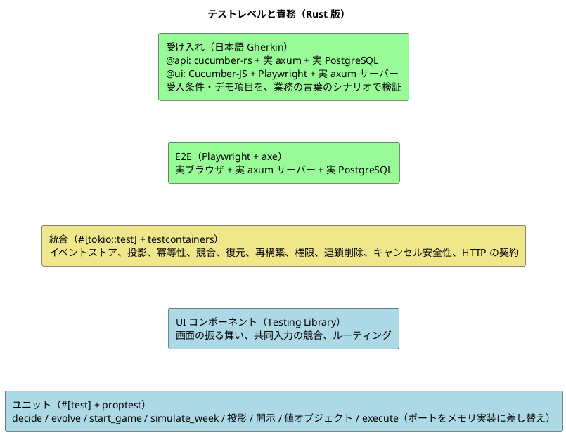
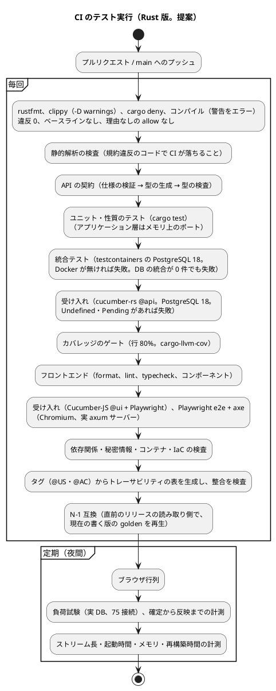

# テスト戦略 - ビールゲームシミュレーション（Rust 版）

## 概要

本書は、beer-game-rust のテスト戦略を定義します。[ADR-001](../../adr/beer-game-rust/001-rust-version-of-beer-game-kotlin.md) の決定により、**受入条件は beer-game2、テストの構造は [beer-game-kotlin のテスト戦略](../beer-game-kotlin/test-strategy.md) を正本**として引き継ぎ、本書は Rust での実現方法と、Rust で変わる点だけを定めます。**`docs/` を設計の正本**とします。実装コードはまだ存在しません。

### 本書の位置づけと確認の範囲

- **本書で確認したこと**: 次の 3 つを、実際に実行して確認しました（2026-11-19）。
  1. Rust の標準の `#[test]` で、**日本語の関数名**のテストが書け、実行できる（rustc 1.97.1。[ドメインモデル](./domain-model.md)・[バックエンドアーキテクチャ](./architecture-backend.md) のスケッチの 8 件が通った）。
  2. 非同期のポート（トレイト）を**メモリ上の実装に差し替える**アプリケーション層のテストが書ける（成功は commit だけ、競合のたびに明示の rollback して再試行、上限で再試行の枯渇、業務の失敗は rollback して追記しない、の 4 件が通った。**自前の `block_on` と標準ライブラリだけの確認で、tokio・実際のクレートとの組み合わせは未確認**。2026-11-21 に明示の rollback を持つ形へ改めて再確認）。
  3. 実 PostgreSQL 18.6 で、追記専用・部分一意索引・連鎖削除・一意制約の制約名を検査できる（[データモデル](./data-model.md) の検証。Rust 版の統合テストの最初の 4 件に当たる）。
- **確認していないこと**: proptest、cucumber-rs（日本語 Gherkin を含む）、testcontainers（PostgreSQL 18 のイメージ指定を含む）、cargo-llvm-cov（分岐の計測を含む）、clippy の個々の lint の設定、cargo-deny の設定の**動作**。いずれも、版は [技術スタック](./tech-stack.md) で確認しましたが、機能は未確認で、B1 で確かめます。
- **引き継ぐだけのもの**: テスト形状とレベルの責務、層の分担、境界値の一覧、非機能のテストの対応、トレーサビリティの方針、CI の工程の考え方は Kotlin 版を正本とします。
- Kotlin 版の実装の経緯（B1〜B15 の結果の記述）と、H2 に関する記述は引き継ぎません。Kotlin 版の未決事項は、本書の未決事項に引き継ぎます。

### 基準にする値

Kotlin 版と同じく、Rust 版は新規のコードで実測値がありません。数値の目標は**出発点の提案**で、ウォーキングスケルトンの実測で見直します。**カバレッジの行の基準は、team の規約（行 80%。[技術スタック](./tech-stack.md) の R6 で承認済み）に従います**（Kotlin 版の行 85%・分岐 75% は引き継ぎません）。

## テスト形状の選択

| 判断項目 | Rust 版の答え | 帰結 |
| :--- | :--- | :--- |
| 業務の中心 | **純粋関数**（`decide` / `evolve` / `simulate_week` / 投影） | ドメインを厚くテストする（ピラミッド型）。モックが要らない（過去のイベントとコマンドを与えるだけ） |
| 永続化の特性 | ストリームの版の一意制約、自動再試行、同一トランザクションでの追記・投影・冪等記録、連鎖削除、追記専用の権限が、実際の PostgreSQL に依存する | 統合テストを厚くする |
| 画面 | URL ルーティングを持つ SPA。API の契約は Kotlin 版・beer-game2 と同じ | 画面のテストは変えない |

**採用する形状は、ピラミッド型で、統合テストは約 3 割までを認めます**（Kotlin 版と同じ）。

| レベル | 目標の割合 | 理由 |
| :--- | :--- | :--- |
| ユニット（ドメイン、投影、アプリケーション）+ UI コンポーネント | 65% 以上 | 純粋関数は速く、規則の網羅に向く |
| 統合（API + DB） | 30% 以下 | 並行性、冪等性、復元、再構築、権限、キャンセル安全性の検証に必要な分 |
| E2E・受け入れ（cucumber-rs `@api`、Cucumber-JS `@ui`、Playwright） | 5% 以下 | 受入条件・デモ項目の要所だけ |

プロパティベーステストは、1 件が多数の入力を試すため、件数の割合ではなく、ユニットの一部として数えます。

## テストレベルの定義



| レベル | 責務 | 対象 | 依存の扱い |
| :--- | :--- | :--- | :--- |
| ユニット（ドメイン） | 規則と計算を検証する。**Given（過去のイベント）→ When（コマンド）→ Then（イベント列、またはエラー）**の形で書く | `decide_game`、`evolve_game`、`decide_session`、`evolve_session`、`start_game`、`simulate_week`、`KitPreset::classify`、`validate_settings`、`Disclosure`、`RetentionSaga`、値オブジェクト | 外部に依存しない（純粋）。時刻・ID・乱数はコマンドの値として与える |
| ユニット（性質） | どんな入力でも成り立つ性質を検証する（下記） | 上記すべて、投影、シリアライズ | proptest の戦略（`Strategy`）で入力を生成する |
| ユニット（投影） | `&Event -> Vec<RowChange>` の純粋関数を検証する。他の投影を読まず、再構築の順序に依存しないこと、1 件の `WeekCommitted` が複数の表の変更を返すことを確かめる | `Projection::project`、`Disclosure` | 純粋 |
| ユニット（アプリケーション） | 「読む → `decide` → 追記 → 再試行 → 冪等記録」の手順を検証する | `execute`、問い合わせ | `EventStore` などの**トレイト**を、メモリ上の実装または失敗を返す実装に差し替える（**検証済みの形**。[バックエンドアーキテクチャ](./architecture-backend.md)） |
| UI コンポーネント | 画面の表示、入力、エラー、フォーカス、共同入力の競合、ルーティング | `web/src/features/` | 既存と同じ（`ApiClient` を差し替える） |
| HTTP の統合 | 境界（認証、Origin 検査、冪等キー、版、エラー形式、ヘッダー、相関 ID、レート制限、SSE）の契約を検証する | axum のルーター（tower の `ServiceExt::oneshot` で直接呼ぶ。**未確認**） | ハンドラはメモリ上のポート、または実 DB |
| DB の統合 | 永続化、**ストリームの版の競合と自動再試行**、同一トランザクションでの追記・投影・冪等記録・周辺ストア、**複数ストリームの原子的な追記（`StartGame`）**、再生・再構築・復元、**追記専用の権限**、連鎖削除の網羅、マイグレーションを、実際の PostgreSQL 18 で検証する | `EventStore`、投影の更新、周辺ストア、`RetentionSaga` の実行、2 つの API プロセス | testcontainers の PostgreSQL 18（専用のコンテナ。誤った DB への接続を、接続先の検査で防ぐ） |
| 受け入れ（Gherkin） | **受入条件とデモ項目**を、日本語 Gherkin のシナリオとして、実サーバー・実 DB を通して検証する。**1 つのシナリオは 1 つの層だけで実行する**（`@api` か `@ui`） | `@api`: ストーリーの受入条件。`@ui`: 画面を通す必要のある業務 | `@api`: cucumber-rs、実 axum、実 PostgreSQL。`@ui`: Cucumber-JS、Playwright、実 axum サーバー |
| E2E | 利用の流れの要所を、実ブラウザで確認し、アクセシビリティを検査する（axe）。業務の受入条件は `@ui` が担い、ここでは実ブラウザでしか確認できないこと（拡大、フォーカス、SSE、axe）に限る | 作成、参加、共同入力、確定、観察、SSE の切断、200% 拡大 | 実際の axum サーバー、実 DB |

**DB の統合テストは、CI では必ず実行します。** Docker が使えない場合は、スキップでなく失敗にします（環境変数 `CI` が設定されている場合）。手元では、スキップした件数を明示します。**DB の統合が 1 件も実行されなかった場合は、失敗**とします。

### ローカル開発の DB とテストの分担

Kotlin 版は、ローカルの H2 と PostgreSQL の乖離への対策（契約テストを両実装で実行など）を持ちます。**Rust 版には H2 がなく、ローカルの DB は PostgreSQL 18（Docker）に決定しました（2026-11-19）**（[技術スタックの未決事項](./tech-stack.md#未決事項) の 1）。PostgreSQL をローカルでも使う場合、**統合テストとローカルの動作確認が同じ DB**になり、乖離の対策は不要です。別の軽量 DB を採る場合は、Kotlin 版の対策（(a) その DB でしか通らない記述の禁止、(b) ポート `ProjectionLock`・`ChangeNotifier` の契約テストを両実装で実行、(c) 受け入れは PostgreSQL）を引き継ぎます。

### レベル間の重複を避ける方針

Kotlin 版と同じです。規則の分岐は、ドメインのユニットで網羅する。HTTP の統合では、境界の契約だけを確認する。永続化の整合性・並行性・再生・再構築・復元は、DB の統合でだけ検証する。画面の分岐は、コンポーネントで確認する。**受入条件は Gherkin、実装の細部と網羅は `#[test]` が担い、同じ振る舞いを二重に書かない。同じシナリオを `@api` と `@ui` の両方で実行しない。**

## 開発の進め方（BDD と TDD）

team の規約（`aidlc/active-memory/team.md` の Testing Posture）は、**BDD で、Given/When/Then の振る舞い例と失敗する自動テストを実装前に定義し、最小実装で通した後にリファクタリングする**ことです。Rust 版でも、Kotlin 版と同じ進め方です。

- **BDD（Given/When/Then を先に）**: 受入条件・デモ項目は**日本語 Gherkin**（フィーチャーファイル）で、cucumber-rs が実行する。ドメインの純粋関数・性質・DB と HTTP の細部は、**`#[test]` の日本語の関数名**で Given/When/Then を書く。ES では、Given は過去のイベントの列、When はコマンド、Then は新しいイベントの列またはエラー。
- **TDD**: 失敗するテストを書き、**失敗を確認してから**最小限を実装し、通ったらリファクタリングする。先回りして実装しない。
- **土台を変える最初のスライドでは、後続の振る舞いのテストも先に書く**（`EventStore` のトレイトや `decide` の型など）。順序を守れなかったときは、規則を壊すとテストが落ちることを個別に確かめ、記録に残す（プロジェクトの規約）。

### アウトサイドインのサイクルと Gherkin

Kotlin 版と同じです（デモ項目・受入条件をシナリオにして合意 → 実行して Undefined → ステップ定義で Pending → Failing（Red）→ 内側へ一段ずつ TDD で Green → リファクタリング。シナリオは業務の言葉のまま変えない）。Gherkin の書き方・タグ（`@US2.4`、`@AC2.4.1`、`@api`、`@ui`、`@acceptance-criteria`、`@happy-path`、`@negative`、`@core`、`@wip`）・配置も同じで、**フィーチャーファイルは beer-game-kotlin の `features/` と同じ内容**になります。

| 項目 | Rust 版 |
| :--- | :--- |
| フィーチャーファイル | **共有の `apps/beer-game-features/` を Kotlin 版と共有する**（RF1。承認済み。複製しない。2026-11-23 に Kotlin 版のディレクトリから移した）。**API の契約が同じなので、シナリオは変わらない見込み** |
| `@api` の実行 | cucumber-rs（`cucumber` 0.23.0）。`# language: ja` の解釈は**未確認**（[技術スタック](./tech-stack.md) の R5。不可なら、英語のキーワード + 日本語の本文などの代替を比較） |
| `@ui` の実行 | Cucumber-JS + Playwright（既存。バックエンドが Rust に変わるだけ） |
| ステップ定義 | `crates/app/tests/acceptance/`（候補）。薄く保ち、業務ロジックを持ち込まない。ステップ定義も静的解析の対象 |
| 実行 | **Rust 側で実行するシナリオを、許可リスト（タグまたは ID の一覧。Rust 側のファイルで管理）で決め、許可したシナリオに Undefined・Pending があれば失敗**とする。**共有する `.feature` に `@wip` などの Rust 専用のタグを書き込まない**（Kotlin 版に影響するため）。**B1 の最初の許可リストは、ウォーキングスケルトン（1 ゲーム・4 役割・1 週）に必要な Must のストーリー（US1.1・US1.2・US2.1〜US2.3）の代表シナリオに限り**、Bolt ごとに広げる（レビュー H7）。許可リストに載らないシナリオは「未対応」として一覧に出し、**許可リストの外のシナリオが Rust で通る割合を、Rust 版の進捗の指標にする**（H8）。cucumber-rs が、定義のないステップを skipped として扱い、終了コード 0 で終わる場合があるか（**未確認**）を B1 で確かめ、**失敗にする設定**を使う |

### テスト名とストーリー ID（設計判断 RT1）

Kotlin 版は、テスト名に `[US2.4/AC2.4.1]` を含めます。**Rust の関数名に `[` や `/` は使えません**。日本語の識別子は使えます（実行して確認）。

| 案 | 内容 | 評価 |
| :--- | :--- | :--- |
| **A（採用）** | 関数名の先頭に ID を識別子の形で付ける。例: `us2_4_ac2_4_1__自動確定が有効で最後の役割が保存すると週が一度だけ確定される` | 標準の `#[test]` のまま使える。テストの一覧と結果の出力に ID が出る。トレーサビリティの抽出は、テスト名の接頭辞の走査（`us<番号>_ac<番号>`）で行える |
| B | 独自の属性マクロ（`#[story("US2.4", "AC2.4.1")]`）で ID を付ける | ID が構造化される。マクロの依存と保守が増える。**検討するなら承認が要る** |

日本語の識別子の例（検証済み。[ドメインモデル](./domain-model.md) のスケッチのテストが通った）:

```rust
#[test]
fn 付け替えは_2_イベントを返す() { /* Given 役割を持つ参加者 When 別の役割へ割り当てる Then RoleUnassigned と RoleAssigned */ }
```

Gherkin のシナリオには、ID を名前に入れず、**タグ**（`@US`・`@AC`）で表します（Kotlin 版と同じ）。

### テストの形（スケッチ）

```rust
#[test]
fn us2_4_ac2_4_1__自動確定が有効で3役割が入力済みのとき最後の役割が保存すると週が一度に確定される() {
    let given = [session_started(CommitMode::Auto), decision_saved(Role::Factory, 4),
                 decision_saved(Role::Distributor, 4), decision_saved(Role::Wholesaler, 4)];
    let state = replay_session(&given);

    let result = decide_session(&state, &save_decision(Role::Retailer, 4, DecisionVersion::ZERO));

    assert_eq!(event_kinds(&result.unwrap()), [EventKind::DecisionSaved, EventKind::WeekCommitted]);
}
```

このスケッチは、**型検査していません**（`session_started` などのビルダーは未実装）。ビルダー（Object Mother）は `crates/domain/tests/support/` のような共通のモジュールに集めます。なお、テストコードでは、ドメインの crate の lint（`unwrap` の禁止など）を**テストの層のルールセットで緩める**扱いを、ADR に記録して決めます（下の静的解析）。

## 純粋関数のテスト（ドメイン）

対象と検証すること（`decide_game` の各コマンドと不変条件、`evolve_*` の全イベントの網羅、`decide_session` の保存・共同入力の競合・代理入力・確定・自動確定（1 回の `decide` で複数イベント）・一時停止中の扱い、`CommitWeek` の判定の順（週 → `basis`）、`evolve` が `WeekCommitted` の `nextStates` を**再計算せず採用する**こと（意図的に違う値を Given にして確かめる）、`start_game`、`simulate_week` の golden、`validate_settings` の誤りの集約、`KitPreset::classify`、`Disclosure`、`RetentionSaga`）は、**Kotlin 版の表と同じ**です。Rust 版での違いは次のとおりです。

| 項目 | Rust 版 |
| :--- | :--- |
| `evolve` の不正な遷移（Kotlin 版の `InvalidTransition`） | `Evolution::Ignored` を返し、**例外・panic を起こさない**。`decide` が作らない列（`SessionStarted` の前の `DecisionSaved` など）を与えると `Ignored` になり、状態が変わらないことを確かめる（RD2。[ドメインモデル](./domain-model.md)） |
| 強制キャストの不在 | Rust には強制キャストがない。代わりに、**`match` が `_` を使わず全域**であること（状態の追加でコンパイルが失敗する）を、コンパイルで保証する。イベントの追加の見落としは、性質テスト（下記）で守る |
| 数値のオーバーフロー | `simulate_week` の累積費用などは、**検査付き演算**で書く。上限・下限の境界で、オーバーフローが起きないこと（または明示のエラーになること）を確かめる |
| golden | 既知の系列と期待値の組。**遅延 0 を許すかは未決**（Kotlin 版と同じ）。キット準拠の需要系列は、JSD の値が確定するまで保留し、**カスタムの需要系列で書く** |

## プロパティベーステスト

proptest を使います（版 1.12.0。[技術スタック](./tech-stack.md)）。入力は、型（`Quantity`、`Week`、`RoleMap` など）の**有効な値だけを生成する `Strategy`** を、値オブジェクトごとに用意します。**有効なコマンド列の生成**（状態に応じて、その時点で受理されうるコマンドを選ぶ）も用意します。**proptest に、状態に応じて操作を選ぶ操作列の機能があるかは、本書では確認していない**（なければ、`Strategy` を合成して自前に書く）。

性質の一覧は、Kotlin 版と同じです。

- **週次計算**: 決定論、非負、保存、費用（累積は検査付き演算）、遅延、役割別の合計とチーム合計の一致。
- **イベントソーシング**: (a) 永続化往復の同値性（実 DB の統合）、(b) 計算と事実の一致（`fold(evolve)` の結果が、イベントのペイロードと `simulate_week` を直接回した結果の両方と一致）、(c) 投影の整合、`evolve` の全域性（**`decide` が作る列は `Ignored` にならない**）、版の連続、週確定の一回性、不変条件の保存、自動確定の等価性、一時停止中は確定しない、競合の正しさ、空のイベント、投影の増分と一括、開示、シリアライズの往復（全イベント型。**型の網羅は、`match` の網羅で保証**し、リフレクションは使わない）、個人情報・秘密の不在、アップキャスト。
- Kotlin 版で削除した「1 件ずつ `evolve` した状態と `fold(evolve)` の一致」は、同じ理由でテストにしません。

**`decide` の純粋性**: Kotlin 版は、静的検査（`ForbiddenMethodCall`）が主で、性質テストは補助です。Rust 版は、**ドメインの crate が時計・乱数・I/O のクレートに依存しない**ことが第一の守りで（呼び出し自体ができない）、lint（`disallowed_methods`）が補います（下の静的解析）。

**生成器の品質（M19）**: 生成した列のうち、`WeekCommitted` に達した割合・`SessionEnded` に達した割合・各エラーを受けた割合を出力し、下限（提案: 10%・2%）を下回ったら失敗させます。生成器の単体テスト（生成した列がすべて受理される）も置きます。proptest にこの分類の機能があるかは**未確認**です（なければ自前の集計）。**変異テスト**（`cargo-mutants` など）の導入の要否は、最初の実測で判断します（**道具の対応は未確認**）。

失敗したときに縮小された最小の反例（proptest が保存する回帰ファイル）は、**例によるテスト（回帰）として加えます**。

## アプリケーション層のテスト（ポートの差し替え）

`EventStore`、`Clock`、`IdGen`、資格の発行などは、**トレイト**として定義します。テストでは、メモリ上の実装と、**失敗を返す実装**に差し替えます。**検証済みの 3 件**（[バックエンドアーキテクチャ](./architecture-backend.md)）: 競合が続いても再試行して成功する、上限で `RetryExhausted` を返す、業務の失敗は再試行も追記もしない。

その他のテスト（Kotlin 版と同じ）: 空のイベントは追記しない、結果が変わる場合（`DecisionConflict`、`WeekAdvanced`、`DecisionsChanged`、`AlreadyStarted`）は再評価した結果を返す、冪等（同じキー・同じ内容は保存済みの応答、内容が違えば 409）、**処理の順（認証 → 認可の前提検査 → 冪等記録の照合 → 読み込み → decide → 追記・投影。認可が冪等照合より先）**、失効した資格の再送は 403、冪等記録は成功だけ、制約ごとの再試行・再照合、周辺ストアに書かれイベントに含まれない、永続化の失敗で受理済みと表示しない、ログ・計測のラッパーが結果を変えず、ログに表示名・資格が含まれない。

**処理の順の検査**は、差し替えたポートの呼び出し順を記録する実装（記録用のメモリ実装）で行います。

### キャンセル安全性のテスト（Rust 固有。設計判断 RT2）

Kotlin 版の「COMMIT / ROLLBACK は `NonCancellable`、`CancellationException` を再送出」に当たる検証です。Rust では、キャンセルは **future の drop** で（[バックエンドアーキテクチャ](./architecture-backend.md) の RB2。**2026-11-21 のレビュー H2 で、明示の ROLLBACK を主にする形へ見直した**）、次をテストします。

**検証する対象の見直し（H2）**: 「部分更新が残らない」ことは、**COMMIT していない変更が他のセッションから見えない**ため、**PostgreSQL が保証します**。したがって、この条件だけでは、接続が `idle in transaction` のままロックを握っていても、テストが通ってしまいます。**検証の中心は、ロックと接続が速やかに解放されること**です。

| テスト | 検証すること | レベル |
| :--- | :--- | :--- |
| 失敗の経路の明示の ROLLBACK | `decide` の失敗・追記の競合・投影の失敗のあと、**一定時間内に**、(a) `pg_stat_activity` で該当の `application_name` の `idle in transaction` が **0 件**になる、(b) 同じストリームへの**次の追記が待たされない**、(c) アドバイザリロックが解放されている（再構築の排他ロックを取れる）、(d) **プールに返った接続がトランザクション外の状態**である | DB の統合 |
| `Tx` の drop（保険） | **panic・ランタイムの終了に当たる状況**（`execute` のタスクを panic させる、タスクを abort する）で、**部分更新が残らず、かつ上の (a)〜(d) が成り立つ**。sqlx の drop での ROLLBACK がいつ送られるか（すぐか、接続を次に使うときか）を、**測定して記録する**（B1 の確認の中心） | DB の統合 |
| spawn による隔離 | ルートの future が drop（クライアントの切断）されても、spawn された `execute` は完了し、COMMIT される。同じ `Idempotency-Key` の再送が、保存済みの応答を返す。**通常の失敗の経路は spawn の中で完結するため、ルートの future を drop しても、明示の ROLLBACK が実行される** | DB の統合、HTTP |
| タイムアウト後の COMMIT（H4） | tower のタイムアウトが `type` なしの 504 で応答した後も、spawn したタスクが COMMIT まで進み、**同じキーでの再送が保存済みの応答を返す**（二重にならない） | HTTP、DB の統合 |
| 実行中の再送（H4） | 元の処理が**実行中**のとき、同じ `Idempotency-Key` の再送が届いても、**409 を返さず**、先の処理の完了を待って、保存済みの応答（または同じ失敗）を返す | DB の統合 |
| タスクの panic | spawn したタスクが panic したとき、`JoinError` が `Persistence`（500、相関 ID）に写り、**トランザクションが残らず接続が解放される**。**release のプロファイルが `panic = "unwind"` であることも確認する**（`abort` だと本番の振る舞いをテストが保護しない。コンテナのスモークテストでも確認する。M6） | DB の統合、スモーク |
| シャットダウン | SIGTERM で、新しい要求を止め、**SSE を閉じ、追跡しているコマンドのタスクの完了を待ってから**終了コード 0 で終わる（待ちの上限つき。`stopTimeout` に達して SIGKILL にならない）。切り離されたタスクが完了を待たれること | 統合（プロセス） |
| 安全網の設定 | **アプリの接続で `SHOW idle_in_transaction_session_timeout` が期待値になる**（NOLOGIN ロールに設定しても継承されず効かないため。H1）。**テスト用の DB では、安全網が不具合を隠さないよう、この設定を無効にするか、判定をタイムアウトより前に行う** | DB の統合 |

**差し込み口（M10）**: 「追記の後・COMMIT の前で止める」を決定論的に再現するため、`EventStore`・`Tx` を**テスト用のデコレーター**（barrier・フックを持つラッパー。[バックエンドアーキテクチャ](./architecture-backend.md) の RB2）で差し込めるようにします。

これらは、**sqlx のトランザクションの drop・ROLLBACK の挙動**（[バックエンドアーキテクチャ](./architecture-backend.md) の未決事項 1）と、**spawn したタスクの追跡**を前提にします。前提が成り立たなければ、設計（RB2）を見直します。

## イベントストアと投影の統合テスト（実 PostgreSQL）

testcontainers の PostgreSQL 18 を使い、**マイグレーションを適用した空の DB から始め**ます。**DB の分離（レビュー M11）**: 「実行全体でコンテナを 1 つ共有する」だけでは、**全ゲームの再構築、`information_schema` を走査する連鎖削除の網羅、`projected_version` と `MAX(stream_version)` の全体の検査、マイグレーションのテスト**が、他のテストが同時に書く行と干渉します。**コンテナは 1 つ共有し、テストごと（または干渉するテストのグループごと）に、マイグレーション済みのテンプレート DB から DB を作る**（`CREATE DATABASE … TEMPLATE …`）方針を第一候補とします（B1 で確認）。通常のテストは、ゲームごとに ID を分け、干渉しません。**「DB の統合が 0 件でも失敗」の実現**: `cargo test` には、早期の return で飛ばした件数を数える標準の仕組みがないため、DB の統合テストは **`CI` 環境変数が設定されていれば Docker が無いことを panic（失敗）にする**共通の入口を通し、**実行したテストの件数を数えて、0 件なら CI が失敗する**ようにする（`#[ignore]` と `--include-ignored` の組み合わせも候補）。`#[tokio::test]` はテストごとにランタイムが別のため、**static に置いた `PgPool` をテスト間で共有すると不具合が出るおそれ**があり（未確認）、プールはテストごとに作る。テストは `#[tokio::test]` で書きます（**マルチスレッドのランタイムの指定は未確認**）。testcontainers で PostgreSQL 18 のイメージを指定する方法は**未確認**です。

次の検証は、Kotlin 版と同じです（表の項目は同一）: イベントストア（追記と読み込み、追記の競合、複数ストリームの原子性、保存の途中の失敗、追記専用の権限、追記専用の否定テスト、観察者の接続プールの配線、マイグレーション）、冪等性・競合（冪等キーの再送、内容違いの再送、24 時間の保持、資格の再返却、共同入力の競合、手動確定と自動確定の競合（2 つの API プロセス）、停止中の代理入力、代理入力と確定の競合、資格の失効と再送、制約ごとの再照合、再試行の上限）、投影・再構築・復元（同期投影、投影の整合性の検査、投影の再構築の一致、永続化往復の同値性、投影の整合、出力は要求時に作る、復元、強制停止、観察者の権限、問い合わせの一貫性、`ProjectionLock` の契約、再構築の同時実行制御、`ChangeNotifier` の契約、通知（ロールバックなら出ない、LISTEN の再購読、`/api/v1/ready`）、連鎖削除の網羅、保持削除の再試行、個人情報の不在）。

**この DB の統合テストの最初の 4 件は、実測済み**です（[データモデル](./data-model.md) の検証。PostgreSQL 18.6）。

| 最初の統合テスト | 検証すること | 状態 |
| :--- | :--- | :--- |
| 追記の競合 | 同じストリームの同じ版への追記は `uq_events_stream_version`（SQLSTATE 23505）で拒否される | SQL で実測済み。**実際の並行（複数タスク）での検証と、sqlx のエラーからの制約名の取得は未確認** |
| 部分一意索引 | `uq_idempotency_create` が `create` の重複だけを拒否する | SQL で実測済み |
| 追記専用 | `beergame_writer` が `events` を UPDATE・DELETE・TRUNCATE できない | SQL で実測済み。**ロールの否定テストの全件（`pg_roles` による検査を含む）は未実装** |
| 連鎖削除 | `events` の DELETE 権限が無い `beergame_deleter` が、`game_roots` の 1 行削除で `events` ほかを連鎖して消せる | SQL で実測済み（1 回、PostgreSQL 18.6） |

Kotlin 版にあった「`FOR UPDATE` の効果」「H2 版のポート契約」「H2 のスモーク」は、Rust 版にはありません。

## HTTP の統合テスト（axum）

アダプターの契約を検証します。観点は Kotlin 版と同じです（認証・認可（無効な資格はすべて同じ応答）、入力の検証（誤りを項目ごとに集める、64 KB の上限）、エラーの写像（分類 → HTTP の状態。`AppFailure` の `match` の網羅）、境界の契約（Origin、冪等キー、版、エラー形式、セキュリティヘッダー、相関 ID。`If-Match` は `SaveDecision` だけ）、エラーの識別子（problem+json の `type` と `code`）、応答の形（`versions` だけ）、停止中・週の競合、レート制限、SSE、アプリケーション層の失敗（バックエンド自身の 503 は必ず `type` を持つ）、ログ、`/api/v1/ready`）。axum のルーターを tower の `ServiceExt` で直接呼べるかは**未確認**です（できなければ、実際にポートを開いて呼ぶ）。

## API の契約テスト（OpenAPI）

[ADR-008](../../adr/beer-game-kotlin/008-api-contract-and-error-codes.md) の方針（`openapi.yaml` を手書きの正本とし、**仕様が先**。仕様を直す → 契約テストを書いて Red → 実装 → 型を再生成 → 画面を直す）を引き継ぎます。**契約の共有方法（同じファイルか複製か）は未決**です（[バックエンドアーキテクチャ](./architecture-backend.md) の未決事項）。

| 検査 | 内容 | Rust 版での実現 |
| :--- | :--- | :--- |
| 仕様の検証 | `openapi.yaml` が OpenAPI として妥当 | `@redocly/cli` の `redocly lint`（フロントエンドの既存の道具をそのまま使う） |
| 型の生成物 | 仕様から生成した TypeScript の型が、コミット済みと一致（差分 0）。typecheck が通る | `openapi-typescript`（既存） |
| 応答の適合 | 実際のルートを呼び、成功の応答と problem+json が仕様のスキーマに適合する | **Rust でのスキーマ検証の道具は未選定**（候補: `jsonschema` 0.61.2。OpenAPI のスキーマを直接扱えるかは**未確認**）。Kotlin 版の `unevaluatedProperties: false` による未宣言の項目の検出と同じことができるかも確認する |
| リクエストの適合 | 仕様どおりのリクエストを受理し、仕様にない形を拒否する | 同上 |
| エラー `code` の一致 | 仕様に載る `code` の一覧と、実装の `code` の全体を突き合わせる。**欠けても余っても失敗** | `GameError::code()` などを列挙して比較する。**Kotlin 版はリフレクションが要るが、Rust 版は `match` の網羅で全列挙子を列挙する関数（またはマクロ）を用意すれば足りる**（設計は未確認） |
| ルートの網羅 | 実装のルートがすべて仕様にあり、仕様のルートがすべて実装にある | axum のルーターから経路を列挙できるかは**未確認** |
| SSE | 版の通知の形を、仕様の記述と照合する。表せない部分は自前のテストで補う | 同上 |

**契約テストの導入の時期は、Kotlin 版の B1・B2 と同じ**に設計し、「**仕様と実装を意図的にずらすと CI が落ちる**」ことを、最初の実装の受入条件にします（ローカルと GitHub Actions の両方で確認する。Kotlin 版は後者が未確認だった）。

## E2E

Kotlin 版と同じです。Playwright と axe で、**実際の axum サーバー**と実 DB に対して、利用の流れの要所（作成、参加、共同入力、確定、観察、SSE の切断、200% 拡大）を確認します。**API の契約が変わらないため、E2E のシナリオは Kotlin 版・beer-game2 のものがそのまま使えるはず**です（変わる場合は、設計の矛盾として扱う）。

## カバレッジ目標

### 判断（設計判断 RT3）

team の規約は**行 80%**（[技術スタック](./tech-stack.md) の R6 で承認済み）で、Kotlin 版の「行 85%・分岐 75%」は引き継ぎません。

| 案 | 内容 | 評価 |
| :--- | :--- | :--- |
| **A（採用）** | **全体の行 80% をゲート**にする（承認済みの R6）。分岐は**目安**にとどめる。層ごとの目標は目安 | team の規約と一致する。cargo-llvm-cov の分岐の計測は**未確認**（安定版で使えない可能性があるため、ゲートにしない） |
| B | Kotlin 版の行 85%・分岐 75% を引き継ぐ | 純粋関数の網羅には妥当。team の規約より厳しく、根拠は beer-game2 の実測で、Rust 版の実測ではない |

**層ごとの目標（目安。下回っても失敗にしない。推移を見て見直す）**: `domain` は行 100%（提案。ゲートにするかは実測後。Kotlin 版は生成コードの扱いで難航したが、Rust にはそのコードの問題がない見込み。**未確認**）、投影は行 100%、`application` は行 95%、`adapter-persistence` は行 90%（DB の統合を合算する前提）、`adapter-http` は行 90%、UI は Vitest で行 85%・分岐 80%（既存）。

**計測の範囲**: `domain`・`application`・`adapter-*` を対象とし、除外するのは起動部（`main`）と設定の組み立てだけです。**統合テストの計測を合算できること**、**`#[cfg(test)]` のコードと生成コードの除外が、実コードだけに効くこと**は、実装開始時に確認します（**cargo-llvm-cov の対応は未確認**）。

## テストデータ

Kotlin 版と同じです。ドメインは **Given のビルダー**（Object Mother）で過去のイベントの列を組み立て、時刻・ID・乱数はコマンドの値として固定で与える。週次計算は golden と proptest による性質。アップキャストは、旧い `schema_version` のイベントの JSON をフィクスチャとして保存する（変更しない）。DB の統合は、testcontainers の PostgreSQL 18 の専用のコンテナで、接続先の名前を検査して誤った DB への接続を防ぎ、マイグレーションを適用した空の DB から始める。資格は、テスト用の鍵（複数の版）とテストごとの乱数で、生の値を保存や出力に含めない。

## 非機能のテスト

NFR 86 件ごとの検証の手段と頻度、境界値の一覧は、**Kotlin 版の表（84 件）を正本**とし、Rust 版で加わった NF-R18・NF-S22 と、変更した NF-P1・NF-P15〜NF-P18・NF-O5・NF-O7・NF-O12 は、[非機能要件](./non-functional.md)（86 件）を正本とします。**NF-R18 の検証は RT2、NF-S22 は `#![forbid(unsafe_code)]` のコンパイルと CI の検査、NF-P17 は RSS・タスク数の負荷試験、NF-O12 の panic の件数・取り残しの件数は、メトリクスの契約テスト（毎回）、NF-O5 は目視に加えてダッシュボードの項目の存在の検査**とします。境界値は同じ値（注文数量 -1/0/1000/1001、最終週 0/1/50/51、保持日数 0/1/3650/3651、表示名 0/1/80/81 と空白のみ、保持削除の再試行 4/5/6 回目、冪等記録の 24 時間、資格の有効期限、寄与者の数 1/2、自動再試行の上限（設定から注入）、リクエストの大きさ 64 KB）です。**上限が未定のもの（再試行の上限など）は、実装の定数に埋め込まず、設定から注入できる設計**にします。

JVM に固有の項目は、Rust では次のように読み替えます。

| Kotlin 版の項目 | Rust 版 |
| :--- | :--- |
| JVM のウォームアップの後の定常値を測る（NF-P1 など） | **ウォームアップの区別は不要**（JIT がない）。ただし、DB の接続プールの温まりは区別する |
| JMH または自前の計測（NF-P15・P18） | **道具は未選定**（`criterion` などの候補は**未確認**）。試行回数・先頭の除外は、Kotlin 版の提案値（100 回以上、先頭 5 回）を出発点とする |
| コールドスタート、ヒープと GC の記録（NF-P16・P17） | コールドスタートは計測する（Rust は短い見込みだが、**実測する**）。**ヒープ・GC の項目は該当なし**。代わりに、**常駐メモリ（RSS）とタスク数**を負荷中に記録する（NF-P17 の読み替えは非機能要件の文書で定める） |
| NF-P15 の「ストリームの再生」の見積もり（千件・2 千件） | **Rust で再計測**（ADR-003） |
| 夜間の負荷試験・レート制限の仮置き値（10 回・10 分）、再試行の上限（10） | **Rust で取り直す**（ADR-017・019） |

## 静的解析と規約の検査

**関数型プログラミングガイド（Rust 編）を、最初のコードから、例外なく、厳格に適用します**（Kotlin 版の厳格さの定義を引き継ぐ。ADR-011）。

### 厳格さの定義

| 項目 | 内容 |
| :--- | :--- |
| 違反の件数 | clippy・rustfmt・`cargo deny`・コンパイラの警告の違反を **0 件**にする（`-D warnings`。警告をエラーとして扱う） |
| ベースライン | **使わない**（既存の違反の許容リストを持たない） |
| 抑制 | **`#[allow(...)]` と `#[expect(...)]` を、理由なしに使わない**。外す範囲は、設定ファイルまたは層ごとの扱いで明示し、緩和は ADR に記録して人が承認する。「通らないから外す」は認めない |
| マージ | 1 つでも失敗したら、マージしない（team の規約）。ローカルでも同じコマンドで再現できる |
| 対象 | ドメイン、アプリケーション、アダプター、テスト（ステップ定義を含む）のすべて |

### ツールと検査

| ツール | 役割 | 扱い |
| :--- | :--- | :--- |
| rustfmt | 整形 | CI で `cargo fmt --check`。設定は `rustfmt.toml`（導入時に決める） |
| clippy | 中心の静的解析 | CI で `cargo clippy --workspace --all-targets -- -D warnings`。**どの lint 群を有効にするか**（`clippy::pedantic` の採否など）は**導入時に決める** |
| cargo-deny | 依存関係のライセンス・脆弱性・重複の検査 | CI で `cargo deny check`（選定済み。R4） |
| コンパイラ | 警告の禁止 | `#![deny(warnings)]` ではなく、CI の `-D warnings` を正とする（ローカルの開発を妨げないため。提案） |

関数型の規約を、次のように守ります。**どの lint で足りるかは、本書では確認していません**（lint の名前は clippy の公式の一覧にあるものを想定。B1 で `clippy.toml` と lint の設定が実際に効くかを確かめる）。

| 規約 | 守り方（候補） |
| :--- | :--- |
| `unsafe` の禁止 | ドメインと application の crate に `#![forbid(unsafe_code)]` |
| `panic` の禁止 | `clippy::unwrap_used`・`clippy::expect_used`・`clippy::panic`・`clippy::indexing_slicing` を `deny`（ドメインと application）。テストの層では緩める扱いを ADR で決める |
| 可変状態・副作用 | ドメインの crate に I/O・時計・乱数のクレートを**依存させない**（第一の守り）。標準の呼び出しの禁止は `clippy.toml` の `disallowed_methods`（`std::time::SystemTime::now` など）で補う（**足りるかは未確認**） |
| 層の依存 | Cargo の依存宣言 + 依存の検査（`cargo metadata` のスクリプト、または `cargo-deny` の `bans`。**方式は未確認**） |
| `match` の網羅 | `_` を使わない（状態・エラー・イベントの変換）。clippy の `wildcard_enum_match_arm` などで守れるか**未確認**。守れない箇所は、性質テストとレビューで守る |

**静的解析の最初のビルドの受入条件**（Kotlin 版の B2 と同じ形）: 規約違反のコードを 1 つ置く（ドメインの crate で `unwrap()` を呼ぶ、時計を呼ぶ、`unsafe` を書く）と、**CI が落ちること**を確認する。**ローカルの同じコマンドと、GitHub Actions 上の両方**で確認する。満たせなければ、B2 以降を止めて代替を選ぶ（ADR に記録）。

構文では表せない規約は、レビューとテストで守り、承認ゲートのチェックリストに入れます。静的解析は、検出できる種類の問題にしか効きません。設計書とコードの食い違い（イベント名、`code`、制約名）は、契約テストと golden で守ります。

## CI との連携

team の規約（`aidlc/active-memory/team.md`）により、**CI と deploy のワークフローは beer-game3 用とは別に新しく作ります**（`.github/workflows/beer-game-rust.yml`。**未作成**）。formatter・linter・type-check を CI で実行し、失敗した変更はマージしません。



| 項目 | 方針 |
| :--- | :--- |
| 失敗時 | どの工程が失敗しても、マージしない。カバレッジの閾値割れも失敗とする |
| ツールチェーン | `rust-toolchain.toml` の版を使う。`Cargo.lock` をコミットし、`cargo ... --locked` で実行する |
| 実行時間の目標（提案） | ユニット + 性質: 30 秒以内（コンパイルを除く）、統合（コンテナの起動を含む）: 3 分以内、E2E: 5 分以内、全体: 12 分以内。**Rust は初回のコンパイルが長い見込み**のため、**キャッシュ（依存のビルドの再利用）の方式は B1 で決める**。実測で見直す |
| N-1 互換のジョブ | Kotlin 版と同じ（直前のリリースの読み取り側で、現在の書く版の golden を再生）。直前のリリースが無い間は実行しない |
| 並列化 | テストは並列に実行する。DB の統合は、ゲームごとに ID を分けて干渉しない。DB のコンテナは、実行全体で 1 つを共有する |
| 失敗の記録 | Playwright のトレースとスクリーンショット、**proptest の反例の回帰ファイル**を保存する |
| 定期実行の結果 | 負荷試験と計測の結果を保存し、推移を確認する |
| デプロイ | team の規約: `main` の merge で staging へ自動反映、production は手動承認。**本書では扱わない**（インフラ設計・運用の文書で定める） |

## トレーサビリティ（ユーザーストーリー → テスト）

Kotlin 版の方針と対応の計画（各ストーリーの受入条件を、どのレベルのテストで保証するか）を引き継ぎます。**対応表は、タグから自動で抽出して生成**します。

- **Gherkin のシナリオ**: タグ `@US<番号>`・`@AC<番号>` と層のタグから抽出し、cucumber-rs の実行結果と突き合わせる。**実行結果の形式（JSON、JUnit XML など）は、cucumber-rs が出せるものを B1 で確認して選ぶ**。
- **Rust の `#[test]`**: テスト名の接頭辞（`us<番号>_ac<番号>`。RT1）を、テスト結果から抽出する。**テスト結果の形式**（`cargo test` の標準出力、または JUnit XML への変換）は、B1 で選ぶ（**`cargo-nextest` などの導入は未選定で、承認が要る**）。
- **整合の検査**: ストーリー・受入条件の一覧（[ユーザーストーリー](../../requirements/beer-game2/user_story.md)）に存在しない ID、受入条件に対応するシナリオまたはテストが無いものを検出する。厳しさ（警告か失敗か）は未決事項。

## B1 の受入条件（未確認の前提を、観察できる形にする。レビュー H8・M10）

未確認の前提は、「B1 で確認」だけでなく、**合否の基準と、成り立たなかったときに見直す対象**を書きます。B1 の範囲は、ウォーキングスケルトンに必要なものに絞り、残りは後の Bolt に移します（B1 の範囲の確定は `planning-releases` で行う）。

| 前提 | 合否の基準（観察できる形） | 成り立たなければ |
| :--- | :--- | :--- |
| sqlx のトランザクションの drop での ROLLBACK | RT2 の測定: drop から ROLLBACK が送られるまでの時間と、その間のロック・接続の状態を記録する。**失敗の経路の明示の ROLLBACK で、ロックと接続が一定時間内に解放される** | RB2 の見直し（明示の ROLLBACK を唯一の手段にする。drop の保険を外す） |
| sqlx のエラーから制約名を取る | `uq_events_stream_version` などの違反で、制約名を取り出して `ConcurrencyConflict` に写せる。**実際の並行（複数タスク）**で、一方だけが成功し、他方が競合になる | エラーの SQLSTATE とメッセージから判別する方式へ変更（脆いため ADR で記録） |
| cucumber-rs の日本語 Gherkin | `# language: ja` のフィーチャー 1 本を実行できる。**ステップ定義がない状態で、Undefined（または skipped）が失敗として扱われ、終了コードが非 0**になる設定を確認する（既定では skipped が成功扱いになりうる。未確認）。JUnit または JSON の形式で出力できる | キーワードを英語にして本文を日本語にする、または別の方式（R5 の代替の比較） |
| proptest の状態ベースの操作列 | 本体にはなく、別のクレート（`proptest-state-machine`。見込み、未確認）がある場合は**新規依存として承認を得る**。受入条件は「**`evolve` の腕を 1 つ消すと、性質テストが落ちる**」。生成列の分類（M19）は本体に機能がない見込みで、**自前の集計**を前提にする | `Strategy` の合成で自前に書く |
| cargo-llvm-cov | **統合テストと cucumber のテストのターゲットの計測が合算される**。**行 80% を割ると終了コードが非 0**になる。分岐の計測が nightly を要する場合は、分岐は目安のままにする（ゲートにしない。RT3） | 行のゲートを、単体・統合の合算の別の方法で実現する |
| testcontainers | **`postgres:18.6` のタグを固定したコンテナ**を起動し、`SELECT version()` が 18 であることを検査する。`CI` 環境変数があり Docker が無いとき失敗する | testcontainers を使わず、サービスコンテナの接続先を環境変数で渡す方式 |
| clippy の lint | **規約違反のコードを実際に置いて、CI が落ちる**ことを確かめる: ドメインの crate で `unwrap_used`・`expect_used`・`panic`・`indexing_slicing` が検出される、`disallowed_methods` の `SystemTime::now` が検出される、`#![forbid(unsafe_code)]` が効く。**`wildcard_enum_match_arm` は、domain-model の意図した `_`（`evolve` のイベント側の腕）と衝突しうる**ため、**許容する箇所の規則**（例: `evolve_*` の最後の 1 腕だけ。理由をコードのコメントではなく設定または ADR に記録）を決める。**「`_` を使わない」は、状態・エラー・イベントの変換に当てはめ、`evolve` の最後の腕は例外とする** | lint の代わりに、依存の制限とレビュー・性質テストで守る（RD5 の見直し） |
| 契約テストのスキーマ検証 | 応答・リクエストを `openapi.yaml` のスキーマで検査でき、**未宣言の項目（`unevaluatedProperties: false`）を検出できる**。**仕様と実装を意図的にずらすと CI が落ちる** | 別の道具、または自前の検査 |

**Rust 版の価値を測る指標（H8）**: ADR-001 は価値を「型による不正な状態の排除、実行時の安全性、小さな実行ファイル」としています。測れる指標として、次を提案します（**数値の目標は B1 の計画で決める**）。(1) **共有する `features/` のうち、Rust のバックエンドで通るシナリオの割合**（許可リストの外を含む。`@api` と `@ui`）。(2) **Must のストーリー 11 本の受入条件のパリティ**（Kotlin 版と同じ受入条件で通る数）。(3) **確認済みの前提の数と、未確認の前提の数の推移**（上の表の行）。

## 設計判断

### Kotlin 版の設計判断 T-1〜T-5 との対応

| ID | Kotlin 版の決定 | Rust 版の扱い |
| :--- | :--- | :--- |
| T-1 | ドメインのテストは Given（イベント）/ When（コマンド）/ Then の形に統一 | **引き継ぐ**（team の BDD の規約とも一致） |
| T-2 | カバレッジの数値は beer-game2 の値を出発点にし、実測で見直す | **変更**: team の規約（行 80%、承認済みの R6）をゲートにする（RT3） |
| T-3 | DB の統合テストは Testcontainers の PostgreSQL 18、CI でも同じ経路（H2 は使わない） | **引き継ぐ**（testcontainers クレート。PostgreSQL 18 のイメージ指定は未確認） |
| T-4 | 並行性のテストは実際の並行で行い、決定論的な再現は補助 | **引き継ぐ**（複数の tokio タスクと 2 プロセス。「一方が必ず成功する」という性質で判定） |
| T-5 | ローカルは H2、検証は PostgreSQL。ポート契約を両実装で実行 | **見直し**（H2 がない。ローカルも PostgreSQL 18 に決定） |

### RT1: テスト名とストーリー ID は、関数名の先頭に識別子の形で付ける（承認済み。2026-11-19）

上の案 A を採用しました（2026-11-19 承認）。案 B（属性マクロ）は、依存の承認が要るため、A で足りなければ検討します。

**命名の規則（レビュー L7。抽出ツールを作る前に決める）**: AC の ID は US の ID を含む（`AC2.4.1` は `US2.4` に属する）ため、**接頭辞は AC の ID だけで足りる**（`ac2_4_1__…`。US は表から引く）。**1 つのテストが複数の AC を保証する場合は、接頭辞を `ac2_4_1_ac2_4_2__…` のように並べる**。ストーリーの ID だけを保証する（AC に対応しない）テストは `us2_4__…`。抽出は、先頭の `(ac|us)[0-9_]+` を走査する。

### RT2: キャンセル安全性を、DB の統合テストで検証する（承認済み。2026-11-19）

上の表のとおりです。RB2（`Tx` の drop と spawn）の前提を検証します。**前提が成り立たなければ、設計を見直す**ことを、B1 の受入条件に含めます。

### RT3: カバレッジのゲートは行 80% とし、分岐は目安にする（承認済み。2026-11-19）

上の案 A を採用しました（2026-11-19 承認。行 80% は承認済みの R6）。

## beer-game-kotlin からの変更

| # | beer-game-kotlin | beer-game-rust | 理由 |
| :--- | :--- | :--- | :--- |
| 1 | Kotest（日本語のテスト名、Given/When/Then）、Kotest Property | 標準の `#[test]`（日本語の関数名）、proptest | 言語・ツールの違い |
| 2 | テスト名に `[US2.4/AC2.4.1]` | 関数名の先頭に `us2_4_ac2_4_1__`（RT1） | 識別子の制約 |
| 3 | Cucumber-JVM（`@api`） | cucumber-rs（日本語対応は未確認） | 言語の違い |
| 4 | Testcontainers（JVM） | testcontainers（Rust。PostgreSQL 18 の指定は未確認） | 同上 |
| 5 | 関数の束を差し替える | トレイトをメモリ実装に差し替える（検証済みの形） | RB1 |
| 6 | `NonCancellable` と `CancellationException` の検証 | `Tx` の drop・spawn・panic・シャットダウンの検証（RT2） | キャンセルの意味の違い |
| 7 | 強制キャストの不在を静的検査 | `match` の網羅（コンパイラ）。イベントの追加の見落としは性質テスト | Rust には強制キャストがない |
| 8 | detekt・PMD・ktlint、JDK 21 の専用ジョブ | clippy・rustfmt・cargo-deny。ツールチェーンは 1 つ | 言語・ツールの違い。detekt の JDK の制約は無い |
| 9 | 行 85%・分岐 75% のゲート、Kover | 行 80% のゲート、cargo-llvm-cov（RT3） | team の規約 |
| 10 | JMH、ウォームアップ、ヒープと GC | 道具は未選定、ウォームアップなし、RSS とタスク数 | 実行環境の違い |
| 11 | OpenAPI の応答の適合に networknt json-schema-validator、`code` の一致にリフレクション | 道具は未選定（`jsonschema` が候補）、`match` の網羅で `code` を列挙 | 言語の違い |
| 12 | H2 とポート契約の両実装 | なし（ローカルも PostgreSQL 18） | H2 がない |

上記以外（テスト形状、レベルの責務、BDD の進め方、Gherkin の配置、境界値、トレーサビリティ、CI の工程の考え方、N-1 互換）は変えません。

## 未決事項

1. **cucumber-rs の日本語 Gherkin 対応**（R5。B1 で確認）。不可なら代替を比較する。
2. **testcontainers の PostgreSQL 18 の指定**、`#[tokio::test]` のランタイムの設定、axum のルーターを直接呼ぶ方法（B1）。
3. **proptest の状態ベースの操作列**、生成列の分布の分類の機能、変異テストの道具。
4. **cargo-llvm-cov** の分岐の計測、統合テストの合算、生成コード・`#[cfg(test)]` の除外。
5. **clippy の lint の設定**（`unwrap_used` など、`disallowed_methods`、`wildcard_enum_match_arm`）が、ドメインの純粋性と網羅の規約を守れるか。守れない場合の代替。
6. **依存の検査の方式**（`cargo metadata` のスクリプトか `cargo-deny` の `bans`）。
7. **テストの層のルールセット**: テストコードで `unwrap` などを許すか。許すなら ADR に記録して承認を得る。
8. **テスト結果の形式とトレーサビリティの抽出**（RT1）。`cargo-nextest` などの導入の要否（承認が要る）。
9. **契約テストのスキーマ検証の道具**（`jsonschema` の OpenAPI への対応）、ルートの網羅の検査の方法。
10. ~~**契約・フィーチャーファイルの共有方法**~~ **解消（2026-11-19。RF1）**: Kotlin 版のディレクトリのまま共有する。Rust 側で実行するシナリオは許可リストで決める（H7）。
11. **sqlx のトランザクションの drop・ROLLBACK の挙動**（RT2・RB2 の前提）。**B1 の受入条件の表**（上）に、合否の基準と見直す対象を書いた。
12. **Rust のビルドキャッシュの方式**と、CI の実行時間の目標の妥当性。
13. ~~**ローカル開発の DB**~~ **解消（2026-11-19）**: PostgreSQL 18（Docker）に決定した。テストの分担の変更はない。
15. **DB の統合テストの分離**（テンプレート DB からテストごとに作る方式）と、**「0 件なら失敗」の実現**（M11）。
16. **差し込み口（テスト用のデコレーター）の設計**（M10）。B1 の最初のスライドで決める。
17. **RT1 の命名の規則**（上の追記）の承認。
18. **`evolve` の最後の腕の `_` を例外とする lint の設定**（`wildcard_enum_match_arm` との整合）。
14. **Kotlin 版の未決事項の引き継ぎ**: 生きたドキュメントの公開ツールと公開先、受け入れのシナリオ数の目標、ストーリー ID の整合の検査の厳しさ、実 DB での負荷試験の環境、手動のアクセシビリティの確認の担当者と時期、変異テストの要否、カバレッジの層ごとの目標の見直し。いずれも [Kotlin 版の未決事項](../beer-game-kotlin/test-strategy.md) に追従する。

## 出典

- 日本語の関数名のテストと、トレイト差し替えの非同期テストの実行: ローカルの rustc 1.97.1（edition 2024）、2026-11-19。DB の検証: ローカルの Docker の `postgres:18.6`（使い捨てのコンテナ）、2026-11-19。
- [テスト戦略（beer-game-kotlin）](../beer-game-kotlin/test-strategy.md)
- [ADR-001（Rust 版）](../../adr/beer-game-rust/001-rust-version-of-beer-game-kotlin.md)、[技術スタック](./tech-stack.md)、[ドメインモデル](./domain-model.md)、[バックエンドアーキテクチャ](./architecture-backend.md)、[データモデル](./data-model.md)
- [ユーザーストーリー](../../requirements/beer-game2/user_story.md)、[関数型プログラミングガイド（Rust 編）](../../reference/関数型プログラミングガイド_Rust編.md)
- team の規約: `aidlc/active-memory/team.md`（Testing Posture、Deployment、Code Style）
