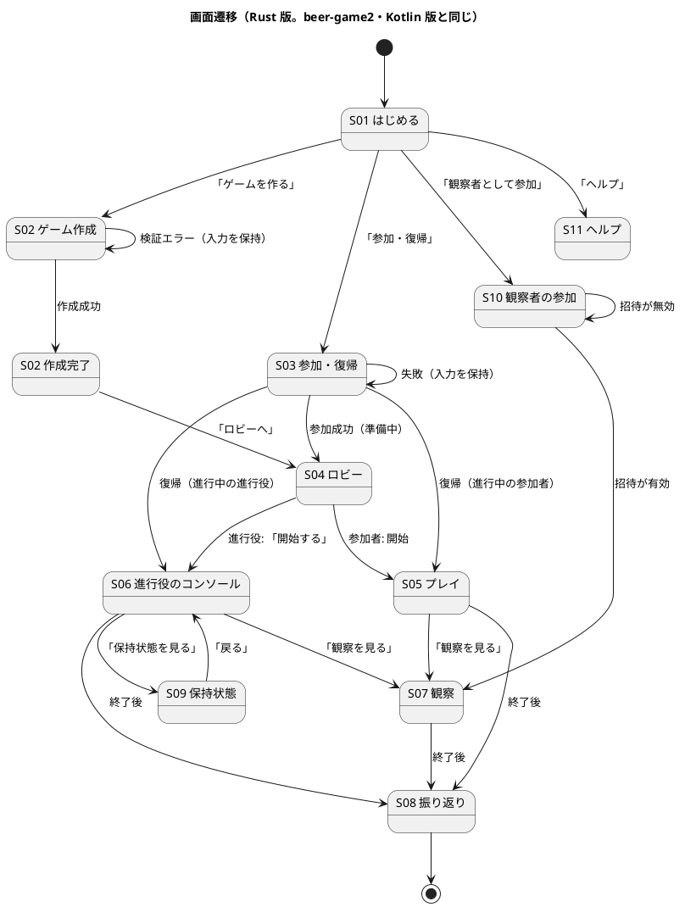

# UI 設計 - ビールゲームシミュレーション（Rust 版）

## 概要

本書は、beer-game-rust の UI 設計を定めます。**結論: 利用者が見る画面は、beer-game-kotlin（および beer-game2）と変わりません。** バックエンドが Rust になっても、API の契約（`openapi.yaml`、エラーの `code`、problem+json、`versions` だけの応答、`If-Match`、SSE の版の通知）が同じなら、画面・遷移・画面イメージ・インタラクション・アクセシビリティは同じです（[ADR-001](../../adr/beer-game-rust/001-rust-version-of-beer-game-kotlin.md)）。**`docs/` を設計の正本**とします。

このため、本書は **UI の設計を複製しません**。画面の正本は次のとおりです。

| 内容 | 正本 |
| :--- | :--- |
| 画面一覧、画面遷移、遷移の条件、表示名、OOUI | [Kotlin 版の UI 設計](../beer-game-kotlin/ui-design.md)の「画面一覧」「画面遷移」「表示名」「オブジェクトと画面」の各節（beer-game2 を引き継ぎ、ES + CQRS の影響を反映済み） |
| 画面イメージ（S02〜S10 の salt 図 14 枚）、確認ダイアログ | 同「画面イメージ」の節 |
| インタラクション（保存直後の表示、競合の種類と表示、エラーの `code` と表示の辞書、結果が不明なとき、画面の状態） | 同「インタラクション設計」の各節 |
| アクセシビリティ（WCAG 2.2 AA） | 同「アクセシビリティ」の節 |

**基準にした版（レビュー M15）**: 本書は、Kotlin 版 `ui-design.md` の **2026-11-15 の版**（フロントマターの `generated.at` が `2026-11-15T08:13:26Z`）を基準にしています。**Kotlin 版が更新されたときは、本書の影響の表（#1〜#14）を見直す**（見直したら、基準にした版を更新する）。**Kotlin 版の ui-design.md の記述のうち、376 行付近の「停止・再開は手動更新・保存・確定のあとの取得で知る」と 667 行付近の「1 秒ごとに更新しています」は、現行の実装（3 秒のポーリング）と合っていない**（UX のレビューによる指摘。正本側の修正は Kotlin 版の判断）。

### 本書の位置づけと確認の範囲

- **本書で確認したこと**: Kotlin 版の UI 設計の全体を読み、**Rust の実装が UI の契約に影響しうる箇所**を洗い出しました（下の「Rust 版のバックエンドが UI に与える影響」）。画面そのものは、コードを動かして確認していません（Rust 版の実装がまだ無いため）。
- **確認していないこと**: 下の影響の表の「検証」の列はすべて、B1 以降で確かめる計画です。
- **UI 設計の複製をしない理由**: 画面イメージ 14 枚と遷移を 2 つの文書に持つと、片方だけが更新されて食い違います（Kotlin 版・beer-game2 の間でも、変更表の管理が要った）。フロントエンドの実装（`web/`）が共有されるなら、設計文書も 1 か所に持つのが自然です（設計判断 RU1）。
- Kotlin 版の実装の経緯（B5・B15 の注記）は引き継ぎません。Kotlin 版の未決事項は、本書の未決事項に引き継ぎます。

## 画面一覧と遷移

画面の ID と URL を、参照用に示します（内容は Kotlin 版が正本）。

| ID | 画面 | URL | 利用者 | ユースケース |
| :--- | :--- | :--- | :--- | :--- |
| S01 | はじめる | `/` | 全員 | UC-01、UC-02 |
| S02 | ゲーム作成 | `/new` | 進行役 | UC-01 |
| S03 | 参加・復帰 | `/join` | 参加者、進行役 | UC-02、UC-14 |
| S04 | ロビー | `/games/:id/lobby` | 進行役、参加者 | UC-02〜UC-04、UC-16 |
| S05 | プレイ | `/games/:id/play` | 参加者 | UC-05〜UC-07 |
| S06 | 進行役のコンソール | `/games/:id/console` | 進行役 | UC-08〜UC-10 |
| S07 | 観察 | `/games/:id/observation` | 進行役、参加者、観察者 | UC-13 |
| S08 | 振り返り | `/games/:id/review` | 全員（終了後） | UC-11、UC-12 |
| S09 | 保持状態 | `/games/:id/retention` | 進行役 | UC-15 |
| S10 | 観察者の参加 | `/observe` | 観察者 | UC-13、UC-16 |
| S11 | ヘルプ | `/help` | 全員 | — |

遷移の条件（検証エラーはすべて集めて一度に示す、資格が有効なら状態に応じた画面へ、権限の無い URL は S03 へ誘導する、など）は Kotlin 版と同じです。**Rust 版でも「検証の誤りはすべて集めて 422 で返す」**ため（[ドメインモデル](./domain-model.md) の `collect`）、S02 の「誤りを一度に示す」振る舞いは変わりません。

## Rust 版のバックエンドが UI に与える影響

UI は API の契約にだけ依存します。Rust の実装が**契約から外れる可能性のある箇所**を、UI の側から列挙します。いずれも、契約テスト（[テスト戦略](./test-strategy.md)）と E2E で、契約どおりであることを確認します。

| # | UI が前提にしていること | Rust 版で起きうる逸脱 | 対策・検証 |
| :--- | :--- | :--- | :--- |
| 1 | **エラーは必ず problem+json**（`type`、`code`）。画面の辞書の鍵は `code` | axum が自動で返す応答（本文の解析の失敗、不正な Content-Type、経路なし、メソッド違い、サイズ超過）や、tower の層が返す応答（タイムアウト、負荷の制限）は、**既定では problem+json にならない**可能性がある（**既定の応答の形は未確認**） | **すべての失敗を `AppFailure` の写像（problem+json）に通す**。axum の拒否（rejection）と tower の層のエラーを、`request.*`・`validation.invalid_input`・`app.*` の `code` に写す。契約テスト「実装の `code` の全体と仕様の一致」と「ルートの網羅」で検証（[バックエンドアーキテクチャ](./architecture-backend.md)） |
| 2 | **バックエンド自身が返す 503 は必ず `type` を持つ**。`type` のない 503（負荷分散装置など）は「結果が不明」として**同じキーで再送**する | tower の層（負荷の制限など）が、`type` のない 503 を返してしまうと、画面が「結果が不明」と誤認して再送し、**新しいキーで再送すべき場面を取り違える** | #1 と同じ。**503 は `app.retry_exhausted`・`app.not_ready` など `type` つきだけ**にする。`type` のない 503 を返さないことを契約テストで確認。**tower のタイムアウトは、`type` を付けない 504 にして「結果が不明」と扱わせる**（#11） |
| 3 | **結果が不明（通信の切断）のとき、同じ冪等キーで再送すると、同じ結果を受け取る** | クライアントの切断でハンドラが途中で止まると、コマンドが**途中までしか実行されない**恐れ | **NF-R18（キャンセル安全性）と RB2（2026-11-21 に見直し）**: `execute` を spawn して切断から隔離し、**失敗の経路では ROLLBACK を明示**する（`Tx` の drop は保険）。切断後の再送が保存済みの応答を返すことを DB の統合テストで検証（[テスト戦略](./test-strategy.md) の RT2）。**これが成り立てば、UI の「結果が不明」の設計は変わらない** |
| 4 | コマンドの応答は `versions` だけ。画面は応答後に**スナップショットを取得し、版に追いつくまで待つ**。**現行の画面は SSE を使わず、自動更新（ポーリング）と、保存・確定の応答の後の取得で更新する**（#12） | 同期投影の更新漏れで、応答の `versions` より古いスナップショットが返る | 問い合わせの REPEATABLE READ と `projection_checkpoints` の同時読み取り（[バックエンドアーキテクチャ](./architecture-backend.md)）。統合テスト「問い合わせの一貫性」 |
| 5 | **（SSE を使う場合の前提。現行の画面は使わない）** SSE は版の通知だけ。再生なし。60 秒より短い間隔の心拍で、負荷分散装置（アイドル 60 秒）に切られない。遅い接続は切断され、再接続後にスナップショットで追いつく | axum の SSE の心拍・切断の動作は未確認（`Lagged` の接続の扱いを含む） | **画面が SSE を使い始める時点で、B1 以降の SSE の負荷試験と、E2E「SSE の切断」で確かめる**。現行は未使用のため、Rust 版のバックエンドは SSE を実装しなくても、既存の画面は動く |
| 6 | 資格の Cookie は `HttpOnly`・`Secure`・`SameSite=Strict`。**タブごとに名前を変える**（`X-Tab-Id` ヘッダー、`bg_session_<id>`・`bg_recovery_<id>`。ADR-020。Rust 版でも扱う。2026-11-19 決定） | Cookie の発行・読み取りを自前で書くため、属性や名前の解決の漏れが起きうる | HTTP の統合テスト（ヘッダーのテスト）。Kotlin 版の ADR-020 自体は提案中だが、既存のフロントエンドはすでに `X-Tab-Id` を送っているため、Rust 版でも扱う（承認済み） |
| 7 | 失敗の文言は、**送った資格の種類**から選ぶ（無効な資格は、すべて同じ 403 の本文） | 認可の失敗の応答の本文が、種類によって違うと、資格の存在・期限が推測される（NF-S12） | 認可の否定テスト（無効な資格はすべて同じ応答） |
| 8 | 予期しない失敗（500）では、**相関 ID だけ**を画面に示す | panic や例外をそのまま返すと、内部の情報が漏れる | 境界で panic を `AppFailure::Persistence`（500）に写し、利用者へは相関 ID だけを返す（NF-R9、NF-R18） |
| 9 | `Retry-After` ヘッダーを `app.retry_exhausted`（503）と `app.rate_limited`（429）に付ける | 付け忘れ | 契約テスト（`Retry-After` の存在） |
| 10 | 数値（`versions`、意思決定の版）は、JavaScript で正確に扱える範囲の整数 | `u64`・`i64` の値が JSON で大きな数になると、精度を失う | 版は 1 から数える小さな整数（ストリーム 2000 件）で、実際には問題にならない。**型の範囲を契約に書く**かは未決 |
| 11 | **「結果が不明」の扱い**（レビュー H4）: 画面は、`type` つきの応答を「**未実行**」として扱い、利用者の再操作を**新しい冪等キー**で送る。`type` のない 5xx・通信の失敗は「結果が不明」として、**同じキーで 500 ms 間隔、最大 2 回だけ自動で再送**する（`client.ts`） | tower のタイムアウトが `type` つきの応答を返すと、**処理は COMMIT まで進んでいる**のに、画面が未実行と判断して新しいキーで再操作する（ゲーム作成などが二重になる。見込み。実装は未確認）。また、spawn した元の処理が**実行中のまま**、同じキーの再送が届く（`client.ts` は 500 ms 後に再送する） | **(a) タイムアウトの応答は、`type` を付けない 504（または切断）にして「結果が不明」と扱わせる。** OpenAPI の `ErrorCode` にタイムアウトの `code` を足さない。**(b) 元の処理が実行中に同じ `Idempotency-Key` の再送が届いたときは、先の処理の完了を待ち、保存済みの応答（または同じ失敗）を返す**（`409 app.idempotency_key_reused` を返さない。409 は、画面が「操作を確認できませんでした。もう一度操作してください。」を出し、新しいキーでの再操作を促してしまう）。**契約テストと RT2 の検証項目に加える**（[テスト戦略](./test-strategy.md)）。**COMMIT の応答が失われた 500（フェイルオーバー中など）にも `type` が付き、画面は再送しない**。ゲーム作成は `If-Match` で守られないため、Kotlin 版と共通の課題として未決事項に残す |
| 12 | **現行の画面の更新は、SSE でなくポーリング**（レビュー H5）: `features/play/PlayPage.tsx` は `PLAY_POLL_MS`（3000 ms）の間隔で、黙って状態を取り直す。S04（ロビー）・S07（観察）にもポーリングがある（S06 には `setInterval` が見つからなかった）。**ポーリングの失敗（403・レート制限・タイムアウト）は黙って無視され、画面は古いまま何の通知も出ない** | tower の**レート制限をポーリングの GET に適用すると**、制限に達した GET が黙って失敗し、画面が古いままになる。**3 秒間隔では、反映の遅れは最大で約 3 秒に GET の時間を足したもの**で、NF-P2（週確定から全画面への反映 p95 2 秒）を満たさない見込みが高い（計算上の推定。**実測していない**）。負荷の想定も SSE 75 本でなく、ポーリングの GET（見込みで毎秒 50 件程度。75 ユーザー ÷ 3 秒に複数の画面を足した推定） | (a) **tower のレート制限は、ポーリングの GET を対象外にする**（参加・復帰・招待の専用の制限は別。NF-S11）。(b) **NF-P2 は実測の結果、p95 4 秒以下に再定義した**（2026-11-23 承認。3 秒間隔のポーリングで p95 約 2.86 秒。SSE は作らない）。(c) ポーリングの失敗が続くときに画面が古いままであることは、Kotlin 版と共通の未解決の課題（未決事項） |
| 13 | **入力の誤りを一度に示す**（レビュー M13）: S02（ゲーム作成）は、422 の `errors[]` を**項目ごと（`errors[].field`。例: `quantity`）に**、入力欄の近くへ示す（`PlayPage.tsx` など） | **axum の `Json` と serde は、最初の型の誤りで解析を止める**（見込み。未確認）ため、DTO の段階で誤りが集まる保証がない。**根拠にしていたドメインの `collect` は、DTO から値を作った後の段階**である。また、画面は `errors[].field` の名前で照合するため、**フィールド名の一致も契約**に含まれる | DTO を、**型の誤りも含めてすべて集められる形**（生の JSON から値を取り出して `collect` で検証する）にするか、型の誤りは最初の 1 件で 422 とする。**どちらにするかは B1 で決め、契約テストに「複数の誤りが一度に返る」「フィールド名が仕様と一致する」を入れる** |
| 14 | **自動切断（`idle_in_transaction_session_timeout`）の利用者への見え方**（レビュー M18） | 切断されるのは**取り残されたトランザクション**で、利用者の要求の応答を返すものではない。要求の処理中に接続が切られた場合は、`Persistence`（500・相関 ID。`type` つき）として返る | 画面は失敗として扱い、利用者は再操作できる（COMMIT 前なら ROLLBACK されるため二重にならない）。COMMIT の応答が失われた場合の回復は、同じ `Idempotency-Key` での再送（#11）。[運用要件](./operation.md) の「利用者・進行役への案内」 |

**画面の変更が必要になる場合の扱い**: 上の逸脱を契約どおりに直せず、画面側の対応が必要になったときは、**設計の矛盾として扱い**、Kotlin 版の UI 設計と合わせて更新する（Rust 版だけ画面を変えない）。

## インタラクション設計

Kotlin 版の次の節を、そのまま引き継ぎます（内容は複製しません）。

- 共通のルール（明示的なボタンで操作を始める、フォーカスと入力だけで状態を変えない）
- **保存直後の表示と投影の遅延**（応答は `versions` だけ。スナップショットを取得して追いついてから表示。同期投影のため遅延は通常ない。反映待ちの共通部品）
- **競合の種類と表示**（共同入力の競合 `session.decision_conflict`、確定済みの週 `session.week_advanced`、確定の前に入力が変わった `session.decisions_changed`、追記の競合の再試行切れ `app.retry_exhausted`）
- **エラーの `code` と表示の辞書**（正本。鍵は `code`。**Rust 版でも `code` の一覧を変えない**。Rust の列挙型の `code()` と OpenAPI の一覧が一致することを契約テストで確認し、辞書が全 `code` を網羅することも確認する。**辞書の網羅の検査は、既存のフロントエンドにある**（確認済み。`problems.ts` が `Record<ErrorCode, string | null>` で、`ErrorCode` は生成した型。保証されるのは鍵がそろっていることだけで、値が `null` の `code`（`request.*` など）は一般の文言になる））
- **結果が不明なとき**（`type` のない 5xx・タイムアウト・切断は「結果が不明」として同じキーで再送。`type` つきの 503 は利用者の再操作で新しいキー）
- 主な操作の流れ、エラーと状態のフィードバック、画面の状態

## アクセシビリティ

**WCAG 2.2 AA を目標とし、Kotlin 版（と beer-game2）の内容をそのまま引き継ぎます**（キーボードだけで完了、色だけで状態を表さない、200% 拡大で横スクロールなし、操作対象の大きさ、フォーカスの管理）。検証は、コンポーネントテストと E2E の axe、手動の確認（スクリーンリーダー）です（NFR-08。担当者と時期は [Kotlin 版の未決事項](../beer-game-kotlin/ui-design.md) のとおり）。

## 設計判断

### RU1: UI 設計は複製せず、Kotlin 版を正本として参照する（承認済み。2026-11-19）

| 案 | 内容 | 評価 |
| :--- | :--- | :--- |
| **A（採用）** | Rust 版の UI 設計は差分の文書にとどめ、画面・遷移・画面イメージ・辞書は Kotlin 版を正本として参照する | 食い違いが生まれない。API の契約が同じ間は変更が一度で済む。参照先を読む手間が増える |
| B | Kotlin 版の UI 設計を Rust 版に複製して持つ | 文書が自己完結する。14 枚のワイヤーフレームと辞書が二重になり、片方の更新漏れが起きる |
| C | UI 設計をプロジェクトに属さない共通の文書へ移す | 正本が 1 つになる。ドキュメント構成のガイド（プロジェクト別のカテゴリ）に反する。**構造の変更で確認が要る** |

トレードオフ: A は、Rust 版を単独で読む人が Kotlin 版に移る必要がある。**将来 UI が実装ごとに分かれる場合は、複製（B）に切り替える**（その時点の差分を ADR に記録する）。

### RU2: 契約から外れる実装の逸脱は、画面でなくバックエンドで直す（承認済み。2026-11-19）

画面は API の契約にだけ依存し、実装の違いを知りません。上の影響の表の逸脱は、**バックエンドを契約に合わせて直す**（画面を実装ごとに分岐させない）。画面の変更が避けられないときは、設計の矛盾として扱います。

## beer-game-kotlin からの変更

| # | beer-game-kotlin | beer-game-rust | 理由 |
| :--- | :--- | :--- | :--- |
| 1 | 画面・遷移・画面イメージ・インタラクション・アクセシビリティを本文に持つ | **差分の文書**。本文は Kotlin 版を正本として参照（RU1） | 二重管理の回避 |
| 2 | （影響の整理なし） | Rust のバックエンドが UI の契約に与える影響の表（10 項目）を追加 | axum・tower の既定の応答の形、キャンセル安全性、SSE が、契約から外れるリスクを持つため |

**画面・遷移・インタラクション・アクセシビリティは変えません。**

## 未決事項

1. ~~**RU1 の承認**~~ **解消（2026-11-19）**: 承認した（RU1・RU2）。
2. **axum・tower の既定の応答**（#1・#2）: 拒否（rejection）とタイムアウト・負荷の制限の既定の形、problem+json への写像の方法（B1 で確認）。
3. **axum の SSE の心拍・切断**（#5）。
4. ~~**辞書の網羅の検査**~~ **解消（2026-11-21）**: 既存のフロントエンドに、型による検査がある（`Record<ErrorCode, …>`）。値が `null` の `code` は一般の文言になる点だけ残る。
5. ~~**ADR-020（タブごとの Cookie 名）**~~ **解消（2026-11-19）**: Rust 版でも扱うと決定した（Kotlin 版の ADR-020 自体の承認は Kotlin 版の判断）。
6. **数値の型の範囲**（#10）: 契約に整数の範囲を書くか。
7. **Kotlin 版の未決事項の引き継ぎ**: 手動のアクセシビリティの確認の担当者と時期、保持の表示（暫定。M5）、自動確定の本人へのフィードバックの文言、参加者のロビーの扱い（B1 の実装は進行役だけ）、ヘルプの教材の本文の人による確認。いずれも [Kotlin 版の未決事項](../beer-game-kotlin/ui-design.md) に追従する。
8. ~~**フロントエンドの共有方法**~~ **解消（2026-11-19。RF1）**: `web/` は Kotlin 版のディレクトリのまま共有する（[フロントエンドアーキテクチャ](./architecture-frontend.md)）。
9. **タイムアウトと実行中の再送**（#11）、**ポーリングと NF-P2**（#12）、**入力の誤りの集約**（#13）: B1 で確認・決定する。
10. **ポーリングの失敗が黙って無視される**（#12）: Kotlin 版と共通の課題。画面側の対応は、Kotlin 版の UI 設計と合わせて決める。

## 出典

- [UI 設計（beer-game-kotlin）](../beer-game-kotlin/ui-design.md)、[beer-game2 の UI 設計](../beer-game2/ui-design.md)
- [ADR-001（Rust 版）](../../adr/beer-game-rust/001-rust-version-of-beer-game-kotlin.md)、[バックエンドアーキテクチャ](./architecture-backend.md)、[ドメインモデル](./domain-model.md)、[非機能要件](./non-functional.md)、[テスト戦略](./test-strategy.md)
- [ユーザーストーリー](../../requirements/beer-game2/user_story.md)、[システムユースケース](../../requirements/beer-game2/system_usecase.md)
