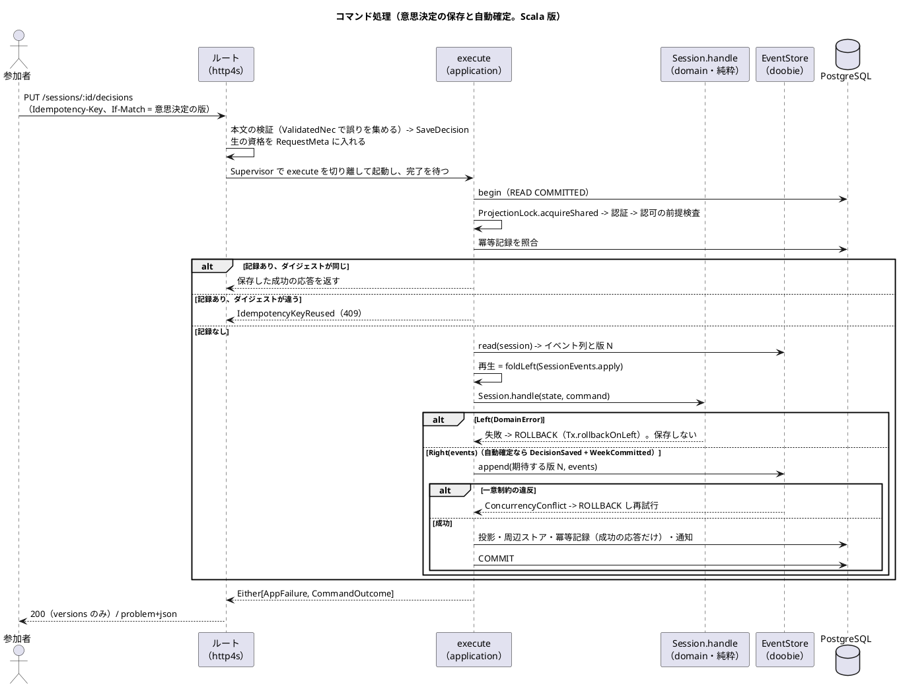

# バックエンドアーキテクチャ - ビールゲームシミュレーション（Scala 版）

## 概要

本書は、beer-game-scala のバックエンドのアーキテクチャを定義します。[ADR-001](../../adr/beer-game-scala/001-scala-version-of-beer-game-kotlin.md) の決定により、**機能・API の振る舞いは beer-game2、設計の構造は [beer-game-kotlin のバックエンドアーキテクチャ](../beer-game-kotlin/architecture-backend.md)、実装規約は [関数型プログラミングガイド（Scala 編）](../../reference/関数型プログラミングガイド_Scala編.md)（以下「ガイド」）を正本**として引き継ぎます。本書は、その構造を **Scala 3（Cats Effect + http4s + doobie）** で実現する方法と、Scala で変わる点だけを定めます。**`docs/` を設計の正本**とします。実装コードはまだ存在しません（アプリの置き場は `apps/beer-game-scala` を予定）。

### 本書の位置づけと確認の範囲

- **本書で確認したこと**: 「コマンド処理の流れ」の `AppFailure`、`EventStore`、`Ports`、`App`（`Kleisli`）、`Tx.rollbackOnLeft`、`Execute.step` / `Execute.execute` の型は、sbt 1.13.1（JetBrains Runtime 25.0.4.1）、Scala 3.7.4、cats-effect 3.7.1、doobie-core 1.0.0-RC12 で、`-Werror -Wunused:all -Wvalue-discard -Wnonunit-statement` と WartRemover 3.6.3 を有効にして**コンパイルできる**ことを確認しました（2026-11-25）。**実 DB での実行、`Left` で ROLLBACK される動作、`ConcurrencyConflict` の再試行、キャンセルの動作は確認していません**（コンパイルのみ）。
- **確認していないこと**: http4s（0.23.39）のルート・ミドルウェア・SSE、doobie の `HikariTransactor`、PostgreSQL の `LISTEN/NOTIFY` とアドバイザリロック、`Supervisor` による切り離し、ember の切断時の挙動、circe による `EventCodec`、各ミドルウェアの名前は、**未確認の設計のスケッチ**です。[技術スタック](./tech-stack.md) の未決事項と同じで、B1 で確かめます。
- **引き継ぐだけのもの**: 冪等性の表、競合の再試行の一意制約の表、問い合わせ側の開示、API のエンドポイントと認可の表、エラーの写像の表、SSE の仕様（版の通知だけ、再生なし）、保持削除の手順、セキュリティの表は、Kotlin 版の該当節を正本とします。**API の契約（`openapi.yaml`、`code`、problem+json）は変えません。**
- Kotlin 版の実装の経緯（B1〜B13 の注記）は引き継ぎません。Kotlin 版の未決事項は、本書の未決事項に引き継ぎます（Rust 版と同じ扱い）。

## パターンの選択

Kotlin 版と同じです。業務領域は中核（週次計算と進行）、**イベントソーシング**（状態はイベントの列。イベントが監査の記録を兼ねる）、**CQRS**（コマンド側は `events` へ追記、問い合わせ側は投影テーブルを SQL で読む）。構造は「**核の純粋関数 + 外側の薄い副作用の層**」です（ガイド §7.9）。核は、入力の検証、`handle`、`Events.apply`、投影、`simulateWeek`、`Disclosure` で、副作用は HTTP、データベース、時計、乱数、ログです。副作用は `IO` と `ConnectionIO` の**値**として組み立て、実行は `IOApp` とテストの境界だけです（SBD5）。

## 全体構成

```plantuml
@startuml
title バックエンドの層構造（Scala 版）

package "adapter-http（http4s）" {
  [ルート（機能別）\n入力検証 -> コマンド\nHttpRoutes[IO]] as Routes
  [ミドルウェア\nOrigin 検査・レート制限\nヘッダー・リクエスト ID] as Guard
  [エラーの写像\nAppFailure => Response（problem+json）] as Err
  [SSE（版の通知）\nStream[IO, ServerSentEvent]] as SSE
}

package "application" {
  [コマンド処理\nexecute: 読む -> handle -> 追記 -> 投影] as Cmd
  [問い合わせ\nSQL の結果 + Disclosure] as Qry
  [ポート（関数を持つ case class）\nEventStore・Generators・CredentialIssuer\nIdempotencyStore・ProjectionLock・ChangeNotifier] as Ports
}

package "domain（純粋。cats-core のみ）" {
  [Game.handle / GameEvents.apply] as Game
  [Session.handle / SessionEvents.apply] as Session
  [startGame] as Start
  [simulateWeek] as Sim
  [Projection（Event => List[RowChange]。純粋）] as Proj
  [Disclosure・KitPreset・RetentionSaga] as Svc
  [値オブジェクト・Command・Event・Error] as VO
}

package "adapter-persistence（doobie）" {
  [EventStore の実装\n追記・版の一意制約] as ES
  [投影の書き込み（SQL）] as PW
  [問い合わせの実装（SQL・読み取り専用ロール）] as QR
  [周辺ストア・冪等記録] as Aux
  [ProjectionLock・ChangeNotifier\nアドバイザリロック・NOTIFY] as Port2
  [EventCodec（circe の DTO）] as Codec
}

database "PostgreSQL 18" as DB

Routes --> Guard
Routes --> Cmd
Routes --> Qry
Routes --> SSE
Routes --> Err
Cmd --> Game
Cmd --> Session
Cmd --> Start
Cmd --> Proj
Cmd --> Ports
Qry --> Svc
Qry --> Ports
Session --> Sim
ES ..|> Ports
PW ..|> Ports
QR ..|> Ports
Aux ..|> Ports
Port2 ..|> Ports
ES --> Codec
ES --> DB
PW --> DB
QR --> DB
Aux --> DB
Port2 --> DB
@enduml
```

### 層と依存の向き

依存は、外側から内側（ドメイン）への**一方向**です。`domain` は `cats-core` だけに依存します（[ドメインモデル](./domain-model.md) の SD5、[技術スタック](./tech-stack.md) の ST3）。

| 層（sbt のプロジェクト。パッケージ） | 責務 | 依存してよい先 |
| :--- | :--- | :--- |
| `domain`（`beergame.domain`） | 値オブジェクト、`Command`、`Event`、エラー、`handle` / `Events.apply`、再生、`startGame`、`simulateWeek`、`KitPreset`、投影の純粋関数、`RetentionSaga` の純粋関数。**業務ルールはここにある** | なし（外部は `cats-core` のみ） |
| `application`（`beergame.application`） | ポート（関数を持つ `case class`）の定義、コマンド処理 `execute`、問い合わせ、競合の再試行、周辺ストアへの書き込み内容の導出（純粋）、開示の判定 `Disclosure`。トランザクションの境界を決める。**ルールは持たない** | `domain`。外部は `cats-effect`、`doobie-core`（`ConnectionIO` の型だけ。SBD3） |
| `adapter-http`（`beergame.adapter.http`） | http4s のルート、DTO の検証（誤りを集める）、認証の入口（生の資格を取り出す）、Origin 検査、レート制限、ヘッダー、SSE、エラーの写像 | `application`、`domain` |
| `adapter-persistence`（`beergame.adapter.persistence`） | doobie による `EventStore`、投影の書き込み、問い合わせ、周辺ストア、冪等記録、`ProjectionLock` と `ChangeNotifier`、イベントの JSON 変換（`EventCodec`）、マイグレーション | `application`、`domain` |
| `app`（`beergame.app`） | 設定の読み込みと検証、ポートの組み立て（ワイヤリング）、`IOApp`、起動のモード（api、retention、migrate、rebuild-projections） | 全プロジェクト |

sbt のプロジェクト名は、ディレクトリ名に合わせて `domain`・`application`・`adapterHttp`（`adapter-http/`）・`adapterPersistence`（`adapter-persistence/`）・`app` とし、依存は `dependsOn` で宣言します。この規則は、**sbt の依存宣言**（宣言していないプロジェクトの型は参照できない）と、**依存の検査**（下の「モジュール構成と依存の検査」）の二重で守ります。

### 依存を表す: 関数を持つ case class（設計判断 SBD1）

Kotlin 版は、依存を `typealias` と `data class` の**関数の束**で表します（BD2）。ガイド §7.2 も、外部とのやり取りを関数を持つ `case class`（`Hub`）で受け取り、テストでは渡す関数を差し替えます。Scala 版も同じ形を採り、**文脈（ポートの束）は `Kleisli` で渡します**。タグレスファイナルと `IOLocal` は採りません（ガイド §7.2、§10.1、§10.2。文脈の渡し忘れは `Kleisli` なら実行前に型で分かる）。

```scala
enum AppFailure:
  case Domain(code: String)         // handle が返した業務上の失敗（実際は DomainError を包む）
  case ConcurrencyConflict          // 追記の競合。execute が再試行する
  case RetryExhausted               // 再試行・ロックの待ちの上限。app.retry_exhausted（503、Retry-After）
  case Unauthorized                 // app.unauthorized（403）
  // … Invalid（境界で集めた入力の誤り）、IdempotencyKeyReused、Persistence（想定外の失敗。500 と相関 ID）

final case class StreamRead[E](events: List[E], version: Long)

final case class EventStore[E](
    read: ConnectionIO[StreamRead[E]],
    append: (Long, List[E]) => ConnectionIO[Either[AppFailure, Long]]
)

final case class Ports[E](store: EventStore[E], xa: Transactor[IO], maxAttempts: Int)

type App[E, A] = Kleisli[IO, Ports[E], A]
```

上は、**コンパイルを確認した簡略化の型**です。実際の `EventStore` は、ストリームの種別（`game` / `session`）と、複数のストリームの追記（`startGame`）を受け取る形に広げます（スケッチは 1 本のストリーム）。`ProjectionLock`・`ChangeNotifier`・`IdempotencyStore`・`PeripheralStore`・`Generators`（時刻・識別子・乱数）・`CredentialIssuer` も同じ形の `case class` で、**型検査していません**。

## コマンド側

### コマンド処理の流れ

流れと順序は Kotlin 版と同じです。**処理の順は固定**で、ロック（共有）→ 認証（操作者・資格の有効性）→ 認可の前提検査 → 冪等記録の照合 → 読み込み → `handle` → 追記・投影 → 周辺ストア → 通知 → 冪等記録の保存 → COMMIT です。認可を冪等記録の照合より**先**に置くため、入れ替えで失効した旧担当者が過去のキーを再送しても 403 になります（ADR-004）。



`execute` は、ストリームの種類に依存しない汎用の関数です。ストリームごとの初期状態・遷移・`handle` を引数で受け取り、ルールを持ちません（Kotlin 版と同じ）。**コンパイルを確認したスケッチ**:

```scala
object Tx:
  /** Left を返したら ROLLBACK してから返す。doobie の既定の戦略は、Left でも COMMIT するため */
  def rollbackOnLeft[A](program: ConnectionIO[Either[AppFailure, A]]): ConnectionIO[Either[AppFailure, A]] =
    program.flatMap:
      case left @ Left(_) => FC.rollback.as(left)
      case right          => FC.pure(right)

object Execute:
  def step[S, E, C](initial: S, evolve: (S, E) => S, decide: (S, C) => Either[AppFailure, List[E]], command: C)(
      store: EventStore[E]
  ): ConnectionIO[Either[AppFailure, Long]] =
    store.read.flatMap: read =>
      val state = read.events.foldLeft(initial)(evolve)
      decide(state, command) match
        case Left(failure) => FC.pure(Left(failure))
        case Right(Nil)    => FC.pure(Right(read.version))     // 空の列は追記しない
        case Right(events) => store.append(read.version, events)

  def execute[S, E, C](initial: S, evolve: (S, E) => S, decide: (S, C) => Either[AppFailure, List[E]], command: C)
      : App[E, Either[AppFailure, Long]] =
    Kleisli: ports =>
      val once: IO[Either[AppFailure, Long]] =
        Tx.rollbackOnLeft(step(initial, evolve, decide, command)(ports.store)).transact(ports.xa)
      def loop(attempt: Int): IO[Either[AppFailure, Long]] =
        once.flatMap:
          case Left(AppFailure.ConcurrencyConflict) if attempt < ports.maxAttempts => loop(attempt + 1)
          case Left(AppFailure.ConcurrencyConflict)                                 => IO.pure(Left(AppFailure.RetryExhausted))
          case other                                                                => IO.pure(other)
      loop(1)
```

上のコードについて、**コンパイルが通ることだけを確認しました**。次の 4 つの性質は、**テストを書いて B1 で確かめる**（Rust 版が型検査とテストで確かめたものに対応）。(1) 成功は COMMIT だけで、ROLLBACK しない。(2) 競合が 2 回続いても、再試行して成功する。(3) 競合が上限まで続くと、すべて ROLLBACK して `RetryExhausted` を返す。(4) 業務の失敗（`handle` が `Left`）は、ROLLBACK して、再試行も追記もしない。**`FC.rollback`（`doobie.free.connection`）が期待どおりに ROLLBACK を発行するかは、実 DB で確認していない**（要確認。SBD2）。

**`Ignored` の扱い**: 実際の `step` の再生は `Evolution`（[ドメインモデル](./domain-model.md) の SD2）を畳み込み、**コマンドの経路で `Ignored` が出たら、状態を信用せず `AppFailure.Persistence`（500・相関 ID）で失敗させます**（fail closed）。保存済みの事実を無視した状態で `handle` すると、不変条件が崩れるためです。`StreamRead.version` は、読み込んだイベントの**件数ではなく、`MAX(stream_version)`** とします（追記の期待する版）。上のスケッチは、簡単のため `(S, E) => S` の遷移を使っています。

要点は Kotlin 版と同じです。

- **`StartGame` と開始後の役割の入れ替え**だけは、`game` と `session` の両ストリームを読み、両方の期待する版を持って 1 回の追記で書く別の関数にします。
- **冪等記録に保存するのは、成功した応答だけ**です。業務の失敗は保存せず、再送は同じ失敗を再計算して返します。
- **自動確定のための特別な処理はありません。** `Session.handle` が複数のイベントを返すため、`execute` から見ると 1 回の追記です。
- **投影は追記の後に更新します**（同じトランザクション）。複数の投影の行を更新するときの**ロックの順序の規則**（表名の辞書順 → 主キーの昇順）も同じです。
- 周辺ストア（表示名・資格のダイジェスト）の書き込み内容は、**純粋関数で導出**します（`peripheralWrites`）。イベントには入れません（D7）。

### トランザクションと Left の ROLLBACK（設計判断 SBD2）

Kotlin 版の `EventStore.transaction` は、ブロックが `Left` を返したら ROLLBACK します。**doobie の `Transactor` は、`ConnectionIO` が例外なく完了すれば、その値が `Left` でも COMMIT します**（`IO` の失敗でなく、`Either` の `Left` を返すため。Scala 版の設計は「業務の失敗は `Either`、`IO` の失敗は想定外に限る」。ガイド ADR-050）。そのため、**`Left` を返す経路で ROLLBACK を明示する**必要があります。

| 案 | 内容 | 評価 |
| :--- | :--- | :--- |
| **A（採用の提案）** | `Tx.rollbackOnLeft` が、`Left` のときに `ConnectionIO` の ROLLBACK（`FC.rollback`）を発行して `Left` を返す。すべての書き込みのトランザクションを、この関数を通して実行する | `Left` が COMMIT されない。1 か所で守れる。Scalafix で `.transact` の直接の呼び出しを禁止し、`Tx` 経由に限る（検査の方式は未確認） |
| B | 業務の失敗を `IO.raiseError` にして、doobie の既定の ROLLBACK に任せる | 既定の動作で ROLLBACK される。業務の失敗を `IO` の失敗にするため、ガイド ADR-050 に反する |
| C | `EitherT[ConnectionIO, AppFailure, A]` の `Left` を ROLLBACK に結びつける | 連鎖が書きやすい。ガイドは `EitherT` を試していない。導入の承認が要る |

**この挙動（「`Left` でも COMMIT する」）は、ガイドと doobie の仕様の読みによる設計の前提で、実 DB では確認していません**。B1 の最初のスライドで、`Left` を返したときに行が残らないことを、Testcontainers の統合テストで確かめます（前提が成り立たなければ、設計を見直す）。

### ポートの型に ConnectionIO を使う（設計判断 SBD3）

Kotlin 版は、`Tx` を引数で明示し、ポートの関数は `suspend (Tx, …)` です。Scala 版は、ガイド §7.6 に従い、**ポートの戻り値を doobie の `ConnectionIO`** にします。`ConnectionIO` は、実行の記述（`IO` と同じく値）で、モナドです。`for` で複数の操作を 1 つのトランザクションに束ねられ、`Transactor` が `transact` で実行したときに初めて接続が使われます。

| 案 | 内容 | 評価 |
| :--- | :--- | :--- |
| **A（採用の提案）** | `application` が `doobie-core` に依存し、ポートは `ConnectionIO[...]` を返す | 1 つのトランザクションへの合成が `for` で書ける（ガイド §7.6）。`application` が SQL を知らず、`ConnectionIO` の型だけを知る。`domain` は依存しない |
| B | `application` 独自の `Tx[A]` 型（`Kleisli[IO, Connection, A]` など）を定義し、`adapter-persistence` が doobie で実装する | `application` が doobie に依存しない。自前のトランザクションの合成とエラー処理を持つことになる |
| C | ポートは `IO` を返し、トランザクションの合成は `adapter-persistence` の内部に閉じる | `application` が単純。複数のポートの呼び出しを 1 つのトランザクションにまとめられない |

トレードオフ: A は、`application` が `doobie-core` に依存します（`ConnectionIO` の型だけ）。ドメインの純粋性は守られます。

### キャンセル安全性（設計判断 SBD4）

Kotlin 版は、COMMIT と ROLLBACK を `NonCancellable` で行い、`CancellationException` を再送出します（ADR-005）。**Cats Effect では、キャンセルは `Fiber` の取消**です。クライアントが切断すると、サーバーが処理中の `Fiber` を取り消しうる（**http4s ember が切断時にハンドラを取り消すかは未確認**）ため、次の方針にします。

**リスクの置き場所**: 「部分更新が残る」ことは、**PostgreSQL のトランザクションの原子性が防ぎます**（COMMIT の前に接続が切れれば、サーバーが中止する）。本当のリスクは、(1) **ロックと接続が解放されるまでの遅れ**（`pg_advisory_xact_lock_shared`・行ロックを握ったまま接続が残る）、(2) **切り離した処理の寿命**（追跡、シャットダウン）、(3) **COMMIT の結果が呼び出し側に分からなくなること**（タイムアウト・切断）の 3 つです。Rust 版のレビューで整理した見方を引き継ぎます。

| 項目 | 設計 |
| :--- | :--- |
| ROLLBACK | 失敗の経路では ROLLBACK を明示する（SBD2 の `Tx.rollbackOnLeft`。`IO` の失敗・取消のときは、doobie の `Transactor` の後始末に任せる。**doobie がキャンセル時に ROLLBACK して接続を返すかは、公式の文書で確認していない**。B1 で挙動を確かめる） |
| COMMIT の途中でのキャンセル | `execute` を **`Supervisor[IO]`（cats-effect の標準）で切り離した `Fiber` として起動**し、ルートはその完了（`join`）を待つ。クライアントが切断してルートの `Fiber` が取り消されても、コマンドの処理は最後まで走る（COMMIT が中途半端にならない）。`Supervisor` は `Resource` で作り、アプリの終了時に追跡している `Fiber` の完了を待つ（`Supervisor(await = true)` の指定は要確認） |
| タイムアウトと「結果が不明」 | ミドルウェアのタイムアウトが応答した後も、切り離した `Fiber` は COMMIT まで進みうる。**タイムアウトの応答は `type` を付けない 504 とし、画面は「結果が不明」として同じ `Idempotency-Key` で再送する**（[UI 設計](./ui-design.md) の影響表）。**元の処理が実行中に同じキーの再送が届いたときは、先の処理の完了を待って、保存済みの応答（または同じ失敗）を返す**（実現は B1 で確認。待ちの上限を超えたら `app.retry_exhausted`） |
| プール取得のタイムアウト | プールから接続を取れなかった場合は、**コマンドは未実行が確実**なので、`AppFailure.RetryExhausted`（503・`type` つき・`Retry-After`）に写す。`begin` の失敗は、`Persistence`（500）とは区別する |
| `Fiber` の失敗（想定外の例外） | `IO` の失敗（`Throwable`）を `AppFailure.Persistence` に写し、500 と相関 ID にする。業務の失敗は `Either` で返るため、`IO` の失敗は想定外に限る |
| 同時に走るコマンドの数 | **同時に走るコマンドの数に上限を置く**（`Semaphore` など。超えたら `RetryExhausted`）。上限の値は実測で決める |
| シャットダウン | SIGTERM で新しい要求の受付を止め、**SSE の接続に終了を知らせて閉じ**（SSE は自然には閉じない）、`Supervisor` が追跡している `Fiber` の完了を待つ（待ちの上限は `stopTimeout` より短く）。**ember のシャットダウンの待ち方は未確認** |

| 案 | 内容 | 評価 |
| :--- | :--- | :--- |
| **A（採用の提案）** | `execute` を `Supervisor` で切り離して起動し、ルートは完了を待つ。失敗の経路は ROLLBACK を明示 | 切断で処理が途中で止まらない。追跡の仕組みが cats-effect の標準にあり、新規の依存が要らない（Rust 版の `TaskTracker` に当たる）。ROLLBACK を後始末に頼らない |
| B | ハンドラの `Fiber` の中で直接実行する | 単純。ただし、クライアントの切断で COMMIT の直前に取り消されうる。`IO.uncancelable` で包む案は、プール取得の待ちまで取り消せなくなる |
| C | `IO.uncancelable` で `execute` 全体を包み、`Supervisor` を使わない | 切断で止まらない。待ちのキャンセル（シャットダウン）ができず、`Fiber` を追跡できない |

### 冪等性と競合の再試行

冪等記録の表（`idempotency_records`、24 時間、応答を暗号化、`request_digest` に操作者 ID を含める、認可の後に照合する、成功した応答だけを保存する）と、再試行する一意制約の一覧（`uq_events_stream_version`、`uq_idempotency_create`、`pk_idempotency_records`）は、**Kotlin 版を引き継ぎます**。

| 項目 | Scala 版での実現 |
| :--- | :--- |
| 一意制約違反の判別 | PostgreSQL のエラーの SQLSTATE（`23505`）と**制約名**で見分ける。doobie の `doobie.postgres.sqlstate`（SQLSTATE の定数）や `SQLException` からの制約名の取得は**未確認**（B1 で確認）。40001・40P01 も `ConcurrencyConflict` に写す。55P03 は `RetryExhausted` |
| 再試行の上限 | 初期値は 10（ADR-019 を引き継ぎ、Scala 版で再計測する）。ジッターなし、書き込みの直列化なし |
| `lock_timeout` | **B1 の受入条件に、`lock_timeout` の初期値を入れる**（未設定だと、再構築の間、コマンドがアドバイザリロックを無期限に待つ）。超過（SQLSTATE 55P03）は `RetryExhausted` に写す。**値は実測で決める** |
| 待ち | 再試行のあいだに待ちを入れない。入れる場合は `IO.sleep`（`Thread.sleep` を使わない。ガイド §5.5）。計測して決める（未決事項） |
| 再試行の書き方 | ガイド §4.4 の `orElse` の連鎖でなく、上の `loop`（回数を数える再帰）で書く。`ConcurrencyConflict` だけを再試行し、業務の失敗は再試行しない |
| 暗号化と HMAC | 候補は JDK の `javax.crypto`（`Mac`・`Cipher`）と `java.util.Base64`。**外部の暗号ライブラリを足さない案**を第一候補とし、資格の設計時に決める（承認が要る） |

## 問い合わせ側

Kotlin 版を引き継ぎます。読み取り専用の DB ロールで投影の表を SELECT し、**読み取り専用の REPEATABLE READ のトランザクション**で `projection_checkpoints` を同じトランザクションで読みます（応答の `versions` が行より新しくならない）。観察者は別のロール・別の接続プールで、`game_overview`・`session_overview`・`week_team_totals` の 3 表だけを読めます（ADR-009）。出力は要求時に `buildExport`（純粋関数）で作ります。

Scala 版の実現として、**用途別に `HikariTransactor`（`Resource`）を持ちます**（api は書き込み・読み取り・観察者の 3 つと `LISTEN` の専用接続。削除は retention、所有者は migrate のタスクが持つ。[インフラストラクチャ](./architecture-infrastructure.md)）。プールの配線テスト（`SELECT current_user` の検査）は書き直します（ADR-009）。

### 投影の更新と再構築

投影は、`Projection`（純粋。`Event => List[RowChange]`）と、SQL への書き込み（境界）に分けます（[ドメインモデル](./domain-model.md)）。再構築は `rebuild-projections` モードで、**1 ゲームを 1 トランザクション**で、排他のロック（`ProjectionLock.acquireExclusive`。PostgreSQL では `pg_advisory_xact_lock`）を取って行います。コマンドは共有のロック（`pg_advisory_xact_lock_shared`）を取るため、再構築と同時には走りません。ロックは SQL を直接発行します（`fr"select pg_advisory_xact_lock($key)"`）。**doobie でこのクエリを `ConnectionIO[Unit]` として実行できることは、未確認**で、B1 で確かめます。

再生に関する 3 つの性質（永続化往復の同値性、計算と事実の一致、投影の整合）と、検証の場は、[ドメインモデル](./domain-model.md) と Kotlin 版のとおりです。

## イベントの JSON 変換

| 項目 | 設計 |
| :--- | :--- |
| 場所 | `adapter-persistence` の `EventCodec`。**ドメインのイベントには、JSON の codec を付けない**（BD5 を引き継ぐ） |
| 形 | 永続化用の DTO と、ドメインイベントの相互変換。`event_type` を判別子にした DTO（circe の `Encoder`・`Decoder`。派生か手書きかは B1）。`schema_version` を持つ。**行きと戻りの写像を対にして持つ**ので、ガイド §6.4 の `imap`（不変ファンクタ）の形に当たる |
| アップキャスト | 旧版の DTO を新版へ変換する純粋関数の列。読み込み時に、遷移へ渡す前に適用する。2 段階リリース（読める版を先に、次で書く版）と、N-1 互換の CI ジョブで守る（ADR-006） |
| 網羅の検査 | 変換は `match`（`_` なし）で網羅し、イベントの追加でコンパイルが失敗する（`-Werror`）。全イベントの往復の性質テスト（ScalaCheck）を置く |
| 秘匿 | 永続化の DTO に、表示名・資格の値・招待コードの値のフィールドを**持たせない**（型で防ぐ） |

## API 設計方針

REST + JSON（`/api/v1`）、リアルタイム通知は SSE、エラーは `application/problem+json`、変更系は `Idempotency-Key` を必須とし、`If-Match` は `SaveDecision`（意思決定の版）だけに付けます。**エンドポイントの一覧、コマンドの流れるストリーム、認可、コマンドの応答（`versions` だけ。資格を渡す操作の例外）は、Kotlin 版の表と同じ**で、OpenAPI の契約を共有します。`POST /games/:id/start` は 2 ストリームにまたがる資源として維持します。

### ルートは薄く、関数として呼べる形にする（設計判断 SBD6）

ルートは `HttpRoutes[IO]` で、本体は「検証 → `execute` → 写像」の 3 つだけを呼びます（Kotlin 版の BD4 と同じ）。ガイド §7.1 のとおり、ルートは `Request` を受け取って `Response` を返す関数なので、**サーバーを起こさずに `routes.orNotFound.run(Request[IO](...))` で呼べます**。API の契約テストと受け入れテストは、この形で書きます（[テスト戦略](./test-strategy.md)）。

### 入力の検証とエラーの写像

**エラーの `code` と HTTP の写像の契約**: Kotlin 版は、`DomainError` の `code` と分類から HTTP の `code` への写像の**正本の一部を実装ファイル（`ProblemMapping.kt`）**に持ちます。Rust 版と同じく、Scala 版は次を**この文書と `openapi.yaml` の両方で固定**します（実装ファイルを正本にしない）。(1) 分類が `Forbidden` のドメインの誤り（`session.forbidden`・`game.forbidden`）は、HTTP では **`app.unauthorized`（403）と同じ本文**に写る（資格の失敗と区別しない。NF-S12）。例外は参加コードの失敗の `game.invitation_invalid`（同じ本文）。(2) 409 の `problem+json` は、拡張メンバー（`requestedWeek`・`currentWeek`・`role`・`latest`・`week`・`current`）を操作ごとに持つ。どの操作がどのメンバーを返すかは、`openapi.yaml` の `ConflictProblem` を正本とする。(3) HTTP の層の失敗（`request.*`・`app.rate_limited`・`app.not_ready`）と、`validation.invalid_input` は、`DomainError` でなく `AppFailure` と http4s の拒否の写像が持つ。契約テストが、`code` の全体と `openapi.yaml` の一覧を突き合わせる。

- ルートは、DTO を、スマートコンストラクタで `Command` に変換します。誤りは**すべて集め**（`ValidatedNec`。[ドメインモデル](./domain-model.md) の SD3）、`422` で項目ごとの誤りを返します。本文の構文エラーは `400`。
- ドメインのエラーは、分類で HTTP の状態へ写します。**写像は 1 か所（`adapter-http`）の関数**で、`AppFailure` を `match`（`_` なし）で網羅します（ガイド §3.3 の `statusOf`。エラーの種類を足すと、写像を忘れた箇所が `-Werror` でビルドの失敗になる。SBD8）。写像の表（`Forbidden` → 403、`NotFound` → 404、`InvalidState` → 409、`Conflict` → 409、`RuleViolation` → 422、`Unauthorized` → 403、`RetryExhausted` → 503 と `Retry-After`、`Persistence` → 500）、`code` の一覧、HTTP の層の失敗（`request.*`、`app.rate_limited`、`app.not_ready`）は **Kotlin 版と同じ**です。
- **バックエンド自身が返す 503 は、必ず `type`（problem+json）を持ちます**（画面が「もう一度お試しください」と「結果が不明」を区別するため）。

### 認証とミドルウェア

Kotlin 版は、認証を `execute` の中（トランザクションの中）で行います。Scala 版も同じです。**ミドルウェアで認証しません**（再試行のたびに、同じトランザクションの中で評価し直す必要があるため）。ミドルウェアは、リクエスト ID、Origin 検査、ヘッダー（CSP、HSTS、`nosniff`、Referrer-Policy）、本文のサイズ上限、レート制限、タイムアウトを担当します。**使うミドルウェアの名前は未確認**です（[技術スタック](./tech-stack.md) の対応表）。ルートは、生の資格（Cookie の値）を取り出し、`RequestMeta` としてコマンドと一緒に `execute` へ渡します。

## 自動確定

Kotlin 版と同じです。自動確定のための処理はアプリケーション層になく、`Session.handle` が複数のイベントを返します。一時停止中の扱い、同時に起きること（最後の保存と手動の確定、共同担当の同時の保存、確定と一時停止）の結果の表も同じです。

## 通知（SSE）

仕様は Kotlin 版を引き継ぎます。**版の通知だけ**を送り（`state-version`。ストリームの種別と版）、内容は運びません。再生（`Last-Event-ID`）は行わず、接続の開始と再接続のたびに、クライアントがスナップショットを取得します。発信は、追記と**同じトランザクション**で `ChangeNotifier.publish` を呼び、コミットされたときだけ配信されます。

| 項目 | Scala 版の設計（未確認のスケッチ） |
| :--- | :--- |
| 受信 | PostgreSQL の `LISTEN` 専用の接続を、1 つ、接続プールの外に持つ。受信の `Stream[IO, VersionNotice]`（fs2）を `Resource` と `Fiber` で動かし、切断したら再接続して購読し直す。**`doobie-postgres` の通知の取得（`PHC` の `pgListen`・`pgGetNotifications` に当たる関数）の名前と動作は未確認** |
| 配信 | 受信した通知を、fs2 の `Topic[IO, VersionNotice]`（または接続ごとの有限の `Queue`）に流し、SSE の接続ごとに `game_id` で絞って送る。**遅い接続のために全体を止めない**（バッファに上限を置き、あふれた接続は切断して、クライアントが再接続してスナップショットを取得する）。**`Topic` が購読者の遅れで発行側を止めうるかは未確認**（fs2 の仕様を B1 で確認し、止めうるなら接続ごとの `Queue.dropping` などに替える） |
| 補完 | 購読中のゲームについて、数秒ごとに `projection_checkpoints` の版を照会し、通知より新しければ通知を出す（NOTIFY の欠落への備え） |
| 認可・心拍・終了 | Kotlin 版と同じ（接続時の認可、定期の照合で資格の失効を検出、60 秒より短い間隔の心拍、SIGTERM で接続を閉じる） |
| 実装 | http4s の `ServerSentEvent` と、`Stream[IO, ServerSentEvent]` を本文にした応答を第一候補とする。**0.23.39 での API は未確認**。使えない場合の逃げ道は、`text/event-stream` の本文を直接書くこと |

## 保持削除

Kotlin 版の手順を引き継ぎます（期限到来の検出 → `StartDeletion` を `handle` → **削除用のロール**で `game_roots` を 1 回 DELETE（連鎖削除）と証跡の挿入を 1 トランザクション → 失敗なら `RecordFailure`。最大 5 回、指数バックオフ）。保持のモードは API のプロセスと別で、同じイメージの別の起動引数で定期的に起動します。

## 観測性

Kotlin 版の「監視は合成で足す」を、Scala 版は、**ガイド §7.8 の `LogRecord` と `LogSink`**（載せるものを型で決める）で表します。ビジネスのコードを変えません（ミドルウェアと `observe` 関数のラップ）。

```scala
/** 載せたくない値は、載せる場所がそもそもない（表示名・資格の項目を持たせない） */
final case class LogRecord(
    kind: String,
    name: String,
    outcome: String,
    gameId: Option[String],       // 不透明な ID
    correlationId: String,
    durationMs: Int
)

final case class LogSink(write: String => IO[Unit])    // 出力先も時計も IO の値として外から渡す（ガイド §7.8）
```

| 項目 | 設計 |
| :--- | :--- |
| ログ | 構造化 JSON（自前の `LogRecord` を標準出力へ。ガイド §7.8、§10.1）。`LogRecord` は**項目として、資格・表示名・非公開の値を持たない**。相関 ID、操作、結果、ストリームの版、所要時間、ゲームの不透明な ID、参加・復帰の要求だけが持つ接続元の鍵付き要約（`src`）を含む。フレームワーク（http4s、HikariCP、Flyway）のログは log4cats-slf4j と Logback（[技術スタック](./tech-stack.md) の ST8。JSON にするかは未決） |
| 秘密の型 | `Secret[A]`（`toString` が伏せ字）を持つ。`Show` の `given` を置かない。**型の断片は未検証**（ドメインでなく application・adapter の型） |
| エラー | 予期しないエラー（`IO` の失敗）は、相関 ID を含めて必ず記録する。利用者へは相関 ID だけを返す。`LogSink.write` の失敗は握りつぶして処理を止めない（ガイド §7.8 の `handleError`） |
| メトリクス | 応答時間、エラー率、`ConcurrencyConflict` の件数と再試行の回数、`DecisionConflict`、確定の方式、再生したイベント数と所要時間、投影の更新時間、SSE の接続数、通知の遅延、接続プールの使用状況、削除の経過時間。CloudWatch の EMF の JSON 行を標準出力へ出す（BD9）。JVM のヒープと GC の指標は、`ManagementFactory` から採る（採否は未決） |
| 追跡 | 相関 ID を、HTTP、コマンド、イベントの封筒、SSE の通知、ログに伝える。`IOLocal` は使わず（SBD1）、`RequestMeta` として引数と `Kleisli` の文脈で渡す |
| ヘルスチェック | `GET /api/v1/health`（生存）と `GET /api/v1/ready`（`SELECT 1`、接続プールの取得、通知の受信が生きていること） |
| 不変条件の監視 | Kotlin 版と同じ（投影の版の不一致、週確定の重複、資格とイベントの不一致、投影の整合を日次で検査） |

## セキュリティ

Kotlin 版の表を引き継ぎます（資格は 256 ビットの乱数とダイジェスト、鍵の版を値の接頭辞 `v<版>.<乱数>` で持つ、有効期限と失効、認証は `execute` の中、入力の検証、参加・復帰・招待の専用のレート制限と DB の窓 `participation_attempts`、ヘッダー、秘匿、用途別の DB ロール、依存関係の検査）。Scala 版での違いは次のとおりです。

| 項目 | Scala 版 |
| :--- | :--- |
| 乱数 | OS 由来の `java.security.SecureRandom` を、`Generators`（時刻・識別子・乱数をまとめたポート）の関数として `IO` に包んで渡す。ドメインは乱数を呼ばない（SD5） |
| 設定の検証 | `AppConfig.load` が、全項目の誤りを `ValidatedNec` で集めて返し、失敗なら終了する。鍵は `local` 以外で必須 |
| 依存関係 | CI で依存関係の検査（**ツールは選定未決**。[技術スタック](./tech-stack.md)）。秘密情報の検査のツールは [インフラストラクチャ](../beer-game-kotlin/architecture-infrastructure.md) の方針に従う |
| 型の安全 | WartRemover の `Null`・`Throw`・`AsInstanceOf` などで、危険な書き方を CI で止める（ガイド §9.4） |

## ローカル開発（Kotlin 版の H2 の節の扱い）

Kotlin 版は、H2 の PostgreSQL モードでのローカル起動を許し、PostgreSQL 固有の機能を `ProjectionLock` と `ChangeNotifier` のポートの裏に隠し、2 実装を持ちます（ADR-014）。**Scala 版は H2 を使いません**（[技術スタック](./tech-stack.md) の ST9。**提案で、人の承認を得る**）。ローカル開発の DB は PostgreSQL 18（Docker）です。

- **ポート `ProjectionLock` と `ChangeNotifier` は維持します。** 動機（PostgreSQL 固有の機能を隠す）と、契約テストの考え方は言語に依存しません。
- ローカルの DB を PostgreSQL にするため、実装が 1 つになり、ポートは**テスト用のインメモリ実装との差し替え**のためだけに残ります（関数を持つ `case class` の `IO` の値を、インメモリの実装に差し替える）。
- **本番・ステージングで、想定外の DB 実装が選ばれないようにする起動時の検査**（許可リスト方式。`APP_ENV` × DB の種別）は、DB が PostgreSQL だけのため要りません。
- 承認されず H2 を採る場合は、Kotlin 版の「乖離のリスクと対策」と「本番での拒否の検査」を引き継ぎ、本節を書き換える。

## モジュール構成と依存の検査

```text
apps/beer-game-scala/                    （設計上の予定地。今は存在しない）
├── build.sbt                            （ルート。依存の版は 1 か所（`lazy val`）にだけ書く）
├── project/
│   ├── build.properties                 （sbt の版を固定）
│   └── plugins.sbt                      （sbt-scalafmt、sbt-wartremover、sbt-scalafix、sbt-scoverage）
├── .scalafmt.conf
├── .scalafix.conf                       （DisableSyntax のルール）
├── domain/                              （純粋。cats-core のみ）
├── application/                         （ポート、execute、問い合わせ、再試行）
├── adapter-http/                        （http4s のルート、検証、SSE、エラーの写像）
├── adapter-persistence/                 （doobie、EventStore、投影の SQL、EventCodec、ProjectionLock・ChangeNotifier、マイグレーション）
├── app/                                 （IOApp、AppConfig、ワイヤリング、起動のモード）
├── acceptance/                          （cucumber-scala と、関数値の経路。`sbt test` に載せない）
├── contracts/                           （beer-game-contracts の openapi.yaml を参照。共有）
├── web/                                 （beer-game-web を共有。変更なし）
├── features/                            （日本語 Gherkin。各処理系が参照する）
└── infra/                               （Terraform）
```

| 検査 | 内容 | 失敗時 |
| :--- | :--- | :--- |
| プロジェクトの依存 | `domain` は他のプロジェクトを参照できない。`application` は `adapter*` を参照できない（`dependsOn`） | ビルドが失敗 |
| 外部ライブラリの制限 | `domain` の `libraryDependencies` は `cats-core` だけ。`application` は `http4s`・`circe`・`doobie-postgres`・`doobie-hikari` を持たない。検査の方式は、sbt のタスクでクラスパスを調べるか、Scalafix の `DisableSyntax.regex` で `import` を禁止するか（**方式は未確認**） | CI が失敗 |
| 関数型の規約 | WartRemover の `Var`・`Null`・`Throw`・`OptionPartial`・`TryPartial`・`EitherProjectionPartial`・`IterableOps`・`AsInstanceOf`・`IsInstanceOf`・`Return`・`MutableDataStructures`・`TripleQuestionMark`・`DefaultArguments`（ガイド §9.4）。テストのソースには適用しない | CI が失敗 |
| 副作用の規約 | Scalafix の `DisableSyntax.regex`: `println`、`System.currentTimeMillis`・`nanoTime`、`Thread.sleep`、`unsafeRunSync`・`unsafeRunAndForget` など（`IO` を実行する場所は `IOApp` とテストの境界だけ。SBD5）。`domain` では `Random`・`UUID.randomUUID`・`cats.effect` の `import` も禁止 | CI が失敗 |
| 静的解析 | scalac のオプション（`-Werror -Wunused:all -Wvalue-discard -Wnonunit-statement`）、`scalafmtCheckAll`、`scalafixAll --check` | CI が失敗 |
| 契約 | OpenAPI と実装の一致を、契約テストで確認する | CI が失敗 |

「`IO` を実行する場所を入口に限る」ことは、ガイド §9.4 の表で**ルールでは表せない**（レビューで守る）とされている。Scalafix の `unsafeRun*` の禁止は、その補助（文字列のパターンで、別名や間接の呼び出しは見逃す）です。

## 品質属性への対応

Kotlin 版と同じ対応です（整合性は版の一意制約と 1 トランザクションの追記・投影、可用性は状態を持たない API、性能は 1 ストリーム千件前後の再生、保守性はプロジェクトの依存と WartRemover・Scalafix、観測性は `LogRecord` と EMF、テスト容易性は純粋なドメインとポートの差し替え）。**性能の見積もりは、Scala の実装で再計測します**（ADR-003）。JVM の起動時間とウォームアップは Kotlin 版と同じ前提です。テスト戦略の詳細は [テスト戦略](./test-strategy.md) で定めます。

## 設計判断

### Kotlin 版の設計判断 BD1〜BD12 との対応

| ID | Kotlin 版の決定 | Scala 版の扱い |
| :--- | :--- | :--- |
| BD1 | 層の依存を Gradle のモジュールと関数型規約の検査で守る | **変更**: sbt のプロジェクトと、WartRemover・Scalafix で守る |
| BD2 | 依存を関数の束（`typealias`・`data class`）で表す | **引き継ぐ**（関数を持つ `case class`。文脈は `Kleisli`。SBD1） |
| BD3 | 永続化は JDBC の直接の SQL（ORM なし） | **変更**: doobie の直接の SQL（ORM なし。`ConnectionIO`。SBD3） |
| BD4 | HTTP の枠組みは Ktor | **変更**: http4s（ユーザーの決定。ST2。SBD6） |
| BD5 | イベントの JSON 変換は `adapter-persistence` に置き、ドメインに注釈を付けない | **引き継ぐ**（circe の DTO。ドメインに codec を付けない） |
| BD6 | 同期投影の競合を、ロックの順序の規則で避ける | **引き継ぐ**（`FOR UPDATE` を残すかは、Kotlin 版でも未決） |
| BD7 | 競合の再試行を `execute` に置く | **引き継ぐ**（コンパイルを確認したスケッチ） |
| BD8 | レート制限の窓を DB に持つ | **引き継ぐ**（ADR-017。仮置き値は取り直す） |
| BD9 | メトリクスは CloudWatch の EMF の JSON を標準出力へ | **引き継ぐ** |
| BD10 | 出力は問い合わせ時に純粋関数で作る | **引き継ぐ**（D11） |
| BD11 | 冪等記録の照合は認可の後、成功の応答だけを保存 | **引き継ぐ**（ADR-004） |
| BD12 | ローカル開発の DB と、PostgreSQL 固有機能のポート | **見直す**: ポートは維持。ローカルの DB は PostgreSQL 18（提案。ST9） |

### Scala 固有の判断 SBD1〜SBD11

**SBD1〜SBD11 は、AI が起草した案で、ユーザーの承認を得ていません。**

| ID | 判断 | 記録先 |
| :--- | :--- | :--- |
| SBD1 | ポートは関数を持つ `case class`、文脈は `Kleisli`。タグレスファイナルと `IOLocal` は採らない | 上の「依存を表す」 |
| SBD2 | `Left` を返す経路は ROLLBACK を明示する（`Tx.rollbackOnLeft`）。doobie は `Left` でも COMMIT する | 上の「トランザクションと Left の ROLLBACK」 |
| SBD3 | ポートの戻り値に `ConnectionIO` を使う。`application` が `doobie-core` に依存する | 上の「ポートの型に ConnectionIO を使う」 |
| SBD4 | `execute` は `Supervisor` で切り離して起動し、ルートは完了を待つ。シャットダウンで追跡した `Fiber` を待つ | 上の「キャンセル安全性」 |
| SBD5 | `IO` を実行する場所は `IOApp`（`app`）とテストの境界だけ。それ以外のコードは `IO` の値を組み立てるだけ。後始末は `Resource`（プール、`Supervisor`、サーバー） | 下 |
| SBD6 | ルートは `HttpRoutes[IO]` で薄く保ち、関数として呼べる形にする | 上の「ルートは薄く」 |
| SBD7 | JSON は circe の DTO（ST6）。ドメインに codec を付けない | 上の「イベントの JSON 変換」 |
| SBD8 | エラーの HTTP の写像は 1 か所の関数で `match` を網羅し、`-Werror` で漏れを止める | 上の「入力の検証とエラーの写像」 |
| SBD9 | SSE の配信は fs2 の `Stream`。遅い接続は切断する | 上の「通知（SSE）」 |
| SBD10 | 観測は `LogRecord` と `LogSink`（載せるものを型で決める） | 上の「観測性」 |
| SBD11 | 接続プールは `HikariTransactor`（用途別。ST8） | 上の「問い合わせ側」 |

#### SBD1: 依存の表し方

| 案 | 内容 | 評価 |
| :--- | :--- | :--- |
| **A（採用の提案）** | 関数を持つ `case class`（`Ports`）。文脈は `Kleisli[IO, Ports, A]` | ガイド §7.2 の形。差し替えが関数で済み、リフレクションに依存しない。文脈の渡し忘れが実行前に型で分かる。組み立てのコードが長くなる |
| B | タグレスファイナル（`trait ToDoLists[F[_]]`） | ガイドが 3 通りを書いて比べ、採らなかった（§7.2、§10.1）。型パラメーターが全体に広がる |
| C | `IOLocal` で文脈を渡す | 設定し忘れが実行時にしか分からない。採らない（ガイド §10.2） |
| D | DI ライブラリ（MacWire など） | 純粋関数の核と相性がよくない。新規の依存になる。採らない |

#### SBD5: `IO` を実行する場所

`unsafeRun*` は、`app` の `IOApp.run` と、テストの境界（munit-cats-effect が `IO` を実行する）だけに現れます（ガイド §4.2、§7.9）。サーバー、プール、`Supervisor`、`LISTEN` の接続は `Resource` で作り、`use` を抜けると、失敗しても止まります。`IOApp` は SIGTERM を受けると、実行中の `Fiber` を取り消してリソースを閉じる（既定の動作の範囲は要確認。SBD4 の `Supervisor` の待ちと組み合わせる）。

## beer-game-kotlin からの変更

| # | beer-game-kotlin | beer-game-scala | 理由 |
| :--- | :--- | :--- | :--- |
| 1 | Ktor | http4s | ユーザーの決定 |
| 2 | Gradle のモジュール、detekt・PMD の検査 | sbt のプロジェクト、WartRemover・Scalafix・scalac のオプション | 言語・ツールの違い |
| 3 | 関数の束（`typealias`・`data class`）、`suspend` が副作用の型 | 関数を持つ `case class`、`IO`・`ConnectionIO` の値、`Kleisli`（SBD1） | 言語の違い |
| 4 | `Either` と `Raise`、`AppFailure` は `sealed interface` | `Either` と `for`、`AppFailure` は `enum`（`match` の網羅） | 標準で足りる |
| 5 | ブロックが `Left` を返したら ROLLBACK | `Tx.rollbackOnLeft` で明示（SBD2） | doobie は `Left` でも COMMIT する |
| 6 | `NonCancellable` と `CancellationException` の再送出 | `Supervisor` で切り離し、ROLLBACK を明示（SBD4） | キャンセルの意味が違う |
| 7 | `Dispatchers.IO` にブロッキング I/O を閉じ込める | doobie は `IO` の中で JDBC を `blocker` の実行コンテキストで動かす（既定。**詳細は要確認**） | JDBC の扱いが違う |
| 8 | `SharedFlow` と `Flow` による SSE の配信 | fs2 の `Stream[IO, A]` と `Topic`（SBD9） | 言語の違い |
| 9 | `Secret<A>` は `value class` | `Secret[A]` は `opaque type` か `case class`（`toString` を伏せ字） | 言語の違い |
| 10 | H2 版と PostgreSQL 版の 2 実装、本番での H2 の拒否 | ローカルの DB は PostgreSQL 18（提案）。ポートは維持 | ST9 |
| 11 | `LogRecord` と Logback | `LogRecord` と `LogSink`（ガイド §7.8）、フレームワークのログは Logback | ガイドに合わせる |
| 12 | Cucumber-JVM の `acceptanceTest` | `acceptance` プロジェクト（cucumber-scala + 関数値の経路。`sbt test` に載せない） | ST7 |

上記以外（ES + CQRS の構造、処理の順、冪等性、再試行の対象、問い合わせの開示、SSE の仕様、保持削除、API の契約）は変えません。

## 前提と見直しの条件

- **前提**: (1) doobie 1.0.0-RC12 が、`ConnectionIO` の ROLLBACK（`FC.rollback`）、PostgreSQL のアドバイザリロック（SQL の直接の発行）、`LISTEN/NOTIFY`（`doobie-postgres`）、制約名つきのエラー、`HikariTransactor` を扱える。(2) http4s 0.23.39 の ember が SSE を提供し、切断時とシャットダウン時の挙動が設計に合う。(3) `Supervisor` で切り離した `Fiber` が、ルートの取消後も完了する。いずれも B1 で確認する。
- **見直しの条件**: 上の前提のどれかが成り立たない場合は、SBD2〜SBD4・SBD9、SSE の設計、`ProjectionLock` と `ChangeNotifier` の実装を見直す。1 ストリームの再生が千件を大きく超える場合は、スナップショットを検討する（ADR-003）。

## 未決事項

1. **doobie の機能の確認**（B1）: `FC.rollback` の効果と、`Left` での COMMIT の挙動（SBD2）、アドバイザリロック、`LISTEN/NOTIFY`、制約名の取得、キャンセル時の ROLLBACK、`HikariTransactor`、マイグレーション（Flyway）との連携。
2. **http4s の ember の確認**: ミドルウェアの名前、SSE の API、切断時のハンドラの取消、シャットダウンの待ち方。
3. **SBD1〜SBD11 の承認**: 人の承認を得る。特に SBD2（`Left` の ROLLBACK）、SBD3（`application` が `doobie-core` に依存）、SBD4（`Supervisor`）。
4. **`Supervisor` の使い方**: `await` の指定、タスクの数の上限、待ちの上限（`stopTimeout` より短く）。**値は実測で決める。**
5. **同じ `Idempotency-Key` の再送が、元の処理の実行中に届いたときの待ち方**（先の処理の完了を待つ仕組みと、待ちの上限）。
6. **`lock_timeout` の初期値**、**プール取得のタイムアウト**の値、**同時に走るコマンドの数の上限**。
7. **暗号化と乱数**: 応答の暗号化（AES-256-GCM）に JDK の `javax.crypto` で足りるか。外部ライブラリを足す場合は承認が要る。
8. **統合のエラー型**（`DomainError`）と `Projection` の `DomainEvent`: B1 の最初のスライドで決める（[ドメインモデル](./domain-model.md) の未決事項 3）。
9. **依存の検査の方式**: sbt のタスクか、Scalafix の `DisableSyntax.regex` か。`.transact` の直接の呼び出しを禁止して `Tx` 経由に限る方式も同じ検査の仕組みで行えるか。
10. **ログ**: フレームワークのログを JSON にするか。JVM のヒープ・GC の指標の採否。
11. **Kotlin 版の未決事項の引き継ぎ**: 投影の再構築中のコマンドの応答（短い待ちか、すぐ 503 か）、`FOR UPDATE` の要否、再試行の間の待ち（ジッター）、観察者への開示、SSE の心拍の間隔、`app` のモードの環境変数の名前。いずれも [Kotlin 版の未決事項](../beer-game-kotlin/architecture-backend.md) に追従する。

## 出典

- 型の断片の検査: sbt 1.13.1（JetBrains Runtime 25.0.4.1）、Scala 3.7.4、cats-effect 3.7.1、doobie-core 1.0.0-RC12、WartRemover 3.6.3、2026-11-25（コンパイルのみ）
- [バックエンドアーキテクチャ（beer-game-kotlin）](../beer-game-kotlin/architecture-backend.md)、[バックエンドアーキテクチャ（Rust 版）](../beer-game-rust/architecture-backend.md)
- [ADR-001（Scala 版）](../../adr/beer-game-scala/001-scala-version-of-beer-game-kotlin.md)、[技術スタック（Scala 版）](./tech-stack.md)、[ドメインモデル（Scala 版）](./domain-model.md)
- [関数型プログラミングガイド（Scala 編）](../../reference/関数型プログラミングガイド_Scala編.md) 第 3〜5 章、§6.4、§7.1〜§7.9、第 8・9 章、§10.1〜§10.2
