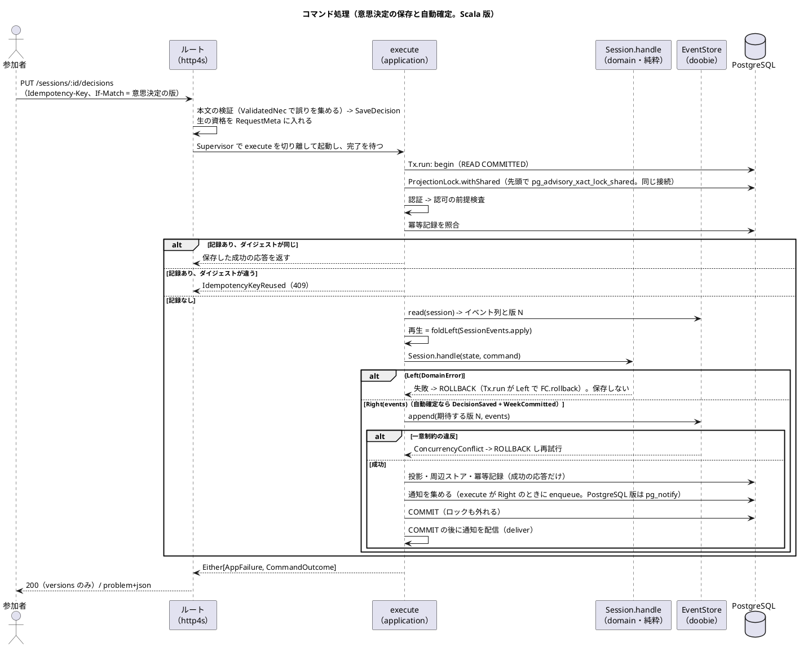

# バックエンドアーキテクチャ - ビールゲームシミュレーション（Scala 版）

## 概要

本書は、beer-game-scala のバックエンドのアーキテクチャを定義します。[ADR-001](../../adr/beer-game-scala/001-scala-version-of-beer-game-kotlin.md) の決定により、**機能・API の振る舞いは beer-game2、設計の構造は [beer-game-kotlin のバックエンドアーキテクチャ](../beer-game-kotlin/architecture-backend.md)、実装規約は [関数型プログラミングガイド（Scala 編）](../../reference/関数型プログラミングガイド_Scala編.md)（以下「ガイド」）を正本**として引き継ぎます。本書は、その構造を **Scala 3（Cats Effect + http4s + doobie）** で実現する方法と、Scala で変わる点だけを定めます。**`docs/` を設計の正本**とします。実装コードはまだ存在しません（アプリの置き場は `apps/beer-game-scala` を予定）。

### 本書の位置づけと確認の範囲

- **確認状況の正本は、[技術スタックの確認状況の一覧](./tech-stack.md#確認状況の一覧)** です（レビュー指摘 H1）。本書の本文は、その一覧へリンクします。**正本の規則（再レビュー N-H5。AI の案）**: 一覧が正です。一覧の根拠は実測の記録（[データモデル](./data-model.md) の「検証の結果」、[テスト戦略](./test-strategy.md) の「確認した事項」）で、**一覧を直すときは根拠も直します**。本文が一覧と食い違ったら、本文を直します。
- **確認したこと**: `AppFailure`、`EventStore`、**旧形の** `Ports`（1 本のストリームの `store` と 1 つの `Transactor`。新しい形は下の「依存を表す」で、型検査していない）、`App`（`Kleisli`）、**旧案の** `Tx.rollbackOnLeft`、`Execute.step` / `Execute.execute` の型は、`-Werror -Wunused:all -Wvalue-discard -Wnonunit-statement` と WartRemover 3.6.3 を有効にして**コンパイルできる**（K2。2026-11-25）。**実 DB で、`Left` を返しても doobie が COMMIT すること、`FC.rollback` を挟むと書き込みが残らないこと**を確認した（K5）。旧案の `Tx.rollbackOnLeft` が、スタブの `Connection` で「成功は `commit` だけ、`Left` は `rollback` が呼ばれる」ことも確認した（K6）。
- **本書の「Tx と execute」「ProjectionLock と ChangeNotifier」の新しい形（`Tx.run`、`ConnectionIO` の変換としてのロック、通知の出所、`.transact(` の入口の一覧）は、2026-11-25 のレビュー対応と再レビュー対応（N-H2・N-H3・M4）で書き直した AI の案**で、承認を得ていない。**型検査も実行もしていない**（旧案がコンパイルできたことは、新案の根拠にならない）。前回の `Resource` 版のロックは、再レビュー N-H2 で不採用にした（下の「ProjectionLock の接続の出所」）。
- **ユーザーの決定（2026-11-25）と AI の案の区別**: ユーザーの決定は、H3（`Ignored` は止める）・H6（行率を算出する案 C）・H7（U1〜U3 を約束）・H9（NF-P2 は p95 4 秒）と、再レビューの N-H4（検証用の CI は U1 に含める）・N-H6（`domain` の文 97% は目安）・N-H7（止まったゲームでも状態取得は返す）・N-H8（U1〜U3 の間は実際の研修に使わない）の 8 件。**N-H1・N-H2・N-H3・N-H5 の直し方など、これら以外は AI の案で、承認を得ていない。**
- **確認していないこと**: `ConcurrencyConflict` の再試行の実行、キャンセル時の ROLLBACK、`Supervisor` による切り離し、ember の切断時の挙動（K7）、`doobie.postgres.sqlstate` の定数と制約名以外の写像（K8）、トランザクションのアドバイザリロックの共有と排他の待ち合い（K10）、専用の接続の `LISTEN` と再購読（K11）、http4s（0.23.39）のルート・ミドルウェア・SSE（K20）、`HikariTransactor`（K19）、circe による `EventCodec`（K9）、各ミドルウェアの名前は、**未確認の設計のスケッチ**です。B1 で確かめます。
- **引き継ぐだけのもの**: 冪等性の表、競合の再試行の一意制約の表、問い合わせ側の開示、API のエンドポイントと認可の表、エラーの写像の表、SSE の仕様（版の通知だけ、再生なし）、保持削除の手順、セキュリティの表は、Kotlin 版の該当節を正本とします。**API の契約（`openapi.yaml`、`code`、problem+json）は変えません。**
- Kotlin 版の実装の経緯（B1〜B13 の注記）は引き継ぎません。Kotlin 版の未決事項は、本書の未決事項に引き継ぎます（Rust 版と同じ扱い）。

## パターンの選択

Kotlin 版と同じです。業務領域は中核（週次計算と進行）、**イベントソーシング**（状態はイベントの列。イベントが監査の記録を兼ねる）、**CQRS**（コマンド側は `events` へ追記、問い合わせ側は投影テーブルを SQL で読む）。構造は「**核の純粋関数 + 外側の薄い副作用の層**」です（ガイド §7.9）。核は、入力の検証、`handle`、`Events.apply`、投影、`simulateWeek`、`Disclosure` で、副作用は HTTP、データベース、時計、乱数、ログです。副作用は `IO` と `ConnectionIO` の**値**として組み立て、実行は `IOApp` とテストの境界だけです（SBD5）。

## 全体構成

```plantuml
@startuml
title バックエンドの層構造（Scala 版）

package "adapter-http（http4s）" {
  [ルート（機能別）\n入力検証 -> コマンド\nHttpRoutes[IO]] as Routes
  [ミドルウェア\nOrigin 検査・レート制限\nヘッダー・リクエスト ID] as Guard
  [エラーの写像\nAppFailure => Response（problem+json）] as Err
  [SSE（版の通知）\nStream[IO, ServerSentEvent]] as SSE
}

package "application" {
  [コマンド処理\nexecute: 読む -> handle -> 追記 -> 投影] as Cmd
  [問い合わせ\nSQL の結果 + Disclosure] as Qry
  [ポート（関数を持つ case class）\nEventStore・Generators・CredentialIssuer\nIdempotencyStore・ProjectionLock・ChangeNotifier] as Ports
}

package "domain（純粋。cats-core のみ）" {
  [Game.handle / GameEvents.apply] as Game
  [Session.handle / SessionEvents.apply] as Session
  [startGame] as Start
  [simulateWeek] as Sim
  [Projection（Event => List[RowChange]。純粋）] as Proj
  [Disclosure・KitPreset・RetentionSaga] as Svc
  [値オブジェクト・Command・Event・Error] as VO
}

package "adapter-persistence（doobie）" {
  [EventStore の実装\n追記・版の一意制約] as ES
  [投影の書き込み（SQL）] as PW
  [問い合わせの実装（SQL・読み取り専用ロール）] as QR
  [周辺ストア・冪等記録] as Aux
  [ProjectionLock・ChangeNotifier\nPostgreSQL 版: アドバイザリロック・NOTIFY\nH2 版（ローカルのみ）: プロセス内のロック・イベント] as Port2
  [EventCodec（circe の DTO）] as Codec
}

database "PostgreSQL 18" as DB

Routes --> Guard
Routes --> Cmd
Routes --> Qry
Routes --> SSE
Routes --> Err
Cmd --> Game
Cmd --> Session
Cmd --> Start
Cmd --> Proj
Cmd --> Ports
Qry --> Svc
Qry --> Ports
Session --> Sim
ES ..|> Ports
PW ..|> Ports
QR ..|> Ports
Aux ..|> Ports
Port2 ..|> Ports
ES --> Codec
ES --> DB
PW --> DB
QR --> DB
Aux --> DB
Port2 --> DB
@enduml
```

### 層と依存の向き

依存は、外側から内側（ドメイン）への**一方向**です。`domain` は `cats-core` だけに依存します（[ドメインモデル](./domain-model.md) の SD5、[技術スタック](./tech-stack.md) の ST3）。

| 層（sbt のプロジェクト。パッケージ） | 責務 | 依存してよい先 |
| :--- | :--- | :--- |
| `domain`（`beergame.domain`） | 値オブジェクト、`Command`、`Event`、エラー、`handle` / `Events.apply`、再生、`startGame`、`simulateWeek`、`KitPreset`、投影の純粋関数、`RetentionSaga` の純粋関数。**業務ルールはここにある** | なし（外部は `cats-core` のみ） |
| `application`（`beergame.application`） | ポート（関数を持つ `case class`）の定義、コマンド処理 `execute`、問い合わせ、競合の再試行、周辺ストアへの書き込み内容の導出（純粋）、開示の判定 `Disclosure`。トランザクションの境界を決める。**ルールは持たない** | `domain`。外部は `cats-effect`、`doobie-core`（`ConnectionIO` の型だけ。SBD3） |
| `adapter-http`（`beergame.adapter.http`） | http4s のルート、DTO の検証（誤りを集める）、認証の入口（生の資格を取り出す）、Origin 検査、レート制限、ヘッダー、SSE、エラーの写像 | `application`、`domain` |
| `adapter-persistence`（`beergame.adapter.persistence`） | doobie による `EventStore`、投影の書き込み、問い合わせ、周辺ストア、冪等記録、`ProjectionLock` と `ChangeNotifier` の **PostgreSQL 版と H2 版**（ST9）、イベントの JSON 変換（`EventCodec`）、マイグレーション（共通と PostgreSQL 専用の場所） | `application`、`domain` |
| `app`（`beergame.app`） | 設定の読み込みと検証、ポートの組み立て（ワイヤリング）、`IOApp`、起動のモード（api、retention、migrate、rebuild-projections、verify-projections） | 全プロジェクト |

sbt のプロジェクト名は、ディレクトリ名に合わせて `domain`・`application`・`adapterHttp`（`adapter-http/`）・`adapterPersistence`（`adapter-persistence/`）・`app` とし、依存は `dependsOn` で宣言します。この規則は、**sbt の依存宣言**（宣言していないプロジェクトの型は参照できない）と、**依存の検査**（下の「モジュール構成と依存の検査」）の二重で守ります。

### 依存を表す: 関数を持つ case class（設計判断 SBD1）

Kotlin 版は、依存を `typealias` と `data class` の**関数の束**で表します（BD2）。ガイド §7.2 も、外部とのやり取りを関数を持つ `case class`（`Hub`）で受け取り、テストでは渡す関数を差し替えます。Scala 版も同じ形を採り、**文脈（ポートの束）は `Kleisli` で渡します**。タグレスファイナルと `IOLocal` は採りません（ガイド §7.2、§10.1、§10.2。文脈の渡し忘れは `Kleisli` なら実行前に型で分かる）。

```scala
enum AppFailure:
  case Domain(code: String)         // handle が返した業務上の失敗（実際は DomainError を包む）
  case ConcurrencyConflict          // 追記の競合。execute が再試行する
  case RetryExhausted               // 再試行・ロックの待ちの上限。app.retry_exhausted（503、Retry-After）
  case Unauthorized                 // app.unauthorized（403）
  // … Invalid（境界で集めた入力の誤り）、IdempotencyKeyReused、Persistence（想定外の失敗。500 と相関 ID）

final case class StreamRead[E](events: List[E], version: Long)

final case class EventStore[E](
    read: ConnectionIO[StreamRead[E]],
    append: (Long, List[E]) => ConnectionIO[Either[AppFailure, Long]]
)

type App[A] = Kleisli[IO, Ports, A]
```

上の `AppFailure`・`StreamRead`・`EventStore` は、**コンパイルを確認した簡略化の型**です（K2）。実際の `EventStore` は、複数のストリームの追記（`startGame`）を受け取る形に広げます。

**`Ports` と、書き込み・読み取り・観察者の区別（M1。AI の案、型検査していない）**: Kotlin 版・旧スケッチは 1 本のストリームの `store` と 1 つの `Transactor` を持ちましたが、`StartGame` と開始後の入れ替えは `game` と `session` の 2 ストリームに書き、観察者の分離（NF-S18）は配線の誤りに弱いため、次の形にします。

```scala
// application（型だけ。実装は adapter-persistence の Transactions.scala に置く。N-H3）
/** 書き込みの実行。`Transactor` を直接渡さない（H4: 公開する書き込みの実行は run だけ）。
  * 型パラメーターを持つ関数のため、case class でなく trait にする（SBD1 の例外） */
trait Tx:
  def run[E, A](program: ConnectionIO[Either[E, A]]): IO[Either[E, A]]   // 実装は下の SBD2。Left で FC.rollback

/** 読み取り・観察者のプールは、別の型で区別する。**守れるのは取り違えの一部だけ**（L9）:
  * `ReadXa(writeXa)` と書けば通る。取り違えは、プールの配線テスト（`SELECT current_user`。NF-S18）で守る */
final case class ReadXa(xa: Transactor[IO])
final case class ObserverXa(xa: Transactor[IO])

final case class Ports(
    gameStore: EventStore[GameEvent],
    sessionStore: EventStore[SessionEvent],
    tx: Tx,                          // 書き込み（api の書き込みプール）
    lock: ProjectionLock,
    notifier: ChangeNotifier,
    logSink: LogSink,                // deliver の失敗の記録に使う（L4）
    maxAttempts: Int
    // … IdempotencyStore・PeripheralStore・Generators・CredentialIssuer
)

final case class QueryPorts(read: ReadXa, observer: ObserverXa /* , … */)
```

**`Ports` の旧形と新形（L4）**: K2 で型検査したのは、1 本のストリームの `store` と 1 つの `Transactor` を持つ**旧形**です。上の `gameStore`・`sessionStore`・`tx: Tx`・`lock`・`notifier`・`logSink` を持つ**新形は、型検査していません**。

**`Tx` の二重のシグネチャを避ける（L4）**: 初稿は、クラス `Tx`（`run(program)`）とオブジェクト `Tx`（`run(xa)(program)`）の 2 つの `run` を持っていた。**公開する書き込みの実行は、`Tx` の 1 つの `run` だけ**にし、実装（`Transactions.scala` の `Tx.fromTransactor(xa)`）だけが `xa` を持つ。`app` が `Tx.fromTransactor` で作って `Ports` に渡す。

`ProjectionLock` と `ChangeNotifier` は、H2 版と PostgreSQL 版が**同じ型**になるよう、次の形にします（H5・再レビュー N-H2。AI の案、型検査していない。**B1 の最初に実測して確定する**）。**ロックは `Resource` でなく、`ConnectionIO` の変換**にします（前回の `Resource` 案は、下の「ProjectionLock の接続の出所」で不採用にした）。

```scala
/** ConnectionIO の変換。`program` を、ゲームのロックを取った後に実行する形で包む。
  * PostgreSQL 版: 先頭で pg_advisory_xact_lock_shared / pg_advisory_xact_lock（COMMIT・ROLLBACK で自動解放。接続は program の接続の 1 本）。
  * H2 版: プロセス内の読み書きロックを ConnectionIO の bracket で取る（下に注意）。
  * 型パラメーター A を持つ関数のため、trait にする */
trait ProjectionLock:
  def withShared[A](gameId: GameId)(program: ConnectionIO[A]): ConnectionIO[A]      // コマンド
  def withExclusive[A](gameId: GameId)(program: ConnectionIO[A]): ConnectionIO[A]   // 再構築

/** execute が、トランザクションの中で通知を集め（enqueue）、Tx.run の後に IO で配信する（deliver）。
  * 呼ぶのは execute だけ（通知の出所は 1 つ。M4） */
final case class ChangeNotifier(
    enqueue: List[VersionNotice] => ConnectionIO[Unit],   // PostgreSQL 版: 中で pg_notify。H2 版: 何もしない
    deliver: List[VersionNotice] => IO[Unit]              // PostgreSQL 版: 何もしない（LISTEN の受信が配る）。H2 版: プロセス内のイベントへ配る
)
```

`IdempotencyStore`・`PeripheralStore`・`Generators`（時刻・識別子・乱数）・`CredentialIssuer` も同じ形の `case class` で、**型検査していません**。

#### ProjectionLock の接続の出所と見積もり（再レビュー N-H2。AI の案）

| 項目 | 内容 |
| :--- | :--- |
| 接続の出所 | **PostgreSQL 版のロックは、コマンドのトランザクションと同じ 1 本の接続**で取る（`Tx.run` が開いた書き込みプールの接続。先頭の `pg_advisory_xact_lock_shared`）。**ロックのための専用の接続を取らない**。再構築（排他）も、`rebuild-projections` モードの 1 ゲーム 1 トランザクションの接続で取る（`pg_advisory_xact_lock`） |
| 接続数の見積もり | 1 タスクあたりの接続は、**3 プール（書き込み・読み取り・観察者）+ `LISTEN` の専用の接続 1 本**のままで、**ロックのために増えない**。見積もりの式は [インフラストラクチャ](./architecture-infrastructure.md) の式（タスク数 ×（3 プール + 通知 1 本））をそのまま使う |
| 解放 | `pg_advisory_xact_lock(_shared)` は、トランザクションの終わり（COMMIT・ROLLBACK）で自動的に外れる。**解放の呼び出しを書かない**ので、解放の失敗と、外れないままプールに戻る接続の問題が構造上ない。接続が切れても、サーバーがトランザクションを中止してロックが外れる |
| 確認状況 | `ConnectionIO` として `pg_advisory_xact_lock(42)` と `pg_advisory_xact_lock_shared` を**実行できること**は確認済み（K10。2026-11-25）。**未確認**: 共有と排他が互いを待つこと、`lock_timeout` での 55P03、再構築（排他）の実測、COMMIT・ROLLBACK で外れること。B1 の最初に確かめる |
| 再試行との関係 | 初稿は「ロックを再試行のあいだも持つ」としていたが、トランザクションのロックは ROLLBACK で外れるため、**試行ごとに取り直す**（`execute` の `loop` の中で `withShared` を包む）。再試行のあいだに再構築が入りうるが、再試行は読み直しから始めるので問題ない |
| 待ちとプール | 再構築（排他）の間、コマンドは**自分のトランザクションの接続を持ったまま**ロックを待つ。待つコマンドの数が書き込みプールの大きさに達すると、ほかの要求はプール取得のタイムアウト（`RetryExhausted`・503）になる。**待ちは `lock_timeout`（55P03 → `RetryExhausted`）で上限があり、同時に走るコマンドの数の上限（`Semaphore`）が先に効く**。値は実測で決める（未決事項 6）。研修中に再構築しない運用（[運用要件](./operation.md)）が前提 |
| H2 版 | プロセス内の読み書きロック（`ReentrantReadWriteLock` などを `Ref` の `Map[GameId, …]` で持つ）を、`ConnectionIO` の `bracket`（Kotlin 版 T7 の H2 版に倣う）で包む。**注意**: `bracket` の解放は `program` の完了時で、**`Tx.run` の COMMIT より前**になる。PostgreSQL 版（COMMIT まで保持）より弱く、再構築が COMMIT 前のコマンドを追い越しうる。H2 版はローカル専用で、複数のプロセスでは保証しない（既存の制限）ので、**許容する案**。契約テストの「COMMIT の後まで直列化する」条項は PostgreSQL 版だけで確かめ、H2 版は「実行中の相互排除」だけ確かめる。`ConnectionIO` へ `IO` を持ち上げる方法（`WeakAsync` など）は**未確認** |

**不採用: `Resource[IO, Unit]` のセッションのロック（前回の案。再レビュー N-H2）**

| 案 | 内容 | 評価 |
| :--- | :--- | :--- |
| **A（採用の提案）** | `ConnectionIO` の変換。PostgreSQL 版は先頭の `pg_advisory_xact_lock(_shared)`、H2 版は `bracket` | 接続が増えない。解放が構造的に保証される。H2 版は COMMIT 前に外れる弱さがある（上） |
| B（不採用） | `GameId => Resource[IO, Unit]`。専用の接続で `pg_advisory_lock(_shared)` を取り、解放で `pg_advisory_unlock` | (1) **ロックの専用接続を書き込みプールから取ると、コマンドごとに接続を 2 本使う**。同時のコマンドがプールの大きさに達すると、全員がロックの接続を持ったまま、トランザクションの接続を待ち、プールが枯渇する。(2) セッションのロックは**接続に残る**。解放（`pg_advisory_unlock`）に失敗した接続がプールに戻ると、**HikariCP は接続を閉じずにプールへ戻し、返却時にセッションのロックを外さない**ため（再レビューの指摘。本書では実測していない）、再構築が止まり続ける（解放の失敗・取消・タイムアウトのテストが要る）。(3) 接続数の見積もりにロックの接続を足す必要がある。実測も未実施（K10） |

## コマンド側

### コマンド処理の流れ

流れと順序は Kotlin 版と同じです。**処理の順は固定**で、ロック（共有）→ 認証（操作者・資格の有効性）→ 認可の前提検査 → 冪等記録の照合 → 読み込み → `handle` → 追記・投影 → 周辺ストア → 通知 → 冪等記録の保存 → COMMIT です。認可を冪等記録の照合より**先**に置くため、入れ替えで失効した旧担当者が過去のキーを再送しても 403 になります（ADR-004）。

**Scala 版（H4・H5・N-H2 の案）での違い**: ロックは `ConnectionIO` の変換（`ProjectionLock.withShared`。PostgreSQL 版は先頭の `pg_advisory_xact_lock_shared`）で、**トランザクションの先頭**で取ります（前回の「`transact` の外の `Resource`」は不採用。上の「ProjectionLock の接続の出所」）。**認証以降の全体（認証 → 認可の前提検査 → 冪等記録の照合 → 読み込み → `handle` → 追記・投影 → 周辺ストア → 冪等記録の保存）を 1 つの `ConnectionIO`（`program`）として組み、`execute` が、ロックの変換と通知の `enqueue` で包んで、1 回の `Tx.run` で実行します**。通知は、**`execute` だけが**、`program` が `Right(committed)` を返したときに、**同じトランザクションの中で集め**（`notifier.enqueue(committed.notices)`。PostgreSQL 版は `pg_notify`。COMMIT されたときだけ届く）、**COMMIT された後**に `IO` で配信します（`deliver`）。ロールバックした試行の通知は、集められず、配信されません（M4）。



`execute` は、ストリームの種類に依存しない汎用の関数です。ストリームごとの初期状態・遷移・`handle` を引数で受け取り、ルールを持ちません（Kotlin 版と同じ）。**`Tx.run` と `execute` の形は 2026-11-25 のレビュー対応で書き直した AI の案（H4・H5）で、型検査していません**。`step` と `AppFailure`・`EventStore` の型は、コンパイルを確認した旧案の形のままです（K2）。

```scala
// adapter-persistence の Transactions.scala（`.transact(` を書いてよいファイル。下の「`.transact(` の入口」）
object Tx:
  /** 公開する書き込みの実行は、Tx.run（これ）だけ。Left を返したら ROLLBACK（FC.rollback）してから transact する。
    * doobie の既定の戦略は、値が Left でも COMMIT するため（確認済み。K5）。
    * コマンドの ConnectionIO 全体（ロック → 認証 → … → 冪等記録の保存 → 通知の収集）を、1 回の run で包む */
  def fromTransactor(xa: Transactor[IO]): Tx = new Tx:
    def run[E, A](program: ConnectionIO[Either[E, A]]): IO[Either[E, A]] =
      program
        .flatMap:
          case left @ Left(_) => FC.rollback.as(left)
          case right          => FC.pure(right)
        .transact(xa)
  // 合成子（ConnectionIO のまま ROLLBACK を足す関数）は公開しない。二重のシグネチャ（クラスとオブジェクトの run）は持たない（L4）

final case class Committed[A](value: A, notices: List[VersionNotice])   // 通知を戻り値で運ぶ（H5）

object Execute:
  def step[S, E, C](initial: S, evolve: (S, E) => S, decide: (S, C) => Either[AppFailure, List[E]], command: C)(
      store: EventStore[E]
  ): ConnectionIO[Either[AppFailure, Long]] =
    store.read.flatMap: read =>
      val state = read.events.foldLeft(initial)(evolve)
      decide(state, command) match
        case Left(failure) => FC.pure(Left(failure))
        case Right(Nil)    => FC.pure(Right(read.version))     // 空の列は追記しない
        case Right(events) => store.append(read.version, events)

  /** program は、認証 → 認可の前提検査 → 冪等記録の照合 → step → 投影 → 周辺ストア → 冪等記録の保存、を 1 つにした ConnectionIO。
    * 通知の enqueue は program の中で呼ばない。execute が、Right(committed) のときに、同じトランザクションの中で呼ぶ（通知の出所は 1 つ。M4） */
  def execute[A](gameId: GameId)(program: ConnectionIO[Either[AppFailure, Committed[A]]]): App[Either[AppFailure, A]] =
    Kleisli: ports =>
      val inTx: ConnectionIO[Either[AppFailure, Committed[A]]] =
        ports.lock.withShared(gameId)(program).flatMap:
          case Right(committed) => ports.notifier.enqueue(committed.notices).as(Right(committed))   // PostgreSQL 版: pg_notify。H2 版: 何もしない
          case left             => FC.pure(left)
      def loop(attempt: Int): IO[Either[AppFailure, A]] =
        ports.tx.run(inTx).flatMap:        // ロックは試行ごとに取り直す（トランザクションのロック。ROLLBACK で外れる）
          case Right(committed) =>
            // COMMIT の後。配信の失敗は成功の応答を変えないが、捨てずにログに記録する（L4。コミット済みのため応答は成功）
            ports.notifier
              .deliver(committed.notices)
              .handleErrorWith(e => ports.logSink.write(deliverFailedLog(gameId, e)).handleError(_ => ()))
              .as(Right(committed.value))
          case Left(AppFailure.ConcurrencyConflict) if attempt < ports.maxAttempts => loop(attempt + 1)
          case Left(AppFailure.ConcurrencyConflict)                                 => IO.pure(Left(AppFailure.RetryExhausted))
          case Left(other)                                                          => IO.pure(Left(other))
      loop(1)
```

**通知の出所は 1 つ（再レビュー M4。AI の案）**: 前回は、PostgreSQL 版の `enqueue` を `program` の中で呼び、H2 版は `Committed.notices` から出る、と読めた（ローカルでだけ通る乖離になる）。**両方の実装で、`execute` が `Right(committed)` のときに `notifier.enqueue(committed.notices)` を呼ぶ**（`Tx.run` の中。`Left` のときは呼ばず、`Tx.run` が ROLLBACK するので `pg_notify` も残らない）。PostgreSQL 版の `enqueue` は `pg_notify`（同じトランザクション）、H2 版の `enqueue` は何もせず、`deliver` がプロセス内のイベントへ配る。`deliver` は COMMIT の後に 1 回だけ呼ぶ。**`deliver` の失敗は握りつぶさず、`LogSink` に記録する**（`LogSink.write` 自体の失敗だけを捨てる。ガイド §7.8）。テストにする（L4）: `deliver` が失敗しても応答は成功で、ログに失敗の記録が 1 件残る。

上のコードは、**型検査していません**（旧案の `execute` は、コンパイルが通ることだけを確認した。K2。`deliverFailedLog` は未定義のスケッチ）。次の 6 つの性質は、**テストを書いて B1 で確かめる**（Rust 版が型検査とテストで確かめたものに対応）。(1) 成功は COMMIT だけで、ROLLBACK しない。(2) 競合が 2 回続いても、再試行して成功する。(3) 競合が上限まで続くと、すべて ROLLBACK して `RetryExhausted` を返す。(4) 業務の失敗（`handle` が `Left`）は、ROLLBACK して、再試行も追記もしない。(5) ロールバックした試行の通知は配信されず（`enqueue` も呼ばれない）、COMMIT の後にだけ配信される。(6) `deliver` が失敗しても成功の応答を返し、失敗をログに記録する。**`Left` を返しても COMMIT されること、`FC.rollback` が書き込みを残さないことは、実 DB で確認した**（K5）。**ロールバックの後に同じ `ConnectionIO` で書き込みが続くとどうなるか、`Tx.run` 全体の実行、トランザクションのアドバイザリロックの共有と排他の待ち合いは未確認**（K5・K6・K10）。

**`Ignored` の扱い**: 実際の `step` の再生は `Evolution`（[ドメインモデル](./domain-model.md) の SD2）を畳み込み、**コマンドの経路で `Ignored` が出たら、状態を信用せず `AppFailure.Persistence`（500・相関 ID）で失敗させます**（fail closed）。保存済みの事実を無視した状態で `handle` すると、不変条件が崩れるためです。`StreamRead.version` は、読み込んだイベントの**件数ではなく、`MAX(stream_version)`** とします（追記の期待する版）。上のスケッチは、簡単のため `(S, E) => S` の遷移を使っています。

**`Ignored` で止めることは、利用者に見える変更です（H3。止める設計を維持する、というユーザーの決定、2026-11-25）。** Kotlin 版は、不正な遷移を状態を変えずに記録して続行します。Scala 版は止めるため、**該当するゲームの保存・確定などの操作が、`Persistence`（500・相関 ID）で失敗し続けます**。次の運用を、運用手順書（[運用要件](./operation.md)。別の担当が書く）と揃えます（文言と原則は AI の案で、承認を得ていない）。

| 項目 | 内容 |
| :--- | :--- |
| 進行役への依頼の文言 | 「このゲームは一時的に操作できません。運用担当が復旧中です。**画面の在庫・受注残・今週の入力を控えたうえで**、参加者には手元で数量をメモして待つよう伝えてください」。**判断の期限と次の手**（案の例: 運用担当から 15 分以内に見込みを伝え、立たなければ控えた数字で紙で続ける）は、[運用要件](./operation.md) と揃える（別の担当。AI の案、承認を得ていない）。画面の相関 ID を運営者に伝える（操作を繰り返さない） |
| 研修中の原則 | **該当するゲームだけを止める**。他のゲームの操作は続ける。手順 A（DB 全体の復元）は、同時進行の最大 15 ゲームの直近の確定も巻き戻すため、**研修の時間帯には行わない** |
| 防ぐ側 | 「`handle` が作る列は `Ignored` にならない」性質テストの生成器に、**開始後の入れ替え、観察者の招待・参加、資格の失効・再発行、復帰を含める**（[ドメインモデル](./domain-model.md) の「遷移の許す組の表」。N-H1）。入れ替えなどを遷移で扱っていないと、入れ替えた時点でそのゲームが止まる |
| **止まったゲームでも状態取得（読み取り）は返す（N-H7。ユーザーの決定、2026-11-25）** | **要件**: 書き込み（コマンド）が `Persistence`（500）で失敗し続けるゲームでも、**読み取り（`GET /games/{id}/state`・`GET /sessions/{id}/state`・`GET /games/{id}/lobby` など、投影の行から返す経路）は 200 で返す**。研修の現場で、進行役が画面の在庫・受注残・今週の入力を控えて紙で続けられるようにするため（表示まで 500 になると数字が残らない）。読み取りは、投影の行と `projection_checkpoints` を SQL で読む経路で、**イベントの再生をしない**ため、`Ignored` の検査の対象外になる見込み。ただし、**見込みであって実測していない** |
| B1 の確認項目（N-H7） | (a) `Ignored` を意図的に起こしたゲーム（保存済みのイベント列に、許さない組を入れる）で、書き込みが 500（`type` と相関 ID つき）になり、**書き込みが残らない**。(b) 同じゲームで、読み取りが **200** で、停止の直前の状態（在庫・受注残・今週の入力）を返す。(c) 他のゲームの書き込みと読み取りは通る。(d) `Ignored` の件数のメトリクスが出る。(e) 画面には「サーバーで問題が発生しました」と相関 ID が出る（[UI 設計](./ui-design.md)。別の担当）。**ポーリングの画面は、読み取りが成功し続けるため、止まったことに気づけない**（気づくのは次に操作した人。画面の課題として別の担当が扱う） |
| 範囲（N-H8。ユーザーの決定） | **U1〜U3 の間は、実際の研修に使わない（検証・事例用）**。止まったゲームの運用（依頼の文言、紙で続ける手順）は、実際の研修に使う前（U4 以降の判断）に、運営者との合意（未決事項）の上で確定する |

要点は Kotlin 版と同じです。

- **`StartGame` と開始後の役割の入れ替え**だけは、`game` と `session` の両ストリームを読み、両方の期待する版を持って 1 回の追記で書く別の関数にします。
- **冪等記録に保存するのは、成功した応答だけ**です。業務の失敗は保存せず、再送は同じ失敗を再計算して返します。
- **自動確定のための特別な処理はありません。** `Session.handle` が複数のイベントを返すため、`execute` から見ると 1 回の追記です。
- **投影は追記の後に更新します**（同じトランザクション）。複数の投影の行を更新するときの**ロックの順序の規則**（表名の辞書順 → 主キーの昇順）も同じです。
- 周辺ストア（表示名・資格のダイジェスト）の書き込み内容は、**純粋関数で導出**します（`peripheralWrites`）。イベントには入れません（D7）。

### トランザクションと Left の ROLLBACK（設計判断 SBD2）

Kotlin 版の `EventStore.transaction` は、ブロックが `Left` を返したら ROLLBACK します。**doobie の `Transactor` は、`ConnectionIO` が例外なく完了すれば、その値が `Left` でも COMMIT します**（`IO` の失敗でなく、`Either` の `Left` を返すため。Scala 版の設計は「業務の失敗は `Either`、`IO` の失敗は想定外に限る」。ガイド ADR-050）。そのため、**`Left` を返す経路で ROLLBACK を明示する**必要があります。

**確認済みの事実**: 実 PostgreSQL 18.6 で、`ConnectionIO` が `Left` を返して完了すると **COMMIT され**、`FC.rollback` を挟むと書き込みは**残らない**（[確認状況の一覧](./tech-stack.md#確認状況の一覧) の K5。2026-11-25）。スタブの `Connection` では、成功は `commit` だけ、`Left` は `rollback` が呼ばれる（K6）。**未確認**: `FC.rollback` の**後**に同じ `ConnectionIO` で書き込みが続いたとき（K5。JDBC の仕様から、新しいトランザクションとして COMMIT されると推論した）。

| 案 | 内容 | 評価 |
| :--- | :--- | :--- |
| **A（採用の提案。H4 で書き直した AI の案）** | **公開する実行は `Tx.run(program)` だけ**にする。`Left` のときに `FC.rollback` を発行して `transact` までを 1 つにし、コマンドの `ConnectionIO` 全体（ロック以外の、認証 → 認可の前提検査 → 冪等記録の照合 → `step` → 投影 → 周辺ストア → 通知の収集 → 冪等記録の保存）を **1 回の `Tx.run`** で包む。合成子（`rollbackOnLeft` を内側で使う形）は**公開しない**。`.transact(` の直接の呼び出しは、Scalafix の `DisableSyntax.regex` で禁止し、入口を 1 つのファイルに集める（下の「`.transact(` の入口」。[技術スタック](./tech-stack.md) の ST4。除外の方法は未確認） | `Left` が COMMIT されない。1 か所で守れる。**`Tx.run` の外で書き込みの `transact` を置くと、Scalafix で落ちる**（型の上で作れなくするのではなく、CI の検査で止める。再レビュー N-H3 で「型で作れなくする」は言いすぎとして直した） |
| A'（旧案。採らない） | `Tx.rollbackOnLeft: ConnectionIO[Either[E, A]] => ConnectionIO[Either[E, A]]` を合成子として公開し、内側で使えるようにする | **合成子のままだと、`FC.rollback` の後に同じ `ConnectionIO` で書き込みが続いたとき、その書き込みが新しいトランザクションとして COMMIT される**（推論。K5）。たとえば冪等記録の保存を `rollbackOnLeft` の外側に置くと、業務の失敗のあとで記録だけが残りうる。コンパイルは通るため、型では防げない |
| B | 業務の失敗を `IO.raiseError` にして、doobie の既定の ROLLBACK に任せる | 既定の動作で ROLLBACK される。業務の失敗を `IO` の失敗にするため、ガイド ADR-050 に反する |
| C | `EitherT[ConnectionIO, AppFailure, A]` の `Left` を ROLLBACK に結びつける | 連鎖が書きやすい。ガイドは `EitherT` を試していない。導入の承認が要る |

B1 の最初のスライドで、(1) `Tx.run` 全体を実 PostgreSQL で（`Left` で行が残らない、成功で残る）、(2) `FC.rollback` の後の書き込みがどうなるか（旧案を避ける根拠の確認）、(3) 「`Tx` を通さない `.transact(` を置くと CI が落ちる」と、「許す入口は落ちない」ことを確かめ、**(3) を最初のビルドの受入条件に入れます**（前提が成り立たなければ、設計を見直す）。

#### `.transact(` の入口（再レビュー N-H3。AI の案、承認を得ていない）

書き込みの `transact` を `Tx.run` に限ると、読み取り・再構築・LISTEN などの正しいコードも `.transact(` を使うため、**禁止の一覧だけでは正しいコードが落ちる**。そこで、**許す入口を一覧にし、すべて同じファイル（`beergame.adapter.persistence.Transactions`）に置いて、Scalafix の除外を 1 か所**にする。

| 入口 | 用途 | 型・使う人 |
| :--- | :--- | :--- |
| `Tx`（`Tx.run`） | 書き込み。`Left` で `FC.rollback` | `application` の `trait Tx`（`Ports.tx`）。実装は `Transactions.scala` |
| `ReadTx` | 読み取り専用の REPEATABLE READ（`projection_checkpoints` と行を同じスナップショットで読む）。`ReadXa`・`ObserverXa` を受け取る | 問い合わせ（`QueryPorts`） |
| `ModeTx` | `rebuild-projections`・`verify-projections`・retention・migrate の各モードの実行（1 ゲーム 1 トランザクションなど） | `app` の起動モード |
| `LISTEN` の専用接続 | プールの外の `LISTEN` の接続（`PHC.pgListen` などを動かす）。K11 は同じ接続だけ確認済みで、専用の接続は**未確認** | `ChangeNotifier` の PostgreSQL 版 |

**Scalafix で禁止するもの**（`Transactions.scala` の外）: `.transact(`、`.transact[`（型引数つき）、`xa.trans`、`FC.commit`・`FC.rollback`・`HC.commit`・`HC.rollback`（`Tx` の実装の外で、ロールバックやコミットを直接書かせない）。**除外に `scalafix:off` は使わない**（[ADR-001](../../adr/beer-game-scala/001-scala-version-of-beer-game-kotlin.md) の 011 の「無効化コメントを使わない」と矛盾する）。**ファイル単位の除外の方法は未確認**（K15。候補: `scalafix` のファイルの除外設定、`Transactions.scala` だけを別の sbt プロジェクトに置いて、その設定だけ緩める）。

**受入条件は、2 方向の表**にする（B1 の最初のビルド）。

| 方向 | 例 | 期待 |
| :--- | :--- | :--- |
| 落ちるべき | `application`・`adapter-http` に `.transact(xa)`、`xa.trans`、`.transact[IO](xa)`（型引数つき）、`FC.rollback` を置く | `scalafix --check` が失敗 |
| 落ちてはならない | `Transactions.scala` の 4 つの入口の実装。コメントや文字列の中の語は、文字列のパターンの限界として**落ちる可能性がある**（ガイド §9.4）ので、除外の対象の確認も受入に含める | 通る |
| 落ちてはならない（未確認） | テストのソース（`Test`）の `.transact(`（スタブの `Connection` の検証。K6）。**`Test / scalafix` の対象にするかは未確認**で、K15 は `Compile` だけ確認した | 対象にしない案 |

禁止の穴（別名での呼び出し、`import` の別名）は、文字列のパターンの限界として**残る**。ガイド §9.4 のとおり、レビューで補う。

### ポートの型に ConnectionIO を使う（設計判断 SBD3）

Kotlin 版は、`Tx` を引数で明示し、ポートの関数は `suspend (Tx, …)` です。Scala 版は、ガイド §7.6 に従い、**ポートの戻り値を doobie の `ConnectionIO`** にします。`ConnectionIO` は、実行の記述（`IO` と同じく値）で、モナドです。`for` で複数の操作を 1 つのトランザクションに束ねられ、`Transactor` が `transact` で実行したときに初めて接続が使われます。

| 案 | 内容 | 評価 |
| :--- | :--- | :--- |
| **A（採用の提案）** | `application` が `doobie-core` に依存し、ポートは `ConnectionIO[...]` を返す | 1 つのトランザクションへの合成が `for` で書ける（ガイド §7.6）。`application` が SQL を知らず、`ConnectionIO` の型だけを知る。`domain` は依存しない。**費用**: テスト用のインメモリ実装も `ConnectionIO` を返すため、実行には `Transactor` が要る（スタブの `Connection` を渡した `Transactor.fromConnection`、または H2 の `Transactor`。インメモリの状態を `ConnectionIO` から読み書く方法は未確認。[テスト戦略](./test-strategy.md)）。ポートの単体テストが、DB を使わない純粋な関数だけでは書けない |
| B | `application` 独自の `Tx[A]` 型（`Kleisli[IO, Connection, A]` など）を定義し、`adapter-persistence` が doobie で実装する | `application` が doobie に依存しない。インメモリ実装は `Tx[A]` を直接作れ、`Transactor` が要らない。**費用**: 自前のトランザクションの合成とエラー処理を持ち、`FC.rollback` などの doobie の機能を包み直す。ガイド §7.6 の形（`ConnectionIO`）から外れる |
| C | ポートは `IO` を返し、トランザクションの合成は `adapter-persistence` の内部に閉じる | `application` が単純。複数のポートの呼び出しを 1 つのトランザクションにまとめられない |

トレードオフ: A は、`application` が `doobie-core` に依存します（`ConnectionIO` の型だけ）。ドメインの純粋性は守られます。A の費用（インメモリ実装にも `Transactor` が要る）と B の費用（自前の `Tx[A]` の保守）の比較は、B1 の最初のスライドで、インメモリ実装を実際に書いて確かめます（AI の案。承認を得ていない）。

#### インメモリ実装の契約（再レビュー M6。AI の案、承認を得ていない）

インメモリ実装は、`ConnectionIO` の中で**可変の状態**（`Ref` や可変の `Map`）を書く。**`FC.rollback` は JDBC の接続のトランザクションを取り消すだけで、可変の状態は取り消さない**ため、「`Left` で書き込みが残らない」を、インメモリ実装のポートの単体では満たせない。次の 2 つで扱う。

1. **契約の条項を 2 つに分ける**。(T) **トランザクションの意味に依存する条項**（`Left` で書き込みが残らない、23505 の後の規則、COMMIT の後にだけ通知が届く、ロックが COMMIT まで続く）と、(N) 依存しない条項（追記の版の一意性の検査、読み出しの順序、`MAX(stream_version)` など）。(N) は 3 つの実装（PostgreSQL 版、H2 版、インメモリ）で同じ内容を実行する。**(T) は、ポート単体でなく `execute` と `Tx.run` を通して**確かめる（M8）。
2. **インメモリ実装は、試行単位でバッファする**: インメモリの `Tx` の実装は、`run` の前に状態の**スナップショット**を取り、`Left` と失敗のときに**復元**し、`Right` のときだけ確定する。これで (T) の「`Left` で残らない」を、インメモリ実装も `Tx` を通して満たす。**限界**: スナップショットの復元は、同時に複数の書き込みが走ると壊れる（単一の書き込みを前提とする）。同時実行の競合（`ConcurrencyConflict`）の検証は、PostgreSQL の統合テストで行い、インメモリ実装には求めない。可変の状態を使うのは**テスト用のソースだけ**（WartRemover の対象外。K17）。

どちらも**未実装・未検証**で、B1 の最初のスライドで、インメモリ実装を書いて (T) の条項が通ることを確かめる。

### キャンセル安全性（設計判断 SBD4）

Kotlin 版は、COMMIT と ROLLBACK を `NonCancellable` で行い、`CancellationException` を再送出します（ADR-005）。**Cats Effect では、キャンセルは `Fiber` の取消**です。クライアントが切断すると、サーバーが処理中の `Fiber` を取り消しうる（**http4s ember が切断時にハンドラを取り消すかは未確認**）ため、次の方針にします。

**リスクの置き場所**: 「部分更新が残る」ことは、**PostgreSQL のトランザクションの原子性が防ぎます**（COMMIT の前に接続が切れれば、サーバーが中止する）。本当のリスクは、(1) **ロックと接続が解放されるまでの遅れ**（`pg_advisory_xact_lock_shared`・行ロックを握ったまま接続が残る）、(2) **切り離した処理の寿命**（追跡、シャットダウン）、(3) **COMMIT の結果が呼び出し側に分からなくなること**（タイムアウト・切断）の 3 つです。Rust 版のレビューで整理した見方を引き継ぎます。

| 項目 | 設計 |
| :--- | :--- |
| ROLLBACK | 失敗の経路では ROLLBACK を明示する（SBD2 の `Tx.run`。`IO` の失敗・取消のときは、doobie の `Transactor` の後始末に任せる。**doobie がキャンセル時に ROLLBACK して接続を返すかは、公式の文書で確認していない**（K7）。B1 で挙動を確かめる） |
| COMMIT の途中でのキャンセル | `execute` を **`Supervisor[IO]`（cats-effect の標準）で切り離した `Fiber` として起動**し、ルートはその完了（`join`）を待つ。クライアントが切断してルートの `Fiber` が取り消されても、コマンドの処理は最後まで走る（COMMIT が中途半端にならない）。`Supervisor` は `Resource` で作り、アプリの終了時に追跡している `Fiber` の完了を待つ（`Supervisor(await = true)` の指定は要確認） |
| タイムアウトと「結果が不明」 | ミドルウェアのタイムアウトが応答した後も、切り離した `Fiber` は COMMIT まで進みうる。**タイムアウトの応答は `type` を付けない 504 とし、画面は「結果が不明」として同じ `Idempotency-Key` で再送する**（[UI 設計](./ui-design.md) の影響表）。**元の処理が実行中に同じキーの再送が届いたときは、先の処理の完了を待って、保存済みの応答（または同じ失敗）を返す**（実現は B1 で確認。待ちの上限を超えたら `app.retry_exhausted`） |
| プール取得のタイムアウト | プールから接続を取れなかった場合は、**コマンドは未実行が確実**なので、`AppFailure.RetryExhausted`（503・`type` つき・`Retry-After`）に写す。`begin` の失敗は、`Persistence`（500）とは区別する |
| `Fiber` の失敗（想定外の例外） | `IO` の失敗（`Throwable`）を `AppFailure.Persistence` に写し、500 と相関 ID にする。業務の失敗は `Either` で返るため、`IO` の失敗は想定外に限る |
| 同時に走るコマンドの数 | **同時に走るコマンドの数に上限を置く**（`Semaphore` など。超えたら `RetryExhausted`）。上限の値は実測で決める |
| シャットダウン | SIGTERM で新しい要求の受付を止め、**SSE の接続に終了を知らせて閉じ**（SSE は自然には閉じない）、`Supervisor` が追跡している `Fiber` の完了を待つ（待ちの上限は `stopTimeout` より短く）。**ember のシャットダウンの待ち方は未確認** |

| 案 | 内容 | 評価 |
| :--- | :--- | :--- |
| **A（採用の提案）** | `execute` を `Supervisor` で切り離して起動し、ルートは完了を待つ。失敗の経路は ROLLBACK を明示 | 切断で処理が途中で止まらない。追跡の仕組みが cats-effect の標準にあり、新規の依存が要らない（Rust 版の `TaskTracker` に当たる）。ROLLBACK を後始末に頼らない |
| B | ハンドラの `Fiber` の中で直接実行する | 単純。ただし、クライアントの切断で COMMIT の直前に取り消されうる。`IO.uncancelable` で包む案は、プール取得の待ちまで取り消せなくなる |
| C | `IO.uncancelable` で `execute` 全体を包み、`Supervisor` を使わない | 切断で止まらない。待ちのキャンセル（シャットダウン）ができず、`Fiber` を追跡できない |

### 冪等性と競合の再試行

冪等記録の表（`idempotency_records`、24 時間、応答を暗号化、`request_digest` に操作者 ID を含める、認可の後に照合する、成功した応答だけを保存する）と、再試行する一意制約の一覧（`uq_events_stream_version`、`uq_idempotency_create`、`pk_idempotency_records`）は、**Kotlin 版を引き継ぎます**。

| 項目 | Scala 版での実現 |
| :--- | :--- |
| 一意制約違反の判別 | PostgreSQL のエラーの SQLSTATE（`23505`）と**制約名**で見分ける。`attemptSql` で `PSQLException` を取り出し、SQLSTATE `23505` と制約名（`getServerErrorMessage.getConstraint`）が得られることは**確認済み**（K8。2026-11-25）。**未確認**: `doobie.postgres.sqlstate` の定数、40001・40P01・55P03 の写像（B1 で確認）。40001・40P01 は `ConcurrencyConflict` に、55P03 は `RetryExhausted` に写す（案） |
| 23505 の後の規則（M2） | **一意制約違反（23505）を受けた後は、その `ConnectionIO` で次の文を発行しない**（`SAVEPOINT` を使う場合を除く）。PostgreSQL はトランザクションを中断して後続の文を 25P02 で拒否するが、**H2 は中断しないため、ローカルでだけ通るコードが書ける**。この規則を `EventStore` と冪等記録の契約に書き、PostgreSQL の統合テストで確かめる（**25P02 の挙動は PostgreSQL の仕様の知識で、doobie では未確認。K8**）。違反を受けたら `Left(ConcurrencyConflict)` を返して `Tx.run` の ROLLBACK に任せる |
| 再試行の上限 | 初期値は 10（ADR-019 を引き継ぎ、Scala 版で再計測する）。ジッターなし、書き込みの直列化なし |
| `lock_timeout` | **B1 の受入条件に、`lock_timeout` の初期値を入れる**（未設定だと、再構築の間、コマンドがアドバイザリロックを無期限に待つ）。超過（SQLSTATE 55P03）は `RetryExhausted` に写す。**値は実測で決める** |
| 待ち | 再試行のあいだに待ちを入れない。入れる場合は `IO.sleep`（`Thread.sleep` を使わない。ガイド §5.5）。計測して決める（未決事項） |
| 再試行の書き方 | ガイド §4.4 の `orElse` の連鎖でなく、上の `loop`（回数を数える再帰）で書く。`ConcurrencyConflict` だけを再試行し、業務の失敗は再試行しない |
| 暗号化と HMAC | 候補は JDK の `javax.crypto`（`Mac`・`Cipher`）と `java.util.Base64`。**外部の暗号ライブラリを足さない案**を第一候補とし、資格の設計時に決める（承認が要る） |

## 問い合わせ側

Kotlin 版を引き継ぎます。読み取り専用の DB ロールで投影の表を SELECT し、**読み取り専用の REPEATABLE READ のトランザクション**で `projection_checkpoints` を同じトランザクションで読みます（応答の `versions` が行より新しくならない）。観察者は別のロール・別の接続プールで、`game_overview`・`session_overview`・`week_team_totals` の 3 表だけを読めます（ADR-009）。出力は要求時に `buildExport`（純粋関数）で作ります。

Scala 版の実現として、**用途別に `HikariTransactor`（`Resource`）を持ちます**（api は書き込み・読み取り・観察者の 3 つと `LISTEN` の専用接続。削除は retention、所有者は migrate のタスクが持つ。[インフラストラクチャ](./architecture-infrastructure.md)）。プールの配線テスト（`SELECT current_user` の検査）は書き直します（ADR-009）。

### 投影の更新と再構築

投影は、`Projection`（純粋。`Event => List[RowChange]`）と、SQL への書き込み（境界）に分けます（[ドメインモデル](./domain-model.md)）。再構築は `rebuild-projections` モードで、**1 ゲームを 1 トランザクション**で、排他のロック（`ProjectionLock.withExclusive`）を先頭で取って行います。コマンドは共有のロック（`ProjectionLock.withShared`）を取るため、再構築と同時には走りません。**ロックは `ConnectionIO` の変換**（再レビュー N-H2 の案。上の「ProjectionLock の接続の出所」）で、PostgreSQL 版は、トランザクションの先頭で `pg_advisory_xact_lock(_shared)` を実行します（COMMIT・ROLLBACK で自動的に外れる。接続は増えない）。**`ConnectionIO` として `pg_advisory_xact_lock(_shared)` を実行できることは確認済み**（K10。2026-11-25）ですが、**共有と排他の待ち合い、再構築（排他）の実測、`lock_timeout` の効き方は未確認**で、B1 の最初に確かめます。前回の「`transact` の外の `Resource` のセッションのロック」は、接続が 2 本要ることと、解放の失敗が接続に残ることから採りません。

再生に関する 3 つの性質（永続化往復の同値性、計算と事実の一致、投影の整合）と、検証の場は、[ドメインモデル](./domain-model.md) と Kotlin 版のとおりです。

## イベントの JSON 変換

| 項目 | 設計 |
| :--- | :--- |
| 場所 | `adapter-persistence` の `EventCodec`。**ドメインのイベントには、JSON の codec を付けない**（BD5 を引き継ぐ） |
| 形 | 永続化用の DTO と、ドメインイベントの相互変換。`event_type` を判別子にした DTO（circe の `Encoder`・`Decoder`。派生か手書きかは B1）。`schema_version` を持つ。**行きと戻りの写像を対にして持つ**ので、ガイド §6.4 の `imap`（不変ファンクタ）の形に当たる |
| アップキャスト | 旧版の DTO を新版へ変換する純粋関数の列。読み込み時に、遷移へ渡す前に適用する。2 段階リリース（読める版を先に、次で書く版）と、N-1 互換の CI ジョブで守る（ADR-006） |
| 網羅の検査 | 変換は `match`（`_` なし）で網羅し、イベントの追加でコンパイルが失敗する（`-Werror`）。全イベントの往復の性質テスト（ScalaCheck）を置く |
| 秘匿 | 永続化の DTO に、表示名・資格の値・招待コードの値のフィールドを**持たせない**（型で防ぐ） |

## API 設計方針

REST + JSON（`/api/v1`）、リアルタイム通知は SSE、エラーは `application/problem+json`、変更系は `Idempotency-Key` を必須とし、`If-Match` は `SaveDecision`（意思決定の版）だけに付けます。**エンドポイントの一覧、コマンドの流れるストリーム、認可、コマンドの応答（`versions` だけ。資格を渡す操作の例外）は、Kotlin 版の表と同じ**で、OpenAPI の契約を共有します。`POST /games/:id/start` は 2 ストリームにまたがる資源として維持します。

### ルートは薄く、関数として呼べる形にする（設計判断 SBD6）

ルートは `HttpRoutes[IO]` で、本体は「検証 → `execute` → 写像」の 3 つだけを呼びます（Kotlin 版の BD4 と同じ）。ガイド §7.1 のとおり、ルートは `Request` を受け取って `Response` を返す関数なので、**サーバーを起こさずに `routes.orNotFound.run(Request[IO](...))` で呼べます**。API の契約テストと受け入れテストは、この形で書きます（[テスト戦略](./test-strategy.md)）。

### 入力の検証とエラーの写像

**エラーの `code` と HTTP の写像の契約**: Kotlin 版は、`DomainError` の `code` と分類から HTTP の `code` への写像の**正本の一部を実装ファイル（`ProblemMapping.kt`）**に持ちます。Rust 版と同じく、Scala 版は次を**この文書と `openapi.yaml` の両方で固定**します（実装ファイルを正本にしない）。(1) 分類が `Forbidden` のドメインの誤り（`session.forbidden`・`game.forbidden`）は、HTTP では **`app.unauthorized`（403）と同じ本文**に写る（資格の失敗と区別しない。NF-S12）。例外は参加コードの失敗の `game.invitation_invalid`（同じ本文）。(2) 409 の `problem+json` は、拡張メンバー（`requestedWeek`・`currentWeek`・`role`・`latest`・`week`・`current`）を操作ごとに持つ。どの操作がどのメンバーを返すかは、`openapi.yaml` の `ConflictProblem` を正本とする。(3) HTTP の層の失敗（`request.*`・`app.rate_limited`・`app.not_ready`）と、`validation.invalid_input` は、`DomainError` でなく `AppFailure` と http4s の拒否の写像が持つ。契約テストが、`code` の全体と `openapi.yaml` の一覧を突き合わせる。

- ルートは、DTO を、スマートコンストラクタで `Command` に変換します。誤りは**すべて集め**（`ValidatedNec`。[ドメインモデル](./domain-model.md) の SD3）、`422` で項目ごとの誤りを返します。本文の構文エラーは `400`。
- ドメインのエラーは、分類で HTTP の状態へ写します。**写像は 1 か所（`adapter-http`）の関数**で、`AppFailure` を `match`（`_` なし）で網羅します（ガイド §3.3 の `statusOf`。エラーの種類を足すと、写像を忘れた箇所が `-Werror` でビルドの失敗になる。SBD8）。写像の表（`Forbidden` → 403、`NotFound` → 404、`InvalidState` → 409、`Conflict` → 409、`RuleViolation` → 422、`Unauthorized` → 403、`RetryExhausted` → 503 と `Retry-After`、`Persistence` → 500）、`code` の一覧、HTTP の層の失敗（`request.*`、`app.rate_limited`、`app.not_ready`）は **Kotlin 版と同じ**です。
- **バックエンド自身が返す 503 は、必ず `type`（problem+json）を持ちます**（画面が「もう一度お試しください」と「結果が不明」を区別するため）。

### 認証とミドルウェア

Kotlin 版は、認証を `execute` の中（トランザクションの中）で行います。Scala 版も同じです。**ミドルウェアで認証しません**（再試行のたびに、同じトランザクションの中で評価し直す必要があるため）。ミドルウェアは、リクエスト ID、Origin 検査、ヘッダー（CSP、HSTS、`nosniff`、Referrer-Policy）、本文のサイズ上限、レート制限、タイムアウトを担当します。**使うミドルウェアの名前は未確認**です（[技術スタック](./tech-stack.md) の対応表）。ルートは、生の資格（Cookie の値）を取り出し、`RequestMeta` としてコマンドと一緒に `execute` へ渡します。

## 自動確定

Kotlin 版と同じです。自動確定のための処理はアプリケーション層になく、`Session.handle` が複数のイベントを返します。一時停止中の扱い、同時に起きること（最後の保存と手動の確定、共同担当の同時の保存、確定と一時停止）の結果の表も同じです。

## 通知（SSE）

仕様は Kotlin 版を引き継ぎます。**版の通知だけ**を送り（`state-version`。ストリームの種別と版）、内容は運びません。再生（`Last-Event-ID`）は行わず、接続の開始と再接続のたびに、クライアントがスナップショットを取得します。発信は、追記と**同じトランザクション**で、**`execute` が** `program` の `Right(committed)` のときに `ChangeNotifier.enqueue(committed.notices)` を呼んで通知を集め（PostgreSQL 版は中で `pg_notify`。コミットされたときだけ届く）、`Tx.run` の後に `ChangeNotifier.deliver` で配信します（H5・M4 の案。通知の出所は `execute` の 1 つ。H2 版は `enqueue` が何もせず、`deliver` がプロセス内のイベントへ配る）。

| 項目 | Scala 版の設計（スケッチ。確認状況は [一覧](./tech-stack.md#確認状況の一覧) の K11） |
| :--- | :--- |
| 受信 | PostgreSQL の `LISTEN` 専用の接続を、1 つ、接続プールの外に持つ。受信の `Stream[IO, VersionNotice]`（fs2）を `Resource` と `Fiber` で動かし、切断したら再接続して購読し直す。**`PHC.pgListen`・`PHC.pgNotify`・`PHC.pgGetNotifications`（`doobie.postgres.hi.connection`）が、同じ接続の通知を受け取れることは確認済み**（K11。2026-11-25）。**専用の接続での受信、別の接続からの通知、切断後の再購読は未確認** |
| 配信 | 受信した通知を、fs2 の `Topic[IO, VersionNotice]`（または接続ごとの有限の `Queue`）に流し、SSE の接続ごとに `game_id` で絞って送る。**遅い接続のために全体を止めない**（バッファに上限を置き、あふれた接続は切断して、クライアントが再接続してスナップショットを取得する）。**`Topic` が購読者の遅れで発行側を止めうるかは未確認**（fs2 の仕様を B1 で確認し、止めうるなら接続ごとの `Queue.dropping` などに替える） |
| 補完 | 購読中のゲームについて、数秒ごとに `projection_checkpoints` の版を照会し、通知より新しければ通知を出す（NOTIFY の欠落への備え） |
| 認可・心拍・終了 | Kotlin 版と同じ（接続時の認可、定期の照合で資格の失効を検出、60 秒より短い間隔の心拍、SIGTERM で接続を閉じる） |
| 実装 | http4s の `ServerSentEvent` と、`Stream[IO, ServerSentEvent]` を本文にした応答を第一候補とする。**0.23.39 での API は未確認**。使えない場合の逃げ道は、`text/event-stream` の本文を直接書くこと |

## 保持削除

Kotlin 版の手順を引き継ぎます（期限到来の検出 → `StartDeletion` を `handle` → **削除用のロール**で `game_roots` を 1 回 DELETE（連鎖削除）と証跡の挿入を 1 トランザクション → 失敗なら `RecordFailure`。最大 5 回、指数バックオフ）。保持のモードは API のプロセスと別で、同じイメージの別の起動引数で定期的に起動します。

## 観測性

Kotlin 版の「監視は合成で足す」を、Scala 版は、**ガイド §7.8 の `LogRecord` と `LogSink`**（載せるものを型で決める）で表します。ビジネスのコードを変えません（ミドルウェアと `observe` 関数のラップ）。

```scala
/** 載せたくない値は、載せる場所がそもそもない（表示名・資格の項目を持たせない） */
final case class LogRecord(
    kind: String,
    name: String,
    outcome: String,
    gameId: Option[String],       // 不透明な ID
    correlationId: String,
    durationMs: Int
)

final case class LogSink(write: String => IO[Unit])    // 出力先も時計も IO の値として外から渡す（ガイド §7.8）
```

| 項目 | 設計 |
| :--- | :--- |
| ログ | 構造化 JSON（自前の `LogRecord` を標準出力へ。ガイド §7.8、§10.1）。`LogRecord` は**項目として、資格・表示名・非公開の値を持たない**。相関 ID、操作、結果、ストリームの版、所要時間、ゲームの不透明な ID、参加・復帰の要求だけが持つ接続元の鍵付き要約（`src`）を含む。フレームワーク（http4s、HikariCP、Flyway）のログは log4cats-slf4j と Logback（[技術スタック](./tech-stack.md) の ST8。JSON にするかは未決） |
| 秘密の型 | `Secret[A]`（`toString` が伏せ字）を持つ。`Show` の `given` を置かない。**型の断片は未検証**（ドメインでなく application・adapter の型） |
| エラー | 予期しないエラー（`IO` の失敗）は、相関 ID を含めて必ず記録する。利用者へは相関 ID だけを返す。`LogSink.write` の失敗は握りつぶして処理を止めない（ガイド §7.8 の `handleError`） |
| メトリクス | 応答時間、エラー率、`ConcurrencyConflict` の件数と再試行の回数、`DecisionConflict`、確定の方式、再生したイベント数と所要時間、投影の更新時間、SSE の接続数、通知の遅延、接続プールの使用状況、削除の経過時間。CloudWatch の EMF の JSON 行を標準出力へ出す（BD9）。JVM のヒープと GC の指標は、`ManagementFactory` から採る（採否は未決） |
| 追跡 | 相関 ID を、HTTP、コマンド、イベントの封筒、SSE の通知、ログに伝える。`IOLocal` は使わず（SBD1）、`RequestMeta` として引数と `Kleisli` の文脈で渡す |
| ヘルスチェック | `GET /api/v1/health`（生存）と `GET /api/v1/ready`（`SELECT 1`、接続プールの取得、通知の受信が生きていること） |
| 不変条件の監視 | Kotlin 版と同じ（投影の版の不一致、週確定の重複、資格とイベントの不一致、投影の整合を日次で検査） |

## セキュリティ

Kotlin 版の表を引き継ぎます（資格は 256 ビットの乱数とダイジェスト、鍵の版を値の接頭辞 `v<版>.<乱数>` で持つ、有効期限と失効、認証は `execute` の中、入力の検証、参加・復帰・招待の専用のレート制限と DB の窓 `participation_attempts`、ヘッダー、秘匿、用途別の DB ロール、依存関係の検査）。Scala 版での違いは次のとおりです。

| 項目 | Scala 版 |
| :--- | :--- |
| 乱数 | OS 由来の `java.security.SecureRandom` を、`Generators`（時刻・識別子・乱数をまとめたポート）の関数として `IO` に包んで渡す。ドメインは乱数を呼ばない（SD5） |
| 設定の検証 | `AppConfig.load` が、全項目の誤りを `ValidatedNec` で集めて返し、失敗なら終了する。鍵は `local` 以外で必須 |
| 依存関係 | CI で依存関係の検査（**ツールは選定未決**。[技術スタック](./tech-stack.md)）。秘密情報の検査のツールは [インフラストラクチャ](../beer-game-kotlin/architecture-infrastructure.md) の方針に従う |
| 型の安全 | WartRemover の `Null`・`Throw`・`AsInstanceOf` などで、危険な書き方を CI で止める（ガイド §9.4） |

## ローカル開発（H2 の PostgreSQL モード）と実行の選択

ユーザーの決定（2026-11-25）により、**開発機でのローカル開発（起動と動作確認）だけ**、H2 の PostgreSQL モードで動かせます（[技術スタック](./tech-stack.md) の ST9。Kotlin 版の T7・ADR-014 を読み替えたもの。**H2 の依存の導入は承認待ち、動作範囲は B1 の最初に実測して確定する**）。PostgreSQL 固有の機能を `ProjectionLock` と `ChangeNotifier` のポートの裏に隠し、**PostgreSQL 版と H2 版の 2 実装**を持ちます。統合テスト、CI、受け入れ、ステージング、本番は PostgreSQL 18 のままです。

| ポート | PostgreSQL 版（統合テスト・CI・ステージング・本番） | H2 版（ローカルのみ） | 契約テスト |
| :--- | :--- | :--- | :--- |
| `ProjectionLock`（`withShared`・`withExclusive`: `ConnectionIO[A] => ConnectionIO[A]` の変換。N-H2） | トランザクションの先頭で `pg_advisory_xact_lock(_shared)`（同じ接続。COMMIT・ROLLBACK で外れる。`ConnectionIO` として実行できることは確認済み。K10。共有と排他の待ち合いは**未確認**） | **プロセス内の読み書きロック**を `ConnectionIO` の `bracket` で包む（単一プロセスでのみ有効。複数のプロセスでは保証しない。**解放は COMMIT の前**で、PostgreSQL 版より弱い） | **同じ型**で、両実装に同じ契約テストを実行する（「COMMIT の後まで直列化する」条項は PostgreSQL 版だけ） |
| `ChangeNotifier`（`enqueue: ConnectionIO`、`deliver: IO`） | `enqueue` は中で `pg_notify`（追記と同じトランザクション）。`deliver` は何もしない（`LISTEN` 専用の接続（プールの外）が受信して配る。K11） | `enqueue` は何もしない。`deliver` が**プロセス内のイベント**へ配る（`Tx.run` の後。単一プロセスでのみ有効） | **同じ型**で、両実装に同じ契約テストを実行する |

H2 版と PostgreSQL 版が同じ型であること（H5 の案）が、契約テストを同じ内容で流せる条件です。**B1 の最初に、両実装を実際に書いて実測し、型を確定します**（承認を得ていません）。

- **ポートは両実装で維持します。** 動機（PostgreSQL 固有の機能を隠す）と、契約テストの考え方は言語に依存しません。ポートは、関数を持つ `case class` の `IO` / `ConnectionIO` の値で、実装を差し替えます。
- **テスト用のインメモリ実装との関係**: 既存のテスト用のインメモリ実装（ドメイン・アプリケーションの受け入れで使う関数値の経路）と、H2 版の本体の実装は**別のもの**です。H2 版は、DB（H2）に接続する経路の実装であり、インメモリ実装は DB を使わない。ただし、**ロックと通知のプロセス内の実装は共通の部品を使える**（プロセス内の読み書きロックと `Topic`。共通化するかは B1 で決める）。契約テストは、PostgreSQL 版、H2 版、インメモリ実装の 3 つで同じ内容を実行する。
- **実行する DB の選択**: 設定 `DB_KIND=postgres|h2`（既定は `postgres`）で選び、`app` が組み立てる（`Transactor`・`ProjectionLock`・`ChangeNotifier` と、マイグレーションの場所）。**H2 版でも `Left` の明示 ROLLBACK（`Tx.run`。SBD2）は同じ**にします（`Tx.run` は DB に依らない見込みですが、H2 での動作は未確認。K21）。
- **本番・ステージングでの H2 の拒否**（許可リスト方式。`APP_ENV` × `DB_KIND`）: `AppConfig.load` が、**`APP_ENV` が本番・ステージングのとき `DB_KIND=h2` を拒否し、起動に失敗する**（`ValidatedNec` の設定の誤りとして、足りない設定と同じ経路で終了する）。**`DB_KIND` だけでなく、JDBC URL の `jdbc:h2:` も検査して拒否する**（設定の組み合わせの誤りで、`DB_KIND=postgres` のまま H2 の URL が渡る場合を止める。L3。[インフラストラクチャ](./architecture-infrastructure.md) の検査と揃える）。E2E のためにレート制限をゆるめる設定（TS 版の `AUTH_RATE_LIMIT_PER_MINUTE` に当たるもの）も、**本番・ステージングでは既定の値以外を拒否する**（SF2 に含める案）。環境ごとの全組み合わせを単体テストで確かめる（[インフラ](./architecture-infrastructure.md)）。**H2 は本番イメージに含めない**ため、H2 のドライバの欠落でも、本番・ステージングでは起動が失敗する（二重の防御）。
- **乖離への対策**: (a) H2 でしか通らない記述を禁止し、PostgreSQL の統合テストを正とする、(b) ポートの契約テストを両実装で実行する、(c) 受け入れは PostgreSQL で実行する（[データモデル](./data-model.md)「乖離のリスクと対策」、[テスト戦略](./test-strategy.md)）。
- **ローカルで守られない制約**（H2 版）: `uq_idempotency_create`、追記専用、DB ロールとプールの分離、複数プロセスの直列化と通知、分離レベルによる一貫した読み取り（[データモデル](./data-model.md) の 7 項目）。冪等記録の重複は、H2 版ではアプリ側で挿入前に `(scope, key_digest)` を検索して `ConcurrencyConflict` を返す（Kotlin 版と同じ方針）。
- **SQLSTATE の写像**: PostgreSQL 版は `PSQLException` から制約名を取る。H2 版は、メッセージ中の制約名（大文字小文字を区別せず）で写し、`AppFailure.Persistence` にメッセージを載せない。**doobie 経由で H2 の SQLSTATE と制約名が取れるかは未確認**（B1 で実測）。

## モジュール構成と依存の検査

```text
apps/beer-game-scala/                    （設計上の予定地。今は存在しない）
├── build.sbt                            （ルート。依存の版は 1 か所（`lazy val`）にだけ書く）
├── project/
│   ├── build.properties                 （sbt の版を固定）
│   └── plugins.sbt                      （sbt-scalafmt、sbt-wartremover、sbt-scalafix、sbt-scoverage）
├── .scalafmt.conf
├── .scalafix.conf                       （DisableSyntax のルール）
├── domain/                              （純粋。cats-core のみ）
├── application/                         （ポート、execute、問い合わせ、再試行）
├── adapter-http/                        （http4s のルート、検証、SSE、エラーの写像）
├── adapter-persistence/                 （doobie、EventStore、投影の SQL、EventCodec、ProjectionLock・ChangeNotifier、マイグレーション）
├── app/                                 （IOApp、AppConfig、ワイヤリング、起動のモード）
├── acceptance/                          （cucumber-scala と、関数値の経路。`sbt test` に載せない）
├── contracts/                           （beer-game-contracts の openapi.yaml を参照。共有）
├── web/                                 （beer-game-web を共有。変更なし）
├── features/                            （日本語 Gherkin。各処理系が参照する）
└── infra/                               （Terraform）
```

| 検査 | 内容 | 失敗時 |
| :--- | :--- | :--- |
| プロジェクトの依存 | `domain` は他のプロジェクトを参照できない。`application` は `adapter*` を参照できない（`dependsOn`） | ビルドが失敗 |
| 外部ライブラリの制限 | `domain` の `libraryDependencies` は `cats-core` だけ。`application` は `http4s`・`circe`・`doobie-postgres`・`doobie-hikari` を持たない。検査の方式は、sbt のタスクでクラスパスを調べるか、Scalafix の `DisableSyntax.regex` で `import` を禁止するか（**方式は未確認**） | CI が失敗 |
| 関数型の規約 | WartRemover の `Var`・`Null`・`Throw`・`OptionPartial`・`TryPartial`・`EitherProjectionPartial`・`IterableOps`・`AsInstanceOf`・`IsInstanceOf`・`Return`・`MutableDataStructures`・`TripleQuestionMark`・`DefaultArguments`（ガイド §9.4）。テストのソースには適用しない | CI が失敗 |
| 副作用の規約 | Scalafix の `DisableSyntax.regex`: `println`、`System.currentTimeMillis`・`nanoTime`、`Thread.sleep`、`unsafeRunSync`・`unsafeRunAndForget` など（`IO` を実行する場所は `IOApp` とテストの境界だけ。SBD5）。`domain` では `Random`・`UUID.randomUUID`・`cats.effect` の `import` も禁止 | CI が失敗 |
| 静的解析 | scalac のオプション（`-Werror -Wunused:all -Wvalue-discard -Wnonunit-statement`）、`scalafmtCheckAll`、`scalafixAll --check` | CI が失敗 |
| 契約 | OpenAPI と実装の一致を、契約テストで確認する | CI が失敗 |

「`IO` を実行する場所を入口に限る」ことは、ガイド §9.4 の表で**ルールでは表せない**（レビューで守る）とされている。Scalafix の `unsafeRun*` の禁止は、その補助（文字列のパターンで、別名や間接の呼び出しは見逃す）です。

## 品質属性への対応

Kotlin 版と同じ対応です（整合性は版の一意制約と 1 トランザクションの追記・投影、可用性は状態を持たない API、性能は 1 ストリーム千件前後の再生、保守性はプロジェクトの依存と WartRemover・Scalafix、観測性は `LogRecord` と EMF、テスト容易性は純粋なドメインとポートの差し替え）。**性能の見積もりは、Scala の実装で再計測します**（ADR-003）。JVM の起動時間とウォームアップは Kotlin 版と同じ前提です。テスト戦略の詳細は [テスト戦略](./test-strategy.md) で定めます。

## 設計判断

### Kotlin 版の設計判断 BD1〜BD12 との対応

| ID | Kotlin 版の決定 | Scala 版の扱い |
| :--- | :--- | :--- |
| BD1 | 層の依存を Gradle のモジュールと関数型規約の検査で守る | **変更**: sbt のプロジェクトと、WartRemover・Scalafix で守る |
| BD2 | 依存を関数の束（`typealias`・`data class`）で表す | **引き継ぐ**（関数を持つ `case class`。文脈は `Kleisli`。SBD1） |
| BD3 | 永続化は JDBC の直接の SQL（ORM なし） | **変更**: doobie の直接の SQL（ORM なし。`ConnectionIO`。SBD3） |
| BD4 | HTTP の枠組みは Ktor | **変更**: http4s（作成計画の承認から導かれた道具の系列。具体的な版 0.23.39 の選定は AI の案。ST2。SBD6。M16） |
| BD5 | イベントの JSON 変換は `adapter-persistence` に置き、ドメインに注釈を付けない | **引き継ぐ**（circe の DTO。ドメインに codec を付けない） |
| BD6 | 同期投影の競合を、ロックの順序の規則で避ける | **引き継ぐ**（`FOR UPDATE` を残すかは、Kotlin 版でも未決） |
| BD7 | 競合の再試行を `execute` に置く | **引き継ぐ**（コンパイルを確認したスケッチ） |
| BD8 | レート制限の窓を DB に持つ | **引き継ぐ**（ADR-017。仮置き値は取り直す） |
| BD9 | メトリクスは CloudWatch の EMF の JSON を標準出力へ | **引き継ぐ** |
| BD10 | 出力は問い合わせ時に純粋関数で作る | **引き継ぐ**（D11） |
| BD11 | 冪等記録の照合は認可の後、成功の応答だけを保存 | **引き継ぐ**（ADR-004） |
| BD12 | ローカル開発の DB と、PostgreSQL 固有機能のポート | **引き継ぐ**: ポートは両実装（PostgreSQL 版・H2 版）で維持。ローカルだけ H2、本番・ステージングで拒否（ST9。ユーザーの決定、2026-11-25） |

### Scala 固有の判断 SBD1〜SBD11

**SBD1〜SBD11 は、AI が起草した案で、ユーザーの承認を得ていません。**

| ID | 判断 | 記録先 |
| :--- | :--- | :--- |
| SBD1 | ポートは関数を持つ `case class`、文脈は `Kleisli`。タグレスファイナルと `IOLocal` は採らない | 上の「依存を表す」 |
| SBD2 | `Left` を返す経路は ROLLBACK を明示する。公開する書き込みの実行は `Tx.run` だけで、コマンド全体を 1 回で包む。`.transact(` は許す入口の一覧（`Tx`・`ReadTx`・`ModeTx`・`LISTEN` の専用接続）を 1 つのファイルに集め、その外を Scalafix で禁止（H4・N-H3。AI の案）。doobie は `Left` でも COMMIT する（確認済み。K5） | 上の「トランザクションと Left の ROLLBACK」 |
| SBD3 | ポートの戻り値に `ConnectionIO` を使う。`application` が `doobie-core` に依存する | 上の「ポートの型に ConnectionIO を使う」 |
| SBD4 | `execute` は `Supervisor` で切り離して起動し、ルートは完了を待つ。シャットダウンで追跡した `Fiber` を待つ | 上の「キャンセル安全性」 |
| SBD5 | `IO` を実行する場所は `IOApp`（`app`）とテストの境界だけ。それ以外のコードは `IO` の値を組み立てるだけ。後始末は `Resource`（プール、`Supervisor`、サーバー） | 下 |
| SBD6 | ルートは `HttpRoutes[IO]` で薄く保ち、関数として呼べる形にする | 上の「ルートは薄く」 |
| SBD7 | JSON は circe の DTO（ST6）。ドメインに codec を付けない | 上の「イベントの JSON 変換」 |
| SBD8 | エラーの HTTP の写像は 1 か所の関数で `match` を網羅し、`-Werror` で漏れを止める | 上の「入力の検証とエラーの写像」 |
| SBD9 | SSE の配信は fs2 の `Stream`。遅い接続は切断する | 上の「通知（SSE）」 |
| SBD10 | 観測は `LogRecord` と `LogSink`（載せるものを型で決める） | 上の「観測性」 |
| SBD11 | 接続プールは `HikariTransactor`（用途別。ST8） | 上の「問い合わせ側」 |

#### SBD1: 依存の表し方

| 案 | 内容 | 評価 |
| :--- | :--- | :--- |
| **A（採用の提案）** | 関数を持つ `case class`（`Ports`）。文脈は `Kleisli[IO, Ports, A]` | ガイド §7.2 の形。差し替えが関数で済み、リフレクションに依存しない。文脈の渡し忘れが実行前に型で分かる。組み立てのコードが長くなる |
| B | タグレスファイナル（`trait ToDoLists[F[_]]`） | ガイドが 3 通りを書いて比べ、採らなかった（§7.2、§10.1）。型パラメーターが全体に広がる |
| C | `IOLocal` で文脈を渡す | 設定し忘れが実行時にしか分からない。採らない（ガイド §10.2） |
| D | DI ライブラリ（MacWire など） | 純粋関数の核と相性がよくない。新規の依存になる。採らない |

#### SBD5: `IO` を実行する場所

`unsafeRun*` は、`app` の `IOApp.run` と、テストの境界（munit-cats-effect が `IO` を実行する）だけに現れます（ガイド §4.2、§7.9）。サーバー、プール、`Supervisor`、`LISTEN` の接続は `Resource` で作り、`use` を抜けると、失敗しても止まります。`IOApp` は SIGTERM を受けると、実行中の `Fiber` を取り消してリソースを閉じる（既定の動作の範囲は要確認。SBD4 の `Supervisor` の待ちと組み合わせる）。

## beer-game-kotlin からの変更

| # | beer-game-kotlin | beer-game-scala | 理由 |
| :--- | :--- | :--- | :--- |
| 1 | Ktor | http4s | 作成計画の承認（ガイド準拠）から導かれた道具の系列。版の選定は AI の案（M16） |
| 2 | Gradle のモジュール、detekt・PMD の検査 | sbt のプロジェクト、WartRemover・Scalafix・scalac のオプション | 言語・ツールの違い |
| 3 | 関数の束（`typealias`・`data class`）、`suspend` が副作用の型 | 関数を持つ `case class`、`IO`・`ConnectionIO` の値、`Kleisli`（SBD1） | 言語の違い |
| 4 | `Either` と `Raise`、`AppFailure` は `sealed interface` | `Either` と `for`、`AppFailure` は `enum`（`match` の網羅） | 標準で足りる |
| 5 | ブロックが `Left` を返したら ROLLBACK | `Tx.run` が `FC.rollback` で明示し、コマンド全体を 1 回で包む。`.transact(` は許す入口の一覧（`Transactions.scala`）の外で禁止（SBD2。H4・N-H3） | doobie は `Left` でも COMMIT する（確認済み。K5） |
| 6 | `NonCancellable` と `CancellationException` の再送出 | `Supervisor` で切り離し、ROLLBACK を明示（SBD4） | キャンセルの意味が違う |
| 7 | `Dispatchers.IO` にブロッキング I/O を閉じ込める | doobie は `IO` の中で JDBC を `blocker` の実行コンテキストで動かす（既定。**詳細は要確認**） | JDBC の扱いが違う |
| 8 | `SharedFlow` と `Flow` による SSE の配信 | fs2 の `Stream[IO, A]` と `Topic`（SBD9） | 言語の違い |
| 9 | `Secret<A>` は `value class` | `Secret[A]` は `opaque type` か `case class`（`toString` を伏せ字） | 言語の違い |
| 10 | H2 版と PostgreSQL 版の 2 実装、本番での H2 の拒否 | 同じ（2 実装、`DB_KIND`、本番・ステージングで拒否）。テスト用のインメモリ実装は別に維持 | ST9 |
| 11 | `LogRecord` と Logback | `LogRecord` と `LogSink`（ガイド §7.8）、フレームワークのログは Logback | ガイドに合わせる |
| 12 | Cucumber-JVM の `acceptanceTest` | `acceptance` プロジェクト（cucumber-scala + 関数値の経路。`sbt test` に載せない） | ST7 |
| 13 | `Ports` は 1 つのストリームの `store` と 1 つの `Transactor` | `Ports` は `gameStore`・`sessionStore` と書き込みの `Tx`。読み取り・観察者の `Transactor` は `ReadXa`・`ObserverXa` の別の型（M1。AI の案） | `StartGame` と開始後の入れ替えは 2 ストリームに書く。観察者の分離（NF-S18）を型で守る |
| 14 | `ProjectionLock` は `Tx` の中の呼び出し、`ChangeNotifier.publish` は同じトランザクション内 | `ProjectionLock` は `ConnectionIO` の変換（`withShared`・`withExclusive`。PostgreSQL 版は先頭の `pg_advisory_xact_lock(_shared)`、H2 版は `bracket`）。`ChangeNotifier` は `enqueue`（`execute` が中で呼ぶ）と `deliver`（`Tx.run` の後。失敗はログに記録）（H5・N-H2・M4。AI の案。前回の `Resource` 案は不採用） | H2 版と PostgreSQL 版を同じ型にし、同じ契約テストを流す。接続を増やさない |
| 15 | 一意制約違反の後の扱いは、H2 でも通る書き方がありうる | 23505 の後は同じ `ConnectionIO` で次の文を発行しない（M2。AI の案） | PostgreSQL は 25P02 で中断し、H2 は中断しない |
| 16 | 不正な遷移は状態を変えず記録して続行 | コマンドの経路で `Ignored` が出たら `Persistence`（500）で止める。**利用者に見える変更**。運用は「コマンド処理の流れ」の「`Ignored` で止めること」（H3。止める設計はユーザーの決定、2026-11-25） | 安全側に倒す。止まるゲームの扱いを運用で定める |

上記以外（ES + CQRS の構造、処理の順、冪等性、再試行の対象、問い合わせの開示、SSE の仕様、保持削除、API の契約）は変えません。

## 前提と見直しの条件

- **前提**: (1) doobie 1.0.0-RC12 が、`ConnectionIO` の ROLLBACK（`FC.rollback`）、PostgreSQL のアドバイザリロック（SQL の直接の発行）、`LISTEN/NOTIFY`（`doobie-postgres`）、制約名つきのエラーを扱える（**同じ接続での確認は済み**。K5・K8・K10・K11）。**未確認**: トランザクションのアドバイザリロックの共有と排他の待ち合い（`lock_timeout` を含む）、専用の接続の `LISTEN`、`HikariTransactor`（K10・K11・K19）。(2) http4s 0.23.39 の ember が SSE を提供し、切断時とシャットダウン時の挙動が設計に合う。(3) `Supervisor` で切り離した `Fiber` が、ルートの取消後も完了する。いずれも B1 で確認する。
- **見直しの条件**: 上の前提のどれかが成り立たない場合は、SBD2〜SBD4・SBD9、SSE の設計、`ProjectionLock` と `ChangeNotifier` の実装を見直す。1 ストリームの再生が千件を大きく超える場合は、スナップショットを検討する（ADR-003）。

## 未決事項

1. **doobie の機能の確認**（B1）: `Left` での COMMIT と `FC.rollback` の効果、制約名の取得、`ConnectionIO` の中のアドバイザリロックと同じ接続の `LISTEN/NOTIFY` は確認済み（K5・K8・K10・K11）。**残り**: `FC.rollback` の後の書き込みの扱い、`Tx.run` 全体、トランザクションのアドバイザリロックの共有と排他の待ち合いと `lock_timeout`（N-H2）、専用の接続の `LISTEN`、キャンセル時の ROLLBACK、`HikariTransactor`、マイグレーション（Flyway）との連携。**`ProjectionLock` と `ChangeNotifier` の型（H5・N-H2）は、B1 の最初に実測して確定する。** H2 版の `bracket` の解放が COMMIT の前になる弱さ（上）を許容するかも、そこで決める。
2. **http4s の ember の確認**: ミドルウェアの名前、SSE の API、切断時のハンドラの取消、シャットダウンの待ち方。
3. **SBD1〜SBD11 の承認**: 人の承認を得る。特に SBD2（`Left` の ROLLBACK）、SBD3（`application` が `doobie-core` に依存）、SBD4（`Supervisor`）。
4. **`Supervisor` の使い方**: `await` の指定、タスクの数の上限、待ちの上限（`stopTimeout` より短く）。**値は実測で決める。**
5. **同じ `Idempotency-Key` の再送が、元の処理の実行中に届いたときの待ち方**（先の処理の完了を待つ仕組みと、待ちの上限）。
6. **`lock_timeout` の初期値**、**プール取得のタイムアウト**の値、**同時に走るコマンドの数の上限**。
7. **暗号化と乱数**: 応答の暗号化（AES-256-GCM）に JDK の `javax.crypto` で足りるか。外部ライブラリを足す場合は承認が要る。
8. **統合のエラー型**（`DomainError`）と `Projection` の `DomainEvent`: B1 の最初のスライドで決める（[ドメインモデル](./domain-model.md) の未決事項 3）。
9. **依存の検査の方式**: sbt のタスクか、Scalafix の `DisableSyntax.regex` か。`.transact(`・`.transact[`・`xa.trans`・`FC`/`HC` の `commit`・`rollback` の禁止と、`Transactions.scala` だけの除外（`scalafix:off` は使わない）も同じ検査の仕組みで行えるか。**「`Tx` を通さない `.transact(` を置くと CI が落ちる」と「許す入口は落ちない」を、最初のビルドの受入条件にする**（H4・N-H3。AI の案。2 方向の表は SBD2 の節）。
10. **ログ**: フレームワークのログを JSON にするか。JVM のヒープ・GC の指標の採否。
11. **Kotlin 版の未決事項の引き継ぎ**: 投影の再構築中のコマンドの応答（短い待ちか、すぐ 503 か）、`FOR UPDATE` の要否、再試行の間の待ち（ジッター）、観察者への開示、SSE の心拍の間隔、`app` のモードの環境変数の名前。いずれも [Kotlin 版の未決事項](../beer-game-kotlin/architecture-backend.md) に追従する。

## レビュー対応の記録（2026-11-25）

[設計書レビュー](../../review/beer-game-scala/design_review_20261125.md) への対応のうち、本書に関するもの（行番号は編集で動くため、節名で記録します）。**H3 の「止める」設計だけがユーザーの決定で、他の直し方は AI の案で、承認を得ていません。**

| 指摘 | 直した箇所 | 状況 |
| :--- | :--- | :--- |
| H1 | 「本書の位置づけと確認の範囲」、SBD2・SBD4・冪等性・投影の再構築・通知（SSE）・前提・未決事項の「確認していない」の記述を、[確認状況の一覧](./tech-stack.md#確認状況の一覧) に合わせた。`Left` での COMMIT と `FC.rollback` は確認済み、`FC.rollback` の後の書き込みなどは未確認のまま | AI の案 |
| H3 | 「コマンド処理の流れ」の「`Ignored` で止めること」（進行役への依頼の文言、研修中の原則）、変更表の 16 | 止める設計はユーザーの決定。文言と原則は AI の案 |
| H4 | 「依存を表す」の `Tx`・`Ports`、「コマンド処理の流れ」の `Tx.run` と `execute`、「トランザクションと Left の ROLLBACK」（案 A と A'）、SBD2 の行、変更表の 5 | AI の案。型検査していない |
| H5 | 「依存を表す」の `ProjectionLock`・`ChangeNotifier`、「投影の更新と再構築」、「通知（SSE）」、「ローカル開発」の表、変更表の 14 | AI の案。B1 の最初に実測して確定する |
| M1 | 「依存を表す」の `Ports`・`QueryPorts`・`ReadXa`・`ObserverXa`、変更表の 13 | AI の案 |
| M2 | 「冪等性と競合の再試行」の「23505 の後の規則」、変更表の 15 | AI の案 |
| M3 | 「ポートの型に ConnectionIO を使う」（SBD3）の評価表に、案 A・B の費用を追記 | AI の案 |
| L2・L3 | 層の表の `app` のモード（`verify-projections`）、`PersistenceFailure` を `AppFailure.Persistence` に | 直した |

### 再レビュー（[設計書の再レビュー](../../review/beer-game-scala/design_rereview_20261125.md)）への対応

**ユーザーの決定は、前回の H3・H6・H7・H9 と、再レビューの N-H4・N-H6・N-H7・N-H8 の 8 件だけ**です。**N-H1・N-H2・N-H3・N-H5 の直し方など、これら以外は AI の案で、承認を得ていません。**

| 指摘 | 直した箇所 | 状況 |
| :--- | :--- | :--- |
| N-H2 | 「依存を表す」の `ProjectionLock`（`ConnectionIO` の変換）と新設の「ProjectionLock の接続の出所と見積もり」（`Resource` 案を不採用の比較に）、「コマンド処理の流れ」の図と `execute`、「投影の更新と再構築」、「ローカル開発」の表、変更表の 14、未決事項 1 | AI の案。型検査・実行していない。共有と排他の待ち合いは未確認 |
| N-H3 | SBD2 の案 A の表現（「型で作れなくする」を「`Tx.run` の外で書き込みの `transact` を置くと Scalafix で落ちる」に）、新設の「`.transact(` の入口」（許す入口の一覧、禁止、2 方向の受入条件）、`Tx` を `application` の trait と `Transactions.scala` の実装に分けた形、変更表の 5、未決事項 9 | AI の案。除外の方法は未確認 |
| N-H5 | 「本書の位置づけと確認の範囲」に正本の規則 | AI の案 |
| N-H7 | 「コマンド処理の流れ」の「`Ignored` で止めること」に、止まったゲームでも読み取りは返す要件と B1 の確認項目 | ユーザーの決定（読み取りは返す）。確認は B1 |
| N-H8 | 同じ表の「範囲」の行（U1〜U3 の間は実際の研修に使わない） | ユーザーの決定 |
| N-H1 | 防ぐ側の行に、入れ替え・観察者・資格・復帰を含める生成器 | [ドメインモデル](./domain-model.md) に主な記述 |
| M4 | `execute`（`Right(committed)` のとき `enqueue`。`deliver` は COMMIT の後）、「通知（SSE）」 | AI の案。型検査していない |
| M6 | SBD3 の後の「インメモリ実装の契約」（条項の分類と、試行単位のスナップショット） | AI の案。未実装 |
| M16 | BD4 と変更表の 1（http4s は作成計画から導かれた系列。版の選定は AI の案） | 直した |
| L3 | 「ローカル開発」の H2 の拒否に JDBC URL の `jdbc:h2:` とレート制限の設定 | 直した |
| L4 | `Ports` の旧形と新形、`Tx` の二重のシグネチャ、`deliver` の失敗をログに記録、`LogSink` を `Ports` に | AI の案 |
| L9 | `ReadXa`・`ObserverXa` が守るのは取り違えの一部（`SELECT current_user` の配線テストで守る） | 直した |

## 出典

- 型の断片の検査: sbt 1.13.1（JetBrains Runtime 25.0.4.1）、Scala 3.7.4、cats-effect 3.7.1、doobie-core 1.0.0-RC12、WartRemover 3.6.3、2026-11-25（コンパイルのみ）
- [バックエンドアーキテクチャ（beer-game-kotlin）](../beer-game-kotlin/architecture-backend.md)、[バックエンドアーキテクチャ（Rust 版）](../beer-game-rust/architecture-backend.md)
- [ADR-001（Scala 版）](../../adr/beer-game-scala/001-scala-version-of-beer-game-kotlin.md)、[技術スタック（Scala 版）](./tech-stack.md)、[ドメインモデル（Scala 版）](./domain-model.md)
- [関数型プログラミングガイド（Scala 編）](../../reference/関数型プログラミングガイド_Scala編.md) 第 3〜5 章、§6.4、§7.1〜§7.9、第 8・9 章、§10.1〜§10.2
