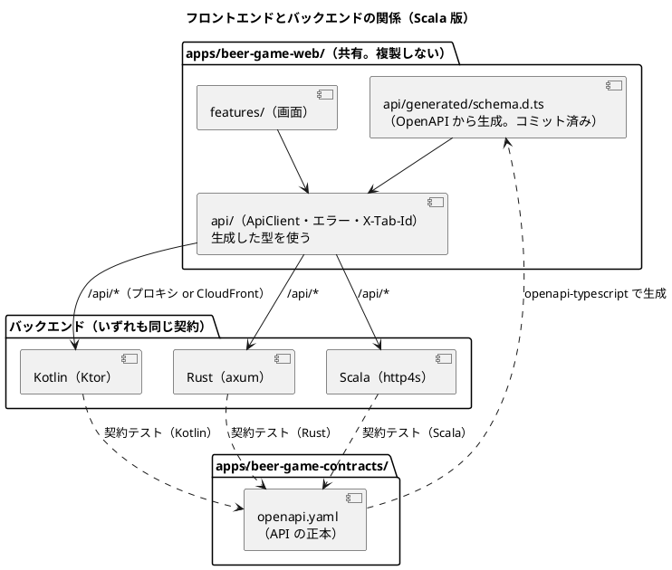

# フロントエンドアーキテクチャ - ビールゲームシミュレーション（Scala 版）

## 概要

本書は、beer-game-scala のフロントエンドのアーキテクチャを定めます。[ADR-001](../../adr/beer-game-scala/001-scala-version-of-beer-game-kotlin.md) の決定は、フロントエンドを**既存の React / TypeScript のまま踏襲する**ことです。**結論: API の契約（`openapi.yaml`、エラーの `code`、problem+json、`versions` だけの応答、`If-Match`）が同じなら、フロントエンドはバックエンドの言語に依存しないため、`apps/beer-game-web` と `apps/beer-game-contracts` を変更せずに共有できます。** `docs/` を設計の正本とします。

**範囲（ユーザーの決定、2026-11-25。M19）**: 実装として約束するのは U1〜U3 です。**U1〜U3 の間は、実際の研修には使いません（検証・事例用）。** U1〜U3 では、振り返り・保持状態・結果の出力の API が無く、最終週の後のリンク（`/games/{id}/review`）から先の画面は失敗します（[UI 設計](./ui-design.md) の #16）。

このため、本書は **フロントエンドの設計（構成、ルーティング、状態管理、API の契約の持ち方、版の扱い、共同入力、エラーの識別子、アクセシビリティ）を複製しません。** 正本は [Kotlin 版のフロントエンドアーキテクチャ](../beer-game-kotlin/architecture-frontend.md)（beer-game2 を引き継ぎ、ES + CQRS の影響を反映済み）です。Rust 版と同じ方針（[Rust 版](../beer-game-rust/architecture-frontend.md)）で、**Scala のバックエンド（http4s）に向けるときの差分**だけを定めます。UI の画面・遷移は [UI 設計（Scala 版）](./ui-design.md) を経由して Kotlin 版を参照します。

### 本書の位置づけと確認の範囲

- **本書で確認したこと**: 共有の `apps/beer-game-web` を読み取り専用で調べ、バックエンドへの結合点の現状を確認しました（2026-11-25）。コードは変更していません。
  - `package.json` の名前は `@beer-game/web`、`api:lint`・`api:generate` は `../beer-game-contracts/openapi.yaml` を参照する。
  - `vite.config.ts` は `/api` を `http://localhost:${API_PORT}` へプロキシする（`API_PORT` の既定は 3000）。
  - `src/api/client.ts` は、すべての要求に `X-Tab-Id` ヘッダーを付ける。
  - ポーリングは **3 画面**にある: `src/features/play/PlayPage.tsx` の `PLAY_POLL_MS`、`src/features/lobby/LobbyPage.tsx` の `LOBBY_POLL_MS`（準備中のときだけ）、`src/features/observer/ObservationPage.tsx` の `OBSERVATION_POLL_MS`（終了後は止まる）が、**いずれも 3000（3 秒）**（2026-11-25 にソースを読んで確認）。**`src/features/console/`（進行役のコンソール）には `setInterval` がない**（自動更新も手動更新のボタンも無い。**全実装共通の画面の課題**。[UI 設計](./ui-design.md) の未決事項 8）。失敗の扱いは、Play と Observation が**黙って無視**、Lobby は **403 だけ表示して取り直しをやめる**。`src`・`support`・`steps` に `EventSource` は存在しない（**SSE は使っていない**）。
  - `support/hooks.mjs` は、バックエンドの未起動時に、**Kotlin 版（`./gradlew :app:run`）と TS 版の起動コマンドを案内する文言**を出して失敗する。Scala 版の案内は無い。
- **確認状況の唯一の一覧**は [技術スタック](./tech-stack.md#確認状況の一覧) です。
- **レビュー（2026-11-25）への対応の承認の状況**: ユーザーが決めたのは H3、H6、H7、H9（NF-P2 は p95 4 秒）に加え、再レビューへの対応の次の 4 件です。**N-H4（検証用の CI は U1 の約束に含め、AWS 環境・デプロイ用ワークフローは後回し）、N-H6、N-H7、N-H8（U1〜U3 は実際の研修に使わない）**。**H10・M17・SF2 の記述の直しを含め、これら以外は AI の案で、承認を得ていません**。
- **確認状況の正本の規則（N-H5。AI の案で承認を得ていない）**: [技術スタックの確認状況の一覧](./tech-stack.md#確認状況の一覧)が正です。一覧の根拠は実測の記録（[データモデル](./data-model.md) の「検証の結果」と [テスト戦略](./test-strategy.md) の「確認した事項」）で、一覧を直すときは根拠も直します。
- **確認していないこと**: Scala のバックエンドに `web/` を向けたときの実際の動作は、**未検証**です（Scala 版のバックエンドがまだ存在しないため）。契約が同じなら動く、という**設計上の見込み**にとどまります。
- Kotlin 版の実装の経緯（B1〜B15 の注記）は引き継ぎません。Kotlin 版の未決事項は、本書の未決事項に引き継ぎます。

## 既存の `web/` のバックエンドへの結合点

Rust 版の調査（[Rust 版](../beer-game-rust/architecture-frontend.md)）の 4 つの結合点を、Scala 版にあてはめます。

| # | 結合点 | 現状（上で確認した実体） | Scala 版で必要な対応 |
| :--- | :--- | :--- | :--- |
| 1 | 開発時の接続先 | `/api` を `API_PORT` のポートへプロキシする。Kotlin に固有の値はない | **変更なし**。Scala のバックエンドを同じポートで起動すればよい（人の開発サーバーの 3000・5173 は止めない。E2E は専用の 3100・5273） |
| 2 | E2E のバックエンド起動の案内 | `hooks.mjs` の案内の文言が、Gradle と npm の起動コマンドだけ | **案内の文言を、Scala 版（sbt の起動）にも出せるようにする**（SF2）。Rust 版の RF3（起動コマンドを差し替え可能にする）は、Rust 版では承認済み（2026-11-19）だが、**既存の `hooks.mjs` の編集は実施前に改めて確認する条件つきで、まだ実施されていない**。**現時点の `hooks.mjs` には、その仕組みは無く**、案内の文言は Kotlin 版（`DB_KIND=h2 … ./gradlew :app:run`）と TS 版のものだけである（上で確認）。**Scala 版が先に差し替えの仕組みを足す場合も、Rust 版と同じ 1 回の編集にまとめる**（承認が要る。SF2） |
| 3 | 契約と受入条件の場所 | `package.json` は `../beer-game-contracts/openapi.yaml`、`cucumber.mjs` は `../beer-game-features/**/*.feature` を参照する（中立のディレクトリへ移動済み） | **共有する**（SF1）。Scala 版の `apps/beer-game-scala/` から、同じ契約と同じフィーチャーファイルを参照する |
| 4 | パッケージ名 | `@beer-game/web`（中立の名前に変更済み） | 変更なし |

**バックエンドが満たすべき契約の確認事項**（Scala のバックエンドが `web/` と動くための条件）:

| # | 確認した実装の事実 | Scala のバックエンドへの要求 |
| :--- | :--- | :--- |
| a | `api/client.ts` は、すべての要求に `X-Tab-Id` ヘッダーを付ける（タブごとの識別子。ADR-020） | バックエンドは、このヘッダーで資格の Cookie の名前（`bg_session_<id>`・`bg_recovery_<id>`）を決める。**http4s のミドルウェアで Cookie 名を解決する**（ADR-001 の 020 の行）。ヘッダーなしは従来の名前のまま |
| b | 現在の画面は、**3 画面（Play・Lobby・Observation）の 3 秒間隔の自動更新**（`PLAY_POLL_MS`・`LOBBY_POLL_MS`・`OBSERVATION_POLL_MS` が各 3000。console にはない）と、手動更新、保存・確定の応答の後の取得で更新する。**SSE を使わない**。取る GET は `/games/{id}/state`・`/sessions/{id}/state`・`/games/{id}/lobby`・`/games/{id}/observation` | **Scala 版のバックエンドは、SSE を実装しなくても、既存の画面は動く**。SSE は契約・非機能要件（NF-P4）にあり、**画面が使い始めるまで優先度を下げられる**（未決）。バックエンドの SSE の設計（fs2 の `Stream`、SBD9）は維持する。**レート制限の対象外にする経路は、メソッドつきのこの 4 つ**（`GET /games/{id}/state`・`GET /sessions/{id}/state`・`GET /games/{id}/lobby`・`GET /games/{id}/observation`。`/sessions/*` と書くと変更系まで含むと読めるため揃えた。M2。NF-S11 の専用の制限は別） |
| c | 開発時は、Vite の中継を通すと、バックエンドが見る `Host` と `Origin` が一致せず、変更系の要求が 403 になる | `ALLOWED_ORIGINS=http://localhost:<UI のポート>` を指定する。Scala のバックエンドも、**同じ設定名（`ALLOWED_ORIGINS`）で Origin の許可リストを受け取る**（NF-S8。[インフラ](./architecture-infrastructure.md) の「ローカルの開発環境」で名前を Kotlin 版と揃える提案）。Origin の検査は弱めない |
| d | エラーの扱いは `problem+json` の `code` を辞書の鍵にする（`api/problems.ts`、`Record<ErrorCode, …>`） | [UI 設計（Scala 版）](./ui-design.md) の影響の表のとおり。**http4s の既定の応答（経路なし、メソッド違い、本文の解析の失敗）を、problem+json に統一する** |
| e | 型は `openapi-typescript` で生成し、生成物をコミットする。`api:check` が差分 0 を検査する | 仕様を変えるときは、**仕様 → 契約テスト（Scala 側。失敗）→ 実装 → 型の再生成 → 画面**の順（Kotlin 版と同じ） |

## 決定の整理

Kotlin 版の決定を**そのまま引き継ぎます**（小規模・`features/` の機能単位の構造、SPA（React）、Vite でビルドし CloudFront から配信、URL ルーター、画面ごとのカスタムフックと `useState`（グローバルな状態ライブラリなし）、OpenAPI を正本とした型の生成、`ApiClient`、`problem+json` の `code` を鍵にした表示名の辞書、保存後は応答の `versions` を受けてスナップショットを取得、スタイルは CSS の設計トークン、アクセシビリティは WCAG 2.2 AA）。

**Scala 版で変わるのは、バックエンドの接続先と起動の案内だけ**です。

| 決定項目 | 採用 | Kotlin 版との違い |
| :--- | :--- | :--- |
| フロントエンドの実体 | **共有の `apps/beer-game-web` を使う**（複製しない。SF1） | 設計の正本の置き場所が違う（本書は参照） |
| 開発時の接続先 | `/api` を、Scala のバックエンド（sbt で起動）へプロキシする（`API_PORT`） | プロキシの先が Ktor から http4s になるだけ |
| E2E のバックエンド | Scala のバックエンドを、専用のポート（3100）で起動して使う（UI は 5273）。起動の案内を Scala 版にも出せるようにする（SF2） | 案内の文言が Gradle 固有 |
| API の契約 | `apps/beer-game-contracts/openapi.yaml` を**共有する**。契約テストは Scala で書く（http4s のルートを関数として呼ぶ。SBD6） | Kotlin の契約テストの代わりに Scala の契約テスト |
| リアルタイム更新 | **既存どおり、3 秒間隔の自動更新（ポーリング。Play・Lobby・Observation の 3 画面）と手動更新**。SSE は使わない。NF-P2 は p95 4 秒（ユーザーの決定、2026-11-25） | 変更なし |

## 全体構成

**同じフロントエンド・同じ契約・同じフィーチャーファイルを、3 つのバックエンドが満たす**構図です。Scala 版のバックエンドが Kotlin 版と**契約として同等であること**を、既存の画面と E2E で確かめられます（SF3）。

### 開発と配信

| 項目 | 設計 |
| :--- | :--- |
| 開発 | Vite の開発サーバーが、`/api` を Scala のバックエンドへプロキシする（接続先は `API_PORT`。固定のポートを書かない）。バックエンドは sbt で起動し、データベースは H2 の PostgreSQL モード（ユーザーの決定、2026-11-25。ST9。導入は承認待ち）。E2E は PostgreSQL で実行する。開発環境は `nix develop .#scala` |
| Origin の検査 | 上の確認事項 c |
| 型の生成 | `apps/beer-game-contracts/openapi.yaml` から、`apps/beer-game-web/src/api/generated/schema.d.ts` へ生成する。生成物はコミットし、`api:check` で差分 0 を検査する（Kotlin 版の運用を引き継ぐ） |
| 配信 | 静的ファイルを S3 へ版つきで配置し、CloudFront から配信する（[インフラ](./architecture-infrastructure.md)）。**フロントエンドは、バックエンドのイメージに含めない** |
| E2E | Cucumber-JS + Playwright（Chromium）。Vite は 5273、バックエンドは 3100。**`@ui` のフィーチャーファイルを共有する**（[テスト戦略](./test-strategy.md)） |
| Node | Node 26（フロントエンドのビルドと E2E にだけ使う。[技術スタック](./tech-stack.md)） |

## API の契約

契約の置き場所と流れ（仕様を正本とし、型を生成し、実装を契約テストで検証する）、`ApiClient`（`Idempotency-Key` の付与、`If-Match` は `SaveDecision` だけ、`problem+json` の `code` の解釈、相関 ID）、**ストリームごとの版（`versions: { game, session }`）**、共同入力の扱い、エラーの識別子と表示名、状態の持ち方は、**Kotlin 版と同じ**です。差分は次のとおりです。

| 項目 | Scala 版 |
| :--- | :--- |
| 契約テスト | Kotlin 版は `app` の test（`json-schema-validator`）。**Scala 版は、http4s のルートを関数として呼ぶテスト**（`routes.orNotFound.run(Request[IO](...))`。ガイド §7.1。[テスト戦略](./test-strategy.md)）。スキーマ検証の道具は JVM の共有を見込むが**未確認**（[技術スタック](./tech-stack.md)） |
| エラー `code` の一致 | 仕様の `code` の一覧と、`DomainError` の `code` と `AppFailure` の写像の全体を突き合わせる（欠けても余っても失敗）。辞書（`Record<ErrorCode, …>`）が仕様の `code` を網羅することは、フロントエンドの型検査で守られる（既存） |
| 変更の手順 | **仕様 → 契約テスト（Scala。失敗）→ Scala の実装 → 型の再生成 → 画面**。契約を変えると、**Kotlin・Rust のバックエンドにも影響する**ため、すべての契約テストを通す（SF1） |

## リアルタイム更新の方式

**現在の `web/` は、SSE を使いません**（上の確認事項 b）。更新は、**Play・Lobby・Observation の 3 画面の 3 秒間隔の自動更新**（`PLAY_POLL_MS`・`LOBBY_POLL_MS`・`OBSERVATION_POLL_MS`。console にはない。失敗は Play と Observation が黙って無視し、Lobby は 403 だけ表示して取り直しをやめる）、手動更新、保存・確定の応答の後の取得（`catchUp`）です。**Scala 版も同じ**にします。

- **SSE の設計**（`state-version` の通知がストリームの種別と版を運ぶ、ストリームごとの版の比較、`useLiveSnapshot`、切断時のポーリング、`Last-Event-ID` による再生はしない）は、Kotlin 版の設計を維持し、**フロントエンドが SSE を使い始める時点**で実装する。バックエンドの SSE は、[バックエンドアーキテクチャ](./architecture-backend.md)の設計（http4s の `ServerSentEvent` と fs2 の `Stream`。**API は未確認**）に従う。
- **NF-P2・NF-P4**: 現在の自動更新の間隔（3 秒）では、反映の遅れは最大で約 3 秒に GET の所要を足したものです。**NF-P2 は p95 4 秒に再定義した**（ユーザーの決定、2026-11-25。Rust 版が 2026-11-23 に同じ再定義をした）。「p95 約 2.86 秒」は **Rust 版の推定**（GET の実測 + 3 秒間隔からの計算。画面を介した実測ではない。[Rust 版の NFR の検証結果](../../development/beer-game-rust/nfr_results.md)）で、Kotlin 版・Scala 版の実測ではありません。**Scala 版の値は実測していません**（B1 以降。[非機能要件](./non-functional.md) に従う）。
- **NF-P2 を 2 秒に戻す選択肢（SSE の導入）**: 画面を変えない前提（SF1・SU2）と両立しないため、**全実装共通の画面の改善として別に扱う**（Scala 版だけでは決めない）。
- 同期投影のため、取得したスナップショットの版は、応答の `versions` 以上であることが保証される（バックエンドの問い合わせの REPEATABLE READ と `projection_checkpoints` の同時読み取り）。この保証を **Scala 版のバックエンドも満たす**（統合テストの「問い合わせの一貫性」）。

## 品質属性への対応

Kotlin 版と同じです（アクセシビリティ、堅牢性、セキュリティ（資格は JavaScript から読めない Cookie、CSP を前提にインラインのスクリプトを使わない）、観測性（エラー表示の相関 ID）、テスト容易性）。**Scala 版の追加**: 契約テストは、**同じ契約を 3 つのバックエンド（Kotlin・Rust・Scala）が満たす**ことを、同じ `openapi.yaml` に対して検査する。

## テスト戦略との対応

画面は Testing Library、`ApiClient` と自動更新は単体テスト、利用の流れは Cucumber-JS + Playwright（`@ui`）で確認します（[テスト戦略](./test-strategy.md)）。加えて、次を確認します。

- **契約テスト（Scala 側）が、仕様と Scala の実装の一致を保証する**。
- 生成した型でフロントエンドをビルドし、仕様の変更による型エラーを検出する（CI の順序: 仕様の検証 → 型の生成 → 型の検査 → テスト）。
- **SF3: 既存の `@ui` のシナリオと E2E を、Scala のバックエンドに向けて通す**ことを、Scala 版の受入の一部にする。

## 設計判断

**SF1〜SF3 は、AI が起草した案で、ユーザーの承認を得ていません**（Rust 版の RF1〜RF3 は承認済みで、Scala 版はそれに倣った提案）。

### SF1: フロントエンドは複製せず、共有の `apps/beer-game-web` と契約・フィーチャーファイルを使う（提案）

| 案 | 内容 | 評価 |
| :--- | :--- | :--- |
| **A（提案）** | **共有の `apps/beer-game-web`、`apps/beer-game-contracts`、`apps/beer-game-features` をそのまま使う**（複製しない）。Scala 版の CI・E2E は、Scala のバックエンドに向けて実行する | すでに中立のディレクトリにあり、**追加の構造変更が要らない**。画面と E2E が 1 か所で、食い違わない。共有物の変更が 3 つのバックエンドに影響する |
| B | `apps/beer-game-scala/web/` に複製する | Scala 版が自己完結する。画面・契約・E2E が二重になり、差分の管理が要る |

トレードオフ: A は、契約の変更が他の版に波及します。波及を防ぐため、すべての契約テストを CI で通します。将来、版が分かれて進化する場合は B へ移行し、ADR に記録します。

### SF2: E2E のバックエンドの起動の案内を、Scala 版にも出せるようにする（提案）

`support/hooks.mjs` の案内の文言が、Kotlin 版と TS 版の起動コマンドだけです（上で確認）。**起動コマンドの案内を、環境変数または設定で差し替えられるようにする**（Rust 版の RF3 と同じ。**RF3 は Rust 版では承認済みだが、既存の `hooks.mjs` には未実施**（2026-11-25 に確認）。「RF3 が実施されていれば使う」ではなく、**RF3 と同じ 1 回の編集にまとめる**）。実際の起動の自動化は別の判断で、現在の「起動済みを前提にし、起動していなければ案内して失敗する」方式を維持します（人の開発サーバーを止めない、専用のポートを使う、という既存の運用を守る）。**既存のファイルの編集で、他の版に影響するため、承認を得てから行います。** **E2E 用のレート制限をゆるめる設定（TS 版の `AUTH_RATE_LIMIT_PER_MINUTE` に当たるもの）の名前も、SF2 の「設定名を揃える」に含める**（L3。E2E が参加・復帰の専用の制限に当たらないようにするため。Origin の検査（`ALLOWED_ORIGINS`）は弱めない）。

### SF3: Scala のバックエンドの契約上の同等性を、既存の `@ui`・E2E で確かめる（提案）

既存の画面コードと E2E は、API の契約にだけ依存しています（上の調査）。同じ画面・同じ `@ui` のシナリオを Scala のバックエンドに向けて通すことは、**契約どおりであることの最も強い検証の 1 つ**です。契約テストが検出できない領域（スキーマで表せない条件、SSE）を、画面を通した確認で補います（Rust 版の RF2 と同じ）。

## beer-game-kotlin からの変更

| # | beer-game-kotlin | beer-game-scala | 理由 |
| :--- | :--- | :--- | :--- |
| 1 | フロントエンドの設計を本文に持つ | **差分の文書**。本文は Kotlin 版を正本として参照（SF1） | 二重管理の回避 |
| 2 | プロキシの先は Ktor | Scala のバックエンド（`API_PORT` の同じ仕組み） | 契約が同じ |
| 3 | E2E の起動の案内は Gradle | 差し替え可能にする（SF2。承認が要る） | 案内の文言が言語に固有 |
| 4 | 契約テストは Kotlin | 契約テストは Scala（ルートを関数として呼ぶ） | 言語の違い |
| 5 | （結合点の調査なし） | 共有の `web/` の結合点（4 件）と、バックエンドが満たすべき契約の確認事項（5 件）を整理 | Scala 版のバックエンドを既存の画面に向けるための前提の確認 |

**フロントエンドの構成・ルーティング・状態管理・API の契約・版・共同入力・エラーの識別子・アクセシビリティは変えません。**

## 変更の記録（レビュー対応。2026-11-25）

[設計書レビュー](../../review/beer-game-scala/design_review_20261125.md) の指摘への対応です。**ユーザーが決めたのは H3・H6・H7・H9 の方針だけで、他の直し方は AI の案です（承認を得ていません）。**

| 指摘 | 変更 | 状態 |
| :--- | :--- | :--- |
| H9 | NF-P2 の選択肢の記述（SSE で 2 秒）を、「画面を変えない前提と両立しないため、全実装共通の画面の改善として別に扱う」に直した。NF-P2 は p95 4 秒 | ユーザーの決定 |
| H10 | ポーリングの範囲を実際の画面（Play・Lobby・Observation が各 3 秒、console にはない。失敗の扱いの違い）に合わせた。「Kotlin 版・Rust 版の実測（約 2.86 秒）」を「Rust 版の推定」に。レート制限の対象外にする GET の範囲を明記 | AI の案 |
| M15 | SF2 の自己矛盾（RF3 は承認済みだが `hooks.mjs` は未対応）を直した | AI の案 |
| M17 | `DB_KIND` の記述をインフラに揃えた（持つ。`postgres\|h2`、既定は `postgres`） | AI の案 |

### 再レビュー（2026-11-25。[設計書の再レビュー](../../review/beer-game-scala/design_rereview_20261125.md)）への対応

**ユーザーが決めたのは N-H4・N-H6・N-H7・N-H8（U1〜U3 は研修に使わない）の方針だけで、他は AI の案です（承認を得ていません）。**

| 指摘 | 変更 | 状態 |
| :--- | :--- | :--- |
| M2 | レート制限の対象外の経路を、メソッドつきの 4 つに揃えた | AI の案 |
| M3 | コンソールの自動更新が無いことを、全実装共通の画面の課題として注記 | AI の案 |
| L2 | 出典に `LobbyPage.tsx`・`ObservationPage.tsx`・`console/` を追加 | AI の案 |
| L3 | SF2 に、E2E 用のレート制限をゆるめる設定の名前を含めた | AI の案 |
| N-H8・M19 | U1〜U3 は研修に使わず、最終週の後の画面は API が無いことを冒頭に | ユーザーの決定 |
| N-H5 | 確認状況の正本の規則を追加 | AI の案 |

## 未決事項

1. **SF1〜SF3 の承認**。SF2 は、`hooks.mjs`（既存のファイル）を編集する前に改めて確認する。
2. **環境変数の名前の揃え方**: Scala のバックエンドの設定名（`ALLOWED_ORIGINS`・`PORT`・`APP_ENV` など）を、Kotlin 版と揃えるか（提案は揃える。**`DB_KIND`（`postgres|h2`、既定は `postgres`）も含める**。[インフラ](./architecture-infrastructure.md) の「ローカルの開発環境と H2 の拒否」と同じ。`hooks.mjs` の起動案内の文言（Kotlin 版は `DB_KIND=h2`）に直接効く。M17）。
3. **http4s の既定の応答**（経路なし、メソッド違い、本文の解析の失敗）の形と、problem+json への写像（[UI 設計](./ui-design.md)）。
4. **SSE の優先度**: 画面が SSE を使い始める時期。バックエンドの SSE の API（http4s の `ServerSentEvent`）の確認。
5. **Scala 版の CI での `web`・`ui` ジョブの構成**: Kotlin 版・Rust 版のワークフローの同名ジョブとの重複と分担（[インフラ](./architecture-infrastructure.md) の SI5）。
6. **Scala のバックエンドを既存の `web/` に向けた実際の動作**（SF3）: B1 以降で検証する。
7. **Kotlin 版の未決事項の引き継ぎ**: 表示名の辞書の形式、設計トークンの管理とコントラスト比の自動検査、ルーターのライブラリ、防御的な再取得の要否、`useLiveSnapshot` の実装時期、アクセシビリティの自動検査・200% 拡大・スクリーンリーダーの確認、進行役のコンソールの未実装の機能。いずれも [Kotlin 版の未決事項](../beer-game-kotlin/architecture-frontend.md) に追従する。

## 出典

- [フロントエンドアーキテクチャ（beer-game-kotlin）](../beer-game-kotlin/architecture-frontend.md)、[フロントエンドアーキテクチャ（Rust 版）](../beer-game-rust/architecture-frontend.md)、[beer-game2 のフロントエンドアーキテクチャ](../beer-game-ts/architecture-frontend.md)
- [ADR-001（Scala 版）](../../adr/beer-game-scala/001-scala-version-of-beer-game-kotlin.md)、[UI 設計](./ui-design.md)、[バックエンドアーキテクチャ](./architecture-backend.md)、[テスト戦略](./test-strategy.md)、[非機能要件](./non-functional.md)、[インフラストラクチャ](./architecture-infrastructure.md)、[技術スタック](./tech-stack.md)
- 共有の `web/` の調査（読み取り専用、2026-11-25）: `apps/beer-game-web/` の `package.json`、`vite.config.ts`、`support/hooks.mjs`、`src/api/client.ts`、`src/features/play/PlayPage.tsx`、`src/features/lobby/LobbyPage.tsx`、`src/features/observer/ObservationPage.tsx`、`src/features/console/`（ポーリングの有無・範囲外の画面のソース。L2）
- [アーキテクチャ設計ガイド](../../reference/アーキテクチャ設計ガイド.md)
- [関数型プログラミングガイド（Scala 編）](../../reference/関数型プログラミングガイド_Scala編.md) §7.1
- [ADR-006](../../adr/beer-game-ts/006-sse-version-only.md)、[ADR-010](../../adr/beer-game-ts/010-url-router-and-features.md)
