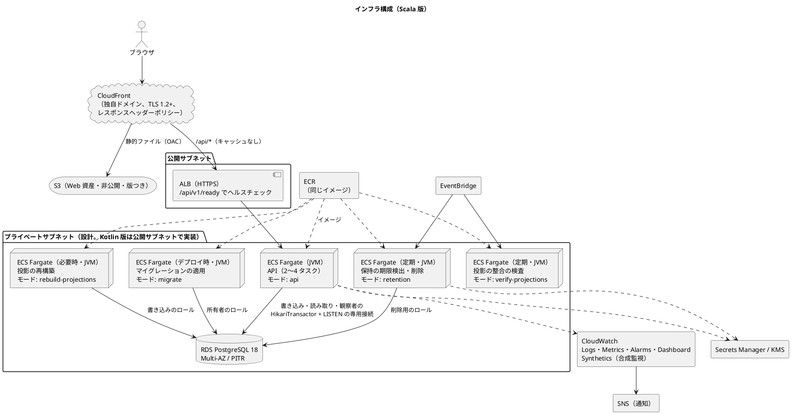
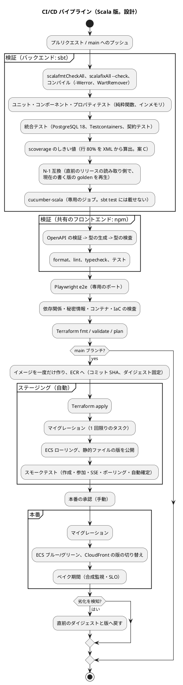

# インフラストラクチャアーキテクチャ - ビールゲームシミュレーション（Scala 版）

## 概要

本書は、beer-game-scala の実行環境と配信の構成を定義します。[ADR-001](../../adr/beer-game-scala/001-scala-version-of-beer-game-kotlin.md) により、[beer-game-kotlin のインフラ](../beer-game-kotlin/architecture-infrastructure.md)（beer-game2 の構成を踏襲）を**正本として引き継ぎ**、Scala 版で変わる点だけを定めます。**`docs/` を設計の正本**とします。実装コードも、インフラのコードも、まだ存在しません（アプリの置き場は `apps/beer-game-scala` を予定）。

引き継ぐ構成は、CloudFront の単一オリジン（静的ファイルは S3、`/api/*` は ALB）、ECS Fargate、RDS for PostgreSQL 18、ECR、Terraform（リモートの状態・環境ごとに分離・モジュール化）、GitHub Actions の OIDC、ステージング自動・本番承認とブルー/グリーン、構造化ログとメトリクス（EMF）、合成監視、アラームです。**非同期・キューは使いません**（Kotlin 版と同じ）。Scala 3 は Kotlin と同じく **JVM 上で動く**ため、JVM に由来する設計（ヒープ、起動の遅さ、SIGTERM、ウォームアップ）は Kotlin 版を引き継ぎます。

変わるのは、次の点です。

- **ビルド**: Gradle から **sbt**（マルチプロジェクト）へ。成果物の作り方（配布物）は未決。
- **コンテナ**: JRE のイメージは同じ（Temurin 25）。**依存の JAR とアプリの JAR を別の層に分ける方法**が、Gradle の配布から sbt のものに変わる（`sbt-native-packager` の採否は未決）。
- **データベースの接続**: JDBC + HikariCP から **doobie の `HikariTransactor`**（用途別。ST8）へ。ロールを用途別に分けるのは同じ。
- **ローカル開発の DB**: ローカル開発だけ **H2 の PostgreSQL モード**（ユーザーの決定、2026-11-25。ST9）。**本番・ステージングでは起動時の検査で H2 を拒否**し、**配布（本番イメージ）から H2 を除外**する。H2 の依存の導入は承認待ち。
- **CI/CD**: 検証の手順が sbt になる。**Scala 版専用のワークフローを新設する**（team の規約）。デプロイは「設計」のみで、ワークフローはまだ作らない。
- **Terraform**: Scala 版専用に複製して出発する案（SI4。提案）。

アプリは [バックエンド](./architecture-backend.md)、[フロントエンド](./architecture-frontend.md)、運用は [運用要件](./operation.md) を参照してください。

### 本書の位置づけと確認の範囲

- **本書で確認したこと**: Kotlin 版・Rust 版のインフラ設計と、既存の `.github/workflows` の Kotlin 版・Rust 版のジョブ構成を読み、Scala 版で変わる点を洗い出しました（2026-11-25）。版は [技術スタック](./tech-stack.md) の記載のみを使います。
- **確認していないこと**: コンテナのビルドと実行、起動モード、SIGTERM の振る舞い、起動時間、メモリ、sbt の配布物の作り方、Terraform、CI/CD は、**すべて未実装・未検証**です。実行イメージの実在（`eclipse-temurin:25-jre-noble`）は、Kotlin 版が 2026-11-15 に確認した値の引用で、**本書では再確認していません**。
- Kotlin 版の実装の経緯（B2・B3・B14 の注記）は引き継ぎません。Kotlin 版の未決事項は、本書の未決事項に引き継ぎます（Rust 版と同じ扱い）。

## 確認したバージョン

版は、**[技術スタック](./tech-stack.md) が 2026-11-25 に Maven Central で確認した値**を使います。本書では再確認していません。確認できなかったものは「要確認」です。

| 区分 | 技術 | 版 | 出典・備考 |
| :--- | :--- | :--- | :--- |
| 言語 | Scala 3 | **3.7.4**（第一候補） | [技術スタック](./tech-stack.md)。ガイドの確認版は 3.7.0 |
| ビルド | sbt | **1.13.1** | 同上。sbt 2 は採らない（ST1） |
| 実行環境 | JDK（Eclipse Temurin、LTS） | **25**（第一候補） | Kotlin 版の確認値（EOL 2031-09-30。endoflife.date、2026-11-14）。**本書では再確認していない**。Nix の開発シェルは JDK を指定していない（要確認） |
| 型クラス・副作用 | cats-core / cats-effect / fs2 | **2.13.0** / **3.7.1** / **3.16.0** | [技術スタック](./tech-stack.md) |
| Web・DB | http4s / doobie | **0.23.39** / **1.0.0-RC12** | 同上。doobie は RC。http4s の 1.0 はマイルストーンのみ |
| 接続プール・ドライバ・マイグレーション | HikariCP / PostgreSQL JDBC / Flyway | **7.1.0**（要確認）/ **42.7.15** / **13.12.2** | 同上 |
| ログ | log4cats-slf4j / Logback | **2.8.0** / **1.6.8** | 同上 |
| IaC | Terraform / AWS プロバイダー | Kotlin 版の値（作業用 1.17.2、`required_version >= 1.17.0`、`~> 6.0`）を引き継ぐ | **再確認していない** |
| データベース | PostgreSQL 18（RDS、ローカルも） | 18 | Kotlin 版の確認値。**再確認していない** |
| フロントエンドのビルド | Node 26 | Kotlin 版・beer-game2 の値 | **再確認していない** |
| コンテナのイメージ | Eclipse Temurin | ビルド `25-jdk-noble`、実行 `25-jre-noble`（第一候補） | Kotlin 版が 2026-11-15 に `docker pull` で実在を確認した値。**本書では未確認** |

| 確認できていない事項 | 扱い |
| :--- | :--- |
| Scala 3.7.4 と JDK 25 の組み合わせ、sbt 1.13.1 と JDK 25 | B1 のビルドで確認する（[技術スタック](./tech-stack.md) の未決事項 3） |
| sbt での配布物（依存の JAR とアプリの JAR を別の層にする）の作り方 | 下の「ビルド（sbt）」と SI1。`sbt-native-packager` の版・採否は未確認 |
| doobie `HikariTransactor` が使う HikariCP の版 | 要確認（[技術スタック](./tech-stack.md)） |

## 決定の整理

Kotlin 版から変更する点を太字で示します。

| 決定項目 | 採用 | Kotlin 版との違い・根拠 |
| :--- | :--- | :--- |
| クラウド・デプロイ形態・配信・データベース・非同期 | AWS（`ap-northeast-1`）、ECS Fargate、CloudFront の単一オリジン、RDS PostgreSQL 18、キューなし | 変更なし |
| 定期処理 | EventBridge による ECS タスク。**同じイメージの別の起動引数**で起動する | 変更なし |
| **イメージ** | **ECR。JRE のイメージ（Temurin 25）の上に、sbt のビルド成果物を載せる。マルチステージ**。配布物の作り方は SI1 | Gradle の配布から変更 |
| 実行環境 | JVM。コンテナのメモリに応じたヒープ、SIGTERM での正常終了、起動時間を考慮した準備のヘルスチェック | 変更なし（JVM のまま）。**`IOApp` の SIGTERM の終了コードは未確認**（SI3） |
| 秘密情報 | Secrets Manager（鍵の版を複数保持）、KMS。ロールごとに別の DB の接続情報 | 変更なし |
| IaC | Terraform。**Scala 版専用に複製して出発する**（SI4。提案） | team の規約は beer-game3 専用の環境のため |
| **ビルド** | **sbt（マルチプロジェクト、`build.sbt` の版は 1 か所、`project/build.properties` で固定）** | Gradle から変更。フロントエンドは npm のまま |
| CI/CD | GitHub Actions（OIDC）。ステージングは自動、本番は承認 + ブルー/グリーン。**ワークフローは Scala 版専用に新設**（SI5） | 検証の手順が sbt になる |
| 観測 | 構造化ログ、メトリクス（EMF）、合成監視、アラーム、ダッシュボード | **JVM の指標は同じ。`Fiber`・接続プール・`idle in transaction` を加える**（[運用要件](./operation.md)） |

## 全体構成

構成は Kotlin 版の図と同じです。**API は、モード（`api`、`retention`、`migrate`、`rebuild-projections`）を引数で切り替える同じイメージ**で、`verify-projections`（日次）を加えます。



プライベートサブネットか公開サブネットか、KMS の顧客管理鍵、DB ログインロールの分離は、Kotlin 版でも実装と設計の差が残っています（人の判断待ち）。Scala 版は**設計どおり（プライベートサブネット）を目標とするが、費用（NAT、VPC エンドポイント）を含めて未決**とします（未決事項）。

### 構成要素

Kotlin 版の構成要素の表（CloudFront、ALB、API サービス、保持・マイグレーション・再構築のタスク、RDS、秘密情報、観測）を**そのまま引き継ぎ**、次の読み替えを加えます。

| 要素 | Scala 版の読み替え |
| :--- | :--- |
| ALB | ヘルスチェックは `GET /api/v1/ready`。**JVM の起動に時間がかかるため、サービスのヘルスチェックの猶予期間を設ける**（値は起動時間の実測で決める。Kotlin 版と同じ） |
| API サービス | **タスクのサイズの初期案: 1 vCPU / 2 GiB**（Kotlin 版と同じ。Scala・Cats Effect のヒープ、再生の所要時間、GC を測定した後に決める。SI2） |
| 保持・マイグレーション・再構築のタスク | 同じイメージを、起動引数（`retention`、`migrate`、`rebuild-projections`、`verify-projections`）で切り替える。再構築は研修中、運営者を通じて進行役に停止を依頼し、排他のアドバイザリロックで直列化する（[運用要件](./operation.md)） |
| 観測 | JSON ログ（`LogRecord`）とメトリクス（EMF）は標準出力へ出し、コンテナのログドライバが CloudWatch Logs へ送る。JVM のヒープ・GC に加え、**`Fiber` の数、接続プールの待ち、`idle in transaction`** のアラームを加える |

### データベースのロールと接続

用途別のロール（書き込み、読み取り、観察者の読み取り、通知の受信、削除、所有者）と、その権限は Kotlin 版の表を引き継ぎます（`events` は書き込みロールが INSERT / SELECT のみ。観察者は `game_overview`・`session_overview`・`week_team_totals` の SELECT のみ）。**接続の持ち方だけが変わります。**

| ロール | 使うタスク | Scala 版の接続の持ち方 |
| :--- | :--- | :--- |
| 書き込み | api（コマンド）、rebuild-projections | `HikariTransactor`（`Resource`。トランザクション単位） |
| 読み取り | api（問い合わせ） | 別の `HikariTransactor` |
| 観察者の読み取り | api（観察者の問い合わせ） | さらに別の `HikariTransactor` |
| 通知の受信 | api | **プールの外の専用の接続**（1 タスクにつき 1 本。fs2 の `Stream` で受信し、切断したら再接続する） |
| 削除 | retention | 小さな `HikariTransactor`（削除用のロール。Kotlin 版は `SET ROLE` で実現した） |
| 所有者 | migrate | 1 回限りの接続（Flyway） |

プールの配線の検査（`SELECT current_user`）は書き直します（バックエンドの「問い合わせ側」）。**接続数の見積もり**は Kotlin 版と同じ式（タスク数 × （書き込み + 読み取り + 観察者の各プールの最大 + 通知 1 本）+ 運用のタスク）で、タスクの最大数（4）で RDS の接続数の上限を超えないことを確認します。プールの大きさは負荷試験で決めます（未決）。**接続を集約するプロキシや接続プーラーは、`LISTEN` が動かない可能性があるため、置きません。** `doobie-hikari` が内部で使う HikariCP の版は要確認です。

## 環境

| 環境 | 用途 | デプロイ | Terraform の状態 |
| :--- | :--- | :--- | :--- |
| ローカル | 開発・確認 | バックエンドは sbt で起動、フロントエンドは Vite（`/api` をプロキシ）。**DB は H2 の PostgreSQL モード（Docker 不要。ST9）**。PostgreSQL を使う場合は Docker の PostgreSQL 18 を選べる（`DB_KIND=postgres`。`DB_KIND` を持つことは [フロントエンド](./architecture-frontend.md) の未決事項 2 と同じ）。開発環境は `nix develop .#scala` | — |
| CI | 検証 | GitHub Actions（**PostgreSQL 18** のサービスコンテナと Testcontainers）。統合テストと受け入れ（`@api`）は PostgreSQL で実行 | — |
| ステージング | 本番前の確認 | main へのマージで自動（ローリング） | 専用 |
| 本番 | 運用 | 手動の承認後（ブルー/グリーン） | 専用 |

各環境の Terraform の状態は、暗号化したリモートの保管先（S3 とロック）に、環境ごとに分けて持ちます（Kotlin 版と同じ）。

### ローカルの開発環境と H2 の拒否

Kotlin 版の「ローカルの開発環境と H2 の拒否」を、Scala 版に読み替えて引き継ぎます（ST9。ユーザーの決定、2026-11-25）。

- **実行する DB は `DB_KIND=postgres|h2`**（既定は `postgres`）で選ぶ。ローカル開発では `h2` を選べる。
- **本番・ステージングでの H2 の拒否**: `AppConfig.load` が、`APP_ENV` が本番・ステージングのとき、**`DB_KIND=h2`、または JDBC の URL（`DB_URL`）が `jdbc:h2:` で始まる設定**を**起動前に拒否**し、起動に失敗する（許可リスト方式。足りない設定と同じ終了の経路。Kotlin 版の同じ検査を引き継ぐ。`DB_KIND` だけの検査では、`DB_KIND=postgres` のまま URL を H2 にした設定を止められない。M4）。**環境（`local`・`test`・ステージング・本番）× `DB_KIND` × URL の種類の全組み合わせを単体テストで確かめる**。Terraform のタスク定義も `DB_KIND=postgres` を固定で渡す案（二重の防御。AWS は未適用）。
- **H2 は単一プロセスでしか有効でない**（プロセス内のロックと通知。ST9）。**2 つ目のプロセスを拒否する手段**（H2 のファイルのロックなど）を検討する（未決事項 14。M4）。
- **配布からの H2 の除外**: sbt の H2 の依存（`com.h2database:h2`。必要なら doobie-h2）は、**開発用の構成（sbt の独立した設定、または開発用の起動プロジェクト）だけに置き**、配布物（本番イメージの JAR の集合）に含めない。**構成の具体（sbt の設定名、`sbt run` と `Test` のクラスパスに残す範囲）は B1 で確定する（未確認）**。イメージの `lib` に H2 が無いことを、イメージの検査で確かめる。
- **H2 のドライバが無い環境で `DB_KIND=h2`** を選んだ場合も、起動に失敗する（本番・ステージングは、拒否の検査とドライバの欠落の二重の防御になる）。
- 起動の失敗（終了コード 70）や設定の誤り（78）の使い分けは、下の終了コードのとおり。

**設定の環境変数**（`APP_ENV`、`CREDENTIAL_KEY`、`IDEMPOTENCY_KEY`、`RESPONSE_KEY`、`DB_URL`、`DB_USER`、`DB_PASSWORD`、`PORT`、`HOST`、`ALLOWED_ORIGINS`、`COMMAND_MAX_ATTEMPTS`、`MIGRATE_ON_START`）は、フロントエンドの E2E の案内と手順書の差分を減らすため、**Kotlin 版と名前を揃える**（提案。`DB_KIND` を含む）。`AppConfig.load` が全項目の誤りを `ValidatedNec` で集め、失敗なら、足りない設定の**名前だけ**をログに出して終了する（終了コードは Kotlin 版と同じ 78 を第一候補。未決）。

## コンテナと JVM

### イメージ

```text
FROM（ビルド）  eclipse-temurin:25-jdk-noble   … sbt でビルド（sbt の版は project/build.properties で固定）
FROM（実行）    eclipse-temurin:25-jre-noble   … JRE と、ビルド済みの成果物だけ
                ENTRYPOINT [ "<起動スクリプト>" ]  CMD [ "<モード>" ]   … api / retention / migrate / rebuild-projections / verify-projections
```

- **マルチステージ**にし、実行用のイメージには、JRE とアプリの成果物（依存の JAR とアプリの JAR）だけを含めます。ビルドの道具（JDK、sbt、ソース）を含めません。
- 依存の JAR と、アプリの JAR を**別の層**にして、アプリだけの変更で、層のキャッシュが効くようにします。
- 実行は**非 root のユーザー**。ファイルシステムは読み取り専用を目指します。
- イメージのタグは、コミット SHA（ECR の不変のタグ）。
- ベースイメージ（`25-jre-noble`）の実在とサポート期限は、Kotlin 版の確認値です。**本書では再確認していません**（B1 で `docker pull` により確かめる）。軽量な派生の採否は、脆弱性の検査の結果とサイズで決めます（未決）。
- **H2 の依存関係は入れません。** 開発用の構成だけに置き、実行イメージ（`lib`）に含めない（ST9。上の「ローカルの開発環境と H2 の拒否」）。

### 配布物の作り方（設計判断 SI1）

依存の JAR とアプリの JAR を別の層にする配布物を、sbt でどう作るかが Gradle の `installDist` と違います。

| 案 | 内容 | 評価 |
| :--- | :--- | :--- |
| A | `sbt-native-packager`（`JavaAppPackaging`。起動スクリプトと `lib/` を生成する） | 起動スクリプトと層の分け方の実績が広い。**新しい sbt プラグインの導入で、承認が要る**。版・対応する sbt（1.13.1）・JDK 25 との組み合わせは**未確認** |
| B | sbt の標準の機能だけ（`Compile / fullClasspath` から依存の JAR を集め、自前の `Dockerfile` で配置し、`java -cp` で起動する） | 依存が増えない。起動スクリプトとクラスパスの管理を自前で持つ。層の分け方は `Dockerfile` で書ける |
| C | 1 つの実行可能な fat JAR（`sbt-assembly` など） | 配布が単純。依存の変更でも全体が再作成され、層のキャッシュが効かない。**新しいプラグイン**（Kotlin 版の ID1 の C と同じ評価） |

**採否は未決**です（[技術スタック](./tech-stack.md) の未決事項 11）。B1 で A と B を試し、層の分離、起動時間、プラグインの承認の手間を比べて決めます。**AI の第一候補は、新しい依存を足さない B から試すこと**ですが、これは提案で、人が決めます。

### 起動モードと終了コード

同じイメージを、`CMD`（引数）のモードで切り替えます。Kotlin 版の表（モード、終了コード 0・1・64・70・78）を**引き継ぎます**。

| モード | 内容 | 終了 |
| :--- | :--- | :--- |
| `api` | 常駐。SIGTERM で新しい要求の受付を止め、SSE を閉じ、追跡している `Fiber`（`Supervisor`）の完了を待つ | 下の SI3 |
| `migrate` | マイグレーションを適用して終了 | 成功で 0 |
| `retention` | 保持削除の掃引を 1 回行って終了 | 放棄したゲームがあれば 1、掃引の失敗は 70 |
| `rebuild-projections [ゲーム ID ...]` | 投影を `events` から作り直す（省くと全ゲーム。ゲームごとに排他のアドバイザリロック） | 再構築できなかったゲームがあれば 1、一覧が読めなければ 70、形が不正な ID は 64 |
| `verify-projections` | 投影が、イベントから作り直した結果と一致するかを検査する（日次。投影は変えない） | 不一致があれば 1 |
| 不明なモード | 使い方を示す | 64 |

終了コードの意味（0 成功、1 一部失敗、64 使い方の誤り、70 起動の失敗、78 設定の誤り）は sysexits の慣例で、Kotlin 版と同じです。起動の失敗（70）は、H2 のドライバの欠落（`DB_KIND=h2` のとき）や、**接続の失敗など**に当てます。**モードを `CMD` で渡し、上書きできる形**は、Kotlin 版の実装に倣う案で、人の確認が要る（未決）。

### JVM の設定（初期案。測定で決める）

Kotlin 版の表を引き継ぎます。

| 項目 | 設計 |
| :--- | :--- |
| ヒープの上限 | `-XX:MaxRAMPercentage` で、コンテナのメモリに対する割合で指定する。初期案は 70% 前後で、ヒープの使用量の測定で決める |
| メモリ不足 | `-XX:+ExitOnOutOfMemoryError` でプロセスを終了させ、ECS が再起動する |
| ログ | 標準出力。GC のログも標準出力へ出す |
| CPU | 起動直後のクラスの読み込みと JIT の CPU の高まりを、自動増減が追加の理由と誤解しないよう、クールダウンを設ける（値は測定で決める） |
| 起動の短縮 | 必要になれば AppCDS などを検討する。**ネイティブイメージは採用しない**（Kotlin 版の ID1 と同じ。Scala 3 での検証の費用は評価していない） |
| cats-effect | **`IOApp` の実行基盤のスレッド数は、CPU 数に応じた既定を使う**（vCPU の少ないコンテナでの計算用・ブロッキング用プールの大きさは、実測で確かめる。未決） |

### 起動と終了

Kotlin 版の表を引き継ぎます（設定の読み込みと検証 → 接続プールの作成 → 通知の受信 → HTTP の受付。`/ready` はデータベースの接続と通知の受信の生存が確認できるまで 503。マイグレーションのタスクの完了後にアプリを起動。スキーマの版が期待と一致しなければ準備できていない）。**Scala 版の読み替え**:

| 局面 | 設計 |
| :--- | :--- |
| 起動 | サーバー、プール、`Supervisor`、`LISTEN` の接続は `Resource` で作り、`IOApp` の中で `use` する。**起動時間の測る区間は Kotlin 版と同じ 2 つ**（アプリの起動時間 = プロセスの開始から `/ready` の成功まで、p95 30 秒（NF-P16 に対応。提案）。タスクの起動時間 = ECS がタスクの起動を始めてからヘルスチェックの成功まで）。**Scala 版の値は未測定**（Kotlin 版はローカルで最大 6.0 秒。Scala 版は別の実測が要る） |
| 終了 | SIGTERM で新しい要求の受付を止め、**SSE の接続に終了を知らせて閉じ**、`Supervisor` が追跡している `Fiber` の完了を待ち（待ちの上限は `stopTimeout` より短く）、接続プールを閉じる（`Resource` の解放）。クライアントは SSE が切れても再接続し、スナップショットで追いつく。**ember のシャットダウンの待ち方は未確認**（バックエンドの未決事項） |
| 負荷分散との整合 | ALB の登録解除の遅延と、アプリの終了の猶予を整合させる（Kotlin 版と同じ） |

#### SIGTERM の終了コード（設計判断 SI3）

Kotlin 版は、SIGTERM でコンテナの終了コードが 143（JVM が停止フックを実行して終わる）となり、「正常終了 0」の記述と差が出て、**人の判断待ち**でした。**`IOApp` が SIGTERM を受けたときの終了コードは、Scala 版では未確認**です。B1 で実測し、(a) 143 を正常とみなすアラームの条件にするか、(b) アプリが終了コード 0 で終わるようにするかを、人が決めます（案を絞らず未決とします）。

## ビルド（sbt）

| 項目 | 設計 |
| :--- | :--- |
| 構成 | sbt のマルチプロジェクト（`domain`、`application`、`adapterHttp`、`adapterPersistence`、`app`。依存は `dependsOn`。[バックエンド](./architecture-backend.md)）。`acceptance` は `sbt test` に載せない |
| 版の管理 | `build.sbt` に、依存の版を **1 か所（`lazy val`）にだけ**書く。`project/build.properties` で sbt の版を固定する。`scalaVersion` を固定する |
| 依存の固定 | 依存の版は、`build.sbt` の宣言で固定する。**ロックファイルに当たる仕組み（`dependencyLock` 相当）の採否は B1 で決める**（[技術スタック](./tech-stack.md)） |
| 警告 | scalac のオプション（`-deprecation -feature -Werror -Wunused:all -Wvalue-discard -Wnonunit-statement`）で、警告をビルドの失敗にする（ST4） |
| 静的解析 | WartRemover（`Compile` のみ。層ごとに許す Wart を変える）、Scalafix（`DisableSyntax`）、`scalafmtCheckAll` を CI で実行する |
| テスト | `test`（ユニット、コンポーネント、プロパティ）と、統合テスト（実際の PostgreSQL 18。`events` の追記専用の権限、連鎖削除の網羅、`Left` の ROLLBACK、複数プロセスの競合。Testcontainers）を分ける。sbt の設定で分ける方法は B1 で決める |
| カバレッジ | sbt-scoverage（文・分岐）と、XML の文の行番号から算出した行率（team の行 80% のゲート。案 C。ユーザーの決定、2026-11-25。出せるかは B1 で確認）。文・分岐のしきい値は暫定の追加のゲート（ST4。未実測） |
| 成果物 | `app` が、起動用の配布物を作る（SI1） |
| フロントエンド | `apps/beer-game-web` は npm（Node 26）でビルドし、sbt のビルドとは独立。仕様から型を生成する手順を、ビルドの前に置く（[フロントエンド](./architecture-frontend.md)） |

## CI/CD



### Scala 版が追加するジョブ（設計判断 SI5。提案）

既存の `.github/workflows` には、`beer-game-kotlin.yml`（`contract`・`test`・`detekt`・`pmd`・`web`・`ui`・`container`・`n1`・`deploy-demo` などのジョブ）と、`beer-game-rust.yml`（`check`・`container`・`infra` のジョブ）、それぞれのデプロイとロールバックの 4 本があります（2026-11-25 に確認）。Scala 版は、**これらを変更せず、Scala 版専用のワークフローを新設する設計**とします（ワークフロー自体は、本書の段階では作りません）。トリガーは Rust 版に倣い、`pull_request` と `push`（`develop`・`main`）、`workflow_dispatch` とし、パスは `apps/beer-game-scala/**`、共有の `apps/beer-game-features/**`・`apps/beer-game-web/**`・`apps/beer-game-contracts/**`、`docs/design/beer-game-scala/**`、ワークフロー自身にします（設計書の生成物の検査のパスは、生きたドキュメントの方式（ADR-001 の 018）が決まってから）。

| ジョブ（予定） | 内容 | 参考にした既存のジョブ |
| :--- | :--- | :--- |
| `check` | `scalafmtCheckAll`、`scalafixAll --check`、コンパイル（`-Werror`、WartRemover）、`test`、`scoverage` のしきい値（行 80% の算出と、文・分岐の暫定のゲート）。**sbt のキャッシュ**（依存と `target`。キーは `build.sbt`・`project/` のハッシュ）を使う | Rust 版の `check`、Kotlin 版の `test` |
| `integration` | Testcontainers による統合テスト（PostgreSQL 18）。`Left` の ROLLBACK、キャンセル、競合の再試行、連鎖削除、ロールの権限 | Kotlin 版の `test`（`integrationTest`） |
| `acceptance` | cucumber-scala の専用ジョブ（日本語 Gherkin。ST7）と、関数値の経路の受入 | Kotlin 版の `test`（`acceptanceTest`） |
| `contract` | OpenAPI の検証と、型の生成物の差分 0（共有） | Kotlin 版の `contract` |
| `web`・`ui` | 共有の `apps/beer-game-web` を、Scala のバックエンドに向けて検証する（`@ui`。専用のポート 3100・5273）。**Kotlin 版・Rust 版の同名ジョブと重複するため、実行の分担は未決**（[フロントエンド](./architecture-frontend.md)） | Kotlin 版の `web`・`ui` |
| `container` | イメージのビルドとスモークテスト（`/api/v1/ready`・`/api/v1/health`・HEALTHCHECK・migrate・終了コード・非 root・SIGTERM） | Kotlin 版・Rust 版の `container` |
| `n1` | 直前のリリースの読み取り側で、現在の書く版の golden を再生（M22） | Kotlin 版の `n1` |
| `infra` | Terraform の fmt と validate（適用しない。AWS 無関係） | Rust 版の `infra` |

**JDK の準備**は、公式のアクションで行い、**各アクションの版はコミット SHA で固定**します（Kotlin 版・beer-game2 と同じ方針）。Kotlin 版は `detekt` だけ JDK 21 の専用ジョブでした（detekt が Kotlin 2.4 に未対応だったため）。**Scala 版には、この種の別 JDK の事情が今のところありません**が、WartRemover と Scalafix の JDK 25 での動作は B1 で確かめます（本書の確認は JetBrains Runtime 25.0.4.1 の sbt でのコンパイルまで）。

### デプロイとロールバックのワークフロー（設計）

Kotlin 版・Rust 版と同じ 4 本を、Scala 版専用に新設する設計とします。**ワークフローは作りません。**

| ワークフロー（予定） | 起動 | 内容（Kotlin 版・Rust 版の流れを引き継ぐ） |
| :--- | :--- | :--- |
| `beer-game-scala-deploy-staging` | 手動、または main の CI の成功後の自動 | ビルド → ECR（不変タグ、ダイジェスト固定）→ タスク定義の登録 → **migrate（1 回限りの ECS タスク。終了コード 0 でなければ中止）** → api の更新（ローリング + サーキットブレーカー）→ 静的ファイル → スモークテスト → 履歴の記録。失敗時は直前のタスク定義と静的ファイルの版へ自動で戻す（マイグレーションは戻さない）。**自動起動は、リポジトリの変数（`BEER_GAME_SCALA_AUTO_DEPLOY` などの名前。提案）が `'true'` のときだけ**、設計書・文書だけの変更では起動しない（Rust 版の `changes` ジョブの方式に倣う） |
| `beer-game-scala-deploy-production` | 手動（承認） | ステージングのダイジェストを昇格（ビルドしない）。ブルー/グリーン |
| `beer-game-scala-rollback-staging`・`-production` | 手動 | 履歴から版を選び、旧イメージが現在のイベントを読めることの確認を必須入力にする |

- **team の規約**: `main` へ merge された application を staging へ自動反映し、production は手動承認後に deploy します。**この自動反映は、beer-game2 では未達だった点を含め、実際に動かす**ことが規約です。Kotlin 版のデプロイは、AWS では未実行の定義でした。Scala 版も、**AWS への適用は別のゲート（人の判断）**です。
- CI は、GitHub Actions の **OIDC** で、環境ごとの最小権限のロールを引き受けます（長期のアクセスキーを置かない）。値（ロール ARN、リージョン、クラスタ名など）はワークフローに書かず、環境の変数から取ります。
- ステージングで承認した**同じイメージのダイジェスト**を、本番へ昇格させます。
- スキーマの変更は、旧アプリが動く間は、必須の列・制約を削除しない（拡張 → 互換 → 縮小）。**イベントは書き換えない**。投影の形の変更は、マイグレーションの後に投影の再構築で埋める。
- **N-1 互換のジョブ**と、新しいイベントの種類を書き始める前に読む側を 1 リリース以上先行させる規則を引き継ぐ。
- スモークテストに、**自動確定**（4 役割の入力で、週が確定すること）を加える。
- 秘密情報、コンテナ、IaC の検査は、gitleaks、Trivy、Checkov（または同等のもの）を引き継ぐ。**sbt の依存関係の検査ツールは選定未決**（[技術スタック](./tech-stack.md)）。

### Terraform の構成（設計判断 SI4。提案）

Kotlin 版の `apps/beer-game-kotlin/infra/`（`modules/` の `network`・`rds`・`ecr`・`secrets`・`alb`・`web`・`ecs`・`github_oidc` など、`envs/` の `staging`・`production`）は、Kotlin 版専用です。team の規約により、**AWS 環境は beer-game3 専用**で、**Scala 版も別に用意**する必要があります。

| 案 | 内容 | 評価 |
| :--- | :--- | :--- |
| **A（提案）** | Kotlin 版の `infra/` を、Scala 版専用に**複製**して出発する（Rust 版の RI5 と同じ） | 環境が独立し、片方の変更が他方に影響しない。モジュールが二重になる。名前・状態・秘密の分離が要る |
| B | Kotlin 版の `infra/` を共有し、アプリ名で変数化する | 重複がない。構造の変更が大きく、Kotlin 版のビルド・手順書・CI に影響する（確認必須）。環境が共有され、障害が波及する |
| C | `apps/` と並ぶ共通のディレクトリへ移す | 正本が 1 つになる。ディレクトリ構造の大規模な変更で、確認必須 |

**提案: A**。ただし、**Kotlin 版の ECS を公開サブネットで実装した差、KMS・ブルー/グリーン・DB ログインロールの未定義**など、Kotlin 版の `infra/` が設計と食い違う点（Kotlin 版の「設計との差」）を、複製の際にどこまで引き継ぐかは、**人が決める**。AWS への適用・費用・アカウント・IAM は別のゲートです。

## 品質属性への対応

Kotlin 版の表を引き継ぎます（可用性は API 2 タスク以上・RDS Multi-AZ・`/ready`・ローリング・ブルー/グリーン・正常終了、スケーラビリティは CPU ベースの 2〜4 の自動増減、セキュリティは DB ロールの分離・非 root・脆弱性の検査、運用性は Terraform・構造化ログ・メトリクス・ロールバック・復元の訓練・投影の再構築、コスト）。**差分**: 運用性に、**`LogRecord` が資格・表示名の項目を持たない**ことによる漏えいの防止と、Wart・Scalafix による危険な書き方の CI での停止を加える。コストでは、**JVM は Node より、メモリの使用量が大きくなる前提**で、タスクのサイズの初期案を 2 GiB とする（Kotlin 版と同じ。測定で見直す）。

## beer-game-kotlin からの変更

| # | beer-game-kotlin | beer-game-scala | 理由 |
| :--- | :--- | :--- | :--- |
| 1 | Gradle（Kotlin DSL、バージョンカタログ、ラッパーの固定） | sbt（`build.sbt` の版は 1 か所、`project/build.properties`） | ビルドの違い |
| 2 | 配布は Gradle の `installDist`（依存の JAR を別の層に） | **配布物の作り方は未決**（SI1: `sbt-native-packager`、sbt の標準、fat JAR） | ビルドの違い |
| 3 | JDBC + HikariCP | doobie の `HikariTransactor`（用途別。`LISTEN` は外の専用の接続） | ST8 |
| 4 | ローカルは H2 の PostgreSQL モード。本番・ステージングで H2 を起動前に拒否。配布から H2 を除外 | 同じ（ユーザーの決定、2026-11-25）。拒否の検査は `AppConfig.load`、除外は sbt の開発用の構成（B1 で確定） | ST9 |
| 5 | CI は Gradle（ktlint、detekt（JDK 21）、PMD、Kover）+ 契約テスト + 型の生成 + npm | sbt（Scalafmt、WartRemover、Scalafix、scoverage）+ 契約 + cucumber-scala の専用ジョブ + npm | ツールの違い |
| 6 | SIGTERM のコンテナの終了コードは 143（人の判断待ち） | **Scala 版では未確認**（SI3） | `IOApp` の挙動が未確認 |
| 7 | Kotlin 版専用の Terraform | Scala 版専用に複製する案（SI4。提案） | team の規約 |
| 8 | CI・デプロイのワークフローは Kotlin 版のもの | Scala 版専用に新設する設計（SI5）。**作成はしない** | team の規約 |
| 9 | 実装の経緯（B2・B3・B14）の注記 | 引き継がない | Scala 版の実装がまだ無い |

**構成（CloudFront、ECS Fargate、RDS、ECR、観測）、JVM の設定、起動モード、データベースのロール、2 段階のリリースは変えません。**

## 変更の記録（レビュー対応。2026-11-25）

[設計書レビュー](../../review/beer-game-scala/design_review_20261125.md) の指摘への対応です。**ユーザーが決めたのは H3・H6・H7・H9 の方針だけで、他の直し方は AI の案です（承認を得ていません）。** 確認状況の唯一の一覧は [技術スタック](./tech-stack.md#確認状況の一覧) です。

| 指摘 | 変更 | 状態 |
| :--- | :--- | :--- |
| M4 | H2 の拒否に、JDBC の URL `jdbc:h2:` の検査を足した（Kotlin 版 173 行に倣う）。H2 で 2 つ目のプロセスを拒否する手段を未決事項に加えた | AI の案 |
| M17 | `DB_KIND` の記述を、[フロントエンド](./architecture-frontend.md) と揃えた（持つ） | AI の案 |
| M12 | SIGTERM の終了コードは SI3 のとおり未決のまま。テスト戦略・非機能要件の NF-SC1 の記述を、これに揃えた | AI の案 |

## 設計判断

**SI1〜SI5 は、AI が起草した案で、ユーザーの承認を得ていません。**

### SI1: 配布物の作り方

上の「配布物の作り方」の表のとおり。A（`sbt-native-packager`）、B（sbt の標準の機能と自前の `Dockerfile`）、C（fat JAR）。**未決**で、B1 で比較して人が決める。

### SI2: タスクのサイズ

| 案 | 内容 | 評価 |
| :--- | :--- | :--- |
| **A（初期案）** | 1 vCPU / 2 GiB。測定で見直す | JVM のヒープ、メタスペース、スレッドの余裕を確保できる見込み（Kotlin 版の ID2 と同じ）。コストが増える |
| B | 0.5 vCPU / 1 GiB | コストが小さい。ヒープと GC の余裕が少なく、再生と JIT の負荷で応答が揺れるおそれがある。cats-effect の実行基盤のスレッド数も CPU 数に連動する |

**数値は、実測の前の初期案**です。負荷試験で、再生の所要時間、GC の停止時間、ヒープの使用量を測って決めます。

### SI3: SIGTERM の終了コード

上のとおり。**未確認**で、B1 の実測の後に人が決める。

### SI4: Terraform は Scala 版専用に複製して出発する（提案）

上の表のとおり。**人の承認を得る。**

### SI5: Scala 版専用の CI とデプロイのワークフローを新設する（提案）

| 案 | 内容 | 評価 |
| :--- | :--- | :--- |
| **A（提案）** | Scala 版専用のワークフローを新設する（CI 1 本、デプロイとロールバック 4 本） | 既存の Kotlin 版・Rust 版・beer-game3 のワークフローに触れない。重複するが、独立して動かせる（team の規約） |
| B | Kotlin 版・Rust 版のワークフローに、Scala 版のジョブを足す | ファイルは増えない。パスのフィルターと変数が複雑になり、他の版の CI の失敗が波及する。**既存の `.github` の編集で、確認必須** |

**提案: A**。共有する `web`・`ui` のジョブの重複は、運用で許容するか、共有のワークフロー（`workflow_call`）に切り出すかを、人が決める（未決）。

## 前提と見直しの条件

- 常時 2 タスクで足りる前提: 同時に進行するゲームが少数。負荷試験で、JVM の起動とヒープ、cats-effect の実行基盤を含めて確認する。
- キューを再導入する条件: 削除以外の非同期処理が必要になった場合。
- 非同期の投影へ移す条件: 同期投影が書き込みの性能を圧迫する場合。
- ネイティブイメージを検討する条件: 起動時間またはメモリが、運用の設定で吸収できなくなった場合。
- WAF の導入: 攻撃の兆候、またはセキュリティ要件の強化があった場合。
- doobie が 1.0 の安定版、または http4s が 1.0 の安定版になった場合（アップグレード計画。[技術スタック](./tech-stack.md)）。

## 未決事項

1. **配布物の作り方**（SI1）と、`sbt-native-packager` の採否・版。承認が要る。
2. **SIGTERM の終了コード**（SI3）と、`IOApp` の終了処理（`Supervisor` の待ち、ember のシャットダウン）。
3. **Terraform の複製**（SI4）と、Kotlin 版の `infra/` の設計との差（公開サブネット、KMS、ブルー/グリーンの方式（ECS の組み込みか CodeDeploy か）、DB ログインロールの分離、状態のロック方式）の引き継ぎ方。
4. **ワークフローの新設**（SI5）と、共有の `web`・`ui` ジョブの重複の扱い、自動デプロイの変数名、アクションの SHA 固定。
5. **コンテナのベースイメージの実在とサポート期限の確認**（`25-jre-noble`）、軽量な派生の採否、読み取り専用のファイルシステム、脆弱性の検査。
6. **タスクのサイズ、ヒープの割合、接続プールの大きさ、ヘルスチェックの猶予期間、自動増減のクールダウン、cats-effect の実行基盤のスレッド数**（SI2。負荷試験で決める）。
7. **`LISTEN` の接続と、RDS の接続数の上限の整合**（タスクの最大数での確認）。
8. **Scala 3.7.4・sbt 1.13.1・JDK 25 の組み合わせ**、WartRemover・Scalafix・scoverage の JDK 25 での動作（B1 のビルドで確認）。
9. **依存関係の脆弱性の検査ツールの選定**（sbt の依存に対応するもの）。
10. **独自ドメインの取得と DNS の管理者**、**CloudFront → ALB の暗号化**、**KMS**、**合成監視の費用と頻度**、**アカウントの分離（環境ごと）の方針**（Kotlin 版から継続）。
11. **投影の再構築のタスクを、デプロイの標準の手順に含める条件**と、再構築中のコマンドの応答（短い待ちか 503 か。Kotlin 版から継続）。
12. **業務のスモークテストの範囲**、**秘密が Terraform の状態に入る問題**、**RDS の CA バンドルと `sslmode`**、**CloudFront の CSP と SSE のオリジン待ち時間**（Kotlin 版から継続）。
13. **設定の環境変数の名前を、Kotlin 版と揃えること**（提案。E2E の案内と手順書の差分が減る）と、設定の誤りの終了コード 78。
14. **ローカル開発の DB**（ST9）: H2 の採用は決定済み。残る未決は、H2 の依存の導入の承認、sbt の依存の置き場（開発用の構成）の確定、本番イメージに H2 が無いことの検査の方法、**H2 で 2 つ目のプロセスを拒否する手段**（ファイルのロックなど）。

## 出典

- [インフラストラクチャアーキテクチャ（beer-game-kotlin）](../beer-game-kotlin/architecture-infrastructure.md)、[インフラストラクチャアーキテクチャ（Rust 版）](../beer-game-rust/architecture-infrastructure.md)、[beer-game2 のインフラストラクチャアーキテクチャ](../beer-game-ts/architecture-infrastructure.md)
- [技術スタック（Scala 版）](./tech-stack.md)、[バックエンドアーキテクチャ（Scala 版）](./architecture-backend.md)、[運用要件（Scala 版）](./operation.md)、[フロントエンドアーキテクチャ（Scala 版）](./architecture-frontend.md)、[非機能要件](./non-functional.md)
- [ADR-001（Scala 版）](../../adr/beer-game-scala/001-scala-version-of-beer-game-kotlin.md)
- 既存のワークフロー（読み取り専用、2026-11-25）: `.github/workflows/beer-game-kotlin.yml`、`beer-game-rust.yml`、`beer-game-rust-deploy-staging.yml` ほか
- [アーキテクチャ設計ガイド](../../reference/アーキテクチャ設計ガイド.md)
- [関数型プログラミングガイド（Scala 編）](../../reference/関数型プログラミングガイド_Scala編.md) 第 9 章（静的解析）、§10.1
- [ADR-007](../../adr/beer-game-ts/007-cascade-deletion-without-queues.md)、[ADR-011](../../adr/beer-game-ts/011-cloudfront-domain-tls-headers.md)、[ADR-012](../../adr/beer-game-ts/012-delivery-pipeline-and-terraform.md)
