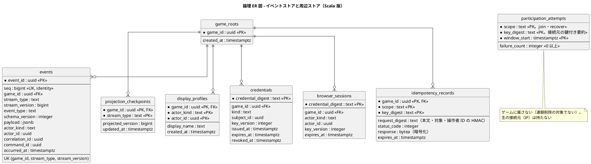
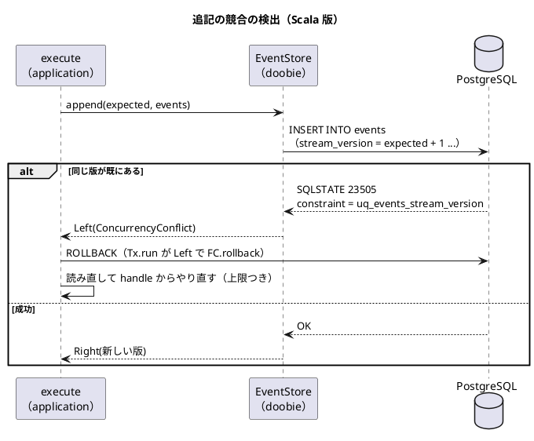

# データモデル設計 - ビールゲームシミュレーション（Scala 版）

## 概要

本書は、beer-game-scala のデータモデルを定義します。[ADR-001](../../adr/beer-game-scala/001-scala-version-of-beer-game-kotlin.md) の決定により、**スキーマの構造は [beer-game-kotlin のデータモデル](../beer-game-kotlin/data-model.md) を正本として引き継ぎ**ます（ES + CQRS、`game_roots` を根にした連鎖削除、追記専用の `events`、同期投影、周辺ストア）。本書は、Scala 版で変わる点（マイグレーションの置き方、doobie での型の対応と制約違反の扱い、ローカル開発だけ H2 を使うこと）と、**実際の PostgreSQL 18.6 と doobie で確認した事項**を定めます。**`docs/` を設計の正本**とします。実装コードはまだ存在しません（アプリの置き場は `apps/beer-game-scala` を予定）。

### 本書の位置づけと確認の範囲

- **確認状況の正本は、[技術スタックの確認状況の一覧](./tech-stack.md#確認状況の一覧)** です（レビュー指摘 H1）。本書の「検証の結果」は、その一覧の K5・K8〜K11・K18 の根拠で、本文は一覧にリンクします。
- **本書で確認したこと**（2026-11-25。リポジトリの外の使い捨てのプロジェクトで、sbt 1.13.1、Scala 3.7.4、doobie 1.0.0-RC12、testcontainers-scala 0.44.1、ローカルの Docker の `postgres:18.6` を使用）。結果は「検証の結果」の表にまとめました。
  - `events`・`game_roots` を**縮小した DDL**（主キー、名前つきの一意制約 `uq_events_stream_version`、外部キー `ON DELETE CASCADE`、`jsonb`、identity の `seq`）を適用できる。
  - doobie の `transact` は、`ConnectionIO` が例外なく完了すれば、値が `Left` でも **COMMIT する**。`FC.rollback` を挟むと、その書き込みは残らない（[バックエンドアーキテクチャ](./architecture-backend.md) の SBD2 の前提を実 DB で確認）。
  - 一意制約違反は、`attemptSql` で `PSQLException` として取り出せ、SQLSTATE `23505` と制約名（`getServerErrorMessage.getConstraint`）が得られる。
  - `uuid`・`timestamptz`・`jsonb` の読み書き、アドバイザリロック（`pg_advisory_xact_lock(_shared)`）、`LISTEN/NOTIFY`（`doobie.postgres.hi.connection` の `pgListen`・`pgNotify`・`pgGetNotifications`。同じ接続）が動く。トランザクションの外のセッションのロック、専用の接続の `LISTEN`、切断後の再購読は**未確認**。
- **引用したもの**: [Rust 版のデータモデル](../beer-game-rust/data-model.md) が、**`events`・`game_roots` ほかの DDL と DB ロール・GRANT を PostgreSQL 18.6 に適用して実測した結果**（追記専用の拒否、部分一意索引、連鎖削除、制約名）を持ちます。DDL は言語に依存しないため、本書はそれを引用します。**Scala 版では、その全文を再適用していません**（上の縮小した DDL だけ）。ロールと GRANT を doobie の接続から検証することも、未実施です。
- **確認していないこと**: 投影・周辺ストア・保持削除の他の表の DDL（Kotlin 版の ER 図と実ファイル `V002〜V006` に基づく設計で、Scala 版では**未適用**）、Flyway の実行、`HikariTransactor` と用途別のロール、`SET ROLE`、読み取り専用の `REPEATABLE READ`、circe による `jsonb` の読み書き（`doobie-postgres-circe` は[技術スタック](./tech-stack.md)に載せておらず、未確認）。
- **引き継ぐだけのもの**: 投影テーブルの定義（購読するイベント、閲覧できる人）、読み取りの規則、設計判断のまとめは、Kotlin 版を正本とします。
- **H2（ローカル開発のみ）は Scala 版では実測していません。** H2 の版（2.5.252）とライセンスは Maven Central で確認しましたが、PostgreSQL モードの動作範囲、Flyway の H2 への適用、doobie 経由の SQLSTATE は**未確認**です。「ローカル開発のデータベース」の表は Kotlin 版の実測（H2 2.5.252、2026-11-14）の引用で、**B1 の最初に Scala 版で実測して確定します**。
- Kotlin 版の実装の経緯（B1〜B12 の注記）は引き継ぎません。Kotlin 版の未決事項は、本書の未決事項に引き継ぎます。

### beer-game-kotlin からの設計方針の変更

| # | beer-game-kotlin | beer-game-scala | 理由 |
| :--- | :--- | :--- | :--- |
| 1 | Flyway（共通・PostgreSQL・H2 の 3 つの場所に分ける。B1 で H2 専用は不要と確定） | **Flyway の連番を 1 系統**で持ち、**共通と PostgreSQL の 2 つの場所**に分ける（H2 は共通だけを適用。H2 専用の場所は、Kotlin 版の実測を引用して作らない見込み。B1 で確定） | ローカルは H2、それ以外は PostgreSQL（[技術スタック](./tech-stack.md) の ST9。ユーザーの決定、2026-11-25） |
| 2 | 共通 V001〜V008 と PostgreSQL V101〜V102。番号の付け替えがあった | **最初から連番**。表を足す番号と、その表の GRANT の番号を分け、GRANT は表より後ろに置く | Kotlin 版で、番号の順序の不整合（V101 と V102）が起きた教訓 |
| 3 | `lobby_participants.replaced_at` は V007 で後から追加 | **ロビーの表の作成時から持つ** | 設計が確定済み（開始後の入れ替え） |
| 4 | `uq_idempotency_create` は H2 版で省略 | **同じく、PostgreSQL 専用のマイグレーションに置き、H2 版では省略**（アプリ側の再照合） | ST9 |
| 5 | `${json_type}` のプレースホルダ、`timestamp with time zone` の書き方、`jsonb` の書き込みを方言ごとに分ける | **同じく分ける**（`events.payload` は PostgreSQL が `jsonb`、H2 が `json`。書き込みの SQL は方言ごと。Kotlin 版の実測の引用で、Scala 版では未確認） | ST9 |
| 6 | JDBC の直接の SQL | **doobie の直接の SQL**（`sql"..."`、`ConnectionIO`）。ORM は使わない | 技術スタック（ST2、SBD3） |
| 7 | ロールと GRANT は PostgreSQL の統合テストでだけ検証し、H2 では省略 | **同じ**（PostgreSQL 専用のマイグレーションに置き、PostgreSQL の統合テストでだけ検証する。H2 では省略。「ローカル開発のデータベース」） | ST9 |

## 概念データモデル

Kotlin 版と同じです（ゲームの根、イベント、投影、周辺ストア、冪等記録、保持方針、保持削除）。ドメインの概念と表の対応も同じで、表の名称（`events`、`game_overview`、`lobby_participants`、`week_role_results` など）は**変えません**（投影・運用の問い合わせ・契約・文書の対応を保つため）。

## 論理データモデル

### ER 図（イベントストアと周辺ストア）

列と制約は Kotlin 版・Rust 版と同じです。



### 投影テーブルと保持の表

投影テーブル（`game_overview`、`game_join_codes`、`game_settings`、`lobby_participants`、`lobby_observer_invitations`、`lobby_observers`、`session_overview`、`role_current_states`、`current_decisions`、`week_commits`、`week_role_results`、`week_team_totals`、`retention_policies`）と、保持の表（`deletion_runs`、`deletion_attempts`、`deletion_receipts`）の**列・制約・購読するイベントは、[Kotlin 版の ER 図とテーブル定義](../beer-game-kotlin/data-model.md) と同じ**で、Scala 版でも変えません（ER 図は再掲しない）。次の 3 点だけ、設計上の取り決めを再掲します。

- `deletion_runs` と `deletion_attempts` は `game_roots` へ外部キーを持ちません（ゲームのデータが消えた後も再試行の記録として生き残るため）。**完了と同じトランザクションで、この 2 表の行も削除**し、`game_id` を含む行を残しません。`deletion_receipts` はゲームを特定しない証跡（ダイジェストだけ）で、1 年後に削除します。
- `lobby_participants` は、作成時から `replaced_at`（入れ替えられた時刻。NULL は未入れ替え）を持ちます。
- 観察者が読める表は、`game_overview`（参加コードなし）・`session_overview`・`week_team_totals` の **3 表だけ**です。

## イベントストア

ストリーム（`(game_id, stream_type)`、1 ゲームにつき `GAME` と `SESSION` の 2 本）、`stream_version`（1 から連続）、`seq`（ゲームをまたぐ追記の順序。業務上の順序は `stream_version`）、追記と楽観的並行制御、共同入力の競合（ストリームの版とは別）、冪等性（処理の順は「ロック → 認証 → 認可の前提検査 → 冪等記録の照合 → 読み込み → `handle` → 追記・投影」。認可が照合より先）、イベントのスキーマ（`schema_version` とアップキャスト）は、**Kotlin 版と同じ**です。

Scala 版での実現（[バックエンドアーキテクチャ](./architecture-backend.md)）:

- 追記は `EventStore.append: (Long, List[E]) => ConnectionIO[Either[AppFailure, Long]]` で、期待する版は **`MAX(stream_version)`**（読み込んだイベントの件数ではない）です。複数のストリーム（`StartGame`）は、同じ `ConnectionIO` の中で追記します。
- 一意制約の違反は `ConcurrencyConflict`（`Left`）に写し、`execute` が再試行します。**`Left` を返しても doobie は COMMIT する**ため、`Left` の経路は `Tx.run` が ROLLBACK を明示します（SBD2。確認済み。下の検証の 2。[一覧](./tech-stack.md#確認状況の一覧) の K5）。**一意制約違反（23505）の後は、同じ `ConnectionIO` で次の文を発行しません**（`SAVEPOINT` を使う場合を除く。PostgreSQL は 25P02 で中断し、H2 は中断しないため、ローカルでだけ通るコードが書ける。M2。AI の案。25P02 は PostgreSQL の仕様の知識で、doobie では未確認）。
- `events` の `payload` は `jsonb` で、書き込みは文字列に `::jsonb` を付けます（検証の 3）。ドメインのイベントには codec を付けず、`EventCodec`（circe の DTO）が JSON との相互変換を担います（BD5）。



### DDL（Rust 版で PostgreSQL 18.6 に適用して検証済み。Scala 版は縮小版のみ再適用）

```sql
CREATE TABLE game_roots (
    game_id    uuid        NOT NULL,
    created_at timestamptz NOT NULL,
    CONSTRAINT pk_game_roots PRIMARY KEY (game_id)
);

CREATE TABLE events (
    event_id       uuid        NOT NULL,
    seq            bigint      GENERATED ALWAYS AS IDENTITY,
    game_id        uuid        NOT NULL,
    stream_type    text        NOT NULL,
    stream_version bigint      NOT NULL,
    event_type     text        NOT NULL,
    schema_version integer     NOT NULL,
    payload        jsonb       NOT NULL,
    actor_kind     text        NOT NULL,
    actor_id       uuid,
    correlation_id uuid        NOT NULL,
    command_id     uuid        NOT NULL,
    occurred_at    timestamptz NOT NULL,
    CONSTRAINT pk_events PRIMARY KEY (event_id),
    CONSTRAINT uq_events_seq UNIQUE (seq),
    CONSTRAINT uq_events_stream_version UNIQUE (game_id, stream_type, stream_version),
    CONSTRAINT fk_events_game FOREIGN KEY (game_id) REFERENCES game_roots (game_id) ON DELETE CASCADE,
    CONSTRAINT ck_events_stream_type CHECK (stream_type IN ('GAME', 'SESSION')),
    CONSTRAINT ck_events_stream_version CHECK (stream_version >= 1),
    CONSTRAINT ck_events_schema_version CHECK (schema_version >= 1)
);
CREATE INDEX ix_events_actor ON events (game_id, actor_kind, actor_id);

-- projection_checkpoints、idempotency_records（pk_idempotency_records、部分一意索引 uq_idempotency_create）、
-- participation_attempts も同様（Rust 版も全文を載せていない。実装時にマイグレーションとして置く）
```

### 一意制約の衝突の扱い（制約名の正本）

制約名と扱いは **Kotlin 版の表と同じ**です（`uq_events_stream_version`、`uq_idempotency_create`、`pk_idempotency_records` は `ConcurrencyConflict` に写して再試行し、それ以外の一意制約違反は 500 と相関 ID）。

Scala 版での**違反の判別**は、`attemptSql`（または `exceptSomeSqlState`）で `SQLException` を取り出し、SQLSTATE `23505` と、`PSQLException` の `getServerErrorMessage.getConstraint`（制約名）で行います。**制約名が取れることは、実 DB で確認しました**（検証の 4）。残る確認事項は、**`adapter-persistence` の本番コードで `PSQLException` の型の判定を書くと、WartRemover の `IsInstanceOf`・`AsInstanceOf` に当たるか**です（確認は使い捨てのテストのコードで、そのソースには適用していない。当たる場合は、層ごとの緩和を ADR に記録して人が承認する。ガイド §9.4）。

### 追記専用の保護

アプリケーションが使う DB ロールには、`events` の **INSERT と SELECT だけ**を与え、UPDATE と DELETE と TRUNCATE を与えません。保持削除は、別のロールが `game_roots` を削除し、**外部キーの連鎖**で `events` の行が消えます。**ローカル開発の H2 版では、この保護（ロール、GRANT、`TRUNCATE` の拒否）を省略し、単一の接続ユーザーで動かします。ローカルでは追記専用は守られません**（ST9。検証は PostgreSQL の統合テストでだけ行う。下の「ローカル開発のデータベース」）。

ロールは次の 5 つです（`NOLOGIN`。ログイン用のユーザーはこれらのメンバーとして運用で作る。作り方は Kotlin 版と同じ未決事項）。

| ロール | 権限 |
| :--- | :--- |
| `beergame_writer` | `events`・`game_roots` は SELECT・INSERT のみ。投影・周辺ストア・冪等記録・`projection_checkpoints`・`participation_attempts` は SELECT・INSERT・UPDATE・DELETE（再構築が行を消すため） |
| `beergame_reader` | 投影の表（`projection_checkpoints`・`game_join_codes`・`game_settings` を含む）と `display_profiles` の SELECT のみ。`credentials`・`browser_sessions`・`idempotency_records` は含めない |
| `beergame_observer` | `game_overview`・`session_overview`・`week_team_totals` の SELECT のみ（`game_join_codes`・役割別の表には到達できない） |
| `beergame_deleter` | `game_roots` の SELECT・DELETE、`retention_policies` の SELECT、`deletion_runs`・`deletion_attempts` の SELECT・INSERT・UPDATE・DELETE、`deletion_receipts` の SELECT・INSERT・DELETE（`events` ほかの DELETE は持たない） |
| 所有者 | マイグレーションを実行する接続のユーザー。新しいロールは作らない |

用途別の接続プールは、`HikariTransactor`（`Resource`。api の書き込み・読み取り・観察者、削除は retention のタスク、所有者は migrate のタスク）です（ADR-009、[バックエンドアーキテクチャ](./architecture-backend.md)）。**プールからロールへの結びつけ（メンバーのログインユーザーで接続するか、接続後に `SET ROLE` するか）は、Scala 版では未確認**です。

**ログインユーザーとセッションの設定**: ロールは `NOLOGIN` で、アプリが接続するのは**そのメンバーのログインユーザー**です。**`idle_in_transaction_session_timeout` や `lock_timeout` のようなロールごとの設定は、NOLOGIN ロールに設定してもメンバーのログインユーザーに継承されず、効きません**（Rust 版が PostgreSQL 18.6 で再現して確認した事項。Scala 版では再確認していない）。**ログインユーザー自身**に設定するか、接続文字列の `options`・接続後の `SET` で設定し、統合テストで `SHOW` が期待値になることを確かめます（[運用要件](./operation.md)）。

### 検証の結果

**A. Scala 版（doobie 1.0.0-RC12、PostgreSQL 18.6、2026-11-25。使い捨てのプロジェクト、縮小した DDL）**

| # | 検証 | 結果 |
| :--- | :--- | :--- |
| 1 | `SELECT version()` | `PostgreSQL 18` を含む（testcontainers-scala 0.44.1 が `postgres:18.6` を起動） |
| 2 | `ConnectionIO` が `Left` を返して完了 | **COMMIT された**（行が残る）。`FC.rollback` を挟んだ `Left` の経路は、**書き込みが残らない** |
| 3 | 型と `jsonb` | `uuid` ← `java.util.UUID`（`doobie.postgres.implicits`）、`timestamptz` → `java.time.OffsetDateTime` と `java.time.Instant`（どちらも読めた）。`jsonb` は、文字列の引数に `::jsonb` を付けて書き、`payload::text` で読める（PostgreSQL が正規化して `{"a": 1}` の形で返す） |
| 4 | 同じストリームの同じ版への 2 回目の追記 | `attemptSql` で `PSQLException`。**SQLSTATE `23505`、制約名 `uq_events_stream_version`** |
| 5 | アドバイザリロック | `sql"select pg_advisory_xact_lock(42)".query[Unit].unique` と `pg_advisory_xact_lock_shared` が `ConnectionIO` として実行できた。**`transact` の外のセッションのロック（`pg_advisory_lock(_shared)`）は未確認**（`ProjectionLock` の `Resource` 版。H5） |
| 6 | `LISTEN/NOTIFY` | `PHC.pgListen`・`PHC.pgNotify`・`PHC.pgGetNotifications`（`doobie.postgres.hi.connection`）で、同じ接続の通知を受け取れた。**別の接続・専用の接続・切断後の再購読は未確認** |
| 7 | `game_roots` の 1 行削除 | そのゲームの `events` が連鎖して消えた。**接続ユーザーは `events` の DELETE 権限を持つユーザーで、権限のないロールでの確認ではない**（下の B） |

**B. Rust 版の検証の引用（`postgres:18.6`、2026-11-19。Scala 版では再実行していない）**

| # | 検証 | 結果 |
| :--- | :--- | :--- |
| 1 | 同じストリームの同じ版への 2 回目の追記 | SQLSTATE 23505、`CONSTRAINT NAME: uq_events_stream_version` |
| 2 | 部分一意索引 `uq_idempotency_create` | 別のゲームの同じ `('create', key_digest)` は違反。`scope` が `create` 以外なら通る |
| 3 | `beergame_writer` による `events` の UPDATE・DELETE・TRUNCATE、`game_roots` の DELETE | すべて permission denied（SQLSTATE の値は記録していない） |
| 4 | `beergame_deleter`（`events` の DELETE 権限なし）が `game_roots` の 1 行を DELETE | 成功し、そのゲームの `events` と `idempotency_records` が連鎖して消え、別のゲームの行は残る |

連鎖削除の権限の確認は、Kotlin 版 ADR-010（PostgreSQL 18、1 回）と Rust 版の再確認（1 回）です。**Scala 版の接続から、権限のないロールで再確認すること**を、B1 の受入条件に入れます。

### スナップショット

**導入しません**（Kotlin 版と同じ）。1 ストリームは千件前後と見積もります。**この見積もりは Kotlin 版の値で、Scala の実装で再計測します**（ADR-003）。再生時間が NFR-03 の予算を圧迫すると実測で分かった場合にだけ、確定ごとのスナップショットを導入します。

## 投影

同期投影（追記と同じトランザクションで更新）、`projection_checkpoints`、投影の再構築（ゲームごとに 1 トランザクション、アドバイザリロック。コマンドは共有、再構築は排他）、複数の投影の行を更新する順序（表の順序の固定。表名と主キーの順）、投影テーブルの定義、出力を投影にしない（`export_packages` の廃止。`buildExport` を問い合わせ時に実行）、読み取りの規則（参加者・進行役・観察者の読める範囲）、観察のための `week_team_totals` は、**Kotlin 版と同じ**です。

Scala 版では、投影を `Projection = EventEnvelope[DomainEvent] => List[RowChange]`（純粋）と、`RowChange` を SQL に変える境界に分けます（[ドメインモデル](./domain-model.md)）。アドバイザリロックは SQL を直接発行します（`ProjectionLock` のポートの実装。**`transact` の外の `Resource[IO, Unit]`**。H5 の案で、承認を得ていない。確認済みなのは `ConnectionIO` の中の `pg_advisory_xact_lock(_shared)` で、セッションのロックは未確認。検証の 5、[バックエンドアーキテクチャ](./architecture-backend.md)）。観察者の問い合わせの寄与者数による抑止（`contributors < 2`）は `Disclosure`（問い合わせの層）で行います。

## 周辺ストア

`display_profiles`（表示名。1〜80 文字）、`credentials`（進行役の資格・復帰資格・観察用の招待のダイジェストと鍵の版、`expires_at`、`revoked_at`）、`browser_sessions`（24 時間。操作の認証はこの表だけを見る。失効は行の削除）、`participation_attempts` は、**Kotlin 版と同じ**です。**追記と同じトランザクション**で書き、書く内容は、コマンドが運んだ値とイベントの ID だけです（書き込みの内容は純粋関数 `peripheralWrites` で導出）。

- `credentials.revoked_at` は `CredentialRevoked` を追記する同じトランザクションで更新し、**同じ主体の `browser_sessions` の行を削除**します（手動の失効と、役割の入れ替えの自動失効の両方）。
- **整合のルール**: 「`credentials` の発行・失効が、対応する `Credential*` などのイベントと必ず一緒に起きる」ことを、統合テストで確認します。
- 参加・復帰の失敗の窓（`participation_attempts`）の仕様（接続元の鍵付き要約だけを保存、ゲームに属さない、検査の前に 1 を足す、`INSERT … ON CONFLICT DO NOTHING` → `UPDATE … SET failure_count = failure_count + 1`、既定 10 回・10 分の仮置き）は Kotlin 版と同じで、仮置き値は Scala 版で取り直します（ADR-017）。

### 役割の入れ替えと永続化

開始後の入れ替えは、`credentials.revoked_at` の更新、`browser_sessions` の行の削除、`lobby_participants` の `role` を NULL にして `replaced_at` を書く、の 3 つを、イベントの追記と**同じトランザクション**で行います。旧担当者の `lobby_participants` の行、`display_profiles` の行、過去のイベント、`current_decisions` の入力者は消しません。

## 保持削除

`game_roots(game_id)` への外部キー（`ON DELETE CASCADE`）で、**`DELETE FROM game_roots WHERE game_id = $1` の 1 回で、イベント・投影・周辺ストア・冪等記録が連鎖して消えます**（ADR-010）。`deletion_runs`・`deletion_attempts` は、同じトランザクションで明示的に削除します。ゲームに属さない `participation_attempts` は対象外です。

削除の網羅は、「削除の完了後に、`game_id` 列を持つ**すべての表**に、そのゲームの行が残らない」ことを、`information_schema` から表の一覧を取得して検査するテストで確認します（Kotlin 版と同じ）。保持削除の流れ（5 分ごとのスケジューラ、`RetentionSaga` の `handle`、削除用ロールでの 1 トランザクション、失敗時の `RecordFailure` と最大 5 回の指数バックオフ）と、`retention_policies`・`deletion_*` のテーブル定義も同じです。

## マイグレーション

- スキーマの変更は**番号つきの SQL マイグレーション**で行い、適用の履歴を DB に残します。管理ツールは **Flyway**（[技術スタック](./tech-stack.md)。版は 13.12.2。PostgreSQL 用のモジュールの名前と、`api` で自動適用せず `migrate` のモードで適用する運用は、B1 で確認する）。
- 変更は、**拡張 → 互換 → 縮小**の順に分け、ロールバックできる単位にします（NFR-12）。
- **イベントは、マイグレーションで書き換えません。** 形の変更は `schema_version` とアップキャストで吸収します。投影の形の変更は、マイグレーションで表を直し、**再構築**で埋めます。
- **表を足す番号と、その表の GRANT の番号を分け、GRANT は表より後ろの番号に置く**（Kotlin 版で、ロールの番号が表の番号と前後して適用できなくなった教訓）。既定の権限は与えない。
- ファイルの置き場は `adapter-persistence` の中（[バックエンドアーキテクチャ](./architecture-backend.md) のモジュール構成）。具体的なパスと命名は B1 で決める。
- **PostgreSQL 用と H2 用で、共通の部分を最大化し、差分だけを分ける**（Flyway のベンダー別の場所。ST9）。PostgreSQL は「共通 + PostgreSQL 専用」、H2（ローカル開発のみ）は「共通」を適用する。**共通に置けるか（`text` 型の主キー、`GENERATED ALWAYS AS IDENTITY`、`timestamp with time zone`、`bytea`）は、Kotlin 版の実測（Flyway 13.12.2 で共通の V001〜V005 が H2 にそのまま適用できた）の引用で、Scala 版では未確認**。B1 の最初に実測し、H2 専用の場所が要るかを確定する。
- **PostgreSQL 専用に置くもの**: 部分一意索引 `uq_idempotency_create`、ロールと GRANT（V007）、`jsonb` の型。H2 は `${json_type}` のプレースホルダで `json` にする（予定）。H2 でしか通らない記述のために共通の DDL を曲げない（乖離への対策 1）。

| 番号（予定） | 内容 |
| :--- | :--- |
| V001 | `game_roots`、`events`（名前つきの一意制約、`CHECK`）、`projection_checkpoints` |
| V002 | 周辺ストアと横断: `display_profiles`、`credentials`、`browser_sessions`、`idempotency_records`（`pk_idempotency_records`。**部分一意索引 `uq_idempotency_create` は PostgreSQL 専用の番号に分ける。H2 では省略**）、`participation_attempts` |
| V003 | 投影（準備）: `game_overview`、`game_join_codes`、`game_settings`、`lobby_participants`（`replaced_at` を含む）、`lobby_observer_invitations`、`lobby_observers` |
| V004 | 投影（進行）: `session_overview`、`role_current_states`、`current_decisions` |
| V005 | 投影（結果）: `week_commits`、`week_role_results`、`week_team_totals` |
| V006 | 保持: `retention_policies`、`deletion_runs`、`deletion_attempts`、`deletion_receipts` |
| V007（PostgreSQL 専用） | ロールと GRANT（上の 5 ロール）。**表（V001〜V006）がすべて揃った後に適用される番号**。H2 では適用しない |
| V008（PostgreSQL 専用） | 部分一意索引 `uq_idempotency_create`（V002 から分けたもの。番号と配置は B1 で確定） |

**Scala 版で適用して確認したのは、V001 の `game_roots`・`events` の縮小版だけ**です。V001〜V006 の他の表は、Rust 版が V001 と V002 の一部とロールまわりを実測しました。**V003〜V006 は、Kotlin 版には実ファイルがありますが、Rust 版と Scala 版では未適用**です。実装時に Kotlin 版の実ファイル（`V003`〜`V006`）を元に書き、PostgreSQL の統合テストで確認します。

### 型の対応（doobie）

| PostgreSQL | Scala（doobie 1.0.0-RC12） | 状況 |
| :--- | :--- | :--- |
| `uuid` | `java.util.UUID`（`doobie.postgres.implicits`）。ドメインでは `opaque type`（`GameId` など）で包む。**`Meta`・`Get`・`Put` は `adapter-persistence` に置く**（`domain` は doobie に依存しない。ST3） | UUID は確認済み。`opaque type` の `Meta` は未確認 |
| `timestamptz` | `java.time.OffsetDateTime` または `java.time.Instant` | **どちらも読めた**。ドメインの時刻の型（コマンドの値）との対応は B1 で決める |
| `jsonb`（`events.payload`） | 文字列 + `::jsonb`（書き込み）、`payload::text`（読み込み）。`EventCodec` が circe の DTO と文字列を相互変換する | 文字列は確認済み。**circe の `Json` を直接扱う `doobie-postgres-circe` は未確認で、技術スタックに無い**（採否は承認が要る） |
| `bigint`（`stream_version`、`seq`） | `Long` | ドメインの `StreamVersion` との変換で範囲を検査 |
| `integer` | `Int` | |
| `bytea`（暗号化した応答） | `Array[Byte]` | 未確認（`Get[Array[Byte]]` が標準にあると見込む） |
| `text`（列挙の値） | `String`。ドメインの `enum` との変換は境界の関数で行い、**不明な値は `Persistence` の失敗**にする | `CHECK` 制約と一致させる。`match` の網羅は `-Werror` で守る |

## インデックス（主なもの）

Kotlin 版と同じです（`events` の `(game_id, stream_type, stream_version)` 一意と `(seq)` 一意と `(game_id, actor_kind, actor_id)`、`game_join_codes.join_code` 一意、`credentials` の `(game_id, kind, subject_id)` と `(expires_at)`、`browser_sessions` の `(game_id, expires_at)`、`participation_attempts` の `(window_start)`、`lobby_participants` の `(game_id)`、`idempotency_records` の `(expires_at)` と部分一意、`retention_policies` の `(delete_after, game_id)`、`deletion_runs` の `next_attempt_at` の部分索引）。

## ローカル開発のデータベース

ユーザーの決定（2026-11-25）により、**開発機でのローカル開発（起動と動作確認）だけ**、H2 の PostgreSQL モードで動かせるようにします（[技術スタック](./tech-stack.md) の ST9、[ADR-001](../../adr/beer-game-scala/001-scala-version-of-beer-game-kotlin.md) の 014。Kotlin 版の T7・ADR-014 を読み替えたもの）。Docker や PostgreSQL がなくても起動できることが目的です。**H2 の導入（依存の追加）は承認待ちで、動作範囲は B1 の最初に Scala 版で実測して確定します。**

**範囲の線引き。**

| 用途 | データベース |
| :--- | :--- |
| ローカル開発（開発機での起動・動作確認） | **H2（PostgreSQL モード）** または PostgreSQL。設定 `DB_KIND=h2\|postgres` で選ぶ（[バックエンドアーキテクチャ](./architecture-backend.md)） |
| 統合テスト、受け入れ（`@api`）、CI | **PostgreSQL 18**（testcontainers-scala） |
| ステージング、本番 | **PostgreSQL 18**（RDS）。起動時の検査で H2 を拒否する |

**H2 を、設計の検証（並行性、権限、部分一意索引、連鎖削除）や性能の計測には使いません。** それらの正は PostgreSQL の統合テストです。

**確認できた事実と、できなかった事実。** 下の「方言の差分」の表は、**Kotlin 版の実測（H2 2.5.252、PostgreSQL モード。2026-11-14。[データモデル（Kotlin 版）](../beer-game-kotlin/data-model.md)）の引用**です。**Scala 版（doobie 経由）では未実測**で、B1 の最初に確かめます。未確認のまま残るもの: H2 での性能、分離レベルの動作の同一性、表の所有者の扱い（`GRANT` まわり）、2 つの API プロセスでの動作、doobie 経由の SQLSTATE と制約名の取得、`Left` の明示 ROLLBACK（SBD2）の H2 での動作（doobie の挙動は DB に依らない見込みだが未実測）。

### 方言の差分

| 項目 | PostgreSQL 18 | H2（PostgreSQL モード。ローカルのみ。Kotlin 版の実測の引用） | 扱い |
| :--- | :--- | :--- | :--- |
| 再構築との直列化（アドバイザリロック） | `pg_advisory_xact_lock(_shared)`（`ConnectionIO` の中。Scala 版で確認済み。K10）。ポートの PostgreSQL 版は `transact` の外のセッションのロックで、**未確認** | 動かない（関数が無い） | ポート `ProjectionLock`（`GameId => Resource[IO, Unit]`）の裏に隠す。H2 版は**プロセス内のロック**を `Resource` に包む（単一プロセスでのみ有効）。**PostgreSQL 版と同じ型**（H5。AI の案） |
| SSE の版の通知（LISTEN/NOTIFY） | `pgListen`・`pgNotify`（同じ接続で Scala 版で確認済み。K11） | 動かない（構文エラー） | ポート `ChangeNotifier`（`enqueue: ConnectionIO`、`deliver: IO`）の裏に隠す。H2 版は `enqueue` が何もせず、`deliver` が**プロセス内のイベント**へ配る（`Tx.run` の後。単一プロセスでのみ有効）。PostgreSQL 版は `enqueue` が `pg_notify`。**同じ型**（H5。AI の案） |
| 部分一意索引 `uq_idempotency_create` | あり（`WHERE scope = 'create'`） | 動かない（構文エラー。通常の一意制約は動く） | H2 版は**省略**し、アプリケーション側の再照合に置き換える（PostgreSQL 専用のマイグレーション） |
| DB ロールと GRANT、追記専用、`TRUNCATE` の拒否 | あり | 一部動く（`GRANT TRUNCATE` は構文エラー。表の所有者の扱いは未確認） | H2 版は**省略**（単一の接続ユーザー）。**権限の検証の正は PostgreSQL の統合テスト** |
| 接続プールの分離（観察者用など） | 用途別の `HikariTransactor` | 単一のプール | H2 版は**省略** |
| `jsonb` | `events.payload` は `jsonb`（文字列 + `::jsonb`） | 型は通るが挙動が違う（`jsonb` は `json`。`setString` の文字列は JSON の文字列値になる。`FORMAT JSON` で書く） | H2 版は `json` 型、書き込みの SQL を方言で分ける。**doobie の `Put` で同じになるかは未確認** |
| `timestamptz` | あり | 不明なデータ型（`timestamp with time zone` なら通る） | 共通の DDL は `timestamp with time zone` と書く |
| 分離レベル（READ COMMITTED、読み取り専用の REPEATABLE READ） | 指定どおり | 設定は通る（動作の同一性は未確認） | H2 では検証しない |
| SQLSTATE（40001、23505 の制約名） | `PSQLException` の `getServerErrorMessage.getConstraint`（Scala 版で確認済み） | 一意違反は 23505、REPEATABLE READ の同時更新は 40001。**制約名はメッセージ中に大文字で含まれ、専用のフィールドは無い**。メッセージには行の値も含まれる | H2 版の写像: メッセージ中の制約名（大文字小文字を区別せず）で `ConcurrencyConflict` に写す。**`AppFailure.Persistence` にメッセージを載せない**。**doobie 経由で取れるかは未確認** |
| Flyway の適用 | 共通 + PostgreSQL 専用 | Kotlin 版は共通の V001〜V005 がそのまま適用できた | **Scala 版では未確認**（B1 で確認） |

### H2 版で省略する制約（ローカルでは守られない）

次の制約は、H2 版では**守られません**。ローカルで動いたことは、これらの制約が正しいことを意味しません。

1. `uq_idempotency_create`（同じキーのゲーム作成の同時の重複。アプリ側の再照合だけ）。
2. `events` の追記専用（UPDATE・DELETE・`TRUNCATE` の拒否）。
3. DB ロールの分離と、観察者のロールが `game_join_codes` などへ到達できないこと（NF-S18）。アプリのバグによる漏えいを DB が止めない。
4. 接続プールの分離（観察者用のプールの配線）。
5. 複数のプロセスにまたがる、再構築との直列化と SSE の通知（`ProjectionLock`・`ChangeNotifier` の H2 版は単一のプロセスでだけ有効）。
6. 削除用のロールの限定（`game_roots` 以外を直接削除できないこと）。
7. 分離レベルによる一貫した読み取り（REPEATABLE READ）の保証。

### 乖離のリスクと対策

ローカル（H2）で通っても、CI（PostgreSQL）で落ちる乖離が起きえます。対策は次のとおりです。

1. **H2 でしか通らない記述を禁止する。** PostgreSQL の統合テストが正で、H2 のために共通の DDL や SQL を曲げない（通らない文は PostgreSQL 側と H2 側に分ける）。
2. **ポートの契約テストを両実装で実行する。** `ProjectionLock`・`ChangeNotifier` の契約テストを、PostgreSQL 版は統合テスト、H2 版は munit のユニットテストで実行する。テスト用のインメモリ実装との関係は[バックエンドアーキテクチャ](./architecture-backend.md)で整理する。
3. **受け入れ（`@api`）は PostgreSQL で実行する。**
4. 本番・ステージングでの H2 の拒否（起動時の検査。[バックエンドアーキテクチャ](./architecture-backend.md)、[インフラ](./architecture-infrastructure.md)）。

## 設計判断のまとめ

Kotlin 版の設計判断 1〜9 は**引き継ぎます**（ストリームの単位、並行制御、スナップショットなし、同期投影、観察の合計、周辺ストア、保持削除、冪等性、出力）。判断 10（ローカル開発の DB）も、**読み替えて引き継ぎます**（ST9。H2 の PostgreSQL モード。ユーザーの決定、2026-11-25）。Scala 固有の判断は、このデータモデルには追加していません（`Left` の ROLLBACK は SBD2、`ConnectionIO` のポートは SBD3、接続プールは SBD11）。

## beer-game-kotlin からの変更

| # | beer-game-kotlin | beer-game-scala | 理由 |
| :--- | :--- | :--- | :--- |
| 1 | Flyway、共通・PostgreSQL・H2 の 3 つの場所 | Flyway、共通と PostgreSQL の 2 つの場所（H2 専用は B1 で要否を確定） | ST9。共通部分を最大化 |
| 2 | 番号の付け替え（V101 と V102 の入れ替え）、後から V007・V008 | 最初から連番 V001〜V008。表と GRANT の番号を分け、GRANT は後ろ。V007・V008 は PostgreSQL 専用 | 教訓の反映 |
| 3 | `${json_type}`、`timestamp with time zone` の書き方、`jsonb` の書き込みを方言ごとに分ける | 同じく方言ごとに分ける（Kotlin 版の実測の引用。Scala 版では未確認） | ST9 |
| 4 | H2 版で `uq_idempotency_create` を省略し、アプリ側で再照合 | 同じ（PostgreSQL 専用のマイグレーション） | 同上 |
| 5 | H2 版で省略する制約の一覧 | 同じ 7 項目を引き継ぐ | 同上 |
| 6 | JDBC の直接の SQL、`Tx` を引数で渡す | doobie の `ConnectionIO`（`ConnectionIO` をポートの戻り値にする。SBD3）。`Left` は `Tx.run` で ROLLBACK（SBD2。コマンド全体を 1 回で包む） | Scala の表現。**doobie は `Left` でも COMMIT する**（検証 A の 2） |
| 7 | 制約名は JDBC の例外のメッセージ・`PSQLException` から取る | `attemptSql` と `PSQLException.getServerErrorMessage.getConstraint`（検証 A の 4） | ライブラリの違い |
| 8 | Kotlin の `kotlinx.serialization` による `payload` | circe の DTO と文字列の `::jsonb`（`doobie-postgres-circe` は未採用） | 技術スタック（ST6） |
| 9 | 検証は Kotest と Testcontainers の統合テスト | DDL の縮小版を doobie と testcontainers-scala で実測。統合テストは munit と testcontainers-scala | ツールの違い |

上記以外（表と列、制約名、投影、周辺ストア、保持削除、ロール）は変えません。

## 未決事項

1. **ローカル開発の DB**（ST9）: H2 の採用は決定済み（2026-11-25）。残る未決は、**H2 の依存の導入の承認**と、**B1 の最初の実測**（上の方言の差分の表。Flyway の H2 への適用、doobie 経由の SQLSTATE と制約名、`jsonb` の書き込み、H2 専用のマイグレーションの要否）。
2. **V003〜V006 の DDL**: Kotlin 版の実ファイルを元に書き、PostgreSQL で適用して検証する。V001・V002 の全文も、Flyway で適用して確認する。
3. **ロールと GRANT の Scala からの検証**: 権限のないロールで `events` の UPDATE・DELETE・TRUNCATE が拒否され、`game_roots` の連鎖削除が動くこと。ログインユーザーとプールの結びつけ（メンバーのログインユーザーか `SET ROLE` か）、セッションの設定（`idle_in_transaction_session_timeout`・`lock_timeout`）が効くこと。
4. **doobie の残りの確認**: `opaque type` の `Meta`、`Array[Byte]`、`HikariTransactor`、読み取り専用の `REPEATABLE READ`、専用の接続での `LISTEN`・切断後の再購読、`PSQLException` の型の判定と WartRemover（`IsInstanceOf`・`AsInstanceOf`）の相性。
5. **`jsonb` の読み書きの方式**: 文字列 + `::jsonb` で足りるか、`doobie-postgres-circe` を足すか（足すなら承認が要る）。
6. **Flyway の確認**: PostgreSQL 用のモジュールの名前、`migrate` のモード、`flyway_schema_history` の権限。
7. **`session_overview.week` が最終週 + 1 になる問題**（Kotlin 版で判明、未解決）: Scala 版の `Projection` は `EventEnvelope[DomainEvent] => List[RowChange]` で、`RowChange.Upsert` は列の値の `Map` を持つ。**投影が最終週を覚える案は、投影が状態を持たない設計と合わない**。**比べる案**: (A) `WeekCommitted` のペイロードに、次の週（終了なら終了の事実）を持たせる（イベントの構造に影響するため、ドメインモデルと合わせて決める）。(B) `session_overview` に `final_week` を持たせ、SQL の式で更新する（`week = LEAST(week + 1, final_week)`。`RowChange` に式の更新を足す）。**決定は B1 のドメイン・投影の実装で行う**。
8. **ロック待ちの上限（`lock_timeout`）と、再構築中のコマンドの応答**（短い待ちか、すぐ 503 か）。
9. **投影の更新の順序と `FOR UPDATE` の要否**: Kotlin 版でも、今のイベント構成では実際の競合は起きないと整理されている。
10. **所有者のロールの作り方（RDS）、通知の受信（`LISTEN`）専用のロールと接続、アプリの用途別のロール・接続への切り替え**: Kotlin 版と同じ未決事項。
11. **`retention_starts_at` の起点**: 暫定で作成時（Kotlin 版・ドメインモデルと共通）。
12. **`events` の長期の保持と、ゲーム削除前の分析の要否**（beer-game2 から継続）。
13. **同期投影のトランザクション時間の実測**（Scala の実装で計測し直す）。

## レビュー対応の記録（2026-11-25）

[設計書レビュー](../../review/beer-game-scala/design_review_20261125.md) への対応のうち、本書に関するもの（行番号は編集で動くため、節名で記録します）。**直し方は AI の案で、承認を得ていません。**

| 指摘 | 直した箇所 | 状況 |
| :--- | :--- | :--- |
| H1 | 「本書の位置づけと確認の範囲」に [確認状況の一覧](./tech-stack.md#確認状況の一覧) への参照を足し、検証 A の 5、`LISTEN/NOTIFY` の記述にセッションのロック・専用の接続が未確認であることを足した | AI の案。検証の結果の表そのものは変えていない |
| H4 | 「イベントストア」の `Tx.run`、追記の競合の図、変更表の 6 | AI の案 |
| H5 | 「投影」のアドバイザリロック、「ローカル開発のデータベース」の方言の差分（`ProjectionLock`・`ChangeNotifier`） | AI の案 |
| M2 | 「イベントストア」に 23505 の後の規則 | AI の案 |
| L3 | 方言の差分の `PersistenceFailure` を `AppFailure.Persistence` に | 直した |

## 出典

- Scala 版の確認: sbt 1.13.1（JetBrains Runtime 25.0.4.1）、Scala 3.7.4、doobie-core・doobie-postgres・doobie-hikari 1.0.0-RC12、testcontainers-scala-postgresql・testcontainers-scala-munit 0.44.1、ローカルの Docker の `postgres:18.6`（使い捨てのコンテナ）、2026-11-25。リポジトリの外の使い捨てのプロジェクトで行い、リポジトリには残していない。
- Rust 版の DDL の検証: ローカルの Docker の `postgres:18.6`、2026-11-19（[データモデル（Rust 版）](../beer-game-rust/data-model.md)）。
- [データモデル設計（beer-game-kotlin）](../beer-game-kotlin/data-model.md)
- [ADR-001（Scala 版）](../../adr/beer-game-scala/001-scala-version-of-beer-game-kotlin.md)、[技術スタック](./tech-stack.md)、[ドメインモデル](./domain-model.md)、[バックエンドアーキテクチャ](./architecture-backend.md)
- [ADR-010](../../adr/beer-game-kotlin/010-retention-deletion-with-append-only.md)（追記専用と連鎖削除）、[ADR-009](../../adr/beer-game-kotlin/009-observer-access-control.md)（観察者の DB ロール）
- [関数型プログラミングガイド（Scala 編）](../../reference/関数型プログラミングガイド_Scala編.md) §7.6（永続化とトランザクション境界）、§9.4
