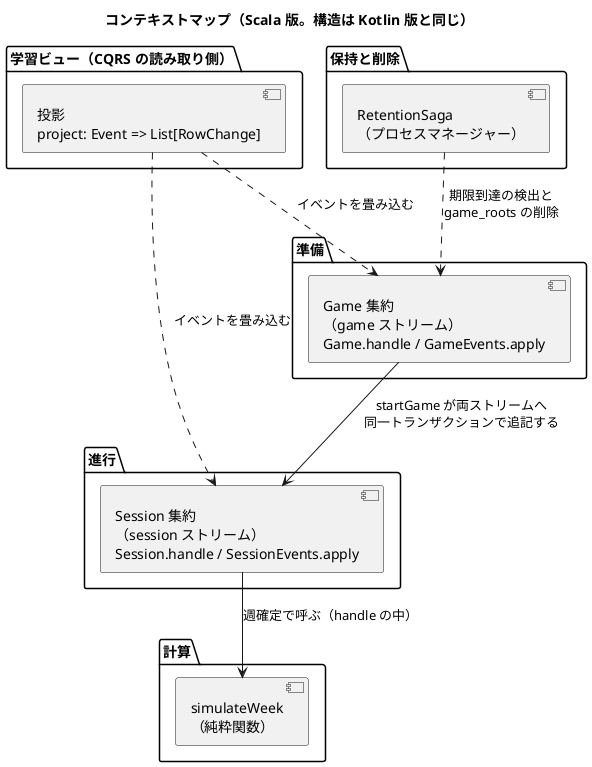

# ドメインモデル設計 - ビールゲームシミュレーション（Scala 版）

## 概要

本書は、beer-game-scala のドメインモデルを定義します。[ADR-001](../../adr/beer-game-scala/001-scala-version-of-beer-game-kotlin.md) の決定により、**機能と振る舞いは beer-game2、設計の構造は [beer-game-kotlin のドメインモデル](../beer-game-kotlin/domain-model.md)、実装規約は [関数型プログラミングガイド（Scala 編）](../../reference/関数型プログラミングガイド_Scala編.md)（以下「ガイド」）を正本**として引き継ぎます。本書は、その構造を **Scala 3 の型**で表す方法と、Scala で変わる点だけを定めます。構造そのもの（2 ストリーム、ES + CQRS、イベントの意味）は変えません。

- 状態はイベントの列です。集約は `handle(state, command): Either[Error, List[Event]]` と `Events.apply(state, event): Evolution[State]` の 2 つの純粋関数で表します（ガイド §7.3、§7.4、§6.2）。Kotlin 版の `decide` / `evolve` に対応します。
- ADT（State・Command・Event・Error）は `enum` と `case class`、不正な値は `opaque type` とスマートコンストラクタで作れなくします。失敗は例外でなく `Either` で返し、独立な検証は `ValidatedNec` と `mapN` で全件集めます（ガイド第 3 章、§6.3）。
- 読み取りは、イベントを畳み込む純粋関数（投影）に分けます（CQRS、ガイド §7.5）。

入力は [要件定義](../../requirements/beer-game-ts/requirements_definition.md)（BR・FR・NFR）、[システムユースケース](../../requirements/beer-game-ts/system_usecase.md)、[ユーザーストーリー](../../requirements/beer-game-ts/user_story.md) です。**`docs/` を設計の正本**とします。実装コードはまだ存在しません（アプリの置き場は `apps/beer-game-scala` を予定）。

### 本書の位置づけと確認の範囲

- **本書で確認したこと**: 3 章の型とコードの断片（`Quantity`、`RoleMap`、`ValidatedNec` による設定の検証、`GameError.code`、Game 集約の `handle`、`Events.apply` と `Evolution`、再生）は、sbt 1.13.1（JetBrains Runtime 25.0.4.1）、Scala 3.7.4、cats-core 2.13.0、munit 1.3.6 で、`-Werror -Wunused:all -Wvalue-discard -Wnonunit-statement` と WartRemover 3.6.3（ガイド §9.4 の 13 個の Wart）を有効にしてコンパイルし、2 件のテスト（設定の誤りが 3 件集まる、付け替えが 2 イベントになる）が通ることを確認しました（2026-11-25）。状態に列挙子を 1 つ足すと、`Events.apply` の `match` で網羅の警告が出ること（`-Werror` で失敗する形）も確認しました。`var` と `head` が WartRemover に拒否されることも確認しました。
- **確認していないこと**: Session 集約、`startGame`、`simulateWeek`、投影、`RetentionSaga` の Scala のコードは、**型検査していない設計のスケッチ**です。`Monoid`・`Functor` の法則のテストは書いていません。
- **引き継ぐだけで再検討していないこと**: 週次計算の規則（12 ステップ）、観察者の開示の規則、保持削除の細部、エラーコードの一覧、投影の購読表、ユビキタス言語の定義は、Kotlin 版の該当節を正本として参照します。Scala 版で変わるのは表現であり、API の契約（`code`、problem+json）は変えません。
- **Kotlin 版の実装の経緯（B1〜B13 の注記）は引き継ぎません。** 本書は、Kotlin 版の設計の現在の形を出発点とします。Kotlin 版の未決事項は、本書の未決事項に引き継ぎます（Rust 版と同じ扱い）。

### 設計の前提と原則

Kotlin 版の前提と原則をそのまま引き継ぎます（学習用シミュレーション、アカウントなし、決定論的な週次計算、役割別の情報制限、ルールは集約が持つ、ドメインは純粋、集約は最小の整合性の範囲、個人情報と秘密はイベントに入れない）。Scala 版で加わる原則は次のとおりです。

- **ドメインのプロジェクトは `cats-core` だけに依存する。** `cats-effect`・`doobie`・`http4s`・`circe` を持たない。時刻・乱数・識別子の生成・永続化は、コマンドの値として渡す（[技術スタック](./tech-stack.md) の ST3、ガイド §4.4、§1.3）。
- **`var`・`null`・`throw`・`return`・可変コレクション・`head` などの部分関数・`asInstanceOf` を使わない。** WartRemover で守る（ガイド §9.4）。遷移関数は全域で、例外を投げない。
- **新しい値を作って返す。** `case class` の `copy` と不変の `List`・`Map` だけを使い、共有可変状態は持たない（ガイド第 2 章）。

## 戦略的設計

境界付けられたコンテキストの分類、コンテキストマップ、ユビキタス言語は、[Kotlin 版](../beer-game-kotlin/domain-model.md) と同じです（中核: シミュレーション計算・進行、補完: 準備・学習ビュー、一般: 保持と削除）。コード上の名称は、Scala の命名規約（型は PascalCase、関数と値は camelCase）に合わせます。

| 概念（Kotlin 版） | Scala 版の名称 | 備考 |
| :--- | :--- | :--- |
| `GameState`、`SessionState` | `GameState`、`SessionState`（`enum`） | 状態の違いを列挙子で表す |
| `decideGame`、`evolveGame` | `Game.handle`、`Events.apply`（`GameEvents`・`SessionEvents` に分ける） | ガイド §7.3・§7.4 の `handle` と `Events.apply` に合わせる |
| `decideSession`、`evolveSession` | `Session.handle`、`SessionEvents.apply` | 同上 |
| `RoleMap<A>` | `RoleMap[A]` | 同じ |
| `StreamType`（`GAME`、`SESSION`） | `StreamType.Game`、`StreamType.Session` | |
| `Either<DomainError, …>` | `Either[GameError, …]` など | 標準の `Either`。Arrow は使わない |
| `zipOrAccumulate` | `ValidatedNec` と `mapN` | cats-core |

**パッケージ**: `beergame.domain`（値オブジェクト、`Command`・`Event`・`Error`、`handle`・`Events.apply`、`startGame`、`simulateWeek`、投影、`RetentionSaga`）。ほかの層は [バックエンドアーキテクチャ](./architecture-backend.md) の層の表のとおり。



## 戦術的設計

### 値オブジェクト

不変で、属性値が同じなら同じものとして扱います。**`opaque type`** とスマートコンストラクタ（`of`）で、生成時に検証し、不正な値が存在できないようにします（Kotlin の `value class` に対応し、ゼロコストで型を区別する。`GameId` と `ParticipantId` は別の `case class` にして取り違えを防ぐ）。ガイドは `opaque type` を扱っていませんが、`case class` と `copy` の範囲の機能であり、**本書の断片でコンパイルとテストを確認しました**（SD1）。

```scala
opaque type Quantity = Int

object Quantity:
  val DefaultMax = 1000
  def of(n: Int): Either[ValidationError, Quantity] =
    if n >= 0 && n <= DefaultMax then Right(n)
    else Left(ValidationError.QuantityOutOfRange(n, DefaultMax))
  extension (q: Quantity) def value: Int = q

enum Role:   // 上流から下流の順
  case Factory, Distributor, Wholesaler, Retailer

/** 4 役割すべてに値を持つ総称コンテナ。「4 役割が揃う」を型で表す */
final case class RoleMap[+A](factory: A, distributor: A, wholesaler: A, retailer: A):
  def apply(role: Role): A = role match
    case Role.Factory     => factory
    case Role.Distributor => distributor
    case Role.Wholesaler  => wholesaler
    case Role.Retailer    => retailer

final case class GameId(value: java.util.UUID)
final case class ParticipantId(value: java.util.UUID)
```

値オブジェクトの一覧（`Units`、`Week`、`Money`、`DemandSeries`、`Pipeline`、`InitialConditions`、`CostPolicy`、`DisclosurePolicy`、`CommitMode`、`SettingsKind`、`GameSettings`、`RoleState`、`RoleWeekResult`、`DisplayName`、`JoinCode`、`InvitationCode`、`CredentialValidity`、`CredentialSubject`、`RetentionPolicy`、`Actor`、`StreamVersion`、`DecisionVersion`）は、[Kotlin 版の表](../beer-game-kotlin/domain-model.md) の意味と制約を引き継ぎます。Scala 版での表現の違いは次のとおりです。

| Kotlin 版 | Scala 版 | 理由 |
| :--- | :--- | :--- |
| `@JvmInline value class` | `opaque type` + コンパニオンの `of`（検証が要らない識別子は `case class` の包み） | ゼロコストの型の区別。`opaque type` は定義の外から中身が見えない |
| `enum class`（`Role`、`CommitMode`） | `enum`（値だけ） | 同じ |
| `sealed interface`（`Actor`、`SettingsKind`、`CredentialSubject`） | データを持つ `enum` | 網羅検査はコンパイラが行う（`-Werror` で警告が失敗になる。ガイド §3.3） |
| `Money`（最小単位の整数） | `Money` は `Long`（最小単位）の `opaque type`（SD7） | 在庫単価・累積費用が `Int` を超えないことを保証しにくい |
| `Quantity`（0〜1000）と `Units`（上限なし） | `Quantity` は `Int` の `opaque type`、`Units` は `Long` の `opaque type`（SD7） | Kotlin 版の区別を維持する |
| `UUID`、`Instant` | `java.util.UUID`、`java.time.Instant` | JVM の標準。時刻はコマンドの値として渡し、`now` を呼ばない |
| `data class` の `copy` | `case class` の `copy` | 同じ |

#### 検証の誤りと業務ルールの失敗

入力の形の誤りは `ValidationError` として、境界でコマンドを作るときに**すべて集めて**返します。状態に照らした業務ルール違反は、集約ごとのエラー（`GameError`・`SessionError`）として、`handle` が 1 件返します（Kotlin 版と同じ分け方）。

Kotlin 版の `zipOrAccumulate` に当たるものは、cats-core の **`ValidatedNec` と `mapN`** です（ガイド §6.3）。誤りは `NonEmptyChain` に集まり、失敗しているなら誤りが 1 つ以上あることを型が保証します（Rust 版の `Vec` と違い、「誤りがあれば必ず 1 件以上」を型で表せます）。

```scala
enum ValidationError:
  case QuantityOutOfRange(actual: Int, max: Int)
  case FinalWeekOutOfRange(actual: Int)

final case class RawSettings(finalWeek: Int, demand: List[Int])
final case class GameSettings(finalWeek: Int, demand: List[Quantity])

object GameSettings:
  private def week(n: Int): ValidatedNec[ValidationError, Int] =
    if n >= 1 && n <= 50 then n.validNec else ValidationError.FinalWeekOutOfRange(n).invalidNec
  private def quantity(n: Int): ValidatedNec[ValidationError, Quantity] =
    Quantity.of(n).toValidatedNec
  def of(raw: RawSettings): ValidatedNec[ValidationError, GameSettings] =
    (week(raw.finalWeek), raw.demand.traverse(quantity)).mapN(GameSettings.apply)
```

これは、設定の誤りを全件返す受入条件（AC1.1.2、AC1.1.4）を満たす形です。上のコードは、範囲外の週と範囲外の需要 2 件で、誤り 3 件を返すテストが通ることを確認しました。`Either` の `for` は最初の誤りで止まるため、**独立な検証には使いません**（ガイド §6.3、§10.2）。

### エラーの分類と `code`

分類（`Forbidden`・`NotFound`・`InvalidState`・`Conflict`・`RuleViolation`）、`code` の書式（小文字のドット区切り `<領域>.<名前>`）、`code` の一覧は、**API の契約**であり、[Kotlin 版](../beer-game-kotlin/domain-model.md) の値を変えません。HTTP への写像と problem+json の `type` が変わらないため、フロントエンドと E2E はそのまま使えます。

```scala
enum ErrorCategory:
  case Forbidden, NotFound, InvalidState, Conflict, RuleViolation

enum GameError:
  case AlreadyCreated, NotPreparing, Forbidden
  case ParticipantNotFound(id: ParticipantId)
  // … Kotlin 版の一覧の残りも同じ形で足す

  def code: String = this match
    case AlreadyCreated         => "game.already_created"
    case NotPreparing           => "game.not_preparing"
    case Forbidden              => "game.forbidden"
    case ParticipantNotFound(_) => "game.participant_not_found"
```

`code` と `category` を `match` の網羅で書くことで、**列挙子を足したときに付け忘れが `-Werror` でコンパイルエラーになります**（Kotlin 版の「`DomainErrorCodesSpec` が一覧を固定する」に加えた、型による守り。ガイド §3.3）。**業務の失敗は `Either` で返し、`IO` の失敗（`IO.raiseError`）に使いません**（ガイド ADR-050。SD2）。

### 共通の型

イベントの封筒（`EventEnvelope[E]`）は、Kotlin 版と同じ項目（イベント ID、ゲーム ID、ストリーム種別、ストリームの版、スキーマ版、操作者の参照、相関 ID、コマンド ID、発生時刻、ペイロード）を持つ `case class` にします。コマンドは、`actor`（`Actor`）と `at`（時刻）を全コマンドが持ちます。`handle` は時計を持たず、`at` を使います。

### Game 集約（準備）

ストリームは `game`。責務と不変条件は Kotlin 版の表（設定の妥当性、作成の一回性、参加の受付、役割の割り当て、開始条件、観察用の招待、資格の有効性、設定の固定、役割の入れ替え、権限）を引き継ぎます。

#### State・Event・Command

```scala
enum GameState:
  case NotCreated
  case Preparing(gameId: GameId, participants: Map[ParticipantId, Option[Role]])  // 実際は設定・招待・観察者・資格も持つ
  case Started(gameId: GameId, participants: Map[ParticipantId, Option[Role]])

enum GameEvent:
  case GameCreated(gameId: GameId)
  case RoleAssigned(participantId: ParticipantId, role: Role)
  case RoleUnassigned(participantId: ParticipantId, role: Role)
  case GameStarted(gameId: GameId)
  // … EV-G01〜G12。Kotlin 版の表のとおり

enum GameCommand:
  case CreateGame(actor: Actor, gameId: GameId)
  case AssignRole(actor: Actor, participantId: ParticipantId, role: Role)
  // … JoinGame、UnassignRole、InviteObserver、RevokeCredential など（実際は at も持つ）
```

`GameState` は**版を持ちません**。ストリームの版は、永続化の層が `(state, version)` として持ちます（SD2。ガイド §7.6 の `Versioned`）。

#### handle と Events.apply

```scala
object Game:
  def handle(state: GameState, command: GameCommand): Either[GameError, List[GameEvent]] =
    command match
      case GameCommand.CreateGame(actor, gameId) =>
        for
          _ <- Either.cond(state == GameState.NotCreated, (), GameError.AlreadyCreated)
          _ <- Either.cond(actor == Actor.Anonymous, (), GameError.Forbidden)
        yield List(GameEvent.GameCreated(gameId))
      case GameCommand.AssignRole(actor, pid, role) =>
        for
          data    <- state match
                       case GameState.Preparing(g, ps) => Right((g, ps))
                       case _                          => Left(GameError.NotPreparing)
          _       <- Either.cond(actor == Actor.Facilitator(data._1), (), GameError.Forbidden)
          current <- data._2.get(pid).toRight(GameError.ParticipantNotFound(pid))
        yield current match
          case Some(r) if r == role => Nil                                        // 変化なし。履歴に足さない
          case None                 => List(GameEvent.RoleAssigned(pid, role))
          case Some(old)            => List(GameEvent.RoleUnassigned(pid, old),   // 付け替え = 2 イベント（D9）
                                            GameEvent.RoleAssigned(pid, role))

/** 遷移は全域。handle が作らない列は Ignored で返し、再生側が検知する */
enum Evolution[+S]:
  case Applied(state: S)
  case Ignored(state: S)

object GameEvents:
  def apply(state: GameState, event: GameEvent): Evolution[GameState] =
    (state, event) match
      case (GameState.NotCreated, GameEvent.GameCreated(g)) =>
        Evolution.Applied(GameState.Preparing(g, Map.empty))
      case (GameState.Preparing(g, ps), GameEvent.RoleAssigned(p, r)) =>
        Evolution.Applied(GameState.Preparing(g, ps.updated(p, Some(r))))
      case (GameState.Preparing(g, ps), GameEvent.RoleUnassigned(p, _)) =>
        Evolution.Applied(GameState.Preparing(g, ps.updated(p, None)))
      case (GameState.Preparing(g, ps), GameEvent.GameStarted(_)) =>
        Evolution.Applied(GameState.Started(g, ps))
      case (s @ (GameState.NotCreated | GameState.Preparing(_, _) | GameState.Started(_, _)), _) =>
        Evolution.Ignored(s)

  def replay(initial: GameState, events: List[GameEvent]): (GameState, Int) =
    events.foldLeft((initial, 0)) { case ((s, ignored), e) =>
      apply(s, e) match
        case Evolution.Applied(n) => (n, ignored)
        case Evolution.Ignored(n) => (n, ignored + 1)
    }
```

（上のコードの `GameEvents` は、検証した断片では `Events` の名前です。集約ごとに分けるため、本書では `GameEvents` と書きます。）

最後の腕は、**状態の列挙子だけを列挙して**、イベントを `_` で受けます。状態を足すと、この `match` が網羅の警告になり、`-Werror` でビルドが止まります（**本書の断片で、状態を 1 つ足して警告を確認しました**）。イベントを足したときは、有効な組の追加を忘れても `Ignored` になるため、**性質テストで「`handle` が作る列は `Ignored` にならない」を守ります**（ガイド §7.3 の「許す組を足し忘れても、コンパイラは止めない」と同じ注意。Kotlin 版・Rust 版と同じ方針）。再生は `foldLeft` で、`Ignored` の件数を再生側が受け取ります（ガイド §7.4、§6.1）。

### Session 集約（進行）

ストリームは `session`。責務、State（`NotStarted`・`Active`・`Paused`・`Ended`）、Command、不変条件（意思決定の条件、保存回数の上限 9 回、共同入力、代理入力、役割の確認、週確定の条件と一回性、自動確定、終了、権限、非負・保存則）、状態遷移は Kotlin 版を引き継ぎます。Scala での形のスケッチ（**型検査していない**）:

```scala
enum SessionState:
  case NotStarted
  case Active(data: SessionData)
  case Paused(data: SessionData)
  case Ended(data: SessionData)

final case class SessionData(
    gameId: GameId,
    settings: GameSettings,                       // 開始時の写し
    assignments: RoleMap[Set[ParticipantId]],     // 開始時の写し（入れ替えだけが変える）
    week: Week,
    roleStates: RoleMap[RoleState],
    decisions: Map[Role, DecisionEntry],          // 当週。確定でクリア
    decisionVersions: RoleMap[DecisionVersion],   // 当週の版。確定で 0
    commitMode: CommitMode
)

object Session:
  def handle(state: SessionState, command: SessionCommand): Either[SessionError, List[SessionEvent]] =
    command match
      case SessionCommand.SaveDecision(actor, _, role, requestedWeek, quantity, expected) =>
        for
          data <- active(state)                        // 進行中でなければ NotActive / Paused / AlreadyEnded
          // 判定順: 権限 → 週(WeekAdvanced) → 版(DecisionConflict) → 保存回数の上限
          saved  = SessionEvent.DecisionSaved(/* … */)
          after <- applyDecided(state, saved)          // 保存直後の状態。Ignored（handle が作らない列）なら失敗させる（下記）
          auto  <- autoCommitEvents(after, command)    // AUTO で 4 役割が揃えば WeekCommitted（+ SessionEnded）
        yield saved :: auto
      // CommitWeek: (1) 週が違えば WeekAdvanced (2) basis が違えば DecisionsChanged (3) 揃っていなければ IncompleteDecisions
      // SubmitProxyDecision: 進行役だけ。進行中または一時停止中で受け付け（activeOrPaused(state)）、
      //   requestedWeek が現在の週と違えば WeekAdvanced。一時停止中は自動確定しない（再開時に判定）
      // …
```

**停止中の代理入力**: `SubmitProxyDecision`（進行役）は、`SaveDecision`（参加者）と違い、**一時停止中も受け付けます**（UC-09: 停止 → 代理入力 → 再開）。**進行中で `AUTO` かつ 4 役割が揃えば自動確定し、一時停止中は確定しません**（`SetCommitMode(AUTO)` も同じ。再開時に判定する）。Kotlin 版は初版でここを「進行中のみ」と誤り、レビューで直した経緯があるため、Scala 版は最初から明記します。

**`Ignored` の扱い**: `applyDecided` は、保存直後の状態を求め、`Ignored` が出たら**失敗**にします（`handle` が作る列は `Ignored` にならないはずなので、出た場合は不具合）。**コマンドの経路で、保存済みのイベントの再生中に `Ignored` が出た場合も、状態を信用せず `AppFailure.Persistence`（500・相関 ID）で失敗させます**（[バックエンドアーキテクチャ](./architecture-backend.md)。fail closed）。再生を診断する用途（`verify-projections` など）では、`Ignored` を記録して続けます。

自動確定は、Kotlin 版と同じく **1 回の `handle` が複数のイベントを返す**ことで表します（D6）。`WeekCommitted` は結果と次週の状態を事実として含み、`SessionEvents.apply` はそれを採用するだけで、`simulateWeek` を呼び直しません（D5）。

#### 状態遷移

状態遷移図は [Kotlin 版](../beer-game-kotlin/domain-model.md) の `session ストリームの状態` と同じです（`NotStarted` → `Active` ⇄ `Paused` → `Ended`）。遷移の「許す組」は `match` に列挙し、許さない組の拒否はテストで確かめます（ガイド §7.3、§10.2）。

### 2 ストリームにまたがる StartGame

開始は、`game` に `GameStarted`、`session` に `SessionStarted` を**同一トランザクションで**追記する唯一のコマンドです（D3）。Scala 版でも、2 ストリームを入力に取る独立の関数にします。

```scala
final case class StartDecision(game: List[GameEvent], session: List[SessionEvent])

def startGame(game: GameState, session: SessionState, command: StartGame): Either[DomainError, StartDecision] =
  // 判定順: 権限 → 開始済み(AlreadyStarted) → 開始条件(StartConditionNotMet)
  ???   // スケッチ。実装では `???` を使わない（Wart.TripleQuestionMark）
```

開始後の役割の入れ替え（`assignRoleAfterStart`）も、`game` と `session` の両方を入力に取る同じ形の関数です。`DomainError` は `GameError` と `SessionError` を包む `enum` とし、統合のエラー型を B1 の最初のスライドで決めます（Rust 版の未決事項と同じ。未決事項 3）。

### 週次計算（simulateWeek）

```scala
final case class WeekOutcome(results: RoleMap[RoleWeekResult], nextStates: RoleMap[RoleState])

def simulateWeek(
    settings: SimulationSettings,       // 最終週、需要系列、費用方針
    week: Week,
    states: RoleMap[RoleState],         // 前週末の断面
    decisions: RoleMap[Quantity]        // 4 役割の当週の発注数または生産要請数
): WeekOutcome
```

- **全域**です（`Either` を返さない）。入力の型が検証済みのため失敗しません。
- 永続化・時刻・乱数・通信に依存しません。決定論性（NFR-01）は、この関数が副作用を持たないことで保たれます。
- 規則（12 ステップ、遅延、利用可能量・充足対象・出荷・週末在庫・受注残・費用の式）は、Kotlin 版・beer-game2 と同じで、**本書は新しい規則を加えません**。
- 数量の演算は、`Units`・`Money` を `Long` にして桁あふれを避けます（SD7。Kotlin 版は `Int` で、上限 1000 の前提）。範囲は未決事項 4 で確かめます。
- 検証は、既知の系列の golden test、ScalaCheck による性質テスト（在庫・受注残が非負、出荷が利用可能量を超えない）、**計算と事実の一致**（`foldLeft` の再生の結果が、イベントのペイロードと `simulateWeek` を直接回した結果の両方と一致する）です（ガイド §8.3）。

### RetentionSaga（プロセスマネージャー）

Kotlin 版の D8 のとおり、ES にせず、状態の行を持つプロセスマネージャーにします。遷移は純粋な `handle` / `apply` で、状態は `enum RetentionState`（`Pending`、`InProgress`、`Failed`、`Completed`、`Abandoned`）、不変条件（一度だけ、再試行は最大 5 回の指数バックオフ、完了の定義は `game_roots` の削除の成功、削除後に行が残らない）は Kotlin 版を引き継ぎます。バックオフの揺らぎは、呼び出し側が引いて渡し、ドメインは乱数・時計を読みません。

### 代数構造の適用範囲（SD6）

ガイド第 6 章の 5 つの構造のうち、本ドメインで使うものと使わないものを、§6.5 の手順（強い構造から確かめ、足りる弱いものを選ぶ）で決めます。

| 構造 | 本ドメインでの使いどころ | 扱い |
| :--- | :--- | :--- |
| モナド（`for`） | `handle` の連鎖（読む、検証する、イベントを作る）。`Either` の `for` | 使う |
| アプリカティブ（`ValidatedNec`・`mapN`） | 境界の検証で誤りを全件集める | 使う |
| ファンクタ（`map`） | `RoleMap[A]` の `map`（4 役割に同じ変換を掛ける）。`Functor[RoleMap]` の `given` を置き、恒等則・合成則をテストで確かめる | 使う（法則のテストを書く） |
| モノイド | `WeekTeamTotals`（チーム合計と寄与者数）の畳み込み。`TeamTotals` の `Monoid`（`empty` は 0 と寄与者 0）。観察用の合計は、役割別の値を持たない | 使う（法則のテストを書く。結合律と単位元） |
| プロファンクタ（`dimap`）・`imap` | `EventCodec`（行きと戻りの写像）。ドメインでなく永続化の層の話で、[バックエンドアーキテクチャ](./architecture-backend.md) に書く | ドメインでは使わない |

イベントの再生（`foldLeft`）を `StateTransition` の `Monoid`（ガイド §6.1）で表す案は、`foldLeft` で足りるため採りません。

## ドメインイベント

イベントの一覧（EV-G01〜G12、EV-S01〜S10）、発生条件、ペイロードは、[Kotlin 版のドメインイベント](../beer-game-kotlin/domain-model.md) を正本として**引き継ぎます**（名称も変えません。イベントは永続化され、投影と契約の一部になるため）。

- **コードから生成した一覧**: Kotlin 版は型の注釈から生成します（ADR-018）。Scala 版の生成方式は**未決**です（[ADR-001](../../adr/beer-game-scala/001-scala-version-of-beer-game-kotlin.md) の 018。置き換え）。出力先は `docs/design/beer-game-scala/generated/`（コード着手後）。
- **名称の差**: Kotlin 版の設計書の表には `RoleHolderReplaced`（EV-S09）があり、Rust 版の実装は `RoleReplaced` としています。Scala 版は**設計書の表の名前（`RoleHolderReplaced`）を採ります**。Rust 版の差は Scala 版に引き継ぎません。
- ペイロードの JSON は、**adapter（`adapter-persistence` の `EventCodec`）の DTO** を、`event_type` を判別子にした形で表します（**ドメインのイベントの型には codec を付けない**。BD5。形は [バックエンドアーキテクチャ](./architecture-backend.md)）。
- 表示名と資格の値は、ペイロードに含めません（D7）。型の上でも、`GameEvent` のフィールドに `DisplayName` と資格のダイジェストの型を**持たせません**。

## 投影（読み取りモデル）

投影は、イベント 1 件から読み取り用の**行の変更の列**を作る純粋関数です。他の投影を読みません。SQL は知りません。再構築は、イベントの列への `flatMap` です（ガイド §7.5）。

```scala
enum RowChange:
  case Upsert(table: ProjectionTable, key: RowKey, values: Map[Column, Value])
  case Delete(table: ProjectionTable, key: RowKey)

type Projection = EventEnvelope[DomainEvent] => List[RowChange]
```

投影の一覧（`GameOverview`、`GameJoinCodes`、`GameSettingsView`、`Lobby`、`SessionOverview`、`RoleCurrentState`、`CurrentDecisions`、`WeekRoleResults`、`WeekTeamTotals`、`RetentionPolicyView`）、購読するイベント、閲覧できる人、**出力 `buildExport` を投影にしない**こと（D11）、**開示の判定（`Disclosure`）**、観察者が読める 3 表の制限は、Kotlin 版を引き継ぎます。

## 設計判断

### Kotlin 版の設計判断 D1〜D11 との対応

| ID | Kotlin 版の決定 | Scala 版の扱い |
| :--- | :--- | :--- |
| D1 | ストリームは `game` と `session` の 2 本 | **引き継ぐ** |
| D2 | ゲームの終了は投影で導出（`game` に書かない） | **引き継ぐ** |
| D3 | `StartGame` は 2 ストリームへの原子的な追記 | **引き継ぐ**（`startGame` 関数） |
| D4 | `SessionStarted` が設定と割り当ての写しを運ぶ | **引き継ぐ** |
| D5 | `WeekCommitted` は結果と次週の状態を事実として含む | **引き継ぐ**（`SessionEvents.apply` は `simulateWeek` を呼ばない） |
| D6 | 自動確定は `decide` が複数イベントを返す | **引き継ぐ**（`handle` が `List` を返す） |
| D7 | 個人情報と秘密は周辺ストアへ | **引き継ぐ**（型でも持たせない） |
| D8 | RetentionSaga はプロセスマネージャー | **引き継ぐ** |
| D9 | 共同担当の付け替えは 2 イベント | **引き継ぐ**（上の `Game.handle` で確認した形） |
| D10 | `CommitWeek` の前提は週と意思決定の版 | **引き継ぐ** |
| D11 | 出力は投影にせず純粋関数で作る | **引き継ぐ** |

### Scala 固有の判断 SD1〜SD7

**SD1〜SD7 は、AI が起草した案で、ユーザーの承認を得ていません。**

| ID | 判断 | Kotlin 版・Rust 版との関係 |
| :--- | :--- | :--- |
| SD1 | 型の表現: 状態・コマンド・イベント・エラーは `enum`、複合値は `case class`（`copy`）、検証つきの値は `opaque type` | Kotlin の `sealed interface`・`value class`、Rust の `enum`・newtype に対応 |
| SD2 | 失敗と遷移: 業務の失敗は `Either[業務の enum, A]`。遷移は `Events.apply` が `Evolution.Applied / Ignored` を返し、版は永続化の層が持つ。**`IO` の失敗は想定外に限る**（ガイド ADR-050） | Kotlin は `State.version` と版の増加で検知（変更）。Rust の RD2 と同じ |
| SD3 | 検証: 独立な検証は `ValidatedNec` と `mapN` で全件集める。連鎖する検証は `Either` の `for` | Kotlin の `zipOrAccumulate`、Rust の `collect` に対応 |
| SD4 | エラーの `code` と `category` は `enum` の `match` の網羅で付け、`-Werror` で付け忘れを止める。一覧は API の契約として固定 | Rust の RD4 と同じ |
| SD5 | 純粋性: `domain` は `cats-core` だけに依存し、`println`・時計・乱数・`UUID.randomUUID`・`cats.effect` の `import` を Scalafix の `DisableSyntax` で禁止する | Kotlin の detekt `ForbiddenMethodCall`、Rust の RD5 に対応。**文字列のパターンの限界あり**（ガイド §9.4）。依存の制限が主、Scalafix が従 |
| SD6 | 代数構造は、`Functor[RoleMap]`・`Monoid[TeamTotals]`・`ValidatedNec`・`Either` の `for` に限り、法則をテストで確かめる。再生の `Monoid` 化は採らない | ガイド第 6 章。Kotlin 版・Rust 版には無い |
| SD7 | 数量の幅: `Quantity` は `Int`（0〜1000）、`Units`・`Money` は `Long` | Kotlin は `Int`。Rust は未決（`u32`・`u64`/`i64` を第一候補）。範囲は未決事項 4 |

#### SD1: 状態の違いは `enum` の列挙子で表し、網羅は `match` に任せる

Kotlin 版の `sealed interface` + `when`（else なし）に対応します。Scala の `match` は、`enum` の網羅性をコンパイラが検査し、`-Werror` で警告が失敗になります（ガイド §3.3、§9.2）。状態・イベント・エラーの列挙子を足したときに、見直す箇所が分かります。ただし、`Events.apply` の最後の腕に `_` を使うと、**イベントの追加の見落としは検出できません**（上記）。このため、「`handle` が作る列は `Ignored` にならない」性質テストを必須にします。また、文字列から読み戻す境界の `match` は型で止まらないため、境界で未知の値を失敗として扱い、テストで確かめます（ガイド §9.2、§10.2）。

#### SD2: ストリームの版は状態に持たせず、永続化の層が持つ。遷移は `Evolution` で適用の有無を返す

Kotlin 版は `State.version` を持ち、`evolve` が版を進めて、再生側が「版が増えなかった」ことで不正な遷移を検出します。Scala 版は、Rust 版の RD2 と同じく、`Evolution.Applied / Ignored` で**明示**し、版は `(state, version)` として永続化の層が数えます（ガイド §7.6 の `Versioned(version, events)` と同じ形）。**これは Kotlin 版からの設計の変更**です。

| 案 | 内容 | 評価 |
| :--- | :--- | :--- |
| **A（採用の提案）** | `Evolution` で適用の有無を返し、版は外で持つ | 検知が直接的。状態の型が小さい。再生は `foldLeft` で `Evolution` を畳み込む |
| B | Kotlin 版と同じく、状態に版を持たせ、再生が前後を比べる | 構造が Kotlin 版と一致する。検知が間接的 |
| C | ガイドの例のとおり `apply(state, event): State` だけを返し、不正な遷移は状態を変えずに返す | 最も単純。不正な遷移を検知する手段がなくなる（`Ignored` に当たる情報が失われる） |

「`IO` の失敗は想定外に限る」ため、業務の失敗は `Either`、再生で出る `Ignored` の扱いは `AppFailure.Persistence`（想定外。500・相関 ID）に写します。

#### SD3〜SD7

SD3（`ValidatedNec`）は上の「検証の誤りと業務ルールの失敗」、SD4（`code` の網羅）は「エラーの分類と `code`」、SD5（純粋性）は「設計の前提と原則」、SD6（代数構造）は「代数構造の適用範囲」、SD7（数量の幅）は「値オブジェクト」に書いたとおりです。SD7 は、`Int` のまま `Math.addExact` などの検査付き演算を使う案もありますが、これは桁あふれで例外を投げ、例外を使わない原則と合いません。**`Long` に広げて桁あふれを避けるほうが原則に合う**と判断しました（未決事項 4 で範囲を確かめる）。

## beer-game-kotlin からの変更

| # | beer-game-kotlin | beer-game-scala | 理由 |
| :--- | :--- | :--- | :--- |
| 1 | `sealed interface`・`data class`・`value class` | `enum`・`case class`・`opaque type` | 言語の違い |
| 2 | `Either<DomainError, List<Event>>`、`Raise` | `Either[Error, List[Event]]`、`for`（SD2） | 標準で足りる |
| 3 | `zipOrAccumulate`（Arrow） | `ValidatedNec` と `mapN`（cats-core） | ガイド §6.3 |
| 4 | `State.version` と版の増加による不正な遷移の検知 | `Evolution.Applied / Ignored`、版は永続化の層（SD2） | 検知を直接にする |
| 5 | `evolve(state, event): State` | `Events.apply(state, event): Evolution[State]` | 同上 |
| 6 | 純粋性は detekt の `ForbiddenMethodCall` | 依存の制限（cats-core だけ）+ Scalafix の `DisableSyntax`（SD5） | ツールの違い |
| 7 | `Int`、`Money` は最小単位の整数 | `Units`・`Money` は `Long`（SD7） | 桁あふれを避ける |
| 8 | 型の注釈（`@Term`・`@EventSpec`）から用語集・イベント一覧を生成 | 方式は未決（ADR-001 の 018 は置き換え） | 注釈は Kotlin の機能 |
| 9 | 代数構造は使わない（Arrow の `Raise` が中心） | `Functor[RoleMap]`・`Monoid[TeamTotals]` を使い、法則をテストする（SD6） | ガイド第 6 章 |

上記以外（ストリームの構造、イベントの名称と意味、投影、週次計算の規則、エラーコード、開示の規則）は変えません。

## 未決事項

1. **SD1〜SD7 の承認**: 人の承認を得る。特に SD2（Kotlin 版の `State.version` からの変更）と SD7（`Long`）。
2. **エラー型の `message`**（`Display` に当たるもの）: 文言は仮置き。境界（HTTP）で日本語の文言を決めるか、ドメインは `code` だけを持つか。
3. **統合のエラー型**（`DomainError`。`GameError`・`SessionError` を包む）と、`Projection` の `DomainEvent`: B1 の最初のスライドで決める。
4. **数量・金額の整数の幅**（SD7）: `simulateWeek` の演算の範囲を確かめて確定する。
5. **用語集・イベント一覧の生成方式**: Scala 3 の注釈、`enum` のメタ情報、scaladoc の走査、手書き + テストによる整合の検査の比較（ADR-001 の 018）。
6. **純粋性の検査**: Scalafix の `DisableSyntax.regex` と、`domain` の依存の制限で足りるか（SD5）。
7. **法則のテストの道具**: cats-laws + discipline-munit か、ガイドの全パターンの列挙か（[技術スタック](./tech-stack.md) の ST5）。
8. **`opaque type` と WartRemover・Scalafix の相性**: 断片では問題なかったが、大きなコードでの確認は B1。
9. **Kotlin 版の未決事項の引き継ぎ**: 開始後の共同担当の追加と開始後の参加、遅延 0 を許すか、需要の上限、キット準拠の既定の需要系列（JSD の値の確認）、保持の開始の起点、AC1.2.5 の文言の改訂、観察者への入力済みの役割の開示、`InvalidTransition` の通知先、再構築とコマンドの同時実行制御、`WeekCommitted.contributors` の意味。いずれも [Kotlin 版の未決事項](../beer-game-kotlin/domain-model.md) と同じ扱いで、Kotlin 版の決定に追従する。

## 出典

- 型の断片の検査: sbt 1.13.1（JetBrains Runtime 25.0.4.1）、Scala 3.7.4、cats-core 2.13.0、munit 1.3.6、WartRemover 3.6.3、2026-11-25
- [ドメインモデル設計（beer-game-kotlin）](../beer-game-kotlin/domain-model.md)、[ドメインモデル設計（Rust 版）](../beer-game-rust/domain-model.md)
- [ADR-001（Scala 版）](../../adr/beer-game-scala/001-scala-version-of-beer-game-kotlin.md)、[技術スタック（Scala 版）](./tech-stack.md)
- [関数型プログラミングガイド（Scala 編）](../../reference/関数型プログラミングガイド_Scala編.md) 第 1〜3 章、第 6 章、§7.3〜§7.6、第 8・9 章
- [要件定義](../../requirements/beer-game-ts/requirements_definition.md)、[システムユースケース](../../requirements/beer-game-ts/system_usecase.md)、[ユーザーストーリー](../../requirements/beer-game-ts/user_story.md)
