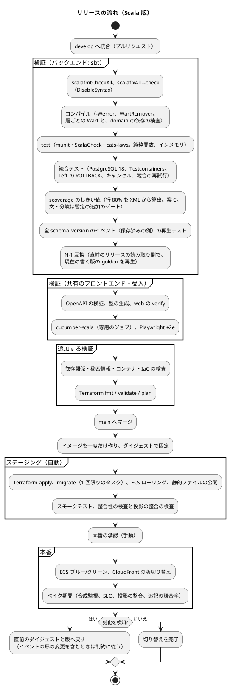

# 運用要件定義 - ビールゲームシミュレーション（Scala 版）

## 概要

本書は、beer-game-scala を本番で運用するための要件を定義します。[ADR-001](../../adr/beer-game-scala/001-scala-version-of-beer-game-kotlin.md) により、[beer-game-kotlin の運用要件](../beer-game-kotlin/operation.md)（beer-game2 の運用要件を引き継いだもの）を**正本として引き継ぎ**、Scala 版で変わるものだけを見直しました。**`docs/` を正本**とします。実装コード、Terraform、アラーム、手順書は**まだ存在せず**、本書の「アラーム」「手順書」は、作成する対象の設計です。

Scala 3 は JVM 上で動くため、**JVM に由来する運用（ヒープ、GC、起動の遅さ、OOM、ヒープダンプ）は Kotlin 版と同じ**です。ES + CQRS に由来する運用（`events` が状態の正本、投影の再構築、投影の整合の検査、追記の競合率、イベントスキーマの進化と 2 段階のリリース、書く版の切り替え）も同じです。変えるのは、次の 4 点だけです。

- **Cats Effect・doobie に固有の監視と障害パターン**（`Fiber` の追跡、`Supervisor`、`HikariTransactor` の待ち、`IO` の失敗の写像）を、Kotlin 版のコルーチン・Ktor・JDBC の項目に読み替える。
- **ログの形**を、ガイド §7.8 の `LogRecord` と `LogSink`（載せるものを型で決める）にする（[バックエンドアーキテクチャ](./architecture-backend.md) の SBD10）。
- **`Left` の ROLLBACK とキャンセル後のトランザクションの取り残し**を、新しい障害パターンとして加える（SBD2、SBD4。Rust 版の NF-R18 の読み替え）。
- ツールの違い（sbt、Scalafmt、WartRemover、Scalafix、scoverage）と、team の規約（`main` の merge で staging へ自動反映、production は手動承認。CI とデプロイのワークフローは beer-game3 とは別に新設）。

**範囲（ユーザーの決定、2026-11-25。M19）**: 実装として約束するのは U1〜U3 です。**U1〜U3 の間は、実際の研修には使いません（検証・事例用）。** 本書の本番運用・復元訓練・監視・手順書の完成は、再開するときに Unit を決めます（指標を見て決める。Unit 定義ではステージングは U1 の US6.2 にあり、U5 への付け替えは AI の整理。L2）。したがって、下の進行役への依頼文言・研修中の原則・パターン 18 は、**実際の研修に使い始める前に、運営者と合意するもの**で、U1〜U3 では設計としてのみ置きます。**研修に使い始める前提の時期は「U4 と U5 の判断の後」です**（理由は ADR-001 の 97〜100 行付近の 2 つ: U4 の US4.2 振り返りと、U5 の US5.1 保持削除。M17）。**U5 に着手する条件として、運営者との合意（依頼文言・15 分・研修中の原則）を 1 つ置きます**（案。承認を得ていない）。**U1 の範囲（D1・D2。ユーザーの指示に基づき AI が推奨案で決めた。確認は未了）**: 検証の CI（`check`）に加え、統合テスト（PostgreSQL 18）と `@api` の受け入れを CI で実行する。US6.1 は AC6.1.1（構造化ログ）・AC6.1.2（相関 ID つきの記録）・AC6.1.4（`/ready`）を U1 に入れる（AC6.1.3 メトリクス・AC6.1.5〜6.1.6 通知は約束の外）。

運用の体制、通知先、連絡先は、**組織に依存するため未決定**です（beer-game2・Kotlin 版と同じ。「要確認」）。

### 本書の位置づけと確認の範囲

- **本書で確認したこと**: Kotlin 版・Rust 版の運用要件と、Scala 版の [技術スタック](./tech-stack.md)・[バックエンドアーキテクチャ](./architecture-backend.md) を読み、Scala 版の実行環境で変わる項目を洗い出しました（2026-11-25）。
- **確認していないこと**: 監視の閾値、アラーム、バックアップ・復元の所要時間、デプロイ、ブルー/グリーン、各手順書は、**すべて未実装・未検証**です。**doobie がキャンセル時に ROLLBACK するか、`Supervisor` の挙動、cats-effect の実行基盤の指標の取り方、`IOApp` が SIGTERM で返す終了コード**は、**実 DB・実行で確認していません**（バックエンドの未決事項と同じ。B1 で確かめます）。`Left` でも COMMIT されることと `FC.rollback` の効果は、使い捨てのプロジェクトの実 DB で確認済みです（[データモデル](./data-model.md) の検証。確認状況の唯一の一覧: [技術スタック](./tech-stack.md#確認状況の一覧)）。
- **確認状況の正本の規則（N-H5。AI の案で承認を得ていない）**: 一覧が正です。一覧の根拠は実測の記録（[データモデル](./data-model.md) の「検証の結果」と [テスト戦略](./test-strategy.md) の「確認した事項」）で、一覧を直すときは根拠も直します。
- **レビュー（2026-11-25）への対応の承認の状況**: ユーザーが決めたのは H3（`Ignored` で止める設計を維持）、H6、H7、H9（NF-P2 は p95 4 秒）に加え、再レビューへの対応の次の 4 件です。**N-H4（検証用の CI の `check` ジョブ 1 本は U1 の約束に含める。AWS 環境・デプロイ用ワークフロー・ステージングへの自動反映は後回し。自動反映を持たない間の team 規約の例外は ADR に記録して人が承認する）、N-H6（`domain` の文 97% は目安）、N-H7（止まったゲームでも状態取得の読み取りは返すことを要件にする）、N-H8（U1〜U3 は実際の研修に使わない）**。**運用の依頼文言（パターン 18 の 15 分を含む）・研修中の原則・N-H1〜N-H3・N-H5 の直し方など、これら以外は AI の案で、承認を得ていません**。
- **再々レビュー（2026-11-25）への対応の区分**: ユーザーが「決定を行い、高 10 件を設計書に反映」と指示したため、AI が推奨案で決めたものがあります（**ユーザー本人が選択肢を選んだ決定ではなく、確認は未了**）。**D1**=統合テストと `@api` の受け入れを U1 の約束に含める、**D2**=U1 に入れる US6.1 の AC は AC6.1.1・6.1.2・6.1.4、**D3**=失効済みの旧担当者の入れ替えは、未失効の旧担当者にだけ `CredentialRevoked` を出す、**D4**=H2 版の `ProjectionLock` は Kotlin 版と同じ構造（`StampedLock` 系 + 待ちの上限 + 後始末）、**D5**=team 規約の及ぶ範囲の確認と例外の記録（`project.md` の `## Scope Overrides`）は人の承認の場で行う（AI は `project.md` を編集しない）。**パターン 17・18 の依頼文言、紙で続ける手順、15 分は、すべて AI の案です。**
- Kotlin 版の実装の経緯（B3・B13・B14 の注記）は引き継ぎません（Scala 版の値ではないため）。Kotlin 版の未決事項は、本書の未決事項に引き継ぎます（Rust 版と同じ扱い）。
- 閾値のうち根拠のないものは**提案**で、実装後の実測で見直します。

### 凡例

Kotlin 版と同じです。**引継**は Kotlin 版と同じ、**変更**は内容を Scala 版に合わせて変える、**新**は Scala 版で加える。

## 運用の前提

| 項目 | 内容 |
| :--- | :--- |
| 利用の形態・重視する時間帯・運用の主体 | Kotlin 版と同じ（研修・授業のセッション。同時に最大 15 ゲーム、拡張目標 25。運営者が実施日時を事前に伝える仕組みが必要（未決）。体制は要確認） |
| 守るべき資産・作り直せるもの | Kotlin 版と同じ（**`events` 表が状態の正本**。確定済みの週は RPO 0。投影は `events` から再構築できる。周辺ストア（表示名・資格）は `events` から復元できないため、`events` と同じ重要度で保護する）（引継） |
| 実行環境 | JVM 上の Scala 3。ECS のタスクで動かす想定（[インフラ](./architecture-infrastructure.md)）。JDK は 25（Temurin）を第一候補とし、**Scala・sbt・cats-effect・http4s・doobie の版は [技術スタック](./tech-stack.md) の記載に従う**。サポート期限は実装開始時に公式情報で確認する（変更） |
| 主な SLO | 月間可用性 99.5%、研修中の完全停止を 1 分以内に検知、RTO 15 分、RPO 0（[非機能要件](./non-functional.md)。引継） |

## 運用フロー

[Kotlin 版の運用フロー](../beer-game-kotlin/operation.md)（常時・研修の前・研修の中・日次・週次・月次・四半期・年次・随時の 11 行）を引き継ぎ、次の読み替えだけを加えます。

| 周期 | 読み替え | Scala 版 |
| :--- | :--- | :--: |
| 研修の前 | 合成監視に加え、**JVM のウォームアップ済みであることを確認する**（起動直後は、クラスの読み込みと JIT で最初の数リクエストが遅い。Kotlin 版と同じ） | 引継 |
| 日次 | ダッシュボードに、**`Fiber` の数・`Supervisor` の追跡数、接続プールの待ち、`idle in transaction` の取り残しの有無**を加える | 変更 |
| 月次 | 容量のレビューに、**JVM のヒープ・GC と、cats-effect の実行基盤（計算用とブロッキング用のスレッドプール）の使用状況**を含める。依存の更新は、sbt の依存の更新と、doobie（RC）・http4s（0.23 系）の新しい版の確認を含める | 変更 |
| 四半期 | 復元の訓練と、投影の再構築の訓練（Kotlin 版と同じ） | 引継 |
| 年次 | **ランタイム（JDK）・Scala・sbt・基盤イメージのサポート期限と、doobie の 1.0 安定版・http4s の 1.0 安定版への移行の要否**の確認 | 変更 |
| 随時 | リリースとロールバック。イベントの形の変更を伴うリリースは 2 段階で行う（Kotlin 版と同じ） | 引継 |

## 監視設計

閾値は、[非機能要件](./non-functional.md) と beer-game2・Kotlin 版の監視設計から導きます。**警告（Warning）は担当者の確認、重大（Critical）は即時の対応**です。メトリクスは、アプリが標準出力へ出す CloudWatch の EMF の JSON 行を第一候補とします（BD9 を引き継ぐ。ライブラリは足さない）。**名前空間は `BeerGame/Scala`（提案）**、メトリクスの名前は仮です。

### 引き継ぐ項目

**Kotlin 版の「beer-game2 から引き継ぐ項目」（15 行）と、「Kotlin 版で加える項目」のうち JVM 以外（投影の遅れ・反映待ちの再取得・投影の整合の検査・追記の競合率・再構築の排他ロックの待ち・再試行の上限超過・再生の所要時間・イベントの読み込み失敗）は、閾値も含めて変えず引き継ぎます**（正本は [Kotlin 版](../beer-game-kotlin/operation.md)）。主なものは次のとおりです。

| 区分 | 監視項目 | Warning | Critical |
| :--- | :--- | :--- | :--- |
| 可用性 | 主要な操作（作成、参加、確定）の成功 | — | 1 分間、成功が無い |
| 可用性 | 5xx の割合 | 1% 超（5 分） | 5% 超（1 分） |
| 性能 | API の応答（p95） | 800 ms 超（5 分） | 1 秒超（5 分） |
| 性能 | 週確定から画面反映（p95） | **実測の後に決める**（M11。3 秒は、平常時の p95（約 2.86 秒に GET の所要を足した 3 秒前後。Rust 版の推定）に近く、警報が出続けるため、置かない） | **4 秒超（5 分）（案）**（**ユーザーが決めたのは NF-P2 を p95 4 秒に再定義したこと（2026-11-25）だけで、監視の閾値（Warning・Critical）は AI の案**。Kotlin 版は 1.5 秒・2 秒。画面は 3 秒間隔のポーリングで、閾値は実測の前の提案）。**Critical 4 秒は SLO と同値で余裕がない**ことに注意（超えた時点で SLO の違反）。Warning は実測の後に決める（変更表の行 11 も同じ。M5） |
| 整合性 | 週結果の重複、不変条件の違反、イベントの欠落 | — | 1 件でも |
| 投影 | `projected_version` と `MAX(stream_version)` の差（5 分ごと）。投影の整合の検査（日次） | — | 差・不一致 1 件 |
| 追記 | 追記の競合率 | 5% 超（5 分。提案） | 20% 超（5 分。提案） |
| 追記 | 再試行の上限超過 | 1 件（5 分） | 5 件（5 分。提案） |
| 追記 | 再生の所要時間（p95） | 100 ms 超（5 分。提案） | 300 ms 超（5 分。提案） |
| イベント | イベントの読み込み失敗（未知の `event_type`・`schema_version`、デコード失敗） | — | 1 件でも |
| データベース | CPU、接続プールの使用率 | 70% 超 | 80% 超（10 分） |
| 削除 | 期限超過の経過時間 / 再試行の回数 / 恒久的な失敗 | 18 時間 / 3 回目 / — | 24 時間 / 5 回 / 発生から 5 分以内に通知 |
| セキュリティ | Origin 拒否、認証失敗の急増 | 平常の 3 倍（提案） | 平常の 10 倍（提案） |

**画面反映の指標の情報源（M11。案）**: サーバーは画面への表示を直接は知らないため、**タブ（`X-Tab-Id`）ごとに、確定の版以上を最初に返した GET の時刻**を、確定の時刻との差として EMF に出す（`WeekCommitted` の時刻から、そのタブの最初の「版が追いついた」応答まで）。タブの識別子がないクライアントは対象外にする。**この指標の取り方は未確認で、B1 以降で確かめる**。

「整合性」の行は、Kotlin 版と同じです（`stream_version` の欠番、`week_commits` と `WeekCommitted` の件数の不一致、内部エラー、想定外の一意制約違反）。**加えて Scala 版では、`Evolution.Ignored` が出た（保存済みのイベントを無視した）回数**を数えます。コマンドの経路で `Ignored` が出たら 500 で失敗させる設計（[バックエンドアーキテクチャ](./architecture-backend.md)「`Ignored` の扱い」）のため、**1 件でも重大**（`evolve` の網羅の漏れか、アップキャストの漏れを示す）です。**止める設計の維持は、ユーザーの決定（2026-11-25）です。Kotlin 版は、不正な遷移を状態を変えずに記録して続行するため、これは利用者に見える変更です**（該当ゲームの書き込みが止まる。**状態取得（読み取り）は返すことを要件にする**（N-H7）。運用の扱いは障害パターン 18）。

### Scala 版で読み替え・加える項目

Kotlin 版の JVM の 4 項目（ヒープ、GC の一時停止、OOM とスレッドの飽和、起動の遅さ）は**そのまま引き継ぎ**、スレッドの飽和の項目を cats-effect の実行基盤に読み替えます。

| 区分 | 監視項目 | Warning | Critical | 情報源 | 根拠 |
| :--- | :--- | :--- | :--- | :--- | :--- |
| JVM | ヒープの使用率（GC 後） | 70% 超（10 分） | 85% 超（10 分） | JVM のメトリクス | Kotlin 版と同じ。上限は `MaxRAMPercentage` で決める（[インフラ](./architecture-infrastructure.md)） |
| JVM | GC の一時停止時間（p99） | 200 ms 超（5 分。提案） | 500 ms 超（5 分。提案） | JVM のメトリクス | Kotlin 版と同じ。GC の種類と設定は実測で決める |
| JVM | コンテナの OOM による再起動 | — | 1 件 | ECS | Kotlin 版と同じ |
| JVM | **タスクの起動時間**と**アプリの起動時間**（NF-P16） | 60 秒超 / 30 秒超（p95。提案） | 120 秒超（提案） | ECS、アプリ | Kotlin 版と同じ 2 つの区間を混ぜずに測る。RTO の見積もりはタスクの起動時間を使う |
| 実行 | **`Fiber` の数の増加**（増え続けて下がらない）、`Supervisor` が追跡している `Fiber` の数 | 単調増加が 30 分（提案） | — | アプリ | 切断後に切り離した `execute` や SSE の `Fiber` が終わらない（リーク）の検知。**取得の方法（cats-effect の実行基盤の指標の公開、または自前の計数）は未確認** |
| 実行 | **ブロッキング I/O 用のスレッドプールの飽和**と、接続プールの待ち（取得の待ち時間）、枯渇 | 待ちが 100 ms 超（5 分。提案） | 枯渇（取得のタイムアウト） | アプリ | Kotlin 版の「ブロッキング用ディスパッチャーと接続プールの待ち」に当たる。JDBC は doobie がブロッキング用の実行コンテキストで動かす（詳細は要確認）。取り残しのトランザクション（パターン 17）の兆候にもなる |
| 実行 | **同時に走るコマンドの数**（上限に対する割合）と、上限超過で返した `RetryExhausted`（503）の件数 | 上限の 70% 超（提案） | 503 が 1 件（5 分） | アプリ | バックエンドの `Semaphore` などの上限（SBD4）。値は実測で決める（未決） |
| 実行 | **`IO` の失敗（想定外の例外）の件数**（`AppFailure.Persistence` に写した件数） | 1 件（5 分） | 5 件（5 分。提案） | アプリ | 業務の失敗は `Either` で返るため、`IO` の失敗は想定外に限る設計。1 件でも不具合か障害を示す。500 と相関 ID を伴う |
| データベース | **`idle in transaction` の取り残し**（新） | 1 件が 10 秒を超える（提案） | 5 件、または 30 秒を超える（提案） | DB の問い合わせ（`pg_stat_activity`）のジョブ | キャンセルや失敗の後に ROLLBACK されないトランザクションの検知（SBD2、SBD4。**doobie の挙動は未確認**）。Rust 版が PostgreSQL 18.6 で、`pg_stat_activity` の `state = 'idle in transaction'` で捉えられることと、**ログインロールに設定した** `idle_in_transaction_session_timeout` で切断できることを実測している（[Rust 版](../beer-game-rust/operation.md)。本書では再確認していない）。**NOLOGIN のロールに設定しても継承されない**点に注意 |
| 配信 | SSE の通知の遅延、SSE の切断・ポーリング切替の割合 | Kotlin 版と同じ | Kotlin 版と同じ | アプリ | fs2 の `Topic`（または `Queue`）であふれて切断した接続の数を加える（SBD9）。**現行の画面は SSE を使わない**（[フロントエンド](./architecture-frontend.md)）ため、画面が使い始めるまで優先度は下がる |

### ヘルスチェック

| 種類 | 内容 | Scala 版 |
| :--- | :--- | :--: |
| 生存（liveness） | プロセスが応答する（`GET /api/v1/health`） | 引継 |
| 準備（readiness） | `SELECT 1`、接続プールの取得、通知の受信（`LISTEN` の接続）が生きていること、**マイグレーションが適用済みであること**（`GET /api/v1/ready`） | 引継 |

JVM のウォームアップの猶予期間は、ヘルスチェックの開始待ちとして、タスクの起動時間の実測で決めます（未決。Kotlin 版と同じ）。

### ログと追跡

ログと計測は、ビジネスのコードを変えず、関数のラップ（`observe`）とミドルウェアで足します（[ガイド §7.8](../../reference/関数型プログラミングガイド_Scala編.md)）。

| 項目 | 要件 | Scala 版 |
| :--- | :--- | :--: |
| アプリのログ | 構造化 JSON の 1 行（`LogRecord` を標準出力へ。`LogSink.write` が `IO[Unit]`）。相関 ID、操作、結果、ストリームの版、所要時間、ゲームの不透明な ID。**`LogRecord` は、資格・表示名・招待コード・非公開の値の項目を持たない**（載せる場所が型に無い。Kotlin 版の「含めない」を型で守る） | 変更 |
| フレームワークのログ | http4s・HikariCP・Flyway のログは log4cats-slf4j と Logback（JSON にするかは未決）。アプリの `LogRecord` と出力先を揃える | 新 |
| ログの書き込みの失敗 | `LogSink.write` の失敗は握りつぶして処理を止めない（ガイド §7.8）。**書き込みの失敗の件数をメトリクスに出す**（ログが欠けても気づけるように。提案） | 新 |
| 集約と保持 | 暗号化した CloudWatch Logs。本番 90 日、その他 14 日 | 引継 |
| 追跡 | 相関 ID を HTTP、トランザクション、イベントの封筒（`correlationId`、`commandId`）、SSE に伝える。`IOLocal` は使わず、`RequestMeta` として引数と `Kleisli` の文脈で渡す（SBD1） | 変更 |
| 監査 | **`events` が監査の記録**。専用の監査表は持たない。保持の再試行は `deletion_attempts`。監査の検索で個人情報に触れない（NF-S14） | 引継 |

### ダッシュボード

Kotlin 版の項目（リクエスト量・応答時間・エラー、確定の成功・競合・ロールバック、追記の競合率・再試行の上限超過・再生の所要時間・投影の整合、JVM のヒープ・GC・スレッド・接続プール、DB の状態・SLO の消費・削除の状況）に、**`Fiber` の数、同時に走るコマンドの数、`IO` の失敗の件数、`idle in transaction` の件数**を加えます（未整備）。

## アラートとエスカレーション

重要度の定義と対応の目標は、Kotlin 版（beer-game2）と同じです。Scala 版で加えた項目の重要度を次に示します。

| 重要度 | Scala 版で加えた項目 |
| :--- | :--- |
| P1（重大） | **`Evolution.Ignored` の発生**、`idle in transaction` の取り残し（5 件、または 30 秒超）、投影の整合の不一致、イベントの読み込み失敗、OOM の再起動 |
| P2（高） | `IO` の失敗の件数、同時に走るコマンドの上限超過（503）、接続プールの枯渇、追記の競合率・再試行の上限超過、GC の一時停止、ヒープの使用率 |
| P3（中） | `Fiber` の数の単調増加、起動の遅さ、反映待ちの再取得、ログの書き込みの失敗 |

インシデント対応の流れ（検知 → 受領 → 重要度の判断 → 切り分け → 復旧 → 確認 → 事後分析）は、Kotlin 版の図を引き継ぎます。「直近の変更が原因」の分岐で、**イベントの形の変更を含むリリースは、書く版を戻す**（旧イメージを戻す前に、戻せるか確認する）点も同じです。

**要確認**: オンコールの当番、呼び出しの手段、インシデントのチャンネル、運営者への連絡窓口は、未定義です（未決事項）。

## バックアップ設計

**Kotlin 版の「バックアップ設計」を、そのまま引き継ぎます**（`events` と周辺ストアが唯一の源、投影は再構築できる、RDS の PITR と Multi-AZ（7 日）、エクスポートは保存しない、RPO 0・RTO 15 分、復元の手順 A（DB 全体）と手順 B（投影の再構築。研修中は運営者を通じて進行役に停止を依頼し、排他のアドバイザリロックで直列化）、四半期の訓練、バックアップと保持削除の関係（保持の起点は作成時で暫定））。

Scala 版での差分は次のとおりです。

| 項目 | Scala 版 |
| :--- | :--- |
| 投影の再構築の実装 | `rebuild-projections` モード（1 ゲームを 1 トランザクション、`ProjectionLock.acquireExclusive`。[バックエンドアーキテクチャ](./architecture-backend.md)）。**アドバイザリロックの動作は使い捨てのプロジェクトで確認済み**（[一覧](./tech-stack.md#確認状況の一覧)）。Scala 版のコードでの発行（`fr"select pg_advisory_xact_lock($key)"`。ポートの型の案は N-H2: `ConnectionIO` の変換 `withShared(gameId)(program)`。PostgreSQL 版は先頭で `pg_advisory_xact_lock_shared`、**H2 版は `StampedLock` 系 + 待ちの上限 + `Tx.run` の COMMIT・ROLLBACK の後の後始末（D4。ユーザーの指示に基づき AI が推奨案で決めた。確認は未了）**。接続は 1 本で、接続数の式は増えない。`Resource` 案は不採用）は、B1 で確かめる |
| 再構築の待ちの上限 | **`lock_timeout` は、ロックを取る間だけ設定する**（取った後に戻し、投影の行のロック待ちには効かせない。R-H6。中核の設計は [バックエンドアーキテクチャ](./architecture-backend.md) を正本とする）。**55P03（ロック待ちの超過）は `Left(RetryExhausted)`（503）に写して即返し、40P01・40001 は `Tx.run` の後に `ConcurrencyConflict` に写して再試行に戻る**。初期値は B1 の受入条件で決める（未決） |
| 復元後の検査 | 整合性の検査と投影の整合の検査は Kotlin 版と同じ。**再生は Scala の `Events.apply` の畳み込みで行う**（ドメインの純粋関数を使う） |
| RPO・RTO の机上確認 | Kotlin 版の確認（RPO 0 は Multi-AZ のフェイルオーバーでは成り立つが、PITR では復元可能な最新時刻が数分遅れる。RTO 15 分は PITR の新しいインスタンスの作成で収まる保証がない）を引き継ぐ。**Scala 版では実測しておらず、扱いは未決** |

## 障害対応設計

### 障害パターンと復旧

Kotlin 版の 16 パターンを、**番号を変えずに引き継ぎ**、Scala・Cats Effect・doobie で読み替える点と、加える 2 パターン（17、18）を示します。各パターンの検知・影響・初動・目標は Kotlin 版の表が正本です。

| # | パターン | Scala 版での読み替え |
| :--- | :--- | :--- |
| 1〜14 | API のタスクの異常、全停止、DB のフェイルオーバー、DB の破損、SSE の不通、デプロイの失敗、削除の失敗、資格の漏洩、鍵の誤設定・漏洩、CloudFront の設定ミス、利用者側の操作ミス、依存関係の重大な脆弱性、投影の不整合、追記の競合の多発 | **Kotlin 版と同じ**（パターン 3 の「冪等キーで再送できる」、13 と 14 の進行役への依頼文言も同じ）。パターン 12 の脆弱性の対応は、sbt の依存の検査の結果で行う（ツールは選定未決） |
| 15 | JVM のメモリ・GC の劣化（ヒープの逼迫、一時停止の長期化、OOM） | **Kotlin 版と同じ**。調査に、**`Fiber` の増加（リーク）の確認**を加える（`Fiber` ダンプの取得方法は未確認）。再生で読み込むイベントの量（長いストリーム）を疑う点も同じ |
| 16 | イベントの読み込み失敗（未知の `schema_version`、デコード失敗） | **Kotlin 版と同じ**（新しい版を旧版のアプリが読んだ）。Scala 版では、`EventCodec`（circe）の**デコード失敗**と、`Evolution.Ignored` の両方を検知の対象にする。復旧は、アプリを新しい版に戻す（旧版への巻き戻しは悪化する）。変更管理の「ロールバックの制約」を参照 |
| 17（新） | **ROLLBACK の漏れ・キャンセル後のトランザクションの取り残し** | 下に詳述 |
| 18（新） | **不正な遷移（`Evolution.Ignored`）で止まったゲーム** | 下に詳述 |

#### パターン 17: ROLLBACK の漏れ・キャンセル後のトランザクションの取り残し（新。Scala 版・Rust 版に固有）

| 項目 | 内容 |
| :--- | :--- |
| 背景 | doobie の `Transactor` は、`ConnectionIO` が例外なく完了すれば、値が `Left` でも COMMIT する（SBD2 の前提。**使い捨てのプロジェクトの実 DB で確認済み**。`FC.rollback` を挟むと残らない。[データモデル](./data-model.md) の検証。一覧: [技術スタック](./tech-stack.md#確認状況の一覧)）。そのため `Tx.run`（案。H4。旧案の `Tx.rollbackOnLeft` は不採用）で ROLLBACK を明示する。また、`Fiber` が取り消されたときに doobie が ROLLBACK して接続を返すかは、**公式の文書でも実測でも確認していない**（SBD4） |
| 検知 | `idle in transaction` の取り残し（上の表）、接続プールの待ち・枯渇、**業務の失敗（`Left`）のはずの操作の結果が `events` に残っている**ことを示す整合性のアラーム（`stream_version` の欠番・不一致、投影の整合の不一致） |
| 影響 | (a) 取り残し: ロック（共有のアドバイザリロック、行ロック）を握ったまま接続が残り、後続のコマンドや再構築が待つ。接続プールが枯渇する。(b) `Left` の COMMIT: 失敗した操作の途中の書き込みが残る（不変条件の違反）。**(b) が起きたら P1** |
| 初動と復旧 | (a) 取り残しのセッションを特定し（`pg_stat_activity`）、運用担当の承認のうえで `pg_terminate_backend` で切断する（切断で ROLLBACK される）。**切断された接続で処理中だった要求は、利用者には失敗（500・相関 ID。`type` つき）として見える。利用者は 1 回は再操作してよい。同じ操作が 2 回続けて失敗したら、パターン 18 の依頼文言に従う**（COMMIT の前なら ROLLBACK されて二重にならない。COMMIT の応答が失われた場合は、同じ `Idempotency-Key` の再送で保存済みの応答を得る。[UI 設計](./ui-design.md) の #14 と整合）。繰り返すなら、直近のリリースを疑い、ロールバックする。恒久対策は、ログインロールの `idle_in_transaction_session_timeout`。(b) 影響のゲームを特定し、パターン 13（投影の再構築）と、`events` の整合の確認を行う。`events` に不正な行が残った場合は追記専用で消せないため、**時点復旧（バックアップ設計の手順 A）を検討する**（人の判断） |
| 進行役への依頼 | **依頼文言の正本は、パターン 18 の 1 か所**（M4。AI の案）。パターン 17 と 18 は、**利用者の画面では同じ**（どちらも `AppFailure.Persistence`・500・`type` つき・`app.internal` の文言と相関 ID）で、**利用者にも進行役にも見分けがつかない**。**見分けるのは運営者側の監視だけ**（`Ignored` のメトリクス、`idle in transaction`、接続プールの待ち）。したがって、**依頼は両方で同じ形**にする: 「同じ操作が 2 回続けて失敗したら、それ以上操作せず、相関 ID を書き写して運営者に伝える」（パターン 17 は再操作で直ることがあるが、文言は変えない。誤って繰り返し続けさせないほうを優先する）。復旧後は、同じ文言の枠で再開を伝える（連絡手段は未決事項 9） |
| 研修中の原則（案） | **該当ゲームだけを止める**。**手順 A（DB 全体の時点復旧）は、研修の時間帯に行わない**（同時に進行している最大 15 ゲームの直近の確定を、すべて巻き戻すため）。取り残しがプール全体を枯渇させる場合（(a) の接続プールの枯渇）は、全ゲームに影響するため、切断を優先する。時点復旧が必要なときは、運営者と研修の終了後の時間を相談する |
| 他のゲームへの影響 | (a) 取り残しがロックを握ると、同じゲームのコマンドが待たされる。接続が枯渇すると、全ゲームに波及する。(b) 手順 A を行うと、全ゲームが巻き戻る（上の原則）。パターン 13 の再構築は、ゲームごとの排他ロックで、対象のゲームだけが待つ |
| 目標 | 15 分（提案） |
| 予防 | B1 の最初のスライドで、Scala 版のコードで `Left` のとき行が残らないこと（使い捨てのプロジェクトでは確認済み）、キャンセル時に ROLLBACK されること（未確認）を、Testcontainers の統合テストで確かめる（[バックエンドアーキテクチャ](./architecture-backend.md)）。前提が成り立たなければ設計を見直す |

#### パターン 18: 不正な遷移（`Evolution.Ignored`）で止まったゲーム（新。Scala 版・Rust 版に固有）

| 項目 | 内容 |
| :--- | :--- |
| 背景 | コマンドの経路で `Evolution.Ignored`（保存済みのイベントを、遷移が受けられない）が出たら、状態を信用せず `AppFailure.Persistence`（500・相関 ID）で失敗させる（fail closed。[バックエンドアーキテクチャ](./architecture-backend.md)「`Ignored` の扱い」）。**この設計の維持は、ユーザーの決定（2026-11-25）**。Kotlin 版は、不正な遷移を状態を変えずに記録して続行するため、**Scala 版では該当ゲームの操作が止まる（利用者に見える変更）**。典型の原因は、遷移の網羅の漏れ、アップキャストの漏れ、新しい版のイベントを旧版のアプリが読んだ場合（パターン 16）、**開始後の入れ替え・復帰・資格の再発行・観察者の招待を、遷移として受けていない場合**（H2・N-H1。案は、EV × 状態の「許す組の表」を規範にし、game の `Started` が `RoleAssigned`・`ParticipantReplaced`・`CredentialRevoked`・`CredentialReissued`・`ParticipationRecovered`・`ObserverInvited`・`ObserverJoined` などを自己遷移として受ける）。**`RoleHolderReplaced` は session のイベントで、受けるのは `Active`・`Paused` の状態**（`Started` ではない。L8）。**表の漏れが、そのまま研修の停止（P1）になる**。**典型の穴（R-H3）**: 失効済みの旧担当者の入れ替えで `CredentialRevoked` を無条件に出すと、自然な流れの「失効 → 入れ替え」が `Ignored` → 500 になり、入れ替えた時点でゲームが止まる（Kotlin 版の潜在不具合でもある）。**D3（ユーザーの指示に基づき AI が推奨案で決めた。確認は未了）: 未失効の旧担当者にだけ `CredentialRevoked` を出す**。受入テストに「失効 → 入れ替え → 新担当者が保存・確定 → 再生しても同じ状態」を置く（[テスト戦略](./test-strategy.md)） |
| 検知 | `Evolution.Ignored` の発生（P1。1 件でも）、同じゲームの 500 の連続、利用者（進行役）からの「操作できない」の連絡。相関 ID とストリームの版で、止まった位置を特定できる |
| 影響 | **該当ゲームのコマンド（保存・確定・停止・再開など）が失敗し続ける**。**他のゲームは、ストリームが別のため影響を受けない**。**投影からの読み取り（メソッドつきの 3 経路: `GET /games/{id}/state`・`GET /sessions/{id}/state`・`GET /games/{id}/lobby`。観察 `GET /games/{id}/observation` は ADR-001 の U4 で U1〜U3 の範囲外（決定済み）。U4 で足すときは 4 経路に拡げる。M7）は返す**ことを要件にする（N-H7。ユーザーの決定、2026-11-25）。B1 の確認項目に入れる（[テスト戦略](./test-strategy.md)）。読み取りまで 500 になる実装だと、画面の数字が残らず、紙で続けられない（その場合は設計を見直す）。**ポーリングの画面（S05 プレイ・S07 観察）は、止まったことに気づけない**: `Ignored` はコマンドの経路でだけ起き、GET は成功し続け、失敗は黙って無視される。気づくのは、次に操作した人（保存・確定の 500）だけ（[UI 設計](./ui-design.md) の #15） |
| 初動 | (1) **進行役への依頼**（運営者を通じて。**文言の案。ユーザーの決定ではない。この文言が、パターン 17・18 の依頼文言の正本**。M4）。**運営者側の判別**: 画面ではパターン 17 と 18 を見分けられないので、運営者が監視（`Ignored` のメトリクス、`idle in transaction`）で判別し、運営者が進行役に伝える。

**依頼文言（案）**: 「**同じ操作が 2 回続けて失敗したら、それ以上操作しないでください。まず画面に出ている『相関 ID』を書き写して（または画面を撮って）、運営者に伝えてください。そのあと『手動更新』を押してもかまいません。運用担当から 15 分以内に見込みを伝えます。15 分を待たず、進行役の判断で、紙に切り替えてかまいません。**」（**15 分は AI の案で、運営者と合意する**。**相関 ID は、操作した人のタブにだけ出る**。進行役が見ている画面に出るとは限らないので、操作した人から聞く。**「手動更新」を押すか、次の保存を押すと消える**: `PlayPage.tsx` 90 行の `setFailure(null)` は `refresh`（手動更新・自動の初回読み込み）の先頭で、**成功を待たず、押した時点で消える**。166 行の保存の開始でも消える。進行役のコンソール（S06）には手動更新が無く、ブラウザの再読み込みで消える。だから文言は「**まず書き写す、そのあと手動更新**」の順にする。**画面は「もう一度お試しください」と再操作を促すが、この状態では再操作しても同じ失敗になる**ため、文言で「2 回続けて失敗したら操作を繰り返さない」と明示する。画面の改善は [UI 設計](./ui-design.md) の未決事項 8 の受入条件の案）。

**進行役がすること**（運営者を通じて依頼）: (i) **コンソール（S06）をブラウザで再読み込みして最新の状態にする**（コンソールは自動更新されない。読む前に必ず再読み込みする）。(ii) 再読み込みしたコンソールで、**各役割の入力状況（「未入力」または「入力済み: N」）と、確定済みの週の結果表（週・役割・受注・発注・在庫・受注残・出荷・費用・累計費用。`ConsolePage.tsx`・`ResultsTable.tsx`）を撮る（または書き写す）**。(iii) 相関 ID を 1 つ、運営者に伝える。

**進行役が参加者に伝えること**: (i) 保存・確定のボタンを押さない（繰り返さない）。(ii) 自分の画面から、控えるべき数字を書き写す（下の表）。

**控える数字（役割別）**:

| 画面 | 控える数字 | 根拠 |
| :--- | :--- | :--- |
| 参加者（S05 プレイ） | 自分の役割の「今週の状況の表」の **在庫・受注残・入荷・受注**（小売店は顧客需要も）。**「現在の入力: N」（保存済みの数量）と、入力欄に打った未保存の数量（`draft`）を区別して**書く | `StatusTable.tsx`、`PlayPage.tsx`（現在の入力の行と `draft`） |
| 進行役（S06 コンソール） | 各役割の入力状況、確定済みの週の結果表。**4 役割を一度に見られるのは S06 だけ**（Kotlin 版 ui-design 378 行の「4 分割」は 4 役割を同時に見る設計だが、**実装の `ConsolePage.tsx` は入力状況の一覧と結果表で、「入荷予定」の項目は無い**） | `ConsolePage.tsx`・`ResultsTable.tsx` |
| 観察者（S07） | 控えなくてよい。見えるのは、現在週・入力済みの役割数・確定した週のチーム合計（注文・在庫・受注残）だけで、紙で続ける材料にならない | `openapi.yaml` の `getObservation` |

**入荷予定（輸送中の品）と、上流へ送って未着の発注**は、紙に移った瞬間に翌週の入荷が決まるために必要だが、**画面にも API の応答にも項目として無い**（`RoleStatus` は当週に処理する入荷 `arrivals` と受注 `orders` だけ。上の表のコンソールの結果表も確定した週の出荷と発注だけ）。**結果表の「出荷」と「発注」の、遅延の週数ぶん（直近の週）から復元する**。遅延の週数は、ゲーム作成時の設定（運営者・進行役が控えを持つ）による。**この復元でそろうかは B1 で確かめる**（[テスト戦略](./test-strategy.md) の B1 の「止まったゲームの読み取り」の行）。**画面に「入荷予定」を出す改善**は、全実装共通の画面の課題として UI 設計の未決事項 8 に加える。

**人の側の検知**: 画面は止まったことを誰にも知らせない（S05・S07 は GET が成功し続け、失敗は無言）。気づくのは操作した人だけ。**全員の保存が 1 分以上進まなければ、進行役がコンソールを再読み込みして確認する**。入力状況が増えていなければ、上の依頼を始める。

**紙で続けるとき（案）**: (a) **紙に移るときに、進行役が各週・各役割の発注数を記録する**（記録の様式: 週・役割・発注数。紙に移った週から）。(b) **復旧後は、代理入力と週ごとの確定で追いつく**: コンソールの結果表の最後に確定した週の次の週から、紙の記録の順に、進行役が各役割の発注数を代理入力し（一時停止中でも代理入力できる）、週を確定する（自動確定が有効なら、4 役割が揃った時点で確定する）。これを紙の最終週まで繰り返す。**追いつきの結果が紙の計算と同じ数字になるかは、golden（既知の系列と期待値）で確かめる候補**（[テスト戦略](./test-strategy.md)。確かめるまで一致は保証しない）。追いつかないと、振り返りのデータが欠ける。**この追いつきは、Kotlin 版・Rust 版の運用手順にも無い**（新たに作る手順）。(c) **15 分を待たず、進行役の判断で紙に切り替えてよい**（依頼文言に含めた）。(2) **研修中の原則（案）**: **該当ゲームだけを止める**。**手順 A（DB 全体の時点復旧）は、研修の時間帯に行わない**（同時に進行する最大 15 ゲームの直近の確定を、すべて巻き戻すため）。(3) 相関 ID・ストリームの版・イベントの種類・`schema_version` を記録する（個人情報は含めない）。(4) パターン 16（イベントの読み込み失敗）と、直近のリリースの有無を切り分ける |
| 復旧 | 原因（遷移の追加、アップキャスト）を直した版を、**緊急変更**としてリリースする。**イベントは書き換えないため、同じゲームを再開できる**（研修の時間帯の変更の凍結との関係は、運営者と相談する）。直せない、または研修の時間に間に合わない場合は、進行役と運営者が、手元のメモを使って続けるか、新しいゲームを作り直すかを選ぶ（人の判断。作り直すと入力済みの数量は引き継がれない） |
| 目標 | 該当ゲームの停止を運営者へ 5 分以内に通知する（提案）。修正のリリースは、研修の後でもよい（運営者と合意する） |
| 予防 | `handle` が作る列は `Ignored` にならない性質テストと、全イベントの種類が生成されることの検査（[テスト戦略](./test-strategy.md) の M9）。**許す組の表から作る状態遷移テスト**（許す組は `Applied`、それ以外は `Ignored`。N-H1）。開始後の入れ替え・復帰のテスト（H2）。**回帰テスト（M14）**: 止まったストリームのイベント列をフィクスチャにし、修正版で `Applied` になり操作を再開できる。`Ignored` の件数のメトリクスが出ること、500 に `type` と相関 ID が付き書き込みが残らないこと、止まったゲームの読み取りが返ること（[テスト戦略](./test-strategy.md) の NF-R9・NF-SC2 の行） |

各パターンの**手順書**は、`docs/operation/beer-game-scala/` に作成します（運用手順書の一覧を参照）。

### 事後分析

Kotlin 版と同じです。投影の不整合、イベントの読み込み失敗、**パターン 17（ROLLBACK の漏れ）**は、原因となったイベントの種類と版・操作を記録し、テスト（永続化往復の同値性、計算と事実の一致、投影の整合、アップキャストの試験、`Left` の ROLLBACK の統合テスト）へ反映します。

## 変更管理設計

### リリースの流れ

Kotlin 版のリリースの流れ（develop へ統合 → 検証 → main へマージ → イメージを一度だけ作りダイジェスト固定 → ステージング → 本番の承認 → 本番のブルー/グリーン・ベイク → 劣化なら戻す）を引き継ぎ、**検証の手順を sbt に読み替えます**。

整形・静的解析・カバレッジは [ガイド 第 9 章](../../reference/関数型プログラミングガイド_Scala編.md) と [技術スタック](./tech-stack.md) の ST4 に従い、CI で実行します（失敗した変更は merge しません。team の規約）。**カバレッジのしきい値は未実測のため暫定**です（`domain` の文 97% は目安で、ゲートにするかは B1 の実測後。N-H6）。

**範囲（N-H4。ユーザーの決定、2026-11-25）**: 上の図のうち、**U1 で約束するのは、検証用の CI の範囲**（ジョブの本数ではなく検証の範囲。D1）です。**`check` ジョブ 1 本（図の「検証（バックエンド: sbt）」の静的解析・テスト・カバレッジ）に加え、統合テスト（PostgreSQL 18、Testcontainers）と `@api` の受け入れの CI 実行**を含みます（`check` に含めるか別ジョブかは案 X・Y。[テスト戦略](./test-strategy.md)。D1 は、ユーザーの指示に基づき AI が推奨案で決めた。確認は未了）。「検証（共有のフロントエンド・受入）」のうち `@ui` と Playwright は、対応する検証が範囲に入る Bolt で足します。**ステージング以降（Terraform、マイグレーションのタスク、ECS、承認、ブルー/グリーン、ベイク）と、AWS 環境、デプロイ用のワークフローは後回し（再開するときに Unit を決める。L2）**です。ステージングへの自動反映を持たない間の team 規約の例外は、ADR に記録して人が承認します。

### ロールバック

Kotlin 版の表（アプリ、Web の静的ファイル、インフラ、DB のスキーマ、投影の形）を引き継ぎます。**新しい `schema_version` のイベントが書かれた後は、旧イメージへ戻せないことがある**点も同じです。ロールバックの入力に、旧イメージが現在のイベントを読めることの確認（`confirm_compatible` 相当）を必須にする設計を引き継ぎます（手順書は Scala 版で新規に作る）。

### イベントスキーマの進化（ES 固有）

Kotlin 版の節（変更の種類の表、2 段階のリリース（読める版 → 書く版）、A・B・C の比較で A を採用、ロールバックの制約、golden による検証）を**そのまま引き継ぎます**。Scala 版の実現は次のとおりです。

- アップキャストは、`adapter-persistence` の `EventCodec`（circe の DTO）の純粋関数の列で、読み込み時に遷移へ渡す前に適用する（[バックエンドアーキテクチャ](./architecture-backend.md)）。
- **新しいイベントの種類を足すと、`Events.apply` と投影の `match` の網羅がコンパイルで失敗する**（`-Werror`）。書く側を後にして、読む側を先にリリースする規則は変わらない。
- 書く版の切り替えの設定名・置き場所は未決（Kotlin 版は `WRITE_SCHEMA_VERSION` を提案）。**本番の環境変数の変更に当たるため、確認必須**。

### 変更の承認

Kotlin 版と同じです（標準変更・通常変更・緊急変更の 3 区分、研修の実施日時の前後は通常変更を凍結）。通常変更に、**イベントの形の変更（読む版・書く版の各段階）、投影の形の変更と再構築**を含めます。

## セキュリティ運用

Kotlin 版の表を引き継ぎます（最小権限、アプリの DB ロールは `events` へ INSERT と SELECT のみ、鍵と秘密情報は Secrets Manager、CloudTrail、個人情報は表示名のみで `events` とログに含めない）。Scala 版の読み替えは次のとおりです。

| 項目 | Scala 版 |
| :--- | :--- |
| 脆弱性管理 | 依存関係（sbt の依存）、秘密情報、コンテナ、IaC を CI で検査し、Critical と High はリリースを止める。**sbt の依存の検査ツールは選定未決**（[技術スタック](./tech-stack.md)） |
| パッチ | ランタイム（JDK）、Scala、sbt、コンテナの基盤イメージのサポート期限を管理する。**doobie は RC、http4s は 0.23 系（1.0 はマイルストーン）の間は、新しい版の変更の影響を確認する**（アップグレード計画） |
| 個人情報 | **`LogRecord` に表示名・資格の項目を持たせない**ことで、ログに載る事故を型で防ぐ（SBD10）。`Secret[A]` の `toString` は伏せ字 |

## データ運用

Kotlin 版の表を引き継ぎます（保持と削除は `game_roots` の連鎖削除で `events` も消える、削除の運用と証跡、復元後の保持の定期タスクの再実行、追記専用（`events` に更新・削除を拒否するトリガーを足さない。NF-S20）、出力は保存しない、期限切れの掃除、スキーマの変更はデプロイ時の 1 回限りのタスク）。**差分**: マイグレーションは Flyway（ST1）で、Scala のコードからは書き換えない。イベントは書き換えない。連鎖削除が `events` の DELETE 権限のないロールで動くかは、Kotlin 版では実測済みだが、**Scala 版の最初のスライドの統合テストで確かめる**。

## 容量・コスト管理

Kotlin 版の表を引き継ぎます（月次の容量のレビュー、拡張の契機、API は CPU 60% を目標に 2〜4 タスクで自動増減、25 ゲーム・100 接続を超える利用は実測で判断、コストの月次予算）。**差分**: 容量のレビューに、**cats-effect の実行基盤の使用状況と、同時に走るコマンドの数の上限**（SBD4）を含める。性能の見積もりは、Scala の実装で再計測する（ADR-003）。

## 運用手順書の一覧（作成予定）

`docs/operation/beer-game-scala/` に作成する手順書です。**すべて未作成**で、Bolt の進行に合わせて作成します。手順書は、新しい独自スクリプトを作らず、**定義済みのタスクを使う**方針です（プロジェクトの規約）。必要なタスクが無い場合は、`operating-script` で正式なタスクとして追加します。

| 手順書 | 内容 | 優先度 | Scala 版 |
| :--- | :--- | :--: | :--: |
| アプリケーション開発環境セットアップ | ローカルの構築（`nix develop .#scala`、JDK、H2 の PostgreSQL モード（ST9。Docker 不要）、PostgreSQL を使う場合は Docker の PostgreSQL 18、sbt のビルド、マイグレーション） | 高 | 変更 |
| 障害対応（パターン別） | 障害パターン 18 件の手順（17・18 は新。進行役への依頼文言と研修中の原則を含む） | 高 | 変更 |
| リリースとロールバック | 手順、承認、ベイク、切り戻し。**2 段階（読む → 書く）と、旧イメージへ戻せる期間** | 高 | 変更 |
| コンテナのローカル実行とスモークテスト | ローカルの Docker での検証手順 | 中 | 新 |
| 復元の訓練 | 時点復旧、復元ゲート、整合性の検査、投影の整合の検査、記録の様式 | 高 | 変更 |
| 本番の運用 | 適用前の確認、独自ドメイン・TLS、ブルー/グリーンのデプロイと戻し、定期タスク、インシデント | 高 | 新 |
| 投影の再構築 | 対象の決め方、研修中の停止の依頼文言、排他ロック、実行、検査、再開の依頼 | 高 | 新 |
| 整合性の検査 | 投影の整合、ストリームの版の連続性、投影の整合の検査 | 高 | 新 |
| イベントスキーマの変更 | `schema_version` の追加、アップキャスト、golden の更新、書く版の切り替え | 高 | 新 |
| **取り残したトランザクションの対応** | `idle in transaction` の特定、切断の承認、`idle_in_transaction_session_timeout` の確認（パターン 17） | 高 | 新 |
| 保持削除の運用 | 状況の確認、失敗の対応、再試行 | 中 | 引継 |
| 資格の失効・再発行 | 進行役の資格、観察用の招待、復帰資格の失効と再発行 | 高 | 引継 |
| ステージング・本番のセットアップ | AWS の構築（Terraform、ネットワーク、秘密情報） | 中 | 引継 |
| 鍵のローテーション | 資格の鍵、暗号鍵、DB の認証情報 | 中 | 引継 |
| **JVM と cats-effect の調査** | ヒープ、GC、スレッド、`Fiber` の増加の確認と、ヒープダンプの取得（承認、取り扱い） | 中 | 変更 |
| 運用コマンド | 運用で使うコマンドの一覧 | 中 | 引継 |

## beer-game-kotlin からの変更

| # | beer-game-kotlin | beer-game-scala | 理由 |
| :--- | :--- | :--- | :--- |
| 1 | ログは `LogRecord`（data class）と Logback | `LogRecord` と `LogSink`（`IO[Unit]`）。フレームワークのログは log4cats-slf4j と Logback | ガイド §7.8（SBD10） |
| 2 | スレッドの飽和は、ブロッキング用ディスパッチャーと接続プールの待ち | cats-effect の実行基盤のブロッキング用プールと `HikariTransactor` の待ち。**`Fiber` の数と、同時に走るコマンドの数**を加える | 実行モデルの違い（SBD4） |
| 3 | 想定外の失敗は例外 | `IO` の失敗の件数を数える。`Evolution.Ignored` の発生を重大にする | 業務の失敗を `Either` で返す設計（SD2） |
| 4 | ブロックが `Left` を返したら ROLLBACK | `Tx.run`（唯一の公開の入口）で明示。**漏れ・取り残しを障害パターン 17 として監視・手順化**する | doobie は `Left` でも COMMIT する（SBD2） |
| 5 | キャンセルは `NonCancellable` | `Supervisor` で切り離し、シャットダウンで `Fiber` の完了を待つ | キャンセルの意味の違い（SBD4） |
| 6 | 障害パターン 16 件、手順書 13 件 | 18 件、15 件（取り残しの対応、JVM と cats-effect の調査を加える。パターン 18 は `Ignored` で止まったゲーム） | 上記 |
| 7 | 検証の手順は Gradle（ktlint、detekt、PMD、Kover） | sbt（Scalafmt、scalac のオプション、WartRemover、Scalafix、scoverage） | ツールの違い（ST4） |
| 8 | メトリクスの名前空間 `BeerGame/Kotlin` | `BeerGame/Scala`（提案） | 区別のため |
| 9 | ローカルは H2 の PostgreSQL モード | 同じ（ローカルは H2、ステージング・本番は PostgreSQL。**本番・ステージングで H2 を起動前に拒否**。ユーザーの決定、2026-11-25。ST9）。本番・ステージングの運用手順に H2 は現れない | ST9 |
| 10 | 実装の経緯（B3・B13・B14）の注記 | 引き継がない | Scala 版の実装がまだ無い |
| 11 | 週確定から画面反映の閾値は Warning 1.5 秒・Critical 2 秒 | Warning は実測の後に決める。Critical 4 秒（案） | NF-P2 を p95 4 秒に再定義（ユーザーの決定、2026-11-25。H9。**閾値そのものは案**。M5。旧記述の「Warning 3 秒」は、平常時の p95（約 3 秒）に近く警報が出続けるため外した） |
| 12 | 不正な遷移は状態を変えず記録して続行 | 該当ゲームを止める。進行役への依頼文言・研修中の原則・手順をパターン 18 に定める | `Ignored` で止める設計の維持（ユーザーの決定、2026-11-25。H3）。文言と原則は AI の案 |
| 13 | （なし） | パターン 17 の初動に、進行役への依頼文言、研修中の原則、他のゲームへの影響、`pg_terminate_backend` の利用者への見え方を加えた | レビュー（2026-11-25）の H3。AI の案 |
| 14 | （なし） | 確認状況の記述（`Left` の COMMIT、アドバイザリロック）を、一覧へのリンクと確認済みの扱いに直した | H1。AI の案 |
| 15 | （なし） | パターン 18 の依頼文言を、「操作を繰り返さず相関 ID を伝える」「15 分以内に見込みを伝える（AI の案）」「画面の数字を控え、見込みが立たなければ紙で続ける」に直し、影響に「読み取りは返す」を要件として入れた。ポーリングの画面が止まったことに気づけないことを書いた | N-H7（要件はユーザーの決定、文言は AI の案） |
| 16 | （なし） | パターン 18 の背景に、許す組の表（N-H1）と `RoleHolderReplaced` の受け手（`Active`・`Paused`。L8）を書いた。予防に、状態遷移テストと止まったストリームの回帰（M14）を足した | N-H1、L8、M14。AI の案 |
| 17 | （なし） | 週確定から画面反映の Warning（3 秒）を、実測の後に決める案にし、画面反映の指標の情報源（タブごとの最初の追いついた GET）を書いた。Critical 4 秒は SLO と同値で余裕がないことを注記 | M11。AI の案 |
| 18 | （なし） | 冒頭に U1〜U3 は実際の研修に使わないと書き、リリースの流れのうち U1 で約束するのは検証用の `check` ジョブだけと書いた。旧名 `Tx.rollbackOnLeft` を `Tx.run` に直し、ロックの型を N-H2 の案に直した | N-H4・N-H8（ユーザーの決定）、N-H5・N-H2（AI の案） |
| 19 | （なし） | **再々レビュー（2026-11-25）**。依頼文言の正本をパターン 18 の 1 か所にし、「同じ操作が 2 回続けて失敗したら、それ以上操作せず、相関 ID を書き写して運営者に伝える」の形に（R-H8・M4）。パターン 17・18 の判別は運営者側の監視だけと明記。相関 ID は操作した人のタブにだけ出て、手動更新（`PlayPage.tsx` 90 行。成功を待たず押した時点）で消えるので「まず書き写す、そのあと手動更新」の順に | AI の案（依頼文言・15 分は未承認） |
| 20 | （なし） | 紙で続けるための依頼を直した（R-H9・M8）。進行役がすることと参加者に伝えることを分け、参加者・進行役・観察者ごとの控える数字（コンソールの結果表。入荷予定・未着の発注は画面に項目が無く、結果表から復元）、コンソールの再読み込み、人の側の検知（1 分）、紙に移るときの発注数の記録、復旧後の代理入力と週ごとの確定による追いつき、15 分を待たず紙に切り替えてよいこと | AI の案 |
| 21 | （なし） | 週確定から画面反映の閾値の注記を揃えた（M5）。止まったゲームの読み取りの対象を、メソッドつきの 3 経路（観察は U4）に（M7）。研修に使い始める前提を「U4 と U5 の判断の後」に、U5 の着手条件に運営者との合意を（M17）。「後回し（U5）」を「後回し（再開するときに Unit を決める）」に（L2）。U1 の範囲に統合と `@api` の受け入れ（D1）、US6.1 の AC（D2）。`lock_timeout` と SQLSTATE の写像、H2 版のロック（R-H5・R-H6・D4）。進行役向けの 1 枚の案内に予備の参加者・代理入力・長く止めない（M11） | D1・D2・D4 は指示に基づき AI が推奨案で決めた（確認未了）。他は AI の案 |

上記以外（ES + CQRS の運用、バックアップと復元の手順、2 段階のリリース、保持削除、セキュリティ運用、容量・コスト）は変えません。

## 未決事項

1. **オンコールの体制、通知先、エスカレーション、運営者への連絡窓口**（組織の判断。Kotlin 版から継続）。
2. **研修の実施日時を、運営者から運用側へ伝える手順**と、運用の予定表（Kotlin 版から継続）。
3. **doobie の挙動の確認**（B1）: キャンセル時の ROLLBACK、`idle in transaction` の発生の有無、Scala 版のコード（`Tx.run`、ポートの型。H5 の案）での `Left` の ROLLBACK とアドバイザリロックの発行。`Left` での COMMIT と `FC.rollback` の効果、アドバイザリロックの動作は、使い捨てのプロジェクトで確認済み（[一覧](./tech-stack.md#確認状況の一覧)）。結果で、パターン 17 の重要度と手順を見直す。
3a. **パターン 18 の運用**（H3 の案）: 進行役への依頼文言（「15 分以内に見込みを伝える」の 15 分を含む。AI の案）、研修中の原則（該当ゲームだけを止める。手順 A を研修の時間に行わない）、連絡手段（未決事項 9）を、運営者と合意する。止まったゲームの画面での見え方（`app.internal` の辞書の文言と相関 ID。再操作を促す文言とのかみ合わなさ）を、全実装共通の画面の課題（[UI 設計](./ui-design.md) の未決事項 8）として扱う。**U1〜U3 の間は実際の研修に使わないため、合意は「U4 と U5 の判断の後、実際の研修に使い始める前」に済ませる**（M17。U5 に着手する条件として、運営者との合意（依頼文言・15 分・研修中の原則）を置く案。承認を得ていない）。依頼文言の正本はパターン 18 の 1 か所で、`architecture-backend.md` は参照だけにする（M4）。
3b. **進行役向けの 1 枚の案内**（L11。beer-game2 から一貫して欠けている）: 「研修中にシステムが止まったら・人が入れ替わったら」の案内を、1 枚にまとめる案。内容の案: 止まったときは操作を繰り返さず相関 ID を運営者に伝える、画面の在庫・受注残・今週の入力を控える、人が入れ替わったときは進行役が入れ替えの操作をして旧担当者の再送は 403 になる、など。ポーリング失敗の無言（UI 設計の未決事項 8）と合わせてストーリー化する（承認を得ていない案）。**M11 の追加（案）**: (i) **準備中に、予備の参加者を参加させておく**（開始後の参加は受け付けない。開始後に役割が空いても、新しく参加はできない）。(ii) **予備がいない場合は、残りの役割を進行役の代理入力で続けられる**（代理入力は一時停止中も使える）。(iii) **研修 1 回が 90〜120 分（運営者の想定。要件の文書には出典が無く、運営者に確認する）で、5〜10 分でも止まると場が冷える**ので、止まったら早めに紙に切り替えてよい（パターン 18 の依頼文言）。**M8 の追加（案）**: 「進行役がすること」と「進行役が参加者に伝えること」を分け、参加者・進行役・観察者ごとに控える数字を書く（パターン 18 の表）。
4. **`IOApp` の SIGTERM での終了コード**（Kotlin 版は 143 で、「正常終了 0」の記述との差が人の判断待ちだった）。**Scala 版での値は未確認**。アラームの条件との関係を決める。
5. **cats-effect の実行基盤の指標**（計算用・ブロッキング用のプールの使用状況、`Fiber` の数）の取得方法。標準で出せない場合は自前の計数にするか、採否を決める（新しい依存は承認が要る）。
6. **同時に走るコマンドの数の上限、`lock_timeout` の初期値、プール取得のタイムアウト**（バックエンドの未決事項と共通。実測で決める）。
7. **`idle_in_transaction_session_timeout` を設定するログインロール**（Kotlin 版・Rust 版では、DB ログインロールの分離が未定義または未決）。
8. **RPO 0 の範囲と、障害パターン 4 の RTO**（Kotlin 版から継続。PITR では RPO 0 にならず、RTO 15 分の保証がない）。
9. **投影の再構築中のコマンドの応答**（短い待ちか、503 か）と、進行役への依頼の連絡手段（Kotlin 版から継続）。
10. **保持の起点**（作成時で暫定。終了時から数える案は未決。Kotlin 版から継続）。
11. **書く版の切り替えの設定の置き場所と名前**、**業務のスモークテスト**の範囲（Kotlin 版から継続）。
12. **合成監視の頻度と費用の妥当性**、**復元・再構築の訓練の担当者と時期**（Kotlin 版から継続）。
13. **メトリクスの出力方式**（EMF の自前出力を第一候補。名前空間は提案）、**JVM の閾値と GC・ヒープの設定**（実測で決める）。
14. **依存関係の脆弱性の検査ツール、変異テスト**（選定未決。[技術スタック](./tech-stack.md)）。
15. **Scala・sbt・JDK・各ライブラリのサポート期限**は、実装開始時に公式情報で確認し、確認日と出典を技術スタックに記す。
16. **ステージング・本番の AWS 環境と、手順書の作成時期**。本書の「手順書」はすべて未作成。

## 出典

- [運用要件定義（Kotlin 版）](../beer-game-kotlin/operation.md)、[運用要件定義（Rust 版）](../beer-game-rust/operation.md)、[beer-game2 運用要件定義](../beer-game-ts/operation.md)
- [技術スタック（Scala 版）](./tech-stack.md)、[バックエンドアーキテクチャ（Scala 版）](./architecture-backend.md)、[ドメインモデル（Scala 版）](./domain-model.md)、[インフラストラクチャ（Scala 版）](./architecture-infrastructure.md)、[非機能要件](./non-functional.md)
- [ADR-001（Scala 版）](../../adr/beer-game-scala/001-scala-version-of-beer-game-kotlin.md)
- [運用要件定義ガイド](../../reference/運用要件定義ガイド.md)
- [関数型プログラミングガイド（Scala 編）](../../reference/関数型プログラミングガイド_Scala編.md) §7.8（監視は合成で足す）、§7.9、第 9 章（静的解析）
- [ADR-007](../../adr/beer-game-ts/007-cascade-deletion-without-queues.md)、[ADR-008](../../adr/beer-game-ts/008-auto-commit-and-event-audit.md)、[ADR-009](../../adr/beer-game-ts/009-credential-key-versions.md)、[ADR-012](../../adr/beer-game-ts/012-delivery-pipeline-and-terraform.md)
