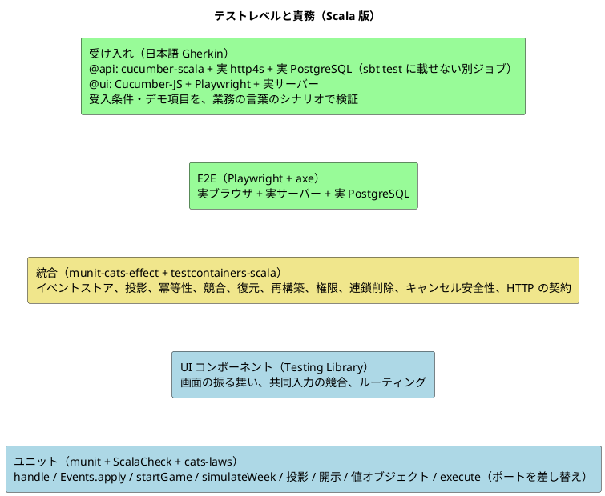
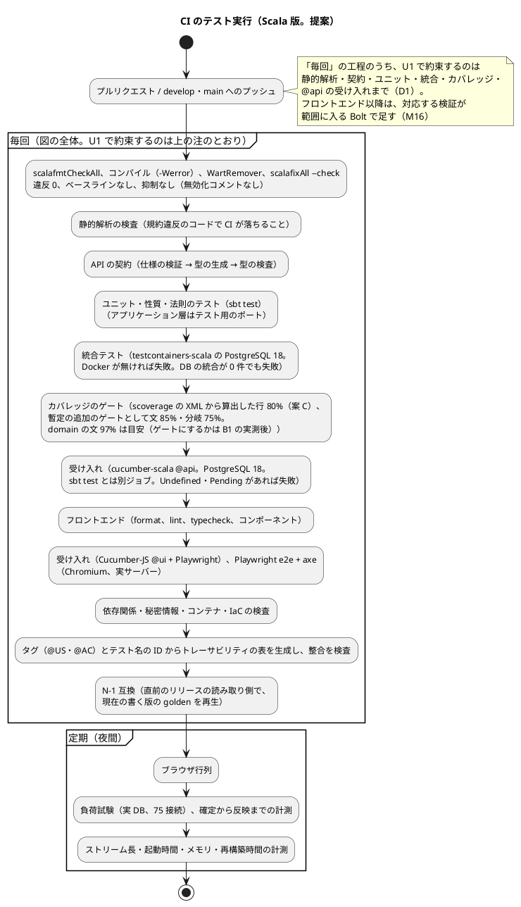

# テスト戦略 - ビールゲームシミュレーション（Scala 版）

## 概要

本書は、beer-game-scala のテスト戦略を定義します。[ADR-001](../../adr/beer-game-scala/001-scala-version-of-beer-game-kotlin.md) の決定により、**受入条件は beer-game2、テストの構造は [beer-game-kotlin のテスト戦略](../beer-game-kotlin/test-strategy.md)、実装規約は [関数型プログラミングガイド（Scala 編）](../../reference/関数型プログラミングガイド_Scala編.md)（以下「ガイド」。テストは第 8 章、静的解析は第 9 章）を正本**として引き継ぎ、本書は Scala での実現方法と、Scala で変わる点だけを定めます。**`docs/` を設計の正本**とします。実装コードはまだ存在しません（アプリの置き場は `apps/beer-game-scala` を予定）。

**範囲の約束（ユーザーの決定、2026-11-25）**: 実装として約束するのは U1〜U3 です。**U1〜U3 の間は、実際の研修には使いません（検証・事例用）。** 検証用の CI（`check` ジョブ 1 本）は U1 に含め、AWS 環境・デプロイ用のワークフロー・本番運用・復元訓練は後回し（再開するときに Unit を決める。Unit 定義ではステージングは U1 の US6.2 にあり、U5 への付け替えは AI の整理。L2）です（下の「CI との連携」）。**U1 の約束は、ジョブの本数ではなく検証の範囲です**（D1。ユーザーの指示に基づき AI が推奨案で決めた。確認は未了）: 統合テスト（PostgreSQL 18、testcontainers-scala）と `@api` の受け入れテストを CI で実行することを、U1 の約束に含めます。**U1 に入れる US6.1（障害と性能の劣化を検知する）の AC は AC6.1.1（構造化ログ）・AC6.1.2（相関 ID つきの記録）・AC6.1.4（`/ready`）**です（D2。同上。AC6.1.3 メトリクスと AC6.1.5・6.1.6 通知は約束の外）。CI の `check` ジョブは、US の受入条件ではなく範囲の決定（N-H4）です。

### 本書の位置づけと確認の範囲

- **本書で確認したこと**（2026-11-25。リポジトリの外の使い捨てのプロジェクトで、sbt 1.13.1、Scala 3.7.4、JetBrains Runtime 25.0.4.1、ローカルの Docker の `postgres:18.6` を使用。下の表）。
- **確認していないこと**: ScalaCheck の状態に応じた操作列の生成、複数プロジェクトの scoverage の合算（`coverageAggregate`）と統合テストの計測、`HttpRoutes` を関数として呼ぶ HTTP のテスト、契約テストのスキーマ検証の道具、Gherkin の別プロジェクトからの実行、テスト用の DB の分離方式、`scalafixAll`、変異テストの道具。いずれも B1 で確かめます。
- **引き継ぐだけのもの**: テスト形状とレベルの責務、層の分担、境界値の一覧、非機能のテストの対応、トレーサビリティの方針、CI の工程の考え方は Kotlin 版を正本とします。
- Kotlin 版の実装の経緯（B1〜B15 の結果の記述）は引き継ぎません。H2 に関する記述は、ST9（ユーザーの決定、2026-11-25）に従って読み替えて引き継ぎますが、**Scala 版では H2 を実測していません**。Kotlin 版の未決事項は、本書の未決事項に引き継ぎます。
- **確認状況の正本の規則（N-H5。AI の案で承認を得ていない）**: [技術スタックの確認状況の一覧](./tech-stack.md#確認状況の一覧)が正です。一覧の根拠は実測の記録（[データモデル](./data-model.md) の「検証の結果」と、本書の「確認した事項」1〜11）で、**一覧を直すときは根拠も直します**。
- **レビュー（2026-11-25）への対応の承認の状況**: ユーザーが決めたのは、H3（不正な遷移 `Ignored` は止める設計を維持）、H6（カバレッジは行率を算出する案 C を第一）、H7（範囲は U1〜U3 を約束し U4〜U6 は指標を見て決める）、H9（NF-P2 は p95 4 秒）に加え、再レビュー（2026-11-25）への対応の次の 4 件です。**N-H4（検証用の CI の `check` ジョブ 1 本は U1 の約束に含める。AWS 環境・デプロイ用ワークフロー・ステージングへの自動反映は後回しで、自動反映を持たない間の team 規約の例外は ADR に記録して人が承認する）、N-H6（`domain` の文 97% は目安。ゲートにするかは B1 の実測後）、N-H7（止まったゲームでも状態取得の読み取りは返すことを要件にする）、N-H8（U1〜U3 の間は実際の研修に使わない）**。**これら以外（N-H1・N-H2・N-H3・N-H5 の直し方など）は AI の案で、承認を得ていません**。本書の N-H1（許す組の表）・N-H2・N-H3 の記述は案です。
- **再々レビュー（2026-11-25）への対応の区分**: ユーザーが「決定を行い、高 10 件を設計書に反映」と指示したため、AI が推奨案で決めたものがあります（**ユーザー本人が選択肢を選んだ決定ではなく、確認は未了**）。**D1**=統合テスト（PostgreSQL 18）と `@api` の受け入れテストを U1 の約束に含める（R-H2 案 (a)）、**D2**=U1 に入れる US6.1 の AC は AC6.1.1・6.1.2・6.1.4（R-H1）、**D3**=失効済みの旧担当者の入れ替えでは、未失効の旧担当者にだけ `CredentialRevoked` を出す（R-H3 案 (a)）、**D4**=H2 版の `ProjectionLock` は Kotlin 版と同じ構造（`StampedLock` 系 + 待ちの上限 + トランザクション終了後の後始末。R-H5）、**D5**=team 規約が beer-game-scala に及ぶかの確認と、例外の project.md `## Scope Overrides` への記録は、人の承認の場で行う（M1。AI は project.md を編集しない）。**これら以外の直し方はすべて AI の案で、承認を得ていません。**

| # | 確認した事項 | 結果 |
| :--- | :--- | :--- |
| 1 | munit 1.3.6 の日本語のテスト名 | 日本語・記号（`[US2.4/AC2.4.1]`）を含む名前で書けて実行できる。`testOnly NameSuite -- "*AC2.4.1*"` で名前の絞り込みもできる。sbt が出す JUnit XML（`target/test-reports`）に名前がそのまま入る |
| 2 | munit-scalacheck 1.3.1、munit-cats-effect 2.2.1 | `property("…") { forAll { … } }` と、`IO` を返す `test` が通る |
| 3 | cats-laws 2.13.0 + discipline-munit 2.0.0 | `checkAll("…", MonoidTests[Totals].monoid)` で法則が 18 件のテストとして走る。**`empty` を壊した `Monoid` は 4 件（`left identity`・`right identity`・`combineAllOption`・`reverseCombineAllOption`）が落ちる**（ガイド §8.4 の「壊れた実装を見分ける」が満たされる） |
| 4 | sbt-scoverage 2.4.4（Scala 3.7.4） | `coverage test coverageReport` で、**文（Statement）と分岐（Branch）**の率が出る（例: 87.50% と 75.00%）。Cobertura の `line-rate` は文の率と同じ値（0.88）で、**行の独立した指標ではない**と見える。`coverageMinimumStmtTotal`・`coverageMinimumBranchTotal`・`coverageFailOnMinimum := true` が効き、分岐 75% < 80% で `coverageReport` が `Coverage minimum was not reached` で失敗する |
| 5 | cucumber-scala 9.3.0（cucumber-core 8.1.0 が推移的に入る） | `# language: ja`（`機能`・`シナリオ`・`前提`・`もし`・`ならば`）の `.feature` が、`io.cucumber.core.cli.Main` で実行できる。タグ（`@US2.4 @AC2.4.1`）も出る。**定義のないステップは `Undefined` と報告され、CLI の終了コードが 1** |
| 6 | testcontainers-scala-postgresql・testcontainers-scala-munit 0.44.1 | `PostgreSQLContainer.Def(DockerImageName.parse("postgres:18.6"))` を `TestContainerForAll` で起動でき、`select version()` が `PostgreSQL 18` を含む |
| 7 | doobie 1.0.0-RC12 + 実 PostgreSQL | `Left` を返しても COMMIT される。`FC.rollback` を挟むと残らない。一意制約違反の SQLSTATE `23505` と制約名が取れる。アドバイザリロックと `LISTEN/NOTIFY` が動く（[データモデル](./data-model.md) の検証） |
| 8 | doobie のトランザクションの境界を DB なしで検証 | `Transactor.fromConnection[IO](stub, None)` に、呼び出しを記録する `java.sql.Connection` のスタブ（`java.lang.reflect.Proxy`）を渡すと、**成功は `commit` だけ（`rollback` なし）**、**`Left` は `rollback` が呼ばれる**（記録は `setAutoCommit, rollback, commit`）ことを、DB なしで確かめられる |
| 9 | sbt-scalafix 0.14.10 + Scala 3.7.4 | `.scalafix.conf` の `DisableSyntax.regex`（`println`・`System.currentTimeMillis`）が、sbt の `Compile/scalafix --check` で、Scala 3 のインデント構文のソースの該当行を報告し、該当しない関数は報告しない |
| 10 | WartRemover 3.6.3 とテストのソース | **既定では `Test` にも適用される**（テストの `var`・`throw` がコンパイルエラーになる）。`Test / wartremoverErrors := Seq.empty` と `Test / compile / wartremoverErrors := Seq.empty` では外れず、**`Test / scalacOptions ~= (_.filterNot(_.startsWith("-P:wartremover")))` で外せる**（STT3） |
| 11 | scalac のオプション（`-Werror -Wunused:all -Wvalue-discard -Wnonunit-statement`）をテストにも適用 | munit・ScalaCheck・discipline・`IO` のテストのコードが、そのまま通った（小さなテストでの確認） |

### 基準にする値

Kotlin 版と同じく、Scala 版は新規のコードで実測値がありません。数値の目標は**出発点の提案**で、ウォーキングスケルトンの実測で見直します。**カバレッジは、team の規約（行 80% の floor）をそのままゲートにする方針です。scoverage の XML の文の行番号から行率を算出する案 C を第一とし（ユーザーの決定、2026-11-25）、出せるかは B1 で確かめます。文 85%・分岐 75%（[技術スタック](./tech-stack.md) の ST4）は暫定の追加のゲートで、行 80% の充足は実測まで主張しません**（STT2）。

## テスト形状の選択

| 判断項目 | Scala 版の答え | 帰結 |
| :--- | :--- | :--- |
| 業務の中心 | **純粋関数**（`handle` / `Events.apply` / `simulateWeek` / 投影） | ドメインを厚くテストする（ピラミッド型）。モックが要らない（過去のイベントとコマンドを与えるだけ） |
| 永続化の特性 | ストリームの版の一意制約、自動再試行、同一トランザクションでの追記・投影・冪等記録、連鎖削除、追記専用の権限が、実際の PostgreSQL に依存する | 統合テストを厚くする |
| 画面 | URL ルーティングを持つ SPA。API の契約は Kotlin 版・beer-game2 と同じ | 画面のテストは変えない |

**採用する形状は、ピラミッド型で、統合テストは約 3 割までを認めます**（Kotlin 版と同じ）。

| レベル | 目標の割合 | 理由 |
| :--- | :--- | :--- |
| ユニット（ドメイン、投影、アプリケーション）+ UI コンポーネント | 65% 以上 | 純粋関数は速く、規則の網羅に向く |
| 統合（API + DB） | 30% 以下 | 並行性、冪等性、復元、再構築、権限、キャンセル安全性の検証に必要な分 |
| E2E・受け入れ（cucumber-scala `@api`、Cucumber-JS `@ui`、Playwright） | 5% 以下 | 受入条件・デモ項目の要所だけ |

プロパティベーステストは、1 件が多数の入力を試すため、件数の割合ではなく、ユニットの一部として数えます。**割合の測り方（L9）**: 「件」は JUnit XML の `testcase`（munit のテスト 1 件 = 1 件）とし、レベルは sbt のプロジェクト（`domain`・`application` はユニット、統合のスイートは統合、`acceptance` と Playwright は E2E）で分けて集計する案です（集計の方法は B1 で決める。承認を得ていない）。

## テストレベルの定義



| レベル | 責務 | 対象 | 依存の扱い |
| :--- | :--- | :--- | :--- |
| ユニット（ドメイン） | 規則と計算を検証する。**Given（過去のイベント）→ When（コマンド）→ Then（イベント列、またはエラー）**の形で書く | `Game.handle`・`Session.handle`、`Events.apply`、`startGame`、`simulateWeek`、`KitPreset.classify`、設定の検証、`Disclosure`、`RetentionSaga`、値オブジェクト | 外部に依存しない（純粋）。時刻・ID・乱数はコマンドの値として与える |
| ユニット（性質・法則） | どんな入力でも成り立つ性質（ScalaCheck）と、`Functor[RoleMap]`・`Monoid[TeamTotals]` の法則（cats-laws）を検証する | 上記すべて、投影、`EventCodec` | `Gen` と `Arbitrary` で入力を生成する |
| ユニット（投影） | `EventEnvelope[DomainEvent] => List[RowChange]` の純粋関数を検証する。他の投影を読まず、再構築の順序に依存しないこと、1 件の `WeekCommitted` が複数の表の変更を返すことを確かめる | `Projection`、`Disclosure` | 純粋 |
| ユニット（アプリケーション） | 「読む → `handle` → 追記 → 再試行 → 冪等記録」の手順を検証する | `Execute.execute`、問い合わせ | ポート（関数を持つ `case class`）を、テスト用の関数に差し替える（ガイド §8.2、§7.2）。**トランザクションの境界（commit・rollback）は、スタブの `Connection` で DB なしに確かめる**（確認した事項 8） |
| UI コンポーネント | 画面の表示、入力、エラー、フォーカス、共同入力の競合、ルーティング | `web/src/features/` | 既存と同じ（`ApiClient` を差し替える） |
| HTTP の統合 | 境界（認証、Origin 検査、冪等キー、版、エラー形式、ヘッダー、相関 ID、レート制限、SSE）の契約を検証する | `HttpRoutes[IO]` を `routes.orNotFound.run(Request[IO](...))` で直接呼ぶ（ガイド §7.1。**http4s 0.23.39 での動作は未確認**） | ハンドラはテスト用のポート、または実 DB |
| DB の統合 | 永続化、**ストリームの版の競合と自動再試行**、同一トランザクションでの追記・投影・冪等記録・周辺ストア、**複数ストリームの原子的な追記（`StartGame`）**、再生・再構築・復元、**追記専用の権限**、連鎖削除の網羅、マイグレーションを、実際の PostgreSQL 18 で検証する | `EventStore`、投影の更新、周辺ストア、`RetentionSaga` の実行、2 つの API プロセス | testcontainers-scala の PostgreSQL 18（専用のコンテナ。誤った DB への接続を、接続先の検査で防ぐ） |
| 受け入れ（Gherkin） | **受入条件とデモ項目**を、日本語 Gherkin のシナリオとして、実サーバー・実 DB を通して検証する。**1 つのシナリオは 1 つの層だけで実行する**（`@api` か `@ui`） | `@api`: ストーリーの受入条件。`@ui`: 画面を通す必要のある業務 | `@api`: cucumber-scala、実 http4s、実 PostgreSQL。`@ui`: Cucumber-JS、Playwright、実サーバー |
| E2E | 利用の流れの要所を、実ブラウザで確認し、アクセシビリティを検査する（axe）。実ブラウザでしか確認できないこと（拡大、フォーカス、axe）に限る。**SSE は、現行の画面が使わないため、画面を通した E2E の対象外**（M12。下の「E2E」と非機能のテストの表）。 | 作成、参加、共同入力、確定、観察、200% 拡大（SSE の切断は、画面が SSE を使い始めるまで保留） | 実サーバー、実 DB |

**DB の統合テストは、CI では必ず実行します。** Docker が使えない場合は、スキップでなく失敗にします（環境変数 `CI` が設定されている場合）。手元では、スキップした件数を明示します。**DB の統合が 1 件も実行されなかった場合は、失敗**とします（実現は未確認。下の未決事項）。

### ローカル開発の DB とテストの分担

ローカル開発だけ H2 の PostgreSQL モードを使います（ST9。ユーザーの決定、2026-11-25。Kotlin 版の T7 を読み替えたもの。**H2 の導入は承認待ち、動作範囲は B1 の最初に実測して確定する**）。ローカルと CI の乖離に備え、Kotlin 版の対策を引き継ぎます。

| 対策 | 内容 |
| :--- | :--- |
| (a) H2 でしか通らない記述の禁止 | PostgreSQL の統合テストが正。H2 のために共通の DDL や SQL を曲げない（通らない文は PostgreSQL 側と H2 側に分ける） |
| (b) ポートの契約テストを両実装で実行 | ポートの型は、H2 版にも合う形にする（**案。H5・N-H2。AI の案で承認を得ていない。B1 の最初に実測して確定する**）。`ProjectionLock` は **`ConnectionIO` の変換 `withShared(gameId)(program)`**（PostgreSQL 版は先頭で `pg_advisory_xact_lock_shared` を発行して同じトランザクションの中で保持し、COMMIT で自動解放する。**H2 版は Kotlin 版と同じ構造（D4。ユーザーの指示に基づき AI が推奨案で決めた。確認は未了。R-H5）**: `StampedLock` 系の部品（取得と解放のスレッドが違ってよい。`Fiber` は別スレッドで再開しうるため、所有スレッド固有の `ReentrantReadWriteLock` は使わない）に、**待ちの上限**（超えたら `RetryExhausted`）を置き、解放は **`Tx.run` が COMMIT・ROLLBACK の後に `guaranteeCase` で行う後始末**に登録する（COMMIT の前に解放しない。詳細は [バックエンドアーキテクチャ](./architecture-backend.md) を正本とする）。接続は 1 本のままで、接続数の見積もりは増えない。`Resource` 案は不採用（コマンドごとに接続が 2 本要るため）。`ChangeNotifier` は**トランザクション内で集め、`Tx.run` の後に `IO` で配信**する（PostgreSQL 版は中で `pg_notify`）。同じ契約テストを、**PostgreSQL 版は testcontainers-scala の統合テスト、H2 版は munit のユニットテスト**で実行し、テスト用のインメモリ実装にも流す。H2 版で保証する範囲は、契約を満たす範囲のすべて（**COMMIT の後まで直列化する条項は、H2 版も `Tx.run` の後始末を通して検証する。ロックの取得と解放が別スレッドになる場合を含める**）。通知の出所と契約の分類（(T)(N)）は [バックエンドアーキテクチャ](./architecture-backend.md) を正本とし、本書は写し（食い違えばバックエンドに従う。M13） |
| (b-2) 契約の条項を分けて列挙する | 契約の条項を「**両実装に共通**」（ロックの排他と共有、コミット後にだけ通知が届く、ロールバックなら届かない（**この 2 つは、ポート単体でなく `execute` と `Tx.run` を通す契約**にする。コミット後にだけ届くことは `execute` が保証し、H2 版は `Committed.notices` から出るため。M8）、`EventStore` の追記の競合を `ConcurrencyConflict` に写す、`payload` の往復）と「**PostgreSQL だけ**」（`LISTEN` の再購読、追記専用の権限、部分一意索引、`jsonb`、複数プロセスの排他）に分けて列挙する。**制約名の取り出しと `json` の書き込みは H2 版独自のコード**のため、H2 版の契約テストに入れる（M11） |
| (c) 受け入れは PostgreSQL | `@api` の受け入れと E2E の CI は PostgreSQL で実行する |

**H2 は、統合テストの検証には使いません。** 並行性、権限（ロールと GRANT、追記専用）、部分一意索引、連鎖削除、`jsonb`、接続プールの分離、分離レベルは、PostgreSQL の統合テストでだけ検証します。H2 版のマイグレーションの適用（Flyway の共通の場所）と、本番・ステージングでの H2 の拒否（環境 × `DB_KIND` の全組み合わせ）は、ユニットテストで確かめます（[インフラ](./architecture-infrastructure.md)）。**H2 の PostgreSQL モードでの動作範囲と、doobie 経由の SQLSTATE の取得は未確認**で、B1 の最初に実測します。

### レベル間の重複を避ける方針

Kotlin 版と同じです。規則の分岐は、ドメインのユニットで網羅する。HTTP の統合では、境界の契約だけを確認する。永続化の整合性・並行性・再生・再構築・復元は、DB の統合でだけ検証する。画面の分岐は、コンポーネントで確認する。**受入条件は Gherkin、実装の細部と網羅は munit が担い、同じ振る舞いを二重に書かない。同じシナリオを `@api` と `@ui` の両方で実行しない。**

## 開発の進め方（BDD と TDD）

team の規約（`aidlc/active-memory/team.md` の Testing Posture）は、**BDD で、Given/When/Then の振る舞い例と失敗する自動テストを実装前に定義し、最小実装で通した後にリファクタリングする**ことです。Scala 版でも、Kotlin 版と同じ進め方です。

- **BDD（Given/When/Then を先に）**: 受入条件・デモ項目は**日本語 Gherkin**（フィーチャーファイル）で、cucumber-scala が実行する。ドメインの純粋関数・性質・DB と HTTP の細部は、**munit の `test("…")` の日本語の名前**で Given/When/Then を書く。ES では、Given は過去のイベントの列、When はコマンド、Then は新しいイベントの列またはエラー。
- **TDD**: 失敗するテストを書き、**失敗を確認してから**最小限を実装し、通ったらリファクタリングする。先回りして実装しない。
- **土台を変える最初のスライドでは、後続の振る舞いのテストも先に書く**（`Ports` の型や `handle` の型など）。順序を守れなかったときは、規則を壊すとテストが落ちることを個別に確かめ、記録に残す（プロジェクトの規約）。

### アウトサイドインのサイクルと Gherkin

Kotlin 版と同じです（デモ項目・受入条件をシナリオにして合意 → 実行して Undefined → ステップ定義で Pending → Failing（Red）→ 内側へ一段ずつ TDD で Green → リファクタリング。シナリオは業務の言葉のまま変えない）。Gherkin の書き方・タグ（`@US2.4`、`@AC2.4.1`、`@api`、`@ui`、`@acceptance-criteria`、`@happy-path`、`@negative`、`@core`、`@wip`）・配置も同じで、**フィーチャーファイルは beer-game-kotlin と同じ内容**になります。

| 項目 | Scala 版 |
| :--- | :--- |
| フィーチャーファイル | **共有の `apps/beer-game-features/` を Kotlin 版・Rust 版と共有する**（Rust 版の RF1 を引き継ぐ案。**Scala 版での承認は未取得**。複製しない）。API の契約が同じなので、シナリオは変わらない見込み |
| `@api` の実行 | cucumber-scala 9.3.0。**日本語 Gherkin の実行は確認した**（確認した事項 5）。sbt の別プロジェクト（`acceptance`）から実行する方式は未確認 |
| `@ui` の実行 | Cucumber-JS + Playwright（既存。バックエンドが Scala に変わるだけ） |
| ステップ定義 | `acceptance/`（モジュール構成）。薄く保ち、業務ロジックを持ち込まない |
| 実行 | **`sbt test` に載せない**（ST7、ガイド §10.1）。専用のジョブで実行し、**Undefined・Pending があれば失敗**とする（CLI は Undefined で終了コード 1 を返すことを確認した）。Scala 側で実行するシナリオは、**許可リスト（タグまたは ID の一覧。Scala 側のファイルで管理）**で決め、**共有する `.feature` に Scala 専用のタグを書き込まない**（Kotlin 版・Rust 版に影響するため）。B1 の最初の許可リストは、ウォーキングスケルトン（1 ゲーム・4 役割・1 週）に必要な Must のストーリーの代表シナリオに限る |
| 関数値の経路 | **同じ受入条件を、ドメイン直接・アプリケーション・HTTP の 3 つの経路でも確かめる**（`case class` に関数値を持たせて経路を差し替える。ガイド ADR-049、§8.5）。Gherkin は業務の言葉の契約、関数値の経路は munit での高速な回帰（ST7） |

### テスト名とストーリー ID（設計判断 STT1）

Kotlin 版は、テスト名に `[US2.4/AC2.4.1]` を含めます。**munit のテスト名は文字列で、日本語・記号を含められ、名前の絞り込みも JUnit XML も動きます**（確認した事項 1）。Rust の識別子の制約のような問題はありません。

| 案 | 内容 | 評価 |
| :--- | :--- | :--- |
| **A（採用の提案）** | Kotlin 版と同じ `test("[US2.4/AC2.4.1] 自動確定が有効で最後の役割が保存すると週が確定される")` | Kotlin 版と形式が同じで、トレーサビリティの抽出の正規表現（`\[US[0-9.]+(/AC[0-9.]+)*\]`）を共有できる。JUnit XML の `testcase name` にそのまま入る |
| B | 識別子の形（`us2_4_ac2_4_1__…`。Rust 版の RT1） | 名前に記号を含められない言語向け。Scala では不要。**この形でも動くことは確認した**ので、A に問題があれば代替になる |

**命名の規則**: AC の ID は US の ID を含むため、接頭辞は AC の ID だけで足りる。1 つのテストが複数の AC を保証する場合は `[US2.4/AC2.4.1,AC2.4.2]` のように並べる。Gherkin のシナリオには ID を名前に入れず、**タグ**（`@US`・`@AC`）で表す（Kotlin 版と同じ）。

### テストの形（スケッチ）

```scala
test("[US2.4/AC2.4.1] 自動確定が有効で3役割が入力済みのとき最後の役割が保存すると週が一度に確定される") {
  val given = List(sessionStarted(CommitMode.Auto), decisionSaved(Role.Factory, 4),
                   decisionSaved(Role.Distributor, 4), decisionSaved(Role.Wholesaler, 4))
  val state = replaySession(given)

  val result = Session.handle(state, saveDecision(Role.Retailer, 4, DecisionVersion.Zero))

  assertEquals(result.map(_.map(eventKind)), Right(List(EventKind.DecisionSaved, EventKind.WeekCommitted)))
}
```

このスケッチは、**型検査していません**（`sessionStarted` などのビルダーと `replaySession` は未実装）。ビルダー（Object Mother）は `domain` のテストの共通のオブジェクトに集めます。

## 純粋関数のテスト（ドメイン）

対象と検証すること（`Game.handle` の各コマンドと不変条件、`Events.apply` の全イベントの網羅、`Session.handle` の保存・共同入力の競合・代理入力・確定・自動確定（1 回の `handle` で複数イベント）・一時停止中の扱い、`CommitWeek` の判定の順（週 → `basis`）、`Events.apply` が `WeekCommitted` の `nextStates` を**再計算せず採用する**こと（意図的に違う値を Given にして確かめる）、`startGame`、`simulateWeek` の golden、設定の検証の誤りの集約、`KitPreset.classify`、`Disclosure`、`RetentionSaga`）は、**Kotlin 版の表と同じ**です。Scala 版での違いは次のとおりです。

| 項目 | Scala 版 |
| :--- | :--- |
| 不正な遷移（Kotlin 版の `InvalidTransition`） | `Evolution.Ignored` を返し、**例外を投げない**（SD2）。`handle` が作らない列（`SessionStarted` の前の `DecisionSaved` など）を与えると `Ignored` になり、状態が変わらないことを確かめる。**コマンドの経路で `Ignored` が出たら `AppFailure.Persistence`（fail closed）**になることは、アプリケーションのテストで確かめる（**止める設計の維持は、ユーザーの決定、2026-11-25**。利用者に見える変更と運用の扱いは [運用要件](./operation.md) のパターン 18） |
| **許す組の表（N-H1。案。承認を得ていない）** | **EV-G01〜G12・EV-S01〜S10 × 状態の「許す組の表」を規範**にする（正本は [ドメインモデル](./domain-model.md)。`Started` の自己遷移を、状態遷移図と Kotlin 版の表に揃える。`Started` で受けるのは `RoleAssigned`・`ParticipantReplaced`・`CredentialRevoked`・`CredentialReissued`・`ParticipationRecovered`・`ObserverInvited`・`ObserverJoined` など。未知の参加者への `ParticipantReplaced` は `Ignored`。**表の行の列数（session は `Ended` を含む 7 列）、Kotlin 版の条件（例: `invited` は既知の招待で変えない、`revoked` は未知の主体と失効済みで変えない、`reissued` は失効していない資格で変えない、`recovered` は失効済みで変えない、`withRole` は未知の参加者で変えない）、EV-S04 の `Paused` の扱い（Kotlin 版の `EndReason` は `FINAL_WEEK` だけ）は、[ドメインモデル](./domain-model.md) の表を正本とする。** **D3（ユーザーの指示に基づき AI が推奨案で決めた。確認は未了）: 失効済みの旧担当者の入れ替えでは、未失効の旧担当者にだけ `CredentialRevoked` を出す**ので、「失効 → 入れ替え」の自然な流れが `Ignored` にならない）。**状態遷移テスト**は、この表から機械的に作る**（(c)。次の「3 方向」）**: 許す組（イベント × 状態）はすべて `Applied`、それ以外の組はすべて `Ignored` で、状態が変わらないことを確かめる。**ただし、表から作るテストは、表と `apply` が一致することしか確かめない**（表自体の漏れ、つまり P1 の本当の原因を見逃す）ので、**コマンドから作る生成器 (a) と、表の ○ の出現の検査 (b) を併せて置く**（下の「プロパティベーステスト」の 3 方向。R-H4）。**スケッチ（`Events.apply` の `match`）を基準にして表を作らない**（スケッチの漏れを見逃すため。再レビューの N-H1）。止める設計では、許す組の漏れがそのまま研修の停止（P1）になるため、この表と状態遷移テストが安全性の中心になる |
| 開始後の入れ替え・復帰（H2・N-H1。案） | `Started`（game）で入れ替え（`RoleAssigned`・`ParticipantReplaced`・`CredentialRevoked`）を受け、**`RoleHolderReplaced` は session のイベントで、受けるのは `Active`・`Paused`（`Started` ではない。L6）**。開始後の復帰（`ParticipationRecovered`。US3.2、U2 の約束）、資格の再発行（`CredentialReissued`）、観察者の招待（`ObserverInvited`・`ObserverJoined`）を**自己遷移として受ける**（`Ignored` にしない）。**受入テスト（4 件。[ドメインモデル](./domain-model.md) と同じ件数。M10・R-H3・R-H4）**: (1) **「停止中に入れ替え → 代理入力 → 再開して確定」**（`Paused` の状態での入れ替えのあと、進行役が代理入力し、再開して週が確定する。現場で最も起きやすい流れ）、(2) **「入れ替え後の再開で新担当者だけが保存できる」**（旧担当者の再送は 403、新担当者の保存は成功）、(3) **「失効 → 入れ替え → 新担当者が保存・確定 → 再生しても同じ状態」**（旧担当者の資格を先に失効させてから入れ替えても `Ignored` にならず、保存済みのイベントを最初から畳み込み直した状態が、途中の状態と一致する。D3 の穴を捕まえる）、(4) **「当週の旧担当者の入力が残り、新担当者に最新値と保存者が見える」**（Kotlin 版の `apps/beer-game-kotlin/app/src/test/kotlin/beergame/app/ContinuationHttpSpec.kt` の 615 行以降「入れ替え（開始後の assignRole）」に当たる。再レビューが挙げた「624 行」はこの付近で、**読んで確認した範囲は、入れ替え前の保存を新担当者が引き継ぐ流れまで**。最新値と保存者の見え方は、Scala 版のテストで新たに確かめる。`ReplaceRoleSpec.kt`（domain）には「失効済みの旧担当者の入れ替え」のテストがない）。Given は `SessionStarted` の後の入れ替えのイベント列。**入れ替えの業務上の出どころ**: AC3.2.5 の本文は「資格の失効と再発行」で、**開始後の入れ替えは Kotlin 版で足した業務ルール**（正本の受入条件に無い）。**共有 `credentials.feature` との分担（案）**: 共有の `@AC3.2.5` のシナリオは許可リストに載せるだけとし、(1)〜(4) は**共有の feature に Scala 専用のシナリオを書き込まず、munit の `test("…")` で書く**（共有ファイルは Kotlin 版・Rust 版に影響するため。M15。同ファイルの 111〜115 行のコメントは Kotlin 版の経緯のままで、「開始後に参加できる人はいない（入れ替えの対象は開始前に参加し、役割を持たなかった参加者だけ）」が (1)〜(4) のテストデータの前提になる）。**U2 の Bolt で書く**（旧記述の「B5 相当」を改めた） |
| `match` の網羅 | `enum` の `match` の漏れは `-Werror` でコンパイルが失敗する（ガイド §9.2。確認済み）。**`_` で隠れた腕（`Events.apply` の最後の腕）と、文字列から読み戻す境界の `match` は型で止まらない**ため、性質テスト（`handle` が作る列は `Ignored` にならない）と、未知の値が失敗になるテストで守る（SD1、ガイド §9.2、§10.2） |
| 数値のオーバーフロー | `Units`・`Money` は `Long`（SD7）。上限・下限の境界で、`Quantity` の範囲（0〜1000）と桁あふれが起きないことを確かめる。**`Long` の最大値の近くの境界テスト（`Units`・`Money` の加算・乗算が桁あふれしないか、または失敗として扱うか）を加える**（L8） |
| golden | 既知の系列と期待値の組。**期待値は、Gherkin のようにデータファイル（JSON など）として置き、Kotlin 版・Rust 版と同じ値を 3 実装で検証する案**（L8。置き場は共有の `apps/beer-game-features/` を想定。承認を得ていない）。**遅延 0 を許すかは未決**（Kotlin 版と同じ）。キット準拠の需要系列は、JSD の値が確定するまで保留し、**カスタムの需要系列で書く**。**紙で続けた後の追いつき（R-H9。案）**: 紙で続けた週の各役割の発注数を、復旧後に代理入力と週ごとの確定で入れ直したとき、紙の計算と同じ数字になるかは、golden（既知の系列と期待値）で確かめる候補とする（[運用要件](./operation.md) のパターン 18）。Kotlin 版・Rust 版の運用手順にも、この追いつきは無い |
| 失敗の型 | 業務の失敗は `Either`、検証は `ValidatedNec`。**テストは `Either` の中身を `assertEquals` で確かめる**（`Left` を例外にしない。ガイド §8.1） |

## プロパティベーステストと代数構造の法則

### プロパティベーステスト

munit-scalacheck（ScalaCheck 1.20.0）を使います（ガイド §8.3。ガイドの Zettai 版は ScalaCheck を入れず全パターンの列挙で足りたが、Scala 版は週次計算の不変条件を広い入力で守る必要があるため採る。ST5）。入力は、型（`Quantity`、`Week`、`RoleMap` など）の**有効な値だけを生成する `Gen`・`Arbitrary`** を値オブジェクトごとに用意します。**有効なコマンド列の生成**（状態に応じて、その時点で受理されうるコマンドを選ぶ）も用意します。**「`Ignored` にならない」性質は、表からではなく、コマンドから作る生成器で確かめます**（R-H4。案。承認を得ていない）。表から列を作ると、表と `apply` が一致することしか確かめられず、**表自体の漏れ（P1 の本当の原因）を見逃す**ためです。検査は 3 方向です。

| 方向 | 内容 | 捕まえるもの |
| :--- | :--- | :--- |
| (a) コマンドから作る | 状態に応じたコマンド列（`handle`・`assignRoleAfterStart` を通す）を `foldLeft` し、**`Ignored` が 0 件**であること | 表の漏れ（`handle` が出すのに表が受けない組） |
| (b) 表の ○ の出現 | 表の各 ○ の組が、(a) の列の中で N 回以上現れること（`collect`。N は B1 で決める） | 表が広すぎる（`handle` が決して作らない組を ○ にしている） |
| (c) 表 × `apply` の全組 | 許す組は `Applied`、それ以外は `Ignored` で状態が変わらない（上の状態遷移テスト） | `apply` の腕の漏れ・余り |

**生成器には、開始後の復帰（`ParticipationRecovered`）、資格の再発行（`CredentialReissued`）、観察者の招待（`ObserverInvited`・`ObserverJoined`）、入れ替え（`Started` の自己遷移。H2 の案）に加え、「失効 → 入れ替え」の流れを明示して含めます**（含めないと、これらの列が `Ignored` にならないことを性質テストが守れない。D3）。**表は、テストが読む値と同じ 1 か所から生成するか、テストで [ドメインモデル](./domain-model.md) の Markdown の表を読んで突き合わせます**（二重管理にしない。置き場は未決事項 16）。**ScalaCheck に、状態に応じて操作を選ぶ操作列の機能があるかは確認していません**（なければ `Gen` を合成して自前に書く。確認した事項 2 は単純な `forAll` のみ）。

性質の一覧は、Kotlin 版と同じです。

- **週次計算**: 決定論、非負、保存、費用、遅延、役割別の合計とチーム合計の一致。
- **イベントソーシング**: (a) 永続化往復の同値性（実 DB の統合）、(b) 計算と事実の一致（`foldLeft(Events.apply)` の結果が、イベントのペイロードと `simulateWeek` を直接回した結果の両方と一致）、(c) 投影の整合、`Events.apply` の全域性（**`handle` が作る列は `Ignored` にならない**）、版の連続、週確定の一回性、不変条件の保存、自動確定の等価性、一時停止中は確定しない、競合の正しさ、空のイベント、投影の増分と一括、開示、シリアライズの往復（全イベント型。**型の網羅は `match` の網羅で保証**し、リフレクションは使わない）、個人情報・秘密の不在、アップキャスト。
- Kotlin 版で削除した「1 件ずつ遷移した状態と `foldLeft` の一致」は、同じ理由でテストにしません。

**`handle` の純粋性**: 主たる保証は、**`domain` が `cats-core` だけに依存すること**（時計・乱数・I/O を呼べない。ST3）と、Scalafix の `DisableSyntax`（下の静的解析）です。性質テストは補助です。

**生成器の品質（Kotlin 版の M19。Scala 版のレビュー指摘の M19 とは別）**: 生成した列のうち、`WeekCommitted` に達した割合・`SessionEnded` に達した割合・各エラーを受けた割合を出力し、下限（提案: 10%・2%）を下回ったら失敗させます。**加えて、「全イベントの種類が、1 回の実行で N 回以上生成される」ことを `collect` で検査します**（最後の腕が `_` の `Events.apply` では、`handle` が作れないイベントの種類の腕の漏れを、この性質テストだけが守るため。M9）。ScalaCheck の分類（`classify`・`collect`）で足りるかは**未確認**です。**変異テスト**の導入の要否と道具は、最初の実測で判断します（**道具の対応は未確認**）。

失敗したときに縮小された最小の反例は、**例によるテスト（回帰）として加えます**。

### 代数構造の法則（ガイド §8.4）

ドメインで使う代数構造は、`Functor[RoleMap]`・`Monoid[TeamTotals]`・`ValidatedNec`・`Either` の `for` に限り（SD6）、法則をテストで確かめます。

| 構造 | 確かめ方 | 状況 |
| :--- | :--- | :--- |
| `Monoid[TeamTotals]` | cats-laws + discipline-munit の `MonoidTests`。**`empty` を壊した実装が 4 件の法則で落ちること**を、別のテストで確かめる（ガイドの「壊れた実装を見分ける」） | 道具の動作は確認済み（確認した事項 3）。`TeamTotals` 自体は未実装 |
| `Functor[RoleMap]` | `FunctorTests`（恒等則・合成則）。壊れた `map`（2 回適用）が合成則で落ちること | 未実装。道具は同じ |
| `ValidatedNec` + `mapN` | 誤りが全件集まること（設定の誤りが 3 件集まる。確認済みのドメインの断片）、左右どちらかだけを返す合成を見分けること | cats の実装のため、**自前の挙動（誤りの順序、重複）だけ**をテストする |

**法則の道具は、cats-laws + discipline-munit か、ガイドの全パターンの列挙のどちらでも書ける**（ST5）。小さな範囲は後者で足りるため、B1 で比較して決める。

## アプリケーション層のテスト（ポートの差し替え）

ポート（`EventStore`・`Generators`・`CredentialIssuer`・`IdempotencyStore`・`ProjectionLock`・`ChangeNotifier`）は、**関数を持つ `case class`** で、テストでは**渡す関数を差し替えます**（ガイド §8.2、§7.2。SBD1）。`EventStore`・`IdempotencyStore` などデータを読み書くポートの戻り値は `ConnectionIO` のため（SBD3）、**テスト用のポートも `ConnectionIO` の値**になります（`FC.pure` と、テストの層で許す可変の保持）。**`ProjectionLock` は `ConnectionIO` の変換 `withShared(gameId)(program)`（同じトランザクション内。案。N-H2）、`ChangeNotifier` は集めた通知を `Tx.run` の後に `IO` で配信する形（案。H5）**なので、テスト用の `ProjectionLock` は `ConnectionIO` の恒等（または呼び出しの記録つき）の変換、`ChangeNotifier` は `IO` の値です。トランザクションの境界は、スタブの `Connection` を渡した `Transactor.fromConnection` で検証します（確認した事項 8）。方式の詳細は B1 で決めます（**インメモリの状態を `ConnectionIO` から読み書く方法は未確認**）。

[バックエンドアーキテクチャ](./architecture-backend.md) の `execute` について、次の 4 つの性質を、**テストを書いて確かめます**（現状はコンパイルのみ確認）。

1. 成功は COMMIT だけで、ROLLBACK しない。
2. 競合が 2 回続いても、再試行して成功する。
3. 競合が上限まで続くと、すべて ROLLBACK して `RetryExhausted` を返す。**上限（`maxAttempts`）は「総試行回数」とする案**（`execute` のスケッチと同じ。再試行回数ではない。承認を得ていない案で、NF-R17 の定義とあわせて人が決める。M10）。**根拠**: Kotlin 版の `Execute.kt` の `withAppendRetry`（総試行回数の形）に倣う（L10。Kotlin 版の実装を読んで写した案で、Scala 版の値は未実測）。境界値のテストは、**上限 − 1 回目の競合のあとの試行が成功すれば成功を返す**、**上限ちょうどの試行まで競合すれば `RetryExhausted`** の 2 件にする。
4. 業務の失敗（`handle` が `Left`）は、ROLLBACK して、再試行も追記もしない。

（1）と（4）の commit・rollback の記録は、スタブの `Connection` で DB なしに書ける見込みです（確認した事項 8 は、旧案の合成子（`Tx.rollbackOnLeft`。不採用）を単体で確かめたもので、`Tx.run` そのものの確認ではありません）。**案（H4・N-H2）では、公開の入口を `Tx.run(program: ConnectionIO[Either[E, A]]): IO[Either[E, A]]` だけにし、コマンドの `ConnectionIO` 全体（認証 → 冪等記録 → step → 投影 → 周辺ストア → 通知 → 冪等記録の保存）を 1 回で包む**。**ロックは `ConnectionIO` の変換（`withShared`）として `program` の中に入り、`transact` の外には出ない**（同じトランザクション内。PostgreSQL 版は `pg_advisory_xact_lock_shared`）。このため、`FC.rollback` の後に同じ `ConnectionIO` で書き込みが続いて新しいトランザクションとして COMMIT される経路がなくなる、と**推論**しています（**この「`FC.rollback` の後の書き込み」の挙動（K5）は未実行**で、B1 の最初のスライドで確かめます。事実として扱いません。M5）。スタブの検証は、呼び出し順の完全一致（`setAutoCommit, rollback, commit`）にせず、**「`Left` の経路で `rollback` が呼ばれ、それより前の書き込みが commit されない」「成功で `rollback` が呼ばれない」**に絞ります（doobie の `Strategy` の内部実装に依存しないため。M13）。

その他のテスト（Kotlin 版と同じ）: 空のイベントは追記しない、結果が変わる場合（`DecisionConflict`、`WeekAdvanced`、`DecisionsChanged`、`AlreadyStarted`）は再評価した結果を返す、冪等（同じキー・同じ内容は保存済みの応答、内容が違えば 409）、**処理の順（ロック → 認証 → 認可の前提検査 → 冪等記録の照合 → 読み込み → `handle` → 追記・投影。認可が冪等照合より先）**、失効した資格の再送は 403、冪等記録は成功だけ、制約ごとの再試行・再照合、周辺ストアに書かれイベントに含まれない、永続化の失敗で受理済みと表示しない、ログ・計測のラッパーが結果を変えず、ログに表示名・資格が含まれない（`LogRecord` に項目が無いことの型の検査）。**処理の順の検査**は、呼び出し順を記録するテスト用のポートで行います。**処理の順（通知と冪等記録の保存の前後を含む）の正本は [バックエンドアーキテクチャ](./architecture-backend.md) で、本書の並びは写しです。食い違いがあればバックエンドに従う（M13）。**

**`lock_timeout` と SQLSTATE の写像のテスト（R-H6。案。中核の設計は [バックエンドアーキテクチャ](./architecture-backend.md) を正本とする。承認を得ていない）**: `lock_timeout` は**ロックを取る間だけ**設定し（取った後に戻して、投影の行のロック待ちには効かせない）、例外で届く SQLSTATE を次のとおり写す。実 DB の統合テストで確かめる（B1 の最初のスライド）。

| 検証 | 期待 |
| :--- | :--- |
| ロック待ちの超過（55P03） | `Left(RetryExhausted)`（503・`app.retry_exhausted`・`Retry-After`）を即返す。**中断したトランザクションで次の文を出さない** |
| デッドロック（40P01）・直列化の失敗（40001） | `Tx.run` の後の `IO` で `ConcurrencyConflict` に写し、`loop`（再試行）に戻る。上限まで続けば `RetryExhausted` |
| 投影の行のロック待ち | `lock_timeout` が効かない（ロックを取った後は `'0'` に戻っている）ので、平常時に 503 が出ない |
| 例外のまま漏れない | 上記以外の例外は `Persistence`（500・相関 ID）。例外のまま画面に届かない |

### キャンセル安全性のテスト（Scala 固有。設計判断 STT4）

Kotlin 版の「COMMIT / ROLLBACK は `NonCancellable`、`CancellationException` を再送出」に当たる検証です。Cats Effect では、キャンセルは `Fiber` の取消で、[バックエンドアーキテクチャ](./architecture-backend.md) の SBD4（`execute` を `Supervisor` で切り離し、失敗の経路は ROLLBACK を明示）を検証します。**「部分更新が残らない」ことは PostgreSQL が保証する**ため、検証の中心は**ロックと接続が速やかに解放されること**です。

| テスト | 検証すること | レベル |
| :--- | :--- | :--- |
| 失敗の経路の明示の ROLLBACK | `handle` の失敗・追記の競合・投影の失敗のあと、**上限 2 秒以内（案。M10。先に上限を置き、測定が合格するように後から決めない。B1 の実測で見直す）に**、(a) `pg_stat_activity` で該当の `application_name` の `idle in transaction` が 0 件、(b) 同じストリームへの次の追記が待たされない、(c) アドバイザリロックが解放されている、(d) プールに返った接続がトランザクション外の状態 | DB の統合 |
| `Fiber` の取消（保険） | `execute` を実行中の `Fiber` を取り消したとき、**部分更新が残らず、かつ上の (a)〜(d) が成り立つ**。**doobie がキャンセル時に ROLLBACK して接続を返すか**を、測定して記録する（B1 の確認の中心） | DB の統合 |
| `Supervisor` による隔離 | ルートの `Fiber` が取り消されても、切り離した `execute` は完了し、COMMIT される。同じ `Idempotency-Key` の再送が、保存済みの応答を返す | DB の統合、HTTP |
| タイムアウト後の COMMIT | ミドルウェアのタイムアウトが `type` なしの 504 で応答した後も、切り離した処理が COMMIT まで進み、**同じキーでの再送が保存済みの応答を返す**（二重にならない） | HTTP、DB の統合 |
| 実行中の再送 | 元の処理が実行中のとき、同じ `Idempotency-Key` の再送が届いても、**409 を返さず**、先の処理の完了を待って、保存済みの応答（または同じ失敗）を返す | DB の統合 |
| `IO` の失敗（想定外の例外） | 切り離した処理が想定外の例外で失敗したとき、`AppFailure.Persistence`（500、相関 ID）に写り、**トランザクションが残らず接続が解放される** | DB の統合 |
| シャットダウン | SIGTERM で、新しい要求を止め、**SSE を閉じ、追跡している `Fiber` の完了を待ってから**終わる（待ちの上限つき）。**終了コードは未決**（0 か 143 か。[インフラ](./architecture-infrastructure.md) の SI3。B1 で実測して人が決める）。完了を待つ上限は、**`stopTimeout` を基準に、それより短く**置く（案。NF-SC1。数値は B1 で測って決める） | 統合（プロセス） |
| アドバイザリロックの解放（M9） | 取消・失敗・COMMIT のあとで、`pg_locks` の `locktype = 'advisory'` が **0 件**になる。ロックは `pg_advisory_xact_lock_shared`（トランザクションの終わりで自動解放。案。N-H2）なので、**セッションロックの `pg_advisory_unlock` の失敗や、プールに戻った専用接続がロックを持つ、という観点は不要になった**。夜間の負荷試験の接続数の前提は、ロックの接続が増えない（接続は 1 本）ことを入れる | DB の統合、夜間 |
| 安全網の設定 | **アプリの接続で `SHOW idle_in_transaction_session_timeout` が期待値になる**（NOLOGIN ロールに設定しても継承されないため。データモデル）。テスト用の DB では、安全網が不具合を隠さないよう、判定をタイムアウトより前に行う | DB の統合 |

**待ちの扱い（M14）**: 上の「一定時間内」の確認は、固定の待ち（`Thread.sleep`）にせず、**期限つきで条件を繰り返し確かめる補助関数（`eventually` 相当）**で書きます（`TestControl` は実 DB の時間に効かない）。夜間のジョブで、不安定さ（失敗の割合）を記録します。**許容は数値で置く（L10。案）: 20 回の反復で不安定（失敗と成功が混在）0 件**（Kotlin 版の参考値）。1 件でも出たら、待ちの設計を見直す。補助関数の設計は B1 で決めます。

**差し込み口**: 「追記の後・COMMIT の前で止める」を決定論的に再現するため、`EventStore` を**テスト用のラッパー**（`Deferred` などで止める）で差し込めるようにします（方式は B1）。前提（`FC.rollback` の効果、キャンセル時の挙動、`Supervisor` の追跡）が成り立たなければ、設計（SBD2〜SBD4）を見直します。

## イベントストアと投影の統合テスト（実 PostgreSQL）

testcontainers-scala の PostgreSQL 18 を使い、**マイグレーションを適用した空の DB から始め**ます。**DB の分離**: 「実行全体でコンテナを 1 つ共有する」だけでは、全ゲームの再構築、`information_schema` を走査する連鎖削除の網羅、`projected_version` と `MAX(stream_version)` の全体の検査、マイグレーションのテストが、他のテストが同時に書く行と干渉します。**コンテナは 1 つ共有し、干渉するテストのグループごとに、マイグレーション済みのテンプレート DB から DB を作る**（`CREATE DATABASE … TEMPLATE …`）方針を第一候補とします（**未確認**）。munit-testcontainers の `TestContainerForAll`（スイートごとに起動）と `TestContainersForAll` の使い分けも B1 で決めます。「DB の統合が 0 件でも失敗」の実現は、`CI` 環境変数が設定されていれば Docker が無いことを失敗にする共通の入口と、実行件数の検査で行います（**未確認**）。

次の検証は、Kotlin 版と同じです（表の項目は同一）: イベントストア（追記と読み込み、追記の競合、複数ストリームの原子性、保存の途中の失敗、追記専用の権限、追記専用の否定テスト、観察者の接続プールの配線、マイグレーション）、冪等性・競合（冪等キーの再送、内容違いの再送、24 時間の保持、資格の再返却、共同入力の競合、手動確定と自動確定の競合（2 つの API プロセス）、停止中の代理入力、代理入力と確定の競合、資格の失効と再送、制約ごとの再照合、再試行の上限）、投影・再構築・復元（同期投影、投影の整合性の検査、投影の再構築の一致、永続化往復の同値性、投影の整合、出力は要求時に作る、復元、強制停止、観察者の権限、問い合わせの一貫性、`ProjectionLock` の契約、再構築の同時実行制御、`ChangeNotifier` の契約、通知（ロールバックなら出ない、`LISTEN` の再購読、`/api/v1/ready`）、連鎖削除の網羅、保持削除の再試行、個人情報の不在）。

**この DB の統合テストの最初の確認は、実測済み**です（[データモデル](./data-model.md) の検証。縮小した DDL、doobie 1.0.0-RC12、`postgres:18.6`）。

| 最初の統合テスト | 検証すること | 状態 |
| :--- | :--- | :--- |
| 追記の競合 | 同じストリームの同じ版への追記が `uq_events_stream_version`（SQLSTATE 23505）で拒否され、doobie から制約名が取れる | **実測済み**（1 接続で順に。**実際の並行（複数 `Fiber`）での検証は未確認**） |
| `Left` の ROLLBACK | `Left` を返しても COMMIT され、`FC.rollback` で残らない | 実測済み（SBD2 の前提） |
| 追記専用 | `beergame_writer` が `events` を UPDATE・DELETE・TRUNCATE できない | **Rust 版が SQL で実測済み。Scala 版の接続からは未確認** |
| 連鎖削除 | `events` の DELETE 権限が無い `beergame_deleter` が、`game_roots` の 1 行削除で連鎖して消せる | **Rust 版が実測済み。Scala 版の確認は、権限のあるユーザーでの連鎖のみ** |

## HTTP の統合テスト（http4s）

アダプターの契約を検証します。観点は Kotlin 版と同じです（認証・認可（無効な資格はすべて同じ応答）、入力の検証（誤りを項目ごとに集める、64 KB の上限）、エラーの写像（分類 → HTTP の状態。`AppFailure` の `match` の網羅）、境界の契約（Origin、冪等キー、版、エラー形式、セキュリティヘッダー、相関 ID。`If-Match` は `SaveDecision` だけ）、エラーの識別子（problem+json の `type` と `code`）、応答の形（`versions` だけ）、停止中・週の競合、レート制限、SSE、アプリケーション層の失敗（バックエンド自身の 503 は必ず `type` を持つ）、ログ、`/api/v1/ready`）。ルートは `HttpRoutes[IO]` で、サーバーを起こさずに直接呼べる設計です（SBD6、ガイド §7.1）。**http4s 0.23.39 での動作は未確認**です（できなければ、実際にポートを開いて呼ぶ）。

## API の契約テスト（OpenAPI）

[ADR-008](../../adr/beer-game-kotlin/008-api-contract-and-error-codes.md) の方針（`openapi.yaml` を手書きの正本とし、**仕様が先**。仕様を直す → 契約テストを書いて Red → 実装 → 型を再生成 → 画面を直す）を引き継ぎます。契約は `apps/beer-game-contracts/openapi.yaml` を共有します。

| 検査 | 内容 | Scala 版での実現 |
| :--- | :--- | :--- |
| 仕様の検証 | `openapi.yaml` が OpenAPI として妥当 | `@redocly/cli` の `redocly lint`（フロントエンドの既存の道具） |
| 型の生成物 | 仕様から生成した TypeScript の型が、コミット済みと一致（差分 0）。typecheck が通る | `openapi-typescript`（既存） |
| 応答・リクエストの適合 | 実際のルートを呼び、成功の応答と problem+json が仕様のスキーマに適合する。未宣言の項目を検出する | JVM のスキーマ検査ライブラリ（Kotlin 版は `json-schema-validator`）を共有できる見込み。**採否と版は未確認**（[技術スタック](./tech-stack.md)）。Scala から呼べるかも未確認 |
| エラー `code` の一致 | 仕様に載る `code` の一覧と、実装の `code` の全体を突き合わせる。**欠けても余っても失敗** | `enum` の `values` と、`match` の網羅で付けた `code`（SD4）を列挙して比較する。リフレクションは使わない（設計は未確認） |
| ルートの網羅 | 実装のルートがすべて仕様にあり、仕様のルートがすべて実装にある。**ただし、U1〜U3 では実装しない操作の許可リスト（範囲外の操作）を持つ**（M9）: 共有の `openapi.yaml` には、U1〜U3 で実装しない操作がある（`getReview`（`GET /games/{gameId}/review`）・`getExport`（`GET /games/{gameId}/exports`）・`getRetention`（`GET /games/{gameId}/retention`）、観察系の `getObservation`・`inviteObserver`・`revokeObserverInvitation`・`joinAsObserver`。**観察（S07）は ADR-001 の U4 で、U1〜U3 の範囲外（決定済み）**）。許可リストなしでは、U1 の `check` ジョブが「仕様のルートが実装に無い」で落ちる。**許可リストは、U1〜U3 の `@AC`（AC の番号まで確定した一覧。M3）から導く**。範囲外の経路は、許可リストにあるあいだ、**実装されない（経路なし）ことを確かめる**（後で実装したら許可リストから外す） | `HttpRoutes` から経路を列挙できるかは**未確認** |
| 「経路なし」の応答（M9・L5。案） | 範囲外の経路と、未知の経路・メソッド違いの応答を、**problem+json の `request.not_found`（404）に写すか**を、**同じ箇所（許可リストの検査）で決める**。`request.not_found` は `openapi.yaml` の `ErrorCode` に宣言されている（964 行付近）。**案 (a)**＝写す（`type` つき。画面は `ErrorNotice` で相関 ID を示せる。契約テストは「許可リストの外の経路は 404 の problem+json」を確かめる。AI の推奨）、**案 (b)**＝http4s の既定の応答のまま（JSON でない 404 で、**画面に相関 ID が出ない**。[UI 設計](./ui-design.md) の #16） | 既定の応答の形は**未確認**（[UI 設計](./ui-design.md) の #1） |
| SSE | 版の通知の形を、仕様の記述と照合する。表せない部分は自前のテストで補う | 同上 |

**契約テストの導入の時期は、Kotlin 版の B1・B2 と同じ**に設計し、「**仕様と実装を意図的にずらすと CI が落ちる**」ことを、最初の実装の受入条件にします（ローカルと GitHub Actions の両方で確認する）。

## E2E

Kotlin 版と同じです。Playwright と axe で、**実際のサーバー**と実 DB に対して、利用の流れの要所（作成、参加、共同入力、確定、観察、200% 拡大）を確認します。**Kotlin 版にある「SSE の切断」は、現行の画面が SSE を使わない（3 秒間隔のポーリング。[フロントエンド](./architecture-frontend.md)）ため、画面を通して確かめられません。API 層（HTTP の統合テスト）の検証に移すか、画面が SSE を使い始めるまで保留とします**（M12。AI の案）。**ポーリングの失敗が画面で無言になること（[UI 設計](./ui-design.md) の #12）は、E2E の対象にしません**（全実装共通の画面の課題。未決事項 8）。**E2E のレート制限をゆるめる設定（TS 版の `AUTH_RATE_LIMIT_PER_MINUTE` に当たるもの）は、設定名を [フロントエンド](./architecture-frontend.md) の SF2 の「環境変数の名前を揃える」に含めます**（L3）。**API の契約が変わらないため、E2E のシナリオは Kotlin 版・beer-game2 のものがそのまま使えるはず**です（変わる場合は、設計の矛盾として扱う）。

## カバレッジ目標

### 判断（設計判断 STT2）

team の規約は**行 80% の floor**で、Kotlin 版は行 85%・分岐 75%（Kover）、Scala 版の技術スタックの ST4 は**文 85%・分岐 75% を全体の暫定のしきい値、`domain` の文 97% を暫定の下限**としています（`domain` の 97% は、ユーザーの決定（2026-11-25）で「目安。ゲートにするかは B1 の実測後」に揃えます。下の「カバレッジ目標」）。**scoverage は文と分岐を計測し、行の独立した指標を持たない**（確認した事項 4）ため、team の「行 80%」を scoverage の標準の出力では測れません。

| 案 | 内容 | 評価 |
| :--- | :--- | :--- |
| A | ST4 のとおり、**全体の文 85%・分岐 75%**、`domain` の文 97% をゲートにする。team の行 80% の floor は、scoverage の文の率が 85% を超えることで満たすものとみなす | ST4・ADR と整合する。**「文 85% なら行 80% を満たす」は仮定で、成り立たない**。反例: 1 行に 9 文を書いた行（長い `for` や 1 行の連鎖）が 1 行だけ実行され、残りの 1 行・1 文は実行されない場合、文は 9/10 = 90% だが、行は 1/2 = 50%。文の率は、1 行に多くの文を詰めた行を過大に評価する。**実測で関係を確かめるまで、floor を満たしたと言わない** |
| B | team の規約に合わせ、全体は文 80% だけをゲートにし、分岐と層ごとは目安にする | team の規約の数値と一致するが、**指標が行でなく文のまま**（A と同じ仮定が残る）。Kotlin 版・ST4 より緩い |
| **C（第一。ユーザーの決定、2026-11-25）** | scoverage の XML（`scoverage.xml`）の、各文の**ソースの行番号**（`<statement>` の `line`）と実行回数から、**行率（実行された行数 / 計測対象の行数）を算出**して、行 80% をそのままゲートにする。文 85%・分岐 75% は**暫定の追加のゲート**として残す | team の規約の指標（行）をそのまま守れる。**Rust 版の先例**: [Rust 版 RT3](../beer-game-rust/test-strategy.md) は、cargo-llvm-cov の行 80% を承認済みのゲートにした（行の指標を持つ道具を選んだ）。Scala 版は、道具が行を出さないため、XML から算出する。**算出の小さなスクリプトを自前で持つ**（新しい依存は足さない。置き場は B1 で決める）。**XML の形式で行を出せるかは未確認**で、B1 で確かめる |

**C で行を出せなかった場合**は、文の率での代替（B）が team の規約の「行 80%」を満たすとみなせるかを、**再度、人が決めます**（AI は代替を黙って採用しない）。**行 80% の充足は、実測まで主張しません**。**出せない間は、CI のカバレッジのジョブを失敗のまま**にします（緑にするために基準を下げない。M7）。

**行の数え方と算出スクリプトのテスト（M7。案 C の STT2 に含める。AI の案）**: 「行」は、**`scoverage.xml` の `<statement>` の `line`（開始行）ごとに、いずれかの文が実行された（`invocation-count` が 1 以上の）行**を実行された行とし、計測対象の行は、文を 1 つ以上持つ行とする（`ignored="true"` の文は計測対象から外す）。複数行にまたがる文は、開始行だけで数える（行の取り方の仮定。B1 で XML の実物と照合する）。算出スクリプトは小さな自前のものなので、**次のテストを書く**（XML の形が違う、または版が上がっても気づけるように、フィクスチャ XML を使う）。

| テスト | 検証すること |
| :--- | :--- |
| 境界値 | 既知の値のフィクスチャ XML で、**79.9% は失敗、80.0% は成功**（例: 1000 行中 799 行・800 行を実行） |
| 丸め（M15） | **7999/10000 = 79.99% は、表示の丸め（小数 1 桁）で 80.0% になっても失敗**。比較は**表示用の小数でなく、有理数か整数の積**（`実行された行 × 100 ≥ 80 × 計測対象の行`）で行う。800/1000・8000/10000 は成功。表示と判定を分ける |
| XML が無い | 入力の XML が存在しない、または空のとき、**失敗**（緑にしない） |
| 文が 0 件 | 計測対象の行が 0 件のとき、0 割りを起こさず、**失敗**（または明示のエラー） |
| `ignored` | `ignored="true"` の文だけの行が、分母にも分子にも入らない |
| 複数行の文 | 複数行にまたがる文が、開始行だけで数えられる。同じ行に複数の文があり、一部だけ実行された行は、実行された行に数える |
| 実物との照合 | 実際の `scoverage.xml` を B1 で算出し、`coverageReport` の文の率との関係（行率 ≥ 文の率とは限らない）を記録する |

**いずれも未実測の暫定値**で、最初の Bolt で実測して見直します。`coverageMinimumStmtTotal`・`coverageMinimumBranchTotal`・`coverageFailOnMinimum` が効くことは確認しました（確認した事項 4）。**プロジェクトごとのしきい値（`domain` だけ高く）が設定できるか、複数プロジェクトと統合テストの計測が合算できるか**は未確認です。

**`domain` の文 97% は「目安」です（N-H6。ユーザーの決定、2026-11-25。ゲートにするかは B1 の実測後に決める）**。技術スタックの ST4・NF-O7・SN3 も同じ「目安（ゲートにするかは B1 の実測後）」に揃えます。**プロジェクトごとのしきい値を設定できるか（K16）は未確認**で、**設定できなければ、全体のしきい値だけにし、`domain` の 97% は目安のまま**（レポートで推移を見る）にします。

**層ごとの目標（目安。下回っても失敗にしない。推移を見て見直す）**: `domain` は文 97% 以上（目安。上のとおり）、投影は文 100%、`application` は文 95%、`adapter-persistence` は文 90%（DB の統合を合算する前提。**統合テストが U1 の CI の範囲に入る（D1）ことで成り立つ**。入らないと、行 80% が赤のままになりうる）、`adapter-http` は文 90%、UI は Vitest で行 85%・分岐 80%（既存）。

**計測の範囲**: `domain`・`application`・`adapter-*` を対象とし、除外するのは起動部（`app` の `IOApp`）と設定の組み立てだけです。`coverageExcludedPackages` などの除外の指定が、実コードだけに効くかは実装開始時に確認します（**scoverage の生成コード・`enum` の扱いは未確認**）。

## テストデータ

Kotlin 版と同じです。ドメインは **Given のビルダー**（Object Mother）で過去のイベントの列を組み立て、時刻・ID・乱数はコマンドの値として固定で与える。週次計算は golden と ScalaCheck による性質。アップキャストは、旧い `schema_version` のイベントの JSON をフィクスチャとして保存する（変更しない）。DB の統合は、testcontainers-scala の PostgreSQL 18 の専用のコンテナで、接続先の名前を検査して誤った DB への接続を防ぎ、マイグレーションを適用した空の DB から始める。資格は、テスト用の鍵（複数の版）とテストごとの乱数で、生の値を保存や出力に含めない。

## 非機能のテスト

NFR ごとの検証の手段と頻度、境界値の一覧は、**Kotlin 版の表（84 件）を正本**とし（**88 件を ID ごとに 1 つにまとめた Scala 版の対応表は、B1 で作る**。現状は差分読み。L9）、Scala 版で変えた NF-R9・NF-S10・NF-S13・NF-O7・NF-O8・NF-O12 と、新しい NF-SC1〜NF-SC4 は、[非機能要件](./non-functional.md)（88 件）を正本とします。境界値は同じ値（注文数量 -1/0/1000/1001、最終週 0/1/50/51、保持日数 0/1/3650/3651、表示名 0/1/80/81 と空白のみ、保持削除の再試行 4/5/6 回目、冪等記録の 24 時間、資格の有効期限、寄与者の数 1/2、自動再試行の上限（設定から注入）、リクエストの大きさ 64 KB）です。**上限が未定のもの（再試行の上限など）は、実装の定数に埋め込まず、設定から注入できる設計**にします。

JVM に固有の項目（ウォームアップ、ヒープと GC、起動時間）は、**Scala も JVM で動くため、Kotlin 版と同じ**です。ただし、**目標値の根拠である JMH・実測は Kotlin の実装のものなので、Scala の実装で取り直します**（ADR-003、017、019）。

| ID | Scala 版での検証 | 頻度 |
| :--- | :--- | :--- |
| NF-R9 | `ConnectionIO`・`IO` の失敗を返すポートに差し替える。**想定外の失敗が `AppFailure.Persistence` に写ること**、障害の注入。**加えて（N-H7・M14。パターン 18 の回帰）**: (a) **止まったストリームのイベント列をフィクスチャ**にし、遷移の表を直した版で `Applied` になり**操作を再開できる**（回帰テスト）、(b) **`Ignored` の件数のメトリクスが出る**、(c) `Ignored` で止まるとき、**500 に `type` と相関 ID が付き、書き込みが残らない**、(d) **止まったゲームでも、状態取得（GET の投影）は 200 で返る**（読み取りは止めない。B1 の確認項目。返せなければ、設計を見直す。**対象の経路は、B1 の受入条件の表の「止まったゲームの読み取り」の行のとおり、メソッドつきの 3 経路（観察は U4 で足す）**） | 毎回 |
| NF-S10 | 境界値と悪意のある入力のテスト。`ValidatedNec` が誤りを全件集めること | 毎回 |
| NF-S13 | CI の依存関係（**ツールは選定未決**）・秘密情報・静的解析（scalac、WartRemover、Scalafix）の検査 | 毎回 |
| NF-O7 | scoverage のゲート（STT2）。**行 80%（案 C）が主たるゲート、文 85%・分岐 75% は暫定の追加のゲート、`domain` の文 97% は目安（ゲートにするかは B1 の実測後。N-H6）**。算出スクリプトのテスト（M7。STT2） | 毎回 |
| NF-P2 | **B1 で、画面を通した実測か、GET の実測 + 3 秒間隔からの計算の推定かを決める**（B1 の受入条件の表の 1 行。M13）。**範囲外（U6）の性能を早めに計測することは約束ではない**。**対象（全ブラウザ）のうち S06（コンソール）は自動更新が無く測れない**（全実装共通の画面の課題。[UI 設計](./ui-design.md) 未決事項 8）ため、測るのは S05・S07（ポーリングのある画面）に限る（NF-P2 の p99 を外したのは AI の解釈）。**S04（ロビー）は、ポーリングが準備中だけで、週確定の反映の対象ではないので外す**（L4）。**「同一の時計（確定した側のブラウザの時刻）」は、複数端末では成り立たない**ため、B1 では**同じ機械の複数タブ**で測る前提を置く（L4。端末をまたぐ測定は、時計のずれを別に見積もる） | 実測は B1 以降 |
| NF-P4 | **現行のポーリング（3 秒間隔）で、確定から 4 秒以内に最新の版を表示する**ことを、**分位（p95。AI の案）**を付けて測る。**Play は 1 回に GET を直列で 2 回**取り（`/games/{id}/state` のあとに `/sessions/{id}/state`）、保存中・操作中は取り直しを飛ばし、失敗は黙って無視するため、**6 秒を超える場合がありうる**（構造上、最大でも 4 秒を保証できない）。したがって、NF-P4 は「p95 で 4 秒」を測る目標にとどめ、最大値の保証にしない | 実測は B1 以降 |
| NF-P7・NF-C1・NF-C3・NF-C5（SSE に依存する部分）| **画面が SSE を使わない**ため、画面を通した E2E では検証できない（M12）。**API 層（HTTP の統合テスト、夜間の負荷試験）での検証に移す、または画面が SSE を使い始めるまで保留**。SSE を使わない範囲（ポーリングの GET の負荷、接続数）は、通常の負荷試験で測る | 保留（API 層で確認） |
| NF-O8 | scalac のオプション（違反 0）、`scalafmtCheckAll`、WartRemover、Scalafix、ルールの fixture テスト | 毎回 |
| NF-O12 | JVM と cats-effect の実行環境のメトリクスの契約テスト（取得方法は未確認） | 毎回 |
| NF-SC1 | 上の「キャンセル安全性のテスト」 | 毎回（統合）、夜間（実測） |
| NF-SC2 | `execute` の性質（1）〜（4）と、実 DB で `Left` の行が残らないこと。**Scalafix の `DisableSyntax.regex` の 2 方向の検査**（案。N-H3・R-H7）: 「落ちるべきもの」（**`Transactions.scala` 以外の全 `Compile` のソース**に置いた `.transact(`・`.transact[IO](`・`\.trans\b`・`\.rawTrans\b`・`FC.commit`・`scalafix:off`、**テスト本体の `.transact(`**）で CI が落ち、「落ちてはならないもの」（`Transactions.scala` の入口、`TestTx`、文字列・コメントの中の語）で落ちないこと。**受け入れ条件は 1 つの表にまとめた**（下の「Scalafix の受け入れ条件」。architecture-backend・tech-stack と同じ表）。**加えて（N-H7・M14）: 止まったゲーム（`Ignored`）の書き込みが残らず、500 に `type` と相関 ID が付くこと**（NF-R9 の (c) と同じ検査） | 毎回 |
| NF-SC3 | CI の依存の検査（`domain` が `cats-core` だけ）と、Scalafix・WartRemover の違反 0 | 毎回 |
| NF-SC4 | cats-laws の法則のテスト、`empty` を壊した実装が落ちること | 毎回 |

## 静的解析と規約の検査

**ガイド第 9 章を、最初のコードから、例外なく、厳格に適用します**（Kotlin 版の厳格さの定義を引き継ぐ。[ADR-001](../../adr/beer-game-scala/001-scala-version-of-beer-game-kotlin.md) の引き継ぎ表の 011 の行）。ガイド §9.3 は「実際に起きた問題を数えてから入れる」と書きますが、本プロジェクトは複数人・長期の保守にあたるため、§9.3 の表の最初の行（scalac のオプションと WartRemover を CI で止める。Scalafmt で整形を揃える）を採ります。

### 厳格さの定義

| 項目 | 内容 |
| :--- | :--- |
| 違反の件数 | scalac の警告、Scalafmt、WartRemover、Scalafix の違反を **0 件**にする（`-Werror`） |
| ベースライン | **使わない**（既存の違反の許容リストを持たない） |
| 抑制 | **抑制なし、無効化コメント（`@SuppressWarnings`・`scalafix:off` など）なし**（ADR-001 の引き継ぎ表の 011 の行）。外す範囲は、sbt のプロジェクトごとの設定で明示し、緩和は ADR に記録して人が承認する。「通らないから外す」は認めない（ガイド §9.4 の導入の進め方 3） |
| マージ | 1 つでも失敗したら、マージしない（team の規約）。ローカルでも同じコマンドで再現できる |
| 対象 | ドメイン、アプリケーション、アダプター、テスト（ステップ定義を含む）のすべて（ただし、WartRemover はテストに適用しない。STT3。**Scalafix の `DisableSyntax` の適用範囲は、テストにも及ぶ。下の「層ごとのルールセット」**） |

### ツールと検査

| ツール | 役割 | 扱い |
| :--- | :--- | :--- |
| scalac のオプション | 警告をビルドの失敗にする | `-deprecation -feature -Werror -Wunused:all -Wvalue-discard -Wnonunit-statement`。`enum` の `match` の漏れもここで止まる（確認済み） |
| Scalafmt 3.11.5 | 整形 | CI で `scalafmtCheckAll`。設定は `.scalafmt.conf` |
| WartRemover 3.6.3 | 関数型の規約の中心 | ガイド §9.4 の 13 個の Wart。Scala 3.7.4 で `var`・`head` の拒否は確認済み（[技術スタック](./tech-stack.md)） |
| Scalafix（sbt-scalafix 0.14.10） | 副作用を持つ呼び出しの禁止 | `DisableSyntax.regex`（`println`、`System.currentTimeMillis`・`nanoTime`、`Thread.sleep`、`unsafeRun*`、**`.transact(`・`.transact[`・`\.trans\b`・`\.rawTrans\b`・`FC.commit`・`FC.rollback`・`HC.commit`・`HC.rollback`**。**パターンはメソッド名で書き、変数名（`xa`・`writeXa`・`transactor` など）に依存しない**。**許可する入口は `Transactions.scala`（`Tx`・`ReadTx`・`ModeTx`）の 1 ファイルで、Scalafix の除外はそのファイルの 1 か所だけ**にする。**`scalafix:off` は使わない**（`DisableSyntax.regex` で検出できるかは未確認の一覧（K15）に足す）。N-H3・H4・R-H7 の案で承認を得ていない）。**sbt の `scalafix --check` で、Scala 3 のインデント構文のソースを解析して報告できることを確認した**（確認した事項 9）。`scalafixAll` は未確認 |

| 規約 | 守り方 |
| :--- | :--- |
| `var`・`null`・`throw`・`return`・可変コレクション・`head` などの部分関数・`asInstanceOf` | WartRemover の `Var`・`Null`・`Throw`・`Return`・`MutableDataStructures`・`IterableOps`・`OptionPartial`・`TryPartial`・`EitherProjectionPartial`・`AsInstanceOf`・`IsInstanceOf`・`TripleQuestionMark`・`DefaultArguments` |
| 副作用・トランザクションの入口 | Scalafix の `DisableSyntax.regex`。**`.transact(` などの直接の呼び出しを、許可した入口のファイル（`Transactions.scala`）の外で禁止し、書き込みの公開の入口を `Tx.run` だけにする**（H4・N-H3・R-H7 の案）。読み取りの入口 `ReadTx` は `application` の trait で、生の `Transactor` は `application` に置かない（M12。中核の設計は [バックエンドアーキテクチャ](./architecture-backend.md) を正本とする）。「型の上で作れなくする」とは言わない（文字列のパターンで、別名やラッパーの中の呼び出しは見逃す）。`domain` では `Random`・`UUID.randomUUID`・`cats.effect` の `import` も禁止 |
| 層の依存 | sbt の `dependsOn` と、`domain` の `libraryDependencies` が `cats-core` だけであることの検査（方式は未確認）。`application` は `http4s`・`circe`・`doobie-postgres`・`doobie-hikari` を持たない |
| `match` の網羅 | `-Werror` が `enum` の漏れを止める。**`_` を使う腕・文字列から読み戻す境界は型で止まらない**ため、性質テストとレビューで守る |
| `IO` を実行する場所 | **ルールでは表せない**（ガイド §9.4）。レビューで守り、Scalafix の `unsafeRun*` の禁止が補助（文字列のパターンで、別名や間接の呼び出しは見逃す） |
| 法則 | ルールでは表せない。cats-laws のテストで確かめる（上の「代数構造の法則」） |

**限界**（ガイド §9.4）: Scalafix の `DisableSyntax.regex` は文字列のパターンで、`import` の別名やラッパーの中の呼び出しを見逃す。意味（遷移表の許可の漏れ、法則、`IO` を実行する場所）は検査できない。Wart の名前とメッセージは WartRemover の版で変わりうる。

### 層ごとのルールセット（設計判断 STT3）

ルールは、**sbt のプロジェクトごとに設定を分けて**外す範囲を明示します（ガイド §9.4）。

| 層（sbt のプロジェクト） | ルールセット | 外してよいもの |
| :--- | :--- | :--- |
| `domain` | 全ルールを有効（最も厳格）。純粋性の `DisableSyntax` を含む | なし |
| `application` | 全ルールを有効 | なし |
| `adapterHttp`・`adapterPersistence` | 全ルールを有効。境界の都合で必要なものだけ外す | 例: 外部ライブラリの例外（`PSQLException`）の型の判定が `IsInstanceOf`・`AsInstanceOf` に当たる場合に限り、その Wart。外すルールと範囲は ADR に記録（**当たるかは未確認**） |
| `app` | 境界として扱う | `IOApp` の `run` で `IO` を実行する部分（`unsafeRun*` の禁止は適用外）。`println` は使わない |
| テスト（ステップ定義を含む） | scalac のオプションと Scalafmt は有効。**WartRemover は適用しない**（ガイド §9.4「テストには適用しない」）。Scalafix の `DisableSyntax` は**テストのソースにも有効**にし、`unsafeRun*` だけテストの境界として許す。**統合テストの準備と検証の SQL は、`.transact(` を直接書かず、テストの補助の入口（`TestTx`。テストのソースの 1 ファイル）を通す**。除外はこの補助のファイル 1 か所だけで、**テスト本体からの `.transact(`・`.trans`・`.rawTrans`・`FC.commit` も落ちる**（`scalafix:off` も使わない。N-H3・R-H7。案） | **外し方は `Test / scalacOptions ~= (_.filterNot(_.startsWith("-P:wartremover")))`**（`Test / wartremoverErrors := Seq.empty` では外れない。確認した事項 10）。`Thread.sleep` は外さない（`IO.sleep` と `TestControl` 相当の仮想時間を使う。**後者は未確認**） |

緩和は**プロジェクト単位**で、`@SuppressWarnings` は使いません。外したルールの新規違反は、その層では検出されなくなります。この粗さは、**人の承認が要ります**（記録は ADR-001 の引き継ぎ表の 011 の行の緩和の記録。Scala 版での承認は未取得）。

### 最初のビルドの受入条件

次を満たせない場合は、B2 以降を止め、代替を選ぶ（[技術スタック](./tech-stack.md) の ST4）。**「CI が落ちる」は、U1 に含める検証用の CI の `check` ジョブ（下の「CI との連携」）で判定する**（N-H4）。

- [ ] 規約違反のコードを 1 つ置くと、CI が落ちる（`domain` で `println`・`var`・`head`・`cats.effect` の `import` を置く。**ローカルの同じコマンドと、`check` ジョブ（GitHub Actions）上の両方**で確認する）
- [ ] **Scalafix の `.transact(` の禁止が、2 方向で期待どおりに動く**（N-H3。案。ローカルと `check` ジョブの両方で確認する。次の表）
- [ ] `domain` の `libraryDependencies` に `cats-core` 以外を足すと、CI が落ちる（検査の方式は未決）
- [ ] WartRemover と Scalafix が、全プロジェクトで違反 0、ベースラインなし、`@SuppressWarnings` なしで緑（層単位の緩和は ADR で承認）
- [ ] `scalafixAll --check` が、全プロジェクトのインデント構文のソースを解析できる（**`Compile/scalafix --check` のみ確認済み**）

**Scalafix の `.transact(` の受け入れ条件（2 方向。N-H3・R-H7。案。承認を得ていない。1 つの表にまとめ、[バックエンドアーキテクチャ](./architecture-backend.md)・[技術スタック](./tech-stack.md) と同じ判定にする）**: 「落ちるべきもの」だけを確かめると、読み取り側とテストの正しいコードが落ちる。「落ちてはならないもの」も同じ重さで確かめる。**規則は、「落ちるべき」ソースを「`Transactions.scala` 以外の全 `Compile` のソース」とする**（`application`・`adapter-http`・`adapter-persistence`・`app` のどこに置いても落ちる）。テストのソースは、`TestTx` の 1 ファイルだけを除いて落ちる。

| 方向 | 置くコード | 期待 | 置き場 |
| :--- | :--- | :--- | :--- |
| **落ちるべきもの** | `.transact(xa)` の直接の呼び出し | CI が落ちる | `Transactions.scala` 以外の全 `Compile` のソース（例: `application`・`adapter-http`・`adapter-persistence`） |
| | `.transact[IO](xa)`（型引数つき） | 落ちる | 同上 |
| | `.trans`・`.rawTrans` の呼び出し（**パターンは `\.trans\b`・`\.rawTrans\b`。変数名（`xa`・`writeXa`・`transactor`）に依存しない**） | 落ちる | 同上 |
| | `FC.commit`・`FC.rollback`・`HC.commit`・`HC.rollback`（入口の外） | 落ちる | 同上 |
| | `scalafix:off`（無効化コメント） | 落ちる（ADR-001 の 011 の行。**`DisableSyntax.regex` で検出できるかは未確認の一覧（K15）に足す**） | 全プロジェクト |
| | **テスト本体の `.transact(`** | 落ちる（`TestTx` 以外では使えない） | テストのソース（`TestTx` の 1 ファイルを除く） |
| **落ちてはならないもの** | 許可した入口（`Tx`・`ReadTx`・`ModeTx`）のファイル `Transactions.scala` の `.transact(` | 落ちない | `adapter-persistence` の入口のファイル（除外は 1 か所） |
| | テストの補助の入口 `TestTx` の `.transact(` | 落ちない | テストのソースの補助のファイル（1 か所） |
| | 入口を呼ぶ側（`Tx.run(program)`、`ReadTx` の読み取り） | 落ちない | `application`・`adapter-persistence` |
| | **文字列・コメントに含まれる `transact`・`trans` という語** | 落ちない（**`DisableSyntax.regex` が文字列の中を拾うかは未確認**。拾うなら、ルールの書き方を直す。期待は「落ちない」） | 全プロジェクト |

**2 方向の検査は、一度きりの確認でなく、違反するコードとしないコードの fixture と期待件数のテストとして `check` に入れる**（M14。回帰テストにする）。fixture の置き場、「Scalafix を fixture に対して実行して違反の件数を数える」方式は B1 で決める（**未確認**）。期待件数がずれる（ルールを緩めた、または fixture を消した）と `check` が落ちる。

テストのソースに `DisableSyntax` を適用する範囲（案）: **テストにも有効**（`println`・`Thread.sleep`・`.transact(` などを禁止）。統合テストの準備と検証の SQL は、テストの補助の入口（1 ファイル）を通す。**除外の設定が書けるか（ファイル単位の除外の書き方。`scalafixAll` を含む）は未確認**で、B1 で確かめる。確かめられなければ、除外ではなく、入口を別の sbt プロジェクトに分ける案へ切り替える（人の承認が要る）。

## CI との連携

team の規約（`aidlc/active-memory/team.md`）は、beer-game3 について「CI と deploy のワークフローを beer-game3 用に別に新しく作る」と書いています。**この規約が beer-game-scala に及ぶかは、人の承認の場で確認します（M1・D5）。及ぶものとして読み**、Scala 版の CI と deploy のワークフローも**別に新しく作ります**（`.github/workflows/beer-game-scala.yml`。**未作成**）。formatter・linter・type-check を CI で実行し、失敗した変更はマージしません。

**範囲（N-H4。ユーザーの決定、2026-11-25）**: **検証用の CI（`check` ジョブ 1 本。Scalafmt、コンパイル `-Werror`、WartRemover、Scalafix、テスト、カバレッジ）は U1 の約束に含めます。** B1 の受入条件の「CI が落ちる」は、この `check` ジョブで判定します。**AWS 環境と、デプロイ用のワークフロー（インフラの SI5 のうち `deploy` 側）、ステージングへの自動反映は後回し（再開するときに Unit を決める。L2）です。**

**U1 の約束の範囲（R-H2・D1。ユーザーの指示に基づき AI が推奨案で決めた。確認は未了）**: **U1 の約束は、ジョブの本数ではなく検証の範囲**です。**統合テスト（PostgreSQL 18、testcontainers-scala）と `@api` の受け入れテストの CI 実行を、U1 の約束に含めます**（案 (a)。案 (b)＝代わりの条件を `check` の範囲に縮めてリスクを例外の節に書く、は採らない）。理由は 3 つです。(1) ADR-001 の「例外の間の条件」（Testcontainers の統合テストと受け入れテストを CI で実行）を U1 で満たさないと、例外を承認しても趣旨が守られない。(2) team の Testing Posture「主要境界の Integration Test を CI で実行」が、デプロイ以外の例外でカバーされない。(3) `adapter-persistence` の文 90%（層ごとの目標）は DB の統合を合算する前提で、統合が CI に無いと行 80% が赤のままになりうる。**実現の形は 2 案で、人が決める**: **案 X**＝`check` ジョブに統合テストと `@api` の受け入れを含める（ジョブは 1 本のまま。時間が延びる）、**案 Y**＝別ジョブ `integration`・`acceptance` を U1 に足す（[インフラ](./architecture-infrastructure.md) の SI5 の表のとおり。`check` は速く保てる）。**ADR-012 のコンプライアンス（CI で Undefined・Pending があれば失敗）は、`@api` の受け入れが U1 の範囲に入ることで、U1 で果たせます**（旧記述では、`acceptance` ジョブが範囲に入るまで果たせなかった。L3）。下の CI の図の「毎回」は、**U1 で約束する範囲（`check`、統合、`@api` の受け入れ）と、対応する検証が範囲に入る Bolt で足す工程（フロントエンド、`@ui`、e2e、`container`、`n1`、`infra` など）を区別して読みます**（M16）。 team の規約は「`main` の merge で staging へ自動反映」を求めるため、**自動反映を持たない間の例外は、ADR に記録して人が承認します**（ADR-001 は別担当。承認を得るまでは規約との衝突が残る）。U1〜U3 の間は実際の研修に使わないため、この例外が研修に影響することはありません。



| 項目 | 方針 |
| :--- | :--- |
| 失敗時 | どの工程が失敗しても、マージしない。カバレッジの閾値割れも失敗とする |
| ビルドの固定 | `project/build.properties` で sbt の版を固定し、`scalaVersion` と依存の版を `build.sbt` の 1 か所に書く。**依存のロック（`dependencyLock` 相当）の方式は B1 で決める** |
| 実行時間の目標（提案） | ユニット + 性質: 1 分以内（コンパイルを除く）、統合（コンテナの起動を含む）: 3 分以内、E2E: 5 分以内、全体: 12 分以内。**sbt の初回のコンパイルとキャッシュの方式は B1 で決める**。実測で見直す |
| N-1 互換のジョブ | Kotlin 版と同じ（直前のリリースの読み取り側で、現在の書く版の golden を再生）。直前のリリースが無い間は実行しない |
| 並列化 | テストは並列に実行する。DB の統合は、ゲームごとに ID を分けて干渉しない。DB のコンテナは、実行全体で 1 つを共有する |
| 失敗の記録 | Playwright のトレースとスクリーンショット、**ScalaCheck の反例**、JUnit XML、scoverage のレポートを保存する |
| 定期実行の結果 | 負荷試験と計測の結果を保存し、推移を確認する |
| デプロイ | team の規約: `main` の merge で staging へ自動反映、production は手動承認。**本書では扱わない**（インフラ設計・運用の文書で定める）。**U1〜U3 では、デプロイ用のワークフローと自動反映を持たない**（N-H4。例外は ADR に記録して人が承認） |
| カバレッジのジョブ | 行率を算出できない間（XML が無い、スクリプトが失敗）は、**ジョブを失敗のまま**にする（M7）。基準を下げて緑にしない。**ジョブが赤の間はマージが止まる**（team の規約: 失敗した変更はマージしない）。そのため、**算出スクリプトとそのテストは、B1 の最初のスライドに置く**（赤のまま長く止めないため。M15）。「手元で緑なら CI も緑」とは扱わず、**CI の `check` ジョブの結果を正とする**（N-H4） |
| U1 の範囲（D1） | `check`・統合・`@api` の受け入れ。実現は案 X（`check` に含める）か案 Y（別ジョブ `integration`・`acceptance` を U1 に足す）で、人が決める。**統合が CI に無い間は、`adapter-persistence` の行率が合算にならず、行 80% が赤のままになりうる** |
| トリガー（L7） | `pull_request` と、`develop`・`main` へのプッシュ（team の規約: `develop` で統合し、リリース時に `main` へ。[インフラ](./architecture-infrastructure.md) の SI5 と同じ） |

## トレーサビリティ（ユーザーストーリー → テスト）

Kotlin 版の方針と対応の計画（各ストーリーの受入条件を、どのレベルのテストで保証するか）を引き継ぎます。**対応表は、タグから自動で抽出して生成**します。

- **Gherkin のシナリオ**: タグ `@US<番号>`・`@AC<番号>` と層のタグから抽出し、cucumber-scala の実行結果と突き合わせる。**実行結果の形式（JSON、JUnit XML など）は、cucumber-core 8.1.0 が出せるものを B1 で確認して選ぶ**。
- **munit のテスト**: テスト名の `[US…/AC…]`（STT1）を、sbt が出す JUnit XML（確認した事項 1）から抽出する。
- **許可リストの導き方（M18・M3。案）**: `@api` の許可リストは、**U1〜U3 の受入条件（`@AC` タグ）から機械的に導く**（手で選ばない）。**ただし、unit_definition の U1〜U3 には AC の番号まで書かれていない項目がある**（US1.2 共同担当を除く、US6.1 基本、US6.2 ステージングまで、US3.1、US3.2、US2.4）ため、書いたとおりには実行できない。**入力は、B1 の計画で確定する「U1〜U3 の AC の一覧（AC の番号まで。人の承認つき）」**とし、それを入力にして導く。許可リストの外のシナリオは、通ると数えない（下の価値の指標）。**U1 の US6.1 は、AC6.1.1・6.1.2・6.1.4 を約束に入れる**（D2。ユーザーの指示に基づき AI が推奨案で決めた。確認は未了。共有の features に `@AC6.1.1`・`@AC6.1.4` が実在する。**`@AC6.1.2` のシナリオは共有の features に無い**（`apps/beer-game-features` を検索して確認。user_story.md の AC6.1.2 は ✗）ので、AC6.1.2 は munit の `test("[US6.1/AC6.1.2] …")` で保証する。共有の feature に足すかは人が決める）。AC6.1.3（メトリクス）と AC6.1.5・6.1.6（通知）は約束の外。**US6.2（ステージングまで）のうち、デプロイ用ワークフローと自動反映は後回し（N-H4）のため約束の外**で、指標の分母から外すか、未達として別枠に出すかは人が決める（旧記述の「US6.1・US6.2 は約束の外」は、ADR-001 と逆だったため直した。R-H1）。
- **整合の検査**: ストーリー・受入条件の一覧（[ユーザーストーリー](../../requirements/beer-game-ts/user_story.md)）に存在しない ID、受入条件に対応するシナリオまたはテストが無いものを検出する。厳しさ（警告か失敗か）は未決事項。

## B1 の受入条件（未確認の前提を、観察できる形にする）

未確認の前提は、「B1 で確認」だけでなく、**合否の基準と、成り立たなかったときに見直す対象**を書きます。B1 の範囲は、ウォーキングスケルトンに必要なものに絞り、残りは後の Bolt に移します（範囲の確定は `planning-releases` で行う）。

| 前提 | 合否の基準（観察できる形） | 成り立たなければ |
| :--- | :--- | :--- |
| `Fiber` の取消と ROLLBACK | STT4 の測定: 取消から ROLLBACK までの時間と、その間のロック・接続の状態を記録する。**失敗の経路の明示の ROLLBACK で、ロックと接続が 2 秒以内に解放される**（案。NF-SC1 と同じ上限。先に置き、測定が合格するよう後から決めない） | SBD2・SBD4 の見直し（明示の ROLLBACK を唯一の手段にする。取消の保険を外す） |
| 並行時の制約名 | 複数の `Fiber` の同時の追記で、一方だけが成功し、他方が `uq_events_stream_version` の違反から `ConcurrencyConflict` に写る | エラーの SQLSTATE とメッセージから判別する方式へ変更（脆いため ADR で記録） |
| scoverage | **統合テストの計測が合算される**、**しきい値を割ると失敗する**（後者は確認済み）、`domain` だけ高いしきい値にできる（K16。**設定できなければ全体のしきい値だけにし、`domain` の 97% は目安のまま**。N-H6）、**XML の文の行番号から行率を算出でき、行 80% で失敗にできる**（案 C。算出スクリプトのテスト（M7）が通る） | 層ごとの目標を目安にとどめ、全体だけをゲートにする。**行を出せなければ、文の率での代替を team の「行 80%」とみなしてよいかを、人が再度決める** |
| ScalaCheck の操作列 | **(a)** `Events.apply` の**腕を 1 つ消すと、(c)（表 × `apply` の全組）が落ちる**。**(b)** 許す組の**表の ○ を 1 つ × に変えると、(a)（コマンドから作る生成列の `Ignored` が 0 件）が落ちる**（表の漏れを捕まえる。R-H4）。「失効 → 入れ替え」の列が生成され、D3 の穴を入れ戻す（旧担当者の `CredentialRevoked` を無条件に出す）と落ちる。生成列の分類（M19）の下限を判定できる | `Gen` の合成で自前に書く |
| `lock_timeout` と SQLSTATE の写像（R-H6） | 55P03 は `Left(RetryExhausted)`（503）、40P01・40001 は `Tx.run` の後に `ConcurrencyConflict` へ写って再試行に戻る。**`lock_timeout` はロックを取る間だけ**で、投影の行のロック待ちに効かない。中断したトランザクションで次の文を出さない | `withShared`/`withExclusive` を Kotlin 版と同じ手順に直す（[バックエンドアーキテクチャ](./architecture-backend.md)） |
| H2 版のロックの直列化（R-H5・D4） | 取得と解放が別スレッドになっても解放できる（`StampedLock` 系）。待ちの上限を超えると `RetryExhausted`。解放は COMMIT・ROLLBACK の後の後始末で、COMMIT の前に解放しない。契約テストを H2 版にも実行する | `FOR UPDATE` のロック行（H2 での動作は未確認）を別案として試す |
| Scalafix の fixture（M14） | 違反するコードとしないコードの fixture に対し、期待件数が一致することが `check` の中のテストになっている（ルールを緩める・fixture を消すと `check` が落ちる） | fixture 方式が書けなければ、一度きりの確認 + レビューにとどめる（人が決める） |
| cucumber-scala | `acceptance` プロジェクトから、共有の `.feature` を実行でき、`@api` の許可リストの外を実行しない | 別の起動方式（CLI を直接呼ぶ） |
| testcontainers | **`postgres:18.6` のタグを固定したコンテナ**を起動し、`CI` 環境変数があり Docker が無いとき失敗する（起動は確認済み） | サービスコンテナの接続先を環境変数で渡す方式 |
| 静的解析 | 規約違反のコードを実際に置いて、`check` ジョブが落ちる。**`.transact(` の 2 方向の表**（落ちるべきもの・落ちてはならないもの）も通る（STT3 の最初のビルドの受入条件） | 依存の制限とレビュー・性質テストで守る |
| 契約テストのスキーマ検証 | 応答・リクエストを `openapi.yaml` のスキーマで検査でき、**未宣言の項目を検出できる**。**仕様と実装を意図的にずらすと CI が落ちる** | 別の道具、または自前の検査 |
| 止まったゲームの読み取り（N-H7・M7） | **`Ignored` で止まったゲームでも、メソッドつきの 3 経路（`GET /games/{id}/state`・`GET /sessions/{id}/state`・`GET /games/{id}/lobby`）が 200 で投影を返す**（書き込みは 500 で止まる。観察 `GET /games/{id}/observation` は ADR-001 の U4 で U1〜U3 の範囲外（決定済み）。U4 で足すときは 4 経路に拡げる）。確認項目は (a) 3 経路が 200、(b) 書き込みが 500 で止まり残らない（`type` と相関 ID つき）、(c) **他のゲームの読み書きは通る**、(d) **`Ignored` の件数のメトリクスが出る**、(e) 500 の画面文言が [UI 設計](./ui-design.md) #15 の実物（文言は複製せず、#15 を正本として参照する。R-H10）。**返る内容に、紙で続けるための数字が含まれる**: 各役割の今週の入力、当週に処理する入荷（`arrivals`）、受注、**セッションの状態の確定済み週の結果（週ごと・役割ごとの受注・発注・在庫・受注残・出荷。進行役のコンソールの結果表の材料）**。**画面の「入荷予定（輸送中の品）」「上流へ送って未着の発注」は、API の応答にも画面にも項目として無く、結果表の出荷・発注と遅延の週数から復元する**（`ConsolePage.tsx`・`ResultsTable.tsx`・`openapi.yaml` の `RoleStatus` を読んで確認）。復元に足りるかは B1 で確かめる | 読み取りも止まる設計なら、紙で続けるための数字が残らないため、設計を見直す（人が決める） |
| NF-P2 の実測の方法（M13） | 画面を通した実測にするか、GET の実測 + 3 秒間隔からの計算の推定にするかを決め、記録する。**範囲外（U6）の性能を早めに計測することは、約束ではない** | 推定にとどめ、実測は U6 に回す |
| `check` ジョブ（N-H4） | 検証用の CI の `check` ジョブ 1 本が、規約違反・`.transact(` の違反・カバレッジの不足で落ち、緑のときだけマージできる。**カバレッジの算出スクリプトとそのテスト（丸め・境界値を含む）は、B1 の最初のスライドに置く**（赤の間はマージが止まるため。M15） | CI の整備を B1 の最初のスライドにする。**基準を下げて緑にしない**（旧記述の「手元の同じコマンドを正とし」は N-H4 の決定を弱めるので外した） |
| U1 の範囲（D1・R-H2） | 統合テスト（PostgreSQL 18）と `@api` の受け入れが CI で実行される（`check` に含める案 X、または別ジョブ `integration`・`acceptance` を U1 に足す案 Y）。**Undefined・Pending で失敗する**（ADR-012 のコンプライアンス） | 約束を `check` の範囲に縮める案 (b) は採らない（リスクを ADR-001 の例外の節に書く場合は、人が決める） |
| ルートの網羅（M9） | U1〜U3 で実装しない操作の許可リストがあり、`check` が「仕様のルートが実装に無い」で落ちない。許可リスト外の経路・メソッド違いが 404 の problem+json（`request.not_found`）で返る（案 (a)） | 案 (b)（JSON でない 404）にする場合は、画面に相関 ID が出ないことを UI 設計の #16 に残す |

**Scala 版の価値を測る指標**: ADR-001 は価値を「型クラスと `IO` の値による合成」としています。測れる指標として、次を提案します（**数値の目標は B1 の計画で決める**）。(1) 共有する `features/` のうち、Scala のバックエンドで通るシナリオの割合（**許可リストの外は通ると数えない**。ADR-001 に合わせた。許可リストは U1〜U3 の `@AC` タグから導く。M18）。(2) Must のストーリーの受入条件のパリティ。(3) 確認済みの前提の数と、未確認の前提の数の推移（上の表と確認した事項の表）。

## 設計判断

### Kotlin 版の設計判断 T-1〜T-5 との対応

| ID | Kotlin 版の決定 | Scala 版の扱い |
| :--- | :--- | :--- |
| T-1 | ドメインのテストは Given（イベント）/ When（コマンド）/ Then の形に統一 | **引き継ぐ**（team の BDD の規約とも一致） |
| T-2 | カバレッジの数値は beer-game2 の値を出発点にし、実測で見直す | **変更**: team の行 80% をゲートにし、scoverage の XML から行率を算出する案 C を第一とする（ユーザーの決定、2026-11-25）。文 85%・分岐 75%（ST4）は暫定の追加のゲート（STT2） |
| T-3 | DB の統合テストは Testcontainers の PostgreSQL 18、CI でも同じ経路（H2 は使わない） | **引き継ぐ**（testcontainers-scala。`postgres:18.6` の起動を確認） |
| T-4 | 並行性のテストは実際の並行で行い、決定論的な再現は補助 | **引き継ぐ**（複数の `Fiber` と 2 プロセス。「一方が必ず成功する」という性質で判定） |
| T-5 | ローカルは H2、検証は PostgreSQL。ポート契約を両実装で実行 | **引き継ぐ**（ST9。ユーザーの決定、2026-11-25。H2 の導入は承認待ち） |

### Scala 固有の判断 STT1〜STT4

**STT1〜STT4 は、AI が起草した案で、ユーザーの承認を得ていません。**

| ID | 判断 | 記録先 |
| :--- | :--- | :--- |
| STT1 | テスト名に Kotlin 版と同じ `[US2.4/AC2.4.1]` を含める（munit のテスト名は文字列） | 上の「テスト名とストーリー ID」 |
| STT2 | カバレッジのゲートは、scoverage の XML から算出した行 80%（案 C を第一。ユーザーの決定、2026-11-25）。文 85%・分岐 75%（ST4）は暫定の追加のゲート。行を出せなければ、代替の可否を人が再度決める | 上の「カバレッジ目標」 |
| STT3 | WartRemover はテストに適用しない（`Test / scalacOptions` から除く）。層ごとのルールセットは sbt のプロジェクトで分ける | 上の「層ごとのルールセット」 |
| STT4 | キャンセル安全性を `Fiber` の取消・`Supervisor`・ROLLBACK の明示として DB の統合テストで検証する。前提が成り立たなければ設計（SBD2〜SBD4）を見直す | 上の「キャンセル安全性のテスト」 |

## beer-game-kotlin からの変更

| # | beer-game-kotlin | beer-game-scala | 理由 |
| :--- | :--- | :--- | :--- |
| 1 | Kotest（日本語のテスト名、Given/When/Then）、Kotest Property | munit（日本語の `test("…")`）、munit-scalacheck、cats-laws + discipline-munit | 言語・ツールの違い |
| 2 | テスト名に `[US2.4/AC2.4.1]` | 同じ（STT1） | munit の名前が文字列 |
| 3 | Cucumber-JVM（Gradle の `acceptanceTest`） | cucumber-scala（`sbt test` に載せない別ジョブ）+ 関数値の経路 | ガイド §10.1、ADR-049（ST7） |
| 4 | Testcontainers（JVM） | testcontainers-scala（`postgres:18.6` の起動を確認） | ライブラリの違い |
| 5 | 関数の束を差し替える | 関数を持つ `case class`（`ConnectionIO` を返すポート）を差し替える。トランザクションの境界はスタブの `Connection` | SBD1、SBD3 |
| 6 | `NonCancellable` と `CancellationException` の検証 | `Fiber` の取消・`Supervisor`・明示の ROLLBACK の検証（STT4） | キャンセルの意味の違い |
| 7 | 強制キャストの不在を静的検査 | `enum` の `match` の網羅（`-Werror`）。`_` の腕と境界は性質テスト | 言語の違い |
| 8 | detekt・PMD・ktlint、JDK 21 の専用ジョブ | scalac のオプション・Scalafmt・WartRemover・Scalafix。ツールチェーンは 1 つ | detekt の JDK の制約は無い（Scala 3.7.4 + WartRemover 3.6.3 + sbt-scalafix 0.14.10 は JDK 25 の sbt で動いた） |
| 9 | 行 85%・分岐 75% のゲート、Kover | 行 80%（scoverage の XML から算出）+ 文 85%・分岐 75% の暫定の追加のゲート、scoverage（STT2） | 計測の指標が違う |
| 10 | JMH、ウォームアップ、ヒープと GC | 同じ（JVM）。JMH の採否は未確認、目標値は Scala の実装で取り直す | JVM のまま |
| 11 | OpenAPI の応答の適合に networknt json-schema-validator、`code` の一致にリフレクション | JVM のライブラリを共有できる見込み（未確認）、`enum` の `values` と `match` の網羅で `code` を列挙 | 言語の違い |
| 12 | H2 とポート契約の両実装 | 同じ（PostgreSQL 版は統合テスト、H2 版は munit のユニットテスト） | ST9（ユーザーの決定） |
| 13 | （なし） | 代数構造の法則のテスト（cats-laws）。壊れた実装を見分ける | ガイド §8.4、SD6 |

上記以外（テスト形状、レベルの責務、BDD の進め方、Gherkin の配置、境界値、トレーサビリティ、CI の工程の考え方、N-1 互換）は変えません。

## 変更の記録（レビュー対応。2026-11-25）

[設計書レビュー](../../review/beer-game-scala/design_review_20261125.md) の指摘への対応です。**ユーザーが決めたのは H3・H6・H7・H9 の方針だけで、他の直し方は AI の案です（承認を得ていない）。**

| 指摘 | 変更 | 状態 |
| :--- | :--- | :--- |
| H1 | 確認状況の一覧へのリンクを足し、食い違い時の正を明記 | AI の案 |
| H2 | 開始後の入れ替えの受入テストと、生成器への入れ替えの追加 | AI の案 |
| H3 | `Ignored` で止める設計の維持を明記（運用はパターン 18） | ユーザーの決定 |
| H4 | `Tx.run` を唯一の入口にし、`.transact(` を Scalafix で禁止。最初のビルドの受入条件に追加。スタブの検証を絞った（M13） | AI の案 |
| H5 | ポートの型（`Resource[IO, Unit]`、`Tx.run` の後の配信）と契約テストの条項の分類（M11）。**`Resource` 案は、再レビューの N-H2 で、`ConnectionIO` の変換に改めた（下の再レビュー対応）** | AI の案 |
| H6 | STT2・カバレッジ目標を案 C（行率の算出）に。案 A に仮定と反例、比較に Rust 版 RT3 | ユーザーの決定 |
| M9・M10・M14 | `collect` の検査、`maxAttempts` の定義と境界値、`eventually` の補助関数 | AI の案 |
| M12 | SIGTERM の終了コードを未決に揃えた | AI の案 |
| L8・L9 | golden のデータファイル化、`Long` の境界、割合の測り方、Scala 版の対応表 | AI の案 |

### 再レビュー（2026-11-25。[設計書の再レビュー](../../review/beer-game-scala/design_rereview_20261125.md)）への対応

**ユーザーが決めたのは N-H4（`check` ジョブ 1 本は U1 の約束に含める）・N-H6（`domain` の文 97% は目安）・N-H7（止まったゲームでも読み取りは返す）・N-H8（U1〜U3 は研修に使わない）の方針だけで、N-H1・N-H2・N-H3・N-H5 の直し方は AI の案です（承認を得ていません）。**

| 指摘 | 変更 | 状態 |
| :--- | :--- | :--- |
| N-H1 | 許す組の表を規範にした状態遷移テスト（許す組は `Applied`、他は `Ignored`）と、性質テストの生成器（開始後の復帰・資格の再発行・観察者の招待・入れ替え）。受入テスト 2 件（停止中の入れ替え → 代理入力 → 再開して確定、入れ替え後の再開で新担当者だけが保存できる）。共有の `credentials.feature`（`@AC3.2.5`）と二重にせず許可リストに載せる。「B5 相当」を「U2 の Bolt」に（M15） | AI の案 |
| N-H2・M5・M8・M9 | `ProjectionLock` を `ConnectionIO` の変換に。`Tx.run` の範囲とロックの位置、K5 の未実行の明示。H2 版の通知の契約を `execute` と `Tx.run` を通す契約に。ロックの解放（`pg_locks`）のテストを残し、専用接続の観点を不要に | AI の案 |
| N-H3 | Scalafix の受け入れ条件を 2 方向の表に。許可する入口、禁止する書き方、`scalafix:off` を使わない。テストのソースへの適用範囲と補助の入口 | AI の案 |
| N-H4 | `check` ジョブを U1 に含め、AWS 環境・デプロイ用ワークフロー・自動反映は後回し（U5）。B1 の「CI が落ちる」は `check` ジョブで判定。例外は ADR に記録して人が承認 | ユーザーの決定（範囲）。ADR への記録は未承認 |
| N-H5 | 確認状況の正本の規則（一覧が正、根拠は実測の記録、一覧を直すときは根拠も直す） | AI の案 |
| N-H6・M7 | `domain` の文 97% を目安に揃えた。K16 が設定できなければ全体のしきい値だけ。算出スクリプトのテスト、行の数え方、出せない間はジョブを失敗のまま | N-H6 はユーザーの決定。M7 は AI の案 |
| N-H7・M14 | NF-R9・NF-SC2 に、パターン 18 の回帰・`Ignored` のメトリクス・500 の `type` と相関 ID・止まったゲームの読み取りを追加。B1 の確認項目に読み取りを追加 | N-H7 はユーザーの決定（要件）。検証の書き方は AI の案 |
| N-H8 | U1〜U3 は研修に使わない、を冒頭に | ユーザーの決定 |
| M3・M12・M13 | NF-P2・NF-P4 の行、SSE に依存するテストの保留、NF-P2 の実測の方法を B1 の表に 1 行 | AI の案 |
| M10・L10 | 解放の上限（2 秒、案）、`stopTimeout` を基準に。不安定さの許容（20 回で 0 件）、`maxAttempts` の根拠（Kotlin 版 `Execute.kt`） | AI の案 |
| M17・M18 | 抑制の行・図、価値の指標、Kotlin 版の M19、ADR-001 の 011 の行への参照、許可リストを `@AC` タグから導く | AI の案 |

### 再々レビュー（2026-11-25。[設計書の再々レビュー](../../review/beer-game-scala/design_rereview2_20261125.md)）への対応

**ユーザー本人が選択肢を選んだ決定は、前回までの H3・H6・H7・H9・N-H4・N-H6・N-H7・N-H8 の 8 件と、ローカル DB（H2）の 1 件です。D1〜D5 は、ユーザーが「決定を行い、高 10 件を設計書に反映」と指示したのに基づき、AI が推奨案で決めたもので、確認は未了です。それ以外の直し方はすべて AI の案で、承認を得ていません。**

| 指摘 | 変更 | 状態 |
| :--- | :--- | :--- |
| R-H1・D2 | U1 に入れる US6.1 の AC を AC6.1.1・6.1.2・6.1.4 に。旧記述「US6.1・US6.2 は約束の外」を直した。`@AC6.1.2` の共有シナリオが無いことを書いた | D2: 指示に基づき AI が推奨案で決めた（確認未了） |
| R-H2・D1・L3・M16 | 統合（PostgreSQL 18）と `@api` の受け入れを U1 の約束に含め、実現の形（案 X・Y）を書いた。約束はジョブの本数でなく検証の範囲。ADR-012 のコンプライアンスが U1 で果たせること。CI の図の「毎回」を U1 の範囲と区別 | D1: 指示に基づき AI が推奨案で決めた（確認未了）。X・Y の選択は未決 |
| R-H3・R-H4・D3・M10・L6 | 許す組の表の条件と列数は domain-model を正本に。性質テストを (a) コマンドから作る・(b) 表の ○ の出現・(c) 表 × `apply` の 3 方向に。B1 の表に、表の ○ を × に変える・`apply` の腕を消す基準。受入テストを 4 件に（失効 → 入れ替え → 保存・確定 → 再生、旧担当者の入力が残る）。入れ替えの出どころ、共有 `credentials.feature` との分担（munit）。`RoleHolderReplaced` は session のイベント | D3: 指示に基づき AI が推奨案で決めた（確認未了）。他は AI の案 |
| R-H5・R-H6・D4 | H2 版の `ProjectionLock` を `StampedLock` 系 + 待ちの上限 + `Tx.run` の後始末に。`lock_timeout` と SQLSTATE の写像のテスト | D4: 指示に基づき AI が推奨案で決めた（確認未了）。他は AI の案 |
| R-H7・M14 | `.transact(` の受け入れ条件を 1 つの表に（「`Transactions.scala` 以外の全 `Compile`」、テスト本体も落ちる、文字列・コメントは落ちない、パターンはメソッド名）。fixture と期待件数のテストを `check` に | AI の案 |
| R-H9 | B1 の確認項目に、返る内容（結果表の出荷・発注、入荷、受注）を加え、入荷予定・未着の発注は項目が無く復元することを書いた。追いつきの golden 候補 | AI の案 |
| R-H10 | 確認項目 (e) は UI 設計 #15 を正本として参照 | AI の案 |
| M3・M4・M7 | `@AC` の導出は AC の番号まで確定した一覧が入力。止まったゲームの読み取りは 3 経路（観察は U4）、(c) 他のゲーム、(d) メトリクス | AI の案 |
| M9・L5 | 契約テストのルートの網羅に、範囲外の操作の許可リストと「経路なし」の応答（案） | AI の案 |
| M15・M16・L4・L7 | カバレッジのジョブが赤の間のマージ停止、算出スクリプトを B1 の最初に、丸め（整数の積で比較）、「手元の同じコマンドを正とし」を外す、`Fiber` の行を 2 秒に、トリガーを `develop`・`main` に、NF-P2 の測定の対象から S04 を外し同一の時計の前提 | AI の案 |
| M1・D5 | team 規約が beer-game-scala に及ぶかの確認と、例外の記録先は、人の承認の場で行う（project.md は編集しない）。「beer-game3 用とは別に」の言い換えを注記 | D5: 指示に基づき AI が推奨案で決めた（確認未了） |

## 未決事項

1. **STT1〜STT4 の承認**: 人の承認を得る。STT2 は方針（行 80% を算出する案 C を第一）をユーザーが決めた（2026-11-25）。残るのは、B1 で行率を出せるかの確認と、出せなかった場合の代替の可否の再決定。
2. **cucumber-scala の運用**: `acceptance` の別プロジェクトからの実行、実行結果の形式（トレーサビリティの抽出）、`@wip` の扱い、フィーチャーファイルの共有（`apps/beer-game-features/`）の承認。
3. **ScalaCheck の状態ベースの操作列**、生成列の分布の分類、変異テストの道具。
4. **scoverage**: **XML の文の行番号からの行率の算出**（案 C）、プロジェクトごとのしきい値、統合テストの合算、生成コード・`enum` の扱い、除外の指定。
5. **Scalafix**: `scalafixAll`、`Disable`（記号による禁止。SemanticDB が要る）の採否、ルールの fixture テスト。
6. **依存の検査の方式**（`domain` が `cats-core` だけ）: sbt のタスクか Scalafix の `DisableSyntax.regex` か。
7. **WartRemover と `PSQLException` の型の判定**（`IsInstanceOf`・`AsInstanceOf`）: アダプターの層ごとの緩和が要るか。
8. **テスト用ポートのインメモリの状態**: `ConnectionIO` から読み書きする方式（`FC.delay` と可変の保持。テストの層だけで許す）。
9. **DB の統合テストの分離**（テンプレート DB）と、**「0 件なら失敗」の実現**。`TestContainerForAll` の使い分け。
10. **差し込み口**（`Deferred` などで止めるテスト用のラッパー）の設計。B1 の最初のスライドで決める。
11. **契約テストのスキーマ検証の道具**（JVM のライブラリの共有。Scala から呼べるか）、ルートの網羅の検査の方法。
12. **`TestControl` 相当の仮想時間**の使えるか（`Thread.sleep` を使わずに時間を扱う）。
13. **sbt のビルドキャッシュ**と、CI の実行時間の目標の妥当性。依存のロックの方式。
14. **ローカル開発の DB**（ST9）: H2 の採用は決定済み。残る未決は、H2 の導入の承認、B1 の最初の実測（動作範囲、doobie 経由の SQLSTATE）、契約テストを共有する形（PostgreSQL 版・H2 版・インメモリ実装）。
15. **Kotlin 版の未決事項の引き継ぎ**: 生きたドキュメントの公開ツールと公開先（ADR-001 の 018 の置き換えを含む）、受け入れのシナリオ数の目標、ストーリー ID の整合の検査の厳しさ、実 DB での負荷試験の環境、手動のアクセシビリティの確認の担当者と時期、カバレッジの層ごとの目標の見直し。いずれも [Kotlin 版の未決事項](../beer-game-kotlin/test-strategy.md) に追従する。
16. **許す組の表（N-H1）の置き場と、表から状態遷移テストと生成器を導く方法**（正本は [ドメインモデル](./domain-model.md)。別担当が書く表との整合）。
17. **Scalafix の除外の書き方**（ファイル単位。`scalafixAll` を含む）と、`DisableSyntax.regex` が文字列・コメントの中の語を拾うか（N-H3）。
18. **U1〜U3 で自動反映を持たない間の team 規約の例外**の ADR への記録と人の承認（N-H4）。
19. **U1 の US6.2 の扱い**（パリティの指標の分母から外すか、未達として別枠に出すか。M18）。US6.1 は AC6.1.1・6.1.2・6.1.4 を U1 に入れる（D2。確認は未了）。
20. **D1 の実現の形**: 統合と `@api` の受け入れを `check` に含める（案 X）か、別ジョブ `integration`・`acceptance` を U1 に足す（案 Y）か。人が決める。
21. **U1〜U3 の AC の一覧（AC の番号まで）**の確定（M3。許可リストと範囲外の操作の許可リストの入力。人の承認つき）。
22. **「経路なし」の応答を `request.not_found` に写すか**（M9・L5。案 (a)・(b)）。
23. **`@AC6.1.2` の共有シナリオ**を共有 features に足すか、munit だけで保証するか。
24. **team 規約が beer-game-scala に及ぶかの確認と、例外の project.md `## Scope Overrides` への記録**（M1・D5。人の承認の場で行う。AI は project.md を編集しない）。「CI との連携」の冒頭の引用（「beer-game3 用とは別に」）は、team.md の原文（beer-game3 用の CI と deploy を新しく作り、AWS 環境も beer-game3 専用に用意する）の意味を、Scala 版にも当てはめた読みに変えている。原文そのままではない。

## 出典

- 確認した事項の実測: sbt 1.13.1、Scala 3.7.4、JetBrains Runtime 25.0.4.1、munit 1.3.6、munit-scalacheck 1.3.1、munit-cats-effect 2.2.1、cats-laws 2.13.0、discipline-munit 2.0.0、sbt-scoverage 2.4.4、cucumber-scala 9.3.0、testcontainers-scala 0.44.1、doobie 1.0.0-RC12、sbt-wartremover 3.6.3、sbt-scalafix 0.14.10、ローカルの Docker の `postgres:18.6`、2026-11-25。リポジトリの外の使い捨てのプロジェクトで行い、リポジトリには残していない。
- [テスト戦略（beer-game-kotlin）](../beer-game-kotlin/test-strategy.md)、[テスト戦略（Rust 版）](../beer-game-rust/test-strategy.md)
- [ADR-001（Scala 版）](../../adr/beer-game-scala/001-scala-version-of-beer-game-kotlin.md)、[技術スタック](./tech-stack.md)、[ドメインモデル](./domain-model.md)、[バックエンドアーキテクチャ](./architecture-backend.md)、[データモデル](./data-model.md)、[非機能要件](./non-functional.md)
- [ユーザーストーリー](../../requirements/beer-game-ts/user_story.md)、[関数型プログラミングガイド（Scala 編）](../../reference/関数型プログラミングガイド_Scala編.md) 第 8 章（§8.1〜§8.5）、第 9 章（§9.1〜§9.4）、§7.1〜§7.2、§10.1
- team の規約: `aidlc/active-memory/team.md`（Testing Posture、Deployment、Code Style）
