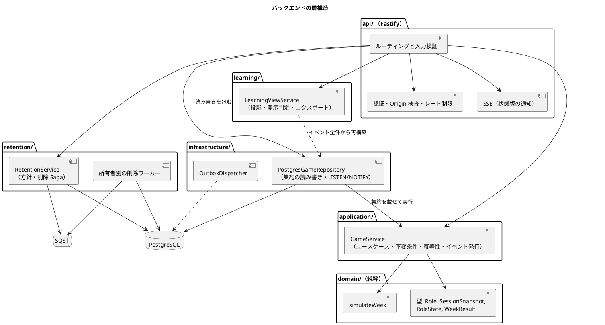

# バックエンドアーキテクチャ - ビールゲームシミュレーション

## 概要

本書は、ビールゲームシミュレーションのバックエンドのアーキテクチャを、パターン選択の根拠とあわせて定義します。**`docs/` を設計の正本**とし、実装（`apps/beer-game/src`）で確認できる事実と、設計意図との差分を区別して記述します。

- 業務の構造は [ドメインモデル設計](./domain-model.md)、永続化は [データモデル設計](./data-model.md) を参照してください。
- フロントエンドは [フロントエンドアーキテクチャ](./architecture-frontend.md)、実行環境は [インフラストラクチャアーキテクチャ](./architecture-infrastructure.md) を参照してください。

## パターンの選択

[アーキテクチャ設計ガイド](../../reference/アーキテクチャ設計ガイド.md) の選択フローに沿って判断します。

| 判断項目 | 本システムの答え | 根拠 |
| :--- | :--- | :--- |
| 業務領域のカテゴリー | 中核の業務領域 | 週次計算と進行の忠実性が教材価値そのもの（[ドメインモデル](./domain-model.md) の分類） |
| 金額・分析・監査記録 | 分析と記録が必要（金額は扱わない） | 終了後に全役割の時系列を分析し、操作の履歴を残す。費用は教材上の仮想値 |
| 永続化モデルが複数か | 書き込み（ゲームの状態）と読み取り（観察・振り返り）で形が異なる | 開示規則を投影で強制するため |

ガイドの流れでは、「分析・記録が必要な中核領域」はイベント履歴式ドメインモデルと CQRS に行き着きます。ただし、本システムの規模では**イベントソーシングまでは採用せず、次の簡易形を採用しています。**

| 採用しているもの | 採用していないもの |
| :--- | :--- |
| ドメインモデル（純粋な計算を分離） | イベントソーシング（状態の正本はイベントではなく断面） |
| 変更のたびに追記するイベント履歴（アウトボックス） | イベントからの完全な状態再生 |
| イベントから作る読み取り用の投影（観察・振り返り・エクスポート） | 読み取り専用の別ストア（投影はリクエストごとに再構築） |

この選択は、1 ゲームのイベント数が少なく（週数 × 数件）、再構築のコストが小さいことを前提にしています。前提が崩れる条件は「前提と見直しの条件」に記します。

## 全体構成

### 層と責務

| 層 | 主なファイル | 責務 | 依存してよい先 |
| :--- | :--- | :--- | :--- |
| api | `api/app.ts` | HTTP の入出力、入力検証（zod）、Cookie 認証、Origin 検査、レート制限、SSE | application、learning、retention、infrastructure |
| application | `application/game-service.ts` | ユースケース、権限判定、不変条件、冪等性、ドメインイベントの発行 | domain、security |
| domain | `domain/simulation-engine.ts`、`types.ts` | 週次計算（純粋関数）と値の型 | なし |
| learning | `learning/learning-view.ts` | イベントから観察・振り返り・エクスポートを作る | なし（入力はイベント） |
| retention | `retention/*.ts` | 保持方針と削除 Saga、所有者別の削除 | pg、SQS |
| infrastructure | `infrastructure/*.ts` | 集約の永続化、イベント通知、アウトボックス | application、pg |
| security | `security/credentials.ts` | 資格の発行とダイジェスト比較 | なし |

### 集約の読み書き（要点）

1. API は `PostgresGameRepository.write` を呼び、ゲームの行を `SELECT ... FOR UPDATE` でロックします。
2. 保存済みの状態から `GameService` にゲーム 1 件を読み込み、ユースケースをメモリ上で実行します。
3. 変更点（セッション、参加者、意思決定、結果、イベント、冪等記録）を同じトランザクションで保存します。
4. 新しいイベントは `outbox_events` に追記し、`pg_notify` で通知します。
5. 読み取りは `REPEATABLE READ READ ONLY` のトランザクションで行います。

この方式により、API は状態を持たず（プロセスに固定されない）、同じゲームへの書き込みは行ロックで直列化されます。

## API 設計方針

- 方式は **REST + JSON**、プレフィックスは `/api/v1`。リアルタイム通知は SSE（`text/event-stream`）です。
- エラーは `application/problem+json`（`type`、`title`、`status`、`detail`、`correlationId`）で返します。
- 変更系は `Idempotency-Key` を必須とし、同じキーで内容が違えば 409 を返します。
- 楽観的排他は `If-Match` に版（`version`）を載せます。古ければ 412 または 409 です。
- 認証はアカウントなしで、Cookie（`HttpOnly`、`Secure`、`SameSite=Strict`）に資格を載せます。
- 変更系は Origin（または Referer）が `ALLOWED_ORIGIN` と一致しない場合 403 で拒否します。
- すべての応答に `x-correlation-id` を付けます。

| 区分 | エンドポイント | 認可 |
| :--- | :--- | :--- |
| ゲーム | `POST /games`、`GET /games/:id/lobby`、`PUT /games/:id/participants/:pid/role` | 作成は誰でも可（`Idempotency-Key` と Origin 検査のみ）、割当ては進行役、ロビー参照はゲームに属する操作者 |
| 参加 | `POST /participations/join`、`POST /participations/recover`、`POST /games/:id/participants` | 参加コードまたは復帰資格 |
| 進行 | `POST /sessions/:id/{start,pause,resume,end}`、`POST /sessions/:id/weeks/:week/commit` | 進行役 |
| 意思決定 | `PUT /sessions/:id/decisions`、`PUT /sessions/:id/proxy-decisions/:role`、`GET /sessions/:id/state` | 参加者本人 / 進行役（代理） |
| 通知 | `GET /games/:id/events` | ゲームに属する操作者 |
| 学習 | `GET /games/:id/{observation,review}`、`POST/GET /games/:id/exports` | ゲームに属する操作者（エクスポートは進行役） |
| 保持 | `GET /games/:id/retention`、`POST /games/:id/retention/retry` | 進行役（作成時に発行された `bg_operator` 資格を要する） |
| 運用 | `GET /health` | なし |

## 品質属性への対応

| 品質属性 | 対応する設計 |
| :--- | :--- |
| 整合性 | ゲーム単位の行ロック、1 トランザクションでの保存、週確定の冪等性 |
| 可用性・水平スケール | 状態を持たない API。SSE は永続化済みのイベントの版で再同期できる |
| セキュリティ | 資格はダイジェストのみ保存、冪等応答は暗号化、Origin 検査、ロールごとの状態開示 |
| 観測性 | 相関 ID、イベントの版と相関 ID、保持削除の試行履歴 |
| テスト容易性 | 計算は純粋関数。リポジトリは実 Postgres での統合テストを持つ |

## テスト戦略との対応

ガイドの「ピラミッド形」に沿い、ドメインの計算と `GameService` はユニットテスト、API とリポジトリは統合テスト、画面操作は E2E で確認します（`tests/u1`〜`u5`、`tests/e2e`）。詳細は今後 `analyzing-test-strategy` で定義します。

## 設計と実装の差分・要確認事項

| # | 内容 | 影響 | 扱い |
| :--- | :--- | :--- | :--- |
| 1 | ドメインの規則（参加、割当て、開始、確定の条件）は `GameService` に集中し、`domain/` には週次計算しかない。集約は `Game` インターフェースで、振る舞いを持たない | 貧血気味のドメインモデル。規則の変更が `GameService`（約 650 行）に集まる | 規模が増えたら、規則を集約の振る舞いへ移す。現状は記録のみ |
| 2 | `OutboxDispatcher` は実装されているが、呼び出し元と実際の送信先（`EventTransport`）が存在しない。学習用 SQS キューも使われていない | イベントの外部配信は未稼働。通知は `pg_notify` と SSE だけで成立している | 使うか削除するか決める（インフラ側の差分とも共通） |
| 3 | `api/app.ts`（約 560 行）にルーティング、認証、Origin 検査、SSE、エクスポートが同居している | 変更理由が複数あり、読みにくい | ルートを機能ごとに分割する。リファクタリングの候補 |
| 4 | 学習ビューはリクエストのたびにイベント全件から投影を再構築する | ゲームが長いほど読み込みが増える。同時アクセスでも毎回再構築する | 負荷試験（`performance/`）で許容範囲を確認し、必要なら投影テーブルに永続化 |
| 5 | レート制限は API プロセスのメモリ上で数える | タスク数（2〜4）に比例して実効上限が増える | 厳密な上限が要るなら共有ストアが必要。現状は記録のみ |
| 6 | **資格のダイジェスト用の鍵 `CREDENTIAL_HMAC_KEY` は、未設定だと固定の開発用の値（`local-development-only-key`）にフォールバックする。Terraform の API タスク定義にもこの変数がなく、現状の本番構成では固定の鍵が使われる** | 資格（進行役・復帰・ブラウザセッション）のダイジェストが、公開されているソースの値で計算される。DB が漏れた場合に資格の照合を偽造しやすくなる | **要対応（優先）**。本番では必須にして起動時に検証し、Secrets Manager から注入する。セキュリティ変更なので承認を得て実施する |

## 前提と見直しの条件

- イベントソーシングへ移行する条件: 完全な操作の再現が要件になった場合、または 1 ゲームのイベントが数千件を超える場合。
- ゲーム集約を分割する条件: 参加人数や共同参加（[ドメインモデル](./domain-model.md) の差分 #2）が増え、ロック競合が目立つ場合。
- 別の読み取り専用ストアを持つ条件: 振り返りの再構築が性能目標を満たせない場合。

## 設計判断

- 週次計算を純粋関数に分離する。
- 状態を持たない API と、ゲーム単位の行ロックによる直列化。
- 完全なイベントソーシングは採用せず、アウトボックスと投影による簡易形とする。
- 通知は SSE（版の通知）と再取得の組み合わせとし、クライアントは再取得で状態を得る。
- 資格はダイジェストのみ保存する。

これらは [ADR-001](../../adr/beer-game/001-pure-weekly-simulation.md)〜[ADR-005](../../adr/beer-game/005-credential-digest-only.md) に記録しています（状態はいずれも提案中）。

## 出典

- [ドメインモデル設計](./domain-model.md)、[データモデル設計](./data-model.md)
- [アーキテクチャ設計ガイド](../../reference/アーキテクチャ設計ガイド.md)
- `apps/beer-game/src/api/app.ts`、`application/game-service.ts`、`infrastructure/postgres-game-repository.ts`、`infrastructure/outbox-dispatcher.ts`
