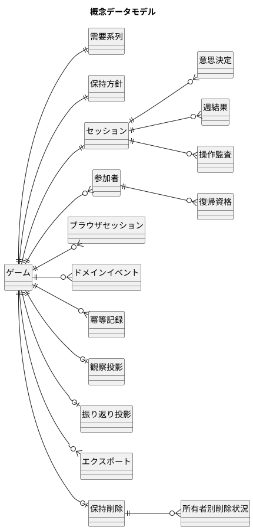
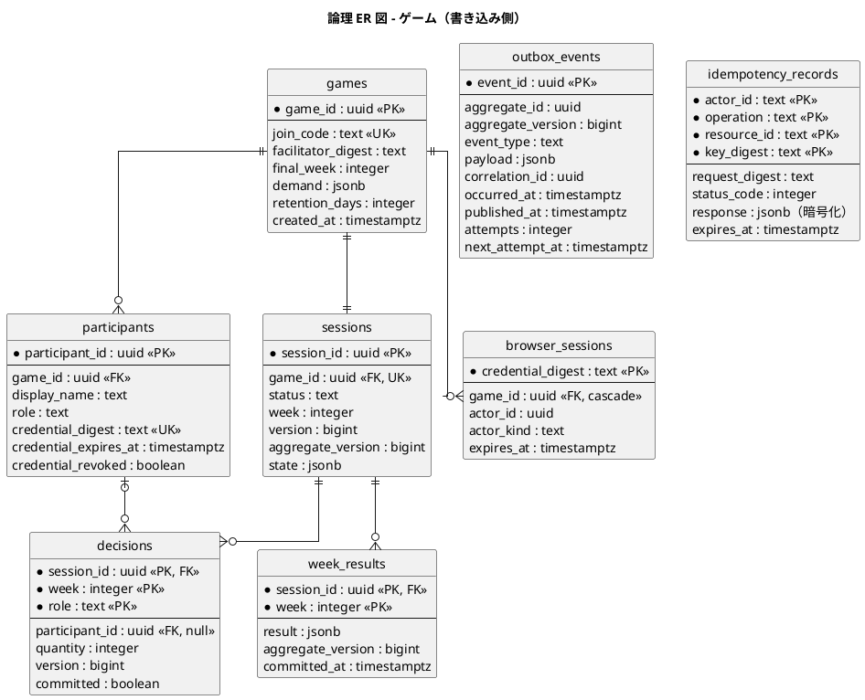
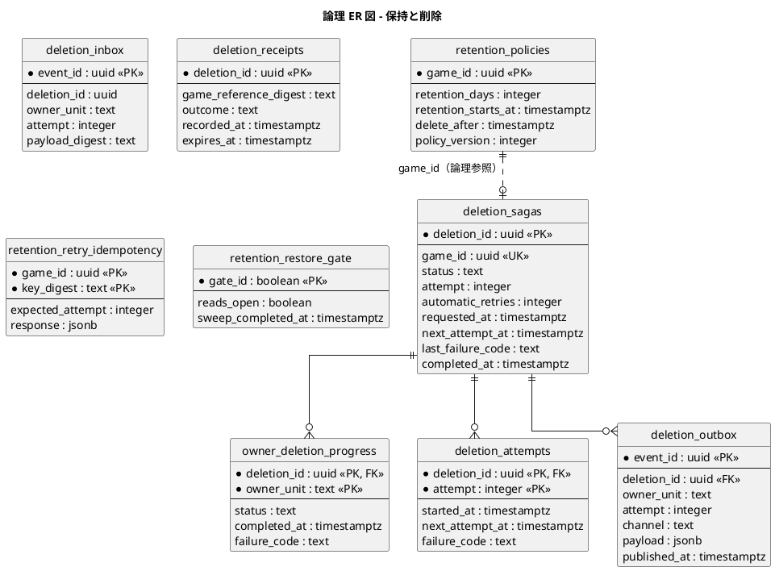
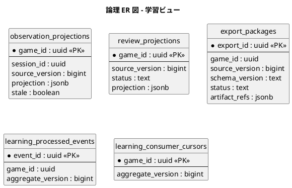

# データモデル設計 - ビールゲームシミュレーション

## 概要

本書は、ビールゲームシミュレーションのデータモデルを、概念データモデルから論理データモデルへ段階的に定義します。**`docs/` を設計の正本**とし、実装済みのスキーマ（`apps/beer-game/migrations/001`〜`005`）と永続化の実装（`infrastructure/postgres-game-repository.ts`、`retention/`）を突き合わせて記述します。

- ドメインモデルは [ドメインモデル設計](./domain-model.md) を参照してください。用語はそこで定義したユビキタス言語に従います。
- データベースは PostgreSQL です。スキーマは SQL マイグレーションで管理しており、ORM は使っていません。
- 本書の「実装の状態」列は、コードでの読み書きを確認した結果です。

### 設計の方針

- ゲーム 1 件の整合性は 1 トランザクションで保つ。API プロセスは状態を持たず、リクエストごとに集約を読み込んで保存する。
- 週ごとの確定結果と意思決定は行として残し、イベントは追記専用の outbox に残す。
- 資格（進行役・復帰・ブラウザセッション）は生の値を保存せず、ダイジェストだけを保存する。
- 冪等性の記録に残す応答は暗号化して保存する（AES-256-GCM）。
- 保持期間を過ぎたゲームは、所有者単位の削除（Saga）で消す。

## 概念データモデル

業務の言葉でエンティティと関係を表します。物理的な実装は考慮しません。

| 概念エンティティ | 対応するドメイン概念 | 説明 |
| :--- | :--- | :--- |
| ゲーム、需要系列、保持方針 | ゲーム（集約ルート）、需要系列、保持方針 | 1 回の実施単位。需要系列はゲームに属する |
| セッション | セッション | 進行状態（週・状態・版）と、4 役割の状態断面 |
| 参加者、復帰資格、ブラウザセッション | 参加者、復帰資格 | アカウントなしの参加と復帰 |
| 意思決定、週結果 | 意思決定、週結果 | 週ごとの入力と、確定した結果 |
| ドメインイベント、冪等記録、操作監査 | ドメインイベント、冪等キー | 変更の履歴と重複排除 |
| 観察投影、振り返り投影、エクスポート | 学習ビュー | 開示規則を適用した読み取り用データ |
| 保持削除、所有者別削除状況 | 保持削除（Saga） | 期限後の一括削除の進行 |

## 論理データモデル

### ER 図（ゲームの書き込み側）

`outbox_events.aggregate_id` はゲーム ID を指し、`idempotency_records.resource_id` はゲーム ID（またはグローバル）を文字列で持ちます。どちらも外部キー制約は張っていません。

### ER 図（保持と削除）

保持と削除のテーブルは `games` への外部キーを持ちません。ゲームが削除された後も、削除の証跡（受領記録）を一定期間残すためです。

### ER 図（学習ビュー）

### テーブル定義

#### ゲームの書き込み側

| テーブル | 主キー | 主な制約 | 役割 | 実装の状態 |
| :--- | :--- | :--- | :--- | :--- |
| `games` | `game_id` | `join_code` 一意、`final_week > 0`、`demand` は JSON 配列 | ゲームの定義。需要系列は列（JSONB）で持つ | 読み書き |
| `sessions` | `session_id` | `game_id` 一意（1 ゲーム 1 セッション）、`status` は 4 値、`week > 0`、`version > 0` | 進行状態。`state` に 4 役割の断面を JSONB で保存 | 読み書き |
| `participants` | `participant_id` | `(game_id, role)` 一意、`credential_digest` 一意、`role` は 4 値または NULL | 参加者。資格のダイジェスト・有効期限・失効もここ | 読み書き |
| `decisions` | `(session_id, week, role)` | `quantity >= 0`、`participant_id` は NULL 可 | 週ごとの意思決定。`committed` で確定済みを区別 | 読み書き |
| `week_results` | `(session_id, week)` | `result` は JSONB | 週ごとに確定した結果 | 書き込みと読み込み |
| `browser_sessions` | `credential_digest` | `game_id` 参照は `ON DELETE CASCADE`、`actor_kind` は 2 値 | ブラウザセッション（24 時間） | 読み書き |
| `outbox_events` | `event_id` | `(aggregate_id, aggregate_version, event_type)` 一意 | ドメインイベントの追記専用の記録。配信状況も持つ | 読み書き |
| `idempotency_records` | `(actor_id, operation, resource_id, key_digest)` | 応答は暗号化、`expires_at` で 30 日 | 冪等キーと応答の保存 | 読み書き |
| `recovery_credentials` | `recovery_credential_id` | `credential_digest` 一意 | 復帰資格を別テーブルで持つ設計 | **定義のみ（アプリは書かない）** |
| `operation_audit` | `audit_id` | なし | 操作監査 | **定義のみ（アプリは書かない）** |

#### 学習ビュー

| テーブル | 主キー | 主な制約 | 実装の状態 |
| :--- | :--- | :--- | :--- |
| `export_packages` | `export_id` | `status` は 4 値 | 読み書き（成果物は `artifact_refs` の JSONB に格納） |
| `observation_projections` | `game_id` | なし | **定義のみ（アプリは書かない）** |
| `review_projections` | `game_id` | `status` は `BUILDING`、`READY`、`FAILED` | **定義のみ（アプリは書かない）** |
| `learning_processed_events` | `event_id` | なし | **定義のみ（アプリは書かない）** |
| `learning_consumer_cursors` | `game_id` | なし | **定義のみ（アプリは書かない）** |

学習ビューの観察・振り返りは、データベース利用時はリクエストのたびに `outbox_events` から投影を再構築して返します（メモリ利用時はイベント購読で更新）。投影テーブルへの永続化は未着手です。

#### 保持と削除

| テーブル | 主キー | 主な制約 | 役割 |
| :--- | :--- | :--- | :--- |
| `retention_policies` | `game_id` | `retention_days` は 1〜3650、`delete_after > retention_starts_at` | 保持方針。期限で索引を持つ |
| `deletion_sagas` | `deletion_id` | `game_id` 一意、`status` は 4 値、`automatic_retries` は 0〜5 | ゲーム単位の削除の進行 |
| `owner_deletion_progress` | `(deletion_id, owner_unit)` | `owner_unit` は 3 値、`status` は 4 値 | 所有者ごとの完了状況 |
| `deletion_attempts` | `(deletion_id, attempt)` | `attempt > 0` | 試行履歴 |
| `deletion_outbox` | `event_id` | `(deletion_id, owner_unit, attempt)` 一意 | 所有者への削除要求の送信待ち |
| `deletion_inbox` | `event_id` | なし | 所有者からの完了通知の重複排除 |
| `deletion_receipts` | `deletion_id` | `game_reference_digest` は 64 文字、`expires_at > recorded_at` | 削除の証跡（ゲーム ID はダイジェストだけを保持）。期限後に消す |
| `retention_retry_idempotency` | `(game_id, key_digest)` | なし | 手動再試行の冪等性 |
| `retention_restore_gate` | `gate_id`（常に true の 1 行） | なし | リストア後の読み取り再開ゲート |

### 設計判断

#### JSONB の使いどころ

次の値は、行を分けずに JSONB で持っています。

- `games.demand`: 週ごとの需要の配列。週数は最大でも少なく、需要だけを検索する要件がない。
- `sessions.state`: 4 役割の在庫・受注残・遅延キュー・累積費用を含む断面。純粋関数 `simulateWeek` の入出力をそのまま保存できる。
- `week_results.result`: 役割ごとの週結果。
- `outbox_events.payload`: イベント本文（スキーマ版つき）。

役割ごとの列に分けると、遅延キューの長さ（可変）と、計算の入出力との変換が増えます。計算の正本はコード側にあり、データベース側で在庫などを集計する要件がないため、JSONB を採用しています。

#### 非正規化

`sessions` は `status`、`week`、`version` を列で持ちつつ、同じ値を `state`（JSONB）にも含みます。列は検索・制約・楽観的排他のため、`state` は計算入力のためです。更新は同じ文で行うので、ずれることはありません。

#### 版と冪等性

- `sessions.version` は週確定・状態遷移ごとに増える楽観的排他の版です。`aggregate_version` は発行済みイベント数で、イベントの連続性の確認に使います。
- 冪等記録は、キーのダイジェスト、リクエストのダイジェスト、暗号化した応答を保存し、同じキーで内容が違うリクエストは競合として拒否します。

#### 履歴の持ち方

意思決定は週ごとに行を残し、確定時に `committed` を立てます。未確定の行だけ、保存のたびに入れ替えます。確定した週の記録は削除せず、振り返りと学習ビューの元になります。

## ドメインモデルとの対応

| ドメイン | テーブル | 備考 |
| :--- | :--- | :--- |
| ゲーム集約（ルート `Game`） | `games`、`sessions`、`participants`、`decisions`、`week_results`、`outbox_events`、`idempotency_records` | 1 ゲーム 1 トランザクションで保存する |
| 参加者の役割の一意性 | `participants` の `(game_id, role)` 一意制約 | ドメインの不変条件をデータベースでも守る |
| 数量の範囲 | `decisions.quantity >= 0` | 上限（1000）はアプリで検証し、データベースは下限だけ |
| セッション状態 | `sessions.status` の CHECK（4 値） | `PAUSED` は 005 で追加 |
| 保持削除集約（Saga） | `deletion_sagas` ほか 7 テーブル | 所有者単位で削除し、証跡は別に残す |
| 学習ビュー | `export_packages`（使用中）、投影テーブル群（未使用） | 差分 #3 を参照 |

## 設計と実装の差分・要確認事項

| # | 内容 | 影響 | 扱い |
| :--- | :--- | :--- | :--- |
| 1 | `recovery_credentials` と `operation_audit` は定義されているが、アプリは書き込まない。復帰資格は `participants` の列で持つ | 設計（別テーブルで復帰資格と監査を持つ）と実装が一致しない | どちらを正とするか決める。監査要件が残るなら実装が不足 |
| 2 | 学習ビューの投影テーブル 4 件は定義のみで、書き込まない | 観察・振り返りは永続化されず、リクエストのたびにイベント全件から再構築する（ゲームが長いほど読み込みが増える） | 永続化するか、テーブルを廃止するか決める |
| 3 | **保持期間後の削除で `outbox_events` と `idempotency_records` が消えない**（`owner-deletion.ts` の削除対象に含まれず、他に該当の `DELETE` が無いことを確認。`retention_policies` も削除対象外だが、削除の証跡として残す意図かは未確認） | イベント本文（参加者 ID・役割・チーム合計）と、暗号化済みの冪等応答が期限後も残る。保持方針の「期限後に削除する」と矛盾する可能性がある | **要確認**。削除対象に含めるか、残す範囲を保持方針として明文化する |
| 4 | `u2-session-continuity` の削除は `participants` を参照するサブクエリを使うが、`u1-walking-skeleton` の削除が先に `participants` を消すと、`recovery_credentials` が残る | #1 のとおり当該テーブルは現状書かれないため実害はないが、使い始めると削除漏れになる | #1 の判断とあわせて、削除順を設計する |
| 5 | `002` の最初の `ALTER TABLE sessions ADD COLUMN IF NOT EXISTS status` は、列が既にあるため何もしない | なし（読み手が混乱する程度） | 記録のみ |
| 6 | 数量の上限（1000）は DB の CHECK にない | アプリ経由なら問題ないが、直接の書き込みは防げない | 必要なら CHECK を追加（スキーマ変更なので要承認） |

## 出典

- [ドメインモデル設計](./domain-model.md)
- [要件定義](../../requirements/beer-game/requirements_definition.md)（情報モデル）
- `apps/beer-game/migrations/001_u1_walking_skeleton.sql` 〜 `005_u5_shared_game_store.sql`
- `apps/beer-game/src/infrastructure/postgres-game-repository.ts`
- `apps/beer-game/src/retention/postgres-retention.ts`、`owner-deletion.ts`

## 未確定事項

- 差分 #3（削除対象の漏れ）は、保持方針の実効性に関わるため、優先して判断が必要です。
- 差分 #1、#2 は、設計と実装のどちらに合わせるかを決める必要があります。
