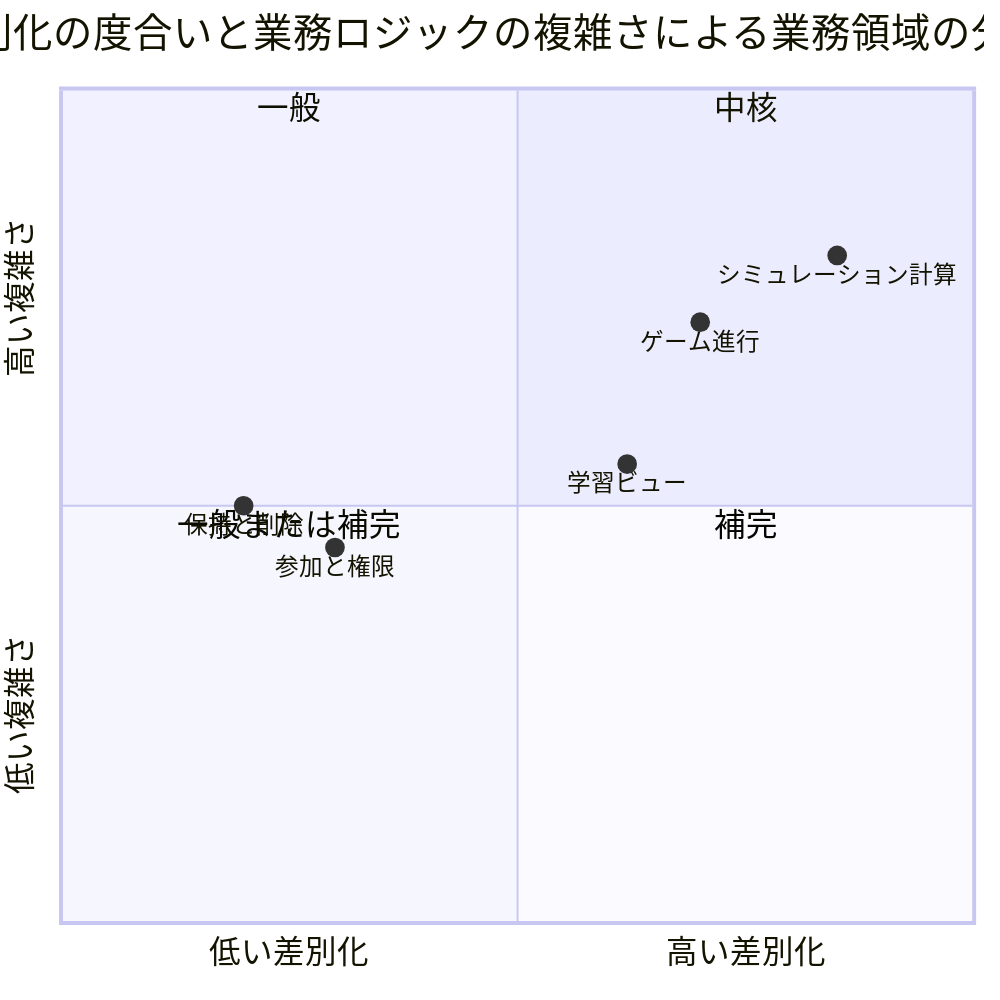
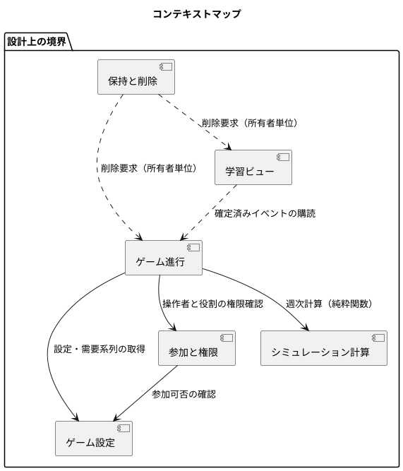
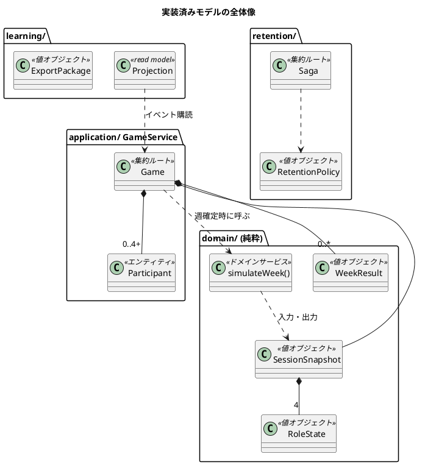
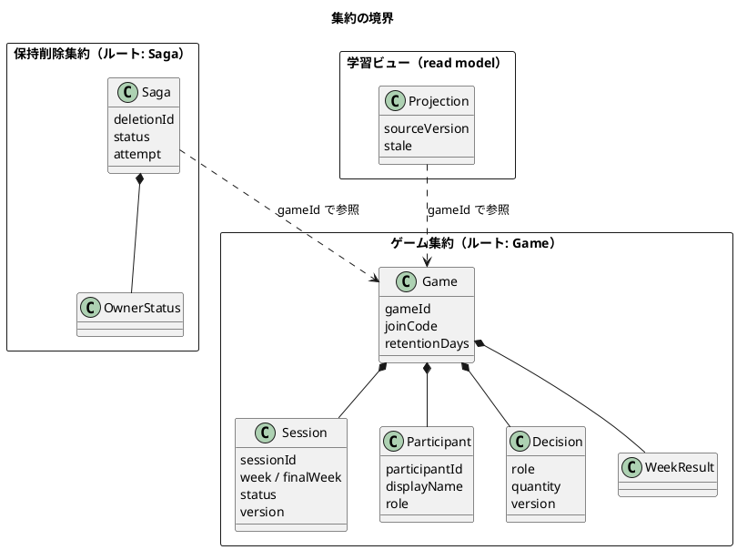
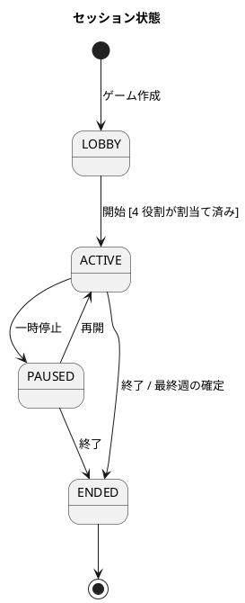

# ドメインモデル設計 - ビールゲームシミュレーション

## 概要

本書は、ビールゲームシミュレーションのドメインモデルを DDD の戦術的設計パターン（エンティティ・値オブジェクト・集約・ドメインサービス）で定義します。**`docs/` を設計の正本**とし、`aidlc/` 配下の Inception 成果物（`domain-design/components.md`、`decisions.md`）と実装（`apps/beer-game/src`）を突き合わせて、次の 3 点を 1 か所にまとめます。

- 業務の専門家と開発者が共有するユビキタス言語
- 実装済みのモデル（コードで確認できる事実）
- 設計意図と実装の差分（今後の判断が必要な点）

入力は [要件定義](../../requirements/beer-game/requirements_definition.md) の BR-01〜BR-14、情報モデル、状態モデルです。

### 設計の前提

- 学習用シミュレーションであり、勝敗の判定ではなく「構造が振る舞いを生む」ことの体験が目的です。
- 参加者はアカウントを作らず、参加コードと表示名で参加します。
- 週次の計算は決定論的で、同じ入力から同じ結果を返します。
- プレイ中は役割ごとに見える情報を制限し、終了後に全役割の時系列を開示します。

## 戦略的設計

### 境界付けられたコンテキストの分類

| コンテキスト | 分類 | 理由 |
| :--- | :--- | :--- |
| シミュレーション計算 | 中核 | JSD 改訂版キットの 12 ステップと 2 週遅延を忠実に再現することが教材価値そのもの |
| ゲーム進行 | 中核 | 4 役割の意思決定を揃えて週を一度だけ確定する整合性が体験の信頼性を決める |
| 学習ビュー | 補完 | 開示範囲の制御（逆算で個別値が漏れない集計）に固有のルールがある |
| 参加と権限 | 一般 | アカウントなしの参加と復帰は一般的な仕組み |
| 保持と削除 | 一般 | 期限後の一括削除と再試行は一般的な仕組み |

### コンテキストマップ

関係の種類は次のとおりです。

- 実線は同期の呼び出しです。
- 点線はイベントまたは削除要求による非同期の連携です。

## ユビキタス言語

| 用語 | 英語（コード上の名称） | 定義 |
| :--- | :--- | :--- |
| ゲーム | Game | 1 回のシミュレーション実施単位。参加コードで参加者を受け付ける |
| 進行役 | Facilitator | ゲームを作成し、役割割当て・開始・週確定・停止・終了を行う人 |
| 参加者 | Participant | 表示名で参加する人。役割を 1 つ割り当てられる |
| 役割 | Role | サプライチェーン上の位置。工場・一次卸・二次卸・小売店（FACTORY、DISTRIBUTOR、WHOLESALER、RETAILER） |
| 顧客需要 | Demand | 小売店にだけ届く外生の週次需要。系列として事前に決まる |
| セッション | Session | ゲームの進行状態（週・状態・版）を持つ実行単位 |
| 週 | Week | 1 から始まる進行単位。4 役割の意思決定が揃って初めて確定する |
| 意思決定 | Decision | 当週の発注数、または工場の生産要請数。役割ごとに 1 件 |
| 代理入力 | Proxy Decision | 進行役が参加者に代わって入力する意思決定 |
| 週確定 | Commit Week | 4 役割の意思決定から次週の状態を計算して確定する操作。一度だけ成立する |
| 在庫 | Inventory | 週末時点で手元にある数量 |
| 受注残 | Backlog | 出荷できず次週以降に持ち越す未充足の受注 |
| 注文遅延 | Order Delay | 注文が上流へ届くまでの 2 週の遅れ |
| 配送遅延 | Shipment Delay | 出荷が下流へ届くまでの 2 週の遅れ |
| 生産遅延 | Production Delay | 工場の生産要請が在庫に入るまでの遅れ |
| 週次費用 | Weekly Cost | 週末在庫 × 0.50 + 週末受注残 × 1.00（金額は最小単位で保持） |
| 参加コード | Join Code | 参加者がゲームに参加するための 8 桁のコード（大文字の英数字） |
| 復帰資格 | Recovery Credential | ブラウザを閉じた参加者が同じ役割へ戻るための推測困難な資格 |
| 保持期間 | Retention | ゲームの記録を保持する日数。期限後に削除する |
| 観察 | Observation | プレイ中に観察者へ見せる、逆算できないチーム合計 |
| 振り返り | Review | 終了後に開示する全役割の時系列 |

## 戦術的設計

### 実装の全体像

### 値オブジェクト

不変で、属性値が同じなら同じものとして扱います。生成時に検証し、不正な値が存在できないようにします。

| 値オブジェクト | 属性・制約 | 実装の位置 |
| :--- | :--- | :--- |
| 役割（Role） | FACTORY、DISTRIBUTOR、WHOLESALER、RETAILER の 4 値。上流から下流の順序を持つ | `domain/types.ts` の `ROLES` |
| 数量（Quantity） | 0 以上 1000 以下の整数。発注数・生産要請数に使う | `assertQuantity`、`submitDecision` の検証 |
| 需要系列（Demand Series） | 各週の顧客需要。0〜1000 の整数で、長さは最終週以上 | `createGame` の検証 |
| 役割状態（RoleState） | 在庫、受注残、注文遅延キュー、配送遅延キュー、生産遅延キュー、累積費用 | `domain/types.ts` |
| セッション断面（SessionSnapshot） | 週、最終週、状態、版、需要系列、4 役割の役割状態 | `domain/types.ts` |
| 週結果（WeekResult） | 役割ごとの需要・出荷・週末在庫・週末受注残・週次費用・累積費用 | `domain/types.ts` |
| 費用単価（SimulationSettings） | 在庫 50、受注残 100（最小単位）、数量上限 1000 | `simulation-engine.ts`、`game-service.ts` の `DEFAULT_SETTINGS` |
| 表示名（Display Name） | 前後の空白を除いて 1〜80 文字 | `joinGame` の検証 |
| 参加コード（Join Code） | 8 桁（UUID 由来の大文字 16 進）。参加者が入力するコード | `randomBytesCode` |
| 資格ダイジェスト（Credential Digest） | 生の資格を保存せず、鍵付き HMAC のダイジェストだけを保持する | `security/credentials.ts` |
| 保持方針（Retention Policy） | 保持日数 1〜3650、保持開始時刻、削除期限、方針の版 | `retention-service.ts` |
| 冪等キー（Idempotency Key） | 操作の重複実行を防ぐキー。同じキーで内容が違えば競合として拒否する | `GameService.idempotent` |
| エクスポート（Export Package） | スキーマ版 `1.0.0`、CSV、JSON、チェックサム、元の版 | `learning/learning-view.ts` |

### エンティティ

| エンティティ | 識別子 | 主な属性 | ライフサイクル |
| :--- | :--- | :--- | :--- |
| ゲーム（Game） | gameId（UUID） | 参加コード、進行役資格のダイジェスト、保持日数、セッション、参加者、意思決定、結果、イベント、冪等記録 | 作成 → 削除（保持期間後） |
| 参加者（Participant） | participantId（UUID） | 表示名、役割（未割当も可）、復帰資格のダイジェスト・有効期限・失効 | 参加 → 役割割当て → 復帰（資格を更新） |
| セッション（Session） | sessionId（UUID） | 週、状態、版、断面 | 準備中 → 進行中 ⇄ 一時停止 → 終了 |
| 意思決定（Decision） | 役割（週ごと） | 数量、版 | 入力・変更 → 週確定でクリア |
| ドメインイベント（DomainEvent） | eventId | 種別、集約の版、相関 ID、発生時刻、スキーマ版 | 発行のみ（不変） |
| 保持削除（Saga） | deletionId | ゲーム、状態、試行回数、所有者ごとの状態 | 進行中 → 完了または失敗 |

### 集約

#### ゲーム集約

集約ルートは `Game` で、外部からは必ずここを経由します。トランザクション境界は 1 回の操作（作成・参加・役割割当て・開始・意思決定・週確定・停止・再開・終了）です。

| 不変条件 | 内容 | 根拠 |
| :--- | :--- | :--- |
| 参加の受付 | 準備中の間だけ参加できる | BR（状態モデル） |
| 役割の一意性 | 1 つの役割に参加者は 1 人。1 人の参加者は 1 つの役割だけを持つ | UC-03 |
| 開始条件 | 4 役割がすべて割り当てられている | UC-04 |
| 意思決定の条件 | 進行中で、役割を持つ参加者だけが 0〜1000 の整数を入力できる | BR-10 |
| 週確定の条件 | 4 役割の意思決定が揃うまで確定できない | BR-12 |
| 週確定の一回性 | 同じ冪等キーでは同じ結果を返し、週と版が現在と一致する場合だけ確定する | BR-12 |
| 終了 | 最終週を確定すると自動で終了し、以後の入力は拒否する | 状態モデル |
| 権限 | 進行・確定・代理入力・割当ては進行役だけ。意思決定と状態参照は参加者本人の役割だけ | 役割別開示 |

#### 保持削除集約

保持方針に従い、期限到達後にゲーム単位の削除要求を所有者（`u1-walking-skeleton`、`u2-session-continuity`、`u3-learning-view`）ごとに発行します。全所有者が完了した場合だけ完了とし、失敗は再試行します。他コンテキストのデータを直接消さず、各所有者が冪等に自分のデータを削除します。

### ドメインサービス

| サービス | 責務 | 入力 → 出力 | 特徴 |
| :--- | :--- | :--- | :--- |
| 週次計算（`simulateWeek`） | 12 ステップと 2 週遅延に従い、在庫・受注残・出荷・遅延・費用を計算する | 前週の断面、4 役割の意思決定、設定 → 次週の断面、週結果 | 純粋関数。永続化・時刻・通信・認可に依存しない |
| 開示判定（学習ビューの `consume`） | 確定済みイベントから、逆算で個別値が漏れない集計だけを公開する | ドメインイベント → 観察・振り返りの投影 | 寄与者が 2 未満の週は抑止し、版の欠落は stale として扱う |

週次計算の規則は次のとおりです（BR-05〜BR-09）。

- 利用可能量は「前週末在庫 + 当週入荷」です。
- 充足対象は「前週末受注残 + 当週受注」です。
- 出荷数は両者の小さい方です。
- 週末在庫と週末受注残は差の正の部分です。
- 週次費用は「週末在庫 × 在庫単価 + 週末受注残 × 受注残単価」です。

### 状態

### ドメインイベント

| イベント | 発行契機 |
| :--- | :--- |
| GameCreated | ゲーム作成 |
| ParticipantJoined | 参加 |
| RoleAssigned | 役割割当て |
| SessionStarted、SessionPaused、SessionResumed、SessionEnded | 進行状態の遷移 |
| DecisionSubmitted、ProxyDecisionSubmitted | 意思決定の入力、代理入力 |
| WeekCommitted | 週確定（チーム合計と寄与者数を含む） |
| ParticipationRecovered | 復帰 |

すべてのイベントは集約の版、相関 ID、スキーマ版を持ち、学習ビューが版の連続性で欠落を検知します。

## 設計と実装の差分

`aidlc/` の設計は 5 つの論理コンポーネント（GameConfiguration、Participation、SimulationEngine、GameSession、LearningView）に分けていましたが、実装は次のとおりです。**どちらに合わせるかは未決定で、判断が必要です。**

| # | 設計（aidlc） | 実装 | 影響・扱い |
| :--- | :--- | :--- | :--- |
| 1 | ゲーム設定・参加・進行を別コンポーネントに分ける | `Game` 集約 1 つに設定・参加者・セッション・意思決定・結果を含む | 現規模では整合性の確保が単純。分割は規模拡大時に再判断 |
| 2 | 同一役割に複数の共同参加者を認める | 役割は 1 人だけ（二人目は `ROLE_OCCUPIED` で拒否） | 要件に共同参加が残るなら実装が不足。要件の再確認が必要 |
| 3 | 初期在庫・遅延・費用・公開範囲を設定でき、変更時は「カスタム」と区別する（BR-14） | 作成時に指定できるのは最終週・需要系列・保持日数だけ。初期値と費用単価は固定 | BR-14 は未実装。カスタム識別は今後の対象 |
| 4 | 意思決定は参加者ごとに記録（RoleDecision に participantId） | 意思決定は役割をキーに保持し、操作者の識別は持たない | 代理入力を含め、操作者の追跡は監査イベントで代替 |
| 5 | 操作監査（OperationAudit）を保持する | 操作者付きのドメインイベントで代替（`actorId` は代理入力のみ） | 監査要件の確認が必要 |
| 6 | 保持と削除を GameConfiguration が所有する | 別モジュール（`retention/`）の Saga が所有 | 設計意図（完了判定の一元化）と整合。所有者単位の削除は実装済み |

## 設計判断

- 週次計算は純粋関数に分離し、既知系列の golden test で規則を保護します。
- 参加者の資格は生の値を保存せず、鍵付き HMAC のダイジェストだけを保持します。復帰時に資格を更新し、ブラウザセッションは 24 時間、復帰資格は 30 日で失効します。
- 学習用の表示は書き込みモデルを直接公開せず、イベントから作る用途別の投影を経由します。
- 設計判断の背景は [ADR](../../adr/beer-game/index.md) に記録しています（週次計算の分離は ADR-001、資格は ADR-005、保持削除は ADR-008）。

## 出典

- [要件定義](../../requirements/beer-game/requirements_definition.md)（BR-01〜BR-14、情報モデル、状態モデル）
- `aidlc/spaces/default/intents/261027-beer-game-development/inception/domain-design/components.md`
- `aidlc/spaces/default/intents/261027-beer-game-development/inception/domain-design/decisions.md`
- `apps/beer-game/src/domain/`、`application/game-service.ts`、`learning/learning-view.ts`、`retention/retention-service.ts`

## 未確定事項

- 差分 #2（共同参加者）と #3（カスタム条件）は、要件として残すか判断が必要です。
- ゲーム集約の分割要否は、規模と変更理由が増えた段階で再判断します。
