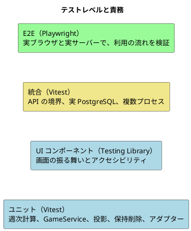
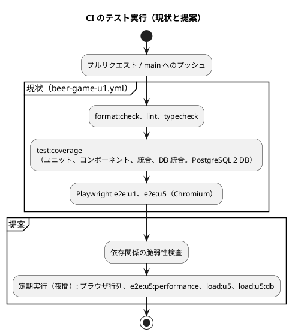

# テスト戦略 - ビールゲームシミュレーション

## 概要

本書は、ビールゲームシミュレーションのテスト戦略を定義します。**`docs/` を正本**とし、テスト形状の選択、テストレベルの責務、カバレッジ目標、CI との連携、要件からテストまでの追跡を記述します。

数値は、2026-11-09 に次のとおり**実測**した値です。

- テスト用の PostgreSQL コンテナ（`_u4_test`、`_u5_test`）を使い、`vitest run tests/u1 … tests/u5 --coverage` を実行した結果（24 ファイル、199 件、全件成功、約 18 秒）
- `npm run load:u5`（負荷の診断）の結果
- Playwright の E2E は、件数だけ数えており、今回は実行していません

アーキテクチャは [バックエンド](./architecture-backend.md)・[フロントエンド](./architecture-frontend.md)、技術は [技術スタック](./tech-stack.md)、受入条件は [ユーザーストーリー](../../requirements/beer-game/user_story.md) を参照してください。

## テスト形状の選択

[テスト戦略ガイド](../../reference/テスト戦略ガイド.md) では、アーキテクチャに応じて形状を選びます。

| 判断項目 | 本システムの答え | 帰結 |
| :--- | :--- | :--- |
| 業務の中心 | 純粋な週次計算と、規則を持つ `GameService`（中核の業務領域） | ドメインを厚くテストする（ピラミッド型） |
| 永続化の特性 | 行ロック、冪等性、SSE、アウトボックスが、実際の PostgreSQL に依存する | 統合テストを、ガイドの標準（15%）より厚くする |
| 画面 | 小さな SPA。状態は `useState`、通信は `BrowserApi` を差し替えられる | 画面はコンポーネントのテストで広く、E2E は少数 |

**採用する形状は、ピラミッド型です。ただし統合テストの比率は、約 3 割まで認めます。** 同時操作、冪等性、複数プロセスでの整合性は、ユニットテストでは検証できないためです。

### 現状の分布（実測）

| レベル | 件数 | 割合 | 実行時間（目安） |
| :--- | ---: | ---: | :--- |
| ユニット（ドメイン、サービス、アダプター） | 89 | 43% | 1 秒未満 |
| UI コンポーネント（Testing Library） | 46 | 22% | 約 10 秒（件数が多く、DOM を使う） |
| API 統合（Fastify、メモリ上のサービス） | 34 | 17% | 約 4 秒 |
| DB 統合（実際の PostgreSQL） | 25 | 12% | 約 10 秒 |
| インフラ定義の静的検査（Terraform の文字列検査） | 5 | 2% | 1 秒未満 |
| E2E（Playwright、実ブラウザ） | 6 | 3% | 未測定 |
| **合計** | **205** | 100% | vitest の 199 件で約 18 秒 |

ユニットと UI コンポーネントの合計は 66%、統合（API と DB）は 29%、E2E は 3% で、方針（ピラミッド型、統合は約 3 割まで）に合っています。

### 目標の分布

| レベル | 目標の割合 | 理由 |
| :--- | :--- | :--- |
| ユニット + UI コンポーネント | 60% 以上 | 速いフィードバックと、規則の網羅 |
| 統合（API + DB） | 35% 以下 | 並行性と永続化の検証に必要な分だけ |
| E2E | 5% 以下 | 利用の流れの要所だけ。遅く、壊れやすい |

## テストレベルの定義

| レベル | 責務 | 対象 | 依存の扱い | 主なファイル |
| :--- | :--- | :--- | :--- | :--- |
| ユニット | 規則と計算を、最小の単位で検証する | `simulateWeek`、`GameService`、`LearningViewService`、`RetentionService`、`BrowserApi`、`LiveStateAdapter` | 永続化と通信は使わない（メモリ上のサービス） | `tests/u1`〜`u5` の `*.test.ts` |
| UI コンポーネント | 画面の表示、入力、エラー、フォーカス、更新の通知 | `src/ui` の各画面 | `BrowserApi` を差し替える。ブラウザの代わりに jsdom | `tests/u5/*.test.tsx` |
| API 統合 | HTTP の境界（認証、Origin 検査、冪等性、版、エラー形式）を検証する | `buildApp`（Fastify） | サービスはメモリ上の実体。通信は `inject` またはローカルのサーバー | `tests/u1/api.test.ts`、`tests/u5/contracts.integration.test.ts` ほか |
| DB 統合 | 永続化、行ロック、複数プロセス、アウトボックス、保持削除を、実際の PostgreSQL で検証する | `PostgresGameRepository`、`PostgresRetentionService`、2 つの API プロセス | 専用のテスト DB（名前が `_u4_test` / `_u5_test` でなければ中止する） | `tests/u4/retention-pg.*`、`tests/u5/multi-process.*`、`tests/u5/postgres-game-repository.*` |
| インフラ定義の静的検査 | 設計上の約束（キャッシュ無効、ヘッダー転送、タイムアウトの関係、アラーム）が定義に残っていることを確認する | `infra/main.tf` | ファイルの文字列検査 | `tests/u5/edge-contract.test.ts` |
| E2E | 利用の流れの要所を、実ブラウザで確認する | 作成、参加、SSE の切断、200% 拡大 | 実サーバー（ポート 3100）、メモリ上のサービス | `tests/e2e/*.spec.ts` |

DB 統合のテストは、環境変数（`GAME_TEST_DATABASE_URL`、`RETENTION_TEST_DATABASE_URL`）が無いと**自動でスキップ**されます。CI では両方を設定して実行します。

### レベル間の重複を避ける方針

- 規則の分岐は、ユニットで網羅する。API 統合では、境界の契約（ステータス、ヘッダー、エラー形式）だけを確認する。
- 画面の分岐は、コンポーネントで確認する。E2E は、画面をまたぐ流れと、実ブラウザでしか確認できないこと（拡大、フォーカス、SSE）に限る。
- 永続化の整合性は、DB 統合でだけ検証する。ユニットでは、メモリ上のサービスを使う。

## 開発の進め方（TDD と BDD）

- **TDD**: 失敗するテストを書き、失敗を確認してから、最小限を実装する（TDD の三原則）。変更は、テストで守られた状態で行う。
- **BDD**: 受入条件は、Given / When / Then の形で、テスト名に表す。既存のテストの多くは、この形式です（例: `Given a running game When review requested Then disclosure is denied`）。
- **配置**: `apps/beer-game/tests/` に、デリバリーの単位（`u1`〜`u5`）ごとに置く。今後は、レベルと機能が分かる名前を使う。
- **契約としての受入条件**: ユーザーストーリーの受入条件が、受入テストの元になる（後述のトレーサビリティ）。

## カバレッジ目標

### 現状の閾値と実測

CI は、`vitest.config.ts` の閾値を**ゲート**にしています（行・関数・文 80%、分岐 70%）。2026-11-09 の実測は次のとおりです。

| 層 | 行 | 分岐 | 関数 |
| :--- | ---: | ---: | ---: |
| `domain` | 100% | 88.0% | 100% |
| `application` | 95.4% | 82.5% | 98.5% |
| `learning` | 100% | 86.8% | 100% |
| `infrastructure` | 93.2% | 70.8% | 94.7% |
| `retention` | 87.3% | 72.6% | 93.2% |
| `ui` | 87.1% | 83.2% | 79.2% |
| **全体** | **90.5%** | **79.8%** | **87.7%** |

### 目標

全体のゲートは現状を維持し、層ごとに、現状を下回らない目標を持ちます（提案。承認後に反映）。

| 層 | 行 | 分岐 | 方針 |
| :--- | ---: | ---: | :--- |
| `domain` | 100% | 85% | 中核。分岐の未到達（3 行）を埋める |
| `application` | 95% | 80% | 規則の変更時は、必ずテストを追加する |
| `learning` | 95% | 85% | 開示の規則は、境界値まで確認する |
| `infrastructure` | 90% | 70% | 分岐は DB 統合で確認する |
| `retention` | 85% | 70% | 失敗と再試行の経路を優先する |
| `ui` | 85% | 75% | 画面の遷移（`App.tsx`）と `browser-api.ts` を補う |
| `api`（新規に計測） | 85% | 70% | 現状は計測の対象外（差分 #1） |
| 全体（ゲート） | 80% | 70% | 変更しない |

### 計測の範囲

`vitest.config.ts` の対象は、`domain`、`application`、`security`、`learning`、`retention`、`infrastructure`、`ui` です。**HTTP の層（`src/api`）と起動部（`src/server.ts`）は対象外**で、テストは存在しますが、カバレッジの数値には含まれません。

## テストデータ

| 種類 | 方針 |
| :--- | :--- |
| ユニット・API 統合 | テストごとに、メモリ上の `GameService` を新しく作る。固定の乱数や時刻を使わず、決定論的な系列（例: 毎週 4）で期待値を計算する |
| 週次計算 | 既知の系列と期待値の組（golden）を持ち、決定論性（同じ入力から同じ結果）を確認する |
| DB 統合 | 専用の DB（`beer_game_u5_test`、`beer_game_u4_test`）だけを使う。名前が合わなければ、テストを中止する。マイグレーションを適用した空の DB から始める |
| 資格 | テスト用の鍵と、テストごとの乱数。資格の生の値を、保存や出力に含めない |

## 非機能のテスト

| 品質特性 | 要件 | 検証の手段 | 現状 |
| :--- | :--- | :--- | :--- |
| 正確性・決定論 | NFR-01 | `simulation-engine.test.ts`（18 件） | 実施済み |
| 整合性・冪等性 | NFR-02、FR-09 | `game-service.test.ts`、`multi-process.integration.test.ts`、`postgres-game-repository.integration.test.ts` | 実施済み（保存途中の失敗の直接検証は未確認） |
| 応答性・同時利用 | NFR-03、NFR-04 | `performance/u5-load.ts`、`performance/u5-db-load.ts`、`tests/e2e/u5-performance.spec.ts` | 診断のみ（下記）。CI では実行しない |
| セキュリティ | NFR-06 | `contracts.integration.test.ts`、`credentials.test.ts`（Origin、偽造 Cookie、他ゲームへのアクセス、資格） | 実施済み。依存関係の脆弱性検査は無い |
| アクセシビリティ | NFR-08 | `accessibility.test.tsx`、`tests/e2e/u5.spec.ts`（200% 拡大）、`tests/manual/u5-accessibility.md`（手動） | 自動は実施済み。手動の結果は未確認 |
| 可搬性 | NFR-10 | Playwright の行列実行（`U5_BROWSER_MATRIX=1`: Chromium、Firefox、WebKit、Chrome、Edge） | CI では Chromium のみ |

### 性能の現状（`npm run load:u5`、実測）

| 項目 | 値 |
| :--- | :--- |
| 条件 | 15 ゲーム、75 の SSE 接続、75 クライアントによる取得を 5 回（375 件） |
| 取得の失敗 | 0 件 |
| 取得の p95 | 約 94 ms（最大 約 107 ms） |
| SSE の接続の p95 | 約 150 ms |
| 注意 | 1 つのプロセスと、メモリ上のサービスでの診断。**ブラウザでの確定から画面反映まで（NFR-03 の 2 秒）、複数タスク、実際のデータベースは測っていない** |

## CI との連携

| 項目 | 方針 |
| :--- | :--- |
| 失敗時 | どの工程が失敗しても、マージしない。カバレッジの閾値割れも失敗とする |
| 実行時間の目標 | ユニット + コンポーネント: 30 秒以内、統合（DB を含む）: 2 分以内、E2E: 5 分以内、全体: 10 分以内（vitest は現状 約 18 秒。E2E は未測定） |
| 並列化 | ファイル単位で並列に実行（Vitest 既定）。DB 統合は専用 DB を使い、他のテストと干渉しない |
| 定期実行（提案） | ブラウザ行列、性能テスト（`e2e:u5:performance`、`load:u5`、`load:u5:db`）は、重いので夜間または手動 |
| 失敗の記録 | 失敗時は、Playwright のトレースとスクリーンショットを保存する（提案） |

## トレーサビリティ（ユーザーストーリー → テスト）

テスト側にストーリーや受入条件の ID は付いていないため、**テスト名から対応づけた推定**です。凡例は、✓ 検証あり、△ 一部、✗ 検証なし（機能が未実装の場合を含む）です。

| ストーリー | 受入条件 | 主なテスト | 状況 |
| :--- | :--- | :--- | :---: |
| US1.1 ゲームを作成する | AC1.1.1 一度だけ作成 | `game-service`（同じキーの再実行）、`api.test`、`e2e/u1` | ✓ |
| | AC1.1.2 無効な需要系列 | `create-join`（無効な需要系列で入力を保持し、要約にフォーカス） | △（対象週の表示は機能が無い） |
| | AC1.1.3 「カスタム」の明示 | なし | ✗（機能が未実装） |
| US1.2 参加して役割を受け取る | AC1.2.1 参加と復帰資格 | `contracts`（参加コードでの参加）、`create-join`、`e2e/u5` | ✓ |
| | AC1.2.2 無効なコード | `contracts`、`create-join`（入力を保持し、理由を示す） | ✓ |
| | AC1.2.3 役割が不足 | `game-service`（役割不足で開始を拒否）、`create-join`（4 役割まで開始をブロック） | ✓ |
| US2.1 役割別の状況 | AC2.1.1〜2.1.3 | `game-service`（他の役割の状態が構造的に存在しない）、`play-live`、`contracts`（他のセッションの状態を拒否）、`e2e/u5` | ✓ |
| US2.2 数量を決定する | AC2.2.1、AC2.2.2 | `game-service`、`play-live`（不正な小数の入力を保持） | ✓ |
| | AC2.2.3 同時更新の競合 | `play-live`（競合時に下書きを保持）、`multi-process`（同じ版の更新は 1 つだけ成功） | △（同一役割の共同担当は機能が無い） |
| US2.3 週の確定 | AC2.3.1、AC2.3.2、AC2.3.4 | `simulation-engine`（18 件）、`game-service`（一度だけ確定、再実行）、`multi-process`、`postgres-game-repository` | ✓ |
| | AC2.3.3 障害時の部分更新なし | 保存途中の失敗を直接検証するテストは確認できていない | △（要確認） |
| US3.1 停止・代理入力・再開 | AC3.1.1、AC3.1.3 | `session-continuity`（停止と再開で下書きを保持）、`play-live`（停止中は入力を無効にする） | ✓ |
| | AC3.1.2 代理入力の監査 | `session-continuity`（操作者の記録） | △（入力値が残らない。機能の不足） |
| US3.2 同じ役割へ復帰 | AC3.2.1〜3.2.3 | `session-continuity`（復帰と資格の更新、無効な資格、別タブの古い入力）、`contracts`、`multi-process` | ✓ |
| US4.1 プレイを観察する | AC4.1.1〜4.1.3 | `learning-contract`（小さい集団の合計を抑止）、`review-export`（抑止の理由を表示） | △（観察者という立場が無い） |
| US4.2 振り返る | AC4.2.1 | `review-export`（50 週のグラフと等価な表） | △（合計のみ。役割別は機能が無い） |
| | AC4.2.2、AC4.2.3 | `learning-view`（実行中は開示しない）、`review-export`（空と読み込み失敗を区別） | ✓ |
| US4.3 出力する | AC4.3.1 設定・役割別・履歴を含む | なし（現状のテストは、合計の推移だけを期待する） | ✗ |
| | AC4.3.2、AC4.3.3 | `learning-view`（CSV と JSON が同じ値）、`review-export`（部分的な結果を出さない） | ✓ |
| US5.1 保持と削除 | AC5.1.1 既定 90 日 | `retention-api`、`retention` | ✓ |
| | AC5.1.2 削除 | `retention-pg`（所有者ごとの削除） | △（`outbox_events` と `idempotency_records` の削除は対象外で、検証も無い） |
| | AC5.1.3 再試行 | `retention-pg`（再試行の予定、再起動後の古い完了通知）、`retention` | ✓ |
| 横断 X-1 キーボード、色 | | `accessibility`、`e2e/u5`（200% 拡大） | ✓ |
| 横断 X-2 性能 | | `load:u5`（診断のみ） | △ |
| 横断 X-4 カバレッジ 80% | | `vitest.config.ts` の閾値（CI のゲート） | ✓ |

## 設計と実装の差分・要確認事項

| # | 内容 | 影響 | 扱い |
| :--- | :--- | :--- | :--- |
| 1 | **カバレッジの計測対象に `src/api` と `src/server.ts` が含まれない**（HTTP の層は約 560 行） | 境界の契約はテストされているが、数値に表れず、未到達の経路に気づけない | 計測対象に `src/api` を加える（起動部と、AWS のワーカーの入口は除外または別に確認） |
| 2 | 一部が低い: `browser-api.ts` 行 54.5%、`App.tsx` 行 60%、`worker-main.ts` 0%、`sqs-worker.ts` 行 78.9% | 画面遷移の統合と、API 呼び出しの網羅が薄い | `App` の画面遷移と `BrowserApi` のテストを足す。`worker-main` は統合で確認する |
| 3 | **テストとテスト対象のコードの多くが、git で追跡されていない**（追跡されているテストは 7 ファイル: `u1` の 4、`u2` の 1、`e2e/u1`、`u5/facilitator.test.tsx`。U3〜U5 のその他のテストと、実装の大半が未コミット） | リポジトリの履歴だけでは、CI が通る状態を再現できない | コミットする（別作業） |
| 4 | テスト名にストーリーや受入条件の ID が無い | 「この受入条件は、どのテストで保証されているか」を、機械的に答えられない | テスト名またはタグに、ストーリー ID（例: `US2.3`）を含める規約を決め、対応表を生成する（Living Documentation） |
| 5 | **保持期間後に残るデータを検証するテストが無い**（`outbox_events`、`idempotency_records` など） | [ADR-008](../../adr/beer-game/008-retention-saga.md) の削除漏れを、テストが検出できない | 「削除後に、そのゲームの ID を含む行が、どの表にも残らない」テストを先に書く（現状は失敗するはず） |
| 6 | 振り返りと出力のテストは、合計の推移だけを期待している | 役割別の拡張時に、期待値の更新が必要 | 先に、役割別の期待値のテストを書いてから実装する（TDD） |
| 7 | 保存の途中で失敗したときに、部分更新が残らないことを直接検証するテストが確認できていない（US2.3 AC2.3.3） | 原子性は、トランザクションの実装に依存している | DB 統合で、失敗を注入するテストを足す |
| 8 | 性能テストと、ブラウザ行列が CI に含まれない。`e2e:u5:performance` の結果も記録が無い | NFR-03、NFR-04 の達成が、継続的に確認されない | 夜間の定期実行にして、結果を保存する |
| 9 | 依存関係の脆弱性検査と、変異テストが無い | 依存の脆弱性に気づけず、ドメインのテストの強さを測れない | `npm audit` を CI に加える。変異テストは、ドメイン層だけを対象に導入を検討する（新しいツールなので要承認） |
| 10 | DB 統合のテストは、環境変数が無いとスキップされる | 手元で気づかずに、DB を使うテストを実行しない（CI では実行される） | スキップした件数を、結果に明示する |

## 出典

- [テスト戦略ガイド](../../reference/テスト戦略ガイド.md)、[ユーザーストーリー](../../requirements/beer-game/user_story.md)
- [バックエンドアーキテクチャ](./architecture-backend.md)、[フロントエンドアーキテクチャ](./architecture-frontend.md)、[技術スタック](./tech-stack.md)
- 実装: `apps/beer-game/tests/`、`vitest.config.ts`、`playwright.config.ts`、`performance/`
- `.github/workflows/beer-game-u1.yml`
- 実測: 2026-11-09 の `vitest run … --coverage` と `npm run load:u5`
