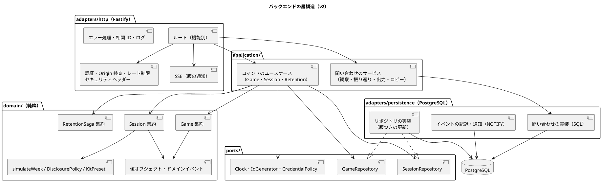
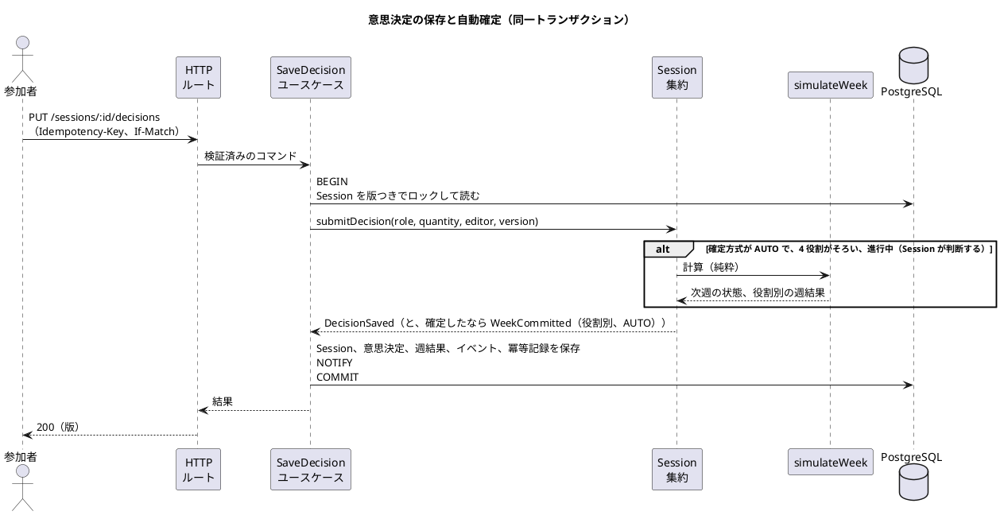

# バックエンドアーキテクチャ - ビールゲームシミュレーション（v2）

## 概要

本書は、beer-game2（v2）のバックエンドのアーキテクチャを、パターン選択の根拠とあわせて定義します。**`docs/` を設計の正本**とします。

beer-game（v1）の [バックエンドアーキテクチャ](../beer-game/architecture-backend.md) を出発点に、[ドメインモデル（v2）](./domain-model.md) と [データモデル（v2）](./data-model.md) に合わせて**改訂**しました。v1 の差分（ルールの `GameService` への集中、`api/app.ts` への機能の同居、ログとメトリクスの欠如、`/health` の浅さ）の解消が中心です。

## パターンの選択

[アーキテクチャ設計ガイド](../../reference/アーキテクチャ設計ガイド.md) の選択フローに沿って判断します。

| 判断項目 | 本システムの答え | 帰結 |
| :--- | :--- | :--- |
| 業務領域のカテゴリー | 中核の業務領域（週次計算と進行） | ドメインモデルパターン |
| 金額・分析・監査記録 | 分析と記録が必要（金額は扱わない） | 追記専用のイベントを監査の記録にする。完全なイベントソーシングはしない |
| 永続化モデルが複数か | 書き込み（集約）と、読み取り（観察・振り返り・出力）で形が異なる | 読み取りは、**集約を経由せず、問い合わせ専用のサービスで SQL を直接実行**する（CQRS の簡易形） |

**採用する構造は、ポートとアダプター（ヘキサゴナル）で、ドメインモデルを中心に置きます。** v1 は、投影をイベントから再構築していました。v2 は、週結果を役割別の行として保存するため、**投影の再構築は不要**です（[データモデル](./data-model.md)）。

## 全体構成



### 層と依存の向き

依存は、外側から内側（ドメイン）への**一方向**です。`domain/` は、他のどの層も import しません。

| 層 | 責務 | 依存してよい先 |
| :--- | :--- | :--- |
| `domain/` | 集約、値オブジェクト、ドメインサービス（`simulateWeek`、`DisclosurePolicy`、`KitPreset`）、ドメインイベント。**業務ルールはここにある** | なし |
| `ports/` | 外部への依存の抽象（リポジトリ、時計、ID 生成、資格のポリシー） | `domain/` |
| `application/` | ユースケース。集約を読み込み、集約のメソッドを呼び、保存する。トランザクションの境界を持つ。**ルールは持たない** | `domain/`、`ports/` |
| `adapters/http/` | HTTP の入出力、入力検証、認証、Origin 検査、レート制限、ヘッダー、SSE | `application/` |
| `adapters/persistence/` | PostgreSQL への、リポジトリと問い合わせの実装、イベントの記録と通知 | `ports/`、`domain/` |
| `config/`・`main` | 設定の読み込みと検証、依存の組み立て、起動 | 全層 |

この規則は、**lint のルール**（import の制限）で機械的に守ります。違反は、CI で失敗とします。

### ディレクトリ構成（提案）

```text
apps/beer-game2/
├── src/
│   ├── domain/        game/ session/ retention/ shared/（値オブジェクト）simulation/
│   ├── ports/
│   ├── application/   commands/ queries/
│   ├── adapters/
│   │   ├── http/      routes/（機能別: games, participation, session, learning, retention, health）
│   │   └── persistence/ repositories/ queries/ migrations/
│   ├── config/
│   └── main.ts
├── ui/                （フロントエンド。別のパッケージとして扱う）
├── tests/             unit/ component/ integration/ e2e/
└── infra/             Terraform
```

v1 の `api/app.ts`（約 560 行）に同居していた、認証、Origin 検査、SSE、エクスポート、保持を、**機能別のルートとミドルウェア**に分けます。

## 集約の読み書き

1. ユースケースは、対象の集約を、リポジトリから**版つきで**読み込む（`SELECT … FOR UPDATE` で、その集約の行をロックする）。
2. 集約のメソッドを呼ぶ（ルールの検証と状態の変更は、集約が行う）。集約は、ドメインイベントを返す。
3. リポジトリが、集約の変更点と、イベント（`events`）を、**同じトランザクションで**保存し、`pg_notify` で通知する。
4. 更新は `WHERE version = $expected` で行い、行数 0 を競合として、最新の状態を返す。

`Game` と `Session` は、**別々の行ロック**を取ります。進行中の入力と確定は `sessions` の行だけをロックし、準備の操作（`games`）と干渉しません。ゲームの開始だけが、2 つを同一トランザクションで扱います。

### 自動確定の流れ



自動確定の判断は、**`Session` 集約が行い**、ユースケースは判断しません。手動の確定と自動確定が同時に起きても、`sessions.version` と `week_results` の主キーにより、確定は**一度だけ**です。

## API 設計方針

- 方式は **REST + JSON**（`/api/v1`）。リアルタイム通知は SSE。
- エラーは `application/problem+json`（`type`、`title`、`status`、`detail`、`correlationId`）。**予期しないエラーは、相関 ID つきで必ず記録する。**
- 変更系は `Idempotency-Key` を必須とし、楽観的排他は `If-Match` に版を載せる。
- 認証は、Cookie（`HttpOnly`、`Secure`、`SameSite=Strict`）の資格。**資格には有効期限と失効があり、鍵は版を持つ。**
- 変更系は、Origin（または Referer）を検査する。セキュリティヘッダー（CSP、HSTS、`nosniff`、Referrer-Policy）をすべての応答に付ける。
- すべての応答に `x-correlation-id` を付ける。

### エンドポイントの区分（v2）

| 区分 | エンドポイントの例 | 認可 | v1 からの変更 |
| :--- | :--- | :--- | :--- |
| ゲーム | `POST /games`、`GET /games/:id/lobby`、`PUT /games/:id/participants/:pid/role`、`DELETE /games/:id/participants/:pid/role` | 作成は誰でも可、他は進行役 | 役割の割り当てが**複数人に対応**。解除を追加 |
| 参加 | `POST /participations/join`、`POST /participations/recover` | 参加コード、復帰資格 | 進行役の復帰も対象 |
| 観察 | `POST /games/:id/observer-invitations`、`DELETE …/:invid`、`POST /observers/join` | 進行役（招待）、招待コード（参加） | **新規** |
| 進行 | `POST /sessions/:id/{start,pause,resume,end}`、`POST /sessions/:id/weeks/:week/commit`、`PUT /sessions/:id/commit-mode` | 進行役 | 確定方式の変更を追加 |
| 意思決定 | `PUT /sessions/:id/decisions`、`PUT /sessions/:id/proxy-decisions/:role`、`GET /sessions/:id/state` | 参加者（その役割の共同担当）、進行役（代理） | 共同担当の競合に対応 |
| 通知 | `GET /games/:id/events`（SSE） | ゲームに属する操作者 | **再生しない**（版の通知だけ） |
| 学習 | `GET /games/:id/{observation,review}`、`POST/GET /games/:id/exports` | 観察は参加者・進行役・観察者、振り返りと出力は終了後 | 役割別のデータを返す |
| 資格 | `POST /games/:id/credentials/revoke`、`POST …/reissue` | 進行役 | **新規** |
| 保持 | `GET /games/:id/retention`、`POST …/retry` | 進行役 | 簡素化 |
| 運用 | `GET /health`（生存）、`GET /ready`（準備: データベース接続） | なし | `/ready` を**新規** |

### 通知（SSE）

- SSE は、**版の通知だけ**を送る（`state-version`。集約の種別と版）。内容は運ばない。
- **再生（`Last-Event-ID` による取りこぼしの再送）は行わない。** 接続の開始と再接続のたびに、クライアントが現在のスナップショットを取得する。v1 の再生のための実装（`eventsSince`、カーソルの照合）を省く。
- サーバーは、`LISTEN/NOTIFY` を合図に、購読中の接続へ通知する。`NOTIFY` が失われても、定期の照合（数秒）で補う。

## 観測性

| 項目 | 設計 |
| :--- | :--- |
| ログ | 構造化 JSON（Pino 相当）。相関 ID、操作、結果、版、所要時間、ゲームの不透明な ID を含み、**資格、表示名、非公開の値を含めない**（秘匿の設定で除外）。起動時に、ログの設定を検証する |
| エラー | 予期しないエラーは、スタックと相関 ID を含めて、必ず記録する。利用者へは、相関 ID だけを返す |
| メトリクス | 応答時間（操作・結果別）、エラー率、確定の競合、ロールバック、確定の方式（手動 / 自動）、SSE の接続数、通知の遅延、削除の経過時間。CloudWatch の Embedded Metric Format で出力する（追加のサーバーを持たない） |
| 追跡 | 相関 ID を、HTTP、トランザクション、イベント、SSE の通知、ログに伝える |
| ヘルスチェック | `GET /health`（生存）と `GET /ready`（`SELECT 1` による準備）。負荷分散には `/ready` を使う |
| 不変条件の監視 | 週結果の重複、確定のないイベントなどを、メトリクスとアラートで検知する |

## セキュリティ

| 項目 | 設計 |
| :--- | :--- |
| 資格 | 256 ビットの乱数。保存はダイジェストと**鍵の版**。鍵は複数の版を同時に持ち、ローテーション後も、旧版で発行した資格を、期限まで検証できる。**本番では鍵の設定を必須にし、未設定なら起動に失敗する** |
| 有効期限と失効 | 進行役の資格、復帰資格、観察用の招待、ブラウザセッションのすべてが、有効期限と失効を持つ。進行役は、資格を失効・再発行できる |
| 認可 | すべての操作で、ゲーム、セッション、役割（共同担当）、操作の認可を、サーバー側で検査する。観察者は、読み取りだけ |
| 入力 | スキーマ（zod 相当）で検証し、サイズと数量の上限を設ける |
| レート制限 | 全体に加え、**参加、復帰、観察用の招待の参加を専用に制限**する（総当たりの対策）。実効の上限が、タスク数で増えないよう、制限の状態の共有を検討する（データベース、または前段のサービス） |
| ヘッダー | CSP、HSTS、`nosniff`、Referrer-Policy を付ける |
| 依存関係 | CI で、依存関係と秘密情報を検査する |

## 品質属性への対応

| 品質属性 | 対応する設計 |
| :--- | :--- |
| 整合性 | 集約ごとの行ロックと版、1 トランザクションでの保存、週確定の一回性（版と主キー） |
| 可用性・水平スケール | 状態を持たない API。SSE は版の通知で、再接続時にスナップショットを取得して収束する |
| 保守性 | 層の依存を lint で守る。ルートを機能別に分ける。ルールは集約に集める |
| 観測性 | 構造化ログ、メトリクス、相関 ID、準備のヘルスチェック |
| テスト容易性 | ドメインは純粋でテストしやすい。ユースケースは、ポートの差し替えでテストできる。永続化は実際の PostgreSQL で検証する |

## テスト戦略との対応

ピラミッド型に沿い、ドメイン（集約、`simulateWeek`、開示判定）は、ユニットテストで網羅します。ユースケースはポートの差し替えで、永続化と並行性（共同担当の競合、自動確定と手動確定の競合、複数プロセス）は、実際の PostgreSQL で検証します。詳細は [テスト戦略](./test-strategy.md) を参照してください。

## v1 からの変更

| # | v1 | v2 |
| :--- | :--- | :--- |
| 1 | ルールが `GameService`（約 650 行）に集中。`domain/` は週次計算のみ | ルールは集約が持つ。アプリケーション層は、ルールを持たない |
| 2 | `api/app.ts`（約 560 行）に、ルート、認証、SSE、出力が同居 | 機能別のルートとミドルウェアに分ける |
| 3 | 観察と振り返りを、リクエストのたびにイベント全件から再構築 | 週結果を役割別の行で保存し、SQL で返す |
| 4 | SSE は、イベントの再生と、カーソルの照合を持つ | 版の通知だけ。再接続時にスナップショットを取得 |
| 5 | ログとメトリクスが無い。`/health` はデータベースを確認しない | 構造化ログ、メトリクス、`/ready`、エラーの記録 |
| 6 | 資格の鍵が、未設定だと固定の開発用の値になる | 本番では必須。鍵に版を持たせる |
| 7 | 資格の有効期限が不統一（進行役は無期限） | すべての資格に、期限と失効 |
| 8 | レート制限が全体のみで、プロセス内 | 参加・復帰の専用の制限。状態の共有を検討 |
| 9 | 保持削除は、所有者別のキューとワーカー | 1 トランザクションのカスケード削除。簡素な Saga |
| 10 | 未使用の `OutboxDispatcher` と、学習用キューがある | 作らない。必要になった時点で、イベントの外部配信を設計する |

## 設計判断（ADR の対象）

次の判断を、v2 の ADR として記録します（作成は次の工程）。

- ドメインモデル + ポートとアダプター。層の依存を lint で守る。
- `Game`（準備）と `Session`（進行）の集約を分ける。開始だけが同一トランザクション。
- 自動確定を、最後の意思決定と同じトランザクションで行う。
- 週結果を役割別の行で保存し、観察・振り返り・出力は SQL で返す（投影の再構築をしない）。
- SSE は版の通知だけで、再生しない。
- 保持削除を、1 トランザクションのカスケード削除にする（所有者別のキューを廃止）。
- 監査をイベントに統一する。
- 資格の鍵に版を持たせ、本番では必須にする。

v1 から**引き継ぐ**判断: 週次計算の純粋関数による分離（[ADR-001](../../adr/beer-game/001-pure-weekly-simulation.md)）、行ロックによる整合性（[ADR-002](../../adr/beer-game/002-stateless-api-row-lock.md)）、資格のダイジェスト保存（[ADR-005](../../adr/beer-game/005-credential-digest-only.md)）。

## 前提と見直しの条件

- 集約をさらに分ける条件: 1 つの `Session` で、共同担当による入力の競合が、利用に影響する場合。
- 読み取り専用のストアを持つ条件: SQL による観察と振り返りが、性能目標を満たせない場合。
- イベントの外部配信を設ける条件: 他のシステムとの連携や、非同期の処理が必要になった場合。

## 未決事項

- ログ、メトリクスのライブラリの選定（[技術スタック](./tech-stack.md) で決める）。
- レート制限の状態を共有する方法（データベース、または前段のサービス）。
- 設定の上限（数量、遅延）の値と、検査の方法。

## 出典

- [ドメインモデル設計（v2）](./domain-model.md)、[データモデル設計（v2）](./data-model.md)、[非機能要件](./non-functional.md)、[運用要件](./operation.md)
- v1 の [バックエンドアーキテクチャ](../beer-game/architecture-backend.md)
- [アーキテクチャ設計ガイド](../../reference/アーキテクチャ設計ガイド.md)
- [ADR-001](../../adr/beer-game2/001-rebuild-as-beer-game2.md)
