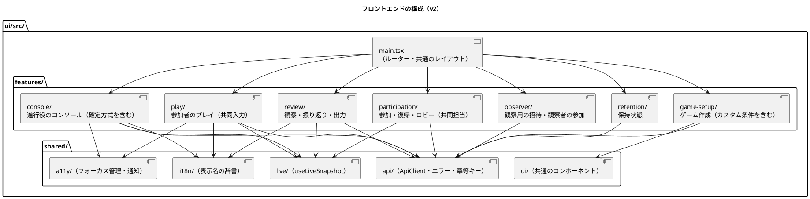
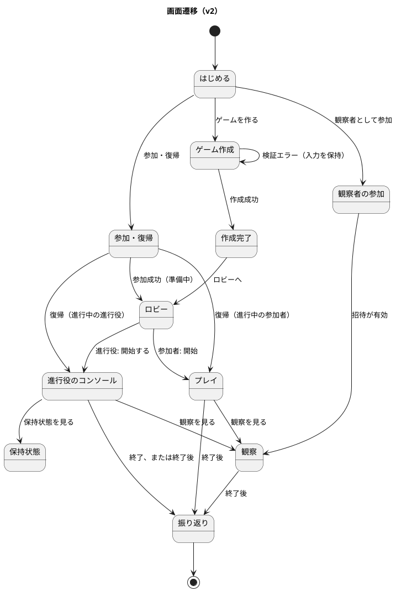

# フロントエンドアーキテクチャ - ビールゲームシミュレーション（v2）

## 概要

本書は、beer-game2（v2）のフロントエンドのアーキテクチャを定義します。**`docs/` を設計の正本**とします。

beer-game（v1）の [フロントエンドアーキテクチャ](../beer-game/architecture-frontend.md) を出発点に、v2 の範囲（共同担当、観察者、自動確定、カスタム条件）と、v1 の差分（再読み込みで進行役が戻れない、英語の列挙値の表示、`CreateJoinLobby.tsx` の肥大など）を反映して**改訂**しました。

- API は [バックエンドアーキテクチャ（v2）](./architecture-backend.md)、画面は [UI 設計](./ui-design.md) を参照してください。

## 決定の整理

[アーキテクチャ設計ガイド](../../reference/アーキテクチャ設計ガイド.md) のフロントエンド決定フローに沿った結果です。**変更点を太字**で示します。

| 決定項目 | v2 の採用 | v1 との違い・根拠 |
| :--- | :--- | :--- |
| プロジェクト規模 | 小規模（機能単位の構造） | 画面が 12 程度に増え、**`features/` で機能ごとに分ける**（v1 はフラットな 11 ファイル） |
| レンダリング戦略 | SPA（React） | 変更なし。検索流入は不要 |
| ビルド | Vite（静的ファイル。CloudFront から配信） | 変更なし。開発時は `/api` をプロキシ |
| **ルーティング** | **URL ルーターを導入する（パスで画面を表す）** | v1 は `useState` で切り替えており、**再読み込みでゲームを失い、進行役が戻れなかった**。URL にゲームを持たせ、資格（Cookie）で復帰する |
| 状態管理 | コンポーネントの状態 + 画面ごとの**カスタムフック**。グローバルな状態ライブラリは使わない | 共有する状態は、URL（ゲーム ID）と、取得したスナップショットだけ |
| サーバー状態 | `ApiClient` + `useLiveSnapshot`（SSE の版の通知 + 再取得） | 再生を前提にせず、通知のたびに、スナップショットを取得する |
| スタイル | CSS（設計トークンを持つ単一のスタイル） | v1 を引き継ぐ。色は、設計トークンで管理する |
| アクセシビリティ | キーボード、フォーカス管理、200% 拡大、WCAG 2.2 AA | 引き継ぐ。**画面ごとの題名とフォーカスの移動先を加える** |
| 表示名の管理 | 役割・状態・確定方式などの表示名を、**1 か所の辞書**に持つ | v1 は、英語の列挙値のまま表示していた |

## 全体構成

### ルーティング（URL と画面）

| URL | 画面 | 利用者 |
| :--- | :--- | :--- |
| `/` | はじめる | 全員 |
| `/new` | ゲーム作成 | 進行役 |
| `/join` | 参加・復帰 | 参加者 |
| `/observe` | 観察者の参加（観察用の招待を入力） | 観察者 |
| `/games/:gameId/lobby` | ロビー | 進行役、参加者 |
| `/games/:gameId/play` | プレイ | 参加者（共同担当を含む） |
| `/games/:gameId/console` | 進行役のコンソール | 進行役 |
| `/games/:gameId/observation` | 観察 | 進行役、参加者、観察者 |
| `/games/:gameId/review` | 振り返りと出力 | 全員（終了後） |
| `/games/:gameId/retention` | 保持状態 | 進行役 |

- URL には、**ゲーム ID だけ**を含め、資格や参加コードを含めません（資格は `HttpOnly` の Cookie）。
- 画面を開いたとき、Cookie の資格で権限を確認し、**権限が無ければ、参加・復帰の画面へ誘導**します。進行役が再読み込みしても、`/games/:gameId/console` へ戻れます（v1 の差分の解消）。
- 画面の切り替えごとに、**ページの題名**（`document.title`）を更新し、見出しへフォーカスを移します。

### 画面遷移

## リアルタイム更新の方式

- 画面は、版（`version`）つきの**スナップショット**を API から取得します。
- SSE は「版が進んだ」ことだけを通知し、通知を受けたら再取得します（内容は運びません）。
- **取りこぼしの再送は行いません。** 接続の開始と再接続のたびに、スナップショットを取得して追いつきます。
- 取得した版が現在より古ければ捨て、同じ版で内容が違えば反映します。
- SSE が切れたら、1 秒間隔のポーリングに切り替え、再接続したら止めます。接続状態を画面に出します。
- 「自動更新を停止」「手動更新」を、利用者に提供します。

## 共同入力の扱い

同一役割の共同担当は、1 つの意思決定値を共有します（[ドメインモデル](./domain-model.md)）。

- 画面は、現在の入力値、版、**最後に保存した人**を表示する。
- 保存は、自分が見ている版で送る。他の人が先に保存していた場合は、拒否され、**最新値と最後の保存者を示し、自分の入力を保持したまま再入力を促す**。変更を黙って失わない。
- 同じ役割の他の人が保存したときは、SSE の通知で、画面が最新になる（入力中の値は、保持する）。

## 状態の持ち方

| 種類 | 持ち場所 | 例 |
| :--- | :--- | :--- |
| 画面の位置 | URL | `gameId`、画面 |
| サーバー状態 | 画面ごとのカスタムフック（`useLiveSnapshot`） | ロビー、役割別の状態、進行状態、観察、振り返り |
| 入力フォームの状態 | コンポーネントの `useState` | 設定、数量、選択中の役割 |
| 認証 | ブラウザの Cookie（`HttpOnly`）。画面は値を持たない | 進行役、復帰、観察者、セッション |
| 表示名 | `shared/i18n` の辞書 | 役割、状態、確定方式 |

## 品質属性への対応

| 品質属性 | 対応する設計 |
| :--- | :--- |
| アクセシビリティ | スキップリンク、ダイアログのフォーカス管理、`aria`、200% 拡大、画面ごとの題名 |
| 堅牢性 | 版比較による更新、SSE 切断時のポーリング、競合時は入力を保持して更新を促す |
| セキュリティ | 資格を JavaScript から読めない Cookie に限定。CSP を前提に、インラインのスクリプトを使わない |
| 観測性 | エラー表示に相関 ID を出す（問い合わせでサーバーのログと突き合わせる） |
| テスト容易性 | `ApiClient` を差し替えて、コンポーネントをテストする |

## テスト戦略との対応

画面は Testing Library、`ApiClient` とライブ更新は単体テスト、利用の流れは Playwright で確認します（[テスト戦略](./test-strategy.md)）。

## v1 からの変更

| # | v1 | v2 |
| :--- | :--- | :--- |
| 1 | URL ルーターが無く、再読み込みでゲームを失う。進行役が戻れない | URL ルーターを導入し、資格で権限を確認して復帰する |
| 2 | `src/ui` がフラット。`CreateJoinLobby.tsx` が約 415 行 | `features/` で機能ごとに分け、画面ごとのファイルにする |
| 3 | 役割・状態が英語の列挙値のまま表示される | 表示名の辞書を 1 か所に持つ |
| 4 | `<title>` と H1 が全画面で同じ | 画面ごとに題名を更新し、フォーカスを移す |
| 5 | エラー表示に相関 ID が無い | 相関 ID を表示する |
| 6 | 共同入力が無い | 版による競合の検出と、最新値・保存者の提示 |
| 7 | 観察者の入口が無い | `/observe` と観察用の招待 |
| 8 | SSE の再生に頼る実装 | 版の通知のみ。再接続時にスナップショットを取得 |

## 設計判断（ADR の対象）

- URL ルーターを導入し、ゲームを URL で表す（資格は Cookie）。
- 機能単位（`features/`）の構成にする。
- 状態管理ライブラリは導入せず、画面ごとのカスタムフックで扱う。
- SSE は版の通知だけで、再接続時にスナップショットを取得する。
- 表示名は 1 か所の辞書に持つ。

v1 から**引き継ぐ**判断: SPA の採用（[ADR-006](../../adr/beer-game/006-spa-without-router-or-store.md) のうち、ルーターを導入しない点を**変更**）、SSE の版の通知（[ADR-004](../../adr/beer-game/004-sse-version-notification.md)。再生を省く点を変更）。

## 未決事項

- ルーターのライブラリの選定（[技術スタック](./tech-stack.md) で決める）。
- 表示名の辞書の形式（多言語化の要否を含む）。
- 設計トークン（色、間隔）の管理方法と、コントラスト比の自動検査の方法。

## 出典

- [バックエンドアーキテクチャ（v2）](./architecture-backend.md)、[ドメインモデル（v2）](./domain-model.md)、[UI 設計](./ui-design.md)
- v1 の [フロントエンドアーキテクチャ](../beer-game/architecture-frontend.md)
- [アーキテクチャ設計ガイド](../../reference/アーキテクチャ設計ガイド.md)
- [ADR-001](../../adr/beer-game2/001-rebuild-as-beer-game2.md)
