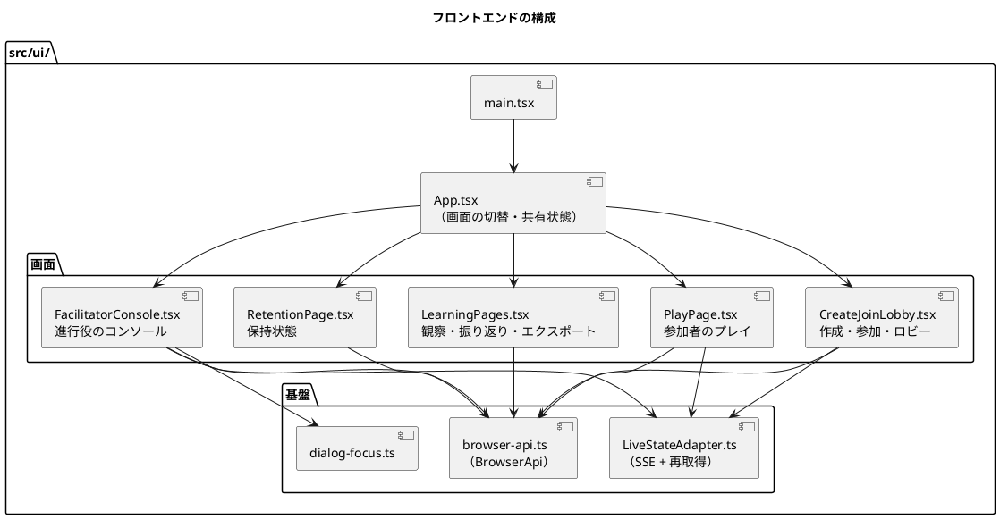
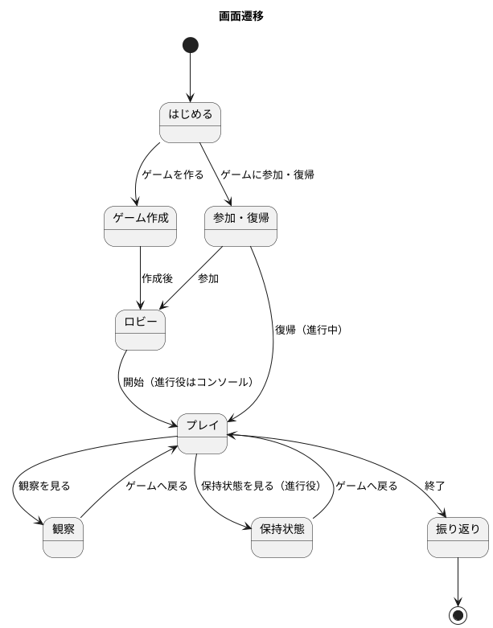

# フロントエンドアーキテクチャ - ビールゲームシミュレーション（v2）

> **beer-game2（v2）の出発点**: 本書は beer-game（v1）の文書を複製したものです。v2 で改訂します。表中の「実装状況」「現状」は **v1 の状態**を表し、不足は v2 で解消する対象です。詳細は [ADR-001](../../adr/beer-game2/001-rebuild-as-beer-game2.md) を参照してください。

## 概要

本書は、ビールゲームシミュレーションのフロントエンドのアーキテクチャを定義します。**`docs/` を設計の正本**とし、実装（`apps/beer-game/src/ui`、`index.html`、`vite.config.ts`）で確認できる事実を記述します。

- API の仕様は [バックエンドアーキテクチャ](./architecture-backend.md) を参照してください。
- 配信構成は [インフラストラクチャアーキテクチャ](./architecture-infrastructure.md) を参照してください。

## 決定の整理

[アーキテクチャ設計ガイド](../../reference/アーキテクチャ設計ガイド.md) のフロントエンド決定フローに沿った結果です。

| 決定項目 | 採用 | 根拠 |
| :--- | :--- | :--- |
| プロジェクト規模 | 小規模（6 フォルダ相当のシンプル構造） | 画面は 8 つ、`src/ui` は 11 ファイル・約 1,660 行 |
| レンダリング戦略 | SPA（React） | 検索流入は不要。学習セッション中の操作と状態更新が中心 |
| ビルド | Vite（`dist/ui`）。配信は静的ファイル | 開発時は Vite の dev server（HMR）で API にプロキシする |
| 状態管理 | コンポーネントの `useState` のみ。グローバルな状態ライブラリは使わない | 共有する状態は「ゲーム ID・セッション ID・進行役か」だけで、`App` が持つ |
| サーバー状態 | `BrowserApi` + `LiveStateAdapter`（SSE と再取得） | 版つきのスナップショットを再取得する方式 |
| ルーティング | URL ルーターなし。`App` の `page` 状態で画面を切り替える | 学習セッション内の遷移だけで、URL で直接開く画面がない |
| スタイル | 単一の `styles.css`（CSS-in-JS なし） | 画面数が少ない |
| アクセシビリティ | キーボード操作、ダイアログのフォーカス管理、200% 拡大 | NFR の要求。`dialog-focus.ts` とテストで担保 |

## 全体構成

### 画面遷移

### 責務

| ファイル | 責務 |
| :--- | :--- |
| `App.tsx` | 現在の画面、ゲーム ID・セッション ID・進行役か、ナビゲーションの表示制御 |
| `CreateJoinLobby.tsx` | ゲーム作成フォームと入力検証、参加・復帰、ロビー（役割割当て・開始） |
| `PlayPage.tsx` | 参加者の状態表示と発注入力。終了後は振り返りへの導線 |
| `FacilitatorConsole.tsx` | 週確定、停止・再開・終了、代理入力。確認ダイアログを伴う |
| `LearningPages.tsx` | 観察、振り返り、エクスポートの表示 |
| `RetentionPage.tsx` | 保持期限と削除の状況、再試行 |
| `browser-api.ts` | `/api/v1` の呼び出し、`Idempotency-Key` と `If-Match` の付与、エラーの正規化（`BrowserApiError`） |
| `LiveStateAdapter.ts` | SSE の `state-version` で再取得。切断時は 1 秒間隔のポーリングに切り替える |

## リアルタイム更新の方式

- 画面は版（`version`）つきのスナップショットを API から取得します。
- SSE は「版が進んだ」ことだけを通知し、通知を受けたら再取得します。内容は SSE で運びません。
- 取得した版が現在より古ければ捨て、同じ版で内容が違えば反映します（順序の入れ替わりと重複に強い）。
- SSE が切れたら 1 秒間隔のポーリングに切り替え、再接続したら止めます。接続状態（`connected` / `polling`）を画面に出します。
- 画面側の「自動更新を停止」「手動更新」を用意し、利用者が制御できます。

## 状態の持ち方

| 種類 | 持ち場所 | 例 |
| :--- | :--- | :--- |
| 画面の共有状態 | `App` の `useState` | `page`、`gameId`、`sessionId`、`facilitator` |
| サーバー状態 | 各画面の `useState` + `LiveStateAdapter` | ロビー、進行状態、役割別の状態 |
| 入力フォームの状態 | 各画面の `useState` | 終了週、需要、数量、選択中の役割 |
| 認証 | ブラウザの Cookie（`HttpOnly`）。画面は値を持たない | `bg_session`、`bg_operator`、`bg_recovery` |

## 品質属性への対応

| 品質属性 | 対応する設計 |
| :--- | :--- |
| アクセシビリティ | スキップリンク、ダイアログのフォーカス管理、`aria` 属性、200% 拡大で横スクロールなし |
| 堅牢性 | 版比較による更新、SSE 切断時のポーリング、競合時は現在の表示を保って更新を促す |
| セキュリティ | 資格を JavaScript から読めない Cookie に限定、危険な HTML の挿入なし |
| テスト容易性 | `BrowserApi` を差し替えてテストする。`LiveStateAdapter` は EventSource を差し込める |

## テスト戦略との対応

ガイドの「アウトサイドイン」に沿い、画面は Testing Library、API 連携と更新は単体テスト、利用の流れは Playwright で確認します（`tests/u5`、`tests/e2e`）。手動のアクセシビリティ確認は `tests/manual/u5-accessibility.md` にあります。

## 設計と実装の差分・要確認事項

| # | 内容 | 影響 | 扱い |
| :--- | :--- | :--- | :--- |
| 1 | URL ルーターがないため、画面の再読み込みで `gameId`・`sessionId` を失う（復帰は Cookie の復帰資格に頼る）。進行役が再読み込みすると、同じゲームのコンソールへ戻る手段が画面にない | 進行役がブラウザを閉じると操作を続けにくい | 要確認。URL にゲーム ID を持たせるか、進行役の復帰を設計する |
| 2 | `CreateJoinLobby.tsx` は約 415 行で、作成・参加・ロビーが同居している | 変更理由が複数ある | 画面ごとに分割する。リファクタリングの候補 |
| 3 | `src/ui` がフラット（コンポーネント、基盤、画面の区別なし） | 画面が増えると見通しが悪くなる | 機能単位（`features/`）への整理は、画面を追加する時点で判断 |
| 4 | 画面ごとのコンポーネントを Container / Presentational に分けていない | テストは `BrowserApi` の差し替えで成立している | 現状は問題なし。記録のみ |
| 5 | UI の配信用ビルド（`build:ui`）は CI に含まれず、S3 への配置手順も未整備 | 本番へ UI を出す手順がない | インフラ側の差分と共通（インフラ文書を参照） |

## 設計判断

- SPA とし、URL ルーターと状態管理ライブラリは導入しない（[ADR-006](../../adr/beer-game/006-spa-without-router-or-store.md)）。
- SSE は版の通知に限り、状態は再取得で得る（[ADR-004](../../adr/beer-game/004-sse-version-notification.md)）。
- アクセシビリティ（キーボード、フォーカス、拡大）を機能要件として扱う。

## 出典

- [バックエンドアーキテクチャ](./architecture-backend.md)
- [アーキテクチャ設計ガイド](../../reference/アーキテクチャ設計ガイド.md)
- `apps/beer-game/src/ui/*`、`index.html`、`vite.config.ts`
