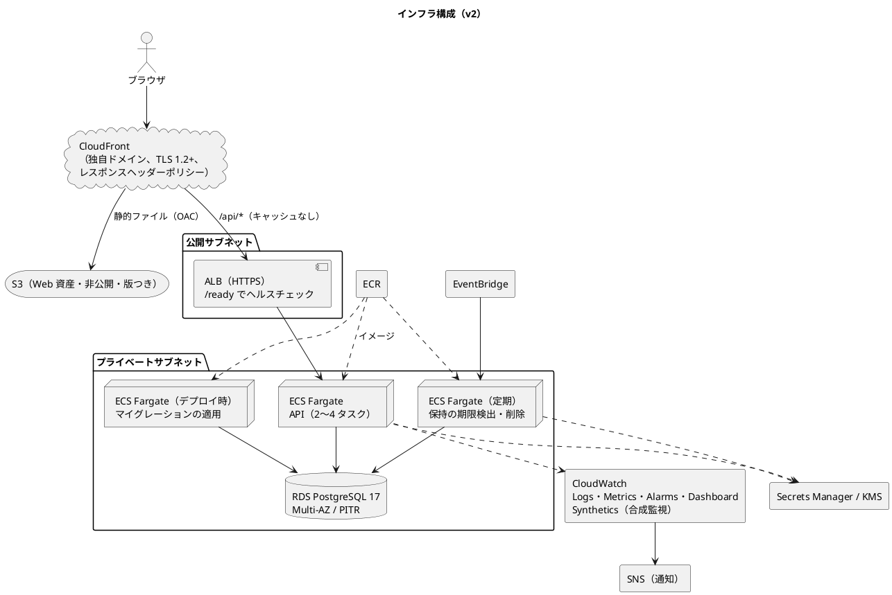
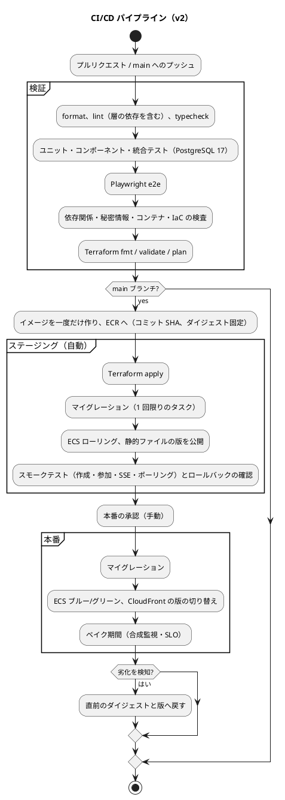

# インフラストラクチャアーキテクチャ - ビールゲームシミュレーション（v2）

## 概要

本書は、beer-game2（v2）の実行環境と配信の構成を定義します。**`docs/` を設計の正本**とします。

beer-game（v1）の [インフラストラクチャアーキテクチャ](../beer-game/architecture-infrastructure.md) を出発点に、v1 の差分（デプロイ未実装、観測性の欠如、ネットワークと状態管理が定義の外、セキュリティヘッダーと TLS）の解消と、v2 の設計の単純化（保持削除のキューの廃止）を反映して**改訂**しました。

- アプリは [バックエンド](./architecture-backend.md)、[フロントエンド](./architecture-frontend.md)、運用は [運用要件](./operation.md) を参照してください。

## 決定の整理

| 決定項目 | v2 の採用 | v1 との違い・根拠 |
| :--- | :--- | :--- |
| クラウド | AWS（`ap-northeast-1`） | 変更なし |
| デプロイ形態 | コンテナ（ECS Fargate） | 変更なし |
| 配信 | CloudFront の単一オリジン（静的ファイルは S3、`/api/*` は ALB）。**独自ドメインと ACM の証明書、TLS 1.2 以上** | v1 は既定の証明書で、TLS の最低版を指定できなかった |
| データベース | RDS for PostgreSQL 17（Multi-AZ、暗号化、PITR、バックアップ 7 日） | 変更なし |
| **非同期・キュー** | **使わない（SQS、所有者別ワーカーを廃止）** | 保持削除を 1 トランザクションのカスケード削除にしたため（[データモデル](./data-model.md)）。必要になった時点で追加する |
| 定期処理 | EventBridge による ECS タスク（保持の期限検出・削除） | 1 種類のタスクに簡素化 |
| イメージ | **ECR（不変のタグ、スキャン）** | v1 は、ECR の定義が無く、イメージは GHCR だった |
| 秘密情報 | Secrets Manager（鍵の版を複数保持）、KMS | 鍵の版管理に対応 |
| IaC | Terraform（**リモートの状態、ロック、環境ごとに分離、モジュール化**） | v1 は、状態の保管先が未定義で、ネットワークが定義の外だった |
| CI/CD | GitHub Actions（OIDC）。**ステージングは自動、本番は承認 + ブルー/グリーン** | v1 は、デプロイが `echo` のプレースホルダー |
| 観測 | **構造化ログ（CloudWatch Logs）、メトリクス（EMF）、合成監視、アラーム、ダッシュボード** | v1 は、アラームが ALB の接続数 1 件だけ |

## 全体構成

### 構成要素

| 要素 | 設定 |
| :--- | :--- |
| CloudFront | 既定は S3（キャッシュあり）、`/api/*` は ALB（キャッシュなし、Cookie・Origin・Idempotency-Key・If-Match を転送）。**レスポンスヘッダーポリシー**で、CSP、HSTS、`nosniff`、Referrer-Policy を付ける。独自ドメインと ACM の証明書、TLS 1.2 以上。WAF を検討 |
| S3（Web） | 公開ブロック、バージョニング、OAC のみ。版つきのプレフィックスに配置し、**配信する版を切り替えて、ロールバックできる** |
| ALB | HTTPS、アイドルタイムアウト 60 秒、ヘルスチェックは **`/ready`**（データベース接続を確認） |
| API サービス | Fargate、常時 2 タスク、CPU 60% で 2〜4 に自動増減。ステートレス。**本番はブルー/グリーン（CodeDeploy）、ステージングはローリング** |
| 保持の定期タスク | EventBridge で 5 分ごとに起動し、期限に達したゲームを検出して削除する |
| マイグレーション | デプロイの一部として、**1 回限りの ECS タスク**で適用する（アプリの起動前）。履歴テーブルで管理し、拡張 → 互換 → 縮小の順 |
| RDS | PostgreSQL 17、Multi-AZ、暗号化、PITR、バックアップ 7 日、本番は削除保護。接続はプライベートのみ |
| ECR | 不変のタグ（コミット SHA）、プッシュ時のスキャン、ライフサイクル |
| 秘密情報 | DB 接続、資格の鍵（**複数の版**）、暗号鍵を Secrets Manager から注入。実行ロールにだけ参照権限 |
| 観測 | JSON ログを暗号化した CloudWatch Logs へ。メトリクスは EMF。合成監視で、作成・参加・SSE を 1 分ごとに確認。アラームを SNS へ。ダッシュボードを 1 枚 |
| ネットワーク | 2 つの AZ の VPC、公開（ALB）とプライベート（ECS、RDS）のサブネット、セキュリティグループ、NAT または VPC エンドポイント。**Terraform のモジュールで管理する** |

## 環境

| 環境 | 用途 | デプロイ | Terraform の状態 |
| :--- | :--- | :--- | :--- |
| ローカル | 開発・確認 | `npm run dev`（API と Vite。DB は Docker の PostgreSQL） | — |
| CI | 検証 | GitHub Actions（PostgreSQL 17 のサービスコンテナ） | — |
| ステージング | 本番前の確認 | main へのマージで自動（ローリング） | 専用 |
| 本番 | 運用 | 手動の承認後（ブルー/グリーン） | 専用 |

各環境の Terraform の状態は、**暗号化したリモートの保管先（S3 とロック）に、環境ごとに分けて**持ちます。アカウントを分けるか、厳格な境界を設けます。

## CI/CD

- CI は、GitHub Actions の **OIDC**で、環境ごとの最小権限のロールを引き受ける（長期のアクセスキーを置かない）。
- ステージングで承認した**同じイメージのダイジェスト**を、本番へ昇格させる。
- スキーマの変更は、旧アプリが動く間は、必須の列・制約を削除しない（拡張 → 互換 → 縮小）。

## 品質属性への対応

| 品質属性 | 対応する設計 |
| :--- | :--- |
| 可用性 | API 2 タスク以上、RDS Multi-AZ、`/ready` のヘルスチェック、最小正常率 100% のローリング、ブルー/グリーン |
| スケーラビリティ | CPU ベースの自動増減（2〜4）。ゲーム単位の直列化で、データベースが律速 |
| セキュリティ | 非公開サブネット、S3 の公開ブロックと OAC、暗号化、Secrets Manager と KMS、HTTPS のみ、TLS 1.2 以上、セキュリティヘッダー、OIDC |
| 運用性 | Terraform（リモートの状態）、構造化ログ、メトリクス、合成監視、アラーム、ロールバック、復元の訓練 |
| コスト | Fargate の最小構成、`db.t4g.small`、月次の予算通知、開発環境の夜間の縮小（提案） |

## v1 からの変更

| # | v1 | v2 |
| :--- | :--- | :--- |
| 1 | CI の staging / production が `echo`。ブルー/グリーンの定義が無い | ステージングは自動、本番は承認 + ブルー/グリーン。ロールバック手順 |
| 2 | イメージは GHCR だが、インフラは ECR を想定し、ECR の定義も無い | ECR に統一する（不変のタグ、スキャン） |
| 3 | 保持削除の SQS と所有者別のワーカー、未使用の学習用キューとエクスポート用バケット | キューとバケットを廃止（1 トランザクションの削除） |
| 4 | Terraform の状態の保管先が未定義。ネットワーク・WAF が定義の外 | リモートの状態と、ネットワークのモジュール |
| 5 | CloudFront は既定の証明書で、TLS の最低版を指定できない。セキュリティヘッダーが無い | 独自ドメイン、ACM、TLS 1.2 以上、レスポンスヘッダーポリシー |
| 6 | アラームが ALB の接続数 1 件。ダッシュボードが無い | 構造化ログ、メトリクス、合成監視、アラーム、ダッシュボード |
| 7 | ALB のヘルスチェックが `/health`（DB を確認しない） | `/ready`（DB 接続を確認） |
| 8 | マイグレーションは手動 | デプロイ時に、1 回限りのタスクで適用 |
| 9 | PostgreSQL の版が環境で異なる（CI は 16） | すべて 17 に揃える |

## 設計判断（ADR の対象）

- CloudFront の単一オリジンと、独自ドメイン・TLS 1.2 以上・セキュリティヘッダー。
- API はステートレスで、Fargate で水平に増減する。
- キューを使わず、保持削除を 1 トランザクションで行う。
- ECR、OIDC、ステージング自動・本番承認・ブルー/グリーンのパイプライン。
- Terraform のリモートの状態と、環境ごとの分離。

v1 から**引き継ぐ**判断: CloudFront の単一オリジン（[ADR-007](../../adr/beer-game/007-cloudfront-single-origin.md)。独自ドメインと TLS を**追加**）。保持削除の Saga（[ADR-008](../../adr/beer-game/008-retention-saga.md)）は、キューを廃止する形に**変更**します。

## 前提と見直しの条件

- 常時 2 タスクで足りる前提: 同時に進行するゲームが少数（学習セッション単位）。性能の目標を、負荷試験で確認する。
- キューを再導入する条件: 削除以外の非同期処理（外部への配信、重い出力の生成）が必要になった場合。
- WAF の導入: 攻撃の兆候、またはセキュリティ要件の強化があった場合。

## 未決事項

- 独自ドメインの取得と、DNS（Route 53）の管理者。
- ブルー/グリーンの実装（CodeDeploy）と、ステージングのローリングの差の許容。
- 合成監視（CloudWatch Synthetics）の費用と、頻度（1 分ごと）の妥当性。
- アカウントの分離（環境ごと）の方針。

## 出典

- [バックエンドアーキテクチャ（v2）](./architecture-backend.md)、[データモデル（v2）](./data-model.md)、[運用要件](./operation.md)、[非機能要件](./non-functional.md)
- v1 の [インフラストラクチャアーキテクチャ](../beer-game/architecture-infrastructure.md)
- [アーキテクチャ設計ガイド](../../reference/アーキテクチャ設計ガイド.md)
- [ADR-001](../../adr/beer-game2/001-rebuild-as-beer-game2.md)
