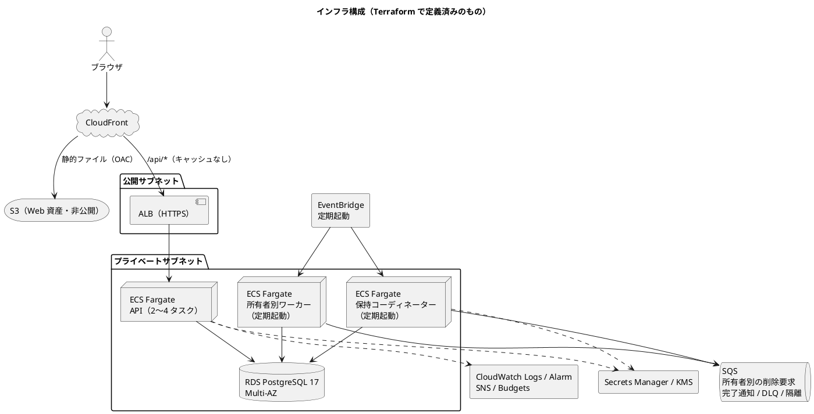
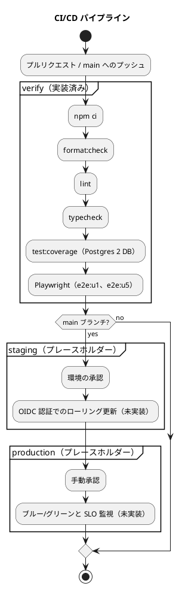

# インフラストラクチャアーキテクチャ - ビールゲームシミュレーション（v2）

> **beer-game2（v2）の出発点**: 本書は beer-game（v1）の文書を複製したものです。v2 で改訂します。表中の「実装状況」「現状」は **v1 の状態**を表し、不足は v2 で解消する対象です。詳細は [ADR-001](../../adr/beer-game2/001-rebuild-as-beer-game2.md) を参照してください。

## 概要

本書は、ビールゲームシミュレーションの実行環境と配信の構成を定義します。**`docs/` を設計の正本**とし、`apps/beer-game/infra/main.tf`、`Dockerfile`、`compose.yaml`、`.github/workflows` で確認できる事実と、まだ形になっていない設計意図を区別して記述します。

- アプリケーションの構造は [バックエンドアーキテクチャ](./architecture-backend.md)、[フロントエンドアーキテクチャ](./architecture-frontend.md) を参照してください。
- 環境ごとの手順は `docs/operation/beer-game/`（運用手順書）に置きます。

## 決定の整理

| 決定項目 | 採用 | 根拠 |
| :--- | :--- | :--- |
| クラウド | AWS（`ap-northeast-1`） | Terraform で定義済み |
| デプロイ形態 | コンテナ（ECS Fargate）。オーケストレーターは使わない | 小規模で、運用負荷を抑える |
| 配信 | CloudFront の単一オリジン。静的ファイルは S3、`/api/*` は ALB 経由で API | ブラウザから見て同一オリジンにし、Origin 検査と Cookie を単純にする |
| データベース | RDS for PostgreSQL 17（Multi-AZ、暗号化、7 日バックアップ） | 週確定の整合性にトランザクションが必要 |
| 非同期 | SQS（保持削除）、EventBridge（定期起動） | 削除は所有者単位の Saga で、再試行と隔離が必要 |
| 秘密情報 | Secrets Manager、KMS | DB 接続、保持用の鍵、資格の暗号鍵 |
| IaC | Terraform | 構成をコードで管理する |
| CI/CD | GitHub Actions | 検証は実装済み、デプロイは未実装（差分 #1） |

## 全体構成

### 構成要素

| 要素 | 設定 | 備考 |
| :--- | :--- | :--- |
| CloudFront | 既定は S3（キャッシュあり）、`/api/*` は ALB（キャッシュなし、Cookie・Origin・Idempotency-Key・If-Match・Last-Event-ID を転送） | 既定の証明書を使用 |
| S3（Web） | 公開ブロック、バージョニング、OAC 経由のみ | UI の `dist/ui` を置く想定（配置手順は未整備） |
| ALB | HTTPS、アイドルタイムアウト 60 秒、ヘルスチェック `/health` | SSE は 15 秒ごとのハートビートで接続を保つ |
| API サービス | Fargate 1 vCPU・2 GB、常時 2 タスク、CPU 60% で 2〜4 に自動増減、最小正常率 100% | 状態を持たず、プロセス固定なし |
| RDS | PostgreSQL 17、`db.t4g.small`、Multi-AZ、ストレージ暗号化、バックアップ 7 日、本番は削除保護 | 管理パスワードを自動管理 |
| SQS | 所有者別の削除要求と DLQ、完了通知（v2）と隔離（v1） | KMS で暗号化 |
| EventBridge | 期限到来の検出（コーディネーター）と所有者キューの消化（ワーカー）を定期起動 | ECS タスクを起動 |
| 監視 | CloudWatch Logs（本番 90 日、その他 14 日）、ALB の接続数アラーム、SNS（メール）、月次の Budgets | アラームは 1 件のみ |
| シークレット | DB 接続、保持用の鍵、資格の暗号鍵を Secrets Manager から注入 | 実行ロールにだけ参照権限 |

## 環境

| 環境 | 用途 | デプロイ | 状態 |
| :--- | :--- | :--- | :--- |
| ローカル | 開発・確認 | `npm run dev`（API と Vite を並行起動。DB なしでもメモリで動作） | 実装済み |
| ローカル（DB あり） | 統合テスト・確認 | `docker compose up -d postgres`（PostgreSQL 17） | 実装済み |
| CI | 検証 | GitHub Actions（PostgreSQL 16 のサービスコンテナ） | 実装済み |
| ステージング | 本番前の確認 | ローリング更新（設計） | 未実装 |
| 本番 | 運用 | CodeDeploy によるブルー/グリーン（設計） | 未実装 |

## CI/CD

イメージの公開は別のワークフロー（`docker-publish.yml`）で、タグのプッシュまたは手動実行時に GitHub Container Registry へ送ります。

## 品質属性への対応

| 品質属性 | 対応する設計 |
| :--- | :--- |
| 可用性 | API 2 タスク以上、RDS Multi-AZ、ALB のヘルスチェック、最小正常率 100% のローリング |
| スケーラビリティ | CPU ベースの自動増減（2〜4）。ゲーム単位の直列化で DB が律速になる |
| セキュリティ | 非公開サブネット、S3 の公開ブロックと OAC、暗号化（RDS・SQS・S3）、Secrets Manager と KMS、HTTPS のみ |
| 運用性 | Terraform、構造化ログの集約、削除 Saga の再試行・隔離・DLQ |
| コスト | Fargate 最小構成、`db.t4g.small`、月次の予算通知 |

## 設計と実装の差分・要確認事項

| # | 内容 | 影響 | 扱い |
| :--- | :--- | :--- | :--- |
| 1 | CI の `staging` と `production` ジョブは `echo` のプレースホルダーで、デプロイは行わない。ブルー/グリーン（CodeDeploy）は Terraform のコメントにあるだけでリソースがない | 本番へ出す手順がなく、設計意図が実装されていない | 要判断。実装するか、当面はローリングだけにするか決める |
| 2 | `Dockerfile` は `npm run typecheck` までで、UI のビルド（`build:ui`）を含まない。全ソースと開発依存関係をそのまま含み、実行は `tsx` による TypeScript 直接実行 | イメージが大きく、起動が遅い可能性。UI を S3 へ置く手順が CI にない | 要確認。マルチステージにして、UI のビルドと S3 配置を CI に加える |
| 3 | Terraform は VPC を作るが、サブネット・NAT・セキュリティグループ・WAF は変数で外から受け取り、定義していない（コメントに記述のみ） | 単体で環境を再現できない。ネットワークの設計が文書化されていない | 要確認。ネットワークを別モジュールで管理するなら、その場所を明記する |
| 4 | `aws_sqs_queue.learning`（学習用キュー）と `aws_s3_bucket.exports`（エクスポート用バケット）があるが、アプリは使っていない（エクスポートは DB の JSONB に保存、イベントの外部配信は未稼働） | 使われないリソースにコストと管理対象が発生する | 使うか削除するか決める（バックエンドの差分 #2 と共通） |
| 5 | アラームは ALB の接続数 1 件のみ。エラー率、応答時間、DB、保持削除の失敗（DLQ の滞留）の監視がない | 障害に気づけない | 運用要件の定義（`analyzing-operation`）で監視項目を決める |
| 6 | CloudFront は既定の証明書で、独自ドメインを持たない | 本番の公開名が `*.cloudfront.net` になる | 本番の公開要件を確認する |
| 7 | API タスクの環境変数に `CREDENTIAL_HMAC_KEY` がない（バックエンドの差分 #6）。Secrets Manager の注入対象は DB 接続、保持用の鍵、資格の暗号鍵の 3 つだけ | 本番で資格のダイジェスト用の鍵が固定の開発用の値になる | **要対応（優先）**。Terraform に秘密情報として追加する（本番設定の変更なので承認が必要） |
| 8 | ローカルは PostgreSQL 17、CI は 16、本番は 17 | 版の差で挙動が変わる可能性 | CI を 17 に揃える（軽微） |

## 前提と見直しの条件

- 常時 2 タスクで足りる前提: 同時に進行するゲームが少数（学習セッション単位）であること。負荷試験（`performance/`）の結果で確認します。
- Kubernetes などへの移行条件: 複数サービスに分割する、または運用チームがオーケストレーションを要求する場合。現状は Fargate で十分です。

## 設計判断

- CloudFront の単一オリジンで、Web と API を同一オリジンに見せる（[ADR-007](../../adr/beer-game/007-cloudfront-single-origin.md)）。
- API は状態を持たず、Fargate で水平に増減する（[ADR-002](../../adr/beer-game/002-stateless-api-row-lock.md)）。
- 保持削除は SQS と所有者別ワーカーの Saga で実行する（[ADR-008](../../adr/beer-game/008-retention-saga.md)）。
- 本番はブルー/グリーン、ステージングはローリング更新とする（未実装のため、ADR は未作成）。

## 出典

- [バックエンドアーキテクチャ](./architecture-backend.md)、[フロントエンドアーキテクチャ](./architecture-frontend.md)
- [アーキテクチャ設計ガイド](../../reference/アーキテクチャ設計ガイド.md)
- `apps/beer-game/infra/main.tf`、`Dockerfile`、`compose.yaml`
- `.github/workflows/beer-game-u1.yml`、`docker-publish.yml`
