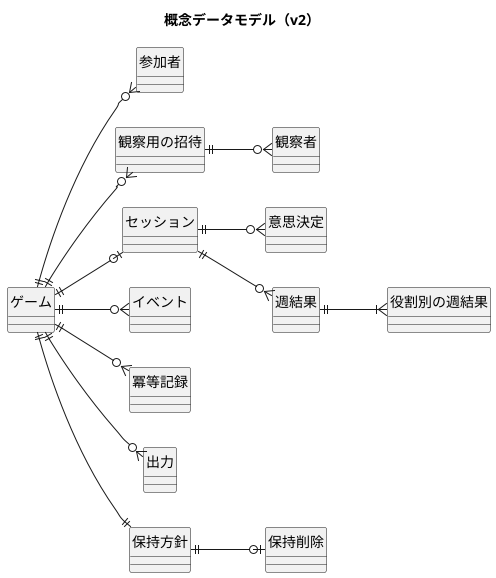
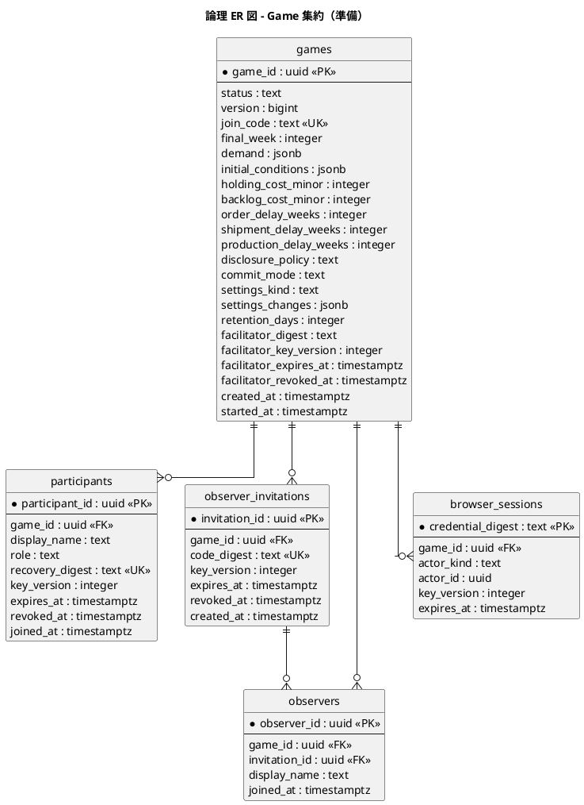
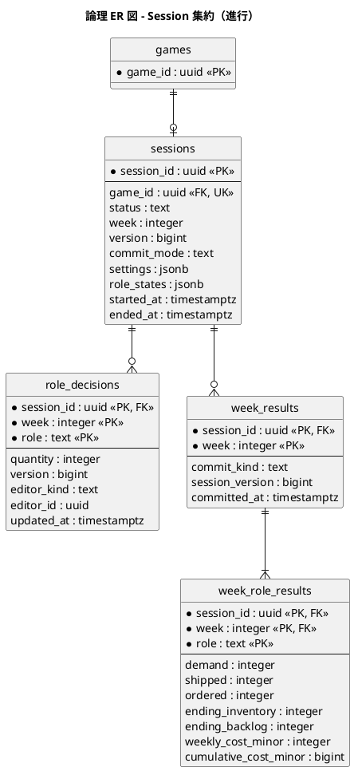
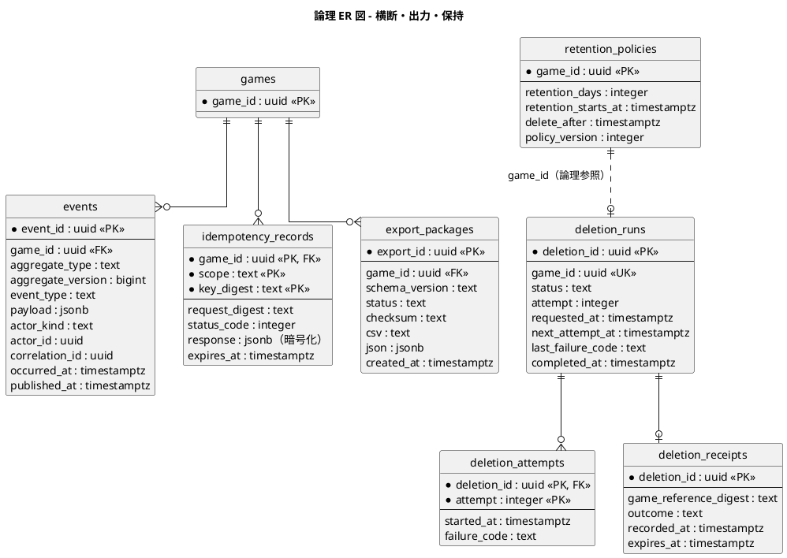

# データモデル設計 - ビールゲームシミュレーション（v2）

## 概要

本書は、beer-game2（v2）のデータモデルを、概念データモデルから論理データモデルへ段階的に定義します。**`docs/` を設計の正本**とします。

beer-game（v1）の [データモデル](../beer-game/data-model.md) を出発点に、[ドメインモデル（v2）](./domain-model.md) に合わせて**改訂**しました。データベースは PostgreSQL で、スキーマは SQL マイグレーションで管理します。

### v1 からの設計方針の変更

| # | v1 | v2 | 理由 |
| :--- | :--- | :--- | :--- |
| 1 | 週結果を JSONB（`week_results.result`）で保存し、投影はイベントから再構築する | **週結果を役割別の行（`week_role_results`）として保存**する。観察と振り返りは、SQL の問い合わせで返す | 役割別の振り返りと出力（FR-13、FR-14）を、単純で速い問い合わせにする。イベントからの再構築を無くす |
| 2 | `games` が設定・進行・参加者の全体を表す | `games`（準備）と `sessions`（進行）に分ける | 集約の分離（更新頻度と整合性の範囲） |
| 3 | `participants.role` は `(game_id, role)` で一意 | **一意制約を外す**。1 人の参加者は高々 1 つの役割 | 共同担当（FR-16） |
| 4 | 設定は最終週・需要・保持日数だけ | 初期条件、費用、遅延、公開範囲、確定方式を列で持つ。準拠かカスタムかを記録 | FR-01、BR-14 |
| 5 | 観察者の表が無い | `observers`、`observer_invitations` を追加 | FR-17 |
| 6 | 監査は、イベントと、未使用の `operation_audit` | **イベントを監査の記録とする**。`operation_audit` は作らない | 二重管理の排除 |
| 7 | 投影テーブルが 4 つ定義され、未使用 | 作らない。冪等・出力以外の読み取り専用の表は持たない | 未使用の定義の排除 |
| 8 | 削除対象に `outbox_events`、`idempotency_records` が漏れていた | **すべての表が `games` へ外部キー（`ON DELETE CASCADE`）を持ち、1 回の削除で漏れなく消える** | NFR-07、削除の網羅 |
| 9 | 保持削除の所有者別の表と、所有者別のキュー | 1 つのデータベースなので、削除は 1 トランザクション。Saga の表は簡素化 | 単純化（[アーキテクチャ](./architecture-backend.md)） |
| 10 | 冪等記録の保持が 30 日 | 24 時間（設計の要件 NFR2.6） | 保存と削除の範囲を小さく |

## 概念データモデル

| 概念エンティティ | 対応するドメイン概念 | 説明 |
| :--- | :--- | :--- |
| ゲーム、参加者、観察用の招待、観察者 | `Game` 集約 | 設定、参加者（役割の割り当てを含む）、観察用の招待、観察者 |
| セッション、意思決定、週結果、役割別の週結果 | `Session` 集約 | 進行状態、役割ごとの現在の意思決定、確定した週の結果（役割別） |
| イベント、冪等記録 | 横断 | 変更の履歴（監査）と、重複排除 |
| 出力 | 学習ビュー | CSV・JSON の成果物 |
| 保持方針、保持削除 | `RetentionSaga` | 期限と、削除の進行 |

## 論理データモデル

### ER 図（Game 集約）

### ER 図（Session 集約）

### ER 図（横断・出力・保持）

`retention_policies`、`deletion_runs`、`deletion_attempts`、`deletion_receipts` は、`games` へ外部キーを持ちません。ゲームを削除した後も、削除の証跡（受領記録）を一定期間残すためです。

### テーブル定義

#### Game 集約

| テーブル | 主キー | 主な制約 | 役割 |
| :--- | :--- | :--- | :--- |
| `games` | `game_id` | `status` は `PREPARING`・`STARTED`・`ENDED`。`join_code` 一意。`final_week` は 1〜50。`commit_mode` は `MANUAL`・`AUTO`。`settings_kind` は `KIT`・`CUSTOM`。遅延と単価は 0 以上。`disclosure_policy` は列挙 | ゲームの設定と状態。`settings_changes` に、準拠値から変えた項目を記録する。進行役の資格も、ここに持つ |
| `participants` | `participant_id` | `game_id` は外部キー（`CASCADE`）。`role` は 4 値または NULL。**`(game_id, role)` の一意制約は無い**。`recovery_digest` 一意 | 参加者。役割の割り当ては `role` 列。1 人の参加者は高々 1 つの役割 |
| `observer_invitations` | `invitation_id` | `game_id` は外部キー（`CASCADE`）。`code_digest` 一意 | 観察用の招待。失効は `revoked_at` |
| `observers` | `observer_id` | `game_id`、`invitation_id` は外部キー（`CASCADE`） | 観察者。役割を持たない |
| `browser_sessions` | `credential_digest` | `game_id` は外部キー（`CASCADE`）。`actor_kind` は `FACILITATOR`・`PARTICIPANT`・`OBSERVER` | ブラウザセッション（24 時間） |

開始後は、`games` の設定の列と、`participants.role` を変更しません（アプリで保証し、更新のトリガーまたは検査で守る）。

#### Session 集約

| テーブル | 主キー | 主な制約 | 役割 |
| :--- | :--- | :--- | :--- |
| `sessions` | `session_id` | `game_id` は外部キー（`CASCADE`）で一意（1 ゲーム 1 セッション）。`status` は `ACTIVE`・`PAUSED`・`ENDED`。`week > 0`、`version > 0` | 進行状態。`settings` に**設定の写し**、`role_states` に 4 役割の状態（在庫、受注残、待ち行列、累積費用）を JSONB で持つ |
| `role_decisions` | `(session_id, week, role)` | `session_id` は外部キー（`CASCADE`）。`quantity >= 0` と上限（検査）。`version > 0` | 現在の週の、役割ごとの意思決定。共同担当で共有し、`editor_*` に最後に保存した人を持つ。週確定でクリア（またはコミット済みとして履歴に残す） |
| `week_results` | `(session_id, week)` | `session_id` は外部キー（`CASCADE`）。`commit_kind` は `MANUAL`・`AUTO` | 確定した週。**一度だけ確定**されることを、主キーで守る |
| `week_role_results` | `(session_id, week, role)` | `(session_id, week)` は `week_results` への外部キー（`CASCADE`） | **役割別の週結果**。需要、出荷、発注、週末在庫、週末受注残、週次費用、累積費用 |

#### 横断・出力・保持

| テーブル | 主キー | 主な制約 | 役割 |
| :--- | :--- | :--- | :--- |
| `events` | `event_id` | `game_id` は外部キー（`CASCADE`）。`(aggregate_type, game_id, aggregate_version)` 一意 | ドメインイベントの追記専用の記録。**監査の記録を兼ねる**（操作者、入力値を含む）。通知・外部配信の状態も持つ |
| `idempotency_records` | `(game_id, scope, key_digest)` | `game_id` は外部キー（`CASCADE`）。応答は暗号化。`expires_at` は 24 時間後 | 冪等キーと応答の保存。ゲームの作成など、ゲームが無い操作は、作成後の `game_id` で保存する |
| `export_packages` | `export_id` | `game_id` は外部キー（`CASCADE`）。`status` は `PENDING`・`COMPLETE`・`FAILED` | CSV と JSON の成果物 |
| `retention_policies` | `game_id` | `retention_days` は 1〜3650、`delete_after > retention_starts_at` | 保持方針。期限で索引を持つ |
| `deletion_runs` | `deletion_id` | `game_id` 一意。`status` は `PENDING`・`IN_PROGRESS`・`FAILED`・`COMPLETED` | 削除の進行（簡素化。所有者別の進捗表は無い） |
| `deletion_attempts` | `(deletion_id, attempt)` | — | 試行履歴 |
| `deletion_receipts` | `deletion_id` | `game_reference_digest` は 64 文字。`expires_at > recorded_at` | 削除の証跡（ゲーム ID のダイジェストだけ）。1 年後に削除 |

ゲーム作成の冪等は、作成の要求（`scope='create'`）を、**ゲームの挿入と同じトランザクションで**、新しい `game_id` で保存します。同じ冪等キーの再送は、`(scope, key_digest)` の部分一意索引（`WHERE scope = 'create'`）で検索し、保存した応答（暗号化済み）を返します。これにより、`game_id` の外部キーを満たしたまま、作成前の重複を排除できます。

### 設計判断

#### 週結果を役割別の行にする

`week_role_results` を行で持つことで、次が単純になります。

- 振り返り: `SELECT … FROM week_role_results WHERE session_id=$1 ORDER BY week, role`（週 × 役割）
- 出力: 同じ問い合わせから、CSV と JSON を作る
- 観察: 確定済みの週の合計を `SUM` し、公開範囲と寄与者数で抑止する

v1 は、イベントの JSONB から投影を再構築しており、役割別の値が失われていました。v2 は、確定の瞬間に**役割別の行を同じトランザクションで保存**します（`sessions`、`week_results`、`week_role_results`、`events` を一括で）。

#### JSONB を使う範囲

- `games.demand`: 週ごとの需要の配列（検索しない）。
- `games.initial_conditions`: 役割ごとの初期在庫と待ち行列の初期値。
- `sessions.role_states`: 4 役割の状態（待ち行列は可変長）。計算の入出力をそのまま保存できる。
- `events.payload`: イベント本文（スキーマ版つき）。

#### 設定の写し

`sessions.settings` に、開始時の設定の写しを持ちます。`Session` は、開始後に `games` を参照せずに、週を確定できます（[ドメインモデル](./domain-model.md)）。

#### 版と冪等性

- `games.version`、`sessions.version` は、楽観的排他の版です。更新は `WHERE version = $expected` で行い、行数 0 を競合とします。
- `role_decisions.version` は、共同担当の競合の検出に使います（古い版の更新は、行数 0 で拒否し、最新値と最後の保存者を返す）。
- 週確定は、`week_results` の主キーにより、同じ週の二重の確定を、データベースでも防ぎます。
- 冪等記録は、リクエストのダイジェストと暗号化した応答を保存し、24 時間で期限切れにします。

#### 削除の網羅

すべての表が `games(game_id)` への外部キー（`ON DELETE CASCADE`）を持つため、**`DELETE FROM games WHERE game_id = $1` の 1 回で、関連するデータがすべて消えます**（`sessions` 経由の `role_decisions`、`week_results`、`week_role_results` も連鎖）。削除の網羅は、次のテストで確認します。

> 削除の完了後に、`game_id` 列を持つ**すべての表**に、そのゲームの行が残らない（表の一覧は、`information_schema` から取得して検査する）。

保持と削除の表（`retention_policies`、`deletion_*`）は、証跡のために `games` を参照しない設計です。`game_id` の生の値は、受領記録に残さず、ダイジェストだけを持ちます。

### インデックス（主なもの）

| 表 | 索引 | 目的 |
| :--- | :--- | :--- |
| `games` | `join_code`（一意） | 参加コードでの検索 |
| `participants` | `(game_id)`、`recovery_digest`（一意） | ロビーの一覧、復帰 |
| `observer_invitations` | `code_digest`（一意） | 招待での参加 |
| `browser_sessions` | `(game_id, expires_at)` | 期限切れの掃除 |
| `events` | `(game_id, aggregate_type, aggregate_version)`、`published_at IS NULL` の部分索引 | 配信、通知の再送 |
| `idempotency_records` | `(expires_at)` | 期限切れの掃除 |
| `retention_policies` | `(delete_after, game_id)` | 期限到来の検出 |
| `deletion_runs` | 再試行の予定の部分索引 | 再試行 |

## ドメインモデルとの対応

| ドメイン | テーブル | 備考 |
| :--- | :--- | :--- |
| `Game` 集約 | `games`、`participants`、`observer_invitations`、`observers`、`browser_sessions` | 準備中の操作 1 回 = 1 トランザクション |
| `Session` 集約 | `sessions`、`role_decisions`、`week_results`、`week_role_results` | 進行の操作 1 回 = 1 トランザクション |
| ドメインイベント | `events` | 監査の記録を兼ねる |
| 共同担当の不変条件 | `participants.role`（一意制約なし）、`role_decisions` の主キー | 役割ごとに意思決定は 1 件 |
| 週確定の一回性 | `week_results` の主キー | データベースでも守る |
| `RetentionSaga` | `retention_policies`、`deletion_*` | 削除は 1 トランザクション（カスケード） |
| 出力 | `export_packages` | 学習ビューの成果物 |

## v1 からの変更の要約

v1 の差分（[データモデル（v1）](../beer-game/data-model.md) の差分表）への対応です。

| v1 の差分 | v2 での対応 |
| :--- | :--- |
| #1 `recovery_credentials`、`operation_audit` が未使用 | 作らない。復帰資格は `participants`、監査は `events` |
| #2 投影テーブルが未使用で、取得のたびにイベント全件から再構築 | 投影テーブルを作らず、`week_role_results` への SQL で返す |
| #3 削除で `outbox_events`、`idempotency_records` が漏れる | すべての表に `ON DELETE CASCADE` の外部キーを持たせ、網羅をテストする |
| #4 削除の順序の依存 | 1 トランザクションで消すため、順序の問題は無い |
| #6 数量の上限が DB の `CHECK` に無い | `CHECK` を持たせる（上限は設定の値と整合させる） |

## 未決事項

- マイグレーションの管理ツールと、適用の自動化（[技術スタック](./tech-stack.md) で決める）。履歴テーブルで管理し、拡張 → 互換 → 縮小の順に適用する。
- 数量の上限を、`CHECK`（固定値）にするか、設定の値と照合する検査にするか。
- `role_decisions` を、確定後に削除するか、履歴として残すか（`week_role_results.ordered` が確定値を持つため、削除でよい見込み）。
- `events` の保持と、ゲームの削除前の長期の分析の要否。

## 出典

- [ドメインモデル設計（v2）](./domain-model.md)、[要件定義](../../requirements/beer-game2/requirements_definition.md)
- v1 の [データモデル設計](../beer-game/data-model.md)、`apps/beer-game/migrations/001`〜`005`
- [ADR-001](../../adr/beer-game2/001-rebuild-as-beer-game2.md)
