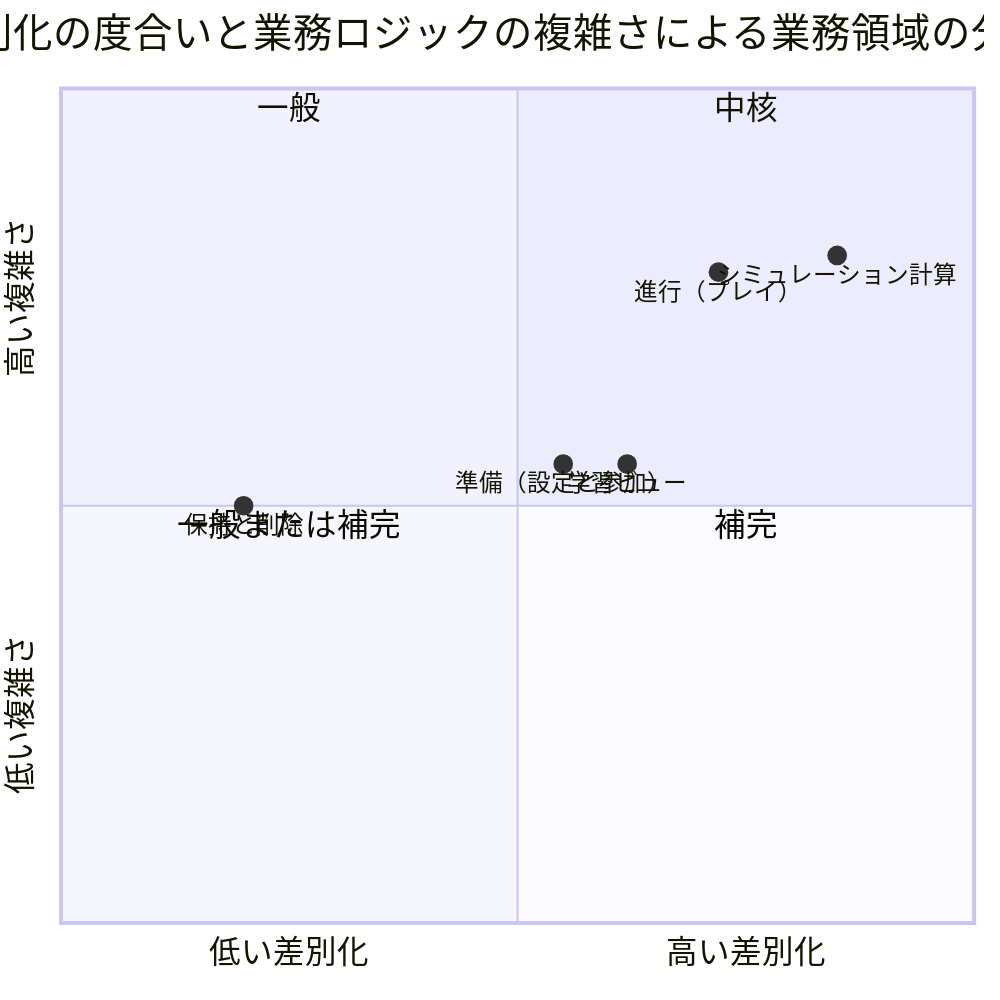
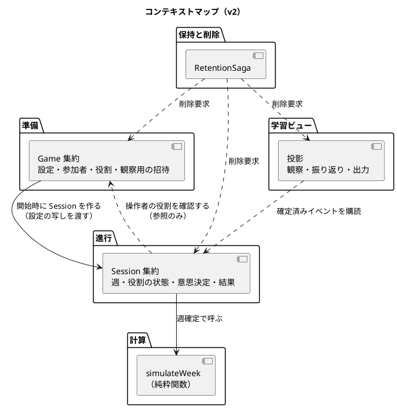
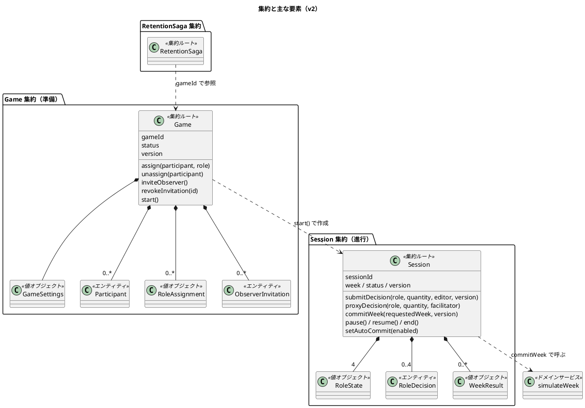
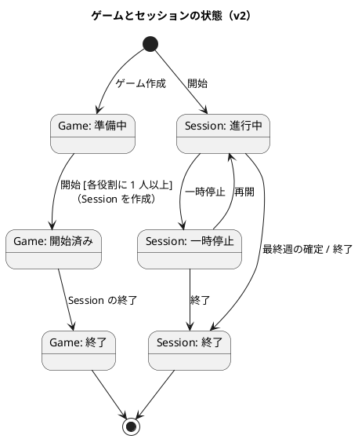
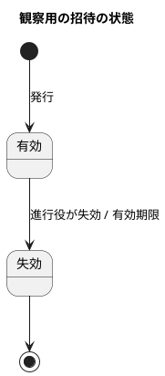

# ドメインモデル設計 - ビールゲームシミュレーション（v2）

## 概要

本書は、beer-game2（v2）のドメインモデルを、DDD の戦術的設計パターン（エンティティ・値オブジェクト・集約・ドメインサービス）で定義します。**`docs/` を設計の正本**とします。

beer-game（v1）の [ドメインモデル](../beer-game/domain-model.md) を出発点に、次の 2 点を反映して**改訂**しました。

- v2 の範囲: 同一役割の共同担当（FR-16）、カスタム条件（FR-01）、観察者の独立した立場（FR-17）、週の自動確定（FR-18）
- v1 の設計上の差分: ルールがサービスに集中し、集約が振る舞いを持たなかったこと。週の確定結果に役割別の値が無かったこと。削除対象に漏れがあったこと

入力は [要件定義](../../requirements/beer-game2/requirements_definition.md)（BR-01〜BR-17）、[システムユースケース](../../requirements/beer-game2/system_usecase.md)、[ユーザーストーリー](../../requirements/beer-game2/user_story.md) です。

### 設計の前提と原則

- 学習用シミュレーションであり、勝敗の判定ではなく「構造が振る舞いを生む」ことの体験が目的です。
- 参加者はアカウントを作らず、参加コードと表示名で参加します。観察者は観察用の招待で参加します。
- 週次の計算は決定論的で、同じ入力から同じ結果を返します。
- プレイ中は役割ごとに見える情報を制限し、終了後に全役割の時系列を開示します。
- **ルールは集約が持ちます。** アプリケーションサービスは、集約の読み込み、呼び出し、保存だけを行い、業務ルールを持ちません（v1 の `GameService` への集中を解消します）。
- 集約は、トランザクション整合性が必要な最小の範囲にします。他の集約へは、識別子で参照します。

## 戦略的設計

### 境界付けられたコンテキストの分類

| コンテキスト | 分類 | 理由 | 集約・主な要素 |
| :--- | :--- | :--- | :--- |
| シミュレーション計算 | 中核 | JSD 改訂版キットの 12 ステップと遅延を忠実に再現することが教材価値そのもの | 純粋なドメインサービス（`simulateWeek`） |
| 進行（プレイ） | 中核 | 4 役割の意思決定を揃えて週を一度だけ確定する整合性。共同入力と自動確定がここにある | `Session` 集約 |
| 準備（設定と参加） | 補完 | カスタム条件、参加者・共同担当・観察者の管理。規則は多いが、更新頻度は低い | `Game` 集約 |
| 学習ビュー | 補完 | 開示範囲（逆算で個別値が漏れない集計）に固有のルールがある。役割別の時系列を持つ | 読み取りモデル（投影） |
| 保持と削除 | 一般 | 期限後の一括削除と再試行は一般的な仕組み | `RetentionSaga` 集約 |

v1 は、準備と進行を 1 つの `Game` 集約に入れていました。v2 では、**更新の頻度と整合性の範囲が異なる**ため、`Game`（準備）と `Session`（進行）に分けます。

### コンテキストマップ

- 実線は、同期の呼び出しです。点線は、イベントまたは参照です。
- `Session` は、開始時に設定の**写し**を持ち、以後は `Game` に依存せずに週を確定できます（設定は開始後に変更しません）。
- 操作者が持つ役割は、`Game` の割り当てを参照して確認します（読み取りのみ。開始後は、割り当てを変更しません）。

## ユビキタス言語

v1 の用語に、v2 で加わったものを太字で示します。

| 用語 | 英語（コード上の名称） | 定義 |
| :--- | :--- | :--- |
| ゲーム | Game | 1 回のシミュレーション実施単位。設定、参加者、役割の割り当てを持つ |
| 進行役 | Facilitator | ゲームを作成し、役割割当て・開始・週確定・停止・終了を行う人 |
| 参加者 | Participant | 表示名で参加する人。役割を 1 つ割り当てられる |
| **共同担当** | Co-assignment | 同じ役割に割り当てられた複数の参加者。1 つの意思決定値を共有して入力する |
| 役割 | Role | サプライチェーン上の位置。工場・一次卸・二次卸・小売店 |
| **観察者** | Observer | 役割を持たず、読み取り専用で観察する人。観察用の招待で参加する |
| **観察用の招待** | Observer Invitation | 観察者が参加するための、参加コードと別の招待。有効期間と失効を持つ |
| ゲーム設定 | Game Settings | 終了週、需要系列、初期条件、費用、公開範囲、確定の方式 |
| **カスタム条件** | Customization | キット準拠値から変更した設定。「カスタム」としてゲームに記録する |
| **公開範囲** | Disclosure Policy | プレイ中に観察者へ見せる情報の範囲 |
| セッション | Session | ゲームの進行状態（週・状態・版・役割の状態・意思決定）を持つ実行単位 |
| 顧客需要 | Demand | 小売店にだけ届く外生の週次需要。系列として事前に決まる |
| 週 | Week | 1 から始まる進行単位。4 役割の意思決定が揃って初めて確定する |
| 意思決定 | Decision | 当週の発注数、または工場の生産要請数。**役割ごとに 1 件**（共同担当で共有） |
| 代理入力 | Proxy Decision | 進行役が参加者に代わって入力する意思決定。入力値を履歴に残す |
| 週確定 | Commit Week | 4 役割の意思決定から次週の状態を計算して確定する操作。一度だけ成立する |
| **自動確定** | Auto Commit | 進行役が有効にした場合、4 役割の入力がそろった時点でシステムが週確定を行う方式 |
| **週結果** | Week Result | 週確定の結果。**役割別の**需要・出荷・発注・週末在庫・週末受注残・週次費用を持つ |
| 在庫 | Inventory | 週末時点で手元にある数量 |
| 受注残 | Backlog | 出荷できず次週以降に持ち越す未充足の受注 |
| 注文遅延・配送遅延・生産遅延 | Order / Shipment / Production Delay | 注文・出荷・生産要請が届くまでの遅れ（週単位。カスタム条件で変更できる） |
| 週次費用 | Weekly Cost | 週末在庫 × 在庫単価 + 週末受注残 × 受注残単価（最小単位で保持） |
| 参加コード | Join Code | 参加者がゲームに参加するための 8 桁のコード |
| 復帰資格 | Recovery Credential | ブラウザを閉じた参加者・進行役が戻るための、推測困難な資格。有効期限と失効を持つ |
| 保持期間 | Retention | ゲームの記録を保持する日数。期限後に削除する |
| 観察 | Observation | プレイ中に観察者へ見せる、逆算できないチーム合計 |
| 振り返り | Review | 終了後に開示する全役割の時系列 |

## 戦術的設計

### 全体像

### 値オブジェクト

不変で、属性値が同じなら同じものとして扱います。生成時に検証し、不正な値が存在できないようにします。

| 値オブジェクト | 属性・制約 |
| :--- | :--- |
| 役割（Role） | FACTORY、DISTRIBUTOR、WHOLESALER、RETAILER。上流から下流の順序を持つ |
| 数量（Quantity） | 0 以上の整数、上限あり（既定 1000）。発注数・生産要請数 |
| 週（Week） | 1 から最終週まで（1〜50） |
| 金額（Money） | 最小単位（整数）。在庫単価・受注残単価・週次費用 |
| 需要系列（DemandSeries） | 各週の顧客需要。0 以上の整数で、長さは最終週以上 |
| 遅延（Delay） | 週数（0 以上の整数）。注文、配送、生産ごと。キットの既定は 2（生産は 2 段階） |
| 初期条件（InitialConditions） | 各役割の初期在庫、初期の注文・配送・生産の待ち行列。既定はキット準拠（在庫 12、各段 4） |
| 費用方針（CostPolicy） | 在庫単価、受注残単価。既定は 0.50 と 1.00 |
| 公開範囲（DisclosurePolicy） | プレイ中に観察者へ見せる範囲。既定はチーム合計（寄与者が 2 未満なら非表示） |
| 確定方式（CommitMode） | MANUAL（既定）または AUTO |
| ゲーム設定（GameSettings） | 上記の組。**キット準拠か、カスタムか**を導出して保持する（`kind` と、変更された項目の一覧） |
| 役割の割り当て（RoleAssignment） | 参加者 ID と役割の組。1 人の参加者は、高々 1 つ |
| 役割状態（RoleState） | 在庫、受注残、注文・配送・生産の待ち行列、累積費用 |
| 役割別の週結果（RoleWeekResult） | 役割ごとの需要（受注）、出荷、**発注（その週の意思決定）**、週末在庫、週末受注残、週次費用、累積費用 |
| 週結果（WeekResult） | 週と、4 つの役割別の週結果 |
| 表示名（DisplayName） | 前後の空白を除いて 1〜80 文字 |
| 参加コード・観察用の招待コード（JoinCode、InvitationCode） | 推測困難な乱数から作る（8 桁以上）。**2 つは別の値** |
| 資格ダイジェスト（CredentialDigest） | 生の資格を保存せず、鍵付き HMAC のダイジェストと**鍵の版**だけを保持する |
| 資格の有効性（CredentialValidity） | 発行時刻、有効期限、失効時刻。有効か、失効か、期限切れかを返す |
| 保持方針（RetentionPolicy） | 保持日数 1〜3650（既定 90）、保持開始、削除期限、方針の版 |
| 版（Version） | 楽観的排他のための、単調に増える整数 |
| 冪等キー（IdempotencyKey） | 重複実行の防止。同じキーで内容が違えば競合 |

### エンティティ

| エンティティ | 識別子 | 属するもの | 主な属性・ライフサイクル |
| :--- | :--- | :--- | :--- |
| ゲーム（Game） | gameId | Game 集約のルート | 設定、状態（準備中 → 開始済み → 終了）、版、保持日数。作成 → 削除 |
| 参加者（Participant） | participantId | Game 集約 | 表示名、復帰資格（ダイジェスト、有効性）。参加 → 役割の割り当て → 復帰（資格を更新） |
| 観察用の招待（ObserverInvitation） | invitationId | Game 集約 | 招待コード（ダイジェスト）、有効性、状態（有効 → 失効）。発行 → 失効 |
| セッション（Session） | sessionId | Session 集約のルート | 週、状態（進行中・一時停止・終了）、版、設定の写し、確定方式。開始 → 終了 |
| 意思決定（RoleDecision） | （sessionId、週、役割） | Session 集約 | 数量、版、**最後に保存した参加者**。入力・変更 → 週確定でクリア |
| 保持削除（RetentionSaga） | deletionId | RetentionSaga 集約のルート | ゲーム、状態、試行回数、所有者ごとの状態 |

進行役の資格は、`Game` が持ちます（ゲームの作成時に発行し、有効期限と失効・再発行を持つ）。

### 集約

#### Game 集約（準備）

集約ルートは `Game` で、設定、参加者、役割の割り当て、観察用の招待を所有します。トランザクション境界は 1 回の操作（作成、参加、割り当て、招待、開始）です。

| 不変条件 | 内容 | 根拠 |
| :--- | :--- | :--- |
| 設定の妥当性 | 最終週 1〜50、需要系列の長さは最終週以上、各値と単価は範囲内。準拠値から変えたら「カスタム」として記録する | BR-13、BR-14 |
| 参加の受付 | 準備中の間だけ、参加と割り当てを受け付ける | 状態モデル |
| 役割の割り当て | 1 人の参加者は高々 1 つの役割。**1 つの役割に複数の参加者を割り当てられる** | FR-16、BR-15 |
| 開始条件 | 4 役割のそれぞれに、1 人以上が割り当てられている | UC-04 |
| 観察用の招待 | 参加コードと別の値。失効したら、新しい参加に使えない。観察者は、役割を持てない | FR-17、BR-17 |
| 設定の固定 | 開始後は、設定と役割の割り当てを変更しない | — |
| 権限 | 割り当て、招待、開始は進行役だけ | — |

**開始**は、`Game` の状態を「開始済み」にし、同じトランザクションで `Session` を作成します（`Game` の設定の写しを渡す）。これは、2 つの集約をまたぐ、**例外的な同一トランザクション**です（開始の一回性を保つため）。

#### Session 集約（進行）

集約ルートは `Session` で、週、4 つの役割状態、意思決定、週結果の履歴を所有します。**ルールは `Session` が持ち**、サービスは持ちません。

| 不変条件 | 内容 | 根拠 |
| :--- | :--- | :--- |
| 意思決定の条件 | 進行中のときだけ、0〜上限の整数を、役割ごとに 1 件保存できる | BR-10 |
| 共同入力 | 同じ役割の意思決定は、1 つの値と 1 つの版を、共同担当で共有する。**版が古い更新は拒否し、最新値と最後の保存者を返す**（変更を黙って失わない） | FR-16、BR-15 |
| 代理入力 | 進行役だけが、任意の役割へ入力できる。**入力値、操作者、時刻を、イベントに残す** | FR-15 |
| 週確定の条件 | 4 役割の意思決定が揃うまで確定できない | BR-12 |
| 週確定の一回性 | 要求された週と版が現在と一致する場合だけ確定し、同じ冪等キーでは同じ結果を返す | FR-09 |
| 週確定の結果 | **役割別の週結果**（需要、出荷、発注、在庫、受注残、費用）を、履歴に追加する | FR-13、FR-14 |
| 自動確定 | 確定方式が AUTO で、進行中のときだけ、**最後の意思決定を保存した同じトランザクション内で**、週確定を行う。一時停止中は確定しない。再開時に、揃っていれば確定する | FR-18、BR-16 |
| 終了 | 最終週を確定すると、自動で終了する。終了後は、入力と確定を拒否する | 状態モデル |
| 権限 | 意思決定は、その役割の参加者だけ。確定、停止、再開、終了、確定方式の変更は進行役だけ | — |

自動確定を、最後の意思決定の保存と**同じトランザクション内**で行うため、「入力がそろったあと、確定の前に、別の人が変更する」という隙間は生じません（手動の確定は、進行役が揃った入力を確認して行う）。手動の確定と、自動確定が同時に起きても、`Session` の版により、確定は一度だけです。

#### RetentionSaga 集約（保持と削除）

v1 を引き継ぎます（[ADR-008](../../adr/beer-game/008-retention-saga.md)）。期限に達したゲームごとに、所有者単位の削除要求を発行し、全所有者が完了した場合だけ完了とします。**v2 では、所有者に、`Game`、`Session`、イベントと冪等記録、学習ビューのすべてを含め、削除後にゲームの ID を含むデータが残らないことを不変条件**とします（v1 の削除対象の漏れの解消）。

### ドメインサービス

| サービス | 責務 | 入力 → 出力 | 特徴 |
| :--- | :--- | :--- | :--- |
| 週次計算（`simulateWeek`） | 12 ステップと遅延に従い、在庫・受注残・出荷・遅延・費用を計算する。**役割別の週結果を返す** | 前週の断面、4 役割の意思決定、設定 → 次週の断面、週結果 | 純粋関数。永続化・時刻・通信・認可に依存しない。遅延の週数は設定から受ける |
| 開示判定（`DisclosurePolicy`） | 確定済みの記録から、公開範囲に応じて、逆算できない集計だけを公開する | 週結果、公開範囲 → 観察用の投影 | 寄与者が 2 未満の週は抑止する。役割別の値は、終了後だけ開示する |
| キット準拠の判定（`KitPreset`） | 設定がキット準拠か、カスタムかを判定し、変更項目を列挙する | ゲーム設定 → 種別、変更項目 | 純粋関数 |

### 状態

### ドメインイベント

すべてのイベントは、集約の版、相関 ID、スキーマ版を持ちます。**監査の記録は、イベントそのものとして残し**（専用の別テーブルは作らない）、操作者と入力値を含めます。

| イベント | 集約 | 発行契機・主なデータ |
| :--- | :--- | :--- |
| GameCreated | Game | ゲーム作成（設定の種別: キット準拠 / カスタム、確定方式） |
| ParticipantJoined | Game | 参加 |
| RoleAssigned、RoleUnassigned | Game | 役割の割り当て・解除（参加者、役割） |
| ObserverInvited、ObserverInvitationRevoked | Game | 観察用の招待の発行・失効 |
| CredentialRevoked、CredentialReissued | Game | 資格の失効・再発行（進行役、参加者） |
| GameStarted | Game | 開始 |
| SessionStarted、SessionPaused、SessionResumed、SessionEnded | Session | 進行状態の遷移 |
| DecisionSaved | Session | 意思決定の保存（役割、数量、保存者、版） |
| ProxyDecisionSubmitted | Session | 代理入力（役割、数量、進行役） |
| AutoCommitChanged | Session | 確定方式の変更（進行役） |
| WeekCommitted | Session | 週確定（**役割別の週結果**、確定の方式: 手動 / 自動、寄与者数） |
| ParticipationRecovered | Game | 復帰 |

## v1 からの変更

| # | v1 の設計・実装 | v2 の設計 | 関連 |
| :--- | :--- | :--- | :--- |
| 1 | `Game` 集約に、設定・参加者・セッション・意思決定・結果を全て含む | `Game`（準備）と `Session`（進行）に分ける。進行の更新が、準備のロックを取らない | 更新頻度と整合性の範囲 |
| 2 | ルールが `GameService` に集中し、集約は振る舞いを持たない | ルールは集約（`Game`、`Session`）が持つ。サービスは、読み込み・呼び出し・保存だけ | 貧血なドメインモデルの解消 |
| 3 | 1 役割 1 人。二人目は拒否 | 1 役割に複数の参加者。意思決定は、役割ごとに 1 件を共有し、版で競合を検出する | FR-16、BR-15 |
| 4 | 週確定のイベントが、全役割の合計だけを持つ | 役割別の週結果（需要、出荷、発注、在庫、受注残、費用）を持つ | FR-13、FR-14（最優先） |
| 5 | 設定は、最終週・需要系列・保持日数だけ。「カスタム」は画面の区別だけ | 初期条件、費用、遅延、公開範囲、確定方式を持つ設定。準拠か、カスタムかを、導出して記録する | FR-01、BR-14 |
| 6 | 観察者の立場が無い | 観察用の招待（`ObserverInvitation`）と、観察者の権限（読み取り専用） | FR-17、BR-17 |
| 7 | 進行役の確定操作だけ | 確定方式（MANUAL / AUTO）。自動確定は、最後の意思決定と同じトランザクションで行う | FR-18、BR-16 |
| 8 | 代理入力の履歴に値が残らず、監査テーブルは使われない | イベントに入力値を含め、イベントを監査の記録とする | FR-15、NFR-09 |
| 9 | 資格に有効性の概念が散在（進行役は期限なし） | 資格の有効性（期限、失効）を値オブジェクトにし、進行役の資格も失効・再発行できる | NFR-06 |
| 10 | 削除対象に `outbox_events`、`idempotency_records` が無い | 削除後にゲームの ID を含むデータが残らないことを、不変条件とする | NFR-07 |

## 設計判断と未決事項

### 設計判断

- 準備と進行を、別の集約に分ける。開始だけが、2 つの集約をまたぐ（同一トランザクション）。
- 共同入力は、**版による楽観的排他**とし、投票や自動の統合はしない（ASM-04）。後から更新した人は、拒否され、最新値と保存者を見て再入力する。
- 自動確定は、最後の意思決定の保存と同じトランザクションで行う。猶予の時間は設けない。
- 監査は、専用のテーブルではなく、イベントに残す。
- 設定の種別（キット準拠 / カスタム）は、設定から導出し、変更項目と一緒に記録する。

### 未決事項

- 開始後に、共同担当の参加者を**追加**できるか（v1 は、開始後の参加を拒否）。当面は、準備中だけとする。
- 観察用の招待の有効期間の既定値と、観察者の人数の上限。
- 遅延の週数のカスタム範囲（0〜何週まで）と、待ち行列の初期値の決め方。
- 自動確定に、猶予（例: 数秒）を設けるか。設けると、入力の訂正の余地が生まれるが、確定が遅れる。

## 出典

- [要件定義](../../requirements/beer-game2/requirements_definition.md)、[システムユースケース](../../requirements/beer-game2/system_usecase.md)、[ユーザーストーリー](../../requirements/beer-game2/user_story.md)
- v1 の [ドメインモデル](../beer-game/domain-model.md)、[データモデル](../beer-game/data-model.md)、[ADR](../../adr/beer-game/index.md)
- `aidlc/spaces/default/intents/261027-beer-game-development/inception/domain-design/`
- [ADR-001](../../adr/beer-game2/001-rebuild-as-beer-game2.md)
