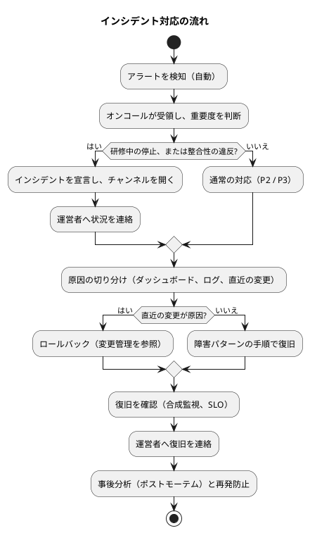
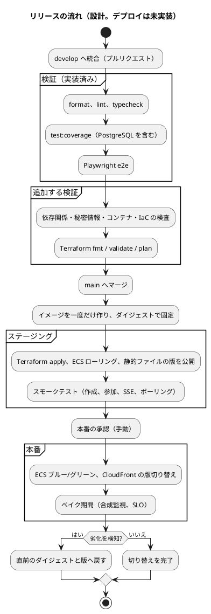

# 運用要件定義 - ビールゲームシミュレーション（v2）

> **beer-game2（v2）の出発点**: 本書は beer-game（v1）の文書を複製したものです。v2 で改訂します。表中の「実装状況」「現状」は **v1 の状態**を表し、不足は v2 で解消する対象です。詳細は [ADR-001](../../adr/beer-game2/001-rebuild-as-beer-game2.md) を参照してください。

## 概要

本書は、ビールゲームシミュレーションを本番で運用するための要件を、運用フロー、監視、バックアップ、障害対応、変更管理の順に定義します。**`docs/` を正本**とし、次を統合しました。

- [非機能要件定義](./non-functional.md)（SLO、RPO/RTO、監視の閾値）と [インフラストラクチャアーキテクチャ](./architecture-infrastructure.md)
- `aidlc/` の Unit ごとの監視・CI/CD・インフラ設計（`construction/*/infrastructure-design/`）
- 実装と設定の確認結果（`infra/main.tf`、`.github/workflows`、`src`）

運用の体制、通知先、連絡先は、**組織に依存するため未決定**です。本書では、決めるべき項目として「要確認」にしています。

### 凡例

| 記号 | 意味 |
| :---: | :--- |
| ✓ | 実装または設定があり、確認した |
| △ | 一部のみ |
| ✗ | 未実装・未整備 |

## 運用の前提

| 項目 | 内容 |
| :--- | :--- |
| 利用の形態 | 研修・授業のセッション（数十分〜数時間）。同時に進行するゲームは最大 15（拡張目標 25）。常時の高負荷は無い |
| 重視する時間帯 | 研修の実施中。**運営者が事前に実施日時を運用側へ伝える仕組みが必要**（SLO の「宣言された時間帯」。U1 NFR2.2） |
| 運用の主体 | 運営者（進行役の所属組織）と、システムの運用担当（プラットフォーム、アプリケーション）。体制は要確認 |
| 守るべき資産 | 確定済みの週の記録（RPO 0）、資格、保持期間内のゲームの記録 |
| 主な SLO | 月間可用性 99.5%、研修中の完全停止を 1 分以内に検知、RTO 15 分、RPO 0（[非機能要件](./non-functional.md)） |

## 運用フロー

運用は、自動化を前提にします。手動の作業は、判断が要るものと、年次のものに限ります。

| 周期 | 作業 | 主体 | 自動化 | 現状 |
| :--- | :--- | :--- | :--- | :---: |
| 常時 | ヘルスチェック、アラートの通知 | 自動 | ALB のヘルスチェック、CloudWatch のアラーム | △（アラームは ALB の接続数 1 件） |
| 研修の前 | 実施日時の連絡を受け、直前の合成監視（作成から参加、SSE まで）で正常を確認する | 運用担当 | 合成監視を自動化 | ✗ |
| 研修の中 | アラートに即応できる状態にする（オンコール） | 運用担当 | — | ✗（体制が未定義） |
| 日次 | ダッシュボードで、エラー率、応答時間、削除 Saga の滞留（`oldest due age`）、DLQ の件数を確認する | 運用担当 | アラートで代替 | ✗ |
| 日次 | コストの確認（予算の 80% 実績、100% 予測の通知） | 自動 | AWS Budgets | ✓ |
| 週次 | 失敗した削除 Saga と、DLQ の確認。失敗があれば、原因を調べ、再試行する | 運用担当 | 失敗時の通知 | ✗ |
| 月次 | SLO のレポート（可用性、p95、削除の SLO）、容量のレビュー、依存関係の更新とセキュリティのパッチ | 運用担当 | レポートを自動生成 | ✗ |
| 四半期 | 復元の訓練（時点復旧）。学習ビューの再構築の訓練 | 運用担当 | 手順をスクリプト化 | ✗ |
| 年次 | 鍵のローテーション、権限の棚卸し、ランタイムのサポート期限の確認（Node 22 は 2027-04-30）、監査への対応 | 運用担当、セキュリティ責任者 | — | ✗ |
| 随時 | リリースとロールバック（変更管理を参照） | 開発・運用 | CI/CD | ✗（デプロイが未実装） |

## 監視設計

### 監視項目と閾値

閾値は、[非機能要件](./non-functional.md) の数値と、`aidlc/` の監視設計から導きます。両者に無い値（Warning の一部、セキュリティの倍率）は、**提案**です。**警告（Warning）は担当者の確認、重大（Critical）は即時の対応**です。アラート疲れを避けるため、対応が必要なものだけを通知にします。

| 区分 | 監視項目 | Warning | Critical | 情報源 | 現状 |
| :--- | :--- | :--- | :--- | :--- | :---: |
| 可用性 | 研修中の主要な操作（作成、参加、確定）の成功 | — | 1 分間、成功が無い | 合成監視 | ✗ |
| 可用性 | 5xx の割合 | 1% 超（5 分） | 5% 超（1 分） | ALB、アプリ | ✗ |
| 性能 | API の応答（p95） | 800 ms 超（5 分） | 1 秒超（5 分） | ALB、アプリ | ✗ |
| 性能 | 週確定から画面反映（p95） | 1.5 秒超（5 分） | 2 秒超（5 分） | 合成ブラウザ | ✗ |
| 性能 | SSE の切断・ポーリング切替の割合 | 5% 超（5 分） | 10% 超（5 分） | アプリ、ALB | ✗ |
| 整合性 | 週結果の重複、不変条件の違反、イベントの欠落 | — | 1 件でも発生 | アプリのメトリクス | ✗ |
| 配信 | アウトボックスと SSE の遅延（p95） | 1 秒超（5 分） | 5 秒超（5 分） | アプリ | ✗ |
| データベース | CPU、接続プールの使用率 | 70% 超 | 80% 超（10 分） | RDS、アプリ | ✗ |
| データベース | フェイルオーバー、バックアップの失敗 | — | 発生 | RDS イベント | ✗ |
| 容量 | ECS タスクの CPU | 60% 超（自動増減の目標） | 80% 超（10 分） | ECS | △（自動増減は設定済み） |
| 削除 | 期限超過の削除の経過時間 | 18 時間 | 24 時間 | Saga のクエリ | ✗ |
| 削除 | SQS の最古メッセージの経過時間、DLQ の件数 | 15 分 / — | 30 分 / 1 件以上 | CloudWatch | ✗ |
| 削除 | 削除の恒久的な失敗（FAILED） | — | 発生から 5 分以内に通知 | アプリ | ✗ |
| セキュリティ | Origin 拒否、認証失敗の急増 | 平常の 3 倍（提案） | 平常の 10 倍（提案） | アプリ | ✗ |
| コスト | 月次の予算 | 実績 80% | 予測 100% | AWS Budgets | ✓（この 2 つを設定済み） |

### ヘルスチェック

| 種類 | 内容 | 現状 |
| :--- | :--- | :---: |
| 生存（liveness） | プロセスが応答する | ✓（`GET /health` が `{"status":"ok"}`） |
| 準備（readiness） | データベースに接続できる（`SELECT 1`）。通らないタスクは ALB の対象から外れる | ✗（`/health` はデータベースを確認しない） |

現状の `/health` は、データベースが落ちていても「正常」を返すため、ALB はデータベース障害を検知できません。準備のチェックを加える必要があります（要承認: 本番の挙動に影響する）。

### ログと追跡

| 項目 | 要件 | 現状 |
| :--- | :--- | :---: |
| アプリのログ | 構造化 JSON（相関 ID、操作、結果、版、所要時間）。資格、表示名、非公開の値を含めない | ✗（**出力が無い**。[非機能要件](./non-functional.md) の差分 #1） |
| 集約と保持 | 暗号化した CloudWatch Logs。本番 90 日、その他 14 日 | △（ロググループは作成済み） |
| 追跡 | 相関 ID を HTTP、トランザクション、アウトボックス、SSE に伝える | △（応答とイベントには付く） |
| 監査 | 設定、役割変更、代理入力、週確定、停止、再開、終了、保持の再試行 | △（イベントのみ） |

### ダッシュボード

次を 1 つの画面で見られるようにします（現状は未整備）: リクエスト量・応答時間・エラー、進行中のゲーム数と SSE の接続数、確定の成功・競合・ロールバック、アウトボックスの遅延、DB の状態、SLO の消費、削除の状況（現在と 30 日の推移）。

## アラートとエスカレーション

| 重要度 | 定義 | 通知 | 対応の目標 |
| :--- | :--- | :--- | :--- |
| P1（重大） | 研修中の停止、データの整合性の違反、削除の恒久的な失敗、バックアップの失敗 | 即時にオンコールを呼び出す。インシデントのチャンネルを開く | 5 分以内に着手（提案） |
| P2（高） | 性能の劣化、配信の遅延、削除の遅れ | 担当チャンネルへ通知する | 研修中は 15 分、それ以外は翌営業日（提案） |
| P3（中） | 予算、容量の予兆 | 担当者へ通知する | 週次で確認 |

**要確認**: 現状の通知先は、SNS のメール（`ops_alert_email`）だけです。オンコールの当番、呼び出しの手段、インシデントのチャンネル、運営者への連絡窓口は、未定義です。

## バックアップ設計

### 対象と方式

| 対象 | 方式 | 保持 | 現状 |
| :--- | :--- | :--- | :---: |
| データベース（ゲームの状態、イベント、保持削除の状態） | RDS の自動バックアップによる時点復旧（PITR）と、Multi-AZ の同期スタンバイ | 7 日 | ✓（設定済み。本番は削除保護あり） |
| Web の静的ファイル | S3 のバージョニング、ビルド成果物（版つきで不変） | バージョンごと | ✓ |
| イメージ | レジストリの不変の版（ダイジェスト固定） | 直近の複数世代 | △（レジストリが未確定。変更管理を参照） |
| インフラの定義 | Git（Terraform） | 無期限 | ✓ |
| Terraform の状態 | 暗号化したリモートの保管と排他ロック | 版つき | ✗（`backend` の定義が無く、状態の保管先が未定義） |
| 秘密情報 | Secrets Manager（ローテーションを設定） | — | △（注入は設定済み。ローテーションの手順は未整備） |
| エクスポートの成果物 | DB の JSONB（データベースのバックアップに含まれる） | データベースに従う | ✓ |

### RPO と RTO

| 指標 | 目標 | 根拠 | 現状 |
| :--- | :--- | :--- | :---: |
| RPO | 確定済みの週は 0 | 永続化のコミット後にだけ応答。Multi-AZ の同期スタンバイ | △（設計は満たす。訓練で確認していない） |
| RTO | 15 分 | 最後の確定済みの週から再開できる | ✗（訓練が無く、未測定） |

### 復元の手順（要件）

1. 復元の対象時点を決める（直前の確定週など）。新しいインスタンスへ時点復旧する。
2. 復元後は、**受領記録の読み取りを閉じ**、期限切れのデータの削除（スイープ）を完了してから再開する（U4 の復元ゲート。`retention_restore_gate`）。
3. アプリの接続先を切り替え、合成監視で、作成、参加、SSE が通ることを確認する。
4. 進行中だったゲームを確認し、運営者へ連絡する。

**訓練**: 四半期に 1 度、およびリリース前、バックアップ方針の変更時に、復元の訓練を行い、RPO と RTO の実測値を記録します。復元の手順がテスト可能な形（手順書とスクリプト）で用意されていなければ、バックアップ設計は完了していません。

### バックアップと削除の関係（要確認）

保持期間後に削除しても、**自動バックアップには最大 7 日間、削除前のデータが残ります**。保持方針（「期限後に削除する」）との関係を、運営者に明示する必要があります（例: 「期限後、最大 7 日以内にバックアップからも消える」）。また、復元時に、削除済みのゲームが再び現れないように、復元後の削除の再実行（スイープ）が必要です。

## 障害対応設計

### 障害パターンと復旧

| # | パターン | 検知 | 影響 | 初動と復旧 | 目標 |
| :--- | :--- | :--- | :--- | :--- | :--- |
| 1 | API のタスクの異常（クラッシュ、メモリ） | ALB のヘルスチェック、ECS | 一部の接続が切れる。SSE は再接続、状態は DB にあるため失われない | ECS が自動で置き換える。続く場合は直近のリリースを疑い、ロールバック | 自動 |
| 2 | API の全停止 | 合成監視、5xx | 研修が止まる | 直近の変更なら、ロールバック。それ以外は、DB と依存の状態を確認し、タスクを再起動する | 15 分 |
| 3 | データベースのフェイルオーバー | RDS のイベント | 数十秒の接続断。確定の一部が失敗しうる | 自動の切替を待つ。失敗した操作は、冪等キーで再送できる。接続の回復を確認 | 数分 |
| 4 | データベースの破損・誤操作 | 整合性のアラート、利用者の報告 | 記録の不整合 | 時点復旧（バックアップ設計の手順）。復元ゲートを守る | 15 分 |
| 5 | SSE の不通（ALB、CloudFront、タスク） | SSE の切断率 | 反映が 1 秒間隔のポーリングに落ちる（最大 4 秒の遅れ） | 利用は継続できる。原因（タイムアウト、ヘッダーの転送）を調べて直す | 影響は軽微 |
| 6 | デプロイの失敗、またはリリース直後の劣化 | ヘルスチェック、SLO の消費、ベイク期間 | 一部または全体の劣化 | ロールバック（直前のダイジェストへ戻す） | 15 分 |
| 7 | 削除 Saga の失敗、DLQ の滞留 | 削除の失敗のアラート、DLQ の件数 | 保持期間後のデータが残る | 失敗コードを確認し、原因を直してから、保持状態の画面（または API）で再試行する。契約の不一致は隔離キューで確認 | 24 時間（SLO） |
| 8 | 資格の漏洩（進行役、復帰資格、セッション） | 利用者の報告、認証失敗の急増 | 他人が役割・進行を操作できる | 当該ゲームを停止し、資格を失効する。**現状、進行役の資格を失効・更新する手段が無い**（[ADR-005](../../adr/beer-game/005-credential-digest-only.md)）。ゲームを終了して作り直す | 要設計 |
| 9 | 鍵の誤設定・漏洩（`CREDENTIAL_HMAC_KEY` など） | 認証失敗の急増、起動の失敗 | 全資格が無効、または偽造の危険 | 鍵のローテーション手順に従う。**現状、鍵の版管理が無く、ローテーションすると既存の資格が全て無効になる** | 要設計 |
| 10 | CloudFront の設定ミス（ヘッダーの転送、キャッシュ） | 認証失敗・Origin 拒否の急増 | ログインや更新が壊れる | 直前の設定へ戻す（IaC） | 15 分 |
| 11 | 利用者側の操作ミス（誤った週確定、誤った終了） | 運営者の連絡 | 元に戻せない | 確定は元に戻せない（設計）。終了後は、新しいゲームを作る。確認ダイアログで予防する | — |
| 12 | 依存関係の重大な脆弱性 | 脆弱性の検査 | 攻撃の危険 | 緊急変更として、パッチを適用してリリース | 72 時間以内（Critical。提案） |

各パターンの**手順書**（コマンド、確認の画面、判断の基準）は、`docs/operation/beer-game/` に作成します（運用手順書の一覧を参照）。

### 事後分析

インシデントのあとに、時系列、原因、検知の遅れ、復旧の手段、再発防止を記録します（ポストモーテム）。個人の責任を問わず、仕組みの改善を目的にします。記録は `docs/journal/beer-game/` または `docs/operation/beer-game/` に置きます。

## 変更管理設計

### リリースの流れ

### ロールバック

| 対象 | ロールバックの手段 | テスト |
| :--- | :--- | :--- |
| アプリ（API、ワーカー） | 直前のイメージのダイジェストを指定してデプロイ | ステージングで、ロールバックの手順を毎回確認する |
| Web の静的ファイル | CloudFront の配信する版（プレフィックス、マニフェスト）を戻す | 同上 |
| インフラ | Terraform の直前の版へ戻す（状態の版管理が前提） | `plan` を確認してから適用 |
| データベースのスキーマ | **破壊的な変更を前提にしない**。拡張 → 互換の期間 → 縮小の順に適用し、旧アプリが動く間は、必須の列・チャネルを消さない | マイグレーションごとに、旧アプリとの互換を確認する |

### 変更の承認

| 区分 | 例 | 承認 | 実施の時間帯 |
| :--- | :--- | :--- | :--- |
| 標準変更 | 画面の文言、テストの追加、依存関係のパッチ（検査を通過） | プルリクエストのレビューと CI | 随時（研修の時間帯を避ける） |
| 通常変更 | 機能の追加、スキーマの変更、インフラの変更 | レビュー、ステージングでの確認、本番は手動承認 | 研修が無い時間帯 |
| 緊急変更 | 重大な脆弱性、データの整合性の障害 | 運用責任者の承認（事後に記録） | 随時 |

**研修の実施日時の前後は、通常変更を凍結**します（運営者から連絡された日時を、運用の予定に載せる）。変更は、Git の履歴、ADR、更新ログ（`docs/log.md`）で追跡します。

## セキュリティ運用

| 項目 | 要件 | 現状 |
| :--- | :--- | :---: |
| 権限 | 最小権限（IAM ロール、タスクロール、デプロイロール）。長期のアクセスキーを置かず、CI は OIDC で一時的な権限を使う | △（ロールは定義済み。CI のデプロイは未実装） |
| 鍵と秘密情報 | Secrets Manager で保管し、ローテーションする。画像、ログ、成果物に含めない。鍵の版を管理し、ローテーション後も既存の資格を段階的に移せる | △（鍵の版管理が無い） |
| 脆弱性管理 | 依存関係、秘密情報、コンテナ、IaC を CI で検査し、Critical と High はリリースを止める。月次で更新する | ✗ |
| パッチ | ランタイム（Node.js）とコンテナの基盤イメージのサポート期限を管理する（[技術スタック](./tech-stack.md)） | △ |
| 監査 | 運用担当の本番への操作（コンソール、コマンド）を記録する（CloudTrail） | 要確認 |
| 個人情報 | 収集は表示名のみ。ログ、監視、受領記録に含めない | △ |

## データ運用

| 項目 | 要件 | 現状 |
| :--- | :--- | :---: |
| 保持と削除 | 保持期間（既定 90 日、1〜3650 日）の後に削除。期限到達の 99% を 24 時間以内に完了 | △（削除対象に漏れ。[ADR-008](../../adr/beer-game/008-retention-saga.md)） |
| 削除の運用 | 失敗した削除を、運営側が状況を確認し、再試行できる（保持状態の画面と API） | ✓ |
| 削除の証跡 | ゲームを特定できない形の受領記録を 1 年残し、期限後に削除する | ✓ |
| 復元後の扱い | 復元後は、受領記録の読み取りを閉じ、期限切れの削除（スイープ）を完了してから再開する | ✓（実装あり。運用手順は未整備） |
| スキーマの変更 | マイグレーションを、番号順に、拡張 → 互換 → 縮小で適用する | ✗（手動適用で、履歴の管理が無い） |

## 容量・コスト管理

| 項目 | 内容 |
| :--- | :--- |
| 容量のレビュー | 月次。同時ゲーム数、SSE の接続数、API の p95、DB の接続プールの使用率の推移を確認する |
| 拡張の契機 | API の p95 が 800 ms 超（5 分）、DB の接続プールが 70% 超、SSE の遅延が p95 1 秒超のときに、容量アラートを出す |
| 自動の増減 | API は CPU 60% を目標に、2〜4 タスクで自動増減（設定済み） |
| 上限を超える見込み | 25 ゲーム・100 接続を超える利用は、実測の飽和点と DB の競合を見て判断する |
| コスト | 月次の予算を設定し、実績 80% と予測 100% で通知（設定済み）。開発環境は、夜間に縮小する（提案） |

## 運用手順書の一覧（作成予定）

`docs/operation/beer-game/` に作成する手順書です。現状は、索引に挙がった環境構築の 4 件を含め、**すべて未作成**です。

| 手順書 | 内容 | 優先度 |
| :--- | :--- | :---: |
| アプリケーション開発環境セットアップ | ローカルの構築（Node、Docker、`npm run dev`、マイグレーション） | 高 |
| 障害対応（パターン別） | 上の障害パターン 12 件の手順 | 高 |
| リリースとロールバック | 手順、承認、ベイク、切り戻し | 高 |
| 復元の訓練 | 時点復旧、復元ゲート、記録の様式 | 高 |
| 保持削除の運用 | 状況の確認、失敗の対応、再試行、DLQ | 中 |
| ステージング・本番のセットアップ | AWS の構築（Terraform、ネットワーク、秘密情報） | 中 |
| 鍵のローテーション | 資格の鍵、暗号鍵、DB の認証情報 | 中 |
| 運用コマンド | 運用で使うコマンドの一覧 | 中 |

手順書は、新しい独自スクリプトを作らず、**定義済みのタスクを使う**方針です（プロジェクトの規約）。必要なタスクが無い場合は、`operating-script` で正式なタスクとして追加します。

## 設計と実装の差分・要確認事項

優先度の高い順に示します。

| # | 内容 | 影響 | 提案 |
| :--- | :--- | :--- | :--- |
| 1 | **ログ、メトリクス、ダッシュボードが無い**（[非機能要件](./non-functional.md) の差分 #1）。運用に必要な監視の大半がこれに依存する | 障害に気づけず、原因も調べられない。運用が成り立たない | 先に、構造化ログ、エラーの記録、基本のメトリクスを実装する |
| 2 | **`/health` がデータベースを確認しない** | データベースが落ちても ALB は正常と判断する | 準備のチェック（`SELECT 1`）を加える（要承認） |
| 3 | **デプロイが未実装**（CI の staging / production は `echo`）。ブルー/グリーンの定義も無い。イメージは GitHub Container Registry に公開されるが、インフラ定義は ECR を想定し、ECR の定義も無い | 本番へ出す手順がない。レジストリが未決 | レジストリを決め、ステージングの自動デプロイから実装する |
| 4 | **通知先と体制が未定義**（SNS のメールのみ）。オンコール、エスカレーション、運営者への連絡窓口が無い | アラートがあっても、対応する人が決まっていない | 体制と通知先を決める（組織の判断） |
| 5 | **復元の訓練が無い**。バックアップ（7 日）と保持削除の関係が未整理 | RTO 15 分を達成できるか不明。削除済みのデータの扱いが説明できない | 訓練を実施して記録し、バックアップの保持を保持方針に明記する |
| 6 | **Terraform の状態の保管先が未定義**（`backend` なし）。ECR、WAF、ネットワーク（サブネット、NAT、セキュリティグループ）も、定義の外 | 環境を再現できず、複数人での変更が衝突する | リモートの状態（暗号化、ロック）と、ネットワークの管理場所を決める |
| 7 | **マイグレーションが手動**で、適用の履歴が無い | 環境ごとの版が追えない。適用漏れの危険 | マイグレーションの管理を導入する（スキーマ変更の手順なので要承認） |
| 8 | **資格の失効と鍵のローテーションの手段が無い**（進行役の資格の失効、鍵の版管理） | 漏洩時に被害を止められない | 失効の手段と鍵の版管理を設計する（セキュリティなので要承認） |
| 9 | 運用手順書がすべて未作成 | 属人化し、障害時にゼロから考えることになる | 優先度「高」の 4 件から作成する |
| 10 | 研修の実施日時を運用側へ伝える仕組みが無い | 研修中の変更の凍結と、事前の確認ができない | 運営者が日時を連絡する手順と、運用の予定表を決める |
| 11 | 削除の運用のアラート（DLQ、期限超過の経過時間、失敗の通知）が、インフラに定義されていない | 削除の失敗に気づけない | 監視項目の表のとおり、アラームを定義する |

## 出典

- [非機能要件定義](./non-functional.md)、[インフラストラクチャアーキテクチャ](./architecture-infrastructure.md)、[技術スタック](./tech-stack.md)
- [運用要件定義ガイド](../../reference/運用要件定義ガイド.md)
- `aidlc/spaces/default/intents/261027-beer-game-development/construction/`（`u1-walking-skeleton`、`u4-retention-operations`、`u5-accessible-experience` の `infrastructure-design/`）
- 実装と設定: `apps/beer-game/infra/main.tf`、`src/api/app.ts`（`/health`）、`.github/workflows/`
