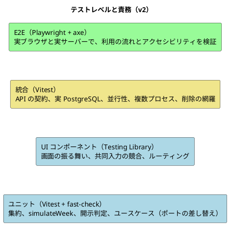
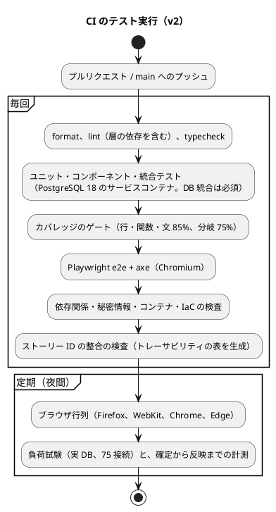

# テスト戦略 - ビールゲームシミュレーション（v2）

## 概要

本書は、beer-game2（v2）のテスト戦略を定義します。**`docs/` を設計の正本**とします。

beer-game（v1）の [テスト戦略](../beer-game/test-strategy.md)（実測: 199 件、カバレッジ 90.5%、10 件の差分）を出発点に、v2 の設計（集約の分離、共同入力、自動確定、役割別の週結果、カスケード削除）と、v1 の差分の解消を反映して**改訂**しました。

v1 の実測値は、v2 の目標を決める**基準**として使います。

| v1 の実測（2026-11-09） | 値 |
| :--- | :--- |
| テスト | 199 件（vitest）+ E2E 6 件。約 18 秒 |
| 分布 | ユニット 43%、UI コンポーネント 22%、API 統合 17%、DB 統合 12%、静的検査 2%、E2E 3% |
| カバレッジ | 行 90.5%、分岐 79.8%、関数 87.7%、文 87.2%（HTTP 層は計測対象外） |

## テスト形状の選択

[テスト戦略ガイド](../../reference/テスト戦略ガイド.md) では、アーキテクチャに応じて形状を選びます。

| 判断項目 | v2 の答え | 帰結 |
| :--- | :--- | :--- |
| 業務の中心 | 純粋な週次計算と、ルールを持つ集約（`Game`、`Session`） | ドメインを厚くテストする（ピラミッド型） |
| 永続化の特性 | 行ロックと版、共同入力の競合、自動確定と手動確定の競合、カスケード削除が、実際の PostgreSQL に依存する | 統合テストは、ガイドの標準（15%）より厚くする |
| 画面 | URL ルーティングを持つ SPA。`ApiClient` を差し替えられる | 画面はコンポーネントのテストで広く、E2E は少数 |

**採用する形状は、ピラミッド型です。統合テストは約 3 割までを認めます**（v1 と同じ考え方）。v2 では、ルールが集約に移るため、**ドメインのユニットテストの比率が上がる**見込みです。

### 目標の分布

| レベル | 目標の割合 | 理由 |
| :--- | :--- | :--- |
| ユニット（ドメイン、アプリケーション、アダプター）+ UI コンポーネント | 65% 以上 | 速いフィードバックと、規則の網羅（v1: 65%） |
| 統合（API + DB） | 30% 以下 | 並行性と永続化の検証に必要な分（v1: 29%） |
| E2E | 5% 以下 | 利用の流れの要所だけ（v1: 3%） |

## テストレベルの定義

| レベル | 責務 | 対象 | 依存の扱い |
| :--- | :--- | :--- | :--- |
| ユニット（ドメイン） | 規則と計算を、最小の単位で検証する。**性質（プロパティ）も検証する** | `Game`、`Session`、`RetentionSaga`、`simulateWeek`、`DisclosurePolicy`、`KitPreset`、値オブジェクト | 外部に依存しない（純粋） |
| ユニット（アプリケーション） | ユースケースの手順（読み込み、集約の呼び出し、保存、イベント）を検証する | `application/` のコマンドと問い合わせ | ポートをメモリ上の実装に差し替える |
| UI コンポーネント | 画面の表示、入力、エラー、フォーカス、共同入力の競合、ルーティング、日本語の表示名 | `ui/src/features/` | `ApiClient` を差し替える。ブラウザの代わりに jsdom |
| API 統合 | HTTP の境界（認証、Origin 検査、冪等性、版、エラー形式、セキュリティヘッダー、相関 ID、レート制限）の契約を検証する | `adapters/http` | アプリケーションはメモリ上のポート、または実 DB |
| DB 統合 | 永続化、行ロックと版、**共同入力の競合、自動確定と手動確定の競合**、複数プロセス、アウトボックスとイベント、**カスケード削除の網羅**、マイグレーションを、実際の PostgreSQL で検証する | `adapters/persistence`、2 つの API プロセス | 専用のテスト DB（名前の検査で、誤った DB への接続を防ぐ） |
| E2E | 利用の流れの要所を、実ブラウザで確認する。アクセシビリティを自動検査する（axe） | 作成、参加、共同入力、確定、観察、SSE の切断、200% 拡大 | 実サーバー、実 DB |

**DB 統合のテストは、CI では必ず実行する**（環境変数が無い場合は、スキップではなく失敗にする）。手元では、環境変数が無ければ、スキップした件数を結果に明示する（v1 の差分への対応）。

### レベル間の重複を避ける方針

- 規則の分岐は、ドメインのユニットで網羅する。API 統合では、境界の契約（ステータス、ヘッダー、エラー形式）だけを確認する。
- 画面の分岐は、コンポーネントで確認する。E2E は、画面をまたぐ流れと、実ブラウザでしか確認できないこと（拡大、フォーカス、SSE、axe）に限る。
- 永続化の整合性と並行性は、DB 統合でだけ検証する。ユニットでは、メモリ上のポートを使う。

## 開発の進め方（TDD と BDD）

- **TDD**: 失敗するテストを書き、失敗を確認してから、最小限を実装する（TDD の三原則）。**v1 の不足を埋めるテスト（役割別の週結果、削除の網羅など）は、実装より先に書く**。
- **BDD**: 受入条件は、Given / When / Then の形で、テスト名に表す。
- **ストーリーとの対応（v1 の差分への対応）**: テスト名に、ストーリー・受入条件の ID を含める（例: `[US2.4/AC2.4.1] Given 自動確定が有効 When 4 役割の入力がそろう Then 週が一度だけ確定される`）。ID の一覧から、**トレーサビリティの表を自動で生成**する（Living Documentation）。
- **配置**: `apps/beer-game2/tests/` に、レベルごと（`unit`、`component`、`integration`、`e2e`）に置く。v1 のデリバリー単位（`u1`〜`u5`）の名前は使わない。

## カバレッジ目標

### ゲート（CI の合格条件）

v1 のゲート（行・関数・文 80%、分岐 70%）を、v2 では**引き上げます**（v1 の実測が超えているため）。

| 指標 | v1 のゲート | v2 のゲート |
| :--- | ---: | ---: |
| 行 | 80% | 85% |
| 関数 | 80% | 85% |
| 文 | 80% | 85% |
| 分岐 | 70% | 75% |

### 層ごとの目標

| 層 | 行 | 分岐 | 方針 |
| :--- | ---: | ---: | :--- |
| `domain` | 100% | 90% | 中核。性質のテストで、分岐を網羅する |
| `application` | 95% | 85% | 手順の分岐（冪等、競合、権限）を網羅する |
| `adapters/persistence` | 90% | 75% | 分岐は DB 統合で確認する |
| `adapters/http`（**計測対象に含める**） | 90% | 75% | v1 は計測対象外だった。**最初から含める**（起動部は除外して、統合で確認する） |
| `ui`（features） | 85% | 80% | 画面の遷移（ルーティング）と `ApiClient` を補う |
| 全体（ゲート） | 85% | 75% | 上の表 |

### 計測の範囲

`vitest.config.ts` の対象に、`domain`、`ports`、`application`、`adapters`、`ui/src` を含めます。**`adapters/http` を最初から含め**、除外するのは、起動部（`main.ts`）と、設定の組み立てだけにします。

## テストデータ

| 種類 | 方針 |
| :--- | :--- |
| ドメイン | ビルダー（Object Mother）で、集約を組み立てる。乱数・時刻・ID は、ポート（`Clock`、`IdGenerator`）で差し替え、決定論的にする |
| 週次計算 | 既知の系列と期待値の組（golden）と、**fast-check による性質の検証**（下記） |
| DB 統合 | 専用の DB（`_test` の名前）だけを使う。名前が合わなければ中止する。マイグレーションを適用した空の DB から始める。**ゲームごとに ID を分け、テスト間で干渉しない** |
| 資格 | テスト用の鍵（複数の版）と、テストごとの乱数。生の値を、保存や出力に含めない |

### 週次計算の性質（プロパティベーステスト）

| 性質 | 内容 |
| :--- | :--- |
| 決定論 | 同じ入力から、同じ出力 |
| 非負 | 在庫、受注残、出荷は、常に 0 以上 |
| 保存 | 出荷数は、`min(利用可能量, 充足対象)`。在庫 + 出荷 = 利用可能量。受注残 = 充足対象 − 出荷 |
| 費用 | 週次費用 = 週末在庫 × 在庫単価 + 週末受注残 × 受注残単価。累積費用は、週次費用の和 |
| 遅延 | 注文・配送・生産は、設定した週数より早く到着しない。カスタムの遅延（0 を含む）でも成り立つ |
| 役割別の結果 | 4 役割の結果の合計が、チームの合計と一致する |

## v2 の新しい振る舞いに対するテスト

| 振る舞い | 主なテスト | レベル |
| :--- | :--- | :--- |
| 共同担当（FR-16） | 同じ役割に複数人を割り当てられる。1 人は 1 役割。各役割 1 人以上で開始できる | ユニット（`Game`） |
| 共同入力の競合 | 古い版の保存は拒否され、最新値と保存者を返す。同時の保存で、一方だけが成功する | ユニット（`Session`）、DB 統合（実際の並行） |
| 自動確定（FR-18） | AUTO で 4 役割がそろうと一度だけ確定。MANUAL では確定しない。停止中は確定せず、再開時に確定する | ユニット（`Session`）、DB 統合 |
| 自動確定と手動確定の競合 | 同時に起きても、結果と費用が一度だけ（2 プロセスで検証） | DB 統合 |
| 観察者（FR-17） | 招待で参加し、読み取り専用。役割別の値と将来の需要を取得できない。失効した招待は使えない | ユニット、API 統合、E2E |
| カスタム条件（FR-01） | 準拠値から変えると「カスタム」と変更項目を記録する。範囲外を拒否する | ユニット（`KitPreset`、`GameSettings`） |
| 役割別の週結果（FR-13、FR-14） | 確定で、役割別の行が保存される。振り返りと出力が、役割別の値を返す。出力に設定・意思決定・履歴を含む | DB 統合、API 統合 |
| 開示の抑止（BR-17） | 寄与者が 2 未満なら合計を出さない。終了前は役割別の値を出さない | ユニット、API 統合 |
| 資格（NFR-06） | 期限切れ、失効、鍵の版（ローテーション後も、旧版の資格が期限まで有効）。**本番で鍵が未設定なら起動に失敗する** | ユニット、統合 |
| カスケード削除 | **削除後に、`game_id` 列を持つすべての表に、そのゲームの行が残らない**（表の一覧は `information_schema` から取得） | DB 統合 |
| 保存途中の失敗 | 確定の保存の途中で失敗を注入しても、部分更新が残らない | DB 統合 |
| 進行役の復帰 | 再読み込みしても、資格でコンソールへ戻れる | E2E、コンポーネント |

## 非機能のテスト

| 品質特性 | 要件 | 検証の手段 | CI での扱い |
| :--- | :--- | :--- | :--- |
| 正確性・決定論 | NFR-01 | `simulateWeek` の golden とプロパティのテスト | 毎回 |
| 整合性・冪等性 | NFR-02、FR-09 | DB 統合（競合、複数プロセス、障害の注入） | 毎回 |
| 応答性・同時利用 | NFR-03、NFR-04 | **実 DB を使う負荷試験**（15 ゲーム、75 の SSE 接続）と、**ブラウザでの確定から反映まで（p95 2 秒）の計測**（Playwright） | 夜間。結果を保存して推移を見る |
| セキュリティ | NFR-06 | API 統合（Origin、偽造 Cookie、他ゲームへのアクセス、観察者の権限、ヘッダー）、依存関係・秘密情報・コンテナ・IaC の検査 | 毎回 |
| アクセシビリティ | NFR-08 | コンポーネントと E2E の自動検査（**axe**）、200% 拡大、手動の確認 | 自動は毎回。手動はリリース前 |
| 可搬性 | NFR-10 | Playwright の行列実行（Chromium、Firefox、WebKit、Chrome、Edge） | 夜間 |
| 観測性 | NFR-11 | ログの許可・拒否のテスト（資格、表示名、非公開値を含まない）、`/ready` のテスト | 毎回 |

## CI との連携

| 項目 | 方針 |
| :--- | :--- |
| 失敗時 | どの工程が失敗しても、マージしない。カバレッジの閾値割れも失敗とする |
| 実行時間の目標 | ユニット + コンポーネント: 30 秒以内、統合（DB を含む）: 2 分以内、E2E: 5 分以内、全体: 10 分以内（v1: vitest 約 18 秒） |
| 並列化 | ファイル単位で並列に実行。DB 統合は、ゲームごとに ID を分け、干渉しない |
| 失敗の記録 | Playwright のトレースとスクリーンショットを保存する |
| 定期実行の結果 | 負荷試験と計測の結果を保存し、推移を確認する（性能の目標の達成を継続的に確認する） |

## トレーサビリティ（ユーザーストーリー → テスト）

テスト名にストーリー・受入条件の ID を含める規約により、**対応表を自動で生成**します。下表は、各ストーリーの受入条件を、どのレベルのテストで保証するかの**計画**です（v1 の状態は、[ユーザーストーリー](../../requirements/beer-game2/user_story.md) を参照）。

| ストーリー | 受入条件 | 主なレベル | 備考 |
| :--- | :--- | :--- | :--- |
| US1.1 ゲームを作成する | AC1.1.1〜1.1.6 | ユニット（`GameSettings`、`KitPreset`）、API 統合、E2E | カスタム条件の記録、最終週 1〜50 |
| US1.2 参加して役割を受け取る | AC1.2.1〜1.2.5 | ユニット（`Game`）、API 統合、コンポーネント | 共同担当、開始条件 |
| US1.3 観察者を招待する | AC1.3.1〜1.3.4 | ユニット、API 統合 | 新規 |
| US2.1 役割別の状況 | AC2.1.1〜2.1.4 | ユニット、API 統合（他役割の拒否）、コンポーネント | 共同担当の表示 |
| US2.2 数量を決定する | AC2.2.1〜2.2.4 | ユニット（`Session`）、DB 統合（実際の競合）、コンポーネント | 共同入力の競合 |
| US2.3 週の確定 | AC2.3.1〜2.3.5 | ユニット（`simulateWeek`、プロパティ）、DB 統合（障害の注入、複数プロセス） | 役割別の結果、原子性 |
| US2.4 週を自動で確定する | AC2.4.1〜2.4.5 | ユニット（`Session`）、DB 統合（競合）、E2E | 新規 |
| US3.1 停止・代理入力・再開 | AC3.1.1〜3.1.3 | ユニット、API 統合 | 代理入力の値をイベントに含む |
| US3.2 復帰 | AC3.2.1〜3.2.5 | ユニット（資格）、API 統合、E2E | 進行役の復帰、失効・再発行 |
| US4.1 観察 | AC4.1.1〜4.1.5 | ユニット（`DisclosurePolicy`）、API 統合、E2E | 観察者の権限 |
| US4.2 振り返り | AC4.2.1〜4.2.4 | DB 統合、API 統合、コンポーネント、E2E | 役割別 |
| US4.3 出力 | AC4.3.1〜4.3.3 | DB 統合、API 統合 | 設定・意思決定・履歴を含む |
| US5.1 保持と削除 | AC5.1.1〜5.1.5 | ユニット（`RetentionSaga`）、DB 統合（網羅） | 残らないことの検証 |
| US6.1 検知 | AC6.1.1〜6.1.6 | API 統合（ログ、`/ready`）、E2E の合成監視 | 新規 |
| US6.2 リリースと復元 | AC6.2.1〜6.2.5 | ステージングでのスモークとロールバック、復元の訓練 | 新規。運用の手順の検証 |
| 横断 X-1〜X-5 | — | axe、E2E、負荷試験、CI の検査 | — |

## v1 からの変更（差分への対応）

| # | v1 の差分 | v2 の対応 |
| :--- | :--- | :--- |
| 1 | カバレッジの計測対象に `src/api` と `src/server.ts` が含まれない | `adapters/http` を最初から含める。除外は起動部のみ |
| 2 | `browser-api.ts`、`App.tsx`、`worker-main.ts` などのカバレッジが低い | 層ごとの目標を設定し、ルーティングと `ApiClient` のテストを加える。ワーカーのキューは廃止 |
| 3 | テストの多くが git で追跡されていない | 最初から、コミットしながら進める（Bolt ごと） |
| 4 | テスト名にストーリー・受入条件の ID が無い | ID を規約にし、対応表を自動で生成する |
| 5 | 保持期間後に残るデータを検証するテストが無い | カスケード削除の網羅を、`information_schema` から検査する |
| 6 | 振り返りと出力のテストが、合計の推移だけを期待している | 役割別の期待値のテストを、実装より先に書く |
| 7 | 保存の途中で失敗したときに、部分更新が残らないことの直接のテストが無い | DB 統合で、失敗を注入するテストを加える |
| 8 | 性能テストとブラウザ行列が CI に含まれない。結果の記録が無い | 夜間に実行し、結果を保存する。実 DB での負荷試験と、確定から反映までの計測を含める |
| 9 | 依存関係の脆弱性検査と、変異テストが無い | 脆弱性検査を毎回実行する。**変異テストは、ドメイン層への導入を検討**（新しいツールなので承認が必要） |
| 10 | DB 統合のテストが、環境変数が無いとスキップされる | CI では失敗にする。手元ではスキップ件数を明示する |

## 未決事項

- 変異テストの導入の要否（ドメイン層のテストの強さを測る）。
- ストーリー ID の整合の検査（テストに存在しない ID、受入条件に対応するテストが無いもの）の厳しさ（警告か、失敗か）。
- 実 DB での負荷試験の環境（CI の夜間の実行か、ステージングか）。
- 手動のアクセシビリティの確認（スクリーンリーダー）を実施する担当者と時期。

## 出典

- [テスト戦略ガイド](../../reference/テスト戦略ガイド.md)、[ユーザーストーリー（v2）](../../requirements/beer-game2/user_story.md)
- [ドメインモデル（v2）](./domain-model.md)、[データモデル（v2）](./data-model.md)、[バックエンドアーキテクチャ（v2）](./architecture-backend.md)、[フロントエンドアーキテクチャ（v2）](./architecture-frontend.md)、[技術スタック（v2）](./tech-stack.md)
- v1 の [テスト戦略](../beer-game/test-strategy.md)（実測: 2026-11-09）
- [ADR-001](../../adr/beer-game2/001-rebuild-as-beer-game2.md)、[ADR-005](../../adr/beer-game2/005-role-results-and-sql-read-models.md)、[ADR-007](../../adr/beer-game2/007-cascade-deletion-without-queues.md)、[ADR-008](../../adr/beer-game2/008-auto-commit-and-event-audit.md)
