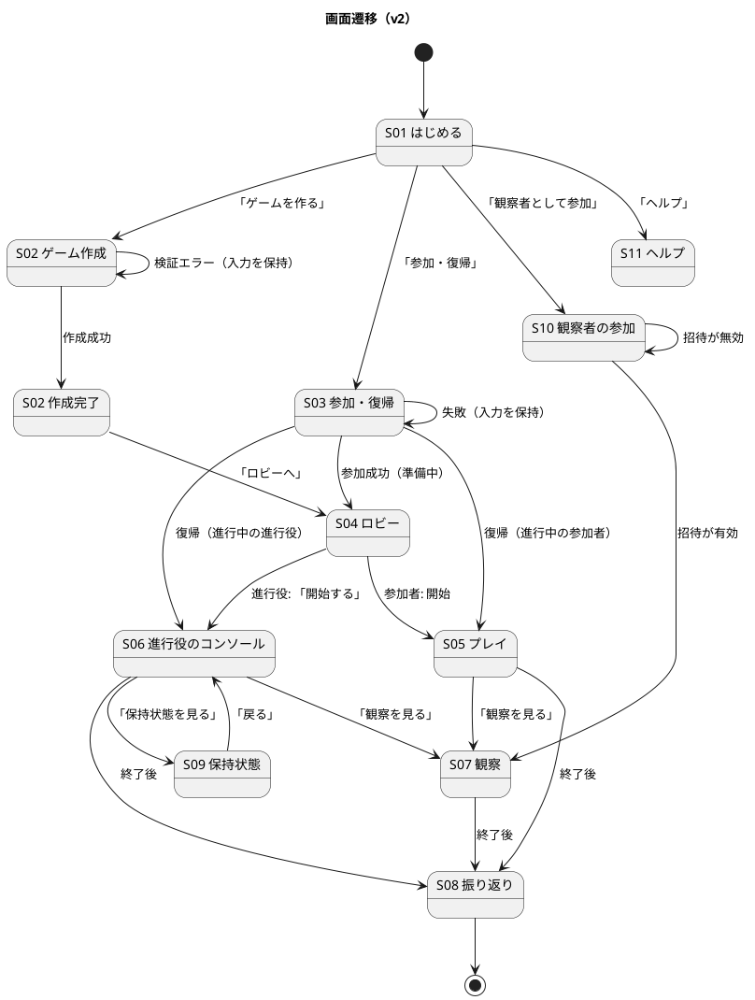
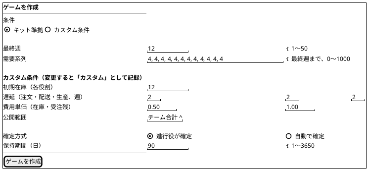
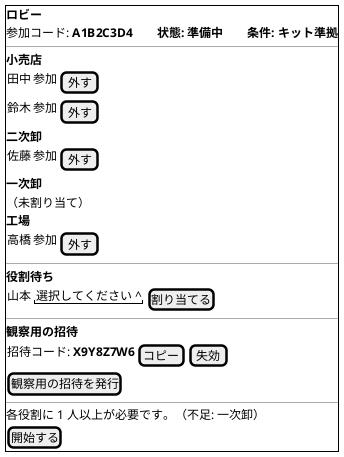
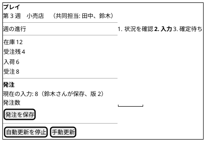
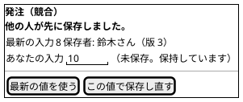
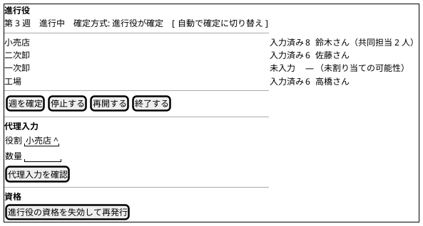
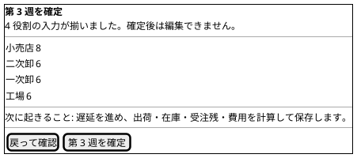
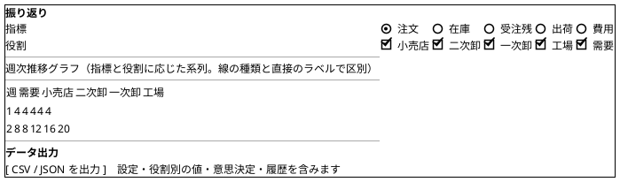
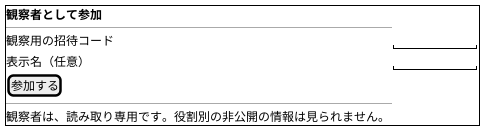

# UI 設計 - ビールゲームシミュレーション（v2）

## 概要

本書は、beer-game2（v2）の UI を、画面一覧、画面遷移、画面イメージ、インタラクションの順に定義します。**`docs/` を設計の正本**とします。

beer-game（v1）の [UI 設計](../beer-game/ui-design.md)（14 件の差分を記録）を出発点に、v2 の範囲（共同担当、カスタム条件、観察者、自動確定）と、v1 の差分の解消を反映して**改訂**しました。入力は次のとおりです。

- [ユーザーストーリー（v2）](../../requirements/beer-game2/user_story.md)、[システムユースケース（v2）](../../requirements/beer-game2/system_usecase.md)
- [フロントエンドアーキテクチャ（v2）](./architecture-frontend.md)（URL ルーティング、機能単位の構成）
- `aidlc/` の精緻化済みモックアップ（M01〜M08）、アクセシビリティのチェックリスト

## 設計の前提

- 利用者は PC のブラウザ（最新 2 世代の主要ブラウザ）で使います。専用ソフトの導入は不要です（NFR-10）。
- 参加者は役割ごとに見える情報が違います。画面構造そのものが、プレイ中の情報制約と、終了後の学習用の開示を分けます。
- 操作は、明示的なボタンで始めます。入力欄へのフォーカスや入力だけでは、状態を変えません。
- すべての主要な操作をキーボードで完了でき、色だけで状態を表しません（NFR-08）。
- **利用者に見せる語は、日本語の表示名の辞書から取り、英語の列挙値を直接表示しません。**

## 表示名（用語の統一）

| 概念 | 画面上の語 |
| :--- | :--- |
| FACTORY / DISTRIBUTOR / WHOLESALER / RETAILER | 工場 / 一次卸 / 二次卸 / 小売店 |
| 準備中 / 進行中 / 一時停止 / 終了 | ゲームとセッションの状態 |
| MANUAL / AUTO | 確定方式: 進行役が確定 / 自動で確定 |
| KIT / CUSTOM | 条件: キット準拠 / カスタム |
| 発注数（工場は**生産要請数**） | 入力欄の名称。役割に応じて切り替える |
| 共同担当 | 同じ役割に割り当てられた、複数の参加者 |
| 観察用の招待 | 観察者を招くためのコード |

## オブジェクトと画面（OOUI）

| オブジェクト | 主なアクション | ビュー | 画面 |
| :--- | :--- | :--- | :--- |
| ゲーム | 作成、開始、一時停止、再開、終了、確定方式の変更 | シングルビュー | ゲーム作成、ロビー、進行役のコンソール |
| 参加者（役割・共同担当） | 参加、役割の割り当て・解除、復帰 | コレクションビュー（ロビーの一覧） | 参加・復帰、ロビー |
| 観察用の招待・観察者 | 発行、失効、参加 | コレクションビュー | ロビー、進行役のコンソール、観察者の参加 |
| 週・意思決定 | 状況の確認、数量の入力（共同）、代理入力、確定 | シングルビュー | プレイ、進行役のコンソール |
| 振り返り | 閲覧（役割別）、出力 | シングルビュー | 観察、振り返り |
| 保持（削除の状況） | 状況の確認、再試行 | シングルビュー | 保持状態 |
| 資格 | 失効、再発行 | — | 進行役のコンソール |

## 画面一覧

| ID | 画面 | URL | 利用者 | ユースケース | v1 の状態 → v2 |
| :--- | :--- | :--- | :--- | :--- | :--- |
| S01 | はじめる | `/` | 全員 | UC-01、UC-02 | 引き継ぐ。ヘルプへの導線を加える |
| S02 | ゲーム作成 | `/new` | 進行役 | UC-01 | カスタム条件（初期在庫、遅延、費用、公開範囲）、確定方式、最終週 1〜50 を加える |
| S03 | 参加・復帰 | `/join` | 参加者、進行役 | UC-02、UC-14 | 進行役の復帰を加える |
| S04 | ロビー | `/games/:id/lobby` | 進行役、参加者 | UC-02〜UC-04、UC-16 | 共同担当の表示、観察用の招待の発行・失効を加える |
| S05 | プレイ | `/games/:id/play` | 参加者 | UC-05〜UC-07 | 共同入力と競合、日本語の役割名、役割に応じた入力欄の名称、週の進行の見直し |
| S06 | 進行役のコンソール | `/games/:id/console` | 進行役 | UC-08〜UC-10 | 入力値の表示、確定ダイアログの充実、確定方式の切り替え、資格の失効 |
| S07 | 観察 | `/games/:id/observation` | 進行役、参加者、観察者 | UC-13 | 観察者が入れるようにする |
| S08 | 振り返り | `/games/:id/review` | 全員（終了後） | UC-11、UC-12 | **役割別**の表示、指標・役割の切り替え、出力の内容の拡充 |
| S09 | 保持状態 | `/games/:id/retention` | 進行役 | UC-15 | 引き継ぐ（所有者別の進捗は無くなる） |
| S10 | 観察者の参加 | `/observe` | 観察者 | UC-13、UC-16 | **新規** |
| S11 | ヘルプ | `/help` | 全員 | — | **新規**（用語、週の流れ、画面の見方） |

## 画面遷移

### 遷移の条件

| 遷移 | 条件 |
| :--- | :--- |
| S02 → S02 | 範囲外の入力（最終週 1〜50、需要系列、初期在庫・遅延・費用単価、保持期間）。エラーの要約にフォーカスを移し、入力を保持する |
| S03 → S04 / S05 / S06 | 資格が有効。準備中ならロビー、進行中なら、参加者はプレイ、進行役はコンソール |
| S10 → S07 | 観察用の招待が有効（失効・期限切れでない） |
| S04 → S05 | 参加者の画面は、ゲームが進行中になると自動で切り替わる |
| S04 → S06 | 各役割に 1 人以上が割り当て済みで、進行役が「開始する」を押す |
| S05、S06、S07 → S08 | ゲームが終了している |
| 権限の無い URL | 資格が無い、または権限の無い画面は、S03（参加・復帰）へ誘導する（再読み込みでも、権限があれば同じ画面に戻る） |

## 画面イメージ

情報の優先順位とグルーピングを描きます。ピクセル単位の精度は求めません。

### S02 ゲーム作成

作成後は、参加コードを大きく表示し（フォーカスを移す）、「参加コードをコピー」と「ロビーへ」を並べます。カスタム条件を変更した場合は、作成画面と作成後に「カスタム」の表示を出します。

### S04 ロビー（進行役）

同じ役割に複数人を割り当てられます（共同担当）。参加者の画面は、参加者の一覧と、自分の役割だけを表示し、参加コード、割り当て、観察用の招待、開始は出しません。

### S05 プレイ（参加者・共同入力）

工場の画面では、入力欄の名称を「生産要請数」にします。週の進行は、**「状況を確認 → 入力 → 確定待ち」の 3 段階**で示します（差分への対応。下記）。

### S05 共同入力の競合

### S06 進行役のコンソール

進行役の画面には、各役割の**入力値**と、最後の保存者を表示します（進行役だけが見られる情報）。

**4 分割**: 4 役割（工場・一次卸・二次卸・小売店）を 2 × 2 の区画に並べ、同時に見られるようにします（狭い画面では縦 1 列）。各区画には、担当（共同担当を含む）、当週の入力値と保存者、在庫・受注残・入荷予定・累積費用、開閉できる週ごとの履歴を示します。参加者と観察者は、このコンソールを開けません（他の役割の値を見せない）。

### 確認ダイアログ（週確定）

代理入力、停止、再開、終了のダイアログも、対象と影響を示します。確定中は、ボタンを無効にし、「確定中」と表示します。

### S08 振り返り（役割別）

グラフと同じ値の表を、常に併記します（色だけに依存しないため）。ブルウィップ効果が見えるよう、役割別の注文の推移を、既定の表示にします。

### S10 観察者の参加

## インタラクション設計

### 共通のルール

| ルール | 内容 |
| :--- | :--- |
| 状態を変える操作 | 明示的なボタンで始める。入力やフォーカスだけでは実行しない |
| 取り返しがつかない操作 | 確認ダイアログを挟む（週確定、代理入力、停止、再開、終了、資格の失効、保持の再試行） |
| 入力の検証 | 画面で即時に補助し、サーバーの検証を正とする。エラーでは入力を保持する |
| エラーの通知 | 緊急のエラーは `role="alert"` で通知し、フォーカスを移す。非同期の更新は `aria-live="polite"`。**エラーに相関 ID を表示する** |
| 古い応答 | 版が画面より古い応答は適用しない。同じ版で内容が違えば反映する |
| 更新の制御 | 自動更新の停止と再開、手動更新を利用者に提供する |
| 重複操作 | 処理中はボタンを無効にする。サーバーも冪等キーで二重の反映を防ぐ |
| 画面の切り替え | 題名（`document.title`）を更新し、見出しへフォーカスを移す |

### 主な操作の流れ

| 流れ | 手順 |
| :--- | :--- |
| ゲームの準備 | 進行役がゲームを作成（S02）→ 参加コードを伝える → 参加者が参加（S03）→ 進行役が役割を割り当てる（同じ役割に複数人）（S04）→ 必要なら観察用の招待を発行 → 各役割に 1 人以上で開始 |
| 週のプレイ | 参加者が状況を確認し（S05）、数量を保存 → 進行役が入力状況を確認し（S06）、確認ダイアログで確定（自動確定なら、4 役割がそろった時点で自動） → 全員の画面が最新になる |
| 共同入力 | 共同担当の誰かが保存すると、全員の画面に、同じ値と版、保存者が反映される。同時に保存した場合は、後の人に競合を示し、自分の入力を保持して、最新値との比較を示す |
| 自動確定 | 確定方式が「自動で確定」のゲームで、最後の役割が保存すると、システムが確定し、全員に「第 N 週が自動で確定されました」と通知する（`aria-live`） |
| 中断と復帰 | 進行役が停止（入力は読み取り専用になり、停止中と表示）→ 必要なら代理入力 → 再開。参加者・進行役は、資格で同じ画面へ戻る |
| 観察 | 進行役が観察用の招待を発行 → 観察者が参加（S10）→ 観察（S07）→ 終了後に振り返り（S08） |
| 終了と振り返り | 最終週の確定、または進行役の終了 → 振り返りへ進む → 役割別の比較と出力 |

### エラーと状態のフィードバック

| 状況 | 表示 | 回復の手段 |
| :--- | :--- | :--- |
| 作成フォームの検証エラー | エラーの要約と、対象欄への関連付け。**対象の週と修正内容を示す**。入力を保持 | 修正して再送 |
| 数量が不正（負数・小数・空・上限超過） | 「発注数は 0〜1000 の整数で入力してください。」（工場は「生産要請数」）。入力を保持 | 修正して再送 |
| 共同入力の競合 | 最新の入力値と保存者、自分の未保存の値を並べて示す | 最新の値を使う、または、この値で保存し直す |
| 停止中 | 「停止中です。進行役の再開を待ってください。」。入力は無効 | 再開を待つ |
| 終了後 | 「終了しました。入力できません。」。振り返りへの導線 | 「振り返りを見る」 |
| 通信の断（SSE） | 「再接続中です。1 秒ごとに更新しています。」を `role="status"` で通知 | 自動で再接続。手動更新も可能 |
| 取得の失敗 | 原因の区分（通信、権限、サーバー）と相関 ID を `role="alert"` で通知 | 手動更新。問い合わせの際は相関 ID を伝える |
| 参加・復帰の失敗 | 入力を保持し、理由（コードが無効、受付が終了、資格の期限切れなど）を示す | 入力し直す、進行役に確認する |
| 観察用の招待が無効 | 「招待が無効です（失効または期限切れ）。進行役に確認してください。」 | 進行役に新しい招待を依頼する |
| 週確定・進行操作の失敗 | 原因の区分と相関 ID。「最新状態を確認して、再度操作してください。」 | 手動更新して再操作 |
| 権限が無い | 「この画面を開く権限がありません。」と、参加・復帰への導線 | 参加・復帰へ |
| 振り返りの出力の失敗 | 「出力に失敗しました。」。部分的な結果を完全な出力として示さない | 再実行 |

### 画面の状態

| 状態 | 表示 |
| :--- | :--- |
| 読み込み中 | 「読み込み中…」と対象名 |
| データなし | 「データなし」（読み込みの失敗と区別） |
| エラー | 原因の区分と相関 ID。再試行または戻る |
| 古い状態 | 古い応答を適用せず、最新を反映する |
| 停止中 | 停止の説明。入力は無効 |
| 終了 | 入力不可。振り返りへの導線 |
| オフライン | 入力を保持し、未送信であることを示す（再接続後に再送を確認する） |

## 週の進行の表示（v1 の差分への対応）

v1 のプレイ画面は、独自の 12 項目（「週を確認」「到着を確認」…）を並べ、現在地を 2 か所に固定していました。教材（JSD）の 12 ステップとは別物で、現在地を誤解させます。

- 教材の 12 ステップは、**システムが確定時に一度に計算する内部の手順**です（参加者の操作は、状況の確認と、数量の入力だけ）。
- 画面では、**「状況を確認 → 入力 → 確定待ち」の 3 段階**で、現在地を示します（`aria-current="step"`）。
- 教材の 12 ステップは、**ヘルプ（S11）と、折りたたみの説明**で提供します（「この週に起きること」）。

## アクセシビリティ（WCAG 2.2 AA を目標）

| 観点 | v2 の設計 |
| :--- | :--- |
| スキップリンク | 「本文へスキップ」を設置 |
| 画面の題名 | 画面ごとに `document.title` と H1 を更新し、フォーカスを見出しへ移す |
| フォーカス表示 | `:focus-visible` で 3px のアウトライン |
| キーボード操作 | ダイアログは Tab の循環、Escape、元のボタンへのフォーカス復帰。共同入力の競合の選択も、キーボードで操作できる |
| 状態の通知 | `role="alert"`、`role="status"`、`aria-live="polite"` を使い分ける。自動確定と、他の人の保存を通知する |
| フォームの関連付け | `label`、`aria-invalid`、`aria-describedby` |
| 色への依存 | 状態は文字で示す。グラフは、線の種類・直接のラベル・表で区別する |
| コントラスト比 | 設計トークンで色を定義し、**自動検査（axe）と、トークンの比の確認**で、4.5:1（大きな文字と部品は 3:1）を満たすことを確認する |
| 操作対象の大きさ | 24 × 24 CSS px 以上。自動検査で確認する |
| 拡大 | 200% で 1 列に再配置し、横スクロールなし（E2E） |
| 強制カラー、動きの低減 | 対応する |
| スクリーンリーダー | 主要な流れ（作成、参加、共同入力、確定、振り返り）を、手動で確認し、結果を記録する |

## v1 からの変更（差分への対応）

| # | v1 の差分 | v2 の対応 |
| :--- | :--- | :--- |
| 1 | 役割と状態が英語の列挙値のまま | 表示名の辞書で、日本語で表示する |
| 2 | 工場の入力欄が「発注量」のまま | 役割に応じて、「生産要請数」に切り替える |
| 3 | 週の 12 ステップが独自の項目で、現在地が固定 | 3 段階の表示。12 ステップは、ヘルプと説明で提供 |
| 4 | 確定ダイアログに、入力値と影響が無い。コンソールにも入力値が無い | 役割別の入力値と、確定後に起きることを示す。コンソールに入力値と最後の保存者を表示 |
| 5 | 作成画面に、カスタム条件の欄が無い。最終週が 52 | カスタム条件、確定方式、最終週 1〜50 |
| 6 | 観察者の入口が無い | 観察者の参加（S10）と、観察用の招待（S04） |
| 7 | 進行役が再読み込みで戻れない | URL ルーティングと、資格による復帰 |
| 8 | ロビーに共同担当の表示が無い | 役割ごとに複数人を表示。観察用の招待を管理 |
| 9 | 振り返りが合計だけ | 役割別の表示と、指標・役割の切り替え |
| 10 | エラーに相関 ID が無い | 相関 ID と原因の区分を表示 |
| 11 | 「オフライン」の状態が無い | 入力を保持し、未送信を示す |
| 12 | `<title>` と H1 が全画面で同じ | 画面ごとに更新し、フォーカスを移す |
| 13 | 狭い画面の案内が無い | PC 利用が前提であることを、狭い画面で案内する（操作は 1024px 以上） |
| 14 | ヘルプが無い | ヘルプ（S11）を追加 |

## 未決事項

- 共同入力の競合で、「この値で保存し直す」の操作の誤りを防ぐ表現（確認の要否）。
- 観察者の表示名を、必須にするか、任意にするか。
- 費用単価の入力の単位（最小単位か、金額の表記か）と、桁の制限。
- 公開範囲の選択肢の一覧（チーム合計のみ、完了状況のみ、など）。

## 出典

- [ユーザーストーリー（v2）](../../requirements/beer-game2/user_story.md)、[システムユースケース（v2）](../../requirements/beer-game2/system_usecase.md)、[要件定義（v2）](../../requirements/beer-game2/requirements_definition.md)
- [フロントエンドアーキテクチャ（v2）](./architecture-frontend.md)、[ドメインモデル（v2）](./domain-model.md)、[UI 設計ガイド](../../reference/UI設計ガイド.md)
- v1 の [UI 設計](../beer-game/ui-design.md)
- `aidlc/spaces/default/intents/261027-beer-game-development/inception/refined-mockups/`
