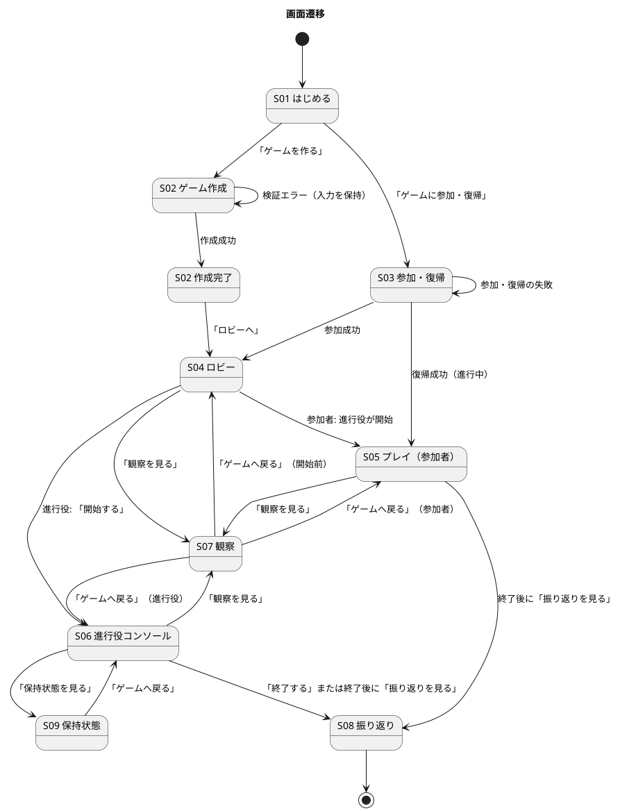
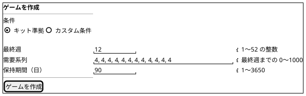
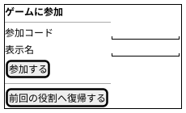
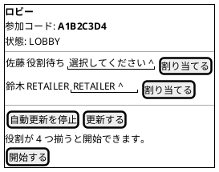
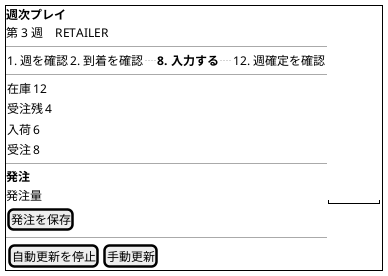
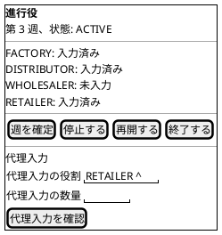
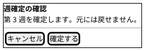
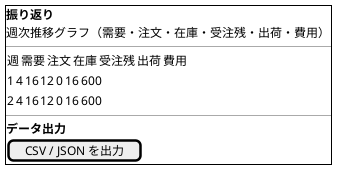

# UI 設計 - ビールゲームシミュレーション（v2）

> **beer-game2（v2）の出発点**: 本書は beer-game（v1）の文書を複製したものです。v2 で改訂します。表中の「実装状況」「現状」は **v1 の状態**を表し、不足は v2 で解消する対象です。詳細は [ADR-001](../../adr/beer-game2/001-rebuild-as-beer-game2.md) を参照してください。

## 概要

本書は、ビールゲームシミュレーションの UI を、画面一覧、画面遷移、画面イメージ、インタラクションの順に定義します。**`docs/` を正本**とし、次の 3 つを突き合わせました。

- 実装済みの画面（`apps/beer-game/src/ui`）
- `aidlc/` の精緻化モックアップ（M01〜M08）、インタラクション仕様、アクセシビリティチェックリスト
- 要件定義の画面・帳票モデル（UI-01〜UI-06、RP-01）と [ユーザーストーリー](../../requirements/beer-game2/user_story.md)

画面イメージは、**実装済みの構成**を描き、モックアップとの違いは「設計と実装の差分」に集約しました。構成は [フロントエンドアーキテクチャ](./architecture-frontend.md)、用語は [ドメインモデル](./domain-model.md) に従います。

## 設計の前提

- 利用者は PC のブラウザ（最新 2 世代の主要ブラウザ）で使います。専用ソフトの導入は不要です（NFR-10）。
- 参加者は役割ごとに見える情報が違います。画面構造そのものが、プレイ中の情報制約と、終了後の学習用の開示を分けます。
- 操作は、明示的なボタンで始めます。入力欄へのフォーカスや入力だけでは、状態を変えません。
- すべての主要な操作をキーボードで完了でき、色だけで状態を表しません（NFR-08）。

## オブジェクトと画面（OOUI）

[UI 設計ガイド](../../reference/UI設計ガイド.md) の考え方に従い、利用者が扱う「モノ」から画面を導きます。

| オブジェクト | 主なアクション | ビュー | 画面 |
| :--- | :--- | :--- | :--- |
| ゲーム | 作成、参加、開始、一時停止、再開、終了 | シングルビュー | ゲーム作成、参加・復帰、ロビー、進行役コンソール |
| 参加者（役割） | 参加、役割の割り当て、復帰 | コレクションビュー（ロビーの一覧） | 参加・復帰、ロビー |
| 週・意思決定 | 状況の確認、数量の入力、代理入力、確定 | シングルビュー | プレイ、進行役コンソール |
| 振り返り | 閲覧、出力 | シングルビュー | 観察、振り返り |
| 保持（削除の状況） | 状況の確認、再試行 | シングルビュー | 保持状態 |

## 画面一覧

| ID | 画面 | 利用者 | ユースケース | 要件の画面 | 実装 | 状況 |
| :--- | :--- | :--- | :--- | :--- | :--- | :---: |
| S01 | はじめる | 全員 | UC-01、UC-02 | — | `App.tsx` | ✓ |
| S02 | ゲーム作成（作成完了を含む） | 進行役 | UC-01 | UI-01 | `CreateJoinLobby.tsx`（`CreateGameForm`） | △ |
| S03 | 参加・復帰 | 参加者 | UC-02、UC-14 | — | `CreateJoinLobby.tsx`（`JoinAndRecovery`） | ✓ |
| S04 | ロビー | 進行役、参加者 | UC-02〜UC-04 | UI-02 | `CreateJoinLobby.tsx`（`Lobby`） | △ |
| S05 | プレイ | 参加者 | UC-05〜UC-07 | UI-03 | `PlayPage.tsx` | △ |
| S06 | 進行役コンソール（確認ダイアログを含む） | 進行役 | UC-08〜UC-10 | UI-04 | `FacilitatorConsole.tsx` | △ |
| S07 | 観察 | 進行役、参加者 | UC-13 | UI-05 | `LearningPages.tsx`（`ObservationPage`） | △ |
| S08 | 振り返り（データ出力を含む） | 進行役、参加者 | UC-11、UC-12 | UI-06、RP-01 | `LearningPages.tsx`（`ReviewPage`、出力） | △ |
| S09 | 保持状態（再試行の確認を含む） | 進行役 | UC-15 | — | `RetentionPage.tsx` | ✓ |

凡例は、✓ 実装済み、△ 一部実装（差分は末尾の表）です。モックアップの M01（開始）は S01 と S03 に分かれています。

## 画面遷移

### 遷移の条件

| 遷移 | 条件 |
| :--- | :--- |
| S02 → S02 | 最終週、需要系列、保持期間のいずれかが範囲外。エラーの要約にフォーカスを移し、入力を保持する |
| S03 → S04 | 有効な参加コードで、ゲームが準備中 |
| S03 → S05 | 有効な復帰資格で、役割がある |
| S04 → S06 | 4 役割がそろっている（「開始する」が有効になる） |
| S04 → S05 | 参加者の画面は、ゲームが進行中になると自動で切り替わる |
| S05、S06 → S08 | ゲームが終了している（最終週の確定、または進行役の終了） |
| S06 → S09 | 進行役のみ。「保持状態を見る」は、ゲームが特定されている進行役の画面（ロビー、プレイ、観察、振り返り）にも表示される |

「保持状態を見る」は進行役の画面にだけ表示します。ナビゲーション（観察、保持状態）は、ゲームが特定されている画面にだけ現れます。

## 画面イメージ

実装済みの構成を、情報の優先順位とグルーピングで描きます。ピクセル単位の精度は求めません。

### S02 ゲーム作成

作成後は、参加コードを大きく表示し（フォーカスを移す）、「参加コードをコピー」と「ロビーへ」を並べます。

### S03 参加・復帰

### S04 ロビー（進行役）

参加者の画面は、参加者の一覧と更新操作だけを表示します（参加コード、割り当て、開始は出しません）。

### S05 プレイ（参加者）

### S06 進行役コンソール

### 確認ダイアログ（週確定、代理入力、停止、再開、終了）

### S08 振り返り

グラフと同じ値の表を常に併記します（色だけに依存しないための代替）。表示は現状、全役割の合計です（差分 #9）。

## インタラクション設計

### 共通のルール

| ルール | 内容 |
| :--- | :--- |
| 状態を変える操作 | 明示的なボタンで始める。入力やフォーカスだけでは実行しない |
| 取り返しがつかない操作 | 確認ダイアログを挟む（週確定、代理入力、停止、再開、終了、保持の再試行） |
| 入力の検証 | 画面で即時に補助し、サーバーの検証を正とする。エラーでは入力を保持する |
| エラーの通知 | 緊急のエラーは `role="alert"` で通知し、フォーカスを移す。非同期の更新は `aria-live="polite"` |
| 古い応答 | 版が画面より古い応答は適用しない。同じ版で内容が違えば反映する |
| 更新の制御 | 自動更新の停止と再開、手動更新を利用者に提供する |
| 重複操作 | 処理中はボタンを無効にする。サーバーも冪等キーで二重の反映を防ぐ |

### 主な操作の流れ

| 流れ | 手順 |
| :--- | :--- |
| ゲームの準備 | 進行役がゲームを作成（S02）→ 参加コードを伝える → 参加者が参加（S03）→ 進行役が役割を割り当てる（S04）→ 4 役割がそろったら開始 |
| 週のプレイ | 参加者が状況を確認し（S05）、発注量を保存 → 進行役が入力状況を確認し（S06）、確認ダイアログで週を確定 → 全員の画面が最新になる |
| 中断と復帰 | 進行役が停止（入力は読み取り専用になり、停止中と表示）→ 必要なら代理入力 → 再開。参加者は復帰資格で同じ役割へ戻る |
| 終了と振り返り | 最終週の確定、または進行役の終了 → 「振り返りを見る」→ 比較と出力 |

### エラーと状態のフィードバック

| 状況 | 表示 | 回復の手段 |
| :--- | :--- | :--- |
| 作成フォームの検証エラー | エラーの要約と、対象欄への関連付け（`aria-describedby`）。入力を保持 | 修正して再送 |
| 発注量が不正（負数・小数・空・上限超過） | 「発注量は 0〜1000 の整数で入力してください。」。入力を保持 | 修正して再送 |
| 同時更新の競合 | 未保存の値と最新の入力版を示し、再入力を促す | 確認して再入力 |
| 停止中 | 「停止中です。進行役の再開を待ってください。」。入力は無効 | 再開を待つ |
| 終了後 | 「終了しました。発注できません。」。入力は無効。振り返りへの導線 | 「振り返りを見る」 |
| 通信の断（SSE が切れた） | 「再接続中です。1 秒ごとに更新しています。」を `role="status"` で通知 | 自動で再接続。手動更新も可能 |
| 取得の失敗 | 「状態を取得できませんでした。」を `role="alert"` で通知 | 手動更新 |
| 参加・復帰の失敗 | 「参加できませんでした。コードとロビーの状態を確認してください。」「復帰できませんでした。進行役に確認してください。」 | 入力し直す、進行役に確認する |
| 週確定・進行操作の失敗 | 「操作できませんでした。最新状態を手動更新して確認してください。」 | 手動更新して再操作 |
| 振り返りの出力の失敗 | 「出力に失敗しました。」。部分的な結果は完全な出力として示さない | 再実行 |

### 画面の状態

| 状態 | 表示 | 状況 |
| :--- | :--- | :---: |
| 読み込み中 | 「読み込み中…」 | ✓ |
| データなし | 「データなし」（読み込みの失敗と区別） | ✓ |
| エラー | 原因の説明。相関 ID は出さない | △ |
| 一部のみ取得 | 取得済みの領域と未取得の領域を分ける | ✗ |
| 古い状態 | 古い応答を適用せず最新を反映 | ✓ |
| オフライン | 入力を保持し、未送信であることを示す | ✗ |
| 停止中 | 停止の説明。入力は無効 | ✓ |
| 終了 | 入力不可。振り返りへの導線 | ✓ |

## アクセシビリティ（WCAG 2.2 AA を目標）

| 観点 | 実装の状況 | 状況 |
| :--- | :--- | :---: |
| スキップリンク | 「本文へスキップ」を設置 | ✓ |
| フォーカス表示 | `:focus-visible` で 3px のアウトライン | ✓ |
| キーボード操作 | ダイアログは、Tab の循環、Escape での閉じる操作、閉じた後の元のボタンへのフォーカス復帰 | ✓ |
| 状態の通知 | `role="alert"`、`role="status"`、`aria-live="polite"` を使い分ける | ✓ |
| フォームの関連付け | `label`、`aria-invalid`、`aria-describedby` | ✓ |
| 数量の入力 | `type="text"` に `inputmode="numeric"`（数値入力の標準部品に依存しない） | ✓ |
| 色への依存 | 状態は文字で示す。グラフは表を併記 | ✓ |
| 強制カラー、動きの低減 | `forced-colors`、`prefers-reduced-motion` に対応 | ✓ |
| 200% 拡大 | 自動テストで横スクロールなしを確認（`tests/e2e/u5.spec.ts`） | ✓ |
| コントラスト比 | 配色を決めているが、測定した記録が見つからない | 要確認 |
| 操作対象の大きさ（24 × 24 px 以上） | 測定した記録が見つからない | 要確認 |
| 画面の題名 | `<title>` と H1 は全画面で同じ（画面ごとの題名が無い） | ✗ |
| スクリーンリーダー | 手動確認の手順（`tests/manual/u5-accessibility.md`）がある。結果は未確認 | 要確認 |

## 用語の一貫性

| 概念 | 画面上の語 | 備考 |
| :--- | :--- | :--- |
| 発注数 | 「発注量」（入力）、「発注を保存」（ボタン） | 工場は「生産要請数」とするのが設計（差分 #2） |
| 役割 | 英語の列挙値（FACTORY など） | 日本語の名称で示すのが設計（差分 #1） |
| 状態 | 英語の列挙値（LOBBY、ACTIVE など） | 日本語で示すのが望ましい（差分 #1） |
| 保持の失敗コード | 英語のコード | 運用者向けのため、現状は許容 |

## 設計と実装の差分・要確認事項

| # | 内容 | 影響 | 扱い |
| :--- | :--- | :--- | :--- |
| 1 | **役割と状態が英語の列挙値のまま表示される**（`FACTORY`、`RETAILER`、`LOBBY`、`ACTIVE`、`ENDED` など）。プレイ、ロビー、進行役コンソール、観察の全画面 | 参加者が自分の役割を日本語で確認できず、学習教材として不親切。要件の用語（工場・一次卸・二次卸・小売店）とも食い違う | 表示名の対応表を 1 か所に持ち、全画面で使う（小さな修正） |
| 2 | 工場の入力欄の名称が「発注量」のまま（設計は「生産要請数」） | UC-07 の用語と食い違い、工場の参加者が意味を取り違えうる | 役割に応じて名称を切り替える |
| 3 | プレイ画面の「週の 12 ステップ」は、独自の 12 項目（週を確認、到着を確認…）で、教材（JSD）の 12 ステップとは別物。現在地（`aria-current`）は「入力する」か「発注を保存」の 2 か所に固定 | 教材の手順と一致せず、進行の現在地を誤解させる | 教材の 12 ステップに合わせるか、独自の手順であることを明示するか決める |
| 4 | 週確定のダイアログが、週番号と「元に戻せません」だけ。設計にある、役割別の入力値と、確定後に起きることの要約が無い。進行役コンソールにも入力値が表示されない | 進行役が内容を確認せずに確定する | ダイアログに役割別の入力値と要約を加える（権限は進行役のため開示してよい） |
| 5 | ゲーム作成に、名称、初期在庫、遅延、費用単価、公開範囲の欄が無い。最終週の上限は 52（設計は 50）。「カスタム」を示す表示も、保存されない | US1.1、FR-01、BR-14 の未実装と連動 | 要件として残すか決めてから、作成画面を拡張する |
| 6 | 観察者が入る入口が無い。観察画面は、ゲームに属する進行役と参加者だけ | UC-13 の観察者を満たさない | 観察者の参加方法を決めてから、入口を設ける |
| 7 | 進行役が画面を再読み込みすると、コンソールへ戻る手段が無い。参加者のための復帰（S03）だけがある | 進行役がブラウザを閉じると操作を続けにくい | 進行役の復帰を設計する（[フロントエンドアーキテクチャ](./architecture-frontend.md) の差分 #1） |
| 8 | ロビーに、同じ役割の共同参加者の表示、準備完了の状態、観察用リンクが無い。プレイ画面に、他の役割の入力状況も無い | モックアップ M03、M04 との差。共同担当は未実装のため当然だが、入力状況は進行の把握に役立つ | 共同担当の要否を決めたあとに判断する。他の役割の「入力済み」の表示は、情報の開示範囲を確認して決める |
| 9 | 振り返りのグラフと表は、全役割の合計だけで、役割別の推移を比べられない。系列の表示切り替えも無い | US4.2 の主目的を満たさない | 週確定のイベントに役割別の値を含め、グラフと表を役割別に拡張する（最優先。ユーザーストーリーの差分 #1） |
| 10 | エラー表示に、原因の区別と相関 ID が無い（設計は、原因、影響範囲、相関 ID、再試行） | 問い合わせ時に、サーバーのログとの突き合わせができない | エラー応答の相関 ID を画面に出す |
| 11 | 「一部のみ取得」「オフライン（未送信の表示）」の状態が無い | 通信が不安定な環境での入力が分かりにくい | 現状の「再接続中」の表示で当面は足りるか、利用状況をみて判断 |
| 12 | `<title>` と H1 が全画面で同じ | 画面の切り替えが、スクリーンリーダーに伝わりにくい | 画面ごとに題名とフォーカスの移動先を設ける |
| 13 | 画面幅による分岐は、小さい幅（48rem 以下）の最小限の対応だけ。モックアップの 3 段階（1024px 以上、768〜1023px、767px 以下）と、操作の制限の案内は未実装 | 狭い画面での操作の案内が無い | 利用環境が PC 前提であることを、画面で案内するか決める |
| 14 | ヘルプ（操作の説明）が無い（M01 にはヘルプのリンクがある） | 初めての参加者が、画面の見方を知る手段が無い | 必要性を確認する |

## 出典

- [ユーザーストーリー](../../requirements/beer-game2/user_story.md)、[システムユースケース](../../requirements/beer-game2/system_usecase.md)、[要件定義](../../requirements/beer-game2/requirements_definition.md)（画面・帳票モデル）
- [フロントエンドアーキテクチャ](./architecture-frontend.md)、[UI 設計ガイド](../../reference/UI設計ガイド.md)
- `aidlc/spaces/default/intents/261027-beer-game-development/inception/refined-mockups/`（`mockups.md`、`interaction-spec.md`、`accessibility-checklist.md`）
- 実装: `apps/beer-game/src/ui/*`、`index.html`
