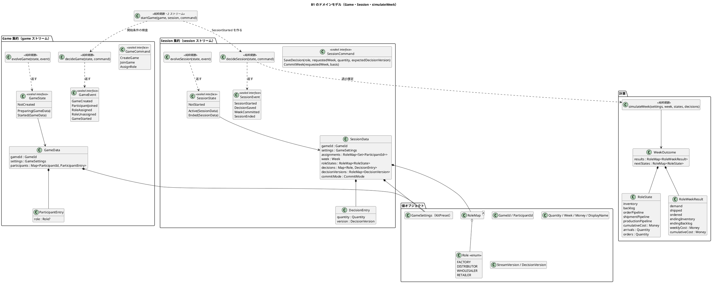
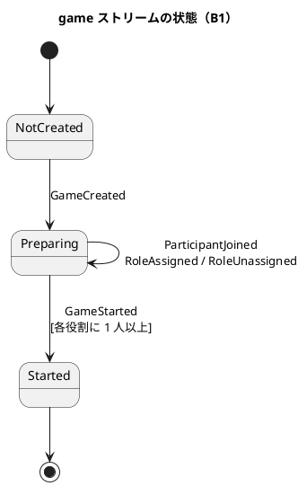
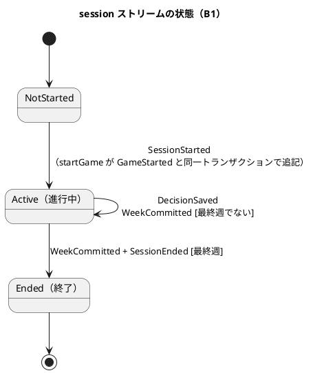
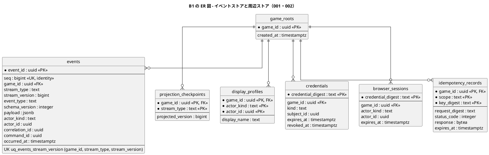
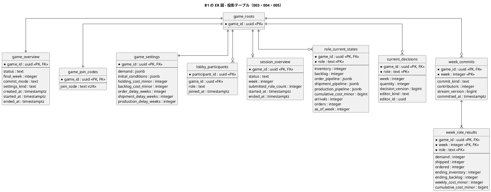
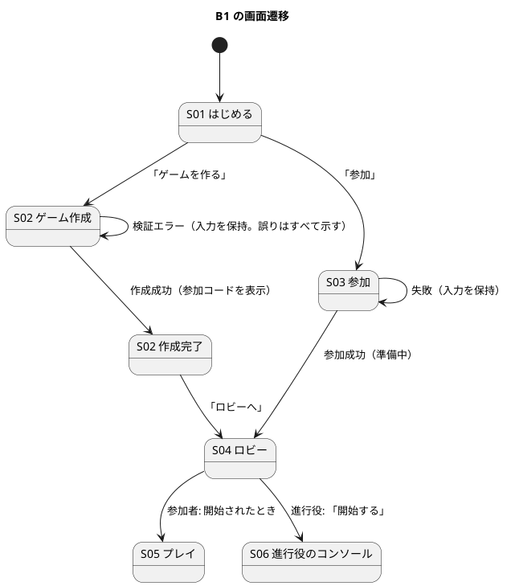

# Bolt 1 計画 - 基盤と縦の最小（ウォーキングスケルトン、Kotlin 版）

## 概要

| 項目 | 内容 |
| :--- | :--- |
| Bolt | B1（[リリース計画](./release_plan.md)） |
| Unit | U1 ウォーキングスケルトン（前半） |
| 所要（計画） | 4 稼働日（2026-11-16〜2026-11-19。仮定） |
| ゲート密度 | **密**（ステップごとに、人が検証する） |
| アプローチ | アウトサイドイン（[開発戦略](./development_strategy.md) の序盤）。**受け入れのシナリオと API の仕様が先** |
| テスト戦略 | Comprehensive（`simulateWeek`、集約、イベントストア）、Standard（その他） |
| 状態 | **承認済み（2026-11-14、ユーザー）。着手前の判断項目 9 件の承認を含む。**実行は未着手（Step 1 から） |

> **承認の状態について**: リリース計画・開発戦略・本書（着手前の判断項目 9 件を含む）は、2026-11-14 に、ユーザーが明示的に承認しました。**PMD の導入と、API の契約テストの道具の選定・導入の承認は含みません（B2 で求めます）。**

### ゴール

キット準拠のゲームを、**作成 → 参加 → 役割の割り当て → 開始 → 入力 → 確定 → 状態の表示**まで、**ローカル（H2）と PostgreSQL（Testcontainers）の両方**で、構造化ログ、`/ready`、層の依存の検査、役割別の週結果の保存つきで、縦に通す。入口は、このウォーキングスケルトンの**日本語 Gherkin のシナリオ**と、`contracts/openapi.yaml` の仕様（仕様が先）にする。

### 確認したい仮説

1. 2 ストリーム（`game`・`session`）と `startGame` の原子的な追記、同期投影は妥当か（[ADR-002](../../adr/beer-game-kotlin/002-event-sourcing-and-cqrs.md)、[ADR-003](../../adr/beer-game-kotlin/003-synchronous-projections.md)）。
2. Kotlin 2.4・JDK 25・Gradle・Ktor・Arrow の組み合わせは動くか（[ADR-013](../../adr/beer-game-kotlin/013-tech-stack-versions.md)）。
3. **H2 の PostgreSQL モードで、設計が使う機能のどれが動くか**（[ADR-014](../../adr/beer-game-kotlin/014-h2-for-local-development.md)）。
4. **Cucumber-JVM と Cucumber-JS の 2 つの処理系で、フィーチャーファイルを 1 か所から参照できるか。** 日本語 Gherkin を、Undefined → Pending → Failing → Passing の順に回せるか（[ADR-012](../../adr/beer-game-kotlin/012-gherkin-and-cucumber.md)）。
5. AI の出力の質は、どの密度の承認ゲートが要るか（以降の Bolt のゲート密度を決める）。

### 対象の受入条件

beer-game2 の B1 と同じ範囲です（[ユーザーストーリー](../../requirements/beer-game2/user_story.md)）。

| ストーリー | 受入条件 | 備考 |
| :--- | :--- | :--- |
| US1.1 | AC1.1.1、AC1.1.2 | キット準拠の作成。**無効な需要系列は、対象週と修正内容を示す**（誤りは項目ごとに集めて返す） |
| US1.2 | AC1.2.1、AC1.2.2、AC1.2.3、AC1.2.5 | 1 役割 1 人（共同担当は B6）。受付終了のコードの拒否。AC1.2.5 は、付け替えの解釈（[ドメインモデル](../../design/beer-game-kotlin/domain-model.md) D9） |
| US2.1 | AC2.1.1、AC2.1.2、AC2.1.3 | 役割別の状況。他役割・将来需要は開示しない。小売店は当週の需要を読む |
| US2.2 | AC2.2.1、AC2.2.2 | 数量の保存と検証（共同入力は B6） |
| US2.3 | AC2.3.1〜AC2.3.5 | 手動の確定、一回性、障害時の原子性、決定論、**役割別の週結果の保存** |
| US6.1 | AC6.1.1、AC6.1.2、AC6.1.4 | 構造化ログ、エラーの記録、`/ready`（メトリクス AC6.1.3 は B13） |

### 範囲外（後続の Bolt）

規約検査の厳格な適用と PMD、API の契約テストと型の生成の CI への組み込み、追記専用権限の否定テスト、N-1 互換（B2）。デプロイの定義（B3）。振り返りの画面（B4）。停止・再開・代理入力・復帰・資格の失効（B5）。共同担当（B6）。カスタム条件（B7）。自動確定（B8）。観察者（B9）。出力（B10）。削除（B11）。投影の再構築（B12）。

---

## 設計（B1 のスコープ）

B1 で実装するウォーキングスケルトン（作成 → 参加 → 役割の割り当て → 開始 → 入力 → 確定 → 状態の表示。手動の確定のみ）に絞った設計を示します。全体の設計は [ドメインモデル](../../design/beer-game-kotlin/domain-model.md)、[データモデル](../../design/beer-game-kotlin/data-model.md)、[UI 設計](../../design/beer-game-kotlin/ui-design.md) が正本で、ここでは名前・型・遷移・表・画面をそれに一致させ、B1 に無い要素を除いています（全体図のコピーではありません）。

### スコープ表

| 項目 | B1 に含む | B1 に含まない（後続の Bolt） |
| :--- | :--- | :--- |
| 集約と状態 | Game: `NotCreated`、`Preparing`、`Started`。Session: `NotStarted`、`Active`、`Ended`。`startGame`（2 ストリームへの原子的な追記） | Session の `Paused`（B5）。観察者と資格（Game の観察用の招待・資格の失効と再発行・復帰。B5、B9）。RetentionSaga（B11） |
| コマンド | `CreateGame`、`JoinGame`、`AssignRole`、`StartGame`（`startGame` の入力）、`SaveDecision`、`CommitWeek` | `PauseSession`、`ResumeSession`、`EndSession`、`SubmitProxyDecision`、`SetCommitMode`、観察者・資格に関するコマンド全般。`UnassignRole`（単独の解除。注記 2） |
| イベント | game: EV-G01 `GameCreated`、EV-G02 `ParticipantJoined`、EV-G03 `RoleAssigned`、EV-G04 `RoleUnassigned`（付け替えの解除側）、EV-G11 `GameStarted`。session: EV-S01 `SessionStarted`、EV-S04 `SessionEnded`（最終週）、EV-S05 `DecisionSaved`、EV-S08 `WeekCommitted`（`MANUAL`） | EV-G05〜G10（観察者・資格）、EV-S02・S03（停止・再開）、EV-S06（代理入力）、EV-S07（確定方式の変更）、`AUTO` の `WeekCommitted` |
| 値・サービス | `Role`、`RoleMap<A>`、`Quantity`、`Week`、`Money`、`DisplayName`、`StreamVersion`、`DecisionVersion`、`GameSettings` と `KitPreset`、`RoleState`、`RoleWeekResult`、`simulateWeek` | `Custom` の設定（B7）、`DisclosurePolicy` の運用（B9）、`buildExport`（B10） |
| ポートとストア | `EventStore`、`Transaction`、`EventCodec`、`Projection`、`ProjectionLock`、`ChangeNotifier`（PostgreSQL 版と H2 版）、`Ports`（関数の束） | 保持削除のポート、投影の再構築の運用（B12） |
| テーブル | マイグレーション 001〜005 のうち B1 で使うもの（下記の ER 図） | 006（保持。B11）、PostgreSQL 固有 101・102、H2 固有 201（Step 1 の実測で確定） |
| 画面 | S01 はじめる、S02 ゲーム作成（作成完了を含む）、S03 参加（復帰は B5）、S04 ロビー、S05 プレイ、S06 進行役のコンソール（週の確定と状態の表示のみ） | S07 観察（B9）、S08 振り返り（B4）、S09 保持状態（B11）、S10 観察者の参加（B9）、S11 ヘルプ |

### ドメインモデル図

Game と Session は別のストリームで、`simulateWeek`（純粋関数）は Session の `decide` が呼びます。`startGame` だけが 2 つのストリームにまたがります（設計判断 D3）。

B1 の `decide` の主な規則は次のとおりです（正本は [ドメインモデル](../../design/beer-game-kotlin/domain-model.md) の不変条件）。

| 対象 | 規則 | 失敗（`DomainError`） |
| :--- | :--- | :--- |
| `CreateGame` | ストリームが空のときだけ。誤りは項目ごとにすべて集める（無効な需要系列は対象週と修正内容） | `AlreadyCreated`、`ValidationError` の集まり |
| `JoinGame` | 準備中だけ | `NotPreparing` |
| `AssignRole` | 進行役だけ。1 人が同時に 2 役割を持たない（別の役割からは `RoleUnassigned` + `RoleAssigned` で移す。同じ役割は空のイベント列） | `Forbidden`、`ParticipantNotFound`、`NotPreparing` |
| `startGame` | 進行役、準備中、各役割に 1 人以上。`GameStarted` と `SessionStarted` を同一トランザクションで追記 | `StartConditionNotMet`、`AlreadyStarted`、`Forbidden` |
| `SaveDecision` | 進行中、その役割の参加者、`requestedWeek` が現在の週、意思決定の版が一致 | `NotActive`、`Forbidden`、`WeekAdvanced`、`DecisionConflict` |
| `CommitWeek` | 進行役、進行中、4 役割が揃う。週が違えば `WeekAdvanced`、`basis` が違えば `DecisionsChanged`。最終週は `SessionEnded` も返す | `Forbidden`、`WeekAdvanced`、`DecisionsChanged`、`IncompleteDecisions`、`AlreadyEnded` |

### 状態遷移図

B1 で使う遷移だけを示します。Game の観察者・資格のイベントの自己遷移と、Session の `Paused`（停止・再開・停止中の代理入力）は B1 に無いため含めません。

### ER 図

B1 のマイグレーション 001〜005 のうち、B1 で書く・読む表だけを示します（列は主なもの。全列は [データモデル](../../design/beer-game-kotlin/data-model.md)）。すべての表は `game_roots` への外部キー（`ON DELETE CASCADE`）を持ちます。

### 画面遷移図

B1 で作る最小の画面です。ID は [UI 設計](../../design/beer-game-kotlin/ui-design.md) の画面一覧のものです。ゲームが終了した（最終週を確定した）後は、S05・S06 に「終了」の状態を表示するだけで、振り返り（S08）への遷移は B4 で加えます。

| 画面 | B1 で作る範囲 | 含めないもの |
| :--- | :--- | :--- |
| S02 | キット準拠の作成（検証エラーの要約）。作成後の参加コード | カスタム条件（B7）、削除予定日の表示（B11） |
| S03 | 参加コードと表示名での参加 | 復帰（B5）、資格を送った種類ごとの失敗の文言のうち復帰・観察者に関するもの |
| S04 | 参加者の一覧、役割の割り当て（別の役割にいる人は移動元と移動先を示す確認）、不足している役割の表示、開始 | 観察用の招待、削除予定日の表示 |
| S05 | 自分の役割の状況、数量の入力と保存、確定待ちの表示、週が進んだ場合の表示 | 共同担当の競合の画面（B6）、自動確定の予告（B8）、停止中の表示（B5） |
| S06 | 各役割の入力状況、「週を確定」と確認ダイアログ、状態の表示 | 停止・再開・終了、代理入力、資格の失効（B5）、観察（B9） |

### 設計書との差分と反映の要否

名前・型・遷移・表・画面は、設計書（ドメインモデル、データモデル、UI 設計）と一致しており、**設計書の記述との差分はありません**。次の 3 点は、設計書への反映が要るか、人が判断する項目です。

1. **マイグレーションの単位と B1 の範囲**: マイグレーション 003 は観察者向けの `lobby_observer_invitations`・`lobby_observers`、005 は `week_team_totals` を含みます。B1 はこれらを設計どおりに作りますが、書き込む投影は Step 7 で決めます（B9 まで空でも、B1 の受入条件には影響しない）。分けるなら、データモデルのマイグレーション計画を直す必要があります（設計書への反映の候補）。
2. **付け替えの解除**: `RoleUnassigned` は付け替えの内部のイベントとして B1 に含みますが、単独の `UnassignRole`（S04 の「外す」）は Step 5.1 に無く、B1 に含めるかは未決です（設計書は `UnassignRole` を定義済みなので、含める場合は設計書の変更は不要）。
3. **`browser_sessions` の利用**: 002 に含まれる表で、B1 のどの処理が書くかは Step 8（認証）で確定します。使わない場合は、表だけ作ります。

---

## 人の判断が要る項目（着手前の承認）

| # | 項目 | 内容 | 提案 |
| :--- | :--- | :--- | :--- |
| 1 | **新しい依存関係の導入** | B1 で使う: Ktor、Arrow、kotlinx.coroutines・serialization・coroutines-test、PostgreSQL JDBC、HikariCP、Flyway、Logback、Kotest、Testcontainers、Kover、detekt、ktlint、**Cucumber-JVM（導入は決定済み）、Cucumber-JS（同）、H2（ローカル開発用）**。版は [技術スタック](../../design/beer-game-kotlin/tech-stack.md) の 2026-11-14 の確認値。**PMD と、API の契約テストの道具は B2 で承認を求める** | 承認をお願いします。版は、導入の直前に、あらためて公式の情報で確認します。フロントエンド（React、Vite、Playwright など）の版は、beer-game2 の確認値（2026-11-09）で、再確認していません |
| 2 | **ローカルの環境** | JDK 25 は入っている（JetBrains Runtime 25.0.4.1。CI は Temurin の想定で、配布が違う）。Gradle は未導入で、**Gradle ラッパーで固定**する。Node は 24.11.0 で、設計は **Node 26 LTS**（`nvm` で入れ、`.nvmrc` で固定する環境の変更）。Docker は入っている | Node 26 の導入を承認してください。ローカルの JDK は、動作確認の用途ならこのままで進め、版の差で問題が出れば Temurin に揃えます |
| 3 | **新規ファイルの作成** | `apps/beer-game-kotlin/` の一式（Gradle のモジュール、`contracts/openapi.yaml`、`features/`、フロントエンド、`.nvmrc` ほか。PostgreSQL は Testcontainers と CI のサービスで使い、ローカルは H2 なので、`compose.yaml` は作らない）と、CI の `.github/workflows/beer-game-kotlin.yml`（検証のみ。デプロイはしない） | この計画の承認で、作成してよいとします。**ディレクトリ `apps/beer-game-kotlin/` は、`.gitkeep` のみの状態で作成済み** |
| 4 | **フロントエンドの配置** | beer-game2 の UI を再利用するか、新規か | **`apps/beer-game-kotlin/web/`（React + Vite）に新しく実装し、beer-game2 の UI は参考にする（コピーしない）**。API の型は、仕様から生成する |
| 5 | **フィーチャーファイルの配置** | 共有の `features/` か、処理系ごとか | **`apps/beer-game-kotlin/features/<機能領域>/` に 1 か所にまとめ、Cucumber-JVM と Cucumber-JS の両方から参照する**（仮説 4 で確かめる。できなければ、処理系ごとに分ける） |
| 6 | **環境変数の名前** | `DB_KIND`（`postgres` / `h2`）と `APP_ENV`（`local` / `staging` / `production`）は提案の名前 | この名前で確定してよいか。`DB_KIND=h2` を許すのは `APP_ENV=local` だけで、それ以外は起動に失敗する |
| 7 | **仮の既定値** | 数量の上限 1000、最終週の上限 50（[非機能要件](../../design/beer-game-kotlin/non-functional.md)） | 暫定の値で進めます。資格の期限などは B5 で、運営者と合意して確定する |
| 8 | **beer-game2 のコードの扱い** | `apps/beer-game2` は参照のみ（変更しない）。`simulateWeek` などは、beer-game2 を**参考にして、テストを先に書いて、Kotlin で新しく実装する**（コピーしない） | この方針で進めます |
| 9 | **所要が 4 日を超える場合** | Step が 12 あり、4 日では厳しい見込み | UI（Step 10）を最小にする。それでも超える場合は、予備 B16 で吸収し、[リリース計画](./release_plan.md) を再調整する（人が判断） |

---

## ステップ計画

各ステップは **TDD（Red → Green → Refactor）**で進めます。ステップの終わりが承認ゲートで、**人が、テストとコードを全行理解して**承認してから、次へ進みます。テスト名には、ストーリー・受入条件の ID を含めます（Kotest は `[US2.3/AC2.3.2] Given … When … Then …`、Gherkin はタグ `@US2.3 @AC2.3.2`）。

凡例: 🔵 設計・準備　🔴 Red（失敗するテスト）　🟢 Green（最小の実装）　🟡 Refactor　✅ 検証

### Step 1: H2 の PostgreSQL モードの実測（🔵）

**最初に行います**（[ADR-014](../../adr/beer-game-kotlin/014-h2-for-local-development.md)）。結果で、H2 版で置き換える・省略する制約を確定します。

- [ ] 1.1 H2（2.5.252）の PostgreSQL モードで、次が動くかを、小さな検証用のコード（使い捨て。成果物にしない）で実測する: アドバイザリロック、`LISTEN` / `NOTIFY`、部分一意索引、`CREATE ROLE` / `GRANT` / `REVOKE`（`TRUNCATE` を含む）、`jsonb`、一意違反と直列化失敗の SQLSTATE、分離レベル（READ COMMITTED、REPEATABLE READ）、`ON DELETE CASCADE`、Flyway の適用
- [ ] 1.2 結果を表にして、[データモデル](../../design/beer-game-kotlin/data-model.md) の「ローカル開発」節と未決事項に記録する（動いた／動かなかった／部分的）
- [ ] 1.3 H2 版で置き換える・省略する制約の一覧を確定する（省略した制約は、ローカルでは守られないと明記する）

**ゲート 1**: 実測の結果と、H2 版の置き換え・省略の一覧を、人が確認する。結果が悪ければ（設計が H2 で成り立たなければ）、ここで止めて方針を相談する。

### Step 2: リポジトリの土台（🔵）

- [ ] 2.1 Gradle ラッパー（Gradle 9.9.1 の予定）、バージョンカタログ（確認済みの版で固定）、`.editorconfig`、`.gitignore`、`.nvmrc`（26）
- [ ] 2.2 Gradle のマルチモジュール: `domain`、`application`、`adapter-persistence`、`adapter-http`、`app`。**`domain` は Kotlin 標準と Arrow だけに依存**（ビルドで強制）
- [ ] 2.3 ktlint と detekt（標準ルール。違反 0）の最小の設定、Kover の最小の設定、`ForbiddenMethodCall`（ドメインでの時計・乱数・UUID の禁止）。**厳格な適用の完成（PMD の 14 ルール、fixture、ベースラインなし・`@Suppress` なし）は B2**
- [ ] 2.4 `.github/workflows/beer-game-kotlin.yml`（ktlint、detekt、`test`、`integrationTest`。PostgreSQL 18 のサービス。検証のみ）
- [ ] 2.5 空の状態で、`./gradlew` の検査・テストが緑で、モジュールの依存の違反を実際に検出する（意図的な違反で失敗し、戻して成功）

**ゲート 2**: 構成、依存関係の導入の承認の記録、モジュールの依存の検査を、人が確認する。

### Step 3: 契約と受け入れの入口（🔵🔴）

- [ ] 3.1 `contracts/openapi.yaml` に、ウォーキングスケルトンの経路（作成、参加、割り当て、開始（`POST /games/:id/start`）、入力、確定、状態の表示）と、`problem+json` の `code` の一覧を書く（**仕様が先**。契約テストの CI への組み込みは B2）
- [ ] 3.2 `features/<機能領域>/` と、タグの文書化（`TAGS.md`）。**最初のシナリオを、日本語 Gherkin で書く**（例: 4 役割が揃ったゲームで、1 週を確定すると、役割別の状況が更新される。`@US2.3 @AC2.3.1 @api @acceptance-criteria`。画面を通す 1 本は `@ui`）
- [ ] 3.3 Cucumber-JVM（`@api`。`acceptanceTest` を想定）と Cucumber-JS + Playwright（`@ui`）の基盤。2 つの処理系から `features/` を参照できるか確かめる
- [ ] 3.4 🔴 シナリオを実行し、**Undefined** になることを確認する（ステップ定義を書いて Pending → Failing を確認する）

**ゲート 3**: **シナリオ（業務の言葉）と仕様**を、人が確認し、契約として承認する。**タグ（`@US`・`@AC`）の一致だけでなく、シナリオの期待値が、受入条件の原文と一致していること**を確認する（beer-game2 の B1 で、AI が付けたタグと実際の定義が食い違っていた。[B1 終了報告](../beer-game2/bolt_1_report.md) の学び #1）。受入条件は、テストを書く前に原文を読み、期待値を貼る。処理系の構成（仮説 4）を確認する。

### Step 4: ドメイン — 値オブジェクトと週次計算（🔴🟢🟡）

- [ ] 4.1 🔴 値オブジェクト（`value class`）のテスト: `Role`、`Quantity`（0〜1000）、`Week`（1〜50）、`Money`、`DisplayName`、`StreamVersion`、`DecisionVersion`。誤りを集めて返す検証（`Either` と `zipOrAccumulate`）
- [ ] 4.2 🟢 値オブジェクトの実装
- [ ] 4.3 🔴 `simulateWeek` の **golden テスト**（既知の系列。2 週遅延）と、**プロパティテスト**（決定論、非負、保存、費用、遅延、役割別の合計 = チームの合計）。次週の入荷・受注（小売店は当週の需要）も返す
- [ ] 4.4 🟢 `simulateWeek` の実装（純粋関数）。**役割別の週結果**を返す
- [ ] 4.5 🟡 Refactor

**ゲート 4**: golden の期待値が教材（要件定義の BR-02〜BR-09）と一致することを、人が確認する。ドメインの `var`・可変コレクション・`!!`・`throw` が無いことを確認する。

### Step 5: ドメイン — Game（🔴🟢🟡）

- [ ] 5.0 🔴 **共通の土台（`decide`・`evolve` の型、`Command`・`Event`・`DomainError` の基底）を作る最初のスライドでは、後続の振る舞いのテスト（Session、`startGame`）も先に書き、失敗を確認してから実装する**（プロジェクトの規約。順序を守れなかったときは、規則を壊すとテストが落ちることを個別に確かめて記録する）
- [ ] 5.1 🔴 `decideGame` のテスト（Given = 過去のイベント、When = コマンド、Then = イベントまたはエラー）: キット準拠の作成（`KitPreset`）、設定の検証（無効な需要系列は対象週と修正内容）、参加、役割の割り当て（1 人 1 役割。別の役割から移す場合の扱い）、不足している役割の通知
- [ ] 5.2 🟢 `decideGame` / `evolveGame` の実装。`evolve` は全域（強制キャストなし）
- [ ] 5.3 🟡 Refactor

**ゲート 5**: ルールが `decide` に集まり、`evolve` が計算をしていないことを確認する。

### Step 6: ドメイン — Session と `startGame`（🔴🟢🟡）

- [ ] 6.1 🔴 `decideSession` のテスト: 入力の保存、手動の確定（週と `basis` の一致）、一回性、最終週の終了、`WeekAdvanced`。`startGame`（2 ストリームへ原子的に追記する唯一のコマンド）
- [ ] 6.2 🟢 `decideSession` / `evolveSession` と `startGame` の実装。`WeekCommitted` に結果と `nextStates` を含める（D5）
- [ ] 6.3 🔴🟢 D5 の検証（違う `nextStates` を持つ `WeekCommitted` を Given にして、状態がその値を採用する）。`InvalidTransition` の検知
- [ ] 6.4 🟡 Refactor

**ゲート 6**: 集約の粒度と、`startGame` の原子性の設計（仮説 1）を確認する。誤りが分かれば、ここで止めて設計を見直す。

### Step 7: イベントストア・投影・ポート（🔴🟢🟡）

- [ ] 7.0 🔴 **`EventStore` の型を作る最初のスライドでは、後続の振る舞い（冪等、投影、ポート）のテストも先に書き、失敗を確認する**（同上）
- [ ] 7.1 🔴 PostgreSQL（Testcontainers）の統合テスト: `append`（版の一意制約 `uq_events_stream_version`）、冪等記録、`startGame` の 2 ストリームの原子性、同期投影（追記と同じトランザクション。`Left` で ROLLBACK）
- [ ] 7.2 🟢 Flyway **001〜005**（[データモデル](../../design/beer-game-kotlin/data-model.md) のマイグレーション計画。001 `game_roots`・`events`・`projection_checkpoints`、002 周辺ストア（`display_profiles`・`credentials`・`browser_sessions`・`idempotency_records`）、003 投影（準備）、004 投影（進行）、005 投影（結果）。**006（保持）は B11**）、`EventStore`、`EventCodec`、`Projection`（`Event -> List<RowChange>`）
- [ ] 7.3 🔴🟢 ポート `ProjectionLock`・`ChangeNotifier` の **PostgreSQL 版と H2 版**と、**契約テストを両実装で**実行（排他・共有、コミット後の通知、ロールバックでは通知しない。**PostgreSQL 版は、`LISTEN` の接続が切れても再接続し、プロセスが落ちない**（beer-game2 の B1 の学び #3）。H2 版は単一プロセスのみ）
- [ ] 7.4 🟢 実行の選択（`DB_KIND`）。H2 版のマイグレーション（共通の部分を最大化し、差分だけを分ける。配置はここで確定）
- [ ] 7.5 🟡 Refactor

**ゲート 7**: 版・冪等・原子性のテストと、ポートの契約テストが両実装で緑であることを、人が確認する。マイグレーション 001〜005 を承認する。

### Step 8: アプリケーション（🔴🟢🟡）

- [ ] 8.1 🔴 関数の束（`Ports` をスタブに差し替え）のテスト: 「認証 → 認可の前提検査 → 冪等記録の照合 → 読み込み → `decide` → 追記・投影」の順序。成功した応答だけを保存。失効した資格の再送は 403。`AppFailure`
- [ ] 8.2 🟢 `execute` と、認可、冪等、再試行（`ConcurrencyConflict` の上限つき）の実装
- [ ] 8.3 🟡 Refactor

**ゲート 8**: 処理の順序（[ADR-004](../../adr/beer-game-kotlin/004-idempotency-after-authorization.md)）と、業務ルールが関数の束に漏れていないことを確認する。

### Step 9: HTTP と観測性（🔴🟢🟡）

- [ ] 9.1 🔴 `testApplication` のテスト: 認証・認可（無効な資格は同じ応答）、入力の検証、problem+json（`type` が `/problems/{code}`）、応答は `versions` だけ、`/health`（生存）と `/ready`（DB を止めると失敗）
- [ ] 9.2 🟢 Ktor のルート（仕様 `contracts/openapi.yaml` のとおり）、構造化ログ（資格・表示名・非公開の値を含めない）、`GET /health`（生存）と `GET /ready`（`SELECT 1`、接続プール、`ChangeNotifier.isAlive`）
- [ ] 9.3 🔴🟢 **本番での H2 の拒否**（`APP_ENV` が `staging`・`production` で `DB_KIND=h2` なら起動に失敗する）。本番相当の設定で、鍵が無ければ起動に失敗する
- [ ] 9.4 🟡 Refactor

**ゲート 9**: 仕様と実装が手で照合できる範囲で一致していること（契約テストの自動化は B2）、ログの内容、H2 の拒否を確認する。

### Step 10: UI（アウトサイドイン）（🔴🟢）

- [ ] 10.1 🔴 `@ui` のシナリオ（画面を通す 1 本）と、コンポーネントのテスト。API の型は仕様から生成する。**テストのエラーの握りつぶし（`.catch(() => {})` など）をしない**（実バグを隠した beer-game2 の B1 の学び #2。フロントエンドの lint で検出する方針は B2 で決める）
- [ ] 10.2 🟢 React + Vite の最小の画面（ゲームの作成、参加、割り当て、開始、入力、確定、状態の表示）。**最小に絞る**
- [ ] 10.3 🟡 Refactor

**ゲート 10**: 画面が、API の仕様と型に従っていることを確認する。

### Step 11: 受け入れの green（🟢）

- [ ] 11.1 `@api` のシナリオが、**PostgreSQL とローカル（H2）の両方**で green（受け入れの正は PostgreSQL）
- [ ] 11.2 `@ui` のシナリオと、ウォーキングスケルトンの E2E が green
- [ ] 11.3 **Undefined・Pending のステップが無い**

**ゲート 11**: シナリオが、業務の言葉のまま green であることを、人が確認する。

### Step 12: 検証と終了（✅）

- [ ] 12.1 全テスト（`test`、`integrationTest`、受け入れ）、ktlint、detekt、Kover（domain の行 100%）が緑
- [ ] 12.2 ログ・`/ready`・H2 の拒否のデモ。依存関係の導入の承認と版の確認の記録がある
- [ ] 12.3 Bolt 終了報告（`bolt_1_report.md`）。**デモ項目の実操作の申告**。実績の所要（人の検証時間を含む）を記録し、リリース計画の残りの Bolt の所要を再調整する
- [ ] 12.4 判断と学びを、ジャーナルに書く
- [ ] 12.5 **設計書の更新**（実装で変わった設計判断。H2 の実測の結果を含む）と、**`validating-design` の完了時の実施**（3 軸）。結果を終了報告に記録する

**ゲート 12（Bolt の承認）**: 人が、完了条件を確認し、Bolt を承認する。

---

## 完了条件（Definition of Done）

- [ ] 対象の受入条件（上記）が、テストと Gherkin のシナリオでパスしている（テスト名とタグにストーリー ID を含む）
- [ ] ローカル（H2）と PostgreSQL の両方で、作成から確定までのシナリオが通る（受け入れの正は PostgreSQL）
- [ ] **Undefined・Pending のステップが無い**。タグの一覧と意味が文書化されている
- [ ] `contracts/openapi.yaml` に、ウォーキングスケルトンの経路が書かれ、`@api` のシナリオと一致している
- [ ] H2 の実測の記録がある。ポート `ProjectionLock`・`ChangeNotifier` の契約テストが、両実装で green
- [ ] DB 統合テストが、CI で**必ず実行される**（スキップされない）。domain の行 100%
- [ ] ktlint・detekt が違反 0 で通り、モジュールの依存の違反を検出する
- [ ] ログに、資格・表示名・非公開値が含まれない（テストで確認）。本番相当の設定で、鍵が無い、または H2 が選ばれると、起動に失敗する
- [ ] 依存関係の導入の承認と版の確認の記録がある
- [ ] **完了時に `validating-design` を実施し、不整合が 0 件（または人が判断済み）。結果が Bolt 終了報告に記録されている**（[開発戦略](./development_strategy.md)）
- [ ] **コードを、人が全行理解して承認した**

### デモ項目

1. ローカル（H2）で、1 ゲーム（4 役割、数週）を、ブラウザで通す。同じシナリオを PostgreSQL でも通す。
2. 日本語 Gherkin のシナリオを実行し、Undefined → Pending → Failing → Passing の流れを示す。
3. ログ（構造化 JSON）と、`/ready`（DB を止めると失敗する）、本番設定での H2 の拒否を示す。

---

## リスクと対策

| リスク | 影響 | 対策 |
| :--- | :---: | :--- |
| H2 の PostgreSQL モードで、設計が使う機能が動かず、ローカルの構成が成り立たない | 中 | Step 1 で最初に実測し、ゲート 1 で止めて方針を相談する（置き換え・省略の確定） |
| 集約の粒度・`startGame` の原子性が誤っている | 高 | Step 5〜7 で早期に検証し、誤りが分かればゲートで止めて設計を見直す |
| Kotlin 2.4・JDK 25・Gradle・Arrow・Kover・Kotest の組み合わせの不具合 | 中 | Step 2 で、空の状態から確認する。問題があれば、版を一段下げる判断を、人が行う |
| Cucumber の 2 処理系から `features/` を共有できない | 中 | Step 3 で確かめる。できなければ、処理系ごとに分ける |
| 計算の期待値が、教材とずれる | 高 | golden の期待値を、要件定義の BR と照合してから実装する（ゲート 4） |
| AI が層の規則を破る、ルールをアプリケーション層に書く | 中 | モジュールの依存の検査と、ゲートで確認する |
| 所要が 4 日を超える | 中 | UI（Step 10）を最小にする。超過は B1 の実績として、リリース計画を再調整する（予備 B16 で吸収） |

## 完了後の流れ

- Bolt 終了報告（`bolt_1_report.md`）と、判断と学びのジャーナル。
- **B1 の実績（所要、AI の出力の質、H2 の実測）で、リリース計画の所要とゲート密度を再調整する。**
- B2（規約検査・CI・テスト基盤）の計画を作成し、承認を得る。**B2 の結果が悪ければ（detekt・PMD と Kotlin 2.4 の互換、Kover、連鎖削除）、B3 以降を止める。**

## 設計整合性の検証結果（着手前。`validating-design`）

2026-11-14 に、本書を 3 軸で検証しました（[開発戦略](./development_strategy.md) の「設計整合性の検証」）。

| 軸 | 検証対象 | 結果 | 不整合の件数 |
| :--- | :--- | :--- | :--- |
| A | 開発戦略 ↔ 本書 | NG → **解消**（#1 は案 A で判断済み） | 4 件（修正 4） |
| B | 本書 ↔ 設計書・ADR | NG（修正済み。判断待ちの小項目 3 件） | 4 件（修正 4）＋判断待ち 3 件（#12〜#14） |
| C | 本書 ↔ 過去の Bolt 計画・終了報告（beer-game2） | NG（修正済み） | 3 件（修正 3） |

### 不整合一覧

| # | 軸 | 不整合の内容 | 本書の記述 | 正しい記述（出典） | 結果 |
| :--- | :--- | :--- | :--- | :--- | :--- |
| 1 | A | **レイヤーを貫く順序**: 序盤はアウトサイドイン（画面 → HTTP → アプリケーション → ドメイン → ストア。まだ無い内側はスタブ）だが、Step 4〜10 は、ドメイン → ストア → アプリケーション → HTTP → UI の順（インサイドアウトの順）。開発戦略の B1 の手順の文（「…`decideGame`…、`EventStore.append`、…Ktor、React の最小の順に内側へ下りる」）も、同じ順で、図（外側から内側）と食い違っている | Step 3 でシナリオ（外側）から入り、Step 4〜10 は内側から外側へ | [開発戦略](./development_strategy.md) の序盤のワークフロー図（外側から内側へ下りる） | **判断済み（案 A、2026-11-14、ユーザー）**。本書を維持し、開発戦略の B1 の説明を直した |
| 2 | A | 「共通の土台の最初のスライドで、後続の振る舞いのテストも先に書く」規約が、Step に無い | 無し | 開発戦略の B1 の手順、`project.md` の規約 | 修正（Step 5.0、7.0 を追加） |
| 3 | A | 「設計ドキュメント整合」のフロー（着手時・実装中・完了時）が無い | 完了時の設計書更新が無い | 開発戦略の「設計整合性の検証」 | 修正（Step 12.5、完了条件を追加） |
| 4 | A | 序盤の対象ストーリー（US6.2 の基本）が、本書の対象の受入条件に無い | AC6.1 のみ | 開発戦略の序盤の対象ストーリー | 問題なし（US6.2 の基本は B3 の範囲。範囲外の記述と一致） |
| 5 | B | マイグレーション番号が設計書と食い違う（001 に `idempotency_records`・投影を含める記述） | Flyway 001 | データモデル: 001 = `game_roots`・`events`・`projection_checkpoints`、002 = 周辺ストア（`idempotency_records` を含む）、003〜005 = 投影、006 = 保持 | 修正（001〜005 に） |
| 6 | B | `compose.yaml`（ローカルの PostgreSQL）が設計書に無い。設計は「ローカルは H2（Docker 不要）、PostgreSQL は Testcontainers と CI」 | `compose.yaml` を作る | 技術スタック T7、インフラ設計 | 修正（作らない） |
| 7 | B | ヘルスチェックの `/health` が無い | `/ready` のみ | バックエンド設計: `GET /health` と `GET /ready` | 修正 |
| 8 | B | **当該 Bolt のスコープの 4 図（ドメインモデル図、状態遷移図、ER 図、画面遷移図）が、「設計」節に無い** | 設計節が無い | `validating-design` 軸 B の絶対項目、開発戦略 | 修正（「設計」節を追加） |
| 9 | C | 受入条件のタグと原文の意味の一致（beer-game2 の B1 の学び #1） | 反映なし | beer-game2 の B1 終了報告 | 修正（ゲート 3 に原文の照合） |
| 10 | C | `LISTEN` 接続の切断で落ちた（学び #3） | ポートの契約テストに再接続が無い | beer-game2 の B1 終了報告 | 修正（7.3 に追記） |
| 11 | C | E2E のエラーの握りつぶし（`.catch(() => {})`）の検出（学び #2。B2 で検討） | 反映なし | beer-game2 の B1 終了報告 | 修正（Step 10 のテストの方針に追記） |

### 判断済み（#1 レイヤーを貫く順序）

**ユーザーの判断（2026-11-14）: 案 A**。どちらを正にするかで、計画の Step の並びが変わる論点でした。

| 案 | 内容 | 影響 |
| :--- | :--- | :--- |
| **A（推奨）** | **本書の順序を維持し、開発戦略の B1 の説明を直す**。B1 は、ウォーキングスケルトンの**土台**（ドメイン、イベントストア、ポート）を内側から固め、**入口はシナリオ（Step 3）、仕上げは Step 8〜11（アプリケーション → HTTP → UI の外側）で結合**する。「共通の土台を先に固める」規約（Step 5.0、7.0）と整合する。B2 以降の序盤（B3、B4）は、図のとおりアウトサイドインにする | 本書は変えない。開発戦略の B1 の手順と、序盤の説明を直す |
| B | 開発戦略の図どおり、外側から内側へ下りるように、Step 4〜10 を並べ替える（UI・HTTP を先に、内側は関数の束のスタブで置く） | 本書の Step を大きく並べ替える。B1 の所要（4 日）が膨らむ見込み |

本書は、案 A の順序で書かれています。**開発戦略の B1 の説明を、本書に合わせて直しました**（「B1 の進め方（序盤の例外）」）。

**設計の節（4 図）を作る過程で見つかった、Step 5〜8 で決める事項**（人の判断が要る。設計書との食い違いはなし）:

| # | 事項 | 内容 | 決める時点 |
| :--- | :--- | :--- | :--- |
| 12 | 観察者向けの投影表を B1 で作るか | マイグレーション 003 に `lobby_observer_invitations`・`lobby_observers`、005 に `week_team_totals` が含まれる。B1 では作るだけで使わない。投影の書き込みを B9 まで省くなら、データモデルの分割（修正）が要る | Step 7 |
| 13 | 単独の `UnassignRole`（S04 の「外す」）を B1 に含めるか | Step 5.1 に無い（付け替えの `RoleUnassigned` は含む）。含めない場合は、S04 から「外す」を除く | Step 5 |
| 14 | `browser_sessions`（002）を B1 のどの処理が書くか | 参加時の資格の発行と対応づけて、Step 8 で決める | Step 8 |

> 図の PlantUML は、設計書の書き方に合わせたが、**描画での構文確認はしていない**（環境に PlantUML が無い）。公開サイトで描画を確認する。

## 更新履歴

| 日付 | 更新内容 | 更新者 |
| :--- | :--- | :--- |
| 2026-11-14 | **#1（レイヤーを貫く順序）をユーザーが案 A と判断**。本書の順序を維持し、開発戦略の B1 の説明を直した。Step 4 以降に着手できる（#12〜#14 は各 Step で決める） | claude-code/claude-sonnet-5-5 |
| 2026-11-14 | **`validating-design` の実施結果を反映**（承認済みの計画への修正。上の表の #2・#3・#5〜#11）。**人に再確認を求める**。#1（レイヤーを貫く順序）は人の判断待ち | claude-code/claude-sonnet-5-5 |
| 2026-11-14 | **承認**（ユーザー。着手前の判断項目 1〜9 を含む。判断項目 1 は B1 で使う依存関係のみで、PMD と契約テストの道具は B2） | claude-code/claude-sonnet-5-5 |
| 2026-11-14 | 初版作成（AI が提案。人の承認待ち） | claude-code/claude-sonnet-5-5 |
