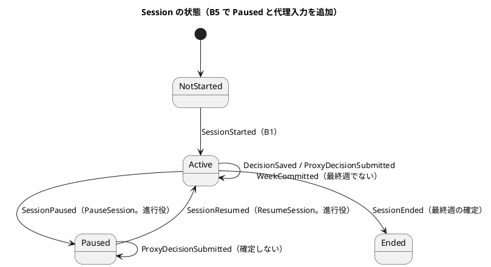

# Bolt 5 計画 - 進行の継続と資格

## 概要

| 項目 | 内容 |
| :--- | :--- |
| Bolt | B5（[リリース計画](./release_plan.md)） |
| Unit | U2 進行の継続（共同担当・資格）。U2 の最初の Bolt。次は B6（共同担当と共同入力） |
| 所要（計画） | 2 稼働日（リリース計画の仮定。**ステップ数に対して厳しい見込み**。下のリスクと判断項目 14） |
| 日程（仮定） | 2026-12-01〜12-02（リリース計画の稼働日による目安。**B4 の終了後**を前提とする。B4 は未着手） |
| ゲート密度 | **密**（リリース計画の「B5 は高リスク（認可と冪等）」。ステップごとに人が検証する）。U1 のゲートは 2026-11-15 に承認済みだが、人の検証を含めた実績はまだ少ないため、密度は下げない |
| アプローチ | 中盤（[開発戦略](./development_strategy.md)）。**インサイドアウト**（ドメイン → 永続化・資格 → アプリケーション → HTTP）。ただし**仕様（`contracts/openapi.yaml`）と日本語 Gherkin を先**に書き、契約テストを Red にしてから実装する（API を足す Bolt の共通の順序） |
| 状態 | **提案。人の承認待ち**（本書は AI が作成した計画の案で、承認されていない）。実装・コード変更は未着手。着手前に、下の「人の判断が要る項目」の決定が要る |

> **承認の状態について**: 本書は計画のみです。ステップ計画、着手前の判断項目、各ゲートは、いずれも**人の承認を受けていません**。承認は、ユーザーが指示した範囲だけを、更新履歴に記録します。

### ゴール

進行役が、停止・代理入力・再開で、不在者や中断があっても学習を継続でき、参加者・進行役が、切断後に同じ役割・同じ進行のコンソールへ復帰できるようにする。同時に、**漏洩した資格の被害を止められる設計**（期限・失効・再発行・鍵の複数の版・専用のレート制限）にし、**失効した資格の再送が 403 になる順序**（認証 → 認可の前提検査 → 冪等記録の照合。[ADR-004](../../adr/beer-game-kotlin/004-idempotency-after-authorization.md)）を、否定テストで守る。

### 確認したい仮説（リリース計画）

1. **資格の設計は、漏洩時に被害を止められるか。** 期限切れ・失効・旧版の鍵で発行した資格が、それぞれ期限・失効の規則どおりに受け付けられる、または拒否されるか。鍵のローテーション後も、旧版の資格が期限まで有効か。
2. **失効した資格の再送は 403 か。** 以前に成功した `Idempotency-Key` を、失効後に再送しても、保存済みの応答が返らないか。
3. **参加・復帰の総当たりを、タスク数に依らず抑えられるか**（NF-S11・NF-S19。現状のレート制限はプロセス内。判断項目 4）。

### 対象の受入条件

出典は [ユーザーストーリー](../../requirements/beer-game2/user_story.md)（Kotlin 版は beer-game2 の要件を引き継ぐ。リリース計画）。**シナリオの期待値は、原文の意味と一致させる**（タグ `@US`・`@AC`）。

| ID | 内容（原文の要点） | 備考 |
| :--- | :--- | :--- |
| AC3.1.1 | 一時停止中に参加者が新規の確定をすると、拒否し、既存の入力を失わない | 原文は「確定」。参加者の `SaveDecision`（入力の保存）も停止中は拒否する設計（[ドメインモデル](../../design/beer-game-kotlin/domain-model.md)）。**原文は「確定」だけを述べる点を、シナリオで両方扱うか、ゲート 1 で確認** |
| AC3.1.2 | 進行役が代理入力して確定すると、操作者・役割・時刻・値を監査履歴に残す | 値をイベントに含める（beer-game2 の「値が残らない」の解消。FR-15） |
| AC3.1.3 | 再開すると、最後の確定済みの週から入力できる | |
| AC3.2.1 | 有効な復帰資格で再接続すると、同じゲームと役割の最新の状態を表示する | |
| AC3.2.2 | 無効または削除済みの資格で再接続すると、復帰せず、進行役への確認方法を示す | 失敗は、資格の存在・期限・削除を区別しない応答（NF-S12） |
| AC3.2.3 | 複数のタブで一方が週を確定すると、他方は古い応答を適用せず、最新の状態を反映する | 版による古い応答の拒否は B1 の仕組みで足りる見込み。**B5 で確認のシナリオを足すか、B6 へ回すかを判断項目 8 で決める** |
| AC3.2.4 | 進行役が画面を再読み込みまたはブラウザを再起動しても、資格で同じゲームの進行コンソールへ戻れる | beer-game2 では未達（✗）。**進行役の復帰の手段は判断項目 9** |
| AC3.2.5 | 資格には有効期限があり、進行役は、漏れた資格を失効させて再発行できる | beer-game2 では未達（✗） |

### 範囲外（後続の Bolt、または未割り当て）

共同担当と共同入力（B6。`DecisionConflict` の拡張、`DecisionsChanged`、制約ごとの再試行）、カスタム条件（B7）、自動確定（B8。ただし**停止中は確定しない・再開時に判定する**規則は、ドメインに B8 が使える形で置く。判断項目 11）、観察者・観察用の招待の資格（B9）、削除（B11）、投影の再構築・N-1 互換の本実装（B12）、AWS・本番の定義（B14。**鍵の複数の版は環境変数・Secrets Manager の形に関わるが、Terraform の変更は本 Bolt では行わない**。判断項目 3）、手動の終了（`EndSession`。リリース計画の B5 の範囲に無い。判断項目 11）。

**前の Bolt（U1）の申し送りの取り込み**（[Unit U1 総括](./unit_u1_summary.md)の学び 7: 取り込まないと黙って落ちる）:

| 申し送り | 扱い |
| :--- | :--- |
| 参加の応答に `gameId` が無い（U1 #12、B1 #1） | **取り込む（判断項目 7）**。復帰・参加の応答は、ゲームを特定する情報を返さないと、復帰した画面が進めない |
| 鍵の版の複数保持（B1 の持ち越し） | **取り込む**（Step 4） |
| 資格の期限の分離（B1 は、ブラウザセッションと復帰資格を 1 つの値で兼ねた。設計は B5 で分ける想定） | **取り込む**（Step 4。判断項目 2） |
| ADR-004 の B5 の項目（失効後の再送の否定テスト） | **取り込む**（Step 4。R5） |
| 停止中の `NotActive` の文言・`code`（[UI 設計](../../design/beer-game-kotlin/ui-design.md) の未決） | **取り込む**（判断項目 6） |
| `InvalidTransition` の性質テスト（B2 の未実施。状態が増えるここが自然） | **取り込む案**（Step 2。判断項目 12） |
| 参加・復帰の専用のレート制限（設計書: 「B5」。現状は接続元ごと 600 件/分のプロセス内の固定窓） | **取り込む**（Step 5。判断項目 4） |
| 冪等記録の掃除、SSE と `LISTEN` 切断中の欠落、投影の整合検査 | 範囲外・未割り当て（B1 の持ち越し。B12 付近か人が決める） |
| V101 と V102 の順序（番号の付け替え） | 判断項目 5（新しいマイグレーションを足す場合に衝突する） |
| N-1 互換（新しいイベント種別を足すと、旧版が読めるか） | 範囲外（本実装は B12）。**新しいイベントを足す事実と一覧を、Step 8 の記録に残す** |
| `@ui` の拡張（参加者の画面）、Node 26 の導入と `.nvmrc` | UI の範囲は判断項目 13。Node は範囲外 |
| 層単位の PMD の緩和、`FunctionNameTooShort`、adapter-persistence の違反をコードで直すか（B2 #3〜#5） | 範囲外。**新しいコードは、層ごとのルールセットのまま違反 0 件**を守る |

---

## 設計（4 図の確認）

B5 は、**新しい状態・コマンド・イベントを足す**ため、4 図のうち 3 つが変わる（設計書にはあるが、B1〜B3 では未実装）。**設計書への反映が要る点は、Step 8 で変更表に記録**する。設計の正本は [ドメインモデル](../../design/beer-game-kotlin/domain-model.md)、[データモデル](../../design/beer-game-kotlin/data-model.md)、[バックエンド](../../design/beer-game-kotlin/architecture-backend.md)、[UI 設計](../../design/beer-game-kotlin/ui-design.md)。

### ドメインモデル図（変わる）

| 追加するもの | 内容（設計書にある。**実装は無いことを確認済み**: `Session.kt` の `SessionState` は `NotStarted`・`Active`・`Ended` だけ、`Game.kt` のコマンドは `CreateGame`・`JoinGame`・`AssignRole` だけ） |
| :--- | :--- |
| Session | 状態 `Paused`。コマンド `PauseSession`、`ResumeSession`、`SubmitProxyDecision`（`requestedWeek`、版は要求しない、進行役のみ、進行中または一時停止中）。イベント `SessionPaused`、`SessionResumed`、`ProxyDecisionSubmitted`（`week`・`role`・`quantity`・`decisionVersion`・`editor`・`submittedRoleCount`） |
| Game | 資格の有効性（`CredentialSubject` ごとの有効期限・失効）。コマンド `RevokeCredential`、`ReissueCredential`、`RecoverParticipation`。イベント `CredentialRevoked`、`CredentialReissued`、`ParticipationRecovered`。エラー `CredentialAlreadyRevoked`（`InvalidState`） |
| 変えないもの | `simulateWeek`（純粋関数）、`startGame`、投影の `Lobby` は資格のイベントを購読しない（資格の状態の正本は `credentials`。設計書の変更 #24） |

### 状態遷移図（変わる。Session）

停止中に、参加者の `SaveDecision`・`CommitWeek` は拒否する（AC3.1.1。入力は失われない）。再開すると、**最後の確定済みの週から**入力できる（AC3.1.3）。自動確定の判定（再開時に揃っていれば確定）は B8。**PlantUML の描画での構文確認は未実施**（B1〜B3 から続く未確認事項）。

### 資格の状態（新しい概念）

| 資格の種別 | 保存 | 期限（暫定。判断項目 2） | 失効・再発行 |
| :--- | :--- | :--- | :--- |
| ブラウザセッション（`browser_sessions`） | 鍵付き HMAC のダイジェストと鍵の版 | 24 時間（設計書 NF-S4 の例） | 期限で自然に失効 |
| 参加者の復帰資格（`credentials`、`PARTICIPANT_RECOVERY`） | 同上 | 30 日 | 進行役が失効・再発行できる |
| 進行役の資格（`credentials`、`FACILITATOR`） | 同上 | ゲームの保持期間内（B1 は 30 日で発行している。保持日数の既定は 90 日） | 同上 |

復帰（`RecoverParticipation`）は、有効な復帰資格を提示すると、新しいブラウザセッションを発行し、復帰資格の期限を更新する（`ParticipationRecovered.credentialExpiresAt`）。

### ER 図（変わる可能性。判断項目 4・5）

**確認した事実**: [V002](../../../apps/beer-game-kotlin/adapter-persistence/src/main/resources/db/migration/common/V002__peripheral_stores.sql) の `credentials` は `key_version`・`expires_at`・`revoked_at` を、`browser_sessions` は `key_version`・`expires_at` を、すでに持つ。**鍵の複数の版・期限・失効に、表の列の追加は要らない見込み**。

**変わる見込み**: 参加・復帰の専用のレート制限を、タスク数に依らない上限にするには、**試行の窓を DB に持つ表**（名前・列は未決）が要る。**スキーマ変更は確認必須**（判断項目 4・5）。表が増えれば `game_id` を持つ表の連鎖削除（B11 の「全表に行が残らない」検査）との整合も要る（接続元の鍵は要約で、ゲームに紐づけない案を提案）。

### 画面遷移図（変わる。UI を含める場合のみ。判断項目 13）

| 画面 | 変更 |
| :--- | :--- |
| S03 参加・復帰（`/join`） | 復帰（資格での再接続）の入口。失敗の文言は、送った資格の種類から選ぶ。進行役の復帰先は S06（進行中）または S04（準備中）、参加者は S05 または S04（[UI 設計](../../design/beer-game-kotlin/ui-design.md)の S03 → S04/S05/S06） |
| S06 進行役のコンソール | 停止・再開、停止中の代理入力（確認ダイアログに上書きする値を表示）、資格の失効・再発行 |
| S05 プレイ | 停止中の表示（入力・確定を受け付けない旨。`code` と文言は判断項目 6） |

---

## 人の判断が要る項目（着手前）

**着手前に、人が決める。決まるまで、依存する Step に着手しない。** 「提案」は AI の案で、承認ではありません。ゲートを通っていない仮置きは、U1 で多く積み上がった反省（U1 総括の学び 1）から、ここで先に決める。

| # | 項目 | 内容（事実） | 提案 |
| :--- | :--- | :--- | :--- |
| 1 | **B4 との順序** | リリース計画は B4 → B5 の直列だが、B5〜B8 は B4 に依存しない（並列にできる）。B4 は未着手。参加・復帰の応答の `gameId`（#7）は、B4 の UI と B5 で共通 | リリース計画どおり B4 の後に着手する。B4 を後ろに回して先に B5 を始める場合は、リリース計画（Release 0.1 の条件）に影響するため、人が決める |
| 2 | **資格の有効期間**（R11） | 運営者との合意が要る数値。設計書の例は、ブラウザセッション 24 時間、復帰資格 30 日、進行役の資格はゲームの保持期間内。B1 の実装は、進行役も参加者も 30 日で兼用 | 設計書の例を**仮の既定値**として設定値にする（コードに埋め込まない）。運営者との合意は未取得であることを記録し、合意の前に永続環境へ出さない |
| 3 | **鍵の複数の版の方式** | 現状は `CREDENTIAL_KEY` が 1 つ（`ServerConfig`）。資格の検証は、1 つの鍵でダイジェストを作って照合している（`Execute.kt`）。ダイジェストは鍵付きなので、**版を知らないと、どの鍵で作ればよいか決まらない**。設定の名前の変更は、Terraform（`infra/`）の秘密の形にも波及する（本 Bolt では Terraform を変更しない） | 資格の値に**版の接頭辞**を含め、版ごとの鍵で検証する案 A。または全版を順に試す案 B（版が少なければ可）。案 A を提案。設定は `CREDENTIAL_KEY` に加えて版つきの複数指定（名前は決めたい）。**ADR を新しく書く**（beer-game2 の ADR-009 を参照して Kotlin 版に追加。判断項目 15） |
| 4 | **参加・復帰の専用のレート制限の方式** | 現状は、接続元ごとの固定窓 600 件/分、**プロセス内**（設計書に「タスク数が増えれば実効の上限が増える」と明記）。NF-S11 は「実効の上限が、タスク数で増えない」を要求。接続元は ALB になるため `X-Forwarded-For` の信頼の範囲が未決（設計書の未決事項） | 案 A: **DB に試行の窓の表**を持つ（新しいマイグレーション。確認必須）。案 B: プロセス内のまま、NF-S11 を未達として記録する（B5 の仮説 3 は確認不能）。案 C: ALB・WAF に任せる（インフラの変更で本 Bolt の範囲外）。**案 A を提案**。接続元の鍵は正規化した接続元の鍵付き要約（生の IP を DB に残さない）。接続元の信頼の範囲は決める必要がある |
| 5 | **マイグレーションの追加と番号** | データモデルの番号の計画は 001〜005 が共通、006 が保持（B11）。PostgreSQL 専用の V101（ロール）・V102（冪等記録の索引）がある。**V101 と V102 の順序の付け替えは未実施**（U1 の判断で、永続環境の前に実施） | 試行の窓の表（#4 の案 A）を足す場合の番号を、保持（006）と衝突しない形で決める。**スキーマ変更は確認必須**。V101・V102 の付け替えを、この機会に行うかも決める |
| 6 | **API の追加経路・`code`・ステータス**（仕様が先） | 設計書の案: `POST /sessions/{id}/pause`、`/resume`、`PUT /sessions/{id}/proxy-decisions/{role}`（本文に `requestedWeek`）、`POST /games/{id}/credentials/revoke`、`…/reissue`、`POST /participations/recover`。停止中の参加者の保存は、設計書は `NotActive`（409。「停止中の `NotActive` は B5」）、UI 設計は文言が未決 | 設計書の経路を採る。停止中は既存の `session.not_active` を使い回すか、`session.paused` を足すかを決める（**使い回すと、「まだ始まっていない」と「停止中」を、画面が区別できない**ため、`session.paused` の追加を提案）。ステータスは 409。`code` は ADR-008（`code` の一覧と仕様の一致を契約テストで検査）に従う |
| 7 | **参加・復帰の応答に `gameId`** | 作成の応答は versions だけで、ゲームの ID は `Location`。参加の応答も versions だけで、参加者は参加後に `gameId` を知る手段が無い（B1 #1、U1 #12）。復帰は、画面が `gameId` なしで進めない | 参加・復帰の応答に `gameId`（または `Location`）を足す（バックエンドと仕様の変更。契約テストの対象）。作成の応答の扱い（`Location` のまま）は変えない |
| 8 | **AC3.2.3（複数タブ）の扱い** | 古い応答の拒否は、版（`If-Match`、`requestedWeek`）の仕組みで B1 から足りる見込み。確かめるシナリオは無い | B5 の Gherkin に 1 シナリオ足して確かめる（実装が足りなければ B6）。足りる見込みは**未確認の仮定** |
| 9 | **進行役の復帰の手段**（AC3.2.4、AC3.2.5） | 進行役の資格は Cookie（B1）。Cookie が残っていれば画面の再読み込み・再起動で戻れる。Cookie を失う（端末の変更、削除）と戻れない | 作成時に、進行役の**復帰用の値を一度だけ表示**して控えさせる案 A。Cookie の寿命だけに頼る案 B（端末を替えると復帰できない。AC3.2.4 の「ブラウザの再起動」は満たす）。**案 A を提案**。表示の値は、保存はダイジェストだけで、再表示しない |
| 10 | **代理入力の保存回数の上限**（NF「1 役割・1 週あたり 9 回（代理入力を含む）」。コードと文言は未決） | 設計書の提案値。B1 に実装があるかは未確認 | B5 では実装しない（範囲外）。または実装する場合の `code`・文言を決める |
| 11 | **`EndSession`（手動の終了）と自動確定との境界** | 設計書の経路 `…/{pause,resume,end}` に `end` があるが、リリース計画の B5 の範囲は「停止・再開・代理入力」。停止中は確定しない規則は、B8 の自動確定に使う | `end` は B5 の範囲外（理由: リリース計画に無い）。ただし停止中に確定しない規則（`decideSession`）は、B5 で実装し、再開時の判定は B8 とする |
| 12 | **`InvalidTransition` の性質テスト**（B2 の未実施） | 状態が `Paused` を含めて 4 つになる。許されない遷移がすべて拒否されることを、性質テストで確かめられる | Step 2 に含める（Kotest の性質テスト）。含めない場合は、未割り当てのまま残す |
| 13 | **UI の範囲** | 開発戦略の中盤はインサイドアウト。Unit 定義の U2 は「サービス + UI」。B1 の `@ui` は 1 シナリオ（ウォーキングスケルトン）だけ | 最小の UI: S03 の復帰、S06 の停止・再開、停止中の表示。`@ui` は 1〜2 シナリオ（復帰、停止 → 再開）。代理入力と資格の失効・再発行の画面は B6 以降に回す案も含めて、人が決める。**UI を含めるほど、2 日を超える** |
| 14 | **所要 2 日の確保** | 本書のステップは 9 つ。U1 の実績（B1: 4 日の計画に 12 ステップ）は、人の検証時間を含まず、2 日で収まる根拠にならない | 超える見込みのとき、予備 B16 で吸収し、リリース計画の再調整は**人が判断**する。B5 を 2 つに分ける（B5a: 停止・再開・代理入力、B5b: 資格・復帰）案も提示する |
| 15 | **新規ファイルの作成**（確認必須） | 新規作成の見込み: `features/continuation/*.feature`（停止・代理入力、復帰・資格）、資格・レート制限のテスト、マイグレーション（#4 の案 A）、ADR（鍵の版とレート制限の保存先）、`bolt_5_report.md`。既存の設計書・ADR・計画は編集 | 必要性は上のとおり。**承認をお願いします**。新しい依存は**導入しない**方針（既存の `Hmac.kt`・`SecureTokens.kt`・`Credentials.kt` を拡張する想定。**中身の詳細は未確認**で、Step 0.3 で確認する）。必要になれば、その時点で人に確認する |
| 16 | **ゲートの密度** | リリース計画は B5 を「密」とする | ステップごとに人が確認する。人の確認なしに連続して進めない（U1 の規律の逸脱の反省） |

---

## ステップ計画

各ステップは、**テストを先に書き、失敗を確認してから最小限を実装する**（TDD、BDD）。**ゲートは、人の確認待ち**とし、承認済みとは書かない。**ファイルの編集は、Write・Edit のみ**（heredoc・python・sed・perl・awk は使わない。U1 で繰り返し起きた逸脱）。**静的解析は、違反 0 件・ベースラインなし・`@Suppress` なし**を、毎ステップで守る。

### Step 0: 着手前の確認（`validating-design`）（✅）

- [ ] 0.1 判断項目 1〜16 を、人が決める（決定を、更新履歴に、ユーザーが指示した範囲だけ記録する）
- [ ] 0.2 `validating-design` を、着手前に実施し、**結果を本書に記録する**（軸 A: 開発戦略 ↔ 本書、軸 B: 本書 ↔ 設計書・ADR、軸 C: 本書 ↔ 過去の Bolt の計画・終了報告。B2・B3 の計画は、この記録が無いことが U1 の逸脱だった）。**本書の作成時点では未実施**
- [ ] 0.3 設計書のスケッチと、実装（B1 の形）の差を確認する（B1 の学び 6: スケッチは型でなく責務で書く）。特に `GameData`（B1 は設定・参加者・割り当てだけ。設計書は招待・観察者・資格を含む）と `AppSettings`（資格の鍵）

**ゲート 0**: 判断項目の決定と、`validating-design` の結果を、人が確認する。**状態: 人の確認待ち（未承認）。**

### Step 1: 仕様と受入シナリオ（API 契約が先）（🔴）

- [ ] 1.1 🔴 日本語 Gherkin を `features/continuation/`（名前は判断項目 15）に書く（AC3.1.1〜3.1.3、AC3.2.1〜3.2.5。**原文の意味と一致**させる。解釈の差は、シナリオの直前にコメントで書く）。**失効した資格の再送が 403**、**鍵のローテーション後も旧版の資格が期限まで有効**、**旧版の鍵の削除後は 403**、**期限切れの資格は 403**、**復帰の失敗は存在・期限・失効を区別しない同じ応答**、**停止中の代理入力は確定しない**、**代理入力のイベントに値が残る**を含める
- [ ] 1.2 🔴 `contracts/openapi.yaml` に、判断項目 6 の経路を書く（`Idempotency-Key`、`code` の一覧、`requestedWeek`、`If-Match` の有無）。契約テストを回し、**実装が無いので失敗する（Red）**ことを確認する
- [ ] 1.3 🔴 `@api` のシナリオが、Undefined・Pending でなく **Failing** になることを確認する（Undefined → Pending → Failing → Passing の順）

**ゲート 1**（全 Bolt の共通の承認項目）: 受入条件の Gherkin シナリオを、**実装の前に**人が検証して合意する。原文との照合（解釈の差）、`code` の名前、応答の形を確認する。**状態: 人の確認待ち（未承認）。**

### Step 2: ドメイン — Session の停止・再開・代理入力（🔴🟢🟡）

- [ ] 2.1 🔴 Kotest（Given: 過去のイベント / When: コマンド / Then: イベントまたはエラー）を先に書く。`PauseSession`・`ResumeSession`・`SubmitProxyDecision` の正常系と否定（参加者の実行は `Forbidden`、`requestedWeek` が違えば `WeekAdvanced`、停止中の `SaveDecision`・`CommitWeek` は拒否、`Ended` は `AlreadyEnded`）。**失敗を確認**する
- [ ] 2.2 🟢 `SessionState.Paused`、コマンド・イベント・エラーを、`decideSession`・`evolve` に実装する（`updateData` は `Active`・`Paused` に適用）。代理入力は版を 1 増やし、`editor`・値を残す。停止中の代理入力は確定しない
- [ ] 2.3 🟡 `InvalidTransition` の性質テスト（許されない状態・コマンドの組が、すべて拒否される。判断項目 12）。リファクタリング。**domain の行 100% のゲートを守る**（除外・閾値の引き下げをしない。B2 の追補で 100% に到達済み。新しい行は、実際のテストで到達させる）
- [ ] 2.4 イベントの検査: ペイロードに表示名・資格が含まれない（ADR-002）。新しいイベントの種別の一覧を記録（N-1 互換の影響。B12）

**ゲート 2**: Session の停止・再開・代理入力の振る舞いと、domain の行 100% を、人が確認する。**状態: 人の確認待ち（未承認）。**

### Step 3: ドメイン — Game の資格（失効・再発行・復帰）（🔴🟢🟡）

- [ ] 3.1 🔴 Kotest を先に書く。`RevokeCredential`（進行役のみ、有効な資格のみ、二重の失効は `CredentialAlreadyRevoked`）、`ReissueCredential`（新しい期限、失効後の再発行）、`RecoverParticipation`（有効な復帰資格のみ。失効・期限切れは `Forbidden` の同じ形）。失敗を確認する
- [ ] 3.2 🟢 `GameData` に資格の有効性（`CredentialValidity`）を足し、コマンド・イベント・`evolve` を実装する（設計書の `credentials: Map<CredentialSubject, CredentialValidity>`）。`startGame` と `JoinGame`（資格を発行する経路）が、資格の有効性を初期化する
- [ ] 3.3 🟡 リファクタリング。domain の行 100% を維持

**ゲート 3**: 資格の規則（有効期限・失効・再発行・復帰）と、domain の行 100% を、人が確認する。**状態: 人の確認待ち（未承認）。**

### Step 4: 鍵の版・資格の期限と失効・冪等記録の順序（🔴🟢🟡）

> **高リスク（認可と冪等。R5）。否定テストを先に書く。**

- [ ] 4.1 🔴 否定テストを先に書く（統合は PostgreSQL 18 の Testcontainers、純粋な部分は単体）: (a) **失効した資格が、以前に成功したキーを再送しても 403**（保存済みの応答を返さない。ADR-004）、(b) 期限切れの資格は 403、(c) **鍵のローテーション後、旧版の鍵で発行した資格が期限まで有効**、(d) **旧版の鍵を設定から外したら、その版の資格は 403**、(e) 別のゲームの資格・役割外の資格は 403、(f) 無効な資格の応答は、理由（期限・失効・不明）を区別しない同じ本文、(g) 読み取りロール（`beergame_reader`）が `credentials` を読めない（V101 の権限。設計書は未決。**確認だけを行い、変更が要るなら人に報告**）。失敗を確認する
- [ ] 4.2 🟢 鍵の複数の版（判断項目 3）。設定の読み込み（本番で必須、未設定なら起動に失敗。**起動時の検査の既存の仕組みを再利用**）、発行は最新の版、検証は保存された版の鍵。資格の値は 256 ビットの乱数、保存は鍵付き HMAC のダイジェストと版
- [ ] 4.3 🟢 ブラウザセッションと復帰資格を、別のダイジェストに分ける（B1 は 1 つの値で兼用）。期限を設定値にする（判断項目 2）。`credentials` の失効・発行を、`Credential*` イベントの追記と**同じトランザクション**で行う（`PeripheralWrite.RevokeCredentialRow` の設計。統合テストで「資格の行の変更が、対応するイベントなしに起きない」ことを確認）
- [ ] 4.4 🟢 `execute`（`Execute.kt`）の順序: 認証 → 認可の前提検査 → 冪等記録の照合 → … を維持し、**失効後の再送が 403 のテスト（4.1 の a）が通る**ことを確認する。**現状の順序が (a) を満たすかは未確認**（設計どおりに実装されているかを、テストで確かめる）
- [ ] 4.5 🟡 リファクタリング。層ごとの静的解析の違反 0 件

**ゲート 4**: 資格の設計（漏洩時に被害を止められるか）と、否定テストの網羅を、人が確認する。**状態: 人の確認待ち（未承認）。**

### Step 5: 参加・復帰の専用のレート制限（🔴🟢）

- [ ] 5.1 🔴 総当たりのテストを先に書く（NF-S11、NF-S19）: 同じ接続元の連続した失敗が上限で 429、**複数のアプリケーションのインスタンスで合算される**（判断項目 4 の案 A の場合。2 つのアプリで同じ DB を共有する統合テスト）、成功は窓に数えない、**形式が不正な本文は窓に数えない**案の確認、接続元の鍵に生の IP が DB に残らない。失敗を確認する
- [ ] 5.2 🟢 試行の窓の保存（判断項目 4・5 の決定どおり）。参加（`/participations/join`）、復帰（`/participations/recover`）に適用する。上限・窓の値は設定値（根拠は未計測の仮置きとして記録）
- [ ] 5.3 🟢 失敗の記録（ログの形。観測の完成は B13）。復帰の失敗の応答は、存在・期限・削除を区別しない（NF-S12）
- [ ] 5.4 🟡 リファクタリング

**ゲート 5**: レート制限の方式、保存する情報、スキーマの変更を、人が確認する（**スキーマ変更は確認必須**）。**状態: 人の確認待ち（未承認）。**

### Step 6: アプリケーションと HTTP（🔴🟢🟡）

- [ ] 6.1 🔴 HTTP の統合テスト（`testApplication`）を先に書く: 経路・認可（進行役だけが停止・再開・代理入力・失効・再発行）、`Idempotency-Key` の再送（同じ操作者・同じ本文なら保存済みの応答。**別の操作者の同じキーは `app.idempotency_key_reused`**）、`Set-Cookie`（`HttpOnly`・`SameSite=Strict`・`Max-Age`）、`code` と `problem+json`。失敗を確認する
- [ ] 6.2 🟢 コマンド（`Commands.kt`）、ルート、DTO の検証、エラーの写像を実装する。参加・復帰の応答に `gameId`（判断項目 7）。**契約テスト（仕様 ↔ 実装）が緑**になる
- [ ] 6.3 🟢 TypeScript の型を再生成し、差分 0 の検査を通す
- [ ] 6.4 🟡 リファクタリング。性能: 停止・再開・代理入力は p95 500 ms 以下（NF-P6）。**ローカルの計測値は、実環境の値でないことを明記して記録**

**ゲート 6**: API の形（`code`、ステータス、`gameId`）と、認可の行列を、人が確認する。**状態: 人の確認待ち（未承認）。**

### Step 7: UI（最小）（🔴🟢。判断項目 13 の決定による）

- [ ] 7.1 🔴 `@ui` のシナリオ（復帰、停止 → 再開）と、コンポーネントのテストを先に書く
- [ ] 7.2 🟢 S03 の復帰、S06 の停止・再開、S05 の停止中の表示。文言は一般の文言に統一し、失敗の文言は送った資格の種類から選ぶ（UI 設計）
- [ ] 7.3 🟡 アクセシビリティ（WCAG 2.2 AA）の確認。**手動の確認は人**（B15 で網羅。ここでは対象の画面だけ）

**ゲート 7**: UI の範囲と文言を、人が確認する。判断項目 13 で UI を含めない場合、このステップは**範囲外**とし、理由を記録する。**状態: 人の確認待ち（未承認）。**

### Step 8: 受け入れの green と検証・終了（✅）

- [ ] 8.1 `@api` の AC3.1.*、AC3.2.* が、PostgreSQL 18 と H2 の両方で green（Undefined・Pending なし）。デモ項目: 進行役が停止 → 代理入力 → 再開、参加者が切断 → 復帰、漏れた資格の失効 → 再発行 → 旧資格の再送が 403
- [ ] 8.2 全テスト、静的解析（ktlint、detekt（JDK 21）、PMD、fixture）、Kover（domain 100%、全体 85%・75%）、契約テスト、`web` の検証が緑。CI で、GitHub Actions 上の実行を確認する（**push は人の判断**。ローカルだけの結果を「CI で動く」と書かない）
- [ ] 8.3 設計書・ADR の更新（変更表）と、`validating-design`（完了時）。新しい ADR（判断項目 3・4）は**提案として記録し、承認は人**
- [ ] 8.4 Bolt 終了報告（`bolt_5_report.md`）。**デモ項目の実操作の申告欄**（人が行う）、未達・未実施、人の判断項目、B6 への申し送り。**承認を捏造しない**

**ゲート 8**（Bolt の承認）: 人が、B5 全体とコードの全行理解を検証する。**状態: 人の確認待ち（未承認）。**

---

## 完了条件（Definition of Done）

- [ ] AC3.1.1〜3.1.3、AC3.2.1〜3.2.5 の Gherkin シナリオが green（PostgreSQL 18 と H2。Undefined・Pending なし）
- [ ] **鍵のローテーションの否定テスト**が通る（旧版の資格は期限まで有効。旧版の鍵を外すと 403）
- [ ] **失効後の再送の否定テスト**が通る（以前に成功したキーを再送しても 403。保存済みの応答を返さない）
- [ ] 期限切れ・失効・不明の資格の応答が、区別されない（NF-S12）
- [ ] 参加・復帰の専用のレート制限が働き、複数のインスタンスで合算される（判断項目 4 の決定による。決定が案 B のときは、**未達として記録**）
- [ ] 代理入力のイベントに、値・操作者・役割・時刻が残る（AC3.1.2）
- [ ] 契約テスト（仕様と実装のずれで CI が落ちる）と、型の生成物の差分 0
- [ ] domain の行 100%（除外・閾値の引き下げなし）、全体の行 85%・分岐 75%。静的解析の違反 0 件、ベースラインなし、`@Suppress` なし
- [ ] 設計書・ADR の変更表が更新され、`validating-design` を着手前と完了時に実施し、結果を記録した
- [ ] Bolt 終了報告があり、未達・未実施・人の判断項目が列挙されている
- [ ] コードを、人が全行理解して承認した（**未。人の確認待ち**）

## リスクと対策

| リスク | 影響 | 対策 |
| :--- | :---: | :--- |
| R5: 冪等記録と認可の順序の誤りで、失効した資格の再送が通る | 高 | Step 4 で否定テストを先に書く。ADR-004 の順序を、`execute` のテストで固定する |
| 鍵の複数の版の方式（判断項目 3）が、設定・Terraform・運用に波及する | 中 | 本 Bolt では Terraform を変更しない。設定の名前と形を、ADR に記録し、B14 の定義の前に人が確認する |
| 試行の窓の表（判断項目 4）が、連鎖削除（B11）や接続元の個人情報の扱いと衝突する | 中 | ゲームに紐づけない、生の IP を保存しない設計を提案。スキーマ変更は確認必須 |
| 資格の有効期間が、運営者と未合意（R11）のまま実装される | 中 | 設定値にする。永続環境の前に合意する。合意の前は仮の既定値と明記 |
| 2 日に対してステップが多い | 中 | 判断項目 14（B16 で吸収、または B5 を 2 つに分ける）。ゲートを省略して時間を作らない |
| 新しいイベントの種別が、将来の N-1 互換（B12）を壊す | 中 | 追加するイベントの一覧を、終了報告に残す。本実装は B12 |
| AI の出力の質が、人の検証なしでは測れない（U1 の学び 1） | 中 | ゲートを通してから次へ進む。AI の自己申告（`@Suppress` の有無など）は、機械で確認する |

## 設計整合性の検証結果（着手前。`validating-design`）

**未実施**（Step 0.2）。本書の作成時に確認できた事実（設計書とコードの突き合わせ）は上の各節に記したが、`validating-design` の 3 軸の検証としては実施していない。実施後に、この節へ結果を記録する。

## 更新履歴

| 日付 | 更新内容 | 更新者 |
| :--- | :--- | :--- |
| 2026-11-15 | 初版作成（AI が提案。**ステップ計画・判断項目・ゲートは、人の承認待ち**。実装・コード変更は未着手。`validating-design` は未実施） | claude-code/claude-sonnet-5-5 |
