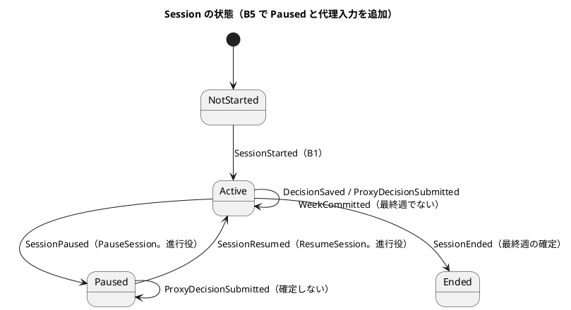

# Bolt 5 計画 - 進行の継続と資格

## 概要

| 項目 | 内容 |
| :--- | :--- |
| Bolt | B5（[リリース計画](./release_plan.md)） |
| Unit | U2 進行の継続（共同担当・資格）。U2 の最初の Bolt。次は B6（共同担当と共同入力） |
| 所要（計画） | 2 稼働日（リリース計画の仮定。**ステップ数に対して厳しい見込み**。下のリスクと判断項目 14） |
| 日程（仮定） | リリース計画の稼働日の目安は 2026-12-01〜12-02（B4 の終了後を前提）。**判断項目 1 の決定（2026-11-15）で、B5 を B4 より先に実施する**ため、この日付は使えない。実施日は着手時に人が決める（`validating-design` の軸 A。リリース計画のスケジュールと進捗状況の更新は、人の判断待ち） |
| ゲート密度 | **密**（リリース計画の「B5 は高リスク（認可と冪等）」。ステップごとに人が検証する）。U1 のゲートは 2026-11-15 に承認済みだが、人の検証を含めた実績はまだ少ないため、密度は下げない |
| アプローチ | 中盤（[開発戦略](./development_strategy.md)）。**インサイドアウト**（ドメイン → 永続化・資格 → アプリケーション → HTTP）。ただし**仕様（`contracts/openapi.yaml`）と日本語 Gherkin を先**に書き、契約テストを Red にしてから実装する（API を足す Bolt の共通の順序） |
| 状態 | **ステップ計画は、2026-11-15 にユーザーが承認した（ユーザーの選択: 「計画を承認」）。着手前の判断項目 16 件は、同日にユーザーが決定した（下の更新履歴）。ゲート 0〜8 は人の確認待ち（未承認）。** 実装・コード変更は未着手。`validating-design` は Step 0.2 で実施する |

> **承認の状態について**: ステップ計画の承認と判断項目 16 件の決定は、2026-11-15 にユーザーが行いました（更新履歴）。**各ゲート（0〜8）は承認を受けていません。** 承認は、ユーザーが指示した範囲だけを、更新履歴に記録します。下の判断項目表の「提案」列は、決定の前の記述で、決定の内容は更新履歴にあります。

### ゴール

進行役が、停止・代理入力・再開で、不在者や中断があっても学習を継続でき、参加者・進行役が、切断後に同じ役割・同じ進行のコンソールへ復帰できるようにする。同時に、**漏洩した資格の被害を止められる設計**（期限・失効・再発行・鍵の複数の版・専用のレート制限）にし、**失効した資格の再送が 403 になる順序**（認証 → 認可の前提検査 → 冪等記録の照合。[ADR-004](../../adr/beer-game-kotlin/004-idempotency-after-authorization.md)）を、否定テストで守る。

### 確認したい仮説（リリース計画）

1. **資格の設計は、漏洩時に被害を止められるか。** 期限切れ・失効・旧版の鍵で発行した資格が、それぞれ期限・失効の規則どおりに受け付けられる、または拒否されるか。鍵のローテーション後も、旧版の資格が期限まで有効か。
2. **失効した資格の再送は 403 か。** 以前に成功した `Idempotency-Key` を、失効後に再送しても、保存済みの応答が返らないか。
3. **参加・復帰の総当たりを、タスク数に依らず抑えられるか**（NF-S11・NF-S19。現状のレート制限はプロセス内。判断項目 4）。

### 対象の受入条件

出典は [ユーザーストーリー](../../requirements/beer-game2/user_story.md)（Kotlin 版は beer-game2 の要件を引き継ぐ。リリース計画）。**シナリオの期待値は、原文の意味と一致させる**（タグ `@US`・`@AC`）。

| ID | 内容（原文の要点） | 備考 |
| :--- | :--- | :--- |
| AC3.1.1 | 一時停止中に参加者が新規の確定をすると、拒否し、既存の入力を失わない | 原文は「確定」。参加者の `SaveDecision`（入力の保存）も停止中は拒否する設計（[ドメインモデル](../../design/beer-game-kotlin/domain-model.md)）。**原文は「確定」だけを述べる点を、シナリオで両方扱うか、ゲート 1 で確認** |
| AC3.1.2 | 進行役が代理入力して確定すると、操作者・役割・時刻・値を監査履歴に残す | 値をイベントに含める（beer-game2 の「値が残らない」の解消。FR-15） |
| AC3.1.3 | 再開すると、最後の確定済みの週から入力できる | |
| AC3.2.1 | 有効な復帰資格で再接続すると、同じゲームと役割の最新の状態を表示する | |
| AC3.2.2 | 無効または削除済みの資格で再接続すると、復帰せず、進行役への確認方法を示す | 失敗は、資格の存在・期限・削除を区別しない応答（NF-S12） |
| AC3.2.3 | 複数のタブで一方が週を確定すると、他方は古い応答を適用せず、最新の状態を反映する | 版による古い応答の拒否は B1 の仕組みで足りる見込み。**B5 で確認のシナリオを足すか、B6 へ回すかを判断項目 8 で決める** |
| AC3.2.4 | 進行役が画面を再読み込みまたはブラウザを再起動しても、資格で同じゲームの進行コンソールへ戻れる | beer-game2 では未達（✗）。**進行役の復帰の手段は判断項目 9** |
| AC3.2.5 | 資格には有効期限があり、進行役は、漏れた資格を失効させて再発行できる | beer-game2 では未達（✗） |

### 範囲外（後続の Bolt、または未割り当て）

共同担当と共同入力（B6。`DecisionConflict` の拡張、`DecisionsChanged`、制約ごとの再試行）、カスタム条件（B7）、自動確定（B8。ただし**停止中は確定しない・再開時に判定する**規則は、ドメインに B8 が使える形で置く。判断項目 11）、観察者・観察用の招待の資格（B9）、削除（B11）、投影の再構築・N-1 互換の本実装（B12）、AWS・本番の定義（B14。**鍵の複数の版は環境変数・Secrets Manager の形に関わるが、Terraform の変更は本 Bolt では行わない**。判断項目 3）、手動の終了（`EndSession`。リリース計画の B5 の範囲に無い。判断項目 11）。

**前の Bolt（U1）の申し送りの取り込み**（[Unit U1 総括](./unit_u1_summary.md)の学び 7: 取り込まないと黙って落ちる）:

| 申し送り | 扱い |
| :--- | :--- |
| 参加の応答に `gameId` が無い（U1 #12、B1 #1） | **取り込む（判断項目 7）**。復帰・参加の応答は、ゲームを特定する情報を返さないと、復帰した画面が進めない |
| 鍵の版の複数保持（B1 の持ち越し） | **取り込む**（Step 4） |
| 資格の期限の分離（B1 は、ブラウザセッションと復帰資格を 1 つの値で兼ねた。設計は B5 で分ける想定） | **取り込む**（Step 4。判断項目 2） |
| ADR-004 の B5 の項目（失効後の再送の否定テスト） | **取り込む**（Step 4。R5） |
| 停止中の `NotActive` の文言・`code`（[UI 設計](../../design/beer-game-kotlin/ui-design.md) の未決） | **取り込む**（判断項目 6） |
| `InvalidTransition` の性質テスト（B2 の未実施。状態が増えるここが自然） | **取り込む案**（Step 2。判断項目 12） |
| 参加・復帰の専用のレート制限（設計書: 「B5」。現状は接続元ごと 600 件/分のプロセス内の固定窓） | **取り込む**（Step 5。判断項目 4） |
| 冪等記録の掃除、SSE と `LISTEN` 切断中の欠落、投影の整合検査 | 範囲外・未割り当て（B1 の持ち越し。B12 付近か人が決める） |
| V101 と V102 の順序（番号の付け替え） | 判断項目 5（新しいマイグレーションを足す場合に衝突する） |
| N-1 互換（新しいイベント種別を足すと、旧版が読めるか） | 範囲外（本実装は B12）。**新しいイベントを足す事実と一覧を、Step 8 の記録に残す** |
| `@ui` の拡張（参加者の画面）、Node 26 の導入と `.nvmrc` | UI の範囲は判断項目 13。Node は範囲外 |
| 層単位の PMD の緩和、`FunctionNameTooShort`、adapter-persistence の違反をコードで直すか（B2 #3〜#5） | 範囲外。**新しいコードは、層ごとのルールセットのまま違反 0 件**を守る |
| 役割の入れ替えでの資格の失効（B1 計画 Step 8 の記録「資格の失効の書き込み、役割の入れ替えでの失効、復帰は B5」。`validating-design` 軸 C の C1 で追加） | **範囲外（人の判断待ち）**。設計書に入れ替えのコマンドと規則が無い（[ドメインモデル](../../design/beer-game-kotlin/domain-model.md) の「開始後の入れ替え」は未決事項）。本 Bolt は、進行役の `RevokeCredential` による失効で否定テストを行う。入れ替えでの自動失効を B5 に含めるかは人が決める |
| 観察用の招待の参加の専用のレート制限（NF-S11・NF-S19） | 範囲外（B9。観察者の参加が B9 のため）。本 Bolt の専用の制限は、参加・復帰だけ |
| B2 の申し送り（生きたドキュメントの公開の導線、`@US`・`@AC` タグの整合検査、`@Suppress`・ベースラインの機械検査、Kover の残り、SSE の契約テスト。U1 総括 #18・#19） | 範囲外・未割り当て（`validating-design` 軸 C の C2）。B5 の計画の作成時に、項目として取り込まれていなかった。割り当て先は人が決める |
| Living Documentation の中盤の重点（開発戦略: 用語集・イベント一覧を、中盤の最初の Bolt から整える） | **人の判断待ち**（`validating-design` 軸 A の A2）。注釈の語彙と生成の仕組みは、開発戦略が「B1〜B2 で決める」とした未決のままで、B1〜B3 の終了報告に決定の記録が見つからない。本 Bolt に含めるか、割り当てを先に決めるかは人が決める |

---

## 設計（4 図の確認）

B5 は、**新しい状態・コマンド・イベントを足す**ため、4 図のうち 3 つが変わる（設計書にはあるが、B1〜B3 では未実装）。**設計書への反映が要る点は、Step 8 で変更表に記録**する。設計の正本は [ドメインモデル](../../design/beer-game-kotlin/domain-model.md)、[データモデル](../../design/beer-game-kotlin/data-model.md)、[バックエンド](../../design/beer-game-kotlin/architecture-backend.md)、[UI 設計](../../design/beer-game-kotlin/ui-design.md)。

### ドメインモデル図（変わる）

| 追加するもの | 内容（設計書にある。**実装は無いことを確認済み**: `Session.kt` の `SessionState` は `NotStarted`・`Active`・`Ended` だけ、`Game.kt` のコマンドは `CreateGame`・`JoinGame`・`AssignRole` だけ） |
| :--- | :--- |
| Session | 状態 `Paused`。コマンド `PauseSession`、`ResumeSession`、`SubmitProxyDecision`（`requestedWeek`、版は要求しない、進行役のみ、進行中または一時停止中）。イベント `SessionPaused`、`SessionResumed`、`ProxyDecisionSubmitted`（`week`・`role`・`quantity`・`decisionVersion`・`editor`・`submittedRoleCount`） |
| Game | 資格の有効性（`CredentialSubject` ごとの有効期限・失効）。コマンド `RevokeCredential`、`ReissueCredential`、`RecoverParticipation`。イベント `CredentialRevoked`、`CredentialReissued`、`ParticipationRecovered`。エラー `CredentialAlreadyRevoked`（`InvalidState`） |
| 変えないもの | `simulateWeek`（純粋関数）、`startGame`、投影の `Lobby` は資格のイベントを購読しない（資格の状態の正本は `credentials`。設計書の変更 #24） |

### 状態遷移図（変わる。Session）

停止中に、参加者の `SaveDecision`・`CommitWeek` は拒否する（AC3.1.1。入力は失われない）。再開すると、**最後の確定済みの週から**入力できる（AC3.1.3）。自動確定の判定（再開時に揃っていれば確定）は B8。**PlantUML の描画での構文確認は未実施**（B1〜B3 から続く未確認事項）。

### 資格の状態（新しい概念）

| 資格の種別 | 保存 | 期限（暫定。判断項目 2） | 失効・再発行 |
| :--- | :--- | :--- | :--- |
| ブラウザセッション（`browser_sessions`） | 鍵付き HMAC のダイジェストと鍵の版 | 24 時間（設計書 NF-S4 の例） | 期限で自然に失効 |
| 参加者の復帰資格（`credentials`、`PARTICIPANT_RECOVERY`） | 同上 | 30 日 | 進行役が失効・再発行できる |
| 進行役の資格（`credentials`、`FACILITATOR`） | 同上 | ゲームの保持期間内。**B1 の実装は、DB の `expires_at` が作成時 + 保持日数（`Commands.kt`。既定 90 日）、Cookie の `Max-Age` が 30 日**（`Wiring.kt` の `PARTICIPANT_CREDENTIAL_TTL_DAYS`。進行役も同じ値）。期限の値は `Wiring.kt` の定数で、設定値ではない | 同上 |

復帰（`RecoverParticipation`）は、有効な復帰資格を提示すると、新しいブラウザセッションを発行し、復帰資格の期限を更新する（`ParticipationRecovered.credentialExpiresAt`）。

### ER 図（変わる可能性。判断項目 4・5）

**確認した事実**: [V002](../../../apps/beer-game-kotlin/adapter-persistence/src/main/resources/db/migration/common/V002__peripheral_stores.sql) の `credentials` は `key_version`・`expires_at`・`revoked_at` を、`browser_sessions` は `key_version`・`expires_at` を、すでに持つ。鍵の複数の版・期限には、表の列の追加は要らない見込み。**ただし、失効は別（Step 0.3・`validating-design` の B3）**: `browser_sessions` に `revoked_at` も `credentials` への参照も無く、B1 は同じダイジェストで両表を結んで認証している。ブラウザセッションと復帰資格を別のダイジェストに分けると、**資格を失効させたときに、発行済みのブラウザセッションを止める結び付きが無い**。列の追加（スキーマ変更）が要るかは未確認で、Step 4.3 の前に人が決める。

**変わる見込み**: 参加・復帰の専用のレート制限を、タスク数に依らない上限にするには、**試行の窓を DB に持つ表**（名前・列は未決）が要る。**スキーマ変更は確認必須**（判断項目 4・5）。表が増えれば `game_id` を持つ表の連鎖削除（B11 の「全表に行が残らない」検査）との整合も要る（接続元の鍵は要約で、ゲームに紐づけない案を提案）。

### 画面遷移図（変わる。UI を含める場合のみ。判断項目 13）

| 画面 | 変更 |
| :--- | :--- |
| S03 参加・復帰（`/join`） | 復帰（資格での再接続）の入口。失敗の文言は、送った資格の種類から選ぶ。進行役の復帰先は S06（進行中）または S04（準備中）、参加者は S05 または S04（[UI 設計](../../design/beer-game-kotlin/ui-design.md)の S03 → S04/S05/S06） |
| S06 進行役のコンソール | 停止・再開、停止中の代理入力（確認ダイアログに上書きする値を表示）、資格の失効・再発行 |
| S05 プレイ | 停止中の表示（入力・確定を受け付けない旨。`code` と文言は判断項目 6） |

---

## 人の判断が要る項目（着手前）

**着手前に、人が決める。決まるまで、依存する Step に着手しない。** 「提案」は AI の案で、承認ではありません。ゲートを通っていない仮置きは、U1 で多く積み上がった反省（U1 総括の学び 1）から、ここで先に決める。

| # | 項目 | 内容（事実） | 提案 |
| :--- | :--- | :--- | :--- |
| 1 | **B4 との順序** | リリース計画は B4 → B5 の直列だが、B5〜B8 は B4 に依存しない（並列にできる）。B4 は未着手。参加・復帰の応答の `gameId`（#7）は、B4 の UI と B5 で共通 | リリース計画どおり B4 の後に着手する。B4 を後ろに回して先に B5 を始める場合は、リリース計画（Release 0.1 の条件）に影響するため、人が決める |
| 2 | **資格の有効期間**（R11） | 運営者との合意が要る数値。設計書の例は、ブラウザセッション 24 時間、復帰資格 30 日、進行役の資格はゲームの保持期間内。B1 の実装は、進行役も参加者も 30 日で兼用 | 設計書の例を**仮の既定値**として設定値にする（コードに埋め込まない）。運営者との合意は未取得であることを記録し、合意の前に永続環境へ出さない |
| 3 | **鍵の複数の版の方式** | 現状は `CREDENTIAL_KEY` が 1 つ（`ServerConfig`）。資格の検証は、1 つの鍵でダイジェストを作って照合している（`Execute.kt`）。ダイジェストは鍵付きなので、**版を知らないと、どの鍵で作ればよいか決まらない**。設定の名前の変更は、Terraform（`infra/`）の秘密の形にも波及する（本 Bolt では Terraform を変更しない） | 資格の値に**版の接頭辞**を含め、版ごとの鍵で検証する案 A。または全版を順に試す案 B（版が少なければ可）。案 A を提案。設定は `CREDENTIAL_KEY` に加えて版つきの複数指定（名前は決めたい）。**ADR を新しく書く**（beer-game2 の ADR-009 を参照して Kotlin 版に追加。判断項目 15） |
| 4 | **参加・復帰の専用のレート制限の方式** | 現状は、接続元ごとの固定窓 600 件/分、**プロセス内**（設計書に「タスク数が増えれば実効の上限が増える」と明記）。NF-S11 は「実効の上限が、タスク数で増えない」を要求。接続元は ALB になるため `X-Forwarded-For` の信頼の範囲が未決（設計書の未決事項） | 案 A: **DB に試行の窓の表**を持つ（新しいマイグレーション。確認必須）。案 B: プロセス内のまま、NF-S11 を未達として記録する（B5 の仮説 3 は確認不能）。案 C: ALB・WAF に任せる（インフラの変更で本 Bolt の範囲外）。**案 A を提案**。接続元の鍵は正規化した接続元の鍵付き要約（生の IP を DB に残さない）。接続元の信頼の範囲は決める必要がある |
| 5 | **マイグレーションの追加と番号** | データモデルの番号の計画は 001〜005 が共通、006 が保持（B11）。PostgreSQL 専用の V101（ロール）・V102（冪等記録の索引）がある。**V101 と V102 の順序の付け替えは未実施**（U1 の判断で、永続環境の前に実施） | 試行の窓の表（#4 の案 A）を足す場合の番号を、保持（006）と衝突しない形で決める。**スキーマ変更は確認必須**。V101・V102 の付け替えを、この機会に行うかも決める |
| 6 | **API の追加経路・`code`・ステータス**（仕様が先） | 設計書の案: `POST /sessions/{id}/pause`、`/resume`、`PUT /sessions/{id}/proxy-decisions/{role}`（本文に `requestedWeek`）、`POST /games/{id}/credentials/revoke`、`…/reissue`、`POST /participations/recover`。停止中の参加者の保存は、設計書は `NotActive`（409。「停止中の `NotActive` は B5」）、UI 設計は文言が未決 | 設計書の経路を採る。停止中は既存の `session.not_active` を使い回すか、`session.paused` を足すかを決める（**使い回すと、「まだ始まっていない」と「停止中」を、画面が区別できない**ため、`session.paused` の追加を提案）。ステータスは 409。`code` は ADR-008（`code` の一覧と仕様の一致を契約テストで検査）に従う |
| 7 | **参加・復帰の応答に `gameId`** | 作成の応答は versions だけで、ゲームの ID は `Location`。参加の応答も versions だけで、参加者は参加後に `gameId` を知る手段が無い（B1 #1、U1 #12）。復帰は、画面が `gameId` なしで進めない | 参加・復帰の応答に `gameId`（または `Location`）を足す（バックエンドと仕様の変更。契約テストの対象）。作成の応答の扱い（`Location` のまま）は変えない |
| 8 | **AC3.2.3（複数タブ）の扱い** | 古い応答の拒否は、版（`If-Match`、`requestedWeek`）の仕組みで B1 から足りる見込み。確かめるシナリオは無い | B5 の Gherkin に 1 シナリオ足して確かめる（実装が足りなければ B6）。足りる見込みは**未確認の仮定** |
| 9 | **進行役の復帰の手段**（AC3.2.4、AC3.2.5） | 進行役の資格は Cookie（B1）。Cookie が残っていれば画面の再読み込み・再起動で戻れる。Cookie を失う（端末の変更、削除）と戻れない | 作成時に、進行役の**復帰用の値を一度だけ表示**して控えさせる案 A。Cookie の寿命だけに頼る案 B（端末を替えると復帰できない。AC3.2.4 の「ブラウザの再起動」は満たす）。**案 A を提案**。表示の値は、保存はダイジェストだけで、再表示しない |
| 10 | **代理入力の保存回数の上限**（NF「1 役割・1 週あたり 9 回（代理入力を含む）」。コードと文言は未決） | 設計書の提案値。B1 に実装があるかは未確認 | B5 では実装しない（範囲外）。または実装する場合の `code`・文言を決める |
| 11 | **`EndSession`（手動の終了）と自動確定との境界** | 設計書の経路 `…/{pause,resume,end}` に `end` があるが、リリース計画の B5 の範囲は「停止・再開・代理入力」。停止中は確定しない規則は、B8 の自動確定に使う | `end` は B5 の範囲外（理由: リリース計画に無い）。ただし停止中に確定しない規則（`decideSession`）は、B5 で実装し、再開時の判定は B8 とする |
| 12 | **`InvalidTransition` の性質テスト**（B2 の未実施） | 状態が `Paused` を含めて 4 つになる。許されない遷移がすべて拒否されることを、性質テストで確かめられる | Step 2 に含める（Kotest の性質テスト）。含めない場合は、未割り当てのまま残す |
| 13 | **UI の範囲** | 開発戦略の中盤はインサイドアウト。Unit 定義の U2 は「サービス + UI」。B1 の `@ui` は 1 シナリオ（ウォーキングスケルトン）だけ | 最小の UI: S03 の復帰、S06 の停止・再開、停止中の表示。`@ui` は 1〜2 シナリオ（復帰、停止 → 再開）。代理入力と資格の失効・再発行の画面は B6 以降に回す案も含めて、人が決める。**UI を含めるほど、2 日を超える** |
| 14 | **所要 2 日の確保** | 本書のステップは 9 つ。U1 の実績（B1: 4 日の計画に 12 ステップ）は、人の検証時間を含まず、2 日で収まる根拠にならない | 超える見込みのとき、予備 B16 で吸収し、リリース計画の再調整は**人が判断**する。B5 を 2 つに分ける（B5a: 停止・再開・代理入力、B5b: 資格・復帰）案も提示する |
| 15 | **新規ファイルの作成**（確認必須） | 新規作成の見込み: `features/continuation/*.feature`（停止・代理入力、復帰・資格）、資格・レート制限のテスト、マイグレーション（#4 の案 A）、ADR（鍵の版とレート制限の保存先）、`bolt_5_report.md`。既存の設計書・ADR・計画は編集 | 必要性は上のとおり。**承認をお願いします**。新しい依存は**導入しない**方針（既存の `Hmac.kt`・`SecureTokens.kt`・`Credentials.kt` を拡張する想定。**中身の詳細は未確認**で、Step 0.3 で確認する）。必要になれば、その時点で人に確認する |
| 16 | **ゲートの密度** | リリース計画は B5 を「密」とする | ステップごとに人が確認する。人の確認なしに連続して進めない（U1 の規律の逸脱の反省） |

---

## ステップ計画

各ステップは、**テストを先に書き、失敗を確認してから最小限を実装する**（TDD、BDD）。**ゲートは、人の確認待ち**とし、承認済みとは書かない。**ファイルの編集は、Write・Edit のみ**（heredoc・python・sed・perl・awk は使わない。U1 で繰り返し起きた逸脱）。**静的解析は、違反 0 件・ベースラインなし・`@Suppress` なし**を、毎ステップで守る。

### Step 0: 着手前の確認（`validating-design`）（✅）

- [x] 0.1 判断項目 1〜16 を、人が決める（決定を、更新履歴に、ユーザーが指示した範囲だけ記録する）。**決定は 2026-11-15 に更新履歴へ記録済み**（ゲート 0 の承認ではない）
- [x] 0.2 `validating-design` を、着手前に実施し、**結果を本書に記録する**（軸 A: 開発戦略 ↔ 本書、軸 B: 本書 ↔ 設計書・ADR、軸 C: 本書 ↔ 過去の Bolt の計画・終了報告。B2・B3 の計画は、この記録が無いことが U1 の逸脱だった）。**2026-11-15 に実施。結果は「[設計整合性の検証結果](#設計整合性の検証結果着手前validating-design)」**（NG。計画側の修正 10 件、人の判断待ち 5 件）
- [x] 0.3 設計書のスケッチと、実装（B1 の形）の差を確認する（B1 の学び 6: スケッチは型でなく責務で書く）。特に `GameData`（B1 は設定・参加者・割り当てだけ。設計書は招待・観察者・資格を含む）と `AppSettings`（資格の鍵）。**2026-11-15 に実ファイルで確認。結果は「[設計書のスケッチと実装の差](#設計書のスケッチと実装の差step-03)」**

**ゲート 0**: 判断項目の決定と、`validating-design` の結果を、人が確認する。**状態: 2026-11-15 にユーザーが承認した（選択: 「ゲート 0 と再承認の両方」）。** 追加ステップ（2.5、4.6、4.7、5.5）を含む計画も再承認された。H1・H4 を B5 に含める決定により、**Step 8.4（Living Documentation の用語集・イベント一覧の生成）と Step 3.5（役割の入れ替えでの自動失効。設計書にコマンド・規則が無いため、仕様と設計書を先に書く）を追加する。この 2 ステップの追加の内容は、ゲート 1 で人が確認する（Step 3.5 と Step 8.4 として記載済み。2026-11-15）。**

### Step 1: 仕様と受入シナリオ（API 契約が先）（🔴）

> **Step 1 の実施結果（2026-11-15。コード変更は、受け入れのステップ定義・試験の道具・仕様・型の生成物・辞書の型の追従だけで、製品の実装は無い）**: 下の 1.1〜1.3 を実施した。結果は「[Step 1 の実施結果](#step-1-の実施結果2026-11-15)」。**ゲート 1 は人の確認待ちで、承認していない。H2・H3 は提案（[ゲート 1 で決めること](#ゲート-1-で決めること2026-11-15-提案)、[ADR-015](../../adr/beer-game-kotlin/015-credential-handover-and-session-revocation.md)）。**

- [x] 1.1 🔴 日本語 Gherkin を `features/continuation/`（名前は判断項目 15）に書く（AC3.1.1〜3.1.3、AC3.2.1〜3.2.5。**原文の意味と一致**させる。解釈の差は、シナリオの直前にコメントで書く）。**失効した資格の再送が 403**、**鍵のローテーション後も旧版の資格が期限まで有効**、**旧版の鍵の削除後は 403**、**期限切れの資格は 403**、**復帰の失敗は存在・期限・失効を区別しない同じ応答**、**停止中の代理入力は確定しない**、**代理入力のイベントに値が残る**、**失効した復帰資格での復帰の再送が 403（保存済みの新しいセッションを返さない）**、**準備中と開始後の両方で、失効・再発行・復帰を受け付ける**（ドメインモデル）、複数タブ（AC3.2.3。判断項目 8）、代理入力の保存回数の上限（判断項目 10。超えたときの `code`・文言は未決で、ゲート 1 で人が決める）を含める。フォルダは `features/continuation/`（名前は判断項目 15）とし、**`features/TAGS.md` の領域の一覧（Epic 3 継続と復旧）に追記する**（`validating-design` 軸 C の C3）
- [x] 1.2 🔴 `contracts/openapi.yaml` に、判断項目 6 の経路を書く（`Idempotency-Key`、`code` の一覧、`requestedWeek`、`If-Match` の有無）。契約テストを回し、**実装が無いので失敗する（Red）**ことを確認する
- [x] 1.3 🔴 `@api` のシナリオが、Undefined・Pending でなく **Failing** になることを確認する（Undefined → Pending → Failing → Passing の順）

**ゲート 1**（全 Bolt の共通の承認項目）: 受入条件の Gherkin シナリオを、**実装の前に**人が検証して合意する。原文との照合（解釈の差）、`code` の名前、応答の形を確認する。**状態: 2026-11-15 にユーザーが承認し、9 項目を提案どおりに決定した（選択: 「承認し、提案どおり決定」）。** 人が決めること（H2・H3 を含む）は、下の「[ゲート 1 で決めること](#ゲート-1-で決めること2026-11-15-提案)」。

#### Step 1 の実施結果（2026-11-15）

実施者: claude-code/claude-sonnet-5-5。**実測の事実だけを書く。ゲート 1 の承認は記録していない。**

**成果物**: `apps/beer-game-kotlin/features/continuation/` の 3 ファイル（`pause-resume.feature` 12 シナリオ、`recovery.feature` 8 シナリオ〔アウトラインの例 3 を含む〕、`credentials.feature` 14 シナリオ〔例 2 を含む〕。計 34）、`features/TAGS.md`（領域 `continuation/` を追記）、`contracts/openapi.yaml`（6 経路と、`gameId`・`recoveryCode` ほかのスキーマ、4 つの `code` を追加。`npm run api:lint` が通る）、受け入れのステップ定義（`ContinuationSteps.kt` ほか）、`web/src/api/generated/schema.d.ts`（再生成。`api:check` で差分 0）、`web/src/api/problems.ts`（`Record<ErrorCode, …>` の型の追従だけ。文言は未決の `null`）、[ADR-015](../../adr/beer-game-kotlin/015-credential-handover-and-session-revocation.md)（提案中）。

**Red の実測**（コマンドは `apps/beer-game-kotlin` で実行）:

| 検査 | 変更前（ベースライン） | 変更後 |
| :--- | :--- | :--- |
| `./gradlew :app:acceptanceTestH2`（H2） | 27 シナリオ・209 ステップ、すべて緑 | **61 シナリオ: 30 passed、31 failed**。519 ステップ: 414 passed、74 skipped、31 failed。**Undefined・Pending は 0** |
| `./gradlew :app:acceptanceTest`（PostgreSQL 18 の Testcontainers） | 同上（27 緑） | **H2 と同じ（30 passed、31 failed）** |
| `./gradlew test`（単体・契約） | 緑（up-to-date） | `:app:test` が **71 件中 8 件 failed**（下記）。ほかのモジュールの test は緑 |
| `web`: `npm run verify`（format・lint・typecheck・test 70 件・build）、`acceptance:dry-run` | — | 緑（型の追従後）。最初は `problems.ts` が型エラーになったため、4 つの `code` を `null` で足した |

- 新規 34 のうち **31 が Failing**。内訳: 経路が無い（404 `request.not_found`）27、参加の応答に `gameId` が無い（`NoSuchElementException`）1、開始後の入れ替えが `game.not_preparing`（409）で拒否される 1、保存回数の上限が無く 10 回目が 200 になる 1、**署名鍵の更新の試験用の操作が無い（`AssertionError`。試験の道具の限界で、振る舞いの Red ではない）1**。**鍵のローテーションの 2 シナリオのうち、1 つ目は復帰の 404 で先に落ち、鍵の操作に届かない**。
- **新規 34 のうち 3 つは、最初から Passing**（Red にならない）: 「期限が切れたブラウザセッションでは、状況を取得できない」（B1 の保証）、「複数のタブで一方が週を確定すると…」（AC3.2.3。判断項目 8 の見込みどおり、版の仕組みで足りる確認）、「進行役が画面を再読み込みしても…」（Cookie が残る場合）。**これらは実装の前から成り立つ振る舞いの確認で、Step 2 以降で壊さないための回帰として残す**。
- `:app:test` の 8 件の failed は、すべて `ApiContractSpec`（仕様を先に変えたことによる、予期した Red）: 「応答の適合」「全体の守り（500）」「全体の守り（503）」「リクエストの適合（2 件）」は、**`POST /games` の 201 に必須の `recoveryCode`（H3 の提案）が無い**という同じ原因で落ちる（**このため、これら 5 件は、ほかの違反を隠している**。H3 を決めたあと、実装の Step で個別に確かめる）。残り 3 件は、「要求の表が仕様の全操作を含む」（表に 6 操作が無い）、「エラー code の一致」（仕様にあって実装に無い 4 件: `session.paused`・`session.not_paused`・`session.save_limit_reached`・`game.credential_already_revoked`）、「ルートの網羅」（仕様にあって実装に無い 6 経路）。**HttpFlowSpec など ApiContractSpec 以外のテストは、すべて緑のまま**。
- 静的解析: `ktlintCheck`、`detekt`、`detektMain`、`detektTest`、`pmd`（`pmdMain`・`pmdTest`・`pmdAdapter`・`pmdDomainApplication`）は違反 0（JDK 21 で実行。`@Suppress` なし、ベースラインなし）。実験的な `:app:detektAcceptanceTest`（`check` に含まれない）は、既存の受け入れの道具を含めて指摘があり（26 件。うち新規のファイルの分: `ContinuationSteps`・`GamePlayApi` の `TooManyFunctions`、`GamePlayApi.send` と `saveDecisionAt` の引数の数）、**本 Bolt では、`check` の対象でないため直していない**（人の判断）。
- 試験の道具に足したもの: `RunningApp.auditTrail`（`events` を読むだけ。API に監査履歴の読み出しが無いため）、`RunningApp.expire`（保存された期限を過去にして、時計を進める代わりにする。**テストの道具だけで、本番のコードにも DB のスキーマにも触らない**）、`rotateCredentialKey`・`dropOldCredentialKey`（鍵の複数の版が無いため、`AssertionError` で失敗する。Step 4 で実装する）。

**シナリオ側の仮定（ゲート 1 で確認）**: 「期限切れ」の再現は、保存された期限の更新による（時計の注入ではない）。「ブラウザセッションを失う」は、以降のステップがその資格を使わないことで表す。`recovery.feature` の復帰コードのシナリオと `bg_recovery` の Cookie は H3 の案 A による（案 B なら外す）。入れ替えは、既存の `assignRole` を開始後に使う形（提案）。

### ゲート 1 で決めること（2026-11-15 提案）

**以下は AI の提案で、決定ではない。人が決める。決まるまで Step 2 以降に進まない。** スキーマ変更・認証・認可に関わる項目（2、3、6、7）は、確認必須。

| # | 決めること | 提案（案と推奨） | 影響 |
| :--- | :--- | :--- | :--- |
| 1 | **原文との解釈の差**。(a) AC3.1.1 の「新規の確定」を、参加者の入力の保存（`SaveDecision`）と、進行役の週の確定（`CommitWeek`）の両方の拒否として書いた。(b) AC3.2.2 の「進行役への確認方法を示す」は、画面（S03）の責務とし、API は理由を区別しない同じ 403 を返す。「削除済み」の資格は B11 のあとに足す | 提案どおり。(a) は設計書（停止中は `SaveDecision` も拒否）に合わせた。原文は「確定」だけ | シナリオの期待値。違う解釈なら、Gherkin を直す |
| 2 | **H2: 失効でブラウザセッションを止める結び付き**（[ADR-015](../../adr/beer-game-kotlin/015-credential-handover-and-session-revocation.md)）。**案 A（推奨）**: 失効と同じトランザクションで、対象の主体の `browser_sessions` の行を削除する（スキーマ変更なし）。案 B: `browser_sessions` に `revoked_at`（または参照）を追加する（**スキーマ変更。確認必須**）。案 C（不採用）: 認証が未失効の資格の存在を確かめる（再発行で、失効した古いセッションが復活する） | 案 A | Step 4.3。A なら新しいマイグレーションは要らない（`DELETE` の GRANT は Step 4 で確認） |
| 3 | **H3: 復帰資格の受け渡し**（ADR-015）。**案 A（推奨）**: `bg_recovery` の Cookie（30 日）と、作成・再発行の応答の本文に一度だけ示す復帰コード。`recover` の本文は `{gameId, recoveryCode?}`、応答は `{gameId, kind, role?, versions}`。復帰は冪等記録の照合より前に、復帰資格を検証する（`Auth` に `RECOVERY` を足す）。案 B: Cookie の寿命だけ（端末の変更で復帰できず、再発行した資格を渡せない。AC3.2.5 が成り立たない）。案 C（不採用）: URL で渡す | 案 A。**設計書の「応答は `versions` だけ」「DTO に資格の値を持たせない」に、2 つの例外ができる**（アーキテクチャ設計・UI 設計の更新は Step 8.3） | 仕様（`createGame`・`joinGame`・`reissueCredential`・`recoverParticipation`）、Step 6.2。**B なら、`recovery.feature` の復帰コードのシナリオと `bg_recovery` の Cookie を外す** |
| 4 | **保存回数の上限（9 回）の `code`・文言**。NF-C8 は未決のまま | `session.save_limit_reached`（409。`InvalidState`）。文言は「この週の保存回数の上限（9 回）に達しました。」の仮置き | 仕様、ドメインのエラー、UI の辞書 |
| 5 | **新しい `code` の名前と状態**（仕様に追加済み）: `session.paused`（409。停止中の保存・確定、二重の停止）、`session.not_paused`（409。停止中でない再開。**派生の提案**）、`game.credential_already_revoked`（409。`CredentialAlreadyRevoked`） | 提案どおり。`session.not_paused` は、再開を冪等にして 200 にする案もある（その場合は code を足さない） | ADR-008 の一覧、設計書の更新（Step 8.3） |
| 6 | **失効・再発行の対象**: (a) 失効していない資格の再発行を、拒否するか、置き換えるか。(b) 進行役自身の資格を対象にするか（B5 の仕様は参加者だけ）。(c) 観察者は B9 | (a) 拒否（`game.credential_not_revoked`。または失効 → 再発行の順を必須）、(b) 対象外（自分の資格を失効させると復帰できなくなる）、(c) 範囲外 | 仕様の `CredentialSubjectRequest`、Step 3 のドメイン |
| 7 | **H4: 役割の入れ替えの形**（Step 3.5）。提案: 既存の `PUT /games/{gameId}/participants/{participantId}/role` を、開始後も受け付け、**すでに担当がいる役割へ、参加済み・未割り当ての参加者を割り当てる**ことを入れ替えとする。旧担当者の資格（復帰資格・ブラウザセッション）は同じ操作で失効し、履歴と入力者のラベルは残す。代替: 専用の経路（`POST …/roles/{role}/replace` など） | 既存の経路を使う案（新しい経路が要らず、準備中の付け替え D9 と同じ入口）。設計書（ドメインモデル・データモデル）に、規則と `participants.replaced_at` を書く | Step 3.5.1 の仕様、データモデルの変更（`participants.replaced_at` は beer-game3 の実績。Kotlin 版の列の有無は未確認） |
| 8 | **試験の道具の方式**: (a) 期限切れを、保存された期限の更新で再現する（時計を注入しない）。(b) 鍵のローテーションの試験用の操作（`RunningApp.rotateCredentialKey`）を、Step 4 で実装する。(c) 3 つの Passing のシナリオ（Step 1 の実施結果）を回帰として残す | 提案どおり | 受け入れの道具（Step 4） |
| 9 | **契約テストの Red の扱い**。`POST /games` の 201 に必須の `recoveryCode` で、5 件が同じ原因で落ちている | H3 を決めたあと、Step 6 で解消する。H3 が案 B なら、`recoveryCode` を仕様から外して、5 件を緑に戻す | 契約テスト |

### Step 2: ドメイン — Session の停止・再開・代理入力（🔴🟢🟡）

> **Step 2 の実施結果（2026-11-15。ゲート 2 は人の確認待ちで、承認していない）**: 2.1〜2.5 を実施した。結果は「[Step 2 の実施結果](#step-2-の実施結果2026-11-15)」。

- [x] 2.1 🔴 Kotest（Given: 過去のイベント / When: コマンド / Then: イベントまたはエラー）を先に書く。`PauseSession`・`ResumeSession`・`SubmitProxyDecision` の正常系と否定（参加者の実行は `Forbidden`、`requestedWeek` が違えば `WeekAdvanced`、停止中の `SaveDecision`・`CommitWeek` は拒否、`Ended` は `AlreadyEnded`）。**失敗を確認**する
- [x] 2.2 🟢 `SessionState.Paused`、コマンド・イベント・エラーを、`decideSession`・`evolve` に実装する（`updateData` は `Active`・`Paused` に適用）。代理入力は版を 1 増やし、`editor`・値を残す。停止中の代理入力は確定しない。**停止中の参加者の拒否は、判断項目 6 の決定どおり新しい `SessionError`（`session.paused`、409、`InvalidState`）で返す**（現状の設計書は「停止中の `NotActive`」で、食い違うため Step 8.3 で設計書を更新する。`validating-design` 軸 B の B1）
- [x] 2.3 🟡 `InvalidTransition` の性質テスト（**設計書の定義: 有効なコマンド列を `decide` と `evolve` で回し、`InvalidTransition` が 1 件も出ない**。判断項目 12。`validating-design` 軸 B の B6 で、計画の記述を設計書に合わせた）。リファクタリング。**domain の行 100% のゲートを守る**（除外・閾値の引き下げをしない。B2 の追補で 100% に到達済み。新しい行は、実際のテストで到達させる）
- [x] 2.4 イベントの検査: ペイロードに表示名・資格が含まれない（ADR-002）。新しいイベントの種別の一覧を記録（N-1 互換の影響。B12）
- [x] 2.5 🔴🟢 **代理入力を含む保存回数の上限（1 役割・1 週あたり 9 回。判断項目 10 の決定）**。`SessionData` に、役割ごとの当週の保存回数を持たせる（現状は持たない）。確定でクリアする。超えたときの `code`・文言は未決（ゲート 1 で決める）。**B6 の共同入力（`DecisionConflict` の拡張）と同じ `SaveDecision` に触れるため、B6 の前提を壊さないことを確認する**。更新履歴の決定が、ステップに反映されていなかったため追加した（`validating-design` 軸 B の B8）

**ゲート 2**: Session の停止・再開・代理入力の振る舞いと、domain の行 100% を、人が確認する。**状態: 人の確認待ち（未承認）。**

#### Step 2 の実施結果（2026-11-15）

実施者: claude-code/claude-sonnet-5-5。**実測の事実だけを書く。ゲート 2 の承認は記録していない。HTTP・application への配線は Step 6 のため行っていない。**

**Red の確認（2.1）**: 先にテストと補助（`DomainFixtures.kt`、`SessionPauseProxySpec.kt`、`SessionEvolveSpec.kt`、`SessionTransitionPropertySpec.kt`、`ProjectionSpec.kt`）を書き、`:domain:test` を実行して、**テストのコンパイルが 61 件のエラー（`PauseSession`・`SessionPaused`・`Editor.ByFacilitator` などが未定義）で失敗する**ことを確認した（Kotlin では未定義の型の参照が Red になる）。そのあと最小の実装で Green にした。

**実装（2.2・2.5）**:

- `Session.kt`: `SessionState.Paused(data, version)`、コマンド 3 つ（`PauseSession`・`ResumeSession`・`SubmitProxyDecision`）、イベント 3 つ（`SessionPaused`・`SessionResumed`・`ProxyDecisionSubmitted`）、`Editor.ByFacilitator(gameId)`、エラー 3 つ。`decideSession` は、保存・確定・停止は進行中だけ、再開は停止中だけ、代理入力は進行中と停止中で受け付ける。**停止中の代理入力は 1 件だけ返し、確定しない**。
- `SessionEvolve.kt`（新規。`evolveSession` を `Session.kt` から移動し、状態ごとの遷移を小さな関数に分けた）。**理由は、detekt の `LongMethod`・`CyclomaticComplexMethod`・`TooManyFunctions` が、状態が 4 つになった `evolveSession` と 12 関数になった `Session.kt` で出たため**（設定の引き下げや `@Suppress` はしていない）。
- **ゲート 1 の決定の反映**: 停止中の保存・確定・二重の停止は `session.paused`（409、`InvalidState`）、停止中でない再開は `session.not_paused`（409）、保存回数の上限は `session.save_limit_reached`（409）。代理入力は、イベントに値・役割・週・版・入力者（`Editor.ByFacilitator`。表示名を含まない）を残し、操作者と時刻は封筒が持つ。
- **判定順**: 保存は 状態 → 権限 → 週 → 版（`DecisionConflict`）→ 上限、代理入力は 状態 → 権限 → 週 → 上限、停止・再開は 状態 → 権限。状態を先に判定するのは、既存の `SaveDecision`・`CommitWeek`（未開始・終了後を先に返す）と同じ。
- **保存回数の上限の実装（2.5。計画からの差）**: 計画は「`SessionData` に役割ごとの当週の保存回数を持たせる」だったが、**意思決定の版が、保存のたびに 1 増え、確定で 0 に戻る、つまり当週の保存回数そのもの**であるため、項目を足さず `decisionVersions[role] < 9`（`SessionData.hasSaveCapacity`、定数 `SAVE_LIMIT_PER_ROLE_WEEK = 9`）で判定した（同じ事実を二重に持たない）。**共同入力（B6）が版の意味を変えるなら、そのとき回数を分ける**（設計書の差の表 34 に記録）。B6 の前提（`SaveDecision` の `DecisionConflict` の判定）は変えていない。

**性質テスト（2.3）**: `SessionTransitionPropertySpec`（Kotest の `checkAll` 500 回。乱数の列は、有効な手・古い週や版の手・権限のない手・停止・再開・代理入力・確定を含む）。(1) 受け付けたコマンドの列の再生が `InvalidTransition` を 1 件も出さず、再生した状態が実行時の状態と一致する、(2) 受け付けるたびに版がイベントの数だけ進む（`evolve` が無視していない）、(3) 同じ列は同じ結果（純粋）、(4) 当週の保存回数が 9 を超えない。**性質テストが空振りでない確認**として、停止中の拒否・40 回保存の上限・停止 → 代理入力 → 再開の 3 つの具体例も置いた。定義は設計書のとおり（「許されない状態・コマンドの組がすべて拒否される」ではなく「有効なコマンド列で `InvalidTransition` が出ない」。B6 の修正済み）。

**イベントの検査（2.4）**: 新しいイベントは 3 種類（`SessionPaused`・`SessionResumed`・`ProxyDecisionSubmitted`）で、ペイロードは週・役割・数量・版・入力者・入力済みの数だけ（表示名・資格を持つ項目の型が無い。ADR-002）。永続化の符号化の往復で、`displayName` を含まないことを確かめた。**N-1 互換の影響**: 旧版のアプリケーションは未知の `event_type` を「未知の event_type」の `Left` で拒否する。**停止・代理入力を使った後に旧版へ戻すと、そのゲームの `session` ストリームが読めなくなる**（配線 Step 6 より前は、コマンドが無いので起きない。ロールバック手順は B12 で扱う）。

**ドメイン以外への追従（最小）**: `Editor`・`SessionEvent` の追加で、永続化の網羅した `when` がコンパイルできなくなったため、`adapter-persistence` に、3 つのイベントの DTO・符号化・復号と `ByFacilitator` の入力者を足した（Step 4.6 の一部の前倒し）。`EventCodecSpec` に往復・不正な入力者の種別の試験を 2 件足した。**4.6 の golden（全イベントの種類の JSON の固定）と、`DecisionSaved` の入力者の復号の拡張は、4.6 に残す**。`Projection.kt` は、`Editor.ByFacilitator` を `current_decisions` の `editor_kind`（`FACILITATOR`）に写す 1 行だけを足した（`ProjectionSpec` に 1 件）。**`ProxyDecisionSubmitted`・`SessionPaused`・`SessionResumed` の投影は、Step 4.7 に残す**。

**実測**（`apps/beer-game-kotlin` で実行。静的解析は JDK 21）:

| 検査 | 結果 |
| :--- | :--- |
| `:domain:test` | **300 件、失敗 0**（Step 2 で 45 件を追加。内訳: `SessionPauseProxySpec` 30、`SessionTransitionPropertySpec` 6、`SessionEvolveSpec` +8、`ProjectionSpec` +1） |
| `:domain:koverVerify`（行 100%） | 合格。**行 879 / 879（未到達 0）**。除外・閾値の引き下げなし |
| `:application:test`・`:adapter-http:test`・`:adapter-persistence:test` | 86 件・70 件・48 件、すべて失敗 0（永続化は +2 件） |
| `:app:test`（`./gradlew test` の一部） | **71 件中 8 件 failed。Step 1 と同じ `ApiContractSpec` の 8 件で、想定どおり**（`recoveryCode` が無い 5 件、要求の表、ルートの網羅、エラー code の一致）。**エラー code の一致の食い違いは、4 件から 1 件（`game.credential_already_revoked`。Step 3）に減った**。ほかの失敗なし |
| `:app:acceptanceTestH2` | 61 シナリオ中 **31 passed、30 failed**（Step 1 は 30 passed、31 failed）。**増えた 1 件は、「同じ週に同じ役割で 10 回目の保存をしようとすると、拒否し…」**（既存の HTTP の経路に `SaveLimitReached` が 409 で写るため。配線なしで通る）。Undefined・Pending は 0。既存の 27 シナリオは緑のまま。PostgreSQL 18（`:app:acceptanceTest`）は、この Step では実行していない（ドメインのみの変更で、Step 6 の配線のあとに実行する） |
| `ktlintCheck`、`detekt`・`detektMain`・`detektTest`、`pmdMain`・`pmdTest`・`pmdAdapter`・`pmdDomainApplication` | **違反 0**（`@Suppress` なし、ベースラインなし）。途中で detekt が `evolveSession`（長さ 62、複雑度 17）と `Session.kt`（関数 12 個）を指摘し、上の `SessionEvolve.kt` への分割で解消した |

**注意**: `app:test`・受け入れの Red の残りは、HTTP・application への配線（Step 6）と資格（Step 3 以降）で解消する。Step 3 以降には進んでいない。

**ゲート 2 で人が確認すること**:

1. 停止中の保存・確定の `session.paused`、停止中でない再開の `session.not_paused` の判定順（状態 → 権限）。**未開始・終了後を先に返す既存の順に合わせたが、権限のない人に状態（停止中か）を知らせる点は、確認してください**
2. **保存回数を別の項目でなく意思決定の版で数える**（計画 2.5 からの差）こと
3. 代理入力が 9 回の上限に数えられ、**上限に達した役割へは進行役も入力できない**こと
4. `evolveSession` の `Paused` の扱い: `DecisionSaved`・`WeekCommitted` も、設計書どおり停止中のデータに適用する（`decide` は停止中に作らない）。**より厳しく、停止中の `DecisionSaved` を不正な遷移として検知する案もある**（再生で不具合を見つけやすい。設計書の状態遷移図は、停止中に `ProxyDecisionSubmitted` だけを許す）
5. `Editor.ByFacilitator(gameId)` の形（進行役を `gameId` で表す。表示名なし）と、永続化の入力者の種別 `FACILITATOR`
6. `SessionEvolve.kt` の新設（確認必須の新規ファイル）と、4.6 の前倒し部分（永続化の DTO）

### Step 3: ドメイン — Game の資格（失効・再発行・復帰）（🔴🟢🟡）

- [ ] 3.1 🔴 Kotest を先に書く。`RevokeCredential`（進行役のみ、有効な資格のみ、二重の失効は `CredentialAlreadyRevoked`）、`ReissueCredential`（新しい期限、失効後の再発行）、`RecoverParticipation`（有効な復帰資格のみ。失効・期限切れは `Forbidden` の同じ形）。**準備中と開始後の両方で受け付ける**（ドメインモデル）。失敗を確認する
- [ ] 3.2 🟢 `GameData` に資格の有効性（`CredentialValidity`）を足し、コマンド・イベント・`evolve` を実装する（設計書の `credentials: Map<CredentialSubject, CredentialValidity>`）。`startGame` と `JoinGame`（資格を発行する経路）が、資格の有効性を初期化する
- [ ] 3.3 🟡 リファクタリング。domain の行 100% を維持

**ゲート 3**: 資格の規則（有効期限・失効・再発行・復帰）と、domain の行 100% を、人が確認する。**状態: 人の確認待ち（未承認）。**

### Step 3.5: ドメイン — 役割の入れ替えでの資格の自動失効（H4）（🔴🟢🟡）

> H4 を B5 に含める決定（2026-11-15）で追加した。**設計書に、開始後の入れ替えのコマンドと規則が無い**（[ドメインモデル](../../design/beer-game-kotlin/domain-model.md)の「開始後の入れ替え」は未決）ため、**仕様と設計書を先に書き、人が確認してから実装する**。入れ替えの形は、Step 1 の提案（[ゲート 1 で決めること](#ゲート-1-で決めること2026-11-15-提案)の項目 7）による。

- [ ] 3.5.1 仕様と設計書を先に書く（📝）: 入れ替えの経路（提案: 既存の `PUT /games/{gameId}/participants/{participantId}/role`〔`assignRole`〕を、開始後も受け付け、**すでに別の参加者が担当している役割へ、参加済み・未割り当ての参加者を割り当てる**ことを「入れ替え」とする）と規則（旧担当者の資格の自動失効、旧担当者の履歴・入力者のラベルは残す、旧担当者のブラウザセッションを止める）を、`contracts/openapi.yaml`、ドメインモデル（コマンド・イベント・不変条件）、データモデル（`participants.replaced_at`、`credentials.revoked_at`）に書く。**人が確認してから 3.5.2 へ進む**（ゲート 3.5 の前半。ゲート 1 でも入れ替えのシナリオ（Step 1.1）とともに確認する）
- [ ] 3.5.2 🔴 Kotest を先に書く: 入れ替えで、旧担当者の資格が失効し（`CredentialRevoked` を同じ追記で返す）、新担当者が役割を持つ。同じ役割への割り当て直し（何も変わらない）は履歴に足さない。進行役以外は `Forbidden`。**準備中の付け替え（B1 の D9）の振る舞いを変えない**ことの回帰。失敗を確認する
- [ ] 3.5.3 🟢 `decideGame` の `AssignRole`（開始後の分岐）、イベント、`evolveGame`（`credentials` の失効）を実装する。永続化（`credentials.revoked_at` と `participants.replaced_at` を同じコミットで更新。旧担当者のブラウザセッションの扱いは Step 4.3 の決定による）は Step 4.3 と 6 で実装する
- [ ] 3.5.4 🟡 リファクタリング。domain の行 100% を維持

**ゲート 3.5**: 入れ替えの仕様（3.5.1）と、規則の実装（3.5.3）を、人が確認する。**状態: 人の確認待ち（未承認）。**

### Step 4: 鍵の版・資格の期限と失効・冪等記録の順序（🔴🟢🟡）

> **高リスク（認可と冪等。R5）。否定テストを先に書く。**

- [ ] 4.1 🔴 否定テストを先に書く（統合は PostgreSQL 18 の Testcontainers、純粋な部分は単体）: (a) **失効した資格が、以前に成功したキーを再送しても 403**（保存済みの応答を返さない。ADR-004。**既存のテストが 3 層にある**: `ExecuteSpec`、`ApplicationFlowContract`、`HttpFlowSpec`。いずれも `credentials.revoked_at` を直接更新するか `World.revoke` で失効させる。**本 Bolt は、実際の `RevokeCredential` コマンド経由で失効させて同じことを確かめる**）、(a2) **復帰（`RecoverParticipation`）の再送**: 現状の `Auth` は `ANONYMOUS`・`REQUIRED` の 2 つで、`joinGame` のような `ANONYMOUS` の操作は、同じキー・同じ本文の再送に保存済みの応答（資格の生の値を含む）を返す（参加コードが認可の代わり）。**復帰は、提示した復帰資格の有効性が認可であり、`ANONYMOUS` で実装すると、失効した復帰資格の再送に、保存済みの新しいセッションが返る**。復帰は、冪等記録の照合の前に、提示された復帰資格を検証する（`validating-design` 軸 B の B5）、(b) 期限切れの資格は 403、(c) **鍵のローテーション後、旧版の鍵で発行した資格が期限まで有効**、(d) **旧版の鍵を設定から外したら、その版の資格は 403**、(e) 別のゲームの資格・役割外の資格は 403、(f) 無効な資格の応答は、理由（期限・失効・不明）を区別しない同じ本文、(g) 読み取りロール（`beergame_reader`）が `credentials` を読めない（V101 の権限。設計書は未決。**確認だけを行い、変更が要るなら人に報告**）。失敗を確認する
- [ ] 4.2 🟢 鍵の複数の版（判断項目 3）。設定の読み込み（本番で必須、未設定なら起動に失敗。**起動時の検査の既存の仕組みを再利用**）、発行は最新の版、検証は保存された版の鍵。資格の値は 256 ビットの乱数、保存は鍵付き HMAC のダイジェストと版
- [ ] 4.3 🟢 ブラウザセッションと復帰資格を、別のダイジェストに分ける（B1 は 1 つの値で兼用）。**分けた後に、資格の失効でブラウザセッションを止める結び付き（`browser_sessions` に `revoked_at` または資格の主体への参照を足すか、認証が主体の未失効の資格の存在を確かめるか）を、実装の前に人が決める**（スキーマ変更は確認必須。現状は、認証が同じダイジェストで `browser_sessions` と `credentials` を結ぶ。`JdbcPeripheralStore.kt` の `AUTHENTICATE_SQL`。`validating-design` 軸 B の B3）。期限を設定値にする（判断項目 2。現状は `Wiring.kt` の定数）。`credentials` の失効・発行を、`Credential*` イベントの追記と**同じトランザクション**で行う（`PeripheralWrite.RevokeCredentialRow` の設計。統合テストで「資格の行の変更が、対応するイベントなしに起きない」ことを確認）
- [ ] 4.4 🟢 `execute`（`Execute.kt` の `runCommand`）の順序: 認証 → 認可の前提検査 → 冪等記録の照合 → … を維持し、**失効後の再送が 403 のテスト（4.1 の a、a2）が通る**ことを確認する。**確認した事実（Step 0.3）**: `Auth.REQUIRED` の操作は、`runCommand` が `authenticate`（資格の有効性とゲームの一致）を `idempotency.find` より前に評価し、無効なら `Unauthorized` を返す。既存の 3 つのテストが、この順序を確かめている。**未確認は、`RecoverParticipation`（a2）と、実際の失効コマンド経由の再送**
- [ ] 4.5 🟡 リファクタリング。層ごとの静的解析の違反 0 件
- [ ] 4.6 🔴🟢 **イベントの符号化**: 新しい 6 種類のイベント（`SessionPaused`・`SessionResumed`・`ProxyDecisionSubmitted`・`CredentialRevoked`・`CredentialReissued`・`ParticipationRecovered`）の DTO を `EventDtos.kt` に足し、`EventCodec`・復号（`DtoDecodingGame.kt`・`DtoDecodingSession.kt`）を拡張する。`EventCodecSpec` の往復と golden（全イベントの種類）に足す。現状の DTO は 9 種類（`@SerialName` で確認）。計画に無かったため追加した（`validating-design` 軸 A の A1）
- [ ] 4.7 🔴🟢 **投影**: `SessionOverview`（`SessionPaused`・`SessionResumed`・`ProxyDecisionSubmitted`。`status` の `PAUSED` は V004・仕様・`SessionStatus` にすでにある）と `CurrentDecisions`（`ProxyDecisionSubmitted`）を、`Projection.kt` に足す。`Lobby` は資格のイベントを**購読しない**（設計書 L5）ことを、投影の契約テストで確かめる。計画に無かったため追加した（同 A1）

**ゲート 4**: 資格の設計（漏洩時に被害を止められるか）と、否定テストの網羅を、人が確認する。**状態: 人の確認待ち（未承認）。**

### Step 5: 参加・復帰の専用のレート制限（🔴🟢）

- [ ] 5.1 🔴 総当たりのテストを先に書く（NF-S11、NF-S19）: 同じ接続元の連続した失敗が上限で 429、**複数のアプリケーションのインスタンスで合算される**（判断項目 4 の案 A の場合。2 つのアプリで同じ DB を共有する統合テスト）、成功は窓に数えない、**形式が不正な本文は窓に数えない**案の確認、接続元の鍵に生の IP が DB に残らない。失敗を確認する
- [ ] 5.2 🟢 試行の窓の保存（判断項目 4・5 の決定どおり）。参加（`/participations/join`）、復帰（`/participations/recover`）に適用する。上限・窓の値は設定値（根拠は未計測の仮置きとして記録）
- [ ] 5.3 🟢 失敗の記録（ログの形。観測の完成は B13）。復帰の失敗の応答は、存在・期限・削除を区別しない（NF-S12）
- [ ] 5.4 🟡 リファクタリング
- [ ] 5.5 マイグレーションの番号（判断項目 5 の決定: 試行の窓の表の追加と、V101・V102 の付け替えを承認済み）。**現状の配置は、共通 `V001`〜`V005`、PostgreSQL `V101`（ロールと GRANT）・`V102`（冪等記録の索引）。データモデルの番号計画は、共通 `006` が B11（保持）の予約**。試行の窓の表と付け替え後の番号を、`006` と衝突しない形で決め、データモデルに記録する（**番号は、ゲート 5 で人が確認する**）。**窓の表の GRANT を、同じマイグレーションで書く**（V101 の注記: 以降の表は、その表の GRANT をそのマイグレーションで書く。既定の権限は与えない）。付け替えは永続環境がまだ無い間だけ安全（適用済みの DB は Flyway のチェックサムと版の検証に当たる）ことを確認する。**決定が更新履歴にあるのにステップに無かったため追加**（`validating-design` 軸 B の B9）

**ゲート 5**: レート制限の方式、保存する情報、スキーマの変更を、人が確認する（**スキーマ変更は確認必須**）。**状態: 人の確認待ち（未承認）。**

### Step 6: アプリケーションと HTTP（🔴🟢🟡）

- [ ] 6.1 🔴 HTTP の統合テスト（`testApplication`）を先に書く: 経路・認可（進行役だけが停止・再開・代理入力・失効・再発行）、`Idempotency-Key` の再送（同じ操作者・同じ本文なら保存済みの応答。**別の操作者の同じキーは `app.idempotency_key_reused`**）、`Set-Cookie`（`HttpOnly`・`SameSite=Strict`・`Max-Age`）、`code` と `problem+json`。失敗を確認する
- [ ] 6.2 🟢 コマンド（`Commands.kt`）、ルート、DTO の検証、エラーの写像を実装する。参加・復帰の応答に `gameId`（判断項目 7）。**契約テスト（仕様 ↔ 実装）が緑**になる。**進行役の復帰用の値（判断項目 9 の案 A）は、現状の設計と異なる**: 資格の生の値は `Set-Cookie` だけが運び、応答の本文は `versions` だけ（`CommandRoutes.kt`、`openapi.yaml` の `createGame`、アーキテクチャ・UI 設計）。作成の応答の本文に復帰用の値を足すこと、**再発行した資格を進行役が参加者へ渡す方法**、`POST /participations/recover` の本文の形は、設計書に無い。**実装の前に、仕様と設計書の案を人が確認する**（ゲート 1・6。`validating-design` 軸 B の B7）
- [ ] 6.3 🟢 TypeScript の型を再生成し、差分 0 の検査を通す
- [ ] 6.4 🟡 リファクタリング。性能: 停止・再開・代理入力は p95 500 ms 以下（NF-P6）。**ローカルの計測値は、実環境の値でないことを明記して記録**

**ゲート 6**: API の形（`code`、ステータス、`gameId`）と、認可の行列を、人が確認する。**状態: 人の確認待ち（未承認）。**

### Step 7: UI（最小）（🔴🟢。判断項目 13 の決定による）

- [ ] 7.1 🔴 `@ui` のシナリオ（復帰、停止 → 再開）と、コンポーネントのテストを先に書く
- [ ] 7.2 🟢 S03 の復帰、S06 の停止・再開、S05 の停止中の表示。文言は一般の文言に統一し、失敗の文言は送った資格の種類から選ぶ（UI 設計）
- [ ] 7.3 🟡 アクセシビリティ（WCAG 2.2 AA）の確認。**手動の確認は人**（B15 で網羅。ここでは対象の画面だけ）

**ゲート 7**: UI の範囲と文言を、人が確認する。判断項目 13 で UI を含めない場合、このステップは**範囲外**とし、理由を記録する。**状態: 人の確認待ち（未承認）。**

### Step 8: 受け入れの green と検証・終了（✅）

- [ ] 8.1 `@api` の AC3.1.*、AC3.2.* が、PostgreSQL 18 と H2 の両方で green（Undefined・Pending なし）。デモ項目: 進行役が停止 → 代理入力 → 再開、参加者が切断 → 復帰、漏れた資格の失効 → 再発行 → 旧資格の再送が 403
- [ ] 8.2 全テスト、静的解析（ktlint、detekt（JDK 21）、PMD、fixture）、Kover（domain 100%、全体 85%・75%）、契約テスト、`web` の検証が緑。CI で、GitHub Actions 上の実行を確認する（**push は人の判断**。ローカルだけの結果を「CI で動く」と書かない）
- [ ] 8.3 設計書・ADR の更新（変更表）と、`validating-design`（完了時）。新しい ADR（判断項目 3・4）は**提案として記録し、承認は人**
- [ ] 8.4 🟢 **Living Documentation の用語集・イベント一覧の生成（H1）**。H1 を B5 に含める決定（2026-11-15）で追加した。[開発戦略](./development_strategy.md)が「B1〜B2 で決める」とした未決（**注釈の語彙と生成の仕組み**）を、本ステップで決める。(a) ドメインの型・イベントに付ける注釈の語彙（用語集の項目: 名前・定義・出典。イベント一覧の項目: 名前・ストリーム・発生するコマンド・ペイロード・購読する投影）を決め、**ADR を提案として書く**（人が承認）。(b) コードから用語集とイベント一覧を生成する仕組みを作る（既存の `EventCodec` の種別の一覧、`@SerialName`、ドメインモデルの EV 表を突き合わせる検査を含める。**生成物と設計書の ID（EV-G*、EV-S*）の不一致で CI が落ちる**形を目指す）。(c) 生成物を `docs/` に置く導線を作る（新規ファイルの作成は確認必須）。**B5 で足す 6 種類のイベントが、一覧に載る**ことを、完了条件とする。**未確認**: 仕組みの規模（B5 の所要に収まるか。判断項目 14 の予備 B16 の対象にしうる）
- [ ] 8.5 Bolt 終了報告（`bolt_5_report.md`）。**デモ項目の実操作の申告欄**（人が行う）、未達・未実施、人の判断項目、B6 への申し送り。**承認を捏造しない**

**ゲート 8**（Bolt の承認）: 人が、B5 全体とコードの全行理解を検証する。**状態: 人の確認待ち（未承認）。**

---

## 完了条件（Definition of Done）

- [ ] AC3.1.1〜3.1.3、AC3.2.1〜3.2.5 の Gherkin シナリオが green（PostgreSQL 18 と H2。Undefined・Pending なし）
- [ ] **鍵のローテーションの否定テスト**が通る（旧版の資格は期限まで有効。旧版の鍵を外すと 403）
- [ ] **失効後の再送の否定テスト**が通る（以前に成功したキーを再送しても 403。保存済みの応答を返さない）
- [ ] 期限切れ・失効・不明の資格の応答が、区別されない（NF-S12）
- [ ] 参加・復帰の専用のレート制限が働き、複数のインスタンスで合算される（判断項目 4 の決定による。決定が案 B のときは、**未達として記録**）
- [ ] 代理入力のイベントに、値・操作者・役割・時刻が残る（AC3.1.2）
- [ ] 新しい 6 種類のイベントが、`EventCodec` の往復と golden に含まれ、投影（`SessionOverview`・`CurrentDecisions`）が反映する。`Lobby` は資格のイベントを購読しない
- [ ] 復帰の再送（失効した復帰資格）が 403 で、保存済みの応答を返さない（`Auth` の扱いを含む）
- [ ] 代理入力を含む保存回数の上限（1 役割・1 週あたり 9 回）が働く（判断項目 10 の決定）
- [ ] 契約テスト（仕様と実装のずれで CI が落ちる）と、型の生成物の差分 0
- [ ] domain の行 100%（除外・閾値の引き下げなし）、全体の行 85%・分岐 75%。静的解析の違反 0 件、ベースラインなし、`@Suppress` なし
- [ ] 設計書・ADR の変更表が更新され、`validating-design` を着手前と完了時に実施し、結果を記録した
- [ ] Bolt 終了報告があり、未達・未実施・人の判断項目が列挙されている
- [ ] コードを、人が全行理解して承認した（**未。人の確認待ち**）

## リスクと対策

| リスク | 影響 | 対策 |
| :--- | :---: | :--- |
| R5: 冪等記録と認可の順序の誤りで、失効した資格の再送が通る | 高 | Step 4 で否定テストを先に書く。ADR-004 の順序を、`execute` のテストで固定する |
| 鍵の複数の版の方式（判断項目 3）が、設定・Terraform・運用に波及する | 中 | 本 Bolt では Terraform を変更しない。設定の名前と形を、ADR に記録し、B14 の定義の前に人が確認する |
| 試行の窓の表（判断項目 4）が、連鎖削除（B11）や接続元の個人情報の扱いと衝突する | 中 | ゲームに紐づけない、生の IP を保存しない設計を提案。スキーマ変更は確認必須 |
| 資格の有効期間が、運営者と未合意（R11）のまま実装される | 中 | 設定値にする。永続環境の前に合意する。合意の前は仮の既定値と明記 |
| 2 日に対してステップが多い | 中 | 判断項目 14（B16 で吸収、または B5 を 2 つに分ける）。ゲートを省略して時間を作らない |
| 新しいイベントの種別が、将来の N-1 互換（B12）を壊す | 中 | 追加するイベントの一覧を、終了報告に残す。本実装は B12 |
| AI の出力の質が、人の検証なしでは測れない（U1 の学び 1） | 中 | ゲートを通してから次へ進む。AI の自己申告（`@Suppress` の有無など）は、機械で確認する |

## 設計整合性の検証結果（着手前。`validating-design`）

**2026-11-15 に実施（Step 0.2。claude-code/claude-sonnet-5-5）。コード変更なし。** 正は、設計書・ADR・開発戦略（過去の計画は、設計書に未反映の判断だけ正）。不整合は本書側を修正した。**ステップ計画は 2026-11-15 に人が承認済みのため、下の修正（Step 2.5、4.6、4.7、5.5 の追加ほか）は、承認後の追加である。人の再確認を求める（ゲート 0）。**

### 検証対象

- イテレーション計画: 本書（`bolt_5_plan.md`）
- 局面（開発戦略）: 中盤（B5〜B12）。アプローチ: インサイドアウト（高リスクの B5 は否定テストを先に書く）

### 検証結果サマリー

| 軸 | 検証対象 | 結果 | 不整合件数 | 内訳 |
| :--- | :--- | :---: | ---: | :--- |
| A | 開発戦略 ↔ 本書 | NG | 3 | 修正 2、人の判断待ち 1 |
| B | 本書 ↔ 設計書・ADR | NG | 9 | 修正 7（B1 は設計書の更新を Step 8.3 に残す。B3 は判断を人に残す）、設計書の更新のみ 1（B2）、修正せず注記のみ 1（B7。人の判断待ち） |
| C | 本書 ↔ B1〜B3 の計画・終了報告、U1 総括 | NG | 3 | 修正 3（うち 2 件は割り当て先が人の判断待ち） |

**合計: 計画側の修正 12 件、人の判断待ち 6 件**（下の H1〜H6）。重大なずれで、修正せず報告のみとしたものは無い（設計との差 B7 は、本書に注記し、判断は人）。

**一致を確認できた点**（不整合なし）: 局面とアプローチ（中盤、インサイドアウト、仕様が先、否定テストが先）、ゲート密度（密）、対象ストーリー（US3.1・3.2）、受入基準の元（AC3.1.*・AC3.2.*、期限切れ・失効・旧版・失効後の再送の否定テスト）、ドメインモデルのコマンド・イベント（`PauseSession`・`ResumeSession`・`SubmitProxyDecision`、`RevokeCredential`・`ReissueCredential`・`RecoverParticipation`、EV-G08〜G10・EV-S02・S03・S06 のペイロード）、`PeripheralWrite.RevokeCredentialRow` の名前（アーキテクチャ設計）、ADR-004 の順序と B5 のコンプライアンス項目、`Lobby` が資格のイベントを購読しない規則（L5）、V002 の `credentials` の列（`key_version`・`expires_at`・`revoked_at`）、`beergame_reader` が `credentials` を読めないこと（V101 の GRANT）、ADR の番号（Kotlin 版の ADR-009 は観察者。鍵の版の ADR は beer-game2 の ADR-009 を引き継ぐ。新しい ADR は 015 から）、4 図の掲載、前の Bolt の申し送りの取り込み表、着手前の `validating-design` と完了時の実施。

### 不整合一覧

#### 軸 A: 開発戦略との不整合

| # | 不整合内容 | 計画の記述 | 正しい記述（正となる出典） | 出典 | 修正要否 |
| :--- | :--- | :--- | :--- | :--- | :--- |
| A1 | 層の順序から**投影とイベントの符号化**が抜けている | Step 2〜4 に、新しいイベントの `EventCodec`・DTO・golden と、`SessionOverview`・`CurrentDecisions` の投影が無い | 中盤は「ドメイン → 永続化 → 投影 → アプリケーション → HTTP → 画面」で、層ごとに承認ゲート。B1 は Step 7 で同じ作業を持った | development_strategy.md（中盤のワークフロー）、bolt_1_plan.md の Step 7 | **修正済み**（Step 4.6、4.7、完了条件） |
| A2 | 中盤の重点「用語集・イベント一覧を、中盤の最初の Bolt から整える」（Living Documentation）が、計画に無い | 言及なし | 同左。ただし、注釈の語彙と生成の仕組みは「B1〜B2 で決める」未決のまま。B1〜B3 の終了報告に決定の記録が見つからない | development_strategy.md（Living Documentation の局面ごとの重点、「注釈の語彙と生成の仕組み（未決）」） | **人の判断待ち（H1）**。範囲外の表に記録した |
| A3 | 概要の日程が、判断項目 1 の決定（B5 を B4 より先に実施）と食い違う | 「B4 の終了後を前提」（2026-12-01〜12-02） | 決定は B5 先行 | 本書の更新履歴（2026-11-15） | **修正済み**（概要）。リリース計画の日程・進捗の更新は**人の判断待ち（H6）** |

#### 軸 B: 設計書・ADR との不整合

| # | 不整合内容 | 計画の記述 | 正しい記述（正となる出典） | 出典 | 修正要否 |
| :--- | :--- | :--- | :--- | :--- | :--- |
| B1 | 停止中の拒否の `code` | 判断項目 6 の決定は新しい `session.paused` | 設計書は「停止中の `NotActive`（`session.not_active`）」、UI 設計は `code` 名の正本をドメインモデルとする | domain-model.md（エラーの表、変更表）、ui-design.md（`session.not_active` は B5 の停止中の文言と合わせて決める）、openapi.yaml の `ErrorCode` | **修正済み**（Step 2.2 に明記）。決定は人のもので、設計書は Step 8.3 で更新する（ドメインモデルの表、UI 設計の辞書、仕様の `ErrorCode`、ADR-008） |
| B2 | 参加・復帰の専用のレート制限の保存先 | 判断項目 4 の決定は DB の窓の表 | 設計書は「未決。まず プロセス内 + 前段（WAF）の併用を提案」で、データモデルに表が無い | architecture-backend.md（BD8、未決事項）、data-model.md | 計画は決定に従う。**設計書の更新は Step 8.3**（変更なし）。**新しい ADR（015 以降）が要る**（判断項目 15） |
| B3 | ブラウザセッションの分離後の失効 | Step 4.3 は「別のダイジェストに分ける」。ER 節は「列の追加は要らない見込み」 | 設計書は「ブラウザセッションが有効で、かつ資格が未失効・未期限切れのときだけ成功」。実装は同じダイジェストで両表を結ぶ。分けると、失効でセッションを止める結び付きが無い（`browser_sessions` に `revoked_at` も参照も無い） | architecture-backend.md（認証と認可）、V002、`JdbcPeripheralStore.kt` | **修正済み**（ER 節と Step 4.3 に、決める点を明記）。結び付きの方式とスキーマ変更は**人の判断待ち（H2）** |
| B4 | 進行役の資格の期限の記述が不正確 | 「B1 は 30 日で発行している」 | DB の期限は作成時 + 保持日数、Cookie の `Max-Age` が 30 日。期限の値は `Wiring.kt` の定数 | `Commands.kt`、`Wiring.kt`、`CommandRoutes.kt` | **修正済み**（資格の状態の表） |
| B5 | 復帰（`RecoverParticipation`）の再送が、ADR-004 の順序の対象になっていない | Step 4.1 は、失効した資格の再送だけ。`Auth` の種類は未検討 | ADR-004: 失効した資格が再送しても保存済みの応答を返さない。現状の `Auth` は `ANONYMOUS`・`REQUIRED` で、`ANONYMOUS` の操作は再送に保存済みの応答（資格の値を含む）を返す。復帰を `ANONYMOUS` にすると、失効した復帰資格の再送に、保存済みの新しいセッションが返る | ADR-004、`Execute.kt`（`authenticate`、`replay`） | **修正済み**（Step 1.1、4.1 の a2、4.4、完了条件）。**本 Bolt の最大のリスク（R5）の具体的な形** |
| B6 | `InvalidTransition` の性質テストの定義 | 「許されない状態・コマンドの組が、すべて拒否される」 | 「有効なコマンド列を `decide` と `evolve` で回し、`InvalidTransition` が 1 件も出ない」 | architecture-backend.md（`evolve` の全域化と `InvalidTransition`） | **修正済み**（Step 2.3） |
| B7 | 進行役の復帰用の値の返し方（判断項目 9 の案 A） | 「作成時に一度だけ表示」 | 設計では、資格は `Set-Cookie` だけが運び、作成の応答は `versions` だけ。再発行した資格の受け渡しと `recover` の本文の形は、設計書に無い | architecture-backend.md（コマンドの応答）、openapi.yaml（`createGame`）、ui-design.md（資格を含む応答） | **修正せず注記**（Step 6.2）。**設計書・仕様・ADR の案が要る。人の判断待ち（H3）** |
| B8 | 判断項目 10（保存回数の上限 9 回）の決定が、ステップに無い | 決定は更新履歴にあるが、ステップ・完了条件が無い。`SessionData` に回数を持たない | 決定どおり実装する（NF-C8。コードと文言は設計書も未決） | 本書の更新履歴、non-functional.md | **修正済み**（Step 2.5、完了条件）。`code`・文言はゲート 1 で人が決める |
| B9 | 判断項目 5（マイグレーションの追加と V101・V102 の付け替え）の決定が、ステップに無い | 決定は更新履歴にあるが、番号とスキーマの作業のステップが無い | データモデルの番号計画（共通 006 は B11 の保持の予約、PostgreSQL 101〜）。V101 は V102 より小さい番号 | data-model.md（マイグレーションの番号計画、V101 と V102 の順序の注意） | **修正済み**（Step 5.5） |

#### 軸 C: 過去の Bolt の計画・終了報告との不整合

| # | 不整合内容 | 計画の記述 | 正しい記述（正となる出典） | 出典 | 修正要否 |
| :--- | :--- | :--- | :--- | :--- | :--- |
| C1 | B1 の申し送り「役割の入れ替えでの資格の失効」が取り込まれていない | 申し送りの表に無い | B1 計画 Step 8: 「資格の失効の書き込み、役割の入れ替えでの失効、復帰は B5」。ただし設計書に入れ替えのコマンド・規則が無い（開始後の入れ替えは未決） | bolt_1_plan.md（Step 8）、domain-model.md、test-strategy.md（H4 の「入れ替えで失効した旧担当者」） | **修正済み**（申し送りの表に、範囲外（人の判断待ち）として追加）。含めるかは**人の判断待ち（H4）** |
| C2 | B2 の申し送りの一部が取り込まれていない | 表に無い | U1 総括 #18・#19（タグ整合検査、`@Suppress` の機械検査、生きたドキュメント、Kover の残り、SSE の契約テスト）は、割り当て先が未定 | unit_u1_summary.md（優先度 C） | **修正済み**（申し送りの表に追加）。割り当て先は**人の判断待ち（H5）** |
| C3 | `features/` の領域の一覧（`TAGS.md`）に Epic 3 が無い | 「`features/continuation/`」だけ | `TAGS.md` は領域を Epic に合わせ、`game-setup`・`weekly-play`・`operations` を列挙する。新しい領域は一覧に足す | features/TAGS.md、開発戦略（フィーチャーファイルの整理） | **修正済み**（Step 1.1） |

### 人の判断待ち

| # | 内容 | 関連 |
| :--- | :--- | :--- |
| H1 | Living Documentation の中盤の重点（用語集・イベント一覧の生成）を、本 Bolt に含めるか、割り当てを先に決めるか | A2 |
| H2 | 資格の失効でブラウザセッションを止める結び付きの方式と、スキーマ変更（確認必須） | B3、Step 4.3 |
| H3 | 進行役の復帰用の値、再発行した資格の受け渡し、`recover` の本文の形（設計書にない。仕様・設計書・ADR の案が要る） | B7、判断項目 9、Step 6.2 |
| H4 | 役割の入れ替えでの自動失効を B5 に含めるか（設計書にコマンド・規則が無い） | C1 |
| H5 | B2 の申し送り（タグ整合検査ほか）の割り当て先 | C2 |
| H6 | 承認済みのステップ計画に、本検証で足したステップ（2.5、4.6、4.7、5.5 ほか）の再確認。所要 2 日の見込み（ステップ増で、さらに厳しい。判断項目 14）。リリース計画の日程・進捗の更新（B5 先行） | A3、判断項目 14 |

## 設計書のスケッチと実装の差（Step 0.3）

2026-11-15 に、実ファイルを読んで確認した（コード変更なし）。**確認の範囲は、読んだファイルと、grep の結果。実行はしていない（ビルド・テストの再実行は本ステップの範囲外）。** 設計書の「スケッチ」は、型でなく責務で読む（B1 の学び 6）。

| 対象 | 設計書のスケッチ | 実装（実ファイル） | 差と、B5 への影響 |
| :--- | :--- | :--- | :--- |
| `GameData` | `gameId`・`settings`・`retention`・`participants`・`invitations`・`observers`・`credentials` | `Game.kt`: `gameId`・`settings`・`participants` の 3 つだけ | `retention` は投影の責務（B1 計画）。**`credentials: Map<CredentialSubject, CredentialValidity>` を足すのが B5**。`invitations`・`observers` は B9。`GameEvent` は 5 種類（`GameCreated`・`ParticipantJoined`・`RoleAssigned`・`RoleUnassigned`・`GameStarted`）で、`GameCreated.facilitatorCredentialExpiresAt` と `ParticipantJoined.credentialExpiresAt` は**すでに運ぶ**（有効期限の初期値はイベントから導ける） |
| `GameCommand` | 10 種類 | `Game.kt`: `CreateGame`・`JoinGame`・`AssignRole` の 3 つ | `RevokeCredential`・`ReissueCredential`・`RecoverParticipation` が B5。`UnassignRole`・観察者のコマンドは範囲外 |
| `SessionState` | `NotStarted`・`Active`・`Paused`・`Ended` | `Session.kt`: `NotStarted`・`Active`・`Ended`。**`Paused` は無い**（読んで確認。`grep` でも domain に `Paused` は無い） | `Paused`、`PauseSession`・`ResumeSession`・`SubmitProxyDecision`、`SessionPaused`・`SessionResumed`・`ProxyDecisionSubmitted` が B5。**`decideSession` は冒頭で `activeData()` を呼び、`NotStarted` を `NotActive`、`Ended` を `AlreadyEnded` で返す**ため、停止中の分岐は構造から足す必要がある |
| `SessionData` | 保存回数の記録は書かれていない | `Session.kt`: `gameId`・`settings`・`assignments`・`week`・`roleStates`・`decisions`・`decisionVersions`・`commitMode` | 保存回数の上限（判断項目 10）には、**回数を持つ項目の追加が要る**（Step 2.5） |
| `SessionError` | `NotActive`・`AlreadyEnded`・`Forbidden`・`WeekAdvanced` ほか | `Session.kt`: `NotActive`・`AlreadyEnded`・`AlreadyStarted`・`Forbidden`・`WeekAdvanced`・`DecisionConflict` など | 停止中は、決定どおり `session.paused` を足す（`validating-design` B1） |
| `AppSettings` | 再試行の上限、冪等記録の期限、資格の期限、**鍵の版と鍵** | `AppPorts.kt`: `maxAttempts`・`idempotencyTtl`・`participantCredentialTtl`・`credentialKeyVersion`（Int）・`idempotencySecret`・`credentialSecret`（**鍵は 1 つ**） | **鍵の複数の版は未実装**（KeyRing に当たるものが無い）。期限は `participantCredentialTtl` の 1 つだけ。**ブラウザセッション・復帰資格・進行役の期限を分ける設定が要る**（判断項目 2・3）。`Wiring.kt` で、24 時間・30 日・版 1 が**定数**として埋め込まれている |
| 設定の読み込み | `CREDENTIAL_KEY` 1 つ（設計書は「鍵は複数の版を同時に持つ」） | `ServerConfig.kt`: `CREDENTIAL_KEY`・`IDEMPOTENCY_KEY`・`RESPONSE_KEY`（それぞれ Base64 の 32 バイト。`local` 以外は必須で、3 つは別の値） | 版つきの複数の鍵の指定（名前は未決。判断項目 3）。Terraform（`infra/`）の秘密の形に波及する（本 Bolt は変更しない） |
| `Hmac.kt` | 鍵付き HMAC-SHA256（鍵の版は 1） | `Hmac.hex(secret, parts)`（`internal`）。各部分に 4 バイトの長さを前置する | **鍵を 1 つ受け取る。版の概念を持たない**。資格のダイジェストは `CredentialDigest.of(secret, raw)` = `Hmac.hex(secret, ["credential", raw])`。**版の接頭辞の方式（判断項目 3 の決定）では、生の値から版を読み、版ごとの鍵を引いてから、この関数を呼ぶ形になる**（`Hmac` 自体は変えなくてよい見込み。未確認） |
| `SecureTokens.kt` | 資格は 256 ビットの乱数 | `SecureTokens.newCredential()`: 32 バイトの `SecureRandom` を、URL 安全な Base64（パディングなし、43 文字）にする | **版の接頭辞は無い**。接頭辞を足すと、生の値の形（43 文字）が変わる（Cookie・既存のテスト・仕様の例への影響は未確認）。参加コードは 12 文字（約 60 ビット） |
| `execute` の順序 | ロック（共有）→ 認証 → 認可の前提検査 → 冪等記録の照合 → 読み込み → `decide` → … | `Execute.kt` の `runCommand`: `lock.acquireShared` → `authenticate`（`Auth.REQUIRED` なら `verified` で資格の有効性、`ensure(verified.gameId == request.operation.gameId)`）→ `idempotency.find` → 照合 → `handle`。再試行のたびに全体を評価し直す。`request_digest` は本文・範囲・**操作者の ID** | **設計どおり**。**失効後の再送が 403 になるかは、実コードとテストで確認した**: 無効な資格（なし・不明・失効・期限切れ・別のゲーム）は、`idempotency.find` より前に `Unauthorized`（`app.unauthorized`）を返し、保存済みの応答を返さない。裏付けのテスト 3 件: `ExecuteSpec` の「[ADR-004][H4] … 失効した資格が同じキーを再送 … 403 で、冪等記録を検索せず」（`calls` に `idempotency.find` が無いことまで検査）、`ApplicationFlowContract`（実 DB。`revoked_at` を更新して再送し、`snapshot` も `Unauthorized`）、`HttpFlowSpec`（失効した参加者の資格の状態取得と、期限切れの資格の同じキーの再送が、HTTP 403。**失効した資格の同じキーの再送そのものは、`ExecuteSpec` と `ApplicationFlowContract` が担う**）。**限界**: (1) 失効は、テストが `revoked_at` を直接更新（または `World.revoke`）しており、**実際の失効コマンドは存在しない**（B5 で実装）。(2) 対象は `Auth.REQUIRED` の操作。**復帰は未実装で、`ANONYMOUS` で作ると同じ保証が無い**（`validating-design` 軸 B の B5）。(3) 実 DB の並行（同時の 2 要求）での検証は未実施（ADR-004 の備考） |
| `credentials`・`browser_sessions`（V002） | `credentials`（ダイジェスト、種別、`key_version`、`expires_at`、`revoked_at`）、`browser_sessions`（24 時間） | V002: `credentials`（`credential_digest` が主キー、`game_id`、`kind`、`subject_id`、`key_version`、`issued_at`、`expires_at`、`revoked_at`）、`browser_sessions`（`credential_digest` が主キー、`game_id`、`actor_kind`、`actor_id`、`key_version`、`expires_at`）。どちらも `game_roots` への `ON DELETE CASCADE` | 設計どおり。**`browser_sessions` に `revoked_at` も `credentials` への参照も無い**（H2）。B1 は、1 つのダイジェストを両表に書く（`insertCredential`）。`AUTHENTICATE_SQL` は、同じダイジェストで両表を結び、`s.expires_at > now AND c.expires_at > now AND c.revoked_at IS NULL` を要求する。`credentials` の種別は `FACILITATOR`・`PARTICIPANT_RECOVERY`（`OBSERVER_INVITATION` は B9）で、**ドメインの `CredentialSubject` の種別（FACILITATOR・PARTICIPANT・OBSERVER）とは名前が違う**（保存の種別と主体の種別。混同しない） |
| ロールと GRANT（V101） | `beergame_reader` は `credentials`・`browser_sessions`・`idempotency_records` を読めない | `V101__database_roles.sql`: `beergame_writer` は `credentials`・`browser_sessions` ほかに `SELECT, INSERT, UPDATE, DELETE`。`beergame_reader` の GRANT に `credentials` は含まれない。`beergame_observer` は 3 表だけ | 設計どおり（Step 4.1 の g の「確認」は、V101 の読みで事実は確認済み。実行して確かめるのは Step 4）。V101 は `postgres/` にあり、V102 より小さい番号（付け替えは判断項目 5） |
| レート制限 | 全体に加え、参加・復帰・観察用の招待の参加を専用に制限。状態の共有は未決（BD8） | `Guards.kt`・`SecurityPolicies.kt`: **全ての要求（`/health`・`/ready` を除く）を、接続元（`call.request.origin.remoteHost`）ごとの固定窓（既定 600 件/分）で数える**。状態は `RateLimiter` のメモリ（`LinkedHashMap`、鍵は最大 10,000 件）。`X-Forwarded-For` を読む実装は見つからなかった（grep） | **参加・復帰の専用の制限は無い**。窓の鍵は生の `remoteHost`（判断項目 4 の決定は、鍵付きの要約）。**ALB の背後では接続元が ALB になる**（設計書の未決）。**認証失敗・形式不正を数える単位（本文の解析の後か）も未実装**（project.md の Corrections の規則は、beer-game3 のもの。Kotlin 版は別に決める） |
| `openapi.yaml` | 設計書の経路: `pause`・`resume`・`proxy-decisions`・`credentials/revoke`・`reissue`・`participations/recover` | 11 本の経路（`createGame`・`getLobby`・`assignRole`・`joinGame`・`startGame`・`saveDecision`・`commitWeek`・`getSessionState`・`getGameState`・`getHealth`・`getReady`）。**停止・代理入力・資格・復帰の経路は無い**。`ErrorCode` に `session.paused` 等は無い。`SessionStatus` の `PAUSED` と、429（`app.rate_limited`）は**すでにある** | 仕様が先（Step 1.2）。参加の応答（`joinGame` の 200）は `versions` だけで、**`gameId` は無い**（判断項目 7）。作成の応答は `Location` が `gameId` を運ぶ |
| 設定値の置き場 | 設計書: 資格の期限は設定値にする | `Wiring.kt`: `IDEMPOTENCY_TTL_HOURS = 24`、`PARTICIPANT_CREDENTIAL_TTL_DAYS = 30`、`CREDENTIAL_KEY_VERSION = 1` が定数。`ServerConfig` は設定にしていない | 判断項目 2 の決定（設定値にする）には、**`ServerConfig` と `AppSettings` の拡張が要る**（Step 4.3） |

**失効後の再送が 403 になるか（結論）**: 現在の実装では、**`Auth.REQUIRED` の操作は、失効した資格の再送に 403（`app.unauthorized`）を返す**（実コードの順序と、3 層の既存テストによる。`credentials.revoked_at` を直接更新した場合）。**B5 で新しく足す失効コマンド・復帰・鍵の版・セッションの分離が、この保証を保つかは未確認で、Step 4 で否定テストを先に書いて確かめる。**

## 更新履歴

| 日付 | 更新内容 | 更新者 |
| :--- | :--- | :--- |
| 2026-11-15 | **Step 2（Session の停止・再開・代理入力。2.1〜2.5）を実施**（ゲート 2 は人の確認待ち。承認は記録していない。Step 3 以降は未着手）。テストを先に書き、コンパイルエラー 61 件の Red を確認してから実装。`SessionState.Paused`、`PauseSession`・`ResumeSession`・`SubmitProxyDecision`、`SessionPaused`・`SessionResumed`・`ProxyDecisionSubmitted`、`Editor.ByFacilitator`、`session.paused`・`session.not_paused`・`session.save_limit_reached` を追加。保存回数は意思決定の版で数える（計画 2.5 からの差）。`evolveSession` を `SessionEvolve.kt` へ分割（detekt の指摘の解消）。`InvalidTransition` の性質テスト（500 回）。永続化の DTO を最小で前倒し。**実測**: domain 300 件・失敗 0・行 879/879（100%）、`:app:test` は想定どおりの 8 件 Red のみ、受け入れ（H2）は 31 passed・30 failed、ktlint・detekt・PMD は違反 0。設計書（domain-model.md）の `code` の表・不変条件・差の表を更新 | claude-code/claude-sonnet-5-5 |
| 2026-11-15 | **ゲート 1 をユーザーが承認し、「ゲート 1 で決めること」9 項目を提案どおりに決定**（選択: 「承認し、提案どおり決定」）。H2=案 A（失効と同じトランザクションで `browser_sessions` の行を削除。スキーマ変更なし）、H3=案 A（`bg_recovery` Cookie と一度だけ示す復帰コード。`Auth.RECOVERY` を冪等照合の前に検証。設計書の例外 2 つを許容）、保存上限の code=`session.save_limit_reached`（409）、`session.not_paused`=409 のまま、失効していない資格の再発行は拒否・進行役自身は対象外、H4=`assignRole` を開始後も受け付ける、原文の解釈の差と試験道具の方式は記載どおり、契約テストの Red は Step 6 で解消。ゲート 2〜8 は未承認 | claude-code/claude-sonnet-5-5 |
| 2026-11-15 | **Step 1（仕様と受入シナリオ）を実施**（ゲート 1 は人の確認待ち。承認は記録していない）。ユーザーの決定（ゲート 0 の承認、H1・H4 を B5 に含める、H2・H3 はゲート 1 で決める）を受けて、**Step 3.5（H4。入れ替えでの自動失効）と Step 8.4（H1。用語集・イベント一覧の生成）を追加**し、旧 8.4 を 8.5 に繰り下げた。日本語 Gherkin 34 シナリオ（`features/continuation/`）、`contracts/openapi.yaml` に 6 経路・4 つの `code`、受け入れのステップ定義、型の再生成を追加。**Red を実測**: 受け入れは 61 シナリオ中 30 passed・31 failed（H2・PostgreSQL 18 とも。Undefined・Pending は 0）、契約テストは `:app:test` が 71 件中 8 件 failed、ほかは緑。**H2・H3 は提案**として [ADR-015](../../adr/beer-game-kotlin/015-credential-handover-and-session-revocation.md)（提案中）に書き、ゲート 1 で人が決めることを「ゲート 1 で決めること」に整理 | claude-code/claude-sonnet-5-5 |
| 2026-11-15 | **ゲート 0 と、追加ステップを含む計画の再承認（H6）をユーザーが承認**（選択: 「ゲート 0 と再承認の両方」）。**H1（Living Documentation の重点）と H4（役割の入れ替えでの自動失効）は B5 に含める**。**H2（資格失効とブラウザセッションの結び付け）と H3（進行役の復帰用の値・再発行の受け渡し）は、Step 1 のゲート 1 で決める**。**H5（B2 の申し送り）は B16（予備）へ送る**。ゲート 1〜8 は未承認 | claude-code/claude-sonnet-5-5 |
| 2026-11-15 | **Step 0.1〜0.3 を実施**（コード変更なし。**ゲート 0 は人の確認待ちのまま。承認は記録していない**）。`validating-design`（着手前）の結果を記録: 軸 A・B・C はいずれも NG で、計画側の修正 12 件と、人の判断待ち 6 件（H1〜H6）。設計書のスケッチと実装の差を、実ファイルで確認して記録。**修正の内容: Step 1.1、2.2、2.3、3.1、4.1、4.3、4.4 の記述を直し、Step 2.5、4.6、4.7、5.5 と完了条件 3 件を追加。概要の日程、資格の状態の表、ER 図の節、範囲外の表（4 行）を修正。承認済みのステップ計画への追加のため、人の再確認を求める** | claude-code/claude-sonnet-5-5 |
| 2026-11-15 | **ステップ計画をユーザーが承認**（選択: 「計画を承認」。ゲートは含まない） | claude-code/claude-sonnet-5-5 |
| 2026-11-15 | **判断項目 16 件をユーザーが決定**（選択式）。#1 B5 を B4 より先に実施、#13 UI は最小。#2 資格の有効期間は提案どおり（セッション 24 時間、復帰 30 日、進行役はゲーム保持期間内。仮の既定値で、運営者との合意後に見直す）。#3 鍵は版の接頭辞。#4 レート制限は DB に窓を持つ。#5 マイグレーション追加（V101・V102 の付け替えを含む）を承認。#6 API 経路・`code`（`session.paused` 新設）は提案どおり。#7 参加・復帰の応答に `gameId` を追加。#8 AC3.2.3 を B5 に足す。#9 進行役の復帰は提案どおり（復帰用の値を作成時に一度だけ表示）。#10 代理入力の保存回数の上限 9 回を実装。#11 `EndSession` は範囲外（提案どおり）。#12 `InvalidTransition` の性質テストを含める。#14 所要 2 日は予備 B16 で吸収（提案どおり）。#15 新規ファイルの作成を承認。#16 ゲート密度は提案どおり（ステップごとに人が確認） | claude-code/claude-sonnet-5-5 |
| 2026-11-15 | 初版作成（AI が提案。**ステップ計画・判断項目・ゲートは、人の承認待ち**。実装・コード変更は未着手。`validating-design` は未実施） | claude-code/claude-sonnet-5-5 |
