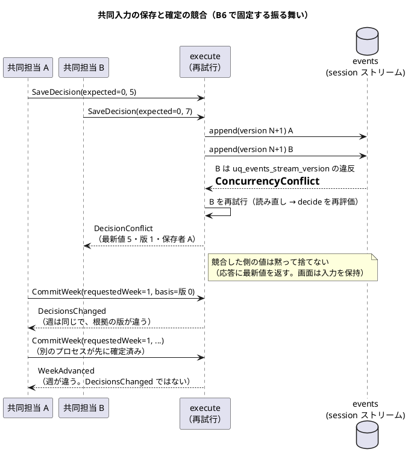

# Bolt 6 計画 - 共同担当と共同入力

## 概要

| 項目 | 内容 |
| :--- | :--- |
| Bolt | B6（[リリース計画](./release_plan.md)） |
| Unit | U2 進行の継続（共同担当・資格）。U2 の 2 つ目の Bolt。前は B5（[計画](./bolt_5_plan.md)、[終了報告](./bolt_5_report.md)）。次は B7（U3。カスタム条件） |
| 所要（計画） | 2 稼働日（リリース計画の仮定）。**ステップ数に対して厳しい見込み**（下のリスクと判断項目 2）。B5 の実績（1 セッション）は人の検証時間を含まず、根拠にしない |
| 日程（仮定） | リリース計画の稼働日の目安は、累計 15 日目・2026-12-04 終了（B5 の後。B5 は B4 より先に実施済みなので、この日付は使えない）。実施日は着手時に人が決める。リリース計画の日程・進捗の更新は、人の判断待ち |
| ゲート密度 | **密**（リリース計画の「B6 は高リスク（並行性）」。ステップごとに人が検証する）。B5 のゲート 0〜8 は人が通した実績があるが、並行の試験と計測は AI の自己申告が効きにくいため、密度は下げない |
| アプローチ | 中盤（[開発戦略](./development_strategy.md)）。**インサイドアウト**（ドメイン → 永続化・投影 → 並行の試験と計測 → アプリケーション・HTTP → UI）。仕様（`contracts/openapi.yaml`）と日本語 Gherkin を先に書き、契約テストを Red にしてから実装する。**否定テストと並行テストを実装より先に書く**（開発戦略の中盤の手順の要点） |
| 状態 | **提案。人の承認待ち。** ステップ計画・判断項目・ゲートは、いずれも承認を受けていない。実装・コード変更は未着手（本書の作成のみ）。`validating-design`（着手前）も未実施で、Step 0 で行う |

> **承認の状態について**: 本書の「提案」は AI の案で、承認ではありません。承認は、ユーザーが指示した範囲だけを、更新履歴に記録します。各ゲートは「人の確認待ち（未承認）」です。

### ゴール

同じ役割に複数の参加者を割り当てて（共同担当）、同じ状況・入力値・版を見ながら入力でき、**同時の保存で、受理した更新を失わず、拒否された側に最新値と保存者を返す**ようにする。確定は、確定の根拠にした入力が変わっていないことと、週が進んでいないことを、**別の理由として**区別して拒否する（`DecisionsChanged` と `WeekAdvanced`）。さらに、**追記の競合の再試行が、上限の中で収まるか**を、実 DB（PostgreSQL 18）の並行の統合テストと計測で確かめ、再試行の上限・間隔と、アドバイザリロックによる直列化の要否（R4）を、数値の根拠つきで決める。

### 確認したい仮説（リリース計画）

1. **同時の保存で、更新を失わないか。** 同じ役割の 2 人以上が同時に保存したとき、受理された書き込みが失われず、拒否された側は最新値と最後の保存者を受け取れるか（NF-R14）。
2. **追記の競合の再試行は、上限内で収まるか。** 現状は上限 5 回・間隔なし（`COMMAND_MAX_ATTEMPTS` の既定。[ADR-005](../../adr/beer-game-kotlin/005-optimistic-concurrency-and-advisory-lock.md) は「実装開始時（B6）に競合の頻度を測って決める」としている）。リリース計画の測定基準は「`RetryExhausted` は 4 人同時の保存で 0 件」。
3. **（R4）再試行が集中して `RetryExhausted` が頻発するなら、アドバイザリロックで直列化する案は、再試行の調整より良いか。**

### 対象の受入条件

出典は [ユーザーストーリー](../../requirements/beer-game2/user_story.md)（Kotlin 版は beer-game2 の要件を引き継ぐ）。**シナリオの期待値は、原文の意味と一致させる**（タグ `@US`・`@AC`）。

| ID | 内容（原文の要点） | 現状（実コードで確認。Step 0 で再確認） |
| :--- | :--- | :--- |
| AC1.2.4 | 進行役は、同じ役割に複数の参加者を割り当てられる。各役割に 1 人以上いれば開始できる | **準備中の割り当ては、すでに複数人を拒否しない**（`decideGame` の `AssignRole` に既存の担当者の検査が無い。`SessionData.assignments` は `RoleMap<Set<ParticipantId>>`。`startGame` は各役割が空でないことだけを検査）。**ただし、受入のシナリオが無い**（`features/` に `@AC1.2.4` が無い）。要件の v1 の状態は「✗」 |
| AC2.1.4 | 同じ役割の共同担当は、同じ状況と、入力値・版を見る | 状況・入力値・版は役割単位の投影で、同じ値になる見込み（`Disclosure.kt` の `RoleStatus`）。**シナリオが無い。保存者は状況の応答に含まれない**（`decision`・`decisionVersion` だけ）。他の役割へ開示しない否定テストが要る |
| AC2.2.3 | 同一役割の複数の参加者が同時に更新すると、更新の競合を示し、変更を黙って失わず、最新値との差を示す | **ドメインの `DecisionConflict` は B1 から実装済み**（`Session.kt`。版が違えば最新の `DecisionEntry` を返す）。**HTTP の 409 の本文は最新値と版だけ**（`ProblemMapping.kt` の `entryJson`）で、**保存者・時刻を含まない**（設計は保存者を含める。[UI 設計](../../design/beer-game-kotlin/ui-design.md) の S05 共同入力の競合）。シナリオ・並行の試験が無い |
| AC2.2.4 | 共同担当の一人が入力すると、同じ役割の全員の画面に、同じ値と版が反映される | API は同じ値・版を返す見込み。**画面の自動更新（SSE）は未実装**（B1 から。B5 終了報告「未達・未実施」）。反映の手段は判断項目 8 |

**対象外の受入条件だが、リリース計画の B6 のゴールに含まれる「`WeekAdvanced` と `DecisionsChanged` の区別」**: 実コードで確認した事実として、**ドメイン（`commitWeekEvents` の判定順: 週 → 根拠の版）、HTTP（`ProblemMapping.kt`）、仕様（`openapi.yaml`）、画面の辞書（`web/src/api/problems.ts`）、進行役の画面（`ConsolePage.tsx`）に、すでに実装がある**。受入の Gherkin には無い。したがって B6 では「新しく実装する」でなく、**シナリオで固定し、共同担当が保存した場合の挙動と、応答の中身（保存者）を確かめて補う**（出典: 設計の AC2.3.1 と [テスト戦略](../../design/beer-game-kotlin/test-strategy.md) の `decideSession`（`CommitWeek`、H6））。

### 範囲外（後続の Bolt、または未割り当て）

自動確定（B8。共同担当の保存で週が確定する場合を含む。ただし**ドメインの判定が、B8 が使える形を壊さないこと**を回帰で確かめる）、カスタム条件（B7）、観察者・出力（B9・B10）、削除（B11）、投影の再構築・N-1 互換の本実装（B12。新しいイベントを足す場合は一覧を終了報告に残す）、観測のメトリクス・アラーム（B13。本 Bolt の計測は**テスト用の道具**に限る。判断項目 11）、AWS・Terraform（B14。変更しない）。**開始後の共同担当の追加**（ドメインモデルの未決事項「当面は準備中だけ」。判断項目 3）。

**前の Bolt（B5）の申し送り・持ち越しの取り込み**（[Unit U1 総括](./unit_u1_summary.md)の学び 7: 取り込まないと黙って落ちる。出典は [Bolt 5 終了報告](./bolt_5_report.md)の「B6 への申し送り」「未達・未実施」「人の判断が要る項目」）:

| 申し送り・持ち越し | 扱い |
| :--- | :--- |
| `SaveDecision` に触れる。B6 の共同入力（`DecisionConflict` の拡張）と、B5 で足した保存回数の上限（9 回）が同じ判定にある | **取り込む**（Step 2。判断項目 5） |
| **保存回数は意思決定の版で数える**（ドメインモデルの差の表 34: 「共同入力（B6）が版の意味を変えるなら、そのとき回数を分ける」） | **取り込む**（判断項目 5、Step 0.3・Step 2）。提案は「版の意味は変わらない」。**変わる場合だけ、回数を別の項目に分ける**。拒否された保存は版を進めないので、競合で上限を消費しない（Step 2 で試験する） |
| 入れ替え（`assignRoleAfterStart`）と共同担当。B5 の入れ替えは、**担当者全員が外れる**設計（ゲート 3.5 で承認）で、共同担当の**追加**を含まない（未決） | **取り込む（回帰）**: 共同担当のいる役割の入れ替えで、全員の資格が失効し、写しが更新されることを確かめる（B5 の受入シナリオが共同担当を含むかは**未確認**。Step 0.3）。追加は判断項目 3 |
| 試験の道具: `credentialConcurrencyContract` の待ち合わせ（`Barrier`・`racing`）、項目単位の検査 `leafValues()`・`integerValues()` | **取り込む**（Step 4・3）。並行の試験は待ち合わせで状況を確実に作り、勝者に依存しない不変条件で判定する。開示の否定は項目単位で確かめ、変異で検査が働くことを確かめる |
| N-1 互換: 新しいイベントを足す前に方針を確認 | **取り込む**: 既定は**新しいイベントを足さない**案（判断項目 7）。足す場合は一覧を残す |
| 生成物: 足すイベント・用語に `@EventSpec`・`@Term` を付ける（付け忘れ・設計書との不一致は試験が落ちる） | **取り込む**（足す場合。用語「共同担当」の追加を提案。Step 8） |
| UI: 代理入力・資格の失効・再発行の画面を B6 で足すか。S03 の案内「進行役に復帰コードの再発行を依頼」を実行する画面が無い | **人の判断待ち**（判断項目 9）。提案は範囲外 |
| `@ui` が PostgreSQL のバックエンドで未実施（H2 のみ） | **取り込む案**（Step 8。共同担当の `@ui` は PostgreSQL でも 1 回実行する。判断項目 9 と合わせて人が決める） |
| SSE（自動更新）未実装。AC2.2.4 の画面への反映 | **人の判断待ち**（判断項目 8） |
| 進行役自身の資格の失効・再発行の扱い（B5 判断項目 6）、復帰の入口（#7）、マイグレーション番号 006 の予約（#8）、ALB の背後の接続元（#9） | 範囲外（B6 の受入条件に無い）。**ただし、本 Bolt でスキーマを変える場合は、006（B11 の予約）と衝突しない番号にする**。 |
| 資格の期限・参加の上限・参加コードの試行の窓の仮置き（R11） | 範囲外。**共同担当の人数と保存回数の上限（9 回）は運営者との合意が要る**（[非機能要件](../../design/beer-game-kotlin/non-functional.md) の NF-C8）。仮の既定値で進め、合意の前に永続環境へ出さない（判断項目 4・5） |
| U1 総括の持ち越し H5（`@US`・`@AC` タグの整合検査、`@Suppress`・ベースラインの機械検査、生きたドキュメントの公開の導線、Kover の残り、SSE の契約テスト） | 範囲外・未割り当て（B16 へ送る決定。**割り当ては人が決める**）。ただし、**新しいシナリオのタグ（`@US`・`@AC`）は手で整合させる**（機械検査が無いため） |
| CI のパスフィルター（`docs/design/beer-game-kotlin/**` を足すか。設計書だけの変更で CI が走らない） | **人の判断待ち**（B5 から未決）。本 Bolt も設計書を更新するため、影響する。提案は取り込まない |
| 冪等記録の掃除、SSE と `LISTEN` 切断中の欠落、投影の整合検査 | 範囲外・未割り当て（B12 付近） |
| デモ項目の人の実操作（B5 の申告欄は空） | 範囲外（人が行う）。**B6 の終了報告にも申告欄を設け、AI は記入しない** |
| GitHub Actions 上の確認（B5 の Step 8 の変更分は未確認） | **取り込む**: push は人の判断。B6 の達成の記述に、確認の範囲（ローカル、CI）を必ず書く（U1 の学び 5） |

---

## 設計（4 図の確認）

B6 は、**状態・コマンド・イベントを足さない案**（判断項目 3・7 の提案どおりの場合）である。既存の `DecisionConflict`・`DecisionsChanged`・`WeekAdvanced` を、共同担当の観点で固定し、応答の中身を補い、並行の性質を試験と計測で確かめる。**設計書への反映が要る点は、Step 8 で変更表に記録**する。設計の正本は [ドメインモデル](../../design/beer-game-kotlin/domain-model.md)、[データモデル](../../design/beer-game-kotlin/data-model.md)、[バックエンド](../../design/beer-game-kotlin/architecture-backend.md)、[UI 設計](../../design/beer-game-kotlin/ui-design.md)、[非機能要件](../../design/beer-game-kotlin/non-functional.md)、[テスト戦略](../../design/beer-game-kotlin/test-strategy.md)。

### ドメインモデル図（変わる見込みは小さい）

| 項目 | 内容 |
| :--- | :--- |
| 変えない見込み | `GameCommand.AssignRole`（準備中は担当者の追加を拒否しない）、`SessionCommand.SaveDecision`／`CommitWeek`／`SubmitProxyDecision`、`SessionError.DecisionConflict`／`DecisionsChanged`／`WeekAdvanced`、`SessionData.assignments`（役割ごとの集合） |
| 変わりうる | **`DecisionEntry` に保存の時刻を持たせるか**（`Evolve` は時刻を受け取らないため、イベントに時刻を足す必要がある。イベントのスキーマ変更で N-1 に影響する）。提案は**足さず**、保存者・時刻は投影（`current_decisions` の `editor_kind`・`editor_id`・`updated_at`）から読む（判断項目 7）。**開始後の共同担当の追加**（`RoleHolderAdded` 相当の新イベントと写しの更新。判断項目 3。提案は範囲外） |
| 確認する | 「版の意味」が変わらないこと（判断項目 5）。`CommitWeek` の判定順（週 → 根拠の版 → 入力の揃い）。共同担当が保存し直しただけでは、確定の根拠の版が変わらない限り `DecisionsChanged` にならない（設計判断 D10） |

### 状態遷移図（変わらない。Session）

Session の状態（`NotStarted`・`Active`・`Paused`・`Ended`）と遷移は B5 から変えない。**変わるのは、`Active` の中の保存の判定の確認**（下）。

`session` ストリームは 1 ゲームに 1 本で、**役割をまたぐ保存も同じ版を取り合う**（`uq_events_stream_version` は `(game_id, stream_type, stream_version)`）。したがって再試行の頻度は、同じ役割の共同担当の人数だけでなく、**4 役割と共同担当の同時の書き手の総数**で決まる（Step 5 の計測の設計の前提）。**PlantUML の描画での構文確認は未実施**（B1〜B5 から続く未確認事項）。

### ER 図（変わらない見込み。判断項目 15）

**確認した事実**: `current_decisions`（V004）は `(game_id, role)` で、`quantity`・`decision_version`・`editor_kind`・`editor_id`・`updated_at` を持つ。保存者・時刻を応答に返すために、**列の追加は要らない見込み**。表示名は周辺ストア（`participants`）から結合する（B1 の設計。イベントに表示名を入れない。ADR-002）。**未確認**: 表示名の結合の経路（`Disclosure.kt` が読むポート）。Step 0.3 で確かめる。**スキーマ変更が要るとわかった場合は、確認必須で、人に決めてもらう**（番号は共通 006 を B11 の予約として避ける）。

### 画面遷移図（変わる。UI を含める場合のみ。判断項目 9）

| 画面 | 変更（提案） |
| :--- | :--- |
| S04 準備（ロビー） | 同じ役割に複数人を割り当てられることの表示（共同担当）。割り当ての操作は B1 から同じ入口 |
| S05 プレイ | 見出しの共同担当の表示、「現在の入力: 8（鈴木さんが 10:42 に保存）」、**共同入力の競合の表示**（最新値・保存者・自分の入力を保持・「最新の値を使う」「この値で保存し直す」）、代理入力が上書きした場合の文言（M10） |
| S06 進行役のコンソール | 確認ダイアログの `DecisionsChanged`（開き直し）は B1 から実装済み。保存者の表示が応答に入ることの確認 |

---

## 人の判断が要る項目（着手前）

**着手前に、人が決める。決まるまで、依存する Step に着手しない。** 「提案」は AI の案で、承認ではありません。ゲートを通っていない仮置きは、U1 で多く積み上がった反省（U1 総括の学び 1）から、ここで先に決める。

| # | 項目 | 内容（事実） | 提案 |
| :--- | :--- | :--- | :--- |
| 1 | **着手の順序・日程**（B4 との関係） | B4 は未着手のまま。B6 は B4 に依存しない（並列にできる前提。リリース計画）。B5 は B4 より先に実施済み。Release 0.1 の条件（B4 を含む）は未達 | B4 より先に B6 に着手してよいかを、人が決める。実施日・リリース計画の更新も人が決める |
| 2 | **所要 2 日とステップ数** | 本書のステップは 9（Step 0〜8）。うち**計測（Step 5）と並行の試験（Step 4）は、人の検証時間と、実 DB の実行時間が要る**。B5 の実績は人の検証を含まない | 超える見込みなら、予備 B16 で吸収し、リリース計画の再調整は**人が判断**する。**2 つに分ける案**（B6a: 共同担当と共同入力の機能 = Step 1〜3・6・7。B6b: 並行・計測・ADR = Step 4・5）も提示する |
| 3 | **共同担当の追加の範囲** | ドメインモデルの未決事項は「当面は準備中だけ」（beer-game2 と同じ）。B5 の入れ替えは担当者全員を外す。開始後に足すには、写しを更新する新しいイベントが要る（D4） | **準備中だけ**。開始後に足したい場合は、運用の回避策（準備中に予備の参加者を共同担当にしておく）を設計書に残す。開始後の追加は範囲外として未決のまま記録 |
| 4 | **共同担当の人数の扱い** | 設計書に人数の上限は無い。NF-C3: 共同担当で同じ役割の同時入力が増えても、確定のエラー率 1% 未満。NF-C8 の最大のストリームの長さ（2000 件）は、保存 9 回の上限が前提で、**共同担当の人数と保存の使い方は運営者との合意が要る**（R11） | 人数の上限は**設けない**（参加者数の上限の未決に従う）。計測は 1 役割 2〜4 人で行い、結果を記録する。合意の前は仮の既定値と明記し、永続環境へ出さない |
| 5 | **意思決定の版の意味と、保存回数の数え方**（B5 の申し送り） | 版は「役割・週ごとの保存の通し番号」で、保存のたびに 1 増え、確定で 0 に戻る。B5 は**版 = 当週の保存回数**として、9 回の上限を `decisionVersions[role] < 9` で判定する（`hasSaveCapacity`）。共同担当では版は**共同担当で共有**され、拒否された保存は版を進めない | **版の意味は変えない**。上限 9 回は役割ごとの共有（共同担当の人数で増やさない）。同じ値の再保存も 1 回に数える（現状どおり）。変えるなら、そのとき回数を別の項目に分ける（ドメインモデルの差の表 34） |
| 6 | **競合の応答に含める情報**（AC2.2.3 の「最新値との差」） | 現状は最新値と版のみ。設計は最新値と**保存者**（表示名）と時刻。表示名は個人情報で、同じ役割の共同担当にだけ見せたい（`isSelf` の扱いも要る）。進行役の代理入力は「進行役（代理入力）」 | 409 の本文と状態の応答に、`editor`（種別: 参加者／進行役の代理入力。同じ役割の共同担当にだけ表示名。自分かどうかの印）と `savedAt` を足す（**仕様が先**。契約テスト）。他の役割・観察者には出さない否定テストを項目単位で行う |
| 7 | **保存の時刻の持ち方** | `DecisionEntry`・`DecisionSaved` に時刻は無い（封筒は持つ）。イベントに足すと、スキーマ変更で N-1 互換（B12）に影響し、golden を変える | **イベントは変えない**。時刻は投影（`current_decisions.updated_at`）または封筒から取る。足す場合は、新しいイベントの一覧と N-1 の影響を終了報告に残す |
| 8 | **AC2.2.4 の画面への反映（SSE）** | SSE は未実装（B1 から）。現状の更新は手動と、保存・確定の応答の後だけ。NF-P2・P4・P7 は SSE とポーリングを前提 | 案 A: B6 で SSE を実装（範囲が大きい。2 日に収まらない恐れ）。案 B: 最小のポーリング（NF-P4 のフォールバックの形）。**案 C（提案）**: API の `@api` で「同じ値・版が返る」を受入とし、**画面の自動反映は未達として記録して割り当てを人が決める**（手動更新と保存の応答では同じ値・版が見える）。AC2.2.4 の「全員の画面に反映」を C で満たしたと書かない |
| 9 | **UI の範囲** | 開発戦略の中盤はインサイドアウト。Unit 定義の U2 は「サービス + UI」。B5 は最小の UI（復帰・停止・再開）を足した。**代理入力・資格の失効・再発行の画面は無い**（B5 の持ち越し） | **最小の UI**: S05 の共同担当の表示と競合の表示、S04 の共同担当の表示。`@ui` は 1 シナリオ（2 つのブラウザコンテキストで共同入力の競合）。代理入力・資格の画面は範囲外（B6 の受入条件に無い）。UI を含めるほど 2 日を超える |
| 10 | **再試行の上限と間隔の決め方** | 現状は上限 5・間隔なし（`COMMAND_MAX_ATTEMPTS`。`ServerConfig` で `1..` の範囲）。ADR-005 は値を未決とし、ジッターの要否も計測して決める。**再試行は、認証・冪等記録の照合から全体をやり直す**（`runCommand` の `withAppendRetry`） | **計測の前に値を決めない**。Step 5 の結果（上限 3・5・10、間隔なし・ジッターあり）で、`RetryExhausted` の発生率と p95 の遅延（NF-P13: 1 秒以下）から決め、ADR に記録する。受入の基準は「4 人同時の保存で 0 件」（リリース計画の測定基準） |
| 11 | **計測の方法と場所** | 現状は再試行の回数を数える仕組みが無い（`withAppendRetry` は回数を返さない）。観測のメトリクスは B13 | **テスト用の道具に限る**（再試行の回数と結果を数えるポートの包み）。本番のメトリクス・アラームは B13。**ローカルの PostgreSQL（Testcontainers）の値は実環境の値でない**ことを、結果に必ず書く |
| 12 | **アドバイザリロック比較の範囲**（R4） | ADR-005 は「常に直列化」を却下している。R4 は「必要なら直列化する案を比較し、ADR にする」 | **計測の道具の中の試作**として、保存の前に**ゲーム単位の書き込み用のロック**（再構築の排他ロックとは別のキー）を取る案を、再試行の調整と比べる。**`main` には入れない**（採用は ADR で人が決め、実装は別途）。H2 版（プロセス内のロック）での扱いも記録 |
| 13 | **制約ごとの再試行・再照合の粒度** | 現状は `uq_events_stream_version`・`uq_idempotency_create`・`pk_idempotency_records`・40001・40P01 を同じ `ConcurrencyConflict` と同じ上限で扱う（55P03 は `RetryExhausted`）。B1 の持ち越し: 冪等記録の同時の重複は**実 DB の並行で未検証** | 上限は共通のまま、**制約ごとの結果（再照合で保存済みの応答、本文が違えば 409、500 にならない）を並行の試験で確かめる**。上限を分けるのは、計測で必要とわかった場合だけ |
| 14 | **新規ファイルの作成**（確認必須） | 見込み: `features/game-setup/co-assignment.feature`、`features/weekly-play/co-input.feature`、並行・計測の試験と道具、ADR-019（再試行の上限・間隔と、直列化の比較）、`bolt_6_report.md`、（必要なら）生成物の更新。既存の設計書・ADR・計画は編集 | 必要性は上のとおり。**承認をお願いします**。**新しい依存は導入しない**（計測は標準ライブラリと既存の Testcontainers・Kotest で行う。JMH などを使う場合は、その時点で人に確認する） |
| 15 | **スキーマ変更の有無**（確認必須） | 見込みは無し（`current_decisions` が保存者・時刻を持つ）。表示名の結合元は Step 0.3 で確認 | スキーマ変更なしで進める。必要なら**止めて人に確認**する（番号は 006 を避ける） |
| 16 | **B5 の持ち越しの割り当て**（上の表の「人の判断待ち」） | CI のパスフィルター、H5、SSE、`@ui` の PostgreSQL 実行、進行役自身の資格 など | 上の表の提案どおり。**割り当て先は人が決める** |
| 17 | **ゲートの密度と、逸脱の再発防止** | U1・B5 の実施中の逸脱（下の「規律」）が、記録されたが再発している（heredoc の誤起動、試験を実装の後に書く、自分の試験の静的解析違反） | ステップごとに人が確認する。人の確認なしに連続して進めない。規律を、各 Step の手順と完了条件に入れる（下） |

---

## ステップ計画

各ステップは、**テストを先に書き、失敗を確認してから最小限を実装する**（TDD、BDD）。**ゲートは、人の確認待ち**とし、承認済みとは書かない。

**守る規律（U1・B5 の逸脱の再発防止。各 Step の終わりに自己確認し、実施結果に正直に書く）**:

- **ファイルの編集は、Write・Edit のみ**。heredoc・python・sed・perl・awk は使わない（B5 の Step 4〜6 で、何も書かない確認の heredoc・python を誤って起動した。**確認の目的でも起動しない**。生成物の再生成は `./gradlew :domain:generateLivingDocs` など、手順書にあるタスクだけ）。
- **テストを先に書き、失敗（Red）を観察してから実装する**。B5 では、`ServerConfig` の設定を実装の後に書いた、8.4b の並行の試験が最初から緑で Red を観察していない、一部の単体試験を実装の後に書いた、という逸脱があった。**並行の試験は、最初から緑になりやすい**（実装が既に正しいため）。そのときは「Red を観察していない」と記録し、**変異（検査の対象を壊す）で、その試験が失敗することを個別に確かめて**から先へ進む（プロジェクトの規則: 順序を守れなかったときは、規則を壊すと試験が落ちることを個別に確かめ、code-summary 相当の記録に残す）。
- **静的解析は、違反 0 件・ベースラインなし・`@Suppress` なし**を、毎ステップで守る。自分が書いた試験にも適用する（B5 の Step 8 で、自分の試験の ktlint・detekt の違反が出た）。detekt は JDK 21 で実行する。
- **AI の自己申告は、機械で確認する**（`@Suppress` の grep、成果物の存在、件数の集計）。人の検証が要る点を、自己申告に頼らない。
- **人の開発サーバー（ポート 3000・5173）は止めない。E2E は専用のポート（3100・5273）**。
- **承認を先回りして書かない**。承認は、ユーザーが指示した範囲を、更新履歴に記録する。

### Step 0: 着手前の確認（`validating-design`）（未実施）

- [ ] 0.1 判断項目 1〜17 を、人が決める（決定を、更新履歴に、ユーザーが指示した範囲だけ記録する）
- [ ] 0.2 **`validating-design` を、着手前に実施し、結果を本書に記録する**（軸 A: 開発戦略 ↔ 本書、軸 B: 本書 ↔ 設計書・ADR、軸 C: 本書 ↔ B1〜B5 の計画・終了報告・U1 総括）。**NG が 0 件、または、残る項目を人が判断済み**であることを、着手の条件にする。**本書の作成者は、`validating-design` を実施していない**（下の「計画作成時に確認した事実」は、実コードと設計書の確認であり、検証の結果ではない）。**軸 C の照合対象に、上の取り込み表の全行を含める**
- [ ] 0.3 設計書のスケッチと実装の差を、実ファイルで確認する（B1 の学び 6: スケッチは型でなく責務で書く）。特に: (a) 表示名の結合の経路（`Disclosure.kt` が読むポートと、同じ役割の共同担当だけに見せられるか）、(b) `AssignRole` が準備中に複数人を受け付ける事実と、`features/` の既存の入れ替えのシナリオが共同担当を含むか、(c) `PlayPage.tsx` に `session.decision_conflict` の分岐があるか（`grep` では `session.week_advanced` だけが見つかった）、(d) `maxAttempts` の既定値と上限の範囲（`ServerConfig.kt`）、(e) 版の意味（判断項目 5）が、共同担当で変わらないこと
- [ ] 0.4 **現状のベースラインを実測して記録する**（コード変更なし）: 既存の全テスト・静的解析・Kover が緑であること、`:app:acceptanceTest`（PostgreSQL 18）と `:app:acceptanceTestH2` のシナリオ数（B5 終了時: `@api` 70、`@ui` 7）。B6 の追加分と区別するため

**ゲート 0**: 判断項目の決定と、`validating-design` の結果を、人が確認する。**状態: 人の確認待ち（未承認）。**

### Step 1: 仕様と受入シナリオ（API 契約が先）（🔴）

- [ ] 1.1 🔴 日本語 Gherkin を書く（AC1.2.4、AC2.1.4、AC2.2.3、AC2.2.4。**原文の意味と一致**させる。解釈の差は、シナリオの直前にコメントで書く）。配置は `features/game-setup/`（AC1.2.4）と `features/weekly-play/`（AC2.1.4・2.2.3・2.2.4。`TAGS.md` の領域の一覧は変更不要の見込み）。**最低限含めるシナリオ**:
  - AC1.2.4: 同じ役割に 2 人を割り当てられる／各役割に 1 人以上いれば開始できる／1 人が 2 つの役割を持てない（AC1.2.5 の回帰。別の役割へは付け替え）
  - AC2.1.4: 共同担当が、同じ状況・入力値・版を見る／**他の役割の参加者は、その役割の保存者・版を見られない**（否定）
  - AC2.2.3: 同じ版から 2 人が保存すると、2 人目は競合し、**最新値と保存者**が示される。**黙って失われた更新が無い**（最新の値は 1 人目のまま）。競合した人の入力は応答に含まれず、画面が保持する（API では、再度の保存が最新の版を指定して成功する）。代理入力が共同担当の入力を上書きした後の保存は競合し、保存者は進行役の代理入力と示される
  - AC2.2.4: 共同担当の一人が保存すると、同じ役割の別の共同担当が取得した状況は、同じ値と版になる（`@api`。画面の自動反映は判断項目 8 の案による）
  - **`WeekAdvanced` と `DecisionsChanged` の区別**（設計の AC2.3.1。タグは `@AC2.3.1`、解釈の差はコメント）: 確定の根拠にした入力が、共同担当の保存で変わったあとの確定は `DecisionsChanged`（現在の値と保存者を返す）／別の確定で週が進んだあとの確定は `WeekAdvanced`／**両方に当てはまる場合は週が先**（`WeekAdvanced`）
  - 保存回数の上限が、共同担当で共有される（B5 の AC 外の確認。判断項目 5）。拒否された保存は上限を消費しない
  - 共同担当のいる役割の入れ替えで、担当者全員が外れ、旧担当者の資格が失効する（B5 の回帰。未確認の場合のみ）
- [ ] 1.2 🔴 `contracts/openapi.yaml` に、判断項目 6・7 の応答の形（409 `session.decision_conflict`／`session.decisions_changed` の拡張メンバー、状況の応答の保存者・時刻）を書く。契約テストを回し、**実装が無いので失敗する（Red）**ことを確認する（応答の形の変更が、既存の契約テストをどう落とすかを実測で記録する）
- [ ] 1.3 🔴 `@api` のシナリオが、Undefined・Pending でなく **Failing** になることを確認する（Undefined → Pending → Failing → Passing の順）。**最初から Passing のシナリオは、回帰として残す**と明記する（B5 の Step 1 と同じ扱い）

**ゲート 1**（全 Bolt の共通の承認項目）: 受入条件の Gherkin シナリオを、**実装の前に**人が検証して合意する。原文との照合（解釈の差）、`code` と応答の形（保存者の出し方。表示名の開示範囲）を確認する。**状態: 人の確認待ち（未承認）。** 結果の記録（Red の実測、最初から Passing のシナリオ、仮置き）は、本書の「Step 1 の実施結果」に、実施後に書く。

### Step 2: ドメイン — 共同入力の判定と版の意味（🔴🟢🟡）

- [ ] 2.1 🔴 Kotest（Given: 過去のイベント / When: コマンド / Then: イベントまたはエラー）を先に書く: (a) 準備中に同じ役割へ複数人を割り当てられる（`AssignRole`）、(b) 共同担当 A が保存（版 0 → 1）、B が `expected=0` で保存 → `DecisionConflict(role, latest=A の入力)`、(c) B が `expected=1` で保存 → 版 2、(d) 拒否された保存は版・状態を変えない、上限（9 回）を消費しない、(e) 代理入力の後の古い版の保存は競合し、`latest.editor` は進行役、(f) 上限の 9 回は役割ごとに共有、(g) `CommitWeek` の判定順（週 → 根拠の版 → 入力の揃い）、共同担当の保存で根拠の版が変わると `DecisionsChanged`、保存し直しても入力が同じなら確定できる設計判断 D10 の確認。**失敗を確認する**（Kotlin では未定義の型の参照が Red になる場合は、それを記録。既存の実装で最初から通るものは「Red を観察していない」と書き、変異で確かめる）
- [ ] 2.2 🟢 不足があれば最小の実装（判断項目 7 で `DecisionEntry` を変えない限り、**実装は小さい見込み**。**「何も変わらない」ことも結論**として記録する）
- [ ] 2.3 🟡 性質テスト（Kotest の `checkAll`）: 共同担当の乱数の保存の列（有効な版・古い版・代理入力・別の役割・確定を含む）で、(1) **受理された最後の保存の値が、状態の入力として残る（更新を失わない）**、(2) 版は受理のたびに連続して 1 増える、(3) **拒否は状態を変えない**、(4) 保存回数が 9 を超えない、(5) 再生が `InvalidTransition` を出さない。リファクタリング。**domain の行 100% のゲートを守る**（除外・閾値の引き下げをしない）
- [ ] 2.4 イベントの検査: ペイロードに表示名・資格が含まれない（ADR-002）。**新しいイベントを足す場合は、種別の一覧を記録**（N-1 互換。B12）。足さない場合は「足していない」と記録する

**ゲート 2**: 共同入力の判定と、版の意味（判断項目 5 の結論）と、domain の行 100% を、人が確認する。**状態: 人の確認待ち（未承認）。**

### Step 3: 永続化・投影・開示（保存者の返却）（🔴🟢🟡）

- [ ] 3.1 🔴 先に書く: (a) 共同担当の保存者・時刻が、同じ役割の状況の応答に出る、(b) **他の役割・観察者・無資格には、保存者・版が出ない**（項目単位の検査 `leafValues()` で「値がどの項目にも無い」を確かめる。**検査が働くことを、検査の対象を変える変異で確かめる**。部分文字列の検索はランダムな ID で偶発的に一致するため使わない）、(c) 表示名の結合が、ロビー・参加者の周辺ストアと矛盾しない、(d) ロビーが共同担当を示す。ポートの契約テストは、PostgreSQL と H2 の両実装で実行
- [ ] 3.2 🟢 実装（`Disclosure.kt`・読み取りの問い合わせ・周辺ストアからの結合）。**スキーマ変更は、判断項目 15 の提案では無い。必要になったら止めて人に確認**
- [ ] 3.3 🟡 リファクタリング。層ごとの静的解析の違反 0 件

**ゲート 3**: 開示の範囲（同じ役割の共同担当にだけ見せる）と、否定テストの網羅を、人が確認する。**状態: 人の確認待ち（未承認）。**

### Step 4: 並行の統合テスト（PostgreSQL 18）と制約ごとの再試行・再照合（🔴🟢）

> **高リスク（並行性。R4）。並行の試験を実装より先に書く。** ADR-005 のコンプライアンス（B6）の 3 項目を、そのまま完了条件にする。

- [ ] 4.1 🔴 `credentialConcurrencyContract` の道具（`Barrier`・`racing`）を再利用し、**追記の直前で待ち合わせて、競合を確実に作る**（確率に頼らない）。勝者は実行ごとに決まらないので、**両方の順で成り立つ不変条件**で判定する:
  - (a) **同じ役割の 2 人が同時に保存**: 自動再試行の後、一方が成功、他方が `DecisionConflict` と最新値・最後の保存者を受け取り、**保存された値が失われない**（NF-R14）。版が連続し欠番が無い
  - (b) **4 役割 + 共同担当の同時の保存**（`session` ストリームを取り合う）: 受理された書き込みがすべて残り、500 が 0 件
  - (c) **競合を意図的に続ける**（`maxAttempts` を小さくする）: 上限で止まり、`app.retry_exhausted`（503・`Retry-After`）を返す。**部分更新が残らない**（`events`・投影・冪等記録のどれにも）
  - (d) **同じキーの同時の重複**: `uq_idempotency_create`（ゲーム作成）と `pk_idempotency_records`（同じキー・同じ対象。**空の列を返す操作を含む**）が、500 にならず保存済みの応答になる。**本文が違えば 409 `app.idempotency_key_reused`**。H2 版は部分一意索引を省略しているため、H2 では「ローカルでは守られない」ことを記録する（ADR-014）
  - (e) **手動確定と共同担当の保存**: 確定の直前に別の共同担当が保存すると `DecisionsChanged`、確定が先なら保存は `WeekAdvanced`。**どちらも 500・再試行の枯渇にならない**
  - (f) **代理入力と共同担当の保存**: 競合し、保存者は進行役と示される
  - (g) 40001・40P01 の写像（`ConcurrencyConflict`）と 55P03（`RetryExhausted`）: 実 DB で起こせない部分は、写像の単体試験で補う（実 DB で起こした範囲と起こしていない範囲を、結果に分けて書く）
  - **失敗（Red）を確認する**。最初から緑のものは、Red を観察していないと記録し、**変異**（再試行を外す、競合の写像を外す、冪等記録の再照合を外す、保存者を返さない）で、その試験が落ちることを個別に確かめる（B5 の 8.4b で、変異の 4 件の失敗に新しい試験が含まれるかを確かめていなかった。**今回は個別に確かめる**）
- [ ] 4.2 🟢 不足があれば最小の実装（制約ごとの再照合。上限は**共通のまま**。判断項目 13）。**`main` に直列化（ロック）を入れない**（判断項目 12）
- [ ] 4.3 🟡 リファクタリング。層ごとの静的解析の違反 0 件（自分が書いた試験を含む）
- [ ] 4.4 **実行時間と不安定さの確認**: 並行の試験を同じ条件で複数回（例: 20 回）実行し、**不安定でない**ことを記録する（B5 では UUID の `998` の検査が不安定だった）

**ゲート 4**: 並行の試験の網羅（各制約、各競合の種類）と、**変異で検査が働くこと**を、人が確認する。**状態: 人の確認待ち（未承認）。**

### Step 5: `RetryExhausted` の発生率の計測と、上限・間隔の決定（R4）（🔴🟢）

- [ ] 5.1 🔴 **計測の設計を先に書く**（判断項目 10〜12）: 再試行の回数・結果を数えるポートの包み（テスト用の道具）、シナリオ、記録する項目、合格の基準。**基準はリリース計画の測定基準**: 「4 人同時の保存で `RetryExhausted` 0 件」。ほかに NF-P13（共同入力の保存 p95 1 秒以下）、NF-C2（全 60 役割が 10 秒以内に確定の入力をしても、エラー率 1% 未満。**再試行の枯渇も含める**）
- [ ] 5.2 計測するシナリオ（**標本の数・同時数・試行回数を、結果に書く**）:
  - S1: 1 ゲーム・4 役割が同時に保存（リリース計画の基準）
  - S2: 1 ゲーム・同じ役割に共同担当が複数人（2〜4 人）× 4 役割が同時に保存
  - S3: 15 ゲーム × 4 役割（60 の書き手）を 10 秒の窓で送る（NF-C2 の形。**ゲーム間はストリームが別なので、競合しない**ことの確認）
  - S4: 1 役割の共同担当だけが連続して保存し続ける（最悪の場合。NF-C8 の保存回数の上限との関係）
  - 各シナリオを、上限 3・5・10、間隔なし・ジッターあり、で比較する
- [ ] 5.3 🟢 **アドバイザリロック（ゲーム単位の書き込み用）の試作**を、**計測の道具の中だけ**で行い、再試行の調整と比べる（判断項目 12。**`main` に入れない**）。比較の軸: `RetryExhausted` の発生率、p95・p99 の遅延、同じゲームの他のコマンド（確定・停止など）の待ち、再構築の排他ロック（B12）との相互作用、H2 版での扱い
- [ ] 5.4 結果を表にまとめる。**ローカルの PostgreSQL（Testcontainers）・逐次に近い負荷の値であり、実環境（ECS・RDS・ALB）の値でない**ことを書く。標本が少ない値から p95 を言わない（B3 の学び）
- [ ] 5.5 **ADR-019（提案）**を書く: 再試行の上限・間隔の値（計測の結果）と、直列化の要否（比較の結果）。ADR-005 の「未決」（再試行の上限の値、ジッターの要否）を更新する。**承認は人**。**採用が「直列化する」になった場合は、`main` の実装を別の作業（本 Bolt の範囲外か、予備 B16）として人が決める**
- [ ] 5.6 既定値の変更が要るなら、`ServerConfig`（`COMMAND_MAX_ATTEMPTS`）の既定値と、ジッターの実装（時計・乱数は注入。ドメインに入れない）を、**テストを先に書いて**行う。**値は計測の後に決める**

**ゲート 5**: 計測の設計・結果・限界、上限と間隔の決定、ADR-019 を、人が確認する。**状態: 人の確認待ち（未承認）。** 未達（`RetryExhausted` が基準を超える）の場合は、**未達として記録**し、対策（上限・間隔・直列化）を人が決める（隠さない）。

### Step 6: アプリケーションと HTTP（🔴🟢🟡）

- [ ] 6.1 🔴 HTTP の統合テスト（`testApplication`）を先に書く: 共同担当の保存（200）、競合の 409（最新値・保存者・時刻。**表示名は同じ役割の共同担当にだけ**）、`DecisionsChanged`／`WeekAdvanced` の区別、`Idempotency-Key` の再送（同じ操作者・同じ本文なら保存済みの応答。**別の操作者の同じキーは `app.idempotency_key_reused`**）、**失効した資格の再送は 403**（B5 の保証を、共同担当の保存でも崩さない）、`problem+json` の `code`。失敗を確認する
- [ ] 6.2 🟢 応答の形の実装（Step 1.2 の仕様どおり）。**契約テスト（仕様 ↔ 実装）が緑**になる
- [ ] 6.3 🟢 TypeScript の型を再生成し、差分 0 の検査を通す
- [ ] 6.4 🟡 リファクタリング。性能: 共同入力の保存は p95 1 秒以下（NF-P13）。**ローカルの計測値は、実環境でないことを明記して記録**

**ゲート 6**: API の形（`code`、ステータス、保存者の開示範囲）と、認可の行列を、人が確認する。**状態: 人の確認待ち（未承認）。**

### Step 7: UI（最小）（🔴🟢。判断項目 9 の決定による）

- [ ] 7.1 🔴 先に書く: コンポーネントのテスト（vitest）と、`@ui` の 1 シナリオ（2 つのブラウザコンテキストで、同じ役割の共同担当が同じ版から保存し、2 人目に競合が示される）。dry-run で Undefined が無いこと、Red を確認する
- [ ] 7.2 🟢 S05: 共同担当の表示、現在の入力と保存者、**競合の表示**（最新値・保存者・入力の保持・選択肢。代理入力の上書きの文言）。S04: 共同担当の表示。`web/src/api/problems.ts` の文言（現在は `session.decision_conflict` が「他の人が先に保存しました。」だけ。設計の文言は UI 設計の辞書が正本）
- [ ] 7.3 🟡 リファクタリング。アクセシビリティ: 競合の通知の `aria-live`、フォーカス、色だけに依存しない。**自動確認は自前の DOM 構造の検査のみ**（axe は導入しない決定。B5 ゲート 7）で、**コントラスト比・200% 拡大・キーボードの順序・スクリーンリーダーは未実施**として記録する
- [ ] 7.4 E2E は**専用のポート（3100・5273）**。**人の開発サーバー（3000・5173）は使わない・止めない**

**ゲート 7**: 画面の振る舞い（競合の見え方、保存者の表示、入力の保持）を、人が確認する。**状態: 人の確認待ち（未承認）。**

### Step 8: 受け入れの green と検証・終了（未実施）

- [ ] 8.1 `@api` の AC1.2.4・AC2.1.4・AC2.2.3・AC2.2.4（と `@AC2.3.1` の区別のシナリオ）が、PostgreSQL 18 と H2 の両方で green（Undefined・Pending なし）。`@ui` を H2 で実行し、**PostgreSQL のバックエンドでも 1 回実行する**（B5 の未実施項目。判断項目 9・16）。デモ項目: 2 人の共同担当が同じ役割に入り、片方が先に保存し、もう片方に競合が示され、最新の値を確認して保存し直す
- [ ] 8.2 全テスト・静的解析（ktlint、detekt（JDK 21）、PMD、fixture）・Kover（domain 100%、全体 85%・75%）・契約テスト・`web` の検証が緑。**GitHub Actions 上の実行は、push が人の判断なので、確認できなければ「未確認」と書く**（ローカルだけの結果を「CI で動く」と書かない）
- [ ] 8.3 設計書・ADR の更新（変更表）と、`validating-design`（完了時。**スキルの全手順を実施したか、機械で確認できる項目に絞ったかを、正直に書く**）。ADR-019・ADR-005 の更新は**提案として記録し、承認は人**。設計書への反映: ドメインモデル（版の意味、`DecisionConflict` の応答）、データモデル・バックエンド（再試行の上限・間隔の値）、テスト戦略（並行の試験と計測の結果、変更の表）、UI 設計（競合の文言の確定）、非機能要件（NF-P13・NF-C8 の結果と未決）。生成物（用語集・イベント一覧）: 足したイベント・用語に `@EventSpec`・`@Term` を付け、`./gradlew :domain:generateLivingDocs` で再生成（足さない場合は変更なしと記録）
- [ ] 8.4 **規律の機械確認**: `@Suppress`・ベースラインの有無、成果物の存在、heredoc・python・sed・perl・awk を使っていないこと（使った場合は正直に記録）、変異で確かめた試験の一覧、Red を観察できなかった試験の一覧
- [ ] 8.5 Bolt 終了報告（`bolt_6_report.md`）。**デモ項目の実操作の申告欄**（人が行う。**空のまま**）、未達・未実施、人の判断項目、B7 への申し送り、計測の結果と限界、仮説の検証結果、Release 0.2 への影響。**承認を捏造しない**

**ゲート 8**（Bolt の承認）: 人が、B6 全体とコードの全行理解を検証する。**状態: 人の確認待ち（未承認）。** デモ項目の人の実操作は、申告があるまで未記録。

---

## 完了条件（Definition of Done）

> チェックは、人がゲート 8 で確認してから付ける。**各項目の実測の達成状況は、Bolt 終了報告に、実測の根拠つきで記録する**（AI の自己申告ではなく）。**未達は隠さず、未達として記録する**。

- [ ] AC1.2.4、AC2.1.4、AC2.2.3、AC2.2.4 の Gherkin シナリオが green（PostgreSQL 18 と H2。Undefined・Pending なし）。AC2.2.4 の画面への自動反映は、判断項目 8 の決定による（案 C の場合は**未達として記録**）
- [ ] **`WeekAdvanced` と `DecisionsChanged` の区別**が、シナリオと試験で固定されている（週が先。共同担当の保存で根拠の版が変わると `DecisionsChanged`）
- [ ] **並行の統合テスト（PostgreSQL 18）が通る**: 同じ役割の同時の保存で、受理された書き込みが失われず、拒否された側へ最新値と最後の保存者を返す（NF-R14）。競合を意図的に続けると上限で止まり `app.retry_exhausted`（503）を返し、部分更新が残らない。冪等記録の同時の重複（`uq_idempotency_create`・`pk_idempotency_records`）が 500 にならない
- [ ] 並行の試験が、**変異で失敗することを個別に確かめ**、同じ条件で複数回実行して不安定でないことを確認した
- [ ] **`RetryExhausted` の発生率を計測した**（4 人同時の保存で 0 件。計測の設計・標本・限界を記録。**ローカルの値で、実環境の値でない**）。再試行の上限・間隔の決定と、ADR-019（提案）がある
- [ ] アドバイザリロックによる直列化の比較結果が、ADR に記録されている（採用でない場合も、理由つき）
- [ ] 保存者・時刻が、同じ役割の共同担当にだけ開示される（他の役割・観察者・無資格には出ない。項目単位の否定テストで確認）
- [ ] 版の意味（判断項目 5）が、設計書に明記されている。保存回数の上限が共同担当で共有され、拒否された保存が上限を消費しない
- [ ] 失効した資格の再送が 403 のままである（B5 の保証の回帰。共同担当の保存でも）
- [ ] 契約テスト（仕様と実装のずれで CI が落ちる）と、型の生成物の差分 0
- [ ] domain の行 100%（除外・閾値の引き下げなし）、全体の行 85%・分岐 75%。静的解析の違反 0 件、ベースラインなし、`@Suppress` なし
- [ ] 設計書・ADR の変更表が更新され、`validating-design` を着手前と完了時に実施し、結果を記録した
- [ ] Bolt 終了報告があり、未達・未実施・人の判断項目が列挙され、デモ項目の申告欄が空である
- [ ] コードを、人が全行理解して承認した（ゲート 8）

---

## リスクと対策

| リスク | 影響 | 対策 |
| :--- | :---: | :--- |
| **R4**: 同時の保存で `ConcurrencyConflict` の再試行が集中し、`RetryExhausted` が頻発する。**役割をまたぐ書き込みも 1 本の `session` ストリームを取り合う**ため、書き手の総数で頻度が決まる | 高 | Step 4・5 で、実 DB の並行と計測を行う。**計測の前に値を決めない**。基準を超えたら未達として記録し、上限・間隔・直列化を人が決める。直列化は ADR を経て別の作業 |
| 並行の試験が最初から緑で、Red を観察できず、検査が空振りしている | 中 | **変異で個別に確かめる**。複数回の実行で不安定さを確かめる。B5 の 8.4b の反省 |
| 並行の試験・計測が不安定（タイミング依存）で、CI が揺れる | 中 | 待ち合わせで状況を確実に作る（確率に頼らない）。勝者に依存しない不変条件で判定する。計測は CI の常時の対象にしない（夜間・手動の扱いは人が決める） |
| 保存者の開示（表示名）が、他の役割・観察者に漏れる | 高 | 先に否定テスト（項目単位）。変異で検査が働くことを確かめる。同じ役割の共同担当にだけ出す |
| `DecisionEntry` へ時刻を足すと、イベントのスキーマ変更になり、N-1 互換（B12）を壊す | 中 | 提案は足さない（投影から読む）。足す場合は一覧を残し、人が決める |
| 共同担当の人数・保存回数の上限が、運営者と未合意（R11） | 中 | 仮の既定値と明記し、合意の前に永続環境へ出さない |
| AC2.2.4 の画面の自動反映（SSE）が未実装のまま、「満たした」と書かれる | 中 | 判断項目 8。案 C なら未達として記録し、割り当てを人が決める。`@api` の達成を画面の達成と書かない |
| 2 日に対してステップが多い（計測と並行の試験は、人の検証時間が要る） | 中 | 判断項目 2（B6a・B6b に分ける案、予備 B16）。**ゲートを省略して時間を作らない** |
| ローカルの計測値を、実環境の性能と誤読する | 中 | 結果に、環境・標本・限界を必ず書く。実環境の値は、B15 の負荷試験で測る |
| 設計書だけの変更で CI が走らない（パスフィルター） | 低 | 判断項目 16。設計書の更新後は、ローカルの検査で確かめる |
| AI の出力の質が、人の検証なしでは測れない（U1 の学び 1）。U1・B5 の逸脱の再発 | 中 | ゲートを通してから次へ進む。AI の自己申告は機械で確認する。規律を各 Step に入れる |

---

## 設計整合性の検証結果（着手前。`validating-design`）

**Step 0.2 で実施する。2026-11-15 時点では未実施。** 結果は、軸ごとの OK / NG と不整合の件数、一覧（不整合の内容、計画の記述、正しい記述と出典、修正の要否）、人の判断待ちを、ここに記録する。**承認済みの計画を、検証の結果で修正したときは、更新履歴に「検証による修正」と記録し、人に再確認を求める**（[開発戦略](./development_strategy.md)の「不整合の扱い」）。

### 計画作成時に確認した事実（検証の結果ではない。Step 0 の入力）

| # | 事実（実コード・設計書で確認） | 出典 | Step 0 で確かめること |
| :--- | :--- | :--- | :--- |
| 1 | `WeekAdvanced`・`DecisionsChanged`・`DecisionConflict` は、ドメイン・HTTP・仕様・画面の辞書に**すでにある**。リリース計画の B6 の記述は「区別」を新規のように書くが、実装済み。受入の Gherkin が無い | `Session.kt`、`ProblemMapping.kt`、`openapi.yaml`、`web/src/api/problems.ts`、`features/` の grep | リリース計画の B6 の記述と、実装済みの差を、軸 A・B で扱う |
| 2 | 409 の本文（`entryJson`）は**最新値と版だけ**で、保存者・時刻が無い。設計は保存者を含める | `ProblemMapping.kt`、ui-design.md S05 共同入力の競合 | 軸 B。応答の形の仕様（判断項目 6） |
| 3 | `DecisionEntry` は `editor` を持つが時刻を持たない。`Evolve` は時刻を受け取らない | `Session.kt` | 判断項目 7 |
| 4 | `PlayPage.tsx` に `session.week_advanced` の分岐は見つかったが、`session.decision_conflict` の分岐は `grep` で見つからなかった（辞書には文言がある） | `PlayPage.tsx` | Step 0.3（c）。画面の競合の表示が未実装かを確認 |
| 5 | 再試行の既定は上限 5・間隔なし（`COMMAND_MAX_ATTEMPTS`）。ADR-005 は上限の値・ジッターの要否を未決とする。再試行は認証・冪等記録の照合からやり直す | `ServerConfig.kt`、`Execute.kt`、ADR-005 | 軸 B。ADR-005 の更新（ADR-019） |
| 6 | `session` ストリームは 1 ゲームに 1 本。役割をまたぐ保存も同じ版を取り合う | データモデル（ストリームと版）、ADR-005 | 計測の設計（Step 5） |
| 7 | 再試行の対象の制約は `uq_events_stream_version`・`uq_idempotency_create`・`pk_idempotency_records` と 40001・40P01。55P03 は `RetryExhausted`。冪等記録の同時の重複の**実 DB の並行は未検証**（B1 の持ち越し） | `ConstraintNames.kt`、`SqlFailures.kt`、architecture-backend.md の未決事項 | 軸 C。Step 4 の(d) |
| 8 | 準備中の `AssignRole` は、既存の担当者の有無を検査しない。受入のシナリオは無い。開始後の共同担当の追加は未決事項（当面は準備中だけ） | `Game.kt`、domain-model.md の未決事項 | 判断項目 3 |
| 9 | SSE は未実装。画面の更新は手動と保存・確定の応答の後だけ（`PlayPage.tsx` の注記） | `PlayPage.tsx`、B5 終了報告 | 判断項目 8 |
| 10 | 次の ADR の番号は 019（`docs/adr/beer-game-kotlin/` は 018 まで）。ADR-005 の状態は「提案中」 | ADR の一覧 | ADR の番号の確認 |
| 11 | **B5 終了報告の記述と、他の記録の食い違い**: 終了報告は「ADR-015・016・017・018 は提案中」とするが、B5 計画の更新履歴と ADR の一覧は「承認済み」とする（ゲート 8 の後の承認） | `bolt_5_report.md`、`bolt_5_plan.md`、ADR の一覧 | 軸 C。終了報告の更新は人の判断（本書では変更しない） |
| 12 | `domain-model.md` の差の表 34 は「共同入力（B6）が版の意味を変えるなら、そのとき回数を分ける」と、B6 への条件を残している | `domain-model.md` | 判断項目 5。軸 C で、取り込み表と照合 |

---

## 更新履歴

| 日付 | 更新内容 | 更新者 |
| :--- | :--- | :--- |
| 2026-11-15 | 初版作成（AI が提案。**ステップ計画・判断項目 17 件・ゲート 0〜8 は、人の承認待ち**。実装・コード変更は未着手。`validating-design` は未実施で、Step 0 で行う。B5 の申し送り・持ち越しを取り込み表に整理。実コードで現状（`SaveDecision`、`decisionVersions`、`DecisionConflict`、`DecisionsChanged`、`WeekAdvanced`、`ConcurrencyConflict` の再試行、`RetryExhausted`）を確認し、事実として記載） | claude-code/claude-sonnet-5-5 |
