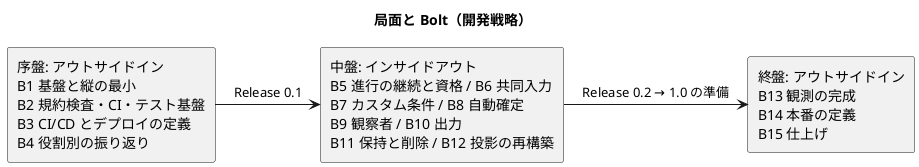
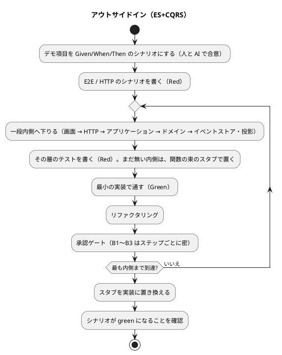
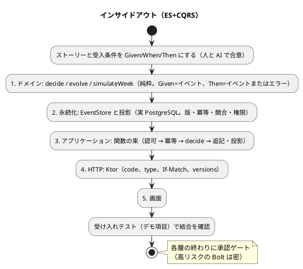

# 開発戦略 - ビールゲームシミュレーション（Kotlin 版）

## 概要

本書は、[リリース計画](./release_plan.md) の Bolt 群（B1〜B15）を **序盤・中盤・終盤** の局面に分け、局面ごとの TDD アプローチと、局面をまたいで変わらない進め方を定めます。局面ごとに変えるのは **テストの入口** と **レイヤーを貫く順序** だけで、Red-Green-Refactor のサイクルは全局面で変えません。

- 本プロジェクトは AI-DLC に従うため、計画の単位の「イテレーション」は **Bolt** に読み替えます。AI が Bolt ごとにステップ計画を書き、人が承認ゲートで検証します。
- **参照元（正）**:
  - Bolt の配分・完了条件: [リリース計画](./release_plan.md)（Bolt ごとのステップ計画 `bolt_N_plan.md` は、着手時に作成する）
  - アプローチの選択フローとサイクル: [コーディングとテストガイド（AI-DLC 版）](../../reference/コーディングとテストガイド_AI-DLC版.md)
  - コーディング規約: [関数型プログラミングガイド（Kotlin 編）](../../reference/関数型プログラミングガイド_Kotlin編.md)
  - テストの種類・カバレッジ・CI: [テスト戦略](../../design/beer-game-kotlin/test-strategy.md)
  - 振る舞いの先行定義（Gherkin と Cucumber を導入する）: [BDD 導入ガイド](../../reference/BDD導入ガイド.md)
  - ドキュメントとコードの同期: [Living Documentation 導入ガイド](../../reference/LivingDocumentation導入ガイド.md)
- 本書は draft です。**計画は B1〜B15 の範囲が確定済み**ですが、各 Bolt のデモ項目は、Bolt ごとのステップ計画を作るときに具体化します（ここでは、リリース計画の「完了条件」を、受け入れ基準の元にします）。
- 実装コードはまだ存在しません。品質チェックのコマンドは、`apps/beer-game-kotlin/` の作成後（B1）に実際のビルド設定で確定します。**本書のコマンドは、設計書の記述から導いた予定です。**

---

## 戦略の全体像

### 局面とアプローチの対応

| 局面 | 対象 Bolt | 主アプローチ | 狙い |
| :--- | :--- | :--- | :--- |
| **序盤** | B1〜B4（Release 0.1） | アウトサイドイン | 作成から振り返りまでの縦の最小を貫き、ES+CQRS・Kotlin の基盤と規約検査の妥当性を、早期に検証する |
| **中盤** | B5〜B12 | インサイドアウト | 並行性・資格・自動確定・削除・投影の再構築など、複雑なドメインと永続化を、ドメイン層と永続化層から固める |
| **終盤** | B13〜B15 | アウトサイドイン | 揃った部品を、運用と受入のシナリオ起点で結合し、リリース全体の一貫性を担保する |

### アプローチ選択の根拠

選択は、[コーディングとテストガイド（AI-DLC 版）](../../reference/コーディングとテストガイド_AI-DLC版.md) の「実装アプローチ選択フロー」に対応づけます。

- **序盤（アウトサイドイン）**: ブラウンフィールドではないが、バックエンドも画面も未実装で、基盤（Gradle のモジュール、イベントストア、Ktor、規約検査）に不確実性が集中している。画面・API の要求（作成から振り返りまで）から入り、薄く貫通させるのが安全である。AI は指示がないと全層を一度に生成しようとするため、**受け入れテストから始め、層を 1 つずつ降りる**ことを Bolt 計画に明記して指示する。
- **中盤（インサイドアウト）**: 並行性（意思決定の版、追記の競合の再試行、冪等記録と認可の順序）、資格、自動確定、削除（追記専用と連鎖削除）、再構築（アドバイザリロック）は、複雑なドメインと永続化が中心である。ここで外側から作ると、型や制約の誤りが下流で膨らむ。ES では、`decide`・`evolve` と `EventStore` の契約が正しければ、上位は薄くなる。**ドメイン → 永続化 → 投影 → アプリケーション → HTTP → 画面の順に、層ごとに承認ゲートを置く**。
- **終盤（アウトサイドイン）**: 基本実装が揃い、観測・本番の定義・仕上げは、既存の部品を運用シナリオと受け入れ条件で結合する作業である。受け入れテストと負荷試験・運用シナリオから始め、不足を内側へ降りて補う。

> 中盤のうち B9（観察者）・B10（出力）は、権限の分離と純粋関数が中心で、ドメインと永続化の層から始めるインサイドアウトを使う。構造が決まっている Bolt なので、ゲートの密度は標準にする（[リリース計画](./release_plan.md)）。

---

## 共通の TDD サイクル

### Red-Green-Refactor（全局面で不変）

1. **Red**: 失敗するテストを書き、**失敗を確認する**。
2. **Green**: テストを通す最小限の実装を書く。先回りして実装しない。
3. **Refactor**: テストが緑のまま設計を改善する。構造の変更と動作の変更を、同じコミットに入れない。

AI がサイクルを回し、人が承認ゲートでコードを全行理解して検証します。**共通の土台（`EventStore` の型、集約の `decide` の型）を作り替える最初のスライドでは、後続の振る舞いのテストも先に書いて失敗を確かめてから実装する**（プロジェクトの規約。順序を守れなかったときは、規則を壊すとテストが落ちることを個別に確かめ、Bolt 終了報告に記録する）。

### テストの種類とレイヤーの対応

詳細は [テスト戦略](../../design/beer-game-kotlin/test-strategy.md) を正とします。

| レイヤー | テストの種類 | 内容 | 主に使う局面 |
| :--- | :--- | :--- | :--- |
| ドメイン（`decide`・`evolve`・`simulateWeek`） | ユニット + 性質 | Given（過去のイベント）/ When（コマンド）/ Then（イベントまたはエラー）。プロパティベース、golden | 全局面（中盤で主役） |
| イベントストア・投影 | 統合（実 PostgreSQL、Testcontainers） | 版の一意制約、冪等、競合、連鎖削除、権限、再構築 | 序盤（B1・B2）、中盤で主役 |
| アプリケーション（関数の束） | ユニット（差し替え） | 関数型の依存をスタブに差し替えた、処理の順序と失敗 | 全局面 |
| HTTP（Ktor） | 統合 | 認証・認可、`code`・`type`、`If-Match`、`versions` | 序盤・中盤 |
| 受け入れ（Gherkin） | Cucumber-JVM（`@api`）、Cucumber-JS + Playwright（`@ui`） | 受入条件・デモ項目の日本語シナリオ。実 DB・実サーバーを通す | 全局面（序盤・終盤は入口、中盤は Bolt の最後） |
| 画面 | コンポーネント + E2E（Playwright、axe） | デモ項目の操作と、アクセシビリティ | 序盤・終盤で主役 |

### 品質チェック（予定。B1 で確定）

ビルドは Gradle を使う予定です（[技術スタック](../../design/beer-game-kotlin/tech-stack.md)）。**Gradle のタスク名は、B1 で `apps/beer-game-kotlin/` の実際の設定を確認して確定します。**

| 検査 | 内容 | 失敗時 |
| :--- | :--- | :--- |
| 整形・静的解析 | **[静的解析とルール設定（厳格に適用）](#静的解析とルール設定厳格に適用)** のとおり。ktlint、detekt、関数型ルールの XPath ルールセット（PMD）、コンパイラの警告をエラーとして扱う。違反は 0 件 | マージしない |
| テスト | `test`（ユニット・性質）と `integrationTest`（DB・HTTP）。DB の統合が 1 件も実行されなければ失敗 | マージしない |
| カバレッジ | Kover。domain の行 100%、全体の行 85%・分岐 75%（実測で見直す） | マージしない |
| 受け入れ（Cucumber） | `@api`（Cucumber-JVM、Gradle のタスク）と `@ui`（Cucumber-JS + Playwright）。Undefined・Pending のステップがあれば失敗 | マージしない |
| フロントエンド | format、lint、typecheck、コンポーネント、Playwright E2E + axe | マージしない |
| 互換 | N-1 互換ジョブ（直前のリリースの読み取り側で、現在の書く版の golden を再生） | マージしない |

---

## 静的解析とルール設定（厳格に適用）

[関数型プログラミングガイド（Kotlin 編）第 9 章](../../reference/関数型プログラミングガイド_Kotlin編.md) の静的解析とルール設定を、**本プロジェクトの全コードに、最初のコードから、例外なく、厳格に適用します。** 関数型の規約（`var` を避ける、可変コレクションを共有しない、例外を握りつぶさない）は、レビューだけに頼ると漏れるため、機械で守らせます（ガイド第 9 章の冒頭）。

### なぜ「厳格」に適用するのか

- ガイドの §9.5 は、静的解析を入れるかを状況で分けている。**複数人の開発、長く保守するプロダクトには「detekt を `check` に組み込み、ktlint の整形は `.editorconfig` で調整する」を推奨**し、1 人の教材・記事のコードには自作の検査を勧める。本プロジェクトは、変更を楽に安全にできる、長く保守するプロダクトで、AI が大量にコードを生成するため、**規約違反を人の目だけで拾えない**（開発者は人 1 名 + AI だが、保守の長さと生成量から、この推奨に当たる）。機械で守らせる。
- 本プロジェクトは新規の実装で、**既存コードの違反がない**。ガイドの導入の進め方（§9.6）にある「件数が多いルールは新しいコードだけに適用する」という段階的な緩和は要らず、**最初から全ルールを有効にできる**。後から入れるほど、違反の修正が高くつく。
- 設計書は、純粋性を「静的検査で守る」と決めている（[テスト戦略](../../design/beer-game-kotlin/test-strategy.md)、[技術スタック](../../design/beer-game-kotlin/tech-stack.md) T5）。この節は、その検査を、開発の進め方として約束する。

### 厳格さの定義

次を、**例外のない合格条件**とします。

| 項目 | 内容 |
| :--- | :--- |
| 違反の件数 | detekt、PMD、ktlint、コンパイラの警告の違反を **0 件**にする（detekt の `build.maxIssues: 0`、コンパイラの警告をエラーとして扱う） |
| 既存の違反を隠さない | **ベースライン（既存の違反の許容リスト）を使わない**。違反は修正する |
| 抑制の禁止 | `@Suppress` と、ルールの無効化コメントを使わない。除外が必要な層は、**ルールセットのファイルを層ごとに分けて外す**（ガイド §9.6。`@Suppress` が写り込まないようにするため） |
| マージの条件 | CI で 1 つでも失敗したら、マージしない。ローカルでも、同じタスクで再現できる |
| 全コードが対象 | ドメイン、アプリケーション、アダプター、テストのすべて。テストは、層ごとのルールセットで、緩めるルールを明示する |
| ルールの緩和 | ルールを無効化・緩和するときは、**理由を ADR に記録し、人が承認する**。「通らないから外す」は認めない |

### 使うツールと役割

ガイドの §9.1 の役割分担に従います。

| ツール | 役割 | 本プロジェクトでの扱い |
| :--- | :--- | :--- |
| **detekt** | Kotlin の中心の静的解析（複雑度、潜在的なバグ、スタイル、例外、`ForbiddenMethodCall`） | 中心。標準ルールを有効にし、`maxIssues: 0` |
| **PMD（XPath のカスタムルール）** | 関数型の規約を表すカスタムルール。標準の Kotlin ルールは 4 つだけだが、XPath で規約をルールにできる（ガイド §9.6）。Java の資産は無いので、**Kotlin の関数型ルールの補完として使う** | detekt に無い規約（`var` の禁止など）を補う（[技術スタック](../../design/beer-game-kotlin/tech-stack.md) T5 の案 C を、補完として採る） |
| **ktlint** | 整形 | 書式の統一。**整形の副作用が出るルールだけを `.editorconfig` で調整する**（ガイド §9.4。下記） |
| Checkstyle、SpotBugs | Java 用 | **使わない**（Kotlin には適用できない。ガイド §9.1） |

> **導入の承認**: PMD は、技術スタックの選定では「補完として使う（未決事項）」だった。本戦略で採用を提案するので、**導入には承認が要る**（新規の依存関係。CI のツールで、実行時の依存関係ではない）。承認までは、detekt と ktlint で進め、PMD のルールセットは、B2 で fixture のテストと合わせて導入する。

### 守る規約（ガイド §9.3・§9.6）

ガイドの章ごとの規約を、機械で検査できるルールに対応づけます。**14 個の関数型ルール（§9.6）を、最初から全て有効にします。**

| 章 | 規約 | ルール | ツール |
| :--- | :--- | :--- | :--- |
| 1 基礎 | 状態を持たせず、値を変換する | `NoVarProperty`（クラス・トップレベルの `var`。関数内のローカルな `var` は許す） | PMD |
| 1 基礎 | 値は不変にし、`copy` で新しい値を作る | `NoVarClassParameter`（コンストラクタの `var`） | PMD |
| 2 関数型スタイル | 可変コレクションを共有しない | `NoMutableCollectionInSignature`（公開関数の引数・戻り値）、`NoMutableCollectionFactory`（`buildList` の外での生成）、detekt の `ForbiddenMethodCall`（`mutableListOf`） | PMD、detekt |
| 2 関数型スタイル | 空のコレクションで例外を投げない | `NoReduce`（`fold` か `reduceOrNull` を使う） | PMD |
| 3 型で表すエラー | null は `?:` や `ensureNotNull` で扱う | `NoNotNullAssertion`（`!!`）、detekt の `UnsafeCallOnNullableType` | PMD、detekt |
| 3 型で表すエラー | 失敗は例外でなく `Either` で返す | `NoThrow`、`NoGenericCatch`、detekt の `TooGenericExceptionCaught`・`SwallowedException` | PMD、detekt |
| 4 副作用の管理 | 隠れた入力と副作用は `suspend` で型に表す | `SideEffectInNonSuspendFunction`（時計・乱数・UUID・標準出力）、`NoRunBlocking` | PMD |
| 5 並行処理 | 構造化並行性、コルーチンと `Atomic` | `NoGlobalScope`、`NoRawConcurrency`（`Thread`、`Executors`、`synchronized`）、`NoThreadSleep` | PMD |
| 6 代数構造の実用 | 入れ子の `flatMap` を平らに書く | `NoNestedFlatMap`（`either { }` と `bind()`、`sequence { }`） | PMD |
| 小さな関数 | 関数を小さく保つ | detekt の `CyclomaticComplexMethod`・`CognitiveComplexMethod`・`LongParameterList` | detekt |
| 読みやすさ | 行長を揃える | detekt の `MaxLineLength` | detekt |
| **本プロジェクトで加える** | ドメインの純粋性 | detekt の `ForbiddenMethodCall` で、**ドメインのモジュールでの** `Instant.now`・`Clock.system*`・`UUID.randomUUID`・`Random` を禁止（[テスト戦略](../../design/beer-game-kotlin/test-strategy.md) M18） | detekt |

構文では表せない規約（`sealed interface` の `when` に `else` を書かない、純粋関数の性質をプロパティベーステストで書く）は、ガイドのとおり、**レビューとテストで守ります**（承認ゲートのチェックリストに入れる）。

**設定値は、使う版で確かめてから確定します。** ガイドの detekt の設定（§9.3）は、出典から転記したものではなく、実際に走らせて確認していない例です。**ルール名と既定値は、導入する detekt の版の公式ドキュメントで確認します。** 同様に、`var` を禁止する専用ルールは、detekt の標準では確認できていないため、PMD のカスタムルールで補います。

### 層ごとのルールセット

境界のコード（HTTP の入口、第三者のライブラリとの接続）やテストでは、例外を投げる、`runBlocking` を使う、といった規約外の書き方が要る場合があります。**ルールは、層ごとにファイルを分けて、外す範囲を明示します**（ガイド §9.6）。

| 層 | ルールセット | 外してよいルール（理由） |
| :--- | :--- | :--- |
| ドメイン（`decide`・`evolve`・`simulateWeek`） | **全ルールを有効**（最も厳格） | なし |
| アプリケーション（関数の束） | 全ルールを有効 | なし |
| アダプター（Ktor、JDBC、`EventStore` の実装） | 全ルールを有効。境界の都合で必要なものだけ外す | 例: `NoThrow`・`NoGenericCatch` を、外部ライブラリの例外を `Either.catch` で値にする箇所に限って外す。外すルールと範囲は、ADR に記録する |
| アプリケーションの起動（`main`） | 境界として扱う | `NoRunBlocking`（一度きりの境界） |
| テスト | 全ルールを有効。テストの都合で必要なものだけ外す | 例: `NoThreadSleep` は外さない（`runTest` の仮想時間を使う）。`NoThrow` の扱いは、Kotest の検証で必要な範囲を確認して決める |

### ktlint の調整

整形の副作用が出るルールは、`.editorconfig` で調整します（ガイド §9.4）。

- **関数名の camelCase の強制は、テストで外す**。バッククォートで書く日本語のテスト名（[テスト戦略](../../design/beer-game-kotlin/test-strategy.md)）が書けなくなるため。
- ファイル名をクラス名に合わせるルールは、ガイドでは「OO 版と FP 版を並べにくい」という理由で外していた。**本プロジェクトは 1 つの実装なので、外す理由があるか、導入時に判断する**（外すなら理由を ADR に記録する）。
- 引数が 2 つ以上の関数シグネチャの強制分割などの中核の整形は、**外さずに受け入れる**（外すと導入の意味がほとんど残らない。ガイド §9.4）。コードが縦長になる副作用は、本プロジェクトでは記事のコード例と実装のずれを起こさないため、問題にならない。

### ルールそのものをテストファーストで確かめる

ガイドの §9.6「ルールの確認」に従い、**ルールは、使い始める前に、違反するコードと違反しないコードを並べた fixture で確かめます**（テストファースト。ルールは、読み間違えると、違反を見逃したり、正しいコードを誤検出したりする）。

1. 違反するコードと、しないコードを 1 つのファイルに並べた **fixture** を用意する（ガイドの例を出発点にする。ローカルな `var`、`private` 関数、`suspend` 関数の中、`buildList` の内側、純粋関数は、報告されないことも確かめる）。
2. 期待する件数と行を決める（ガイドの例では、PMD 7.29.0 で **17 件**）。
3. ルールセットで実行し、**期待どおりの行だけが報告される**ことを確かめる。
4. この確認を **CI に組み込み**、ルールを変更したら、fixture のテストで回帰を防ぐ。

ルールの `message` に `{` と `}` を書かない（PMD が `MessageFormat` として解釈し、内部エラーで失敗する。ガイド §9.6）。件数が合わないときは、PMD の `designer` で実際のノード名を確かめて XPath を直す。**PMD の版は、本プロジェクトで使う版で、fixture を実行して確かめる**（ガイドは PMD 7.29.0 で確認した。他の版では保証されない）。

### 最初のビルドの受入条件（B2）

[リリース計画](./release_plan.md) の B2 で、次を**受入条件**にします。満たせない場合は、B3 以降を止め、代替を選びます（[技術スタック](../../design/beer-game-kotlin/tech-stack.md) T5）。

- [ ] **規約違反のコードを 1 つ置くと、CI が落ちる**（ドメインのモジュールで `Instant.now()` を呼ぶ、`var` を使う、など。detekt と PMD のそれぞれで確認する）
- [ ] **detekt が、使う Kotlin（2.4）のコードを解析できる**（できなければ、代替: detekt 2 alpha、PMD の XPath の拡充、ktlint のカスタムルール。選択は ADR に記録する）
- [ ] **PMD が Kotlin 2.4 の構文を解析できる**（未確認）。fixture の期待件数と一致する
- [ ] `maxIssues: 0`、ベースラインなし、`@Suppress` なしで、全コードが緑
- [ ] ktlint の `.editorconfig` の調整（日本語のテスト名など）が、実際の版で動く

### 守り続けるために

- **ルールを足すのは、同じ指摘をレビューで繰り返したときに限る**（ガイド §9.6 の導入の進め方）。ただし、14 個の関数型ルールと detekt の標準ルールは、最初から有効にする。
- **ルールを緩める・外す提案が出たら**、理由を ADR に記録し、人が承認する。
- **再検討の条件は、事象で決める**（ガイド §9.5）: 時期が来たことは、理由にならない。たとえば、誤検出が頻発してレビューの手間が増える、または自作のルールで拾えない問題が実際に起きる、のいずれかが起きたとき。
- 静的解析は、**検出できる種類の問題にしか効かない**。設計書とコードの食い違い（イベント名、`code`、制約名）は、静的解析では検出できず、契約テストと golden、設計書の整合の確認（grep）で守る。

---

## デモ項目を受け入れ基準とする

[リリース計画](./release_plan.md) の各 Bolt の完了条件を、**当該 Bolt の受け入れ基準**とします。受け入れ/E2E のテストは、テストピラミッドの上では最小でも、「業務価値が実際に成立するか」を担保する最終ゲートとして、各 Bolt の完了条件（DoD）に組み込みます。

- **序盤**: 受け入れの基盤（Cucumber-JVM、Cucumber-JS と Playwright、実 Ktor サーバー）を B1 でセットアップし、「作成 → 参加 → 割り当て → 開始 → 入力 → 確定 → 状態の表示」を green にすることを、ウォーキングスケルトン成立の判定基準とする。
- **中盤・終盤**: Bolt のステップ計画で、完了条件を **デモ項目（操作またはリクエストの系列）に翻訳**し、受け入れテストにする。デモ項目のテストが green でなければ、その Bolt をクローズしない。追加したテストは以降も実行し、回帰を防ぐ。
- **人による実操作**: 実績が偏った beer-game2 の反省（承認を Unit の終わりにまとめ、実操作の申告が無かった）から、**デモ項目の実操作を、Bolt 終了報告に申告する**（[リリース計画](./release_plan.md) のリスク R14）。

### Bolt ごとの受け入れ基準の元

| Bolt | 受け入れ基準の元（完了条件の要点） |
| :--- | :--- |
| B1 | ローカルの E2E（作成 → 確定 → 状態の表示）。`simulateWeek` と `decide`/`evolve` の性質テスト。DB 統合（版・冪等・原子性）。golden |
| B2 | 規約違反コードを 1 つ置くと CI が落ちる。追記専用権限の否定テスト。domain の行 100% のゲート |
| B3 | `terraform validate`・`plan`（適用しない）。ローカルのコンテナでスモークテスト |
| B4 | AC4.2.1〜4.2.4。終了前は振り返りを開示しない（**Release 0.1**） |
| B5 | AC3.1.*、AC3.2.*。資格の否定テスト（期限切れ・失効・旧版・失効後の再送） |
| B6 | AC1.2.4、AC2.1.4、AC2.2.3、AC2.2.4。並行の統合テスト。`RetryExhausted` の発生率 |
| B7 | AC1.1.3〜1.1.5。可変遅延のプロパティテスト（遅延 0 を含む） |
| B8 | AC1.1.6、AC2.4.*。2 プロセスの並行テスト（**Release 0.2**） |
| B9 | AC1.3.*、AC4.1.*。他役割の値・将来の需要・参加コードを取得できない否定テスト。観察者プールの配線 |
| B10 | AC4.3.*。最大の長さでの生成時間（NF-P9） |
| B11 | AC5.1.*。削除後に `game_id` を持つ全表に行が残らないテスト |
| B12 | 投影の整合が不一致 0 件。再構築の時間。N-1 互換ジョブ |
| B13 | AC6.1.*。アラームの訓練（模擬） |
| B14 | AC6.2.*（定義まで）。机上の復元・ロールバック |
| B15 | 横断の受入条件 X-1〜X-5。NFR の検証表の全件（**Release 1.0**） |

### アウトサイドインの入口を BDD で定義する（Gherkin と Cucumber を導入する）

**Gherkin と Cucumber を導入します**（2026-11-14 の決定）。理由: 本プロジェクトのチームの規約が「Given/When/Then を実装より先に定義する」であること。デモ項目と受入条件を、業務の言葉で読める日本語のシナリオにし、**同じものを自動テストとして実行できる**ため、人と AI の契約（Mob Elaboration の合意）がそのまま検証可能になること。シナリオとコードという冗長な知識の整合を、Cucumber が照合する「天秤」になること（[BDD 導入ガイド](../../reference/BDD導入ガイド.md)）。

#### Gherkin と Kotest の使い分け

| 対象 | 書き方 | 処理系 | 理由 |
| :--- | :--- | :--- | :--- |
| **受入条件・デモ項目**（ストーリーの AC、業務シナリオ） | **日本語 Gherkin**（フィーチャーファイル） | **Cucumber** | 非技術者（進行役・運用担当の視点）も読める契約にする。生きたドキュメントとして公開する |
| ドメインの純粋関数（`decide`・`evolve`・`simulateWeek`）、性質、DB・HTTP の細部 | Kotest の日本語のテスト名で Given（過去のイベント）/ When（コマンド）/ Then（イベントまたはエラー） | Kotest | イベントの列は実装の詳細に近く、業務のシナリオにすると冗長になる。ビルダー（Object Mother）で組み立てる（[テスト戦略](../../design/beer-game-kotlin/test-strategy.md) T-1） |

**同じ振る舞いを、Gherkin と Kotest で二重に書かない。** 受入条件は Gherkin、実装の細部と網羅は Kotest が担う。

#### 方針

- **使う局面**: 序盤・終盤のアウトサイドインで、デモ項目をフィーチャーファイルにして入口にする。中盤のインサイドアウトでは、ドメインと永続化の Kotest が主役で、**受入条件のシナリオは、実装の前に書いて合意しておき、Bolt の最後に Cucumber で実行して結合を確認する**（Bolt の完了条件に含める）。
- **誰が書くか**: シナリオは実装前に、Mob Elaboration（人 + AI）で合意する。**AI にシナリオを書かせた場合も、人が業務の言葉と例の妥当性を検証してから承認する**（シナリオが契約）。
- **記述言語**: 日本語 Gherkin（フィーチャーファイルの先頭に `# language: ja`。キーワードは `機能`・`背景`・`シナリオ`・`シナリオテンプレート`・`前提`・`もし`・`ならば`・`かつ`）。**語彙は、[ユビキタス言語](../../design/beer-game-kotlin/domain-model.md)（業務の用語）に合わせ、イベント名やテーブル名などの実装の言葉を持ち込まない。** 言語を混在させない。
- **フィーチャーファイルの整理**: 機能領域ごとにフォルダを切る（ガイドの「機能領域ごと」。業務ドメインが重要なため）。領域は [ユーザーストーリー](../../requirements/beer-game2/user_story.md) の Epic（ゲーム準備と参加、1 週の意思決定、継続と復旧、観察と振り返り、保持、運用と観測性）に合わせる。1 ファイルに 3〜15 シナリオを目安にする。
- **タグ**: 各シナリオに、ストーリーと受入条件の ID（例: `@US2.4 @AC2.4.1`）、層（`@api`、`@ui`）、重要度（`@acceptance-criteria`、`@happy-path`、`@negative`、`@core`）を付ける。`@wip` は作業中の一時的なタグで、完了時に削除する。**タグの一覧と意味を、フィーチャーファイルと同じ場所のテキストファイルに文書化する。** ストーリーとの対応は、タグから自動で抽出し、[テスト戦略](../../design/beer-game-kotlin/test-strategy.md) のトレーサビリティの検査（ストーリー ID の整合）に使う。

#### 処理系と配置

ガイドの「処理系を選ぶ」に従い、**公式の処理系**から、層ごとに選びます。

| 層 | 処理系 | 実行するシナリオ | 備考 |
| :--- | :--- | :--- | :--- |
| バックエンド（アプリケーション・HTTP・永続化） | **Cucumber-JVM**（公式。Java / Kotlin） | `@api` | Gradle のソースセット（`acceptanceTest` を想定）。Ktor のテスト用アプリケーションと、実 PostgreSQL（Testcontainers）を通す |
| 画面 | **Cucumber-JS**（公式。`@cucumber/cucumber`）と Playwright | `@ui` | フロントエンドの E2E。実 Ktor サーバーを通す |

- **1 つのシナリオは、1 つの層だけで実行する**（`@api` か `@ui`）。画面を通す必要のある業務（振り返りの表示、アクセシビリティ）だけを `@ui` にし、そのほかは `@api` にする。同じシナリオを両方の層で実行して、ステップ定義を二重に持たない。
- **配置（B1 で確定）**: フィーチャーファイルは `apps/beer-game-kotlin/features/<機能領域>/` に 1 か所にまとめ、両処理系から参照する案を第一とする。ステップ定義は、Cucumber-JVM は Kotlin の `acceptanceTest`、Cucumber-JS は E2E のディレクトリに置く。処理系の既定の場所（Cucumber-JVM は `src/test/resources`、Cucumber-JS は `features/`）と合わせられるかを、B1 で確認する。
- **注意（Cucumber-JS、ガイドより）**: グローバルにインストールしない（プロジェクトの依存として入れる）。依存ツリーに複数の版を混在させない（`npm why @cucumber/cucumber` で確認）。パッケージは旧 `cucumber` ではなく `@cucumber/cucumber`。
- **導入の手続き**: 導入は決定済み。**具体的な成果物（Cucumber-JVM のモジュール、Cucumber-JS）と版は、[技術スタック](../../design/beer-game-kotlin/tech-stack.md) の手順で、公式の情報で確認してから確定し、依存関係の導入の承認を得る**（B1）。版は、このとき確認する。
- **実行**: `@api` は Gradle のタスク、`@ui` は `npx cucumber-js` を、CI の毎回の工程に含める（[テスト戦略](../../design/beer-game-kotlin/test-strategy.md) の CI）。

#### ステップ定義の責務

- ステップ定義は**薄く保ち、業務ロジックを持ち込まない**。ステップの中身は、アプリケーションの関数と、過去のイベントのビルダーを呼ぶだけにする。
- アウトサイドインでは、**ステップ定義から呼ぶ「まだ無い内側」の関数と型が、設計を駆動する**。
- ステップ定義も、静的解析の対象である（[静的解析とルール設定](#静的解析とルール設定厳格に適用)）。テストの層のルールセットで、外す範囲を明示する。

#### アウトサイドインのサイクル（Cucumber）

ガイドの Red-Green-Refactor に従います。

1. デモ項目を日本語 Gherkin のシナリオにし、Mob Elaboration で合意する。
2. 実行する。ステップ定義が無いので **Undefined** になる（Cucumber が貼り付け可能なスニペットを提案する）。
3. ステップ定義を書く。まだ無い内側の関数を呼ぶ。**Pending**（未実装）→ アサーションを書いて **Failing（Red）** を確認する。
4. 内側へ一段下りて（画面 → HTTP → アプリケーション → ドメイン → イベントストア・投影）、各層を TDD で実装し、**Passing（Green）** にする。
5. リファクタリングする。**シナリオは業務の言葉のまま変えない。**

この流れは、AI-DLC の Bolt のステップ計画に対応する。**シナリオが受入条件、Cucumber の実行結果が承認ゲートでの検証材料**になる。

#### 生きたドキュメントとしての公開

フィーチャーファイルを、ビルドごとに Web サイトなどとして公開し、**生きたドキュメント**にします。ツール（Pickles、Cucumber Reports など。ガイドの一覧）は B1〜B2 で選ぶ。**公開は CI で自動化し、手作業で生成しない**（手作業にすると更新されなくなる）。Living Documentation の終盤の重点（ガイドツアー、シナリオダイジェスト）とも連携する。

---

## ドキュメントをコードと同期させる（Living Documentation）

**採用します。** 理由: beer-game2 で、コードの注釈から「サイトシーイング・マップ」と「ガイドツアー」を生成する実績があり（beer-game2 の `docs/design/` の生成物）、局面をまたいでも設計の理解がずれにくくなるためです。Kotlin 版の設計書は、この 2 つを「実装後に生成する」としています（[設計の一覧](../../design/beer-game-kotlin/index.md)）。**これから書くコードから適用し、既存コードへの一括適用はしません。**

### 局面ごとの重点

| 局面 | 生まれる知識 | 重点 | 参照ガイド |
| :--- | :--- | :--- | :--- |
| 序盤 | アーキテクチャ（モジュール）、外部アクター | 注釈の語彙を決める。**モジュールの依存は、Gradle のモジュール分割で強制し、ビルドで検証する**（追加ライブラリなし）。アーキテクチャ図は、モジュールの依存からの生成を B1〜B2 で検討する | アノテーション導入ガイド |
| 中盤 | ドメインの概念、集約、業務ルール、イベント | コア概念のハイライトと、**ドメインの型（`sealed interface`、`value class`、イベント一覧）から生成する用語集**でユビキタス言語をコードに一本化する。判断の根拠は ADR に残す。模範となる集約（`Session`）を示す | ダイナミックキュレーション導入ガイド |
| 終盤 | 業務シナリオ、処理の流れ | デモ項目の処理チェーン（画面 → API → ユースケース → 集約 → イベントストア → 投影）を**ガイドツアー**として案内し、見どころを**サイトシーイング・マップ**にまとめる。**Gherkin のタグから、シナリオのダイジェストを生成する**（BDD を採用しているため） | ガイドツアー・サイトシーイング導入ガイド |

### 開発戦略として決めること

- **何をコードに持たせ、何を文書に残すか**: コードで表せる知識（構造、用語、イベント名、依存関係）は生成し、`docs/design/` に手で複製しない。`docs/design/` には、コードから読み取れない**意図・判断・却下した代替案**を残す。生成物（用語集、ツアー、マップ）と手書きの設計書の境界は、設計書側に明記する。
- **重複させる知識の検証**: やむを得ず重複する知識（API の契約 `contracts/openapi.yaml` と Kotlin の実装、イベント一覧とコード）は、不一致を検出するテストで守る。契約テスト（OpenAPI）と、`EventCodec` の golden（全イベントの種類）がこれを担う（[テスト戦略](../../design/beer-game-kotlin/test-strategy.md)）。
- **注釈の語彙と生成の仕組み（未決）**: 注釈の語彙と、注釈から生成する方式（コンパイラ連携の注釈処理か、ソースを走査するスクリプトか）は、**B1〜B2 で、追加の依存関係が最小の方式を決める**。ドメインのモジュールは Kotlin の標準と Arrow だけに依存する規約があるため、注釈の定義は別モジュールに置く。beer-game2 は走査のスクリプトで生成した。
- **生成と公開の自動化**: 用語集・図・ツアーの生成を、ビルドまたは CI のどの段階で実行し、どこに公開するかは、B1〜B2 で決める。**手作業で更新する一覧は作らない。**
- **根拠の記録先**: 設計判断は ADR（`creating-adr`）、変更ごとの意図はコミットメッセージに残す。

### 完了条件への組み込み

- 生成するドキュメント（用語集・図・ツアー）の生成がビルドまたは CI で成功している（生成の仕組みが決まった Bolt 以降）。
- その Bolt で下した設計判断が ADR に記録され、コードで表せない根拠だけが `docs/design/` に反映されている。
- 手書きでコードの内容を複製した一覧・図が、新たに増えていない。

---

## 序盤: アウトサイドイン（B1〜B4）

### 目的

縦の最小（作成から振り返りまで）を貫き、次を早期に検証する。

- 2 ストリームと `startGame` の原子的な追記、同期投影、版の一意制約による並行制御
- Kotlin・JDK・Gradle・Ktor・Arrow の組み合わせ、detekt と Kotlin 2.4 の互換
- AI の出力の質と、以降の承認ゲートの密度

### 対象ストーリー

US1.1・1.2・2.1・2.2・2.3（基本）、US4.2、US6.1・6.2（基本）（[リリース計画](./release_plan.md)）。

### ワークフロー

### 手順の要点

1. **B1**: **Cucumber の基盤（Cucumber-JVM と Cucumber-JS、E2E）を最初に作る**。キット準拠のゲームを通す 1 本の日本語 Gherkin のシナリオから入り、`decideGame`/`decideSession`/`simulateWeek` の最小、`EventStore.append`、同期投影、Ktor、React の最小の順に内側へ下りる。共通の土台の最初のスライドでは、後続の振る舞いのテストも先に書く。
2. **B2**: Kotlin 固有の不確実性を、**テストで**解消する。**静的解析とルール設定の厳格な適用の受入条件**（[静的解析とルール設定](#静的解析とルール設定厳格に適用)。fixture によるルールの確認、規約違反コードで CI が落ちること、detekt・PMD と Kotlin 2.4 の互換）、Kover が 2 つのソースセットを合算すること、追記専用権限の否定テストと連鎖削除の Red を確かめる。**悪ければ B3 以降を止める**（[リリース計画](./release_plan.md)）。
3. **B3**: デプロイの定義（コンテナ、Terraform）を、適用せずに `validate`・`plan` とスモークテストで検証する。
4. **B4**: 振り返りの画面を、役割別の週結果の行から、E2E のシナリオ起点で作る。

### 完了条件

- [ ] 各 Bolt の受け入れ基準（上の表）のテストが green
- [ ] ウォーキングスケルトンのシナリオ（作成 → 確定 → 状態の表示。Cucumber）が green。Undefined・Pending のステップがない
- [ ] **静的解析とルール設定の受入条件（B2）を満たす**: 規約違反コードで CI が落ちる。fixture のテストで、全ルールが期待どおり。違反 0 件、ベースラインなし、`@Suppress` なし
- [ ] Release 0.1 のリリース条件を満たす（[リリース計画](./release_plan.md)）
- [ ] 人による実操作の申告が Bolt 終了報告にある

---

## 中盤: インサイドアウト（B5〜B12）

### 目的

並行性・資格・自動確定・カスタム条件・観察者・出力・削除・再構築を、ドメイン層と永続化層から堅牢に作り込む。**ES では、`decide`/`evolve` と `EventStore` の契約が正しければ、上位の層は薄くなる。**

### 対象ストーリー

US3.1・3.2、US1.2（共同）、US2.2（共同）、US1.1（カスタム）、US2.4、US1.3、US4.1、US4.3、US5.1、US6.1・6.2（定義まで）。

### ワークフロー

### 手順の要点

- 各層で **Red → Green → Refactor** を回し、層ごとに承認ゲートを置く。AI に「次の層へ進む前に、この層のテストが緑であること」を指示する。
- **高リスクの Bolt（B5、B6、B8、B9、B11、B12）では、否定テストと並行テストを実装より先に書く**: 失効後の再送、観察者が読めない値、2 プロセスの確定、削除後の残存、再構築中の追記。
- ドメインは純粋に保つ。時計・乱数・ID は、コマンドの値で受け取る。`var` と可変コレクションを使わない（detekt と PMD の関数型ルールで検査。[静的解析とルール設定](#静的解析とルール設定厳格に適用)）。
- 生成する用語集・イベント一覧を、中盤の最初の Bolt から整える（Living Documentation の中盤の重点）。

### 完了条件

- [ ] 各 Bolt の受け入れ基準のテストが green（デモ項目の Gherkin シナリオ（Cucumber）を含む）。シナリオは実装前に書いて合意済み
- [ ] 各層のテスト（ドメイン・永続化・アプリ・HTTP）が green。domain の行 100%
- [ ] 否定テスト・並行テストが green
- [ ] Release 0.2（B8）のリリース条件を満たす
- [ ] 設計判断が ADR に記録され、`docs/design/` が更新されている
- [ ] 静的解析の違反が 0 件（ベースラインなし、`@Suppress` なし）。ルールの緩和・除外を足した場合は、ADR と承認がある

---

## 終盤: アウトサイドイン（B13〜B15）

### 目的

揃った部品を、運用シナリオと受け入れ条件で結合し、リリース全体の一貫性を担保する。

### 対象ストーリー

US6.1・6.2（完成）、横断の受入条件 X-1〜X-5、NFR の検証表（84 件）。

### 手順の要点

1. 運用・受入のシナリオ（アラームの訓練、復元とロールバックの机上確認、負荷試験、アクセシビリティの手動確認、ブラウザ行列）を、**先に**書く。
2. 不足を内側へ降りて補う。性能の目標（NF-P3、P15 など）は、実 DB の計測で確認し、同期投影が重ければ、非同期投影への移行を判断する（設計判断 4）。
3. ガイドツアーとサイトシーイング・マップを、デモ項目の処理チェーンから生成し、公開する。

### 完了条件

- [ ] 横断の受入条件と NFR の検証表の全件が実施済み
- [ ] Release 1.0 のリリース条件を満たす（AWS への適用は別ゲートで、未実施であることを明記する）
- [ ] 生成するドキュメントが CI で成功している
- [ ] 静的解析の違反が 0 件（ベースラインなし、`@Suppress` なし）

---

## イテレーション（Bolt）ごとの設計ドキュメント整合

各 Bolt で、ステップ計画の設計トピックと `docs/design/beer-game-kotlin/` の整合を、**着手時・実装中・完了時**に確認します。Bolt 計画は局所ビュー、設計書は全体の「正」です。実装で設計判断が変わったら、その場で設計書を更新します（計画だけに書いて放置しない）。

- 着手時は `validating-design`（設計書と計画・過去の Bolt の整合）で検証する。
- 構造の変更（モジュール、テーブル、イベント）は、アーキテクチャの検査（Gradle のモジュール境界、detekt）とフルテストで裏取りする。
- **設計書を変えたときは、他の文書への影響を grep で確認する**（イベント名、`code`、テーブル名、制約名は、複数の文書に現れる。設計書のレビューで、この種の取り残しが多く見つかった）。
- 設計書の暫定の決定（保持の起点、研修中の再構築の運用）は、B11・B12 の着手前に人が確定する（[リリース計画](./release_plan.md) の Level 1 計画）。

---

## 局面移行時の一貫性維持

局面が変わっても、次は変えません。

| 不変の規律 | 内容 |
| :--- | :--- |
| TDD の三原則 | 失敗するテストを先に書き、失敗を確認し、最小限を実装し、緑でリファクタリングする |
| コミット | 1 コミット 1 目的。構造変更と動作変更を混ぜない。日本語の Conventional Commits、scope は `beer-game-kotlin` |
| 品質基準 | 整形・静的解析・テスト・カバレッジ・N-1 互換が、毎回、緑 |
| 関数型の規約 | ドメインは純粋（`decide`・`evolve`）。失敗は `Either`/`Raise`。副作用は境界へ。`var` と可変コレクションを使わない。**[静的解析とルール設定](#静的解析とルール設定厳格に適用)のとおり、全ルールを最初から有効にし、違反 0 件・ベースラインなし・`@Suppress` なしで守る** |
| 常時グリーンの検査 | モジュール境界（ドメインは Kotlin 標準と Arrow だけに依存）、`ForbiddenMethodCall`、関数型ルール（PMD）、ルールの fixture のテスト |
| ユビキタス言語 | イベント名・コマンド名・`code` は、設計書とコードで同じ。生成する用語集で一本化する |
| 承認ゲート | 人がコードを全行理解する。承認は Bolt ごとに受ける |

**局面の移行は、移行の前に確認する**: 序盤 → 中盤の前に、B2 の判定（detekt の互換、Kover、連鎖削除）と、B1 の実績による所要の再調整を行う。中盤 → 終盤の前に、Release 0.2 のリリース条件と、未決の設計項目（保持の起点、再構築の運用）の確定を確認する。

---

## 未決事項

- **PMD の導入の承認**（新規の CI ツール。承認までは detekt と ktlint で進める）。技術スタック（T5）、テスト戦略（静的解析の節）、リリース計画（B2）は、本書に合わせて更新済み（2026-11-14）。
- PMD の Gradle での実行方法と、Kotlin 2.4 の構文の解析の可否（未確認。B2 の受入条件）。
- detekt の設定値（ルール名と既定値）は、導入する版の公式ドキュメントで確認して確定する（ガイドの例は未確認）。
- ktlint の `.editorconfig` で、ファイル名のルールを外すか（導入時に判断。外すなら ADR）。
- テストの層ごとのルールセットで、外すルールの範囲（Kotest の検証での `NoThrow` の扱いなど）。
- 注釈の語彙と、ドキュメントの生成の仕組み（B1〜B2 で決める）。
- Cucumber-JVM・Cucumber-JS の依存関係の導入の承認（導入は決定済み。版は 2026-11-14 に確認済み: Cucumber-JVM 8.0.4、`@cucumber/cucumber` 13.3.0。詳細は [技術スタック](../../design/beer-game-kotlin/tech-stack.md)）。JUnit の版との組み合わせは、B1 で確認する。
- フィーチャーファイルの配置（共有の `features/` か、処理系ごとか）と、ステップ定義の置き場（B1 で確定）。
- 生きたドキュメントの公開ツール（Pickles、Cucumber Reports など）と公開先（B1〜B2）。
- **他の文書の更新**: 解決済み（2026-11-14）。技術スタック（Cucumber・PMD の依存関係、T5）、テスト戦略（開発の進め方、静的解析、CI、トレーサビリティ）、リリース計画（B1 に Cucumber の基盤、B2 に PMD と fixture。B1 を 4 日、B2 を 3 日に変更し、日程を再計算）を反映した。
- 品質チェックの Gradle タスク名と、`apps/beer-game-kotlin/` のディレクトリ構成（B1 で確定）。
- フロントエンドの E2E の配置（beer-game2 の再利用か、新規か）。B1 で決める。
- 局面への Bolt の割り当ては、B1 の実績（所要、AI の出力の質）で見直す。特に、B9・B10 を中盤とするか、終盤に回すか。

---

## 更新履歴

| 日付 | 更新内容 | 更新者 |
| :--- | :--- | :--- |
| 2026-11-14 | 初版作成（承認待ち） | claude-code/claude-sonnet-5-5 |
