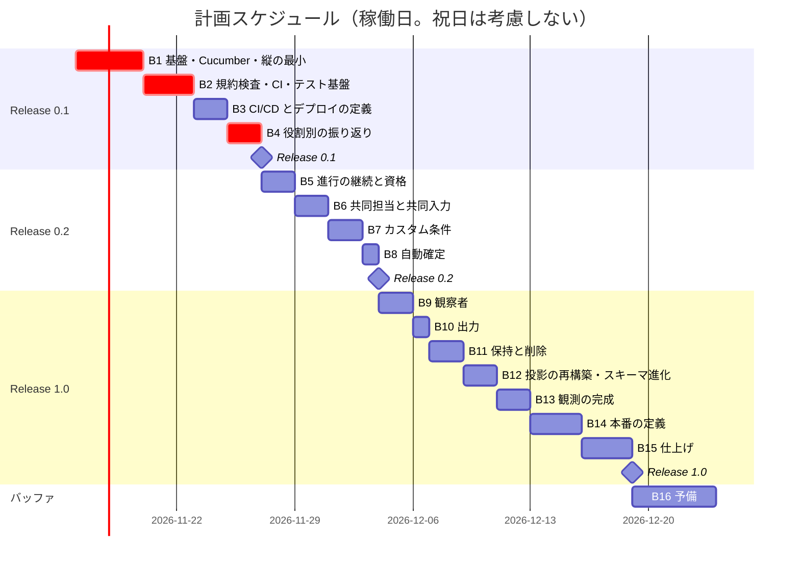

# リリース計画 - ビールゲームシミュレーション（Kotlin 版）

## 概要

本書は、beer-game-kotlin（beer-game2 の Kotlin 版）のリリース計画を、AI-DLC の Intent → Unit → Bolt の階層で定義します。**AI が計画を提案し、人が承認ゲートで検証・承認します。本書は承認待ちです。**

- 機能・振る舞いは beer-game2 を引き継ぎます。要件・ユースケース・ストーリー・Unit の定義・ADR は、新規に作らず beer-game2 のものを参照します（[ユーザーストーリー](../../requirements/beer-game2/user_story.md)、[Unit 定義](../../requirements/beer-game2/unit_definition.md)）。
- 設計は [beer-game-kotlin の設計](../../design/beer-game-kotlin/index.md)（イベントソーシング + CQRS、Ktor + Arrow）です。コーディングは [関数型プログラミングガイド（Kotlin 編）](../../reference/関数型プログラミングガイド_Kotlin編.md) に準拠します。
- 計画の根拠: [リリース・イテレーション計画ガイド（AI-DLC 版）](../../reference/リリース・イテレーション計画ガイド_AI-DLC版.md)、[beer-game2 のリリース計画](../beer-game2/release_plan.md) と [リリース完了報告書 0.2](../beer-game2/release_report-0_2_0.md)。
- 開発の進め方は [開発戦略](./development_strategy.md) に従います。受入条件・デモ項目は日本語 Gherkin と Cucumber（Cucumber-JVM の `@api`、Cucumber-JS + Playwright の `@ui`）で表し、静的解析は [関数型プログラミングガイド（Kotlin 編）第 9 章](../../reference/関数型プログラミングガイド_Kotlin編.md) を厳格に適用します（違反 0 件、ベースラインなし、`@Suppress` なし。detekt が中心、PMD の XPath ルール 14 個が補完、ktlint は `.editorconfig` で調整）。
- **日付と所要は、仮定にもとづく初期の見積もりです。** ウォーキングスケルトン（B1）の実績で再調整します。

### プロジェクト情報

| 項目 | 内容 |
| :--- | :--- |
| プロジェクト名 | beer-game-kotlin（ビールゲームシミュレーション Kotlin 版） |
| Intent | beer-game2 と同じ学習の価値（**役割別に、遅延と意思決定が変動を増幅する過程を振り返れる**）を、Kotlin の関数型設計とイベントソーシングで、変更を楽に安全にできる形で提供する |
| 対象ユーザー | 進行役、参加者（共同担当を含む）、観察者、運用担当 |
| 開発体制 | モブ（人 1 名 + AI）。人は承認ゲートで計画・設計・コードを検証し、判断する |
| 実装の場所 | `apps/beer-game-kotlin/`（バックエンド Kotlin。フロントエンドは React/TypeScript で、配置は B1 で決める） |
| 参照のみ | `apps/beer-game2/`（フロントエンドの再利用元）。beer-game2 は修正しない |

---

## 満足条件

### スコープ

beer-game2 と同じ範囲（Unit U1〜U6、Release 0.1 / 0.2 / 1.0）です。Kotlin 版で加える作業は、Bolt として明示します（B2、B12）。

| リリース | 内容 | 含む Unit | ストーリー |
| :--- | :--- | :--- | :--- |
| Release 0.1 | **学習が成立する最小**: 1 ゲームを通し、役割別の振り返りができる。CI が通る | U1、U4（振り返りの核） | US1.1・1.2・2.1・2.2・2.3（基本）、US4.2、US6.1・6.2（基本） |
| Release 0.2 | 進行の継続、共同担当、カスタム条件、自動確定 | U2、U3 | US3.1、US3.2、US1.2（AC1.2.4）、US2.2（共同）、US1.1（カスタム）、US2.4 |
| Release 1.0 | 観察者、出力、保持と削除、投影の再構築、観測、本番の定義、仕上げ | U4（残り）、U5、U6 | US1.3、US4.1、US4.3、US5.1、US6.1・6.2（完成）、横断の受入条件 |

- ストーリーは 15 件（Must 11 件、Should 4 件）で、beer-game2 と同じです。Should は US1.3、US2.4、US4.1、US4.3。
- **AWS への適用は、本計画の範囲外の別の承認ゲート**です。Terraform、CI/CD、デプロイ構成は**定義まで**を Bolt に含め、ステージング・本番への適用は人の判断で別に行います（beer-game2 では、AWS 未適用のまま Release 0.2 が止まったため、切り分けます）。したがって「ステージングで動く」ことは Release 0.1 の完了条件に含めません。

### ビジネス価値と測定基準

[Unit 定義](../../requirements/beer-game2/unit_definition.md) の「測定基準」を参照してください。最優先の価値は、**役割別の振り返り**（ブルウィップ効果の確認）です。Kotlin 版に固有の測定基準は、次の 3 つです。

| 指標 | 目標 | 確認する Bolt |
| :--- | :--- | :--- |
| 純粋関数（`decide`・`evolve`・`simulateWeek`）の行カバレッジ | domain 100%（CI のゲート） | B1〜 |
| 関数型の規約違反（時計・乱数の直接呼び出しなど）が CI で落ちる | 違反コードを 1 つ置くと CI が失敗する（detekt と PMD のそれぞれで確認） | B2 |
| 静的解析の違反件数（detekt、PMD、ktlint、コンパイラの警告） | 0 件。ベースラインなし、`@Suppress` なし。PMD の 14 個の関数型ルールが fixture の期待件数と一致する | B2〜 |
| 受入シナリオ（Gherkin）の実行 | Undefined・Pending のステップが 0 件。全シナリオにストーリーと受入条件のタグ（例: `@US2.4 @AC2.4.1`）がある。生きたドキュメントが CI で自動公開される | B1〜 |
| 投影の整合（`fold(evolve)` と投影の行の一致）の検査が不一致 0 件 | 日次の検査と CI のテスト | B12 |

### スケジュール（仮定）

| 項目 | 内容 |
| :--- | :--- |
| 開発の開始 | 2026-11-16（月）（承認後） |
| 単位 | Bolt（1〜3 稼働日）。計画上、Bolt を 15 個、予備を含めて 16 個 |
| 稼働の仮定 | 週 5 日（月〜金）。祝日・年末年始は考慮していない（beer-game2 と同じ前提） |
| Release 0.1 | 2026-11-30（B1〜B4、11 稼働日） |
| Release 0.2 | 2026-12-09（B5〜B8、18 稼働日） |
| Release 1.0 | 計画上 2026-12-30（B9〜B15、33 稼働日）。バッファ込みで **2027-01-06 を目安**（38 稼働日） |

**所要の見積もりの根拠**: beer-game2 の実績は、計画 13 日に対し 2 日でした。ただし、これは AI が承認ゲートを連続して通過し、承認を Unit の終わりにまとめて受けたためで、**人の検証時間を含みません**（[リリース完了報告書 0.2](../beer-game2/release_report-0_2_0.md)）。そのため、実績の短さを Kotlin 版の見積もりには反映せず、beer-game2 の計画値（人の検証を含む稼働日）を基準にしました。Kotlin 版で増える作業は、基盤（B1 を 2 日 → 4 日）、規約検査と CI の基盤（B2、3 日）、投影の再構築と整合検査・スキーマ進化（B12、2 日）で、計 +7 日です（beer-game2 の 26 日 → 33 日）。

**B1 を 3 日から 4 日に、B2 を 2 日から 3 日に変えた理由**（開発戦略の決定: Gherkin と Cucumber の導入、静的解析の厳格な適用）:

- **B1（+1 日）**: Cucumber-JVM（Gradle のソースセット `acceptanceTest` を想定）と Cucumber-JS + Playwright の 2 つの処理系の基盤、フィーチャーファイルの配置の確定、日本語 Gherkin の最初のシナリオ、タグの文書化、生きたドキュメントの公開の最小の導線が加わる。B1 は、すでに基盤の確認（Gradle のマルチモジュール、イベントストア、Ktor、React）を 3 日に詰めていたため、3 日のままでは収まらないと判断した。2 つの処理系の初期設定と、依存関係の導入の承認（版の確認を含む）に 1 日を見込む。
- **B2（+1 日）**: PMD の 14 個の関数型ルールを、fixture（違反するコードとしないコードを並べたファイル。ガイドの例では PMD 7.29.0 で 17 件）で、使う版で実測して確かめる作業が加わる。detekt と PMD の Kotlin 2.4 の互換の確認、層ごとのルールセットの分割、detekt と PMD のそれぞれで「規約違反コードで CI が落ちる」ことの確認、違反 0 件・ベースラインなし・`@Suppress` なしでの全コードの緑が、受入条件になる。
- 上の見積もりは、**実測前の仮定**である。B1 の実績（人の検証時間を含む）で、B2 以降を再調整する。

### リソース

- **開発**: 人 1 名（承認・判断）+ AI（計画・生成）。
- **人の時間**: 承認ゲートでの検証が中心。ゲートの密度は、Unit の評価と B1 の結果で決める。
- **外部の依存**: 独自ドメインの取得、通知先とオンコールの体制、運営者との数値目標の合意、AWS の利用の判断と費用（いずれも beer-game2 から継続。本計画の範囲外の承認ゲート）。

### リスク

[リスク台帳](#リスク台帳) を参照してください。

---

## Level 1 計画（ワークフロー）

- [x] 設計（ドメイン、データ、アーキテクチャ、UI、テスト、非機能、運用、技術スタック）: [設計](../../design/beer-game-kotlin/index.md)（draft。レビュー済み: [設計書レビュー](../../review/beer-game-kotlin/design_review_20261114.md)）
- [x] 要件・ストーリー・Unit 定義・ADR: beer-game2 のものを流用する
- [ ] **設計の暫定の決定の確認**（保持の起点、研修中の再構築の運用。[レビュー](../../review/beer-game-kotlin/design_review_20261114.md) の M5・M23）
- [ ] 設計書の `draft` から `stable` への確認（人）
- [ ] **リリース計画の承認（本書）**
- [ ] **PMD と Cucumber の導入の承認**（いずれも新規の依存関係。PMD は CI のツール、Cucumber-JVM と Cucumber-JS はテストの依存関係。版は公式の情報で確認してから確定する。[開発戦略](./development_strategy.md) の未決事項）
- [ ] Kotlin 版の ADR の作成（ES+CQRS、同期投影、冪等記録と認可の順序、detekt・PMD の判断、Cucumber の導入と Kotest との使い分け）
- [ ] Bolt 1 の計画（ステップ計画）の作成と承認
- [ ] Bolt の実行（Mob Construction）。各 Bolt の終わりに、Bolt 終了報告と、計画の更新
- [ ] Release 0.1 → 0.2 → 1.0

---

## 優先順位

4 軸（金銭価値・コスト・知識習得・リスク軽減）に、依存関係とウォーキングスケルトンを加えて決めます。Unit の順序は beer-game2 と同じで、Kotlin 版で追加した作業を、リスク軽減の高い順に前へ置きます。

| Unit | 金銭価値（BV） | コスト（C） | 知識習得（KA） | リスク軽減（RR） | 順序 | 理由 |
| :--- | :---: | :---: | :---: | :---: | :---: | :--- |
| U1 | 高 | 高 | **高** | **高** | 1 | 土台。Kotlin・Arrow・ES+CQRS・detekt と Kotlin 2.4 の互換など、不確実性が最も高い（ウォーキングスケルトン） |
| U4（振り返りの核） | **高** | 中 | 中 | 中 | 2 | 学習の最優先の価値（役割別の振り返り）を早く届ける。Release 0.1 |
| U2 | 高 | 高 | 高 | 高 | 3 | 進行の継続（Must）と、共同担当・資格（並行性と、冪等記録と認可の順序） |
| U3 | 中 | 中 | 中 | 中 | 4 | カスタム条件と自動確定。Should を含み、後ろ倒しにできる |
| U4（観察者・出力） | 中 | 中 | 低 | 高 | 5 | 観察者と出力。情報の開示のリスク（権限の層での分離） |
| U5 | 中 | 高 | 高 | **高** | 6 | 削除、投影の再構築、観測、本番の定義。追記専用と連鎖削除の両立など、ES 固有の不確実性 |
| U6 | 中 | 中 | 低 | 中 | 7 | 仕上げ、受入 |

---

## Bolt 計画

Bolt は、時間〜日単位の構築の単位です。各 Bolt は**確認したい仮説**と**完了条件**を持ち、詳細なステップ計画は **Bolt ごとに作成し、人が承認してから実行します**。TDD の三原則と BDD（Given/When/Then を先に）は、すべての Bolt で守ります。**受入条件・デモ項目は日本語 Gherkin で書き、Cucumber で実行します**（`@api` は Cucumber-JVM、`@ui` は Cucumber-JS + Playwright）。ドメインの純粋関数・性質・DB/HTTP の細部は Kotest の Given/When/Then で書き、同じ振る舞いを二重に書きません。**静的解析は、すべての Bolt で違反 0 件（ベースラインなし、`@Suppress` なし）を保ちます**（[開発戦略](./development_strategy.md)）。

| Bolt | Unit | ゴール | 確認したい仮説 | 完了条件（DoD の要点） | 所要 |
| :---: | :--- | :--- | :--- | :--- | :---: |
| B1 | U1 | **基盤と縦の最小（ES）**: Gradle のマルチモジュール（domain・application・adapters）、**Cucumber の基盤（Cucumber-JVM の `@api` と Cucumber-JS + Playwright の `@ui`、フィーチャーファイルの配置、日本語 Gherkin の最初のシナリオ、タグ（ストーリー・受入条件の ID、`@api`/`@ui`、重要度）の文書化、生きたドキュメントの公開の最小の導線）**、`events`・`game_roots`・`idempotency_records`（Flyway 001）、`EventStore.append`（版の一意制約）、`decideGame`/`decideSession`/`simulateWeek` の最小、同期投影、Ktor API、React の最小。キット準拠のゲームを、作成 → 参加 → 割り当て → 開始 → 入力 → 確定 → 状態の表示まで、ローカルで通す。入口は、このウォーキングスケルトンの日本語 Gherkin のシナリオにする | 2 ストリームと `startGame` の原子的な追記は妥当か。Kotlin 2.4・JDK 25・Gradle・Ktor・Arrow の組み合わせは動くか。**Cucumber-JVM と Cucumber-JS の 2 つの処理系で、フィーチャーファイルを 1 か所から参照できるか。日本語 Gherkin のシナリオを、Undefined → Pending → Failing → Passing の順に回せるか**。AI の出力の質は、どの密度のゲートが要るか | ローカルで E2E が通る（**Gherkin のシナリオが green。Undefined・Pending のステップがない**）。`simulateWeek` と `decide`/`evolve` のプロパティテスト。DB 統合（版・冪等・原子性）。golden テスト。**タグの一覧と意味が文書化され、依存関係の導入の承認と版の確認の記録がある** | 4 日 |
| B2 | U1 | **規約検査・CI・テスト基盤（Kotlin 固有）**: **静的解析の厳格な適用**（detekt を中心に、PMD の XPath の 14 個の関数型ルール（ガイド §9.6）を補完として導入。ktlint は `.editorconfig` で調整（日本語のテスト名など）。層ごとにルールセットを分ける。ドメインでの `Instant.now` ほかを `ForbiddenMethodCall` で禁止。**PMD のルールを、違反するコードとしないコードを並べた fixture で、使い始める前に期待件数と行を確かめ、そのテストを CI に組み込む**。違反 0 件・ベースラインなし・`@Suppress` なし）、Kover（`test` と `integrationTest` と受入の合算の確認）、Testcontainers、追記専用権限の否定テストと連鎖削除の Red（最初のスライド）、`InvalidTransition` の性質テスト、N-1 互換ジョブの雛形、Cucumber の CI への組み込みの確認（Undefined・Pending で失敗） | detekt 1.23.8 は Kotlin 2.4 を解析できるか（できなければ代替: detekt 2 alpha、PMD の XPath の拡充、ktlint のカスタムルール。選択は ADR）。**PMD は Kotlin 2.4 の構文を解析でき、fixture の期待件数（ガイドの例は PMD 7.29.0 で 17 件）と一致するか（使う版で実測する）。detekt と PMD は、Gradle で実行でき、層ごとのルールセットの分割と両立するか**。Kover は 2 つのソースセットを合算できるか。連鎖削除は、`events` に DELETE 権限が無いロールで動くか | **規約違反コードを 1 つ置くと CI が落ちる（detekt と PMD のそれぞれで確認）。PMD の fixture のテストが期待どおり。detekt・PMD が Kotlin 2.4 を解析できる。違反 0 件・ベースラインなし・`@Suppress` なしで全コードが緑。ktlint の `.editorconfig` の調整が実際の版で動く**。権限の否定テストが通る。CI で domain の行 100% のゲートが有効 | 3 日 |
| B3 | U1 | **CI/CD とデプロイの定義**: JVM のコンテナ（マルチステージ、`25-jre-noble`）、起動モード（api・retention・migrate・rebuild-projections）、Terraform の最小構成（ネットワーク、RDS、ECS、ALB、CloudFront、S3）の**定義**、マイグレーションの自動適用、スモークテスト、ロールバックの手順。**AWS への適用はしない**（別ゲート） | コンテナと起動モードが再現でき、戻せるか。JVM の起動時間は目標（p95 30 秒）に収まるか | `terraform validate`・`plan` が通る（適用はしない）。ローカルのコンテナでスモークテストが通る | 2 日 |
| B4 | U4 | **役割別の振り返り**: 役割別の時系列（指標・役割の切り替え、グラフと表）。ブルウィップ効果が見える | 役割別の週結果の行で、振り返りが単純に実現できるか | AC4.2.1〜4.2.4。終了前は開示しない。**Release 0.1** | 2 日 |
| B5 | U2 | **進行の継続と資格**: 停止・再開・代理入力（停止中の代理入力、`requestedWeek`）、参加者・進行役の復帰、資格の期限・失効・再発行、鍵の複数の版、参加・復帰の専用のレート制限、**冪等記録の照合を認可の後に置く** | 資格の設計は漏洩時に被害を止められるか。失効した資格の再送は 403 か | AC3.1.*、AC3.2.*。鍵のローテーションの否定テスト。失効後の再送の否定テスト | 2 日 |
| B6 | U2 | **共同担当と共同入力**: 同一役割に複数人、意思決定の版による競合の検出（`DecisionConflict`）、`WeekAdvanced` と `DecisionsChanged` の区別、制約ごとの再試行・再照合 | 同時の保存で更新を失わないか。追記の競合の再試行は上限内で収まるか | AC1.2.4、AC2.1.4、AC2.2.3、AC2.2.4。並行の統合テスト。`RetryExhausted` の発生率の計測 | 2 日 |
| B7 | U3 | **カスタム条件**: 初期在庫・遅延・費用単価・公開範囲、`KitPreset`、可変の遅延の `simulateWeek` | 遅延が可変でも、計算の性質が保たれるか | AC1.1.3〜1.1.5。プロパティテスト（遅延 0 を含む） | 2 日 |
| B8 | U3 | **自動確定**: 確定方式の設定、最後の入力と同じ追記での確定（代理入力を含む）、手動との競合 | 自動確定と手動確定の競合で、一度だけ確定されるか | AC1.1.6、AC2.4.*。2 プロセスの並行テスト。**Release 0.2** | 1 日 |
| B9 | U4 | **観察者**: 観察用の招待、観察（公開範囲、抑止）、観察者の権限（DB ロールと接続プールの分離、`game_join_codes` を読めない） | 情報が漏れないか。観察者のプールの配線は正しいか | AC1.3.*、AC4.1.*。他役割の値と将来の需要・参加コードが取得できないことの否定テスト。`current_user` の検査 | 2 日 |
| B10 | U4 | **出力**: CSV・JSON（設定、役割別、意思決定、履歴）、スキーマ版、チェックサム。**要求時に `buildExport` で生成**する | 出力が完全かつ再利用できるか。最終週の確定が出力に依存しないか | AC4.3.*。最大の長さでの生成時間（NF-P9） | 1 日 |
| B11 | U5 | **保持と削除**: 保持方針（暫定: 作成時起点）、期限検出の定期タスク、`game_roots` の連鎖削除、再試行と通知、受領記録、削除予定日の表示 | 削除後に何も残らないか | AC5.1.*。**削除後に `game_id` を持つ全表に行が残らないテスト**（`information_schema` による検査） | 2 日 |
| B12 | U5 | **投影の再構築・整合検査・スキーマ進化（Kotlin 固有）**: 投影の再構築（アドバイザリロックによる停止中の実行）、投影の整合の日次検査、`EventCodec` とアップキャスト、読む版 → 書く版の 2 段階リリース | `events` から投影を再構築でき、結果が一致するか。研修中の再構築の運用は成立するか | 再構築の時間（目標は実測で決める）。投影の整合が不一致 0 件。N-1 互換ジョブが通る | 2 日 |
| B13 | U5 | **観測の完成**: メトリクス（EMF）、アラーム（投影の遅れ、追記競合率、JVM）、ダッシュボード、合成監視、通知（SNS）の**定義** | 研修中の停止を 1 分以内に検知できるか | AC6.1.*。アラームの訓練（ローカルの模擬） | 2 日 |
| B14 | U5 | **本番の定義**: 独自ドメイン・ACM・TLS 1.2 以上・セキュリティヘッダー、ブルー/グリーン、復元の手順、運用手順書（優先度「高」）。**AWS への適用はしない** | 本番へ安全に出し、戻し、復元できる**定義**になっているか | AC6.2.*（定義まで）。RPO・RTO の机上確認 | 3 日 |
| B15 | U6 | **仕上げ**: ヘルプ、狭い画面の案内、アクセシビリティの手動確認、ブラウザ行列、実 DB の負荷試験と確定から反映までの計測、受入 | 非機能の目標を満たすか | 横断の受入条件 X-1〜X-5。NFR の検証表（[テスト戦略](../../design/beer-game-kotlin/test-strategy.md)）の全件 | 3 日 |
| B16 | — | **予備**（スケジュールバッファ） | — | — | 5 日 |

### 順序と並列

- B1 → B2 → B3 → B4 は、順序が固定される（土台、Kotlin 固有の不確実性の解消、最優先の価値）。**B2 の結果（detekt の互換、Kover、連鎖削除）が悪ければ、B3 以降を止めて設計を見直す。**
- B5〜B8（U2、U3）と B9〜B10（U4）、B11〜B14（U5）は、互いに依存せず、並列に回せる。体制が人 1 名の間は、上の順に直列で進める。
- B12（再構築）は B11（削除）と同じ `game_roots`・ロックの設計に依存する。B14（本番の定義）は B11・B13 の完了が前提。

### 承認ゲートの密度

| Bolt | 密度 | 理由 |
| :--- | :--- | :--- |
| B1、B2、B3 | **密**（ステップごとに検証） | ウォーキングスケルトン。AI の出力の質と Kotlin 固有の不確実性を確かめ、以降の密度を決める。B1 では、Gherkin のシナリオ（業務の言葉と例の妥当性）と Cucumber の配置・依存関係の導入、B2 では、静的解析のルールと fixture の期待件数、層ごとのルールの除外の理由を、人が検証する（承認ゲートの追加項目） |
| B5、B6、B8、B9、B11、B12、B14 | 密 | 高リスク（並行性、認可と冪等、開示、削除、再構築、本番） |
| B4、B7、B10、B13、B15 | 標準 | 構造が決まっている |

**全 Bolt の共通の承認項目**: 当該 Bolt の受入条件の Gherkin シナリオを、実装の前に人が検証して合意する（AI が書いた場合も同じ）。ルールの緩和・除外を足す場合は、ADR を記録し、人が承認する。

**beer-game2 の反省を反映し、承認は Unit の終わりにまとめず、Bolt ごとに受けます。** 人による実操作の確認（デモ項目の操作）を、Bolt 終了報告に申告する欄を設けます。

---

## スケジュール

### 計画スケジュール

注: ガントの `d` は暦日で、稼働日（月〜金）とは一致しません。日付の正は、上の「スケジュール（仮定）」の表です。

### 稼働日による日付の目安

| Bolt | 累計の稼働日 | 終了日の目安 |
| :--- | ---: | :--- |
| B1 | 4 | 2026-11-19 |
| B2 | 7 | 2026-11-24 |
| B3 | 9 | 2026-11-26 |
| B4（Release 0.1） | 11 | 2026-11-30 |
| B5 | 13 | 2026-12-02 |
| B6 | 15 | 2026-12-04 |
| B7 | 17 | 2026-12-08 |
| B8（Release 0.2） | 18 | 2026-12-09 |
| B9 | 20 | 2026-12-11 |
| B10 | 21 | 2026-12-14 |
| B11 | 23 | 2026-12-16 |
| B12 | 25 | 2026-12-18 |
| B13 | 27 | 2026-12-22 |
| B14 | 30 | 2026-12-25 |
| B15（Release 1.0） | 33 | 2026-12-30 |
| B16（予備を使い切る場合） | 38 | 2027-01-06 |

---

## リリースの内容

### Release 0.1: 学習が成立する最小

**目標**: 1 ゲームを通し、役割別の振り返りができる。Kotlin 版の基盤（ES+CQRS、規約検査、CI）が動く。

**含まれる機能**: ゲームの作成・参加・割り当て・開始、役割別の週次状況、発注、1 週の確定、終了、役割別の振り返り。

**リリース条件**:

- [ ] 全ユニットテストと DB 統合テストがパス（CI）
- [ ] domain の行カバレッジ 100%、全体の行 85%・分岐 75%（実測で見直す）
- [ ] 規約違反コードを置くと CI が落ちることを確認（detekt と PMD のそれぞれ）
- [ ] 静的解析の違反が 0 件（ベースラインなし、`@Suppress` なし）。PMD の 14 個の関数型ルールが、fixture の期待件数と一致し、そのテストが CI で実行されている
- [ ] detekt・PMD が Kotlin 2.4 のコードを解析できる（できない場合は、代替の選択が ADR に記録され、人が承認している）
- [ ] 追記専用権限の否定テストがパス
- [ ] ローカルで E2E（作成 → 振り返り）がパス。受入条件・デモ項目の日本語 Gherkin のシナリオ（`@api` は Cucumber-JVM、`@ui` は Cucumber-JS + Playwright）が green で、Undefined・Pending のステップがない
- [ ] 全シナリオにストーリー・受入条件のタグがあり、タグの一覧と意味が文書化されている。生きたドキュメントが CI で自動公開されている
- [ ] PMD と Cucumber の導入が承認され、使った版が出典つきで記録されている
- [ ] デプロイの定義（コンテナ、Terraform）が検証済み（適用は別ゲート）

### Release 0.2: 進行の継続と、v2 の範囲

**目標**: 研修として継続して運用できる。

**含まれる機能**: 停止・再開・代理入力、復帰、資格の期限・失効・再発行、共同担当と共同入力、カスタム条件、自動確定。

**リリース条件**:

- [ ] 受入条件 U2・U3 がパス
- [ ] 並行の統合テスト（共同入力、自動確定と手動確定、2 プロセス）がパス
- [ ] 資格の否定テスト（期限切れ・失効・旧版・失効後の再送）がパス
- [ ] 追記の競合の再試行で `RetryExhausted` が出ないこと（4 人同時の保存）

### Release 1.0: 本番の定義まで

**目標**: 観察者、出力、保持と削除、再構築、観測、本番の**定義**が揃い、AWS の適用の判断を待つだけの状態にする。

**含まれる機能**: 観察者、出力、保持と削除、投影の再構築と整合検査、スキーマ進化、観測、本番の定義、仕上げ。

**リリース条件**:

- [ ] 全テストがパス。NFR の検証表の全件が実施済み
- [ ] 削除後に `game_id` を持つ全表に行が残らない
- [ ] 観察者が他役割の値・将来の需要・参加コードを取得できない
- [ ] 投影の整合が不一致 0 件。N-1 互換ジョブがパス
- [ ] 運用手順書（優先度「高」）が揃い、机上で復元・ロールバックを確認
- [ ] **AWS への適用は別ゲート**（未実施であることを、リリース完了報告書に明記する）

---

## バッファ戦略

### フィーチャバッファ（30%）

| リリース | 計画（稼働日） | バッファ（30%） | 実効の稼働日 |
| :--- | ---: | ---: | ---: |
| Release 0.1 | 11 | 3 | 14 |
| Release 0.2 | 7 | 2 | 9 |
| Release 1.0 | 15 | 4 | 19 |

フィーチャバッファは、Should のストーリー（US1.3、US2.4、US4.1、US4.3）の後ろ倒し、または Bolt の範囲の縮小で吸収します。

### スケジュールバッファ

- **予備 Bolt（B16）**: 5 稼働日（計画 33 日に対し約 15%）。
- **B2 の結果が悪い場合**（detekt・PMD の互換、Kover、連鎖削除）は、B16 を先に使い、設計の見直しを行う。**静的解析の厳格な適用（違反 0 件）を満たすための緩和（ルールの無効化、ベースライン、`@Suppress`）で時間を節約しない。**

### バッファ消費ルール

1. フィーチャバッファを先に消費する。
2. 低優先度ストーリー（Should）を後回しにする。
3. スケジュールバッファ（B16）は最後の手段。

---

## リスク台帳

| ID | リスク | Unit | 影響 | 確率 | 対策 |
| :--- | :--- | :--- | :---: | :---: | :--- |
| R1 | detekt 1.23.8 が Kotlin 2.4 を解析できず、関数型の規約を機械で守れない | U1 | 高 | 中 | B2 の受入条件にする（違反コードで CI が落ちること）。代替（detekt 2 alpha、PMD の XPath の拡充、ktlint のカスタムルール）の判断を B2 内で行い、ADR に記録する |
| R16 | PMD が Kotlin 2.4 の構文を解析できない、または Gradle での実行や層ごとのルールセットの分割と両立せず、14 個の関数型ルールを使えない（ガイドは PMD 7.29.0 で確認しており、他の版では保証されない） | U1 | 高 | 中 | B2 の受入条件にする。使う版で fixture を実行し、期待件数と一致することを確かめる（未確認の間は「実装開始時に確認」）。解析できない場合は、ルールを detekt と ktlint のカスタムルールへ移す案と、PMD の版を変える案を比較し、ADR にする。**厳格さは落とさない（違反 0 件、ベースラインなし、`@Suppress` なし）** |
| R17 | 厳格な静的解析の適用（違反 0 件、ベースラインなし）で、B1・B2 の所要が膨らみ、以降の Bolt が圧迫される | 全体 | 中 | 中 | 最初のコードから全ルールを有効にする（後から入れるほど修正が高くつく）。ルールの緩和は ADR と人の承認を要件にし、「通らないから外す」を認めない。B1 の実績で B3 以降を再調整する |
| R18 | Cucumber の導入で、受入条件が Gherkin と Kotest に二重に書かれ、保守の負担が増える。2 つの処理系（Cucumber-JVM と Cucumber-JS）でステップ定義が重複し、フィーチャーファイルの配置が崩れる | 全体 | 中 | 中 | 受入条件・デモ項目は Gherkin、ドメインの純粋関数・性質・DB/HTTP の細部は Kotest と、書く場所を分ける。1 つのシナリオは 1 つの層（`@api` か `@ui`）だけで実行する。ステップ定義は薄く保つ。フィーチャーファイルは 1 か所にまとめる案を第一とし、B1 で確定する。承認ゲートで二重の記述がないことを確認する |
| R19 | Cucumber-JVM・Cucumber-JS の版、Kotlin 2.4 や JDK 25 との互換、依存関係の混在（Cucumber-JS の複数の版）が未確認で、導入が遅れる。導入の承認が遅れる | U1 | 中 | 中 | 版は公式の情報で確認してから確定する（確認できなければ「実装開始時に確認」）。B1 の最初に、最小のシナリオで両処理系の動作を確かめる。導入の承認を計画の承認と同時に依頼する |
| R2 | Kotlin 2.4・JDK 25・Gradle 9・Kover・Kotest・Arrow の組み合わせに、未知の不具合がある | U1 | 中 | 中 | B1 で CI を含めて確認する。問題があれば、版を一段下げる判断をする |
| R3 | 同期投影のトランザクションが重く、最終週の確定が遅い（NF-P3） | U1、U5 | 中 | 中 | 最大の状態で計測する。重ければ非同期投影へ移す（設計の設計判断 4）。出力は要求時生成で切り離し済み |
| R4 | 同時の保存で `ConcurrencyConflict` の再試行が集中し、`RetryExhausted` が頻発する | U2 | 高 | 中 | B6 の統合テストと計測で上限を決める。必要ならアドバイザリロックで直列化する案を比較し、ADR にする |
| R5 | 冪等記録と認可の順序の誤りで、失効した資格の再送が通る | U2 | 高 | 低 | B5 で否定テストを先に書く（設計の H4） |
| R6 | 追記専用の権限と `game_roots` の連鎖削除が両立しない | U1、U5 | 高 | 中 | B2 の最初のスライドで Red のテストを書いて確かめる。両立しなければ、`SECURITY DEFINER` の関数または削除用ロールで解決する |
| R7 | 情報の開示の誤りで、役割別の値・将来の需要・参加コードが漏れる | U4 | 高 | 低 | 否定テストを先に書く。観察者を DB ロールと接続プールで分離し、配線を検査する |
| R8 | 研修中に投影が不整合になり、再構築が研修を止める | U5 | 中 | 低 | B12 でアドバイザリロックによる停止中の再構築を検証する。運用の合意（停止の依頼）を事前に取る |
| R9 | イベントスキーマの進化で、ロールバック時に旧版がイベントを読めない | U5 | 中 | 低 | 読む版を先に展開し、次のリリースで書く版を上げる。N-1 互換ジョブを B2 で雛形、B12 で完成させる |
| R10 | AWS の適用が長く止まり、リリースが完了とならない（beer-game2 で発生） | U5 | 中 | 高 | 本計画では適用を範囲外とし、定義まで完了とする。適用の判断と費用を、別の承認ゲートとして早めに依頼する |
| R11 | 運営者との数値目標・資格の有効期間・体制の合意が遅れる | U2、U5、U6 | 中 | 中 | 該当 Bolt の前に決定を依頼する。仮の既定値で進める |
| R12 | 設計の暫定の決定（保持の起点、再構築の運用）が覆り、B11・B12 が手戻りする | U5 | 中 | 中 | 計画の承認と同時に、人が確認する（Level 1 計画の項目） |
| R13 | AI が生成するコードの品質（過剰設計、層の違反、関数型の規約違反、テストの不足） | 全体 | 中 | 中 | detekt・PMD・ktlint で層と規約を機械で守る（違反 0 件）。TDD の三原則。承認ゲートでコードを全行理解する。B1 で密度を調整 |
| R14 | 承認を Unit の終わりにまとめると、人による実操作の確認が抜ける（beer-game2 で発生） | 全体 | 中 | 中 | 承認を Bolt ごとに受け、Bolt 終了報告にデモ項目の実操作の申告欄を設ける |
| R15 | beer-game2・beer-game3 との並行で、注意が分散する | 全体 | 低 | 中 | beer-game2 は参照のみ。beer-game3 とは別プロジェクトとして扱う |

---

## 進捗管理

### メトリクス

| メトリクス | 目標 |
| :--- | :--- |
| 完了した Bolt の数 | 計画（B1〜B15）との差を記録する |
| Bolt のリードタイム | 計画（1〜4 稼働日）との差を記録する。**人の検証時間を含めて**測る |
| テストカバレッジ | domain 100%、全体の行 85%・分岐 75%（実測で見直す） |
| 規約違反による CI の失敗 | 違反を入れたときに失敗する（B2 以降、継続） |
| 静的解析の違反件数 | 0 件（ベースラインなし、`@Suppress` なし）。ルールの緩和・除外を足した件数と、ADR の有無を記録する |
| 受入シナリオ（Gherkin） | 完了した Bolt の受入条件のシナリオが全件 green。Undefined・Pending 0 件。タグのないシナリオ 0 件 |
| `RetryExhausted` の発生率 | 4 人同時の保存で 0 件 |
| 投影の整合の不一致 | 0 件 |

### 進捗状況

| Bolt | Unit | 状態 | 完了日 | 備考 |
| :--- | :--- | :--- | :--- | :--- |
| B1〜B15 | — | 未着手 | - | 計画の承認待ち |
| B16 | — | 予備 | - | |

### 計画の更新

- B1 の終了時に、実績（人の検証時間を含む）で、残りの Bolt の所要を再調整する。
- 計画と実績のズレは、各 Bolt の終了報告と、リリース完了報告書に記録する。

---

## 次のステップ

1. **本書の承認**（人）。あわせて、設計の暫定の決定（保持の起点、研修中の再構築の運用）を確認する。
2. **PMD と Cucumber の導入の承認**（人。新規の依存関係。PMD は CI のツール、Cucumber-JVM と Cucumber-JS はテストの依存関係）。版は公式の情報で確認してから確定する。承認までは、静的解析は detekt と ktlint で進め、PMD のルールセットは B2 で fixture のテストと合わせて導入する（[開発戦略](./development_strategy.md) の未決事項）。
3. 設計書（`draft`）を人が確認し、`stable` にする。技術スタック・テスト戦略を、開発戦略（Cucumber の依存関係、CI の工程、タグによるトレーサビリティ、PMD）に合わせて更新する。
4. Kotlin 版の ADR を作成する（ES+CQRS、同期投影、冪等記録と認可の順序、detekt・PMD の判断、Cucumber の導入と Kotest との使い分け）。
5. `apps/beer-game-kotlin/` を作成する（**新規ディレクトリのため、承認ゲート**）。フロントエンドの配置（beer-game2 の再利用か、新規か）と、フィーチャーファイルの配置を B1 で決める。
6. Bolt 1 の計画（ステップ計画）を作成し、承認を受ける。最初のシナリオ（日本語 Gherkin）は、実装の前に Mob Elaboration で合意する。

---

## 更新履歴

| 日付 | 更新内容 | 更新者 |
| :--- | :--- | :--- |
| 2026-11-14 | 初版作成（承認待ち） | claude-code/claude-sonnet-5-5 |
| 2026-11-14 | 開発戦略の決定を反映: B1 に Cucumber の基盤、B2 に PMD の 14 ルール・fixture・厳格な適用を追加。B1 を 4 日、B2 を 3 日に変更し、日程を再計算（Release 0.1 は 11-30、0.2 は 12-09、1.0 は 12-30、バッファ込みで 2027-01-06）。リスク R16〜R19、測定基準、リリース 0.1 の条件、次のステップを更新 | claude-code/claude-sonnet-5-5 |
