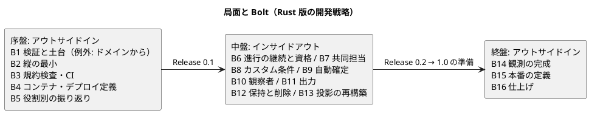
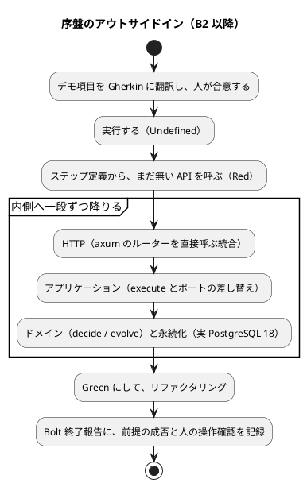
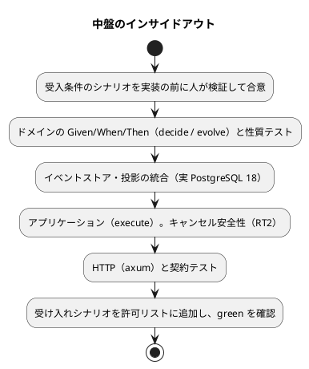

# 開発戦略 - ビールゲームシミュレーション（Rust 版）

## 概要

本書は、[リリース計画](./release_plan.md)の Bolt 群（B1〜B16）を **序盤・中盤・終盤** の局面に分け、局面ごとの TDD アプローチと、局面をまたいで変えない進め方を定めます。局面ごとに変えるのは**テストの入口**と**レイヤーを貫く順序**だけで、Red-Green-Refactor は全局面で変えません。**2026-11-21 に、ユーザーが承認しました。ただし、守り（git の hook、Claude Code の hook、CI の必須ジョブ）の新設の承認は含みません（未決事項 7・8）。**

- 計画の単位の「イテレーション」は **Bolt** に読み替えます。AI が Bolt ごとにステップ計画を書き、人が承認ゲートで検証します。
- **参照元（正）。本書は内容を複製せず、判断だけを書きます。**
  - Bolt の配分・完了条件: [リリース計画](./release_plan.md)
  - テストの種類・ツール・カバレッジ・CI・B1 の受入条件: [テスト戦略](../../design/beer-game-rust/test-strategy.md)
  - **コーディング規約（準拠）: [関数型プログラミングガイド（Rust 編）](../../reference/関数型プログラミングガイド_Rust編.md)。** 純粋関数、所有権による不変データ、`Option`/`Result` と型で表すエラー、副作用の境界、並行処理、アーキテクチャ（クレートによる境界）、テスト、静的解析（第 9 章）のすべてに従う。設計との対応は下の「関数型プログラミングガイド（Rust 編）への準拠」。
  - 型・エラー・純粋性の設計: [ドメインモデル](../../design/beer-game-rust/domain-model.md)、[バックエンドアーキテクチャ](../../design/beer-game-rust/architecture-backend.md)
  - 手法: [コーディングとテストガイド（AI-DLC 版）](../../reference/コーディングとテストガイド_AI-DLC版.md)、[BDD 導入ガイド](../../reference/BDD導入ガイド.md)、[Living Documentation 導入ガイド](../../reference/LivingDocumentation導入ガイド.md)
- **実装コードはまだありません。** 品質チェックのコマンドは、設計書の記述から導いた**予定**で、B1 で実際のビルド設定に合わせて確定します（憶測を事実として書きません）。
- Rust 版は Kotlin 版の [開発戦略](../beer-game-kotlin/development_strategy.md) の構造を引き継ぎ、**JVM・H2・detekt・PMD に関する記述は引き継ぎません**。

---

## 戦略の全体像

### 局面とアプローチの対応

| 局面 | 対象 Bolt | 主アプローチ | 狙い |
| :--- | :--- | :--- | :--- |
| **序盤** | B1〜B5（Release 0.1） | アウトサイドイン（**B1 のみ例外**） | 縦の最小を貫き、**未確認の前提**（sqlx、cucumber-rs、clippy、llvm-cov、共有する `web/` の動作）を早期に検証する |
| **中盤** | B6〜B13 | インサイドアウト | 並行性・資格・自動確定・開示・削除・再構築など、複雑なドメインと永続化を、ドメインと永続化の層から固める |
| **終盤** | B14〜B16 | アウトサイドイン | 揃った部品を、運用・受入のシナリオ起点で結合し、リリース全体の一貫性と NF-P2 の最終判断を担保する |

### アプローチ選択の根拠

コーディングとテストガイドの「実装アプローチ選択フロー」に対応づけます。

- **序盤（アウトサイドイン）**: バックエンドも Rust 側の画面連携も未実装で、不確実性は基盤（イベントストア、`execute`、axum、共有するフロントエンドの動作）に集中している。共有する日本語 Gherkin と `contracts/openapi.yaml` を入口に、薄く貫通させて前提の成否を早く見る。AI は指示がないと全層を一度に生成しようとするため、**受け入れのシナリオから始め、層を 1 つずつ降りる**ことを Bolt 計画に明記する。
- **B1 だけは例外**: B1 の中心は「未確認の前提のうち DB を要さないもの」の検証と、**純粋なドメインの核**（`simulate_week`、`decide`/`evolve`）である。外側（HTTP・DB）がまだ無いため、**ドメインの Given/When/Then から始め**、B2 でその外側を作る（Kotlin 版の B1 と同じ判断の逆向き）。B1 の受け入れ入口は、共有する `features/` のうち**ドメインの純粋関数で表せるシナリオ**に限る。
- **中盤（インサイドアウト）**: 並行性（追記の競合の再試行、冪等と認可の順序）、資格、自動確定、開示の制御、削除（追記専用と連鎖削除）、再構築（アドバイザリロック）は、ドメインと永続化が中心。ここで外側から作ると、型や制約の誤りが下流で膨らむ。**ドメイン → 永続化 → 投影 → アプリケーション → HTTP → 画面の順に、層ごとに承認ゲートを置く**。
- **終盤（アウトサイドイン）**: 部品が揃い、観測・本番の定義・仕上げは既存の部品を運用シナリオと受け入れ条件で結合する作業。受け入れ・負荷・運用シナリオから始め、不足を内側で補う。

---

## 共通の TDD サイクル

### Red-Green-Refactor（全局面で不変）

1. **Red**: 失敗するテストを書き、**失敗を確認する**（コンパイルエラーは Red に数えず、型が通ったうえで落ちる状態にする）。
2. **Green**: テストを通す最小限の実装。先回りして実装しない。
3. **Refactor**: 緑のまま設計を改善する。構造の変更と動作の変更を同じコミットに入れない。

AI がサイクルを回し、人が承認ゲートでコードを**全行理解**して検証します。**共通の土台（`EventStore` のトレイト、集約の `decide` の型）を作り替える最初のスライドでは、後続の振る舞いのテストも先に書いて失敗を確かめてから実装する**（プロジェクトの規約）。順序を守れなかったときは、規則を壊すとテストが落ちることを個別に確かめ、Bolt 終了報告に記録します。

### ローカルも PostgreSQL 18

Rust 版には H2 がありません。**ローカル開発・統合テスト・受け入れ・CI・ステージング・本番が同じ PostgreSQL 18** です（ローカルは Docker。承認済み）。したがって、Kotlin 版の「H2 と PostgreSQL の乖離」のリスクはありません。**Docker が無い環境の DB 統合テストは、CI では失敗にする**（スキップで緑にしない。[テスト戦略](../../design/beer-game-rust/test-strategy.md) の統合テスト）。

### テストの種類とレイヤーの対応

詳細は [テスト戦略](../../design/beer-game-rust/test-strategy.md) を正とし、ここには局面との対応だけを置きます。

| レイヤー | テスト | 主に使う局面 |
| :--- | :--- | :--- |
| ドメイン（`decide`・`evolve`・`simulate_week`） | ユニット（Given/When/Then）+ 性質（proptest）+ golden | 全局面（中盤で主役。B1 は最初） |
| アプリケーション（`execute`、ポートの差し替え） | メモリ実装の単体 + **キャンセル安全性（RT2）** | 序盤（B2）、中盤 |
| イベントストア・投影 | 統合（実 PostgreSQL 18、testcontainers） | 序盤（B2・B3）、中盤で主役 |
| HTTP（axum） | ルーターを直接呼ぶ統合 + 契約テスト（OpenAPI） | 序盤（B2・B3）、全局面 |
| 受け入れ（`@api`・`@ui`） | 共有する日本語 Gherkin（cucumber-rs。`@ui` は既存の Cucumber-JS + Playwright） | 序盤・終盤で主役 |
| 非機能 | 負荷・性能・復元・NF-P2 の実測 | 序盤の実測、終盤 |

### 品質チェック（予定。B1 で確定）

| 項目 | 予定のコマンド（未確認） | 根拠 |
| :--- | :--- | :--- |
| 書式 | `cargo fmt --check` | R4 |
| 静的解析 | `cargo clippy --workspace --all-targets --locked -- -D warnings` | R4（lint の設定は B1 で確かめる） |
| テスト | `cargo test --workspace --locked` | — |
| カバレッジ | `cargo llvm-cov`（行 80% 未満で失敗。domain 100%） | RT3、R6 |
| 依存関係 | `cargo deny check` | R4 |
| 規約の検査 | `#![forbid(unsafe_code)]`、`unwrap_used` などの deny | domain-model RD5 |

**Rust 固有の運用**: コンパイルが長いため、**依存のビルドのキャッシュ方式は B3 で決める**。Bolt 内のサイクルは、`cargo test -p <対象 crate>` で小さく回す。

---

## 関数型プログラミングガイド（Rust 編）への準拠

**本プロジェクトのコーディングは、[関数型プログラミングガイド（Rust 編）](../../reference/関数型プログラミングガイド_Rust編.md) に準拠します。** ガイドと設計書が食い違う場合は、**設計書（承認済みの設計判断）を正とし、食い違いを ADR か設計書の変更として記録**します（黙ってどちらかに寄せません）。AI は実装のたびにガイドの該当章を参照し、人は承認ゲートで準拠を検証します。

| ガイドの章 | 規約の要点 | 本プロジェクトでの扱い | 守り（下の「戦略の適用をテストと hook でガードする」の対応表） |
| :--- | :--- | :--- | :--- |
| 1 基礎 | 純粋関数、所有権と純粋性、参照透過性 | domain は純粋（時計・乱数・I/O を引数で受ける）。共有状態は境界のクレートだけが持つ | DS-3・4 |
| 2 関数型スタイル | 新しい値を作る、`map`/`filter`/`fold`、添字でなく `get` とイテレータ | `evolve` は状態を値で受け取り新しい状態を返す | DS-2 |
| 3 型で表すエラー | `Option`/`Result`/`?`、型付きのエラー、`enum` で ADT、`match` のワイルドカードを避ける | domain-model の RD1〜RD4（状態は `enum`、`Result` と誤りの集約、`code` は `match` の網羅） | DS-2・5 |
| 4 副作用の管理 | 副作用を境界に寄せる、`async` は記述、純粋な計算と非同期を分ける | `decide`/`evolve` は同期の純粋関数。非同期は application・adapter | DS-3・4 |
| 5 並行処理 | 共有状態は所有権で守る、キャンセル、チャネル、アクター | `execute` の spawn とキャンセル安全性（RB2、RT2）。`std::sync::Mutex` を domain に置かない | DS-12 |
| 6 代数構造 | 法則を守る | lint で表せない。**法則・性質は proptest で確かめる**（ガイド 8.4） | DS-5 |
| 7 アーキテクチャ | 薄い縦串、依存は型とトレイト、コマンドと状態遷移表、イベント列、クレートによる境界 | architecture-backend の RB1（トレイトによるポート）、クレート分割 | DS-4 |
| 8 テスト戦略 | `#[test]`、スタブ、プロパティ、代数の法則、テストの種類 | [テスト戦略](../../design/beer-game-rust/test-strategy.md) | DS-5〜13 |
| 9 静的解析 | clippy と `[lints]` で規約を表す。`deny` で CI を止める。`allow` は理由を残す。**守る範囲は狭く、守られない範囲はテストで確かめる** | 下の「静的解析と規約」。ガイド 9.6 の設定を出発点にする | DS-1〜3・17 |

- **ガイド 9.4 の注意（守られない範囲）**: `wildcard_enum_match_arm` は、単体の `enum` を直接 `match` したときだけ発火し、**遷移表のように組（タプル）で受けると発火しない**。組の `match` でのワイルドカードは、lint で守れないため、**テスト（腕を 1 つ消すと落ちる性質テスト。DS-5）とレビューで守る**。
- **ガイド 9.6 の clippy の設定は、clippy 0.1.91 で確認されたもの**です。本プロジェクトの Rust 1.97.1 の clippy で同じ件数が報告されるかを、**B1 の Step 2 の fixture で確かめます**（ガイドの確認用コードを使う）。
- **ガイドとの差分は、記録します**: ガイドの設定のうち、Rust 版で変えたもの（例: アプリ・アダプターのクレートで `std::env::var` や非同期の `spawn` を許す。クレートごとに `clippy.toml` と `[lints]` を置く: ガイド 9.5）は、ADR か設計書に理由を書きます。

---

## 静的解析と規約

厳格に適用します（違反 0 件、`allow` の追加は理由つきで人が承認、ベースラインなし）。具体的な lint は **ガイド 9.6 の設定を出発点**にし、`evolve` の最後の腕の `_` の扱い（`wildcard_enum_match_arm` との衝突の規則）は、[テスト戦略](../../design/beer-game-rust/test-strategy.md) の「静的解析と規約の検査」と B1 の受入条件を正とします。**ルールそのものをテストファーストで確かめる**: 違反するコードを実際に置いて CI が落ちること（ローカルと GitHub Actions の両方）を、B1（lint）と B3（CI）の受入条件にします。AI は `unsafe`・`unwrap`・`expect`・`SystemTime::now` を生成しがちなため、**lint を CI のゲートにする**ことが最も確実な防御です（リスク台帳 R8）。

---

## デモ項目を受け入れ基準とする

[リリース計画](./release_plan.md) の各 Bolt の「完了条件」を受け入れ基準の元にし、**Bolt ごとに日本語 Gherkin のデモシナリオ**（共有する `features/` の既存シナリオ、または Rust 版で足すもの）が green であることを DoD に含めます。green でなければ Bolt はクローズしません。追加したシナリオは以降も実行し、回帰を防ぎます。

### 共有する `features/` の許可リスト（H7）

- **Rust 側で実行するシナリオを、許可リスト（Rust 側のファイル）で決め、許可したシナリオに Undefined・Pending があれば失敗**とします。共有する `.feature` に Rust 専用のタグを書き込みません（Kotlin 版への影響を避けるため）。
- B1 の最初の許可リストは、ウォーキングスケルトン（US1.1・1.2・2.1〜2.3）の代表シナリオに限り、**Bolt ごとに広げます**。許可リストの外のシナリオは「未対応」として一覧に出し、**許可リストの外が Rust で通る割合**を、Rust 版の進捗の指標にします（価値指標。リリース計画）。
- **共有物（`features/`・`contracts/`・`web/`）を変える提案は、変更の前にユーザーに確認します**（Kotlin 版に影響）。

### アウトサイドインの入口を BDD で定義する

**BDD（日本語 Gherkin）を採用します。** 理由: ①共有する `features/` が既に日本語 Gherkin で、Rust 版は同じ受入条件で動くことが価値の中心である。②team の規約が BDD（Given/When/Then を先に）である。記法・手順は BDD 導入ガイドを正とします。

| 項目 | 方針 |
| :--- | :--- |
| 使う局面 | 序盤・終盤のアウトサイドイン。中盤はドメインの Given/When/Then の単体テストが主役で、シナリオは回帰実行 |
| 誰が書くか | 受入条件のシナリオは、**実装の前に人が検証して合意**する（AI が書いた場合も同じ。Mob Elaboration） |
| 言語 | 日本語（`# language: ja`）。**cucumber-rs で日本語が使えるかは B1 で確認**（未確認。不可なら代替を比較） |
| 処理系 | `@api` は cucumber-rs（Rust）、`@ui` は既存の Cucumber-JS + Playwright。配置と実行の詳細は B1 で確定 |
| ステップ定義 | **薄く保ち**、業務ロジックを持ち込まない。呼び出す先が無い内側が、設計を駆動する |
| ドメインのテスト | Given（過去のイベント）/ When（コマンド）/ Then の形に統一（T-1）。**シナリオと同じ振る舞いを二重に書かない**: 業務の言葉と例はシナリオ、純粋関数の性質・細部は Rust のテスト |

**サイクル（アウトサイドイン）**: ①デモ項目をシナリオに翻訳して合意 → ②実行（Undefined）→ ③ステップ定義で内側のインターフェースを呼び Red → ④一段ずつ内側へ降りて各層を TDD で Green → ⑤リファクタリング（シナリオは業務語彙のまま）。

**テスト名とストーリー ID（RT1）**: Rust のテスト関数名の先頭に AC の ID を付けます（`ac2_4_1__…`。命名規則は承認待ち）。CI で ID と AC の対応表を生成します（B3）。

---

## ドキュメントをコードと同期させる（Living Documentation）

スキル `apply-living-documentation` を適用して決めました。**採用します。これから書くコードから適用し、既存コードへの一括適用はしません**（Rust 版のコードは未着手なので、全体が「これから」に当たる）。手法の解説は導入ガイドとスキルを正とし、ここには判断だけを書きます。

### triage: 知識ごとに「書く・リンク・生成・書かない」を決める

変化の速さで選びます。**権威ある情報源（正）を先に決め、他はそこから導きます。生成物を新しい真実の源にしません**（いつでも捨てて作り直せるキャッシュとして扱う）。

| 知識 | 判断 | 権威ある情報源（正） | 備考 |
| :--- | :--- | :--- | :--- |
| クレートの依存方向（domain は外に依存しない） | **生成・検証** | `Cargo.toml` の依存（`cargo metadata`） | 図は生成。違反は `cargo deny` と lint で CI が落とす。設計書の図は手で複製しない |
| テーブル定義・ER 図 | **生成** | `migrations/*.sql`（DDL） | 設計書（data-model）は意図と判断だけ残す。生成の方式は B2 で決める |
| イベント・コマンド・エラー `code` の一覧 | **生成** | ドメインの `enum`（型） | 用語集・一覧は手で保守しない。`EventCodec` の golden（全イベントの種類）が不一致を検出 |
| ユビキタス言語（用語集） | **生成**（ドメインの語だけを選択的に） | ドメインの型名・`enum` の値 | 技術的な語は除く。**読みにくければ、用語集でなくコードの名前を直す** |
| API の契約 | **リンク + 検証** | `contracts/openapi.yaml`（共有物） | 複製しない。契約テストが不一致を検出（Reconciliation） |
| 受入条件・シナリオ | **リンク + 生成** | 共有する `features/`（日本語 Gherkin） | ストーリー・AC ID とテストの対応表、シナリオのダイジェストは CI で生成 |
| 処理の流れ（画面 → API → `execute` → 集約 → イベントストア → 投影） | **キュレーション**（ガイドツアー） | コード上の注記 | 終盤。下記 |
| 見どころ（核心の少数） | **キュレーション**（サイトシーイング・マップ） | コード上の注記 | 5〜7 個、最大 10 |
| 設計判断の理由・却下した代替案 | **書く** | ADR、設計書の「設計判断」節 | 4 点セット（文脈・問題・選んだ解決策と理由・却下した代替案と理由） |
| 変更の意図 | **書く** | コミットメッセージ（`git-commit`） | — |
| 実装の経緯（どの Bolt で何をしたか） | **書かない**（Bolt 終了報告に 1 回） | Bolt 終了報告・git 履歴 | 設計書に積まない |

### augment: コードに足りない意図だけを補う

- **付けるのは本質的な知識だけ**（役割・性質・判断理由。消すと知識も消えるもの）。所有者・配置先のような外在的な知識は付けない。**大半に当てはまる性質は付けず、例外だけに付ける。**
- **Rust での表し方**: Rust には実行時に読めるアノテーションがない。**第一候補は、`///` のドキュメントコメントのタグ（例: `/// @CoreConcept`）を、スクリプトで走査する方式**（追加の依存関係なし。beer-game2 も走査のスクリプトで生成した）。属性マクロ（procedural macro のクレート）は、**新規依存として承認が要る**ため、タグで足りない場合に限って検討する。規約（命名・クレート構成）で分類を表せるなら、規約を使い、lint で守らせる。
- **just-in-time**: 実際に作ったものだけに、必要になった時点で付ける。推測で先回りしない。同種の判断が繰り返されるなら、原則を 1 回だけ書いて参照する。
- **タグ語彙（案。5〜10 個以内。名前は B1 で合意）**: `CoreConcept`（中心概念）、`Exemplar`（模範例。弱点も書く）、`KeyLandmark`（見どころ）、`GuidedTour`（name・description・rank を持つ）。目的別に乱立させない。

### curate: 読み手と核心メッセージを 1 つずつ決めて、少数を動的に選ぶ

| 局面 | 読み手 | 核心メッセージ（1 文書 1 メッセージ） | 手法 | 上限 |
| :--- | :--- | :--- | :--- | :--- |
| 序盤 | 新しく参加する開発者 | 「`domain` は純粋で、外側が `execute` で副作用を持つ」 | サイトシーイング・マップ（入口、`execute`、イベントストア、`simulate_week`、許可リスト） | 5〜7（最大 10） |
| 中盤 | 開発者・レビュー担当 | 「ドメインの語はコードの型と一致している」「模範の集約はこれ」 | コアのハイライト（`CoreConcept`）と模範例（`Exemplar`。弱点も書く）。**Living Glossary を生成** | 主要概念に限る |
| 終盤 | 運営者・新メンバー | 「確定の 1 リクエストがどこを通るか」 | **ガイドツアー**（1 本あたり数ステップ。`rank` は 10 刻み）。**シナリオダイジェスト**（`@US`・`@AC` のタグで読み手別に絞る） | 1 本数ステップ |

- 選択基準は**安定したもの**（フォルダ・命名規約・タグ・ツールの出力）。クラス名や URL の名指し列挙は、リネームで壊れるので使わない。
- **まず IDE の検索（`grep` でタグを探す）で価値を確かめ、必要になってから生成スクリプトと CI の公開に進む。**
- ツアーは、**最初から最後まで実際に歩いて**、分かりにくい箇所を直す。歩いて分かりにくければ、それは設計のシグナルで、文書でなく設計を直す。

### automate: 4 ステップで生成する（範囲 → フィルタ → 抽出 → 変換）

- **Living Glossary**: ドメインの `enum`・型名から、**ドメインの語だけ**を抽出し、境界づけられたコンテキストごとに分ける。出力は Markdown。生成物には元へのリンクと生成日を付け、**公開物を直接編集させず、元（コード）を直させる**。
- **Living Diagram**: **1 つの図に 1 つのストーリー、5〜9 要素**。クレートの依存図（`cargo metadata`）、ER 図（DDL）、状態遷移（`evolve` の `enum`）。プレーンテキスト（PlantUML・Mermaid）で、差分管理できる形にする。すべてをリバースで描かない。
- **自動化の前に、まず手作業で試し、手間に見合うかを判断する**。生成の順序: ①ID と AC の対応表（RT1。**B3 の CI**）→ ②用語集・イベント一覧（中盤の最初の Bolt）→ ③図（B2 以降。手間に見合うものだけ）→ ④ツアー・マップ・ダイジェスト（終盤）。
- **生成と公開の自動化**: 生成を CI のどの段階で実行し、どこに保存・公開するかは B3 で決める（MkDocs への公開を含む）。**手作業で更新する一覧は作らない。**

### check: 陳腐化の芽の点検（各 Bolt の完了時と、局面移行時）

- [ ] 手作業で更新する一覧・目次・図が残っていない（新たに増えていない）
- [ ] 名前や URL の直接指定の参照が残っていない
- [ ] 重複した知識に、不一致を検出する仕組みがある（契約テスト、`EventCodec` の golden、ID と AC の対応表、許可リストの Undefined 検査）
- [ ] タグを付けすぎていない（マップは最大 10。語彙は 5〜10 個以内）
- [ ] 生成物が CI で更新・保存され、入口（`docs/` の索引）から 1 本のリンクで辿れる
- [ ] 終盤: 新メンバーに実際に歩いてもらい、迷った箇所を直した

### 完了条件への組み込み

- 生成するドキュメント（対応表・用語集・図・ツアー）の生成が CI で成功している（生成の仕組みが決まった Bolt 以降）。
- その Bolt で下した設計判断が ADR に記録され、**コードで表せない根拠だけ**が `docs/design/` に反映されている（設計書の内容を変えたときは `verified` の再確認を人に求める）。
- 手書きでコードの内容を複製した一覧・図が、新たに増えていない（上の check）。

---

## 序盤: アウトサイドイン（B1〜B5）

### 目的

縦の最小（作成 → 参加 → 割り当て → 開始 → 入力 → 確定 → 状態の表示 → 振り返り）を貫き、**未確認の前提を、成立・不成立の記録つきで確認**する。不成立なら、**B3 以降を止めて設計を見直す**。

### 対象ストーリー

US1.1・1.2・2.1・2.2・2.3（基本）、US4.2、US6.1・6.2（基本）（Release 0.1）。

### ワークフロー

### B1 の進め方（序盤の例外）

B1 は**ドメインの核から**始める（アプローチ選択の根拠を参照）。順序: ①B1 の受入条件の表のうち、DB を要さない前提（clippy・cucumber-rs の日本語・proptest・llvm-cov）を、**最小のコードで確かめる**（Red → 規約違反を置いて CI が落ちる）。②ドメインの Given/When/Then。③結果を記録（成立・不成立）。**共有の土台（トレイトと型）を最初に作るスライドでは、後続の振る舞いのテストも先に書く**（共通の TDD サイクル）。

### 手順の要点

- **B2 の順序**: 共有する `features/` の許可リスト（US1.1 から）→ 契約テスト（`openapi.yaml` を正とする）→ 実装。仕様の変更が要る場合は**ユーザーに確認**。
- **RB2 の検証**: B2 に `Tx` の drop・明示の ROLLBACK・制約名の取得・testcontainers の確認を含める（B1 の受入条件の表）。
- **NF-P2 の実測**: B2 の縦の貫通の後、確定から他の参加者の画面への反映の時間を**測って記録**する。方式（SSE／間隔の短縮／目標の再定義）は、人が決める。
- **共有する `web/` の動作**: 既存の `@ui` と E2E で、Rust のバックエンドでも動くことを確かめる（RF2）。**`web/support/hooks.mjs` の編集（RF3）は、実施の前に改めて確認する。**
- **規約検査・CI（B3）**: 違反コードで CI が落ちることを、ローカルと GitHub Actions の両方で確かめる。ゲートは B3 で有効にし、**以降緑を保つ**。
- **コンテナ（B4）**: 実行イメージ、`healthcheck`、SIGTERM、スモークテスト。`terraform validate` は 1.17 以上で（適用しない）。サイズ・起動・メモリは**記録のみ**（実測前に縮めない）。

### 完了条件

- 該当する Bolt の受け入れシナリオ（許可リスト）が green（Undefined・Pending なし）
- B1 の受入条件の表が、全行「成立／不成立」で記録されている（Release 0.1 の条件）
- ゲート（fmt・clippy・テスト・llvm-cov・deny）が CI で緑。**規約違反で落ちる**ことを確認済み
- Bolt 終了報告に、人による実操作の確認と、前提の成否を申告

---

## 中盤: インサイドアウト（B6〜B13）

### 目的

並行性・資格・自動確定・開示・削除・再構築を、**ドメイン → 永続化 → 投影 → アプリケーション → HTTP → 画面**の順に、層ごとに承認ゲートを置いて固める。ES では `decide`・`evolve` と `EventStore` の契約が正しければ上位は薄くなる。

### 対象ストーリー

U2（US3.1・3.2、US1.2 の共同、US2.2 の共同）、U3（US1.1 のカスタム、US2.4）、U4 の残り（US1.3、US4.1、US4.3）、U5（US5.1）。

### ワークフロー

### 手順の要点

- **並行性・競合**: 実際の並行（複数の tokio タスクと 2 プロセス）で検証し、判定は「一方が必ず成功する」という性質で書く（T-4）。決定論的な再現は補助。
- **冪等と認可の順序**: 認可を冪等記録の照合より先に置く（失効した資格の再送は 403）。否定テストを必須にする。
- **開示（B10）**: DB ロールと接続プールの分離。他役割の値・将来の需要・参加コードが取得できないことの**否定テスト**と `current_user` の検査。
- **削除（B12）**: `information_schema` で `game_id` を持つ全表を走査し、**削除後に残る行が 0** を検査。
- **再構築（B13）**: `fold(evolve)` と投影の一致、アドバイザリロック、N-1 互換。
- **キャンセル安全性（RT2）**: `execute` のタスクを abort／panic させ、ロックと接続の解放時間とプールの状態を検査（B7 から）。
- **性質テスト**: `evolve` の腕を 1 つ消すと落ちること。proptest で、決定論・保存則・遅延 0 を含む範囲。

### 完了条件

- 受入条件（該当 Bolt）が green。並行・否定・性質のテストが緑
- ゲート（clippy・llvm-cov・deny）が緑のまま。`allow` の追加は ADR で承認済み
- ADR と `docs/design/` が実装と一致している

> B10（観察者）・B11（出力）は、権限の分離と純粋関数が中心で、構造が決まっているため、ゲートの密度は標準にする（リリース計画）。

---

## 終盤: アウトサイドイン（B14〜B16）

### 目的

観測・本番の定義・仕上げを、運用と受け入れのシナリオ起点で結合し、**リリース全体の一貫性**を担保する。**NF-P2 の最終判断と対応**、サイズ・メモリの比較の確定、**共有する `features/` の全シナリオ green** を担保する。

### 対象ストーリー

US6.1・6.2（完成）、横断の受入条件。

### 手順の要点

- 受け入れ・負荷・運用シナリオ（アラームの模擬、復元、ロールバック）から始め、不足を内側へ降りて補う。
- **実測が要る目標**（NF-P2、サイズ、起動、メモリ、負荷）は、**実測値を記録**してから目標を確定する（実測前に変えない。RN1）。
- AWS への**適用はしない**（定義まで）。RPO・RTO は、**範囲の決定の後**に机上確認する。

### 完了条件

- 共有する `features/` の**全シナリオ**が green。NFR の検証表の全件が確認済み
- 運用手順書（優先度「高」）と、定義の検証（`terraform validate`・コンテナのスモークテスト）
- AWS 適用の判断材料が揃っている（適用しない）

---

## 戦略の適用をテストと hook でガードする

**戦略は、書いただけでは守られません。** 規則ごとに、**破ると機械が失敗する守り**を対応させ、適用漏れ（規則があるのに検査がない、検査があるのに効いていない）を防ぎます。人の注意に頼る規則は、承認ゲートで人が見る項目としてだけ残します。**本節は案で、hook の導入は新規ファイル・構造変更に当たるため、承認を求めます**（未決事項）。

### 原則

1. **規則 → 守りの対応表を正とする**（下の表。規則 ID `DS-n` を付ける）。規則を足したら、同じ変更で守りを足す。
2. **最終の権威は CI**。ローカルの hook は早く気づくための便宜で、**`--no-verify` などで外されても、CI が同じ検査で落とす**。hook にしか無い守りは作らない。
3. **守りそのものをテストする**（ガードのガード）。**規則を破るコード（fixture）を置いて、守りが実際に落ちること**を、ローカルと GitHub Actions の両方で確かめる（B1 の lint、B3 の CI の受入条件）。落ちる確認がない守りは、守りに数えない。
4. **対応表の網羅をテストで検査する**（`rule-guard` の検査）: 対応表の全規則が、実在する守り（テスト名・CI のジョブ名・hook のファイル）を指していること、**守りが指す規則が表に載っていること**を、スクリプトで確かめて CI に入れる（手で更新する一覧にしない）。
5. **緩和は人が承認する**: lint の `allow`、`deny.toml`・`clippy.toml`・許可リストの緩和、カバレッジのしきい値の引き下げは、ADR を残して人が承認する（守りを弱める変更も守る）。

### 規則と守りの対応表

| ID | 規則（戦略の記述） | 守り | 種別 | 導入 | 落ちる確認 |
| :--- | :--- | :--- | :--- | :---: | :--- |
| DS-1 | `unsafe` を使わない（NF-S22） | `#![forbid(unsafe_code)]` | コンパイラ | B1 | `unsafe` を置くとビルドが失敗 |
| DS-2 | `unwrap`・`expect`・`panic`・添字アクセスを domain で使わない | clippy の deny（`-D warnings`） | lint・CI | B1 | 違反コードで clippy が失敗 |
| DS-3 | 時計・乱数を注入する（`SystemTime::now` 等を domain で使わない） | clippy の `disallowed_methods` | lint・CI | B1 | 違反コードで失敗 |
| DS-4 | domain は外に依存しない（クレートの依存方向） | **アーキテクチャテスト**（`cargo metadata` の依存を検査）と `cargo deny` | テスト・CI | B1 | domain に外向きの依存を足すとテストが失敗 |
| DS-5 | `evolve` の腕を消すと性質テストが落ちる | 性質テスト（proptest）。変異で確かめる | テスト | B1 | 腕を 1 つ消すと失敗 |
| DS-6 | 行 80%（domain 100%）を割らない | `cargo llvm-cov` のしきい値 | CI | B1 | しきい値未満で終了コード非 0 |
| DS-7 | Gherkin の許可したシナリオに Undefined・Pending がない | cucumber-rs の strict 設定と、許可リストの検査 | テスト・CI | B2 | ステップ定義を消すと失敗 |
| DS-8 | 許可リストは共有する `.feature` に Rust 専用タグを書かない | **共有物への書き込みの検査**（`features/` の差分に Rust 専用のタグがない。CI） | テスト・CI | B2 | タグを足すと失敗 |
| DS-9 | 契約を `openapi.yaml` で守る（仕様と実装のずれ） | 契約テスト（`unevaluatedProperties: false`） | テスト・CI | B2 | 仕様か実装を意図的にずらすと失敗 |
| DS-10 | テスト名に AC の ID を付ける（RT1） | **命名の検査**（テスト一覧を走査し、`(ac\|us)[0-9_]+__` で始まらないものを失敗にする。例外は一覧で管理）と、ID と AC の対応表の生成 | テスト・CI | B3 | 接頭辞のないテストを置くと失敗 |
| DS-11 | 受入条件の抜け（AC に対応するテストがない） | 対応表の生成と、**許可リストの AC に対応のないものが 0** であることの検査 | CI | B3 | AC のテストを消すと失敗 |
| DS-12 | キャンセル安全性（RT2） | DB 統合テスト（abort・panic でロック・接続が解放される） | テスト | B7 | 明示の ROLLBACK を外すと失敗 |
| DS-13 | DB 統合テストが 0 件・Docker なしで緑にならない | 共通の入口（`CI` 環境変数で panic）と実行件数の検査 | テスト・CI | B2 | Docker なしの CI で失敗 |
| DS-14 | 依存関係の検査（脆弱性・ライセンス・不要な依存） | `cargo deny check` | CI | B1 | 未許可の依存で失敗 |
| DS-15 | 新規依存は人が承認する | **`Cargo.toml` の依存の変更を検出**し、承認の記録（ADR または Bolt 計画の承認欄）の参照がなければ失敗（CI）。ローカルは Claude の hook で確認を促す | CI・hook | B3 | 依存を足し、承認の参照がないと失敗 |
| DS-16 | 共有物（`web/`・`contracts/`・`features/`）は変更前にユーザーに確認 | Claude の PreToolUse hook（編集前に**確認を求める**）と、CI での変更の可視化（PR の説明に確認の記録を要求） | hook・CI | B3 | 共有物の編集で確認が出る |
| DS-17 | 規則の緩和（`allow`・設定・許可リスト・しきい値）は ADR で承認 | 設定ファイルの変更を検出し、**ADR の参照がなければ失敗**（CI）。Claude の hook で確認 | CI・hook | B3 | `#[allow(` を足すと失敗 |
| DS-18 | 手作業の一覧・生成物の直接編集をしない（Living Documentation） | 生成物を再生成して**差分が 0** であることの検査（CI）。タグの数の上限（語彙 5〜10、マップ最大 10）の検査 | テスト・CI | B3〜 | 生成物を手で編集すると失敗 |
| DS-19 | ドメインの語（イベント名・型名）が設計書の用語と一致する | **用語の突合せ**（生成した用語集と設計書の用語表の差を検査） | テスト・CI | 中盤の最初の Bolt | 型名を変えると失敗 |
| DS-20 | コミットの形式（日本語の Conventional Commits、scope `beer-game-rust`）、1 コミット 1 変更 | commit-msg hook と、CI の PR タイトル・コミットの検査 | hook・CI | B3 | 形式違反で失敗 |
| DS-21 | 設計書を変えたら `verified` を再確認する | `okf:check`（既存）に加え、**`verified` 済みの設計書の本文が変わったら、再検証の記録がない限り警告**（CI。承認は人） | CI | B3 | 本文を変えると警告 |
| DS-22 | 承認前に先へ進まない（計画・戦略の承認） | **人の承認ゲート**（機械で置き換えない）。Bolt 計画の承認欄が空なら、Bolt 開始の検査（`bolt_N_plan.md` の `verified`）が警告 | 人 + CI | B1 | 計画が未承認だと警告 |

### 守りの層と置き場所

| 層 | 役割 | 置き場所（案） | 備考 |
| :--- | :--- | :--- | :--- |
| コンパイラ・lint | 最も早く、最も確実 | `Cargo.toml` の `[lints]`、`clippy.toml`、`#![forbid(unsafe_code)]` | DS-1〜3。緩和は DS-17 |
| テスト | 規則を実行して確かめる | 各クレートのテスト、アーキテクチャテスト、命名の検査 | DS-4・5・10・12・13・19 |
| CI | **最終の権威**。必須のジョブにし、ブランチ保護で緑を必須にする | GitHub Actions（beer-game-rust 専用のワークフロー） | 全規則。**hook と同じ検査を CI で必ず行う** |
| git の hook | 早い気づき（コミット前・push 前） | `.githooks/`（`core.hooksPath`）。**追加の依存なし**。導入の手順は `ops/scripts` の既存の流儀に合わせる | pre-commit: `cargo fmt --check`・`clippy`（速い範囲）・禁止パターンの走査。commit-msg: DS-20。pre-push: `cargo test`（速い範囲） |
| Claude Code の hook | **AI が規則を破る瞬間に止める** | `.claude/settings.json` の hooks（PreToolUse / PostToolUse）。Rust 版のパスに限定 | 共有物の編集前に確認（DS-16）、`Cargo.toml`・lint 設定・許可リストの編集前に確認（DS-15・17）、編集後に `cargo fmt`・`clippy` を実行して結果を AI に返す |

- **hook の限界を明記する**: git の hook は `--no-verify` で外せ、Claude の hook は設定で外せる。**だから CI が最終の権威**であり、**hook の無効化は人が判断する**（AI は外さない）。
- **hook は速く保つ**（コミット前は数秒）。遅い検査（全テスト、カバレッジ、DB 統合）は CI に置く。
- **偽陽性を放置しない**: 守りが誤って落とす場合は、規則でなく守りを直す（例外の一覧を ADR で管理）。

### 導入の順序と受入条件

| Bolt | 導入する守り | 受入条件（観察できる形） |
| :--- | :--- | :--- |
| B1 | DS-1〜6・14 | 規則を破る fixture を置くと、ローカルで失敗する（手元で確認）。fixture は**テストとして残す**（期待どおり落ちる） |
| B2 | DS-7〜9・13 | 契約・許可リストをずらすと失敗する（ローカルと GitHub Actions） |
| B3 | DS-10・11・15〜18・20・21・22、git hook、Claude hook、`rule-guard` の検査 | **対応表の全規則に守りが実在し、全守りが落ちる fixture で確認されている**。GitHub Actions で、必須ジョブとして緑／赤になる |
| 以降 | DS-12（B7）、DS-19（中盤の最初の Bolt） | 各 Bolt の完了条件の check（Living Documentation の点検）に含める |

**各 Bolt の完了時**、対応表を見直す: ①この Bolt で新しい規則を決めたら、同じ Bolt で守りを足す。②守りが偽陽性・抜けを出していないか。③`rule-guard` の検査が緑か。

---

## 設計整合性の検証（`validating-design` の実施）

各 Bolt の**着手時**（ステップ計画と設計書の整合）と**完了時**（実装で変わった設計判断が設計書・ADR に反映されているか）に実施します。**設計書は 2026-11-21 に `verified` 済みで、内容を変えたときは `verified` が古くなる**ため、変更したら人に再確認を求めます。不整合は、その場で設計書を直すか、ADR で却下の根拠を残します。結果は Bolt 終了報告に記録します。

---

## 局面移行時の一貫性維持

- **不変の規律**: Red-Green-Refactor の 3 原則、1 コミット 1 変更、ゲートの緑（fmt・clippy・テスト・llvm-cov・deny）、純粋性の規約（`#![forbid(unsafe_code)]`、時計・乱数は注入）、`/api/v1` の契約を `openapi.yaml` で守る。
- **序盤 → 中盤**: B1・B2 の成否の記録が、すべて確認済みであること。不成立の前提がある場合は、**設計の見直しが承認されてから**中盤に入る。
- **中盤 → 終盤**: ID と AC の対応表に抜けがないこと、許可リストの外のシナリオの一覧が、残りの作業として確認されていること。
- **用語**: ユビキタス言語（設計書の用語、イベント名）を、局面が変わっても変えない。

---

## 未決事項

1. 本書の承認（局面の割り当て、BDD・Living Documentation の方針）。
2. B1 の新規依存関係の確定と承認。
3. RT1 の命名規則（AC のみの接頭辞）の承認。
4. NF-P2 の方式（B2 の実測の後）。
5. RF3（`web/support/hooks.mjs` の編集）の実施の確認。
6. 品質チェックのコマンドの確定（B1）、キャッシュ方式（B3）。
7. **守りの導入の承認**: git の hook（`.githooks/`）と Claude Code の hook（`.claude/settings.json`。共有の設定の変更）の新設、`rule-guard` の検査、CI の必須ジョブ・ブランチ保護（新規ファイル・構造変更・CI のため）。
8. 規則 DS-15・17・21・22 のように**承認の記録を機械で検査する方式**（ADR の参照を必須にする、など）の妥当性。

---

## 更新履歴

| 日付 | 更新内容 | 更新者 |
| :--- | :--- | :--- |
| 2026-11-21 | 初版作成（案） | claude-code |
| 2026-11-21 | コーディング規約として関数型プログラミングガイド（Rust 編）への準拠を明記（章との対応、守りの対応） | claude-code |
| 2026-11-21 | 戦略の適用をテストと hook でガードする節（規則 DS-1〜22 と守りの対応）を追加 | claude-code |
| 2026-11-21 | Living Documentation の節に `apply-living-documentation`（triage・augment・curate・automate・check）を適用 | claude-code |
