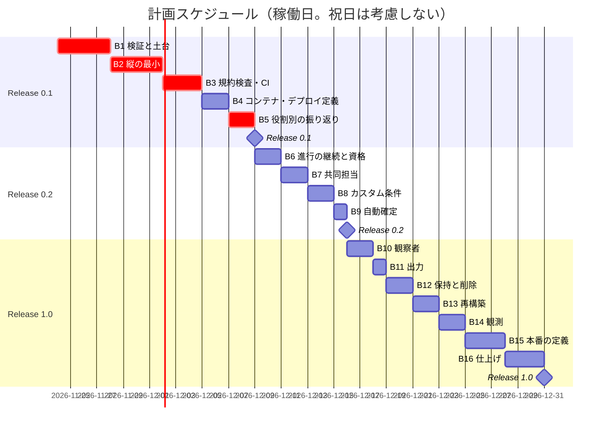

# リリース計画 - ビールゲームシミュレーション（Rust 版）

## 概要

本書は、beer-game-rust（beer-game-kotlin の Rust 版）のリリース計画を、AI-DLC の Intent → Unit → Bolt の階層で定義します。**AI が提案し、人が承認ゲートで検証・承認します。本書は 2026-11-21 に、ユーザーが承認しました（スコープ、Bolt の割り当て、日程の仮定、価値指標の目標、リスク）。**

- 機能・振る舞いは beer-game-kotlin（元は beer-game2）と同じです。要件・ストーリー・Unit・受入条件は新規に作らず参照します（[ユーザーストーリー](../../requirements/beer-game-ts/user_story.md)、[Unit 定義](../../requirements/beer-game-ts/unit_definition.md)）。
- 設計は [beer-game-rust の設計](../../design/beer-game-rust/index.md)（ES + CQRS、axum + sqlx + tokio。**設計文書 10 本は 2026-11-21 に `verified`**）と [ADR-001](../../adr/beer-game-rust/001-rust-version-of-beer-game-kotlin.md) です。
- 計画の形式は [Kotlin 版のリリース計画](../beer-game-kotlin/release_plan.md) に合わせ、**ストーリーポイントでなく Bolt の稼働日**で見積もります（ベロシティは計測前のため）。
- **日付と所要は仮定です。** B1・B2 の実績（人の検証時間を含む）で B3 以降を再調整します。

### プロジェクト情報

| 項目 | 内容 |
| :--- | :--- |
| プロジェクト名 | beer-game-rust（ビールゲームシミュレーション Rust 版） |
| Intent | beer-game-kotlin と同じ学習の価値（**役割別に、遅延と意思決定が変動を増幅する過程を振り返れる**）を、Rust の型・所有権・単一バイナリで、変更を楽に安全にできる形で提供する |
| 対象ユーザー | 進行役、参加者（共同担当を含む）、観察者、運用担当 |
| 開発体制 | モブ（人 1 名 + AI）。人は承認ゲートで計画・設計・コードを検証する |
| 実装の場所 | `apps/beer-game-rust/`（バックエンド。`infra/` は準備済み）。`web/`・`contracts/`・`features/` は Kotlin 版と共有（RF1） |
| 参照のみ | `apps/beer-game-kotlin/`。**共有物の変更は Kotlin 版に影響するため、都度確認する**（RF3 など） |

---

## 満足条件

### スコープ

Kotlin 版と同じ範囲（Unit U1〜U6、Release 0.1 / 0.2 / 1.0。ストーリー 15 件、Must 11・Should 4）です。Rust 版で加える作業は、Bolt として明示します（B1 の未確認の前提の検証、B3 の規約検査）。

| リリース | 内容 | ストーリー |
| :--- | :--- | :--- |
| Release 0.1 | **学習が成立する最小**: 1 ゲームを通し、役割別の振り返りができる。CI が通る。コンテナの定義 | US1.1・1.2・2.1・2.2・2.3（基本）、US4.2、US6.1・6.2（基本） |
| Release 0.2 | 進行の継続、共同担当、カスタム条件、自動確定 | US3.1、US3.2、US1.2（AC1.2.4）、US2.2（共同）、US1.1（カスタム）、US2.4 |
| Release 1.0 | 観察者、出力、保持と削除、投影の再構築、観測、本番の定義、仕上げ | US1.3、US4.1、US4.3、US5.1、US6.1・6.2（完成）、横断の受入条件 |

- **AWS への適用は範囲外の別ゲート**です。Terraform は準備済み（[インフラ](../../design/beer-game-rust/architecture-infrastructure.md)）で、本計画は**定義の検証まで**を含みます（`terraform validate` は 1.17 以上で。適用しない）。
- **Kotlin 版の `features/`（日本語 Gherkin）を共有**し、Rust 側は**許可リスト**で段階的に広げます（H7）。

### ビジネス価値と測定基準

最優先の価値は、Kotlin 版と同じ**役割別の振り返り**です。ADR-001 の Rust 版固有の価値（型による不正な状態の排除、実行時の安全性、小さな実行ファイル）は、次の指標で測ります（レビュー H8。**数値は本書の案で、承認で確定**）。

| 指標 | 目標（案） | 確認する Bolt |
| :--- | :--- | :--- |
| 共有する `features/` のうち、Rust のバックエンドで通るシナリオの割合（`@api`・`@ui`） | Release 0.1: 許可リストの 100%（Must の代表）。Release 0.2: 0.2 の範囲の `@api` 100%。**Release 1.0: 全シナリオ 100%** | B2〜 |
| Must 11 ストーリーの受入条件パリティ（Kotlin 版と同じ受入条件で通る数） | 0.1: 該当ストーリーの全 AC。1.0: 11/11 | B2〜 |
| 未確認の前提の数（[テスト戦略](../../design/beer-game-rust/test-strategy.md) の B1 の受入条件の表と未決の一覧） | B2 の終わりに、B1 の表の 8 行が確認済み（成立・不成立の記録つき）。以降、増えない | B1・B2 |
| 純粋関数（`decide`・`evolve`・`simulate_week`）の行カバレッジ | domain 100%（CI のゲート）、全体の行 80%（RT3） | B1〜 |
| 規約違反（`unwrap`・`SystemTime::now`・`unsafe` など）が CI で落ちる | 違反コードを置くと CI が失敗する | B3 |
| 実行イメージのサイズと起動時間、メモリ（Kotlin 版との比較） | **測って記録する**（目標値は実測の後。実測前に縮めない: RN1） | B4・B16 |
| NF-P2（確定から他の参加者への反映）の方式 | B2 の実測の後に、SSE／間隔の短縮／目標の再定義のどれかを人が決める | B2・B16 |

### スケジュール（仮定）

| 項目 | 内容 |
| :--- | :--- |
| 開発の開始 | 2026-11-24（火）（承認後） |
| 稼働の仮定 | 週 5 日（月〜金）。祝日・年末年始は考慮しない（Kotlin 版と同じ前提） |
| Release 0.1 | 2026-12-14（B1〜B5、15 稼働日） |
| Release 0.2 | 2026-12-23（B6〜B9、22 稼働日） |
| Release 1.0 | 計画上 2027-01-13（B10〜B16、37 稼働日）。バッファ込みで **2027-01-20 を目安**（42 稼働日） |

**見積もりの根拠**: 設計・ADR・受入条件は Kotlin 版から引き継ぐため、設計の作業は不要ですが、**Rust の実装は新規で、未確認の前提（sqlx・cucumber-rs・proptest・llvm-cov など）が多い**ため、Kotlin 版の所要を基準に、前半（B1〜B5）は**検証の分だけ増やし**、後半（B6〜）は Kotlin 版と同じにしました（実績が出てから縮めるか判断する。B1 の実績の前に短縮を前提にしない）。

- Kotlin 版は B1〜B4 で 11 稼働日。Rust 版は B1〜B5 で 15 稼働日（Kotlin 版の B1 に当たる縦の最小を、**未確認の前提の検証（B1）と縦の貫通（B2）に分けた**ため、+1 Bolt、+4 日）。

### リソース

- **開発**: 人 1 名（承認・判断）+ AI（計画・生成）。
- **外部の依存**: 運営者との数値目標の合意（H9 の進行役向けの案内の文言を含む）、通知先とオンコールの体制、AWS の利用の判断・費用・アカウント・IAM、**依存関係（新規クレート）の承認**。いずれも本計画の範囲外の承認ゲート。

---

## Level 1 計画（ワークフロー）

- [x] 設計（ドメイン、データ、アーキテクチャ、UI、テスト、非機能、運用、技術スタック、インフラ）: [設計](../../design/beer-game-rust/index.md)（2026-11-21 verified）
- [x] マルチパースペクティブレビューと反映: [設計書レビュー](../../review/beer-game-rust/design_review_20261121.md)
- [x] ADR-001（Rust 版を作る。承認済み）
- [x] Terraform の準備（Kotlin 版から複製。適用しない）
- [x] **リリース計画（本書）の承認**（2026-11-21、ユーザーの承認）
- [ ] **B1 の新規依存関係の承認**（B1 で使うものを確定し、版を `cargo search` と公式情報で確認してから）
- [ ] **RT1 の命名規則（AC のみの接頭辞）の承認**（test-strategy の未決 17）
- [x] 開発戦略（局面別の TDD アプローチ）の作成と承認（2026-11-21。ガードの導入の承認は別）（Kotlin 版に準じ、序盤アウトサイドイン・中盤インサイドアウト・終盤アウトサイドイン案）
- [ ] Bolt 1 のステップ計画の作成と承認
- [ ] RPO・RTO の約束の範囲の決定（B15 の机上確認の前まで）
- [ ] Bolt の実行 → Release 0.1 → 0.2 → 1.0

---

## 優先順位

4 軸（金銭価値・コスト・知識習得・リスク軽減）で決めます。Unit の順序は Kotlin 版と同じで、Rust 固有の不確実性（未確認の前提）を最初に解消します。

| Unit | BV | C | KA | RR | 順序 | 理由 |
| :--- | :---: | :---: | :---: | :---: | :---: | :--- |
| U1 | 高 | 高 | **高** | **高** | 1 | 土台。sqlx のトランザクション（RB2）、cucumber-rs の日本語 Gherkin、clippy による規約など、**未確認の前提が集中**する |
| U4（振り返りの核） | **高** | 中 | 中 | 中 | 2 | 最優先の価値を早く届ける（Release 0.1） |
| U2 | 高 | 高 | 高 | 高 | 3 | 進行の継続・共同担当（並行性、冪等と認可の順序、キャンセル安全性） |
| U3 | 中 | 中 | 中 | 中 | 4 | カスタム条件・自動確定。Should を含む |
| U4（観察者・出力） | 中 | 中 | 低 | 高 | 5 | 開示の制御（権限の分離） |
| U5 | 中 | 高 | 高 | **高** | 6 | 削除・再構築・観測・本番の定義 |
| U6 | 中 | 中 | 低 | 中 | 7 | 仕上げ、受入、NF-P2 の最終判断 |

---

## Bolt 計画

各 Bolt は**確認したい仮説**と**完了条件**を持ち、ステップ計画は Bolt ごとに作成して人が承認してから実行します。TDD の三原則と BDD（Given/When/Then を先に）は全 Bolt で守ります。

| Bolt | Unit | ゴール | 確認したい仮説 | 完了条件（要点） | 所要 |
| :---: | :--- | :--- | :--- | :--- | :---: |
| B1 | U1 | **検証と土台**: Cargo ワークスペース（domain・application・adapter-http・adapter-persistence・app）、`rust-toolchain.toml`、最小の CI（fmt・clippy・test）。**ドメインの核**（newtype、`simulate_week`、`decide`/`evolve`、`Evolution`）を、Given/When/Then で。**テスト戦略の B1 の受入条件の表のうち DB を要さない前提**（clippy の lint、cucumber-rs の日本語 Gherkin と Undefined の扱い、proptest、llvm-cov）を確かめ、結果を記録 | 設計の型・純粋性の規約は Rust で成り立つか。`_` の腕と lint は衝突するか | 該当する表の行が「成立／不成立」で記録される。domain の行カバレッジ 100%。規約違反コードで CI が落ちる | 4 日 |
| B2 | U1 | **縦の最小（ウォーキングスケルトン）**: イベントストア（sqlx、追記専用）、`execute`（RB2: spawn・明示の ROLLBACK）、投影、axum、`/ready`、`/health`、構造化ログ。作成 → 参加 → 割り当て → 開始 → 入力 → 確定 → 状態の表示。**共有する `features/` の許可リスト**と契約テスト。**DB を要する前提**（drop での ROLLBACK、制約名の取得、testcontainers、DB の分離）を確かめる。**NF-P2 の実測** | RB2 は成り立つか。共有する `web/` が Rust のバックエンドで動くか。確定から反映まで何秒か | US1.1・1.2・2.1〜2.3・6.1（B1 の範囲）の AC。許可リストの 100%。B1 の表の全行が記録済み。NF-P2 の実測値を記録（方式は人が決める） | 4 日 |
| B3 | U1 | **規約検査・CI・テスト基盤**: clippy の lint の厳格な適用、`cargo-deny`、`cargo-llvm-cov` のゲート（行 80%）、テスト名の ID の抽出（RT1）、契約テストの CI、追記専用権限の否定テスト、N-1 互換 | 規約・ゲートは違反を実際に落とすか | 違反コードで CI が落ちる（ローカルと GitHub Actions の両方）。ID と AC の対応表が CI で生成される | 3 日 |
| B4 | U1 | **コンテナ・デプロイの定義**: 実行イメージ（RI1）、`healthcheck`・起動モード 6 つ、SIGTERM の終了コード 0、スモークテスト。`terraform validate`（1.17 以上）・`plan` の定義の検証（**適用しない**） | イメージは再現でき、戻せるか。サイズ・起動時間・メモリは | スモークテストが通る。サイズ・起動・メモリを**記録**（実測前に縮めない） | 2 日 |
| B5 | U4 | **役割別の振り返り**: 役割別の時系列（指標・役割の切り替え）。ブルウィップ効果が見える | 役割別の週結果の行で、振り返りが単純に実現できるか | AC4.2.1〜4.2.4。終了前は開示しない。**Release 0.1** | 2 日 |
| B6 | U2 | **進行の継続と資格**: 停止・再開・代理入力、復帰、資格の期限・失効・再発行、鍵の版、レート制限、**冪等記録の照合を認可の後に置く** | 失効した資格の再送は 403 か | AC3.1.*、AC3.2.*。否定テスト | 2 日 |
| B7 | U2 | **共同担当と共同入力**: 同一役割に複数人、`DecisionConflict`、`WeekAdvanced` と `DecisionsChanged` の判定、制約ごとの再試行 | 並行の保存で更新を失わないか。キャンセル安全性（RT2）は | AC1.2.4、AC2.1.4、AC2.2.3、AC2.2.4。並行の統合テスト、`RetryExhausted` の発生率 | 2 日 |
| B8 | U3 | **カスタム条件**: 初期在庫・遅延・単価・公開範囲、可変の遅延の `simulate_week` | 遅延が可変でも性質が保たれるか | AC1.1.3〜1.1.5。性質テスト（遅延 0 を含む） | 2 日 |
| B9 | U3 | **自動確定**: 確定方式、最後の入力と同じ追記での確定、手動との競合 | 一度だけ確定されるか | AC1.1.6、AC2.4.*。2 プロセスの並行テスト。**Release 0.2** | 1 日 |
| B10 | U4 | **観察者**: 観察用の招待、公開範囲、DB ロールと接続プールの分離 | 情報が漏れないか | AC1.3.*、AC4.1.*。否定テスト、`current_user` の検査 | 2 日 |
| B11 | U4 | **出力**: CSV・JSON、スキーマ版、チェックサム。要求時に `build_export`（純粋関数） | 出力が完全で再利用できるか | AC4.3.*。最大長での生成時間（NF-P9） | 1 日 |
| B12 | U5 | **保持と削除**: 保持方針、期限検出（RetentionSaga）、`game_roots` の連鎖削除、受領記録 | 削除後に何も残らないか | AC5.1.*。`game_id` を持つ全表に行が残らないテスト | 2 日 |
| B13 | U5 | **投影の再構築・整合検査・スキーマ進化**: 再構築（アドバイザリロック）、日次の整合検査、`EventCodec` とアップキャスト | 再構築の結果が一致するか。研修中の運用は成立するか | 不一致 0 件。N-1 互換ジョブが通る | 2 日 |
| B14 | U5 | **観測の完成**: メトリクス、アラーム（メモリのアラームは実測後に追加）、ダッシュボード、合成監視の**定義** | 研修中の停止を 1 分以内に検知できるか | AC6.1.*。アラームの訓練（ローカルの模擬） | 2 日 |
| B15 | U5 | **本番の定義**: 独自ドメイン・TLS・セキュリティヘッダー、ブルー/グリーン、復元の手順、運用手順書。**適用しない** | 本番へ出し、戻し、復元できる定義か | AC6.2.*（定義まで）。RPO・RTO の机上確認（**RPO・RTO の範囲の決定が前提**） | 3 日 |
| B16 | U6 | **仕上げ**: ヘルプ、狭い画面、アクセシビリティ、ブラウザ行列、負荷試験、**NF-P2 の最終判断と対応**、サイズ・メモリの比較の確定 | 非機能の目標を満たすか | 横断の受入条件、NFR の検証表の全件。**全シナリオ 100%** | 3 日 |
| B17 | — | **予備**（スケジュールバッファ） | — | — | 5 日 |

### 順序と並列

- **API を追加・変更する Bolt は、仕様（`contracts/openapi.yaml`。共有物）→ 契約テスト（Red）→ 実装 → 画面の順に進める**。仕様の変更は Kotlin 版に影響するため、**変更の前にユーザーに確認する**（RU2: 契約の逸脱はバックエンドで直す）。
- B1 → B2 → B3 → B4 → B5 は固定。**B1・B2 の結果で前提が成り立たなければ、B3 以降を止めて設計を見直す**（RB2・RD5 など）。
- B6〜B9、B10〜B11、B12〜B15 は互いに依存しないが、人 1 名の間は上の順に直列で進める。B13 は B12 と同じ `game_roots`・ロックの設計に依存する。B15 は B12・B14 の完了が前提。
- NF-P2 の方式が SSE になった場合は、**B2 の実測の後に、追加の Bolt を計画する**（予備 B17 から充てるか、再計画）。

### 承認ゲートの密度

| Bolt | 密度 | 理由 |
| :--- | :--- | :--- |
| B1、B2、B3 | **密**（ステップごとに検証） | 未確認の前提が集中。AI の出力の質を確かめ、以降の密度を決める |
| B6、B7、B9、B10、B12、B13、B15 | 密 | 高リスク（並行性、認可、開示、削除、再構築、本番） |
| B4、B5、B8、B11、B14、B16 | 標準 | 構造が決まっている |

**全 Bolt の共通の承認項目**: 受入条件のシナリオを実装の前に人が検証する。新規依存関係と lint の緩和は、人が承認する。**Bolt 終了報告に、人による実操作の確認（デモ項目）を申告する欄を設ける。承認は Bolt ごとに受け、Unit の終わりにまとめない。**

---

## スケジュール

注: ガントの `d` は暦日で、稼働日とは一致しません。日付の正は、下の表です。

| Bolt | 累計の稼働日 | 終了日の目安 |
| :--- | ---: | :--- |
| B1 | 4 | 2026-11-27 |
| B2 | 8 | 2026-12-03 |
| B3 | 11 | 2026-12-08 |
| B4 | 13 | 2026-12-10 |
| B5（Release 0.1） | 15 | 2026-12-14 |
| B6 | 17 | 2026-12-16 |
| B7 | 19 | 2026-12-18 |
| B8 | 21 | 2026-12-22 |
| B9（Release 0.2） | 22 | 2026-12-23 |
| B10 | 24 | 2026-12-25 |
| B11 | 25 | 2026-12-28 |
| B12 | 27 | 2026-12-30 |
| B13 | 29 | 2027-01-01 |
| B14 | 31 | 2027-01-05 |
| B15 | 34 | 2027-01-08 |
| B16（Release 1.0） | 37 | 2027-01-13 |
| B17（予備を使い切る場合） | 42 | 2027-01-20 |

---

## リリースの内容

### Release 0.1: 学習が成立する最小

**目標**: 1 ゲームを通し、役割別の振り返りができる。Rust 版の基盤（ES + CQRS、規約検査、CI、コンテナの定義）が動く。

**リリース条件**:

- [ ] 全ユニットテストと DB 統合テストがパス（CI）。全体の行 80%、domain 100%
- [ ] 規約違反コードを置くと CI が落ちる（clippy・`cargo-deny`。ローカルと GitHub Actions）
- [ ] テスト戦略の B1 の受入条件の表が全行「成立／不成立」で記録され、**不成立の行は設計の見直しが承認済み**
- [ ] 共有する `features/` の許可リストが 100% green、Undefined・Pending が 0 件
- [ ] 契約テストが通り、**仕様と実装を意図的にずらすと CI が落ちる**
- [ ] 追記専用権限の否定テストがパス
- [ ] ローカルで E2E（作成 → 振り返り）がパス
- [ ] 新規依存関係の承認と、使った版の出典が記録されている
- [ ] コンテナのスモークテストがパスし、サイズ・起動・メモリが記録されている。Terraform の定義が `validate` を通る（適用しない）
- [ ] NF-P2 の実測値が記録され、方式の判断が人に渡されている

### Release 0.2: 進行の継続と、v2 の範囲

**リリース条件**:

- [ ] 受入条件 U2・U3 がパス
- [ ] 並行の統合テスト（共同入力、自動確定と手動確定、2 プロセス）がパス
- [ ] 資格の否定テストがパス
- [ ] キャンセル安全性の検証（RT2）がパス（ロック・接続の解放時間、プールの状態）
- [ ] 4 人同時の保存で `RetryExhausted` が出ない

### Release 1.0: 本番の定義まで

**目標**: 観察者、出力、保持と削除、再構築、観測、本番の**定義**が揃い、AWS の適用の判断を待つだけの状態にする。

**リリース条件**:

- [ ] 受入条件 U4・U5・U6 と横断の受入条件がパス。**共有する `features/` の全シナリオが Rust で green**
- [ ] 削除後に残る行が 0、投影の不一致が 0
- [ ] NFR の検証表の全件が確認済み（86 件。実測が要るものは実測値つき）
- [ ] 運用手順書（優先度「高」）、RPO・RTO の机上確認（範囲の決定後）
- [ ] AWS 適用の判断材料（費用・アカウント・IAM）が揃っている（適用はしない）

---

## バッファ戦略

| 種別 | 内容 |
| :--- | :--- |
| フィーチャバッファ | Should の 4 件（US1.3、US2.4、US4.1、US4.3）を後ろ倒しにできる。Release 0.1 の Must 範囲は削らない |
| スケジュールバッファ | 予備 B17（5 稼働日、約 14%）。B1・B2 の実績で、前半の未確認の前提が多く外れた場合に充てる |
| 消費ルール | ①Should の後ろ倒し → ②予備 B17 → ③リリース日の再調整（人が決める）。**前提が成り立たない場合は、日付の維持より設計の見直しを優先する** |

---

## リスク台帳

| # | リスク | 影響 | 確率 | 対策 | 確認する Bolt |
| :--- | :--- | :---: | :---: | :--- | :--- |
| R1 | sqlx のトランザクションの drop での ROLLBACK が想定と異なる（RB2 の前提） | 高 | 中 | B2 で測定。明示の ROLLBACK を唯一の手段にする代替 | B2 |
| R2 | cucumber-rs が日本語 Gherkin を扱えない、または Undefined を成功にする | 高 | 中 | B1 で確認。キーワードを英語にする代替 | B1 |
| R3 | clippy の lint が `evolve` の `_` の腕と衝突する | 中 | 高 | 許容する箇所の規則を決めて設定または ADR に記録 | B1 |
| R4 | NF-P2（反映の遅さ）が 3 秒のポーリングで満たせない | 高 | 中 | B2 で実測、人が方式を決める。SSE なら Bolt を追加 | B2・B16 |
| R5 | 共有物（`web/`・`contracts/`・`features/`）の変更が Kotlin 版を壊す | 高 | 中 | 変更前にユーザーに確認。Rust 側の許可リストで管理。RU2 | 全 Bolt |
| R6 | Rust のコンパイル時間で CI が遅い（12 分の目標を超える） | 中 | 高 | キャッシュ方式を B3 で決め、実測で目標を見直す | B3 |
| R7 | 新規依存関係の承認待ちで進行が止まる | 中 | 中 | B1 の計画で使うものを確定し、まとめて承認を求める | B1 |
| R8 | AI が `unsafe`・`unwrap` などを生成する | 中 | 中 | `#![forbid(unsafe_code)]`、clippy を CI のゲートに。コードの全行理解を承認ゲートに | B1〜 |
| R9 | RPO・RTO の約束（PITR では RPO 0 にならない）が未決のまま B15 に達する | 中 | 中 | B14 までにユーザーが範囲を決める | B14 |
| R10 | 人 1 名の承認が律速になる | 中 | 高 | Bolt ごとに承認。密度は B1・B2 の結果で見直す | B1〜 |

---

## 進捗管理

| 指標 | 目標 |
| :--- | :--- |
| Bolt の計画日数と実績日数（人の検証時間を含む） | 差を Bolt ごとに記録し、B2 の後に B3 以降を再調整 |
| 共有する `features/` のシナリオの通過割合 | 上の測定基準 |
| 未確認の前提の数 | B2 の後に B1 の表が全行確認済み |
| テストカバレッジ | 行 80% 以上（domain は 100%） |

### 進捗状況

| Bolt | 計画（稼働日） | 実績 | 状態 |
| :--- | ---: | ---: | :--- |
| B1〜B16 | 42（B17 は予備） | - | 実装・記録は完了（2026-11-23。B16 の報告をユーザーが承認、Release 1.0 の完了の承認を記録済み）。Bolt ごとの状態は [index](./index.md)、準備状況は [Release 1.0 の準備状況](./release_readiness.md)。AWS には未適用 |

---

## 次のステップ

1. 本書の承認（スコープ、Bolt の割り当て、日程の仮定、価値指標の目標、リスク）。承認の前に、ユーザーの確認が要る点は、上の「Level 1 計画」の未完了の項目。
2. 開発戦略の作成。
3. B1 の新規依存関係の確定と承認 → Bolt 1 のステップ計画の作成と承認。

---

## 更新履歴

| 日付 | 更新内容 | 更新者 |
| :--- | :--- | :--- |
| 2026-11-21 | 初版作成（案） | claude-code |
