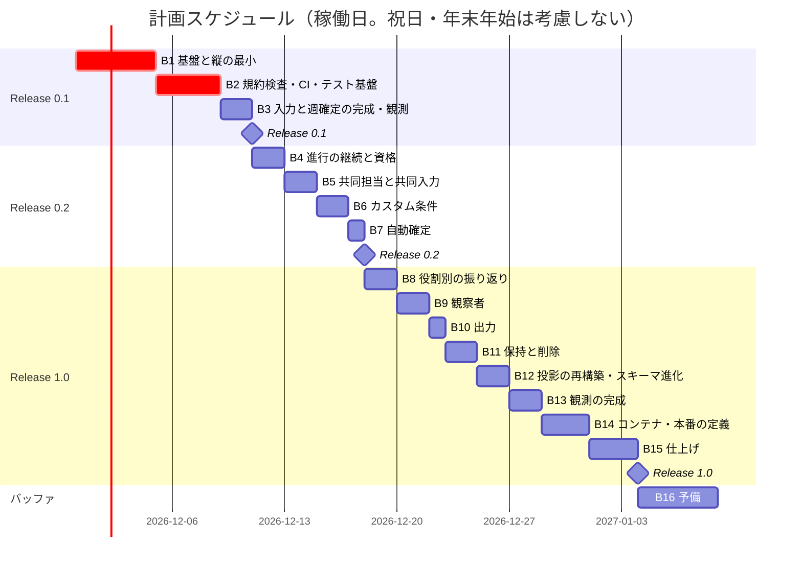

# リリース計画 - ビールゲームシミュレーション（Scala 版）

## 概要

本書は、beer-game-scala（beer-game-kotlin の Scala 版）のリリース計画を、AI-DLC の Intent → Unit → Bolt の階層で、**Release 1.0 まで**定義します。**本書は AI の草案で、人の承認を得ていません。** スコープ、Bolt の割り当て、日程の仮定、価値指標の目標、リスクは、承認のゲートで人が検証します。

- 機能・振る舞いは beer-game-kotlin（元は beer-game2）と同じです。要件・ストーリー・Unit・受入条件は新規に作らず参照します（[ユーザーストーリー](../../requirements/beer-game-ts/user_story.md)、[Unit 定義](../../requirements/beer-game-ts/unit_definition.md)）。
- 設計は [beer-game-scala の設計](../../design/beer-game-scala/index.md)（設計書 10 本は 2026-11-25 に `verified`。U1〜U6 の全範囲を扱う）と [ADR-001](../../adr/beer-game-scala/001-scala-version-of-beer-game-kotlin.md)（提案中。人のレビュー待ち）です。
- 計画の形式は [Kotlin 版](../beer-game-kotlin/release_plan.md)・[Rust 版](../beer-game-rust/release_plan.md) に合わせ、**ストーリーポイントでなく Bolt の稼働日**で見積もります（ベロシティは計測前のため）。
- **日付と所要は仮定です。** B1 の実績（人の検証時間を含む）で B2 以降を再調整します。
- **範囲の変更（2026-11-26、ユーザーの指示）**: 設計書・ADR-001 は「U1〜U3 を約束し、U4〜U6 は指標を見て決める」（2026-11-25）でしたが、ユーザーが「リリース計画を 1.0.0 まで立てて」と指示したため、本書は U1〜U6 を計画します。**設計書・ADR-001 の範囲の記述の更新と、約束の範囲を U1〜U6 に広げる承認は、本書の承認で行います**（未実施）。

### プロジェクト情報

| 項目 | 内容 |
| :--- | :--- |
| プロジェクト名 | beer-game-scala（ビールゲームシミュレーション Scala 版） |
| Intent | beer-game-kotlin と同じ学習の価値（**役割別に、遅延と意思決定が変動を増幅する過程を振り返れる**）を、Scala 3（Cats Effect + http4s + doobie）の関数型設計で、変更を楽に安全にできる形で提供する |
| 対象ユーザー | 進行役、参加者（共同担当を含む）、観察者、運用担当 |
| 開発体制 | モブ（人 1 名 + AI）。人は承認ゲートで計画・設計・コードを検証する |
| 実装の場所 | `apps/beer-game-scala/`（バックエンド）。`apps/beer-game-web`・`beer-game-contracts`・`beer-game-features` は他の版と共有 |
| 参照のみ | `apps/beer-game-kotlin/`。**共有物の変更は他の版に影響するため、都度確認する** |

---

## 満足条件

### スコープ

Kotlin 版・Rust 版と同じ範囲（Unit U1〜U6、Release 0.1 / 0.2 / 1.0。ストーリー 15 件、Must 11・Should 4）です。

| リリース | 内容 | 含む Unit | ストーリー（要点） |
| :--- | :--- | :--- | :--- |
| Release 0.1 | **ウォーキングスケルトンと検証用 CI**: 1 ゲームを作成 → 参加 → 開始 → 入力 → 確定 → 状態の表示まで通る。CI で規約・統合・受け入れが検証される | U1 | US1.1・1.2・2.1・2.2・2.3（基本）、US6.1 の AC6.1.1・6.1.2・6.1.4（D2） |
| Release 0.2 | 進行の継続、共同担当、カスタム条件、自動確定 | U2、U3 | US3.1、US3.2、US1.2（AC1.2.4）、US2.2（共同）、US1.1（カスタム）、US2.4 |
| Release 1.0 | **学習の価値の完結**（役割別の振り返り）、観察者、出力、保持と削除、投影の再構築、観測、本番の**定義**、仕上げ | U4、U5、U6 | US1.3、US4.1、US4.2、US4.3、US5.1、US6.1・6.2（完成）、横断の受入条件 |

- **学習の価値（役割別の振り返り、US4.2）が完結するのは B8（Release 1.0 の最初）です。** Kotlin 版は Release 0.1 に含めましたが、Scala 版は検証用 CI とスケルトンを優先して U1 に含めません（約束の順序の案。入れ替えは承認時に決める）。
- **AWS への適用は、本計画の範囲外の別の承認ゲート**です。Terraform、CI/CD、デプロイ構成は**定義まで**を B14 に含め、適用は人の判断で別に行います（Kotlin 版・Rust 版と同じ）。「ステージングで動く」ことは完了条件に含めません。
- **CI の形**: 案 Y（別ジョブ `integration`・`acceptance` を `check` に足す）をユーザーが選びました（2026-11-26）。
- **team 規約の例外**（ステージング自動反映と production 手動承認デプロイを持たない）は、2026-11-26 にユーザーが承認しました（[ADR-001](../../adr/beer-game-scala/001-scala-version-of-beer-game-kotlin.md)）。**承認の期間は「U1〜U3 の間」でしたが、計画は U6 まで延びたため、期間を Release 1.0 まで延ばす再承認が要ります**（SR9）。project.md `## Scope Overrides` への記録は未実施です。
- **Release 1.0 の前までは実際の研修に使いません**（検証・事例用。N-H8）。研修に使い始める時期は、U4・U5 の完了と、運営者との合意（依頼文言・15 分・研修中の原則）の後です（案）。

### ビジネス価値と測定基準

最優先の価値は、Kotlin 版と同じ**役割別の振り返り**（ブルウィップ効果の確認）です。数値の目標は案で、承認で確定します（[ADR-001](../../adr/beer-game-scala/001-scala-version-of-beer-game-kotlin.md) の成功の測り方）。

| 指標 | 目標（案） | 確認する Bolt |
| :--- | :--- | :--- |
| 共有する `features/` のうち、Scala のバックエンドで通るシナリオの割合（`@api`・`@ui`） | Release 0.1・0.2: 各範囲の `@AC` タグから導く許可リストの 100%。**Release 1.0: 全シナリオ 100%** | B1〜 |
| Must 11 ストーリーの受入条件パリティ | 0.1・0.2: 含まれる Must の全 AC（US6.1 は AC6.1.1・6.1.2・6.1.4）。1.0: 11/11 | B1〜 |
| 未確認の前提の数 | B1 の終わりに、テスト戦略の B1 の受入条件の表が全行確認済み。以降増えない | B1 |
| 行カバレッジ | 全体の行 80%（scoverage の XML から算出。案 C）。`domain` の文 97% は目安で、ゲート化は B1 の実測後に決める | B1〜 |
| 規約違反が静的解析で落ちる | 違反コードを置くと CI が失敗する | B1・B2 |
| 検証用 CI | `check`・`integration`・`acceptance` の 3 ジョブが緑 | B2〜 |
| NF-P2（確定から反映） | p95 4 秒（実測は B1、最終の計測は B15） | B1・B15 |
| 投影の整合（`fold(evolve)` と投影の行の一致）の検査 | 不一致 0 件 | B12 |
| NFR の検証表 | 全件に達成・未達・未測定などの判定がつく（Kotlin 版は 84 件） | B15 |

### スケジュール（仮定）

| 項目 | 内容 |
| :--- | :--- |
| 開発の開始 | 2026-11-30（月）（承認後） |
| 単位 | Bolt（1〜5 稼働日）。計画上 Bolt を 15 個、予備を含めて 16 個 |
| 稼働の仮定 | 週 5 日（月〜金）。**祝日・年末年始は考慮していない**（実際は 12/29〜1/3 ごろの停止で、Release 1.0 は約 1 週間後ろにずれる見込み） |
| Release 0.1 | 2026-12-14（B1〜B3、11 稼働日） |
| Release 0.2 | 2026-12-23（B4〜B7、18 稼働日） |
| Release 1.0 | 計画上 2027-01-15（B8〜B15、35 稼働日） |
| バッファ込みの目安 | **2027-01-22**（予備 B16 の 5 稼働日を含む。合計 40 稼働日） |

**所要の見積もりの根拠**: Kotlin 版の計画値（B1 4 日、B2 3 日、B5・B6・B7 各 2 日、B8 1 日、B9 2 日、B10 1 日、B11 2 日、B12 2 日、B13 2 日、B14 3 日、B15 3 日、予備 5 日）を基準にしました。Scala 版で増える作業は、CI を 3 ジョブに分ける作業と未確認の前提の検証（B1・B2 に各 +1 日）です。Kotlin 版の B3（コンテナ・Terraform の定義）は B14 に統合し、B4（役割別の振り返り）は B8 に移しました。実績は、AI が承認ゲートを連続して通過した場合に人の検証時間を含まないため、見積もりに反映していません。**上の見積もりは実測前の仮定で、B1 の実績で再調整します。**

### リソース

- **開発**: 人 1 名（承認・判断）+ AI（計画・生成）。
- **外部の依存**: 独自ドメインの取得、通知先とオンコールの体制、運営者との数値目標の合意、AWS の利用の判断と費用（いずれも Kotlin 版から継続。本計画の範囲外の承認ゲート）。

### リスク

[リスク台帳](#リスク台帳) を参照してください。

---

## Level 1 計画（ワークフロー）

- [x] 設計（10 本）: [設計](../../design/beer-game-scala/index.md)（`verified` 2026-11-25。U1〜U6 の全範囲）
- [x] 設計書のレビュー（5 視点・再レビュー・再々レビュー）と D1〜D5 の承認（2026-11-25）
- [x] 案 Y（別ジョブ）の選択と team 規約の例外の承認（2026-11-26、ユーザー。期間は U1〜U3）
- [ ] **約束の範囲を U1〜U6（Release 1.0）に広げる承認**（本書の承認で行う。設計書・ADR-001 の範囲の記述を更新する）
- [ ] **team 規約の例外の期間を Release 1.0 まで延ばす再承認**（SR9）と、project.md `## Scope Overrides` への記録（learnings の手続き。人の承認の場）
- [ ] ADR-001 のレビューと `Accepted` の判断（人。提案中のまま）
- [ ] **リリース計画の承認（本書）**
- [ ] 依存関係（H2、scoverage ほか Scala の道具の版）の導入の承認と版の確認（B1 の計画の判断項目）
- [ ] B1 の計画（ステップ計画）の作成と承認
- [ ] Bolt の実行（Mob Construction）。各 Bolt の終わりに、Bolt 終了報告と計画の更新
- [ ] Release 0.1 → 0.2 → 1.0

---

## 優先順位

4 軸（金銭価値・コスト・知識習得・リスク軽減）に、依存関係とウォーキングスケルトンを加えて決めます。

| Unit | 金銭価値（BV） | コスト（C） | 知識習得（KA） | リスク軽減（RR） | 順序 | 理由 |
| :--- | :---: | :---: | :---: | :---: | :---: | :--- |
| U1 | 高 | 高 | **高** | **高** | 1 | 土台。Scala 3・Cats Effect・doobie・H2 の実測など不確実性が最も高い（ウォーキングスケルトン） |
| U2 | 高 | 高 | 高 | 高 | 2 | 進行の継続（Must）と、共同担当・資格（並行性、認可と冪等の順序） |
| U3 | 中 | 中 | 中 | 中 | 3 | カスタム条件と自動確定。Should を含む |
| U4 | **高** | 中 | 中 | 高 | 4 | 学習の最優先の価値（役割別の振り返り）の完結。観察者の情報開示のリスク（権限の層での分離） |
| U5 | 中 | 高 | 高 | **高** | 5 | 削除、投影の再構築、観測、本番の定義。追記専用と連鎖削除の両立など、ES 固有の不確実性 |
| U6 | 中 | 中 | 低 | 中 | 6 | 仕上げ、受入、性能の実測 |

---

## Bolt 計画

各 Bolt は**確認したい仮説**と**完了条件**を持ち、ステップ計画は **Bolt ごとに作成し、人が承認してから実行します**。BDD（Given/When/Then を先に）と TDD の三原則は全 Bolt で守ります。受入条件・デモ項目は日本語 Gherkin で書きます（共有する `features/`）。**静的解析は全 Bolt で違反 0 件**（[開発戦略](./development_strategy.md)）。

| Bolt | Unit | ゴール | 確認したい仮説 | 完了条件（要点） | 所要 |
| :---: | :--- | :--- | :--- | :--- | :---: |
| B1 | U1 | **基盤と縦の最小**: 最初に H2（PostgreSQL モード）の動作範囲を実測し、テスト戦略の「B1 の受入条件」の未確認の前提を確かめる。sbt のマルチモジュール、`events` ほかの最小スキーマ、`decide`/`evolve`/`simulateWeek` の最小、http4s API、共有 `web` の接続。ゲームを作成 → 参加 → 割り当て → 開始 → 入力 → 確定 → 状態の表示まで通す（H2 と PostgreSQL）。U1〜U6 の AC の一覧の確定と許可リストの導出。行率の算出スクリプトとそのテスト（最初のスライド）。NF-P2 の実測 | Scala 3 と Cats Effect・doobie・http4s の組み合わせは動くか。H2 は PostgreSQL の代わりにどこまで使えるか。インメモリの状態を `ConnectionIO` から読み書く方法は成り立つか。AI の出力の質は、どの密度のゲートが要るか | ローカル（H2）で E2E が通り、PostgreSQL（Testcontainers）でも同じシナリオが通る。Undefined・Pending が 0。B1 の受入条件の表の全行が成立・不成立の記録つき。golden テスト。依存関係の承認の記録 | 5 日 |
| B2 | U1 | **規約検査・CI・テスト基盤**: 静的解析の厳格な適用、`.transact(` の許可する入口の検査、scoverage、**CI の 3 ジョブ（`check`・`integration`・`acceptance`）**、追記専用権限の否定テスト、API の契約テストの CI 組み込み | 規約違反コードで CI が落ちるか。scoverage でプロジェクトごとのしきい値を設定できるか（できなければ全体のしきい値だけにする）。契約テストが成り立つか | 違反コードを 1 つ置くと CI が失敗する。3 ジョブが GitHub Actions で緑。仕様と実装を意図的にずらすと契約テストが落ちる。行 80% のゲートが有効 | 4 日 |
| B3 | U1 | **入力と週確定の完成と観測**: US2.1〜2.3 の基本の残り、不正な遷移（`Ignored`）を止める設計、止まったゲームの状態取得（N-H7）、構造化ログ・相関 ID・`/ready`（AC6.1.1・6.1.2・6.1.4）。**Release 0.1** | 観測の最小は U1 の範囲で成り立つか | U1 の許可リストの 100%。AC6.1.1・6.1.2・6.1.4 が通る。CI 緑 | 2 日 |
| B4 | U2 | **進行の継続と資格**: 停止・再開・代理入力、参加者・進行役の復帰、資格の期限・失効・再発行、鍵の複数の版、試行の窓、**冪等記録の照合を認可の後に置く** | 資格の設計は漏洩時に被害を止められるか。失効した資格の再送は 403 か | AC3.1.*、AC3.2.*。鍵のローテーションと失効後の再送の否定テスト | 2 日 |
| B5 | U2 | **共同担当と共同入力**: 同一役割に複数人、意思決定の版による競合の検出、入れ替え（D3: 未失効の旧担当者にだけ `CredentialRevoked`）、再試行 | 同時の保存で更新を失わないか。再試行は上限内で収まるか | AC1.2.4、AC2.1.4、AC2.2.3、AC2.2.4。並行の統合テスト | 2 日 |
| B6 | U3 | **カスタム条件**: 初期在庫・遅延・費用単価・公開範囲、可変の遅延の `simulateWeek` | 遅延が可変でも計算の性質が保たれるか | AC1.1.3〜1.1.5。プロパティテスト（遅延 0 を含む） | 2 日 |
| B7 | U3 | **自動確定**: 確定方式の設定、最後の入力と同じ追記での確定（代理入力を含む）、手動との競合。**Release 0.2** | 自動確定と手動確定の競合で、一度だけ確定されるか | AC1.1.6、AC2.4.*。2 プロセスの並行テスト。0.2 の許可リストの 100% | 1 日 |
| B8 | U4 | **役割別の振り返り**: 役割別の時系列（指標・役割の切り替え、グラフと表）。ブルウィップ効果が見える。終了前は開示しない | 役割別の週結果の行で、振り返りが単純に実現できるか | AC4.2.1〜4.2.4。**学習の価値が完結する** | 2 日 |
| B9 | U4 | **観察者**: 観察用の招待、観察（公開範囲、抑止）、観察者の権限（DB ロールと接続プールの分離、`game_join_codes` を読めない） | 情報が漏れないか。観察者のプールの配線は正しいか | AC1.3.*、AC4.1.*。他役割の値と将来の需要・参加コードが取得できないことの否定テスト。`current_user` の検査 | 2 日 |
| B10 | U4 | **出力**: CSV・JSON（設定、役割別、意思決定、履歴）、スキーマ版、チェックサム。要求時に生成する | 出力が完全かつ再利用できるか。最終週の確定が出力に依存しないか | AC4.3.*。最大の長さでの生成時間（NF-P9） | 1 日 |
| B11 | U5 | **保持と削除**: 保持方針（暫定: 作成時起点）、期限検出の定期タスク、`game_roots` の連鎖削除、再試行と通知、受領記録、削除予定日の表示。**マイグレーションの承認が先** | 削除後に何も残らないか | AC5.1.*。**削除後に `game_id` を持つ全表に行が残らないテスト**（`information_schema` による検査） | 2 日 |
| B12 | U5 | **投影の再構築・整合検査・スキーマ進化**: 投影の再構築（アドバイザリロックによる停止中の実行。`ProjectionLock` は D4 の構造）、投影の整合の日次検査、イベントのコーデックとアップキャスト、読む版 → 書く版の 2 段階リリース | `events` から投影を再構築でき、結果が一致するか。研修中の再構築の運用は成立するか | 再構築の時間（目標は実測で決める）。投影の整合が不一致 0 件。N-1 互換ジョブが通る | 2 日 |
| B13 | U5 | **観測の完成**: メトリクス（EMF）、アラーム（投影の遅れ、追記競合率、JVM）、ダッシュボード、合成監視、通知（SNS）の**定義** | 研修中の停止を 1 分以内に検知できるか | AC6.1.*（残り）。アラームの訓練（ローカルの模擬） | 2 日 |
| B14 | U5 | **コンテナ・デプロイ・本番の定義**: JVM のコンテナ（マルチステージ）、起動モード、Terraform の最小構成と本番（独自ドメイン・ACM・TLS・セキュリティヘッダー、ブルー/グリーン）の定義、復元の手順、運用手順書。**AWS への適用はしない** | 本番へ安全に出し、戻し、復元できる**定義**になっているか。JVM の起動時間は目標に収まるか | AC6.2.*（定義まで）。`terraform validate`（適用しない）。ローカルのコンテナでスモークテストが通る。RPO・RTO の机上確認 | 3 日 |
| B15 | U6 | **仕上げ**: ヘルプ、狭い画面の案内、アクセシビリティの手動確認、ブラウザ行列、実 DB の負荷試験と確定から反映までの計測（NF-P2 の最終）、受入。NFR の検証表、Release 1.0 の準備状況。**Release 1.0** | 非機能の目標を満たすか | 横断の受入条件 X-1〜X-5。**許可リスト（全シナリオ）の 100%**。NFR の検証表の全件に判定。AWS には未適用と明記 | 3 日 |
| B16 | — | **予備**（スケジュールバッファ） | — | — | 5 日 |

### 順序と並列

- API を追加・変更する Bolt は、仕様（`contracts/openapi.yaml`）→ 契約テスト（Red）→ 実装 → 型の再生成 → 画面の順に進める（契約テストの基盤は B2）。
- B1 → B2 → B3 は固定。**B1 の実測（H2、`ConnectionIO`、scoverage）の結果が悪ければ、B2 以降を止めて設計を見直す。**
- B4〜B7（U2・U3）、B8〜B10（U4）、B11〜B14（U5）は互いに依存しないが、人 1 名の間は上の順に直列で進める。
- B12（再構築）は B11（削除）と同じ `game_roots`・ロックの設計に依存する。B14 は B11・B13 の完了が前提。B15 は B12・B14 の完了が前提。
- **スキーマを変える Bolt（B11 ほか）は、マイグレーションの承認を、個別の計画書と合わせて先に取る**（確認必須の対象）。

### 承認ゲートの密度

| Bolt | 密度 | 理由 |
| :--- | :--- | :--- |
| B1、B2 | **密**（ステップごとに検証） | ウォーキングスケルトン。AI の出力の質と Scala 固有の不確実性を確かめ、以降の密度を決める |
| B4、B5、B7、B9、B11、B12、B14 | 密 | 高リスク（並行性、認可と冪等、競合、開示、削除、再構築、本番） |
| B3、B6、B8、B10、B13、B15 | 標準 | 構造が決まっている |

**全 Bolt の共通の承認項目**: 当該 Bolt の受入条件の Gherkin シナリオを、実装の前に人が検証して合意する。ルールの緩和・除外を足す場合は ADR を記録し、人が承認する。**承認は Unit の終わりにまとめず、Bolt ごとに受ける。** 人による実操作の確認（デモ項目）は、Bolt 終了報告に申告する欄を設ける。**Bolt 完了後のレビューでは、毎回必ず `apply-living-documentation` を実施し、結果を Bolt 終了報告に記録する**（実施するまでレビューを完了としない）。

---

## スケジュール

---

## リスク台帳

| ID | リスク | 影響 | 対応 | 確認する Bolt |
| :--- | :--- | :--- | :--- | :--- |
| SR1 | H2 が PostgreSQL の代わりにならない機能（アドバイザリロック、`LISTEN`/`NOTIFY`、ロール）がある | ローカルと CI で結果がずれる | B1 の最初に実測し、置き換え・省略を確定。受け入れの正は PostgreSQL | B1 |
| SR2 | インメモリの状態を `ConnectionIO` から読み書く方法が成り立たない | `ProjectionLock` の設計の見直し | B1 の最初のスライドで確かめ、D4 の構造を実測で検証 | B1 |
| SR3 | scoverage がプロジェクトごとのしきい値を設定できない（K16） | `domain` 97% をゲートにできない | 全体 80% のみをゲートにし、97% は目安のまま | B1・B2 |
| SR4 | 依存関係（版、ライセンス）の承認待ちで B1 が止まる | 日程の遅れ | B1 の計画で一括して承認を受ける | B1 |
| SR5 | 共有する `web`・`contracts`・`features` の変更が Kotlin 版・Rust 版を壊す | 他の版の CI の失敗 | 共有物の変更は都度確認し、他の版の CI で確かめる | 全 Bolt |
| SR6 | 3 ジョブの CI の実行時間が延びる | フィードバックの遅れ | `check` を速く保つ。時間を B2 で計測 | B2 |
| SR7 | 規約の例外の project.md への記録が未実施のまま進む | 規約と実態のずれ | B1 の開始前に、人の承認の場で learnings の手続きを行う | B1 前 |
| SR8 | 正本の要件で US6.1・US6.2 の Unit が食い違う（`user_story.md` は U6、`unit_definition.md` は U1・U5） | 範囲の解釈のずれ | D2 の決定に従い、B1 の AC の一覧の確定で再確認 | B1 |
| SR9 | 規約の例外の承認の期間（U1〜U3）が、計画の延長（U6 まで）と合わない | 規約と実態のずれ。Release 0.2 以降の Bolt が規約違反になる | 本書の承認と同時に、期間を Release 1.0 まで延ばす再承認を受ける（または AWS・デプロイを前倒しする） | 承認時 |
| SR10 | 約束の範囲を U1〜U6 に広げたことで、設計書・ADR-001 の記述（「U4〜U6 は指標を見て決める」）と食い違う | 文書間の不整合 | 本書の承認後、設計書・ADR-001 の範囲の記述を更新し、`verified` を再確認する | 承認後 |
| SR11 | U5 でスキーマ変更（マイグレーション）が要る | 確認必須の承認待ち | B11 ほかの個別の計画書にマイグレーションの承認を含める | B11〜 |
| SR12 | 年末年始が計画の中盤にかかる（日程は考慮していない） | Release 1.0 が約 1 週間遅れる | 日程は仮定として、稼働日を人が決めた時点で引き直す | B8〜 |
| SR13 | Kotlin 版の NFR 未達（NF-P18 再構築が約 4 倍遅い、NF-S13 CI の依存関係・秘密情報の検査なし）が Scala 版にも及ぶ | NFR の未達 | B12・B2 で Scala 版の対応を最初から入れる（B2 で依存関係・秘密情報の検査を CI に含める） | B2・B12・B15 |

---

## 進捗管理

| 指標 | 目標 |
| :--- | :--- |
| Bolt の計画日数と実績日数（人の検証時間を含む） | 差を Bolt ごとに記録し、B1 の後に B2 以降を再調整 |
| 共有する `features/` のシナリオの通過割合 | 上の測定基準 |
| 未確認の前提の数 | B1 の後に表が全行確認済み |
| テストカバレッジ | 全体の行 80% 以上 |

### 進捗状況

| Bolt | 計画（稼働日） | 実績 | 状態 |
| :--- | ---: | ---: | :--- |
| B1〜B16 | 40（B16 は予備 5） | - | 未着手（本書の承認待ち） |

---

## 次のステップ

1. 本書の承認（スコープを U1〜U6 に広げること、Bolt の割り当て、日程の仮定、価値指標の目標、リスク）。
2. team 規約の例外の期間の再承認（SR9）、ADR-001 のレビューと判断、project.md への記録（人の承認の場）。
3. 設計書・ADR-001 の範囲の記述の更新（SR10）。
4. [開発戦略](./development_strategy.md) の承認。
5. B1 の計画（ステップ計画）の作成と承認。
