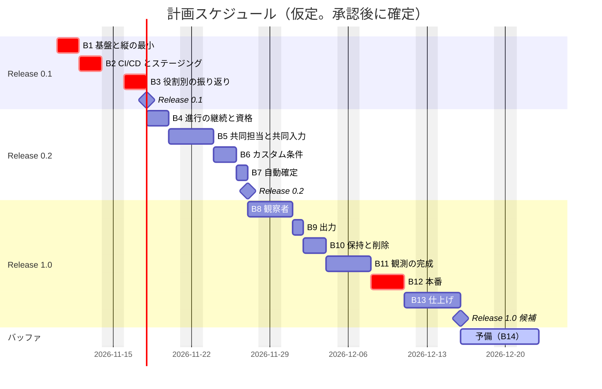
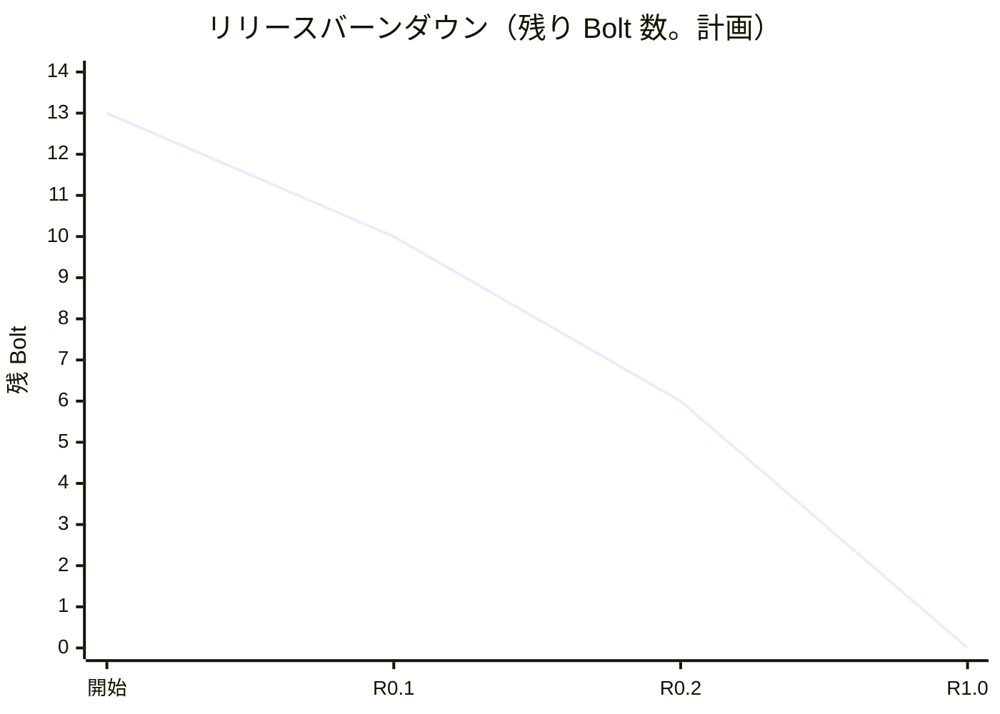

# リリース計画 - ビールゲームシミュレーション（v2）

## 概要

本書は、beer-game2（v2）のリリース計画を、AI-DLC の Intent → Unit → Bolt の階層で定義します。**AI が計画を提案し、人が承認ゲートで検証・承認します。**

- Unit の分解と評価は [Unit 定義](../../requirements/beer-game2/unit_definition.md)、ストーリーは [ユーザーストーリー](../../requirements/beer-game2/user_story.md) を参照してください。
- 計画の根拠: [リリース・イテレーション計画ガイド（AI-DLC 版）](../../reference/リリース・イテレーション計画ガイド_AI-DLC版.md)
- **日付と所要は、仮定にもとづく初期の見積もりです**（体制と稼働時間の確認が必要。下記）。ウォーキングスケルトン（B1）の実績で、再調整します。

### プロジェクト情報

| 項目 | 内容 |
| :--- | :--- |
| プロジェクト名 | beer-game2（ビールゲームシミュレーション v2） |
| Intent | 学習用のビールゲームを、複数人で実行し、**役割別に、遅延と意思決定が変動を増幅する過程を振り返れる**、運用できるシステムとして作る |
| 対象ユーザー | 進行役、参加者（工場・一次卸・二次卸・小売店。共同担当を含む）、観察者、運用担当 |
| 開発体制 | モブ（人 1 名 + AI）。人は、承認ゲートで、計画・設計・コードを検証し、判断する |
| 実装の場所 | `apps/beer-game2/`（beer-game は参照用に残す） |

---

## 満足条件

### スコープ

| リリース | 内容 | 含む Unit | ストーリー |
| :--- | :--- | :--- | :--- |
| Release 0.1 | **学習が成立する最小**: 1 ゲームを通し、役割別の振り返りができる。ステージングで動く | U1、U4（振り返りの核） | US1.1・1.2・2.1・2.2・2.3（基本）、US4.2、US6.1・6.2（基本） |
| Release 0.2 | 進行の継続、共同担当、カスタム条件、自動確定 | U2、U3 | US3.1、US3.2、US1.2（AC1.2.4）、US2.2（共同）、US1.1（カスタム）、US2.4 |
| Release 1.0 | 観察者、出力、保持と削除、運用（観測、本番、復元）、仕上げ。本番で動く | U4（残り）、U5、U6 | US1.3、US4.1、US4.3、US5.1、US6.1・6.2（完成）、横断の受入条件 |

- ストーリー 15 件（Must 11 件、Should 4 件）。Should は、US1.3、US2.4、US4.1、US4.3 です。
- ユースケースは 16 件（UC-01〜UC-16）。

### ビジネス価値と測定基準

[Unit 定義](../../requirements/beer-game2/unit_definition.md) の「測定基準」を参照してください。最優先の価値は、**役割別の振り返り**（ブルウィップ効果の確認）です。

### スケジュール（仮定）

| 項目 | 内容 |
| :--- | :--- |
| 開発の開始 | 2026-11-10（承認後） |
| 単位 | Bolt（1〜3 稼働日）。計画上、Bolt を 13 個、予備を含めて 14 個 |
| 稼働の仮定 | 週 5 日、1 日 1 Bolt 程度。祝日・年末年始は考慮していない |
| Release 0.1 | 2026-11-17（B1〜B3） |
| Release 0.2 | 2026-11-26（B4〜B7） |
| Release 1.0 | 計画上 2026-12-15（B8〜B13）。バッファ込みで **2027-01-06 を目安** |

### リソース

- **開発**: 人 1 名（承認・判断）+ AI（計画・生成）。
- **人の時間**: 承認ゲートでの検証が中心。ゲートの密度は、Unit の評価で決める（[Unit 定義](../../requirements/beer-game2/unit_definition.md)）。
- **外部の依存**: 独自ドメインの取得、通知先とオンコールの体制、運営者との数値目標の合意（組織の判断）。

### リスク

[リスク台帳](#リスク台帳) を参照してください。

---

## Level 1 計画（ワークフロー）

AI が提案し、人が承認するワークフローです（承認済みの項目は Inception の成果物として `docs/` に永続化済み）。

- [x] 要件の改訂（v2 の範囲の確定）: [要件定義](../../requirements/beer-game2/requirements_definition.md)
- [x] ユースケースとストーリーの改訂: [システムユースケース](../../requirements/beer-game2/system_usecase.md)、[ユーザーストーリー](../../requirements/beer-game2/user_story.md)
- [x] 設計の改訂（ドメイン、データ、アーキテクチャ、UI、テスト、非機能、運用）: [設計](../../design/beer-game2/index.md)
- [x] 技術スタックの更新と ADR（12 件）: [ADR](../../adr/beer-game2/index.md)
- [x] Unit への分解と評価: [Unit 定義](../../requirements/beer-game2/unit_definition.md)
- [x] **リリース計画の承認（本書）**（2026-11-09、人が承認）
- [ ] Bolt 1 の計画（ステップ計画）の作成と承認
- [ ] Bolt の実行（Mob Construction）。各 Bolt の終わりに、Bolt 終了報告と、計画の更新
- [ ] Release 0.1 → 0.2 → 1.0

---

## 優先順位

[リリース・イテレーション計画ガイド](../../reference/リリース・イテレーション計画ガイド_AI-DLC版.md) の 4 軸（金銭価値・コスト・知識習得・リスク軽減）に、依存関係とウォーキングスケルトンを加えて決めます。

| Unit | 金銭価値（BV） | コスト（C） | 知識習得（KA） | リスク軽減（RR） | 順序 | 理由 |
| :--- | :---: | :---: | :---: | :---: | :---: | :--- |
| U1 | 高 | 高 | 高 | 高 | 1 | すべての Unit の土台。構造・観測性・デプロイの不確実性を、最初に減らす（ウォーキングスケルトン） |
| U4（振り返りの核） | **高** | 中 | 中 | 中 | 2 | 学習の最優先の価値（役割別の振り返り）を早く届ける。Release 0.1 |
| U2 | 高 | 高 | 高 | 高 | 3 | 進行の継続（Must）と、共同担当・資格（並行性とセキュリティの不確実性が高い） |
| U3 | 中 | 中 | 中 | 中 | 4 | カスタム条件と自動確定。Should を含み、後ろ倒しにできる |
| U4（観察者・出力） | 中 | 中 | 低 | 高 | 5 | 観察者と出力。情報の開示のリスクが高い |
| U5 | 中 | 高 | 中 | **高** | 6 | 削除、観測、本番。本番前に必須 |
| U6 | 中 | 中 | 低 | 中 | 7 | 仕上げ、受入 |

---

## Bolt 計画

Bolt は、時間〜日単位の構築の単位です。各 Bolt は、**確認したい仮説**と**完了条件**を持ちます。詳細なステップ計画は、**Bolt ごとに作成し、人が承認してから実行します**。

| Bolt | Unit | ゴール | 確認したい仮説 | 完了条件（DoD の要点） | 所要 |
| :---: | :--- | :--- | :--- | :--- | :---: |
| B1 | U1 | **基盤と縦の最小**: キット準拠のゲームを、作成 → 参加 → 割り当て → 開始 → 入力 → 確定 → 状態の表示まで、ローカルで通す（実 DB、構造化ログ、`/ready`、層の lint、役割別の週結果の保存） | 集約の粒度と層の構造は妥当か。Node 26 / TS 6 / PG 18 の組み合わせで問題ないか。AI の出力の質は、どの密度のゲートが要るか | ローカルで E2E が通る。`simulateWeek` のプロパティテスト。DB 統合（版・冪等・原子性）。層の lint が CI で有効 | 2 日 |
| B2 | U1 | **CI/CD とステージング**: ECR、OIDC、Terraform の最小構成（ネットワーク、RDS、ECS、ALB、CloudFront、S3）、マイグレーションの自動適用、スモークテスト、ロールバックの確認 | パイプラインと環境が、再現でき、戻せるか | main へのマージで、ステージングへ自動デプロイされる。ロールバックを確認 | 2 日 |
| B3 | U4 | **役割別の振り返り**: 役割別の時系列（指標・役割の切り替え、グラフと表）。ブルウィップ効果が見える | 役割別の週結果の行で、振り返りが単純に実現できるか | AC4.2.1〜4.2.4。終了前は開示しない。**Release 0.1** | 2 日 |
| B4 | U2 | **進行の継続と資格**: 停止・再開・代理入力（値をイベントに）、参加者・進行役の復帰、資格の期限・失効・再発行、鍵の複数の版、参加・復帰の専用のレート制限 | 資格の設計は、漏洩時に被害を止められるか | AC3.1.*、AC3.2.*。鍵のローテーションと、本番で鍵が無ければ起動に失敗することのテスト | 2 日 |
| B5 | U2 | **共同担当と共同入力**: 同一役割に複数人、版による競合の検出と、最新値・保存者の提示 | 同時の保存で、更新を失わないか（実際の並行） | AC1.2.4、AC2.1.4、AC2.2.3、AC2.2.4。並行の統合テスト | 2 日 |
| B6 | U3 | **カスタム条件**: 初期在庫・遅延・費用単価・公開範囲、`KitPreset`、可変の遅延の `simulateWeek` | 遅延が可変でも、計算の性質が保たれるか | AC1.1.3〜1.1.5。プロパティテスト（遅延 0 を含む） | 2 日 |
| B7 | U3 | **自動確定**: 確定方式の設定、最後の入力と同じトランザクションでの確定、手動との競合 | 自動確定と手動確定の競合で、一度だけ確定されるか | AC1.1.6、AC2.4.*。2 プロセスの並行テスト。**Release 0.2** | 1 日 |
| B8 | U4 | **観察者**: 観察用の招待の発行・失効・参加、観察（公開範囲、抑止）、観察者の権限 | 情報が漏れないか | AC1.3.*、AC4.1.*。他役割の値と将来の需要が取得できないことの否定テスト | 2 日 |
| B9 | U4 | **出力**: CSV・JSON（設定、役割別、意思決定、履歴）、スキーマ版、チェックサム | 出力が、完全かつ再利用できるか | AC4.3.* | 1 日 |
| B10 | U5 | **保持と削除**: 保持方針、期限検出の定期タスク、カスケード削除、再試行と通知、受領記録 | 削除後に、何も残らないか | AC5.1.*。**削除後に `game_id` を持つ全表に行が残らないテスト** | 2 日 |
| B11 | U5 | **観測の完成**: メトリクス（EMF）、アラーム、ダッシュボード、合成監視、通知（SNS） | 研修中の停止を 1 分以内に検知できるか | AC6.1.*。アラームの訓練 | 2 日 |
| B12 | U5 | **本番**: 独自ドメイン・ACM・TLS 1.2 以上・セキュリティヘッダー、ブルー/グリーン、復元の訓練、運用手順書（優先度「高」） | 本番へ安全に出し、戻し、復元できるか | AC6.2.*。RPO・RTO の実測。**Release 1.0 の候補** | 3 日 |
| B13 | U6 | **仕上げ**: ヘルプ、狭い画面の案内、アクセシビリティの手動確認、ブラウザ行列、実 DB の負荷試験と確定から反映までの計測、受入 | 非機能の目標を満たすか | 横断の受入条件 X-1〜X-5。要件定義の受入れの判断基準 | 3 日 |
| B14 | — | **予備**（スケジュールバッファ） | — | — | 5 日 |

### 順序と並列

- B1 → B2 → B3 は、順序が固定される（土台と最優先の価値）。
- B4〜B7（U2、U3）と B8〜B9（U4）、B10〜B12（U5）は、互いに依存せず、並列に回せる。体制が人 1 名の間は、上の順に直列で進める。
- B12（本番）は、B10（削除）と B11（観測）の完了と、独自ドメインの取得が前提。

### 承認ゲートの密度

| Bolt | 密度 | 理由 |
| :--- | :--- | :--- |
| B1、B2 | **密**（ステップごとに検証） | ウォーキングスケルトン。AI の出力の質を確かめ、以降の密度を決める |
| B4、B5、B7、B8、B10、B12 | 密 | HIGH のリスク（並行性、セキュリティ、開示、削除、本番） |
| B3、B6、B9、B11、B13 | 標準 | 構造が決まっている |

B1 の結果で、以降の密度を調整します。

---

## スケジュール

### 計画スケジュール

実績スケジュールは、Bolt の完了ごとに、このセクションに追記します。

### リリースの内容

#### Release 0.1: 学習が成立する最小

**目標**: ステージングで、1 ゲームを通し、役割別の振り返りでブルウィップ効果を確認できる。

**含まれる機能**: キット準拠のゲームの作成、参加、役割の割り当て、開始、入力、手動の確定、役割別の週結果の保存、役割別の振り返り。構造化ログ、`/ready`、CI/CD、ステージング。

**リリース条件**:

- [ ] 受入条件 AC1.1.1、1.1.2、1.2.1〜1.2.3、1.2.5、2.1.1〜2.1.3、2.2.1、2.2.2、2.3.1〜2.3.5、4.2.1〜4.2.4、6.1.1〜6.1.4、6.2.1〜6.2.3 がパス
- [ ] ユニット・統合・E2E テストがパス。カバレッジのゲート（85/85/85/75）を満たす
- [ ] ステージングへ、main のマージで自動デプロイされ、ロールバックを確認済み

#### Release 0.2: 進行の継続と、v2 の範囲

**目標**: 共同担当、進行の継続、カスタム条件、自動確定が使える。

**含まれる機能**: 停止・再開・代理入力、復帰（進行役を含む）、資格の期限・失効・再発行、共同入力、カスタム条件、自動確定。

**リリース条件**:

- [ ] 受入条件 AC1.1.3〜1.1.6、1.2.4、2.1.4、2.2.3、2.2.4、US2.4、US3.1、US3.2 がパス
- [ ] 並行性の統合テスト（共同入力の競合、自動・手動の確定の競合）がパス
- [ ] 鍵のローテーションと、本番で鍵が無ければ起動に失敗することのテストがパス

#### Release 1.0: 本番

**目標**: 本番で運用できる。観察者、出力、削除、観測、デプロイ、復元が揃う。

**含まれる機能**: 観察者の招待と観察、出力、保持と削除、メトリクス・アラーム・ダッシュボード・合成監視、独自ドメイン・TLS・ヘッダー、ブルー/グリーン、ヘルプ。

**リリース条件**:

- [ ] すべての受入条件（US1.1〜US6.2、X-1〜X-5）がパス
- [ ] 削除後に、`game_id` を持つ全表に行が残らないことのテストがパス
- [ ] 夜間の負荷試験で、入力確定 p95 1 秒、反映 p95 2 秒を確認（記録あり）
- [ ] 復元の訓練で、RPO 0、RTO 15 分を実測（記録あり）
- [ ] アクセシビリティの手動確認の結果を記録
- [ ] 運営者との数値目標の合意、オンコールの体制と通知先の決定

---

## バッファ戦略

### フィーチャバッファ（30%）

Should のストーリーを、スコープの調整の対象にします（優先度の低いものから後回し）。

| 対象（Should） | Unit・Bolt | 後回しにした場合の影響 |
| :--- | :--- | :--- |
| US4.3 結果の出力 | U4（B9） | 画面での振り返りは残る。表計算での比較ができない |
| US2.4 週の自動確定 | U3（B7） | 進行役の確定操作が必要（v1 と同じ） |
| US1.3、US4.1 観察者 | U4（B8） | 観察者が使えない |

Must は、バッファの対象にしません（US4.2 役割別の振り返りと、U5 の削除・運用は、必須）。

### スケジュールバッファ

- **予備の Bolt**（B14）: 5 稼働日。
- **全体のバッファ**: 約 30%（計画上の 2026-12-15 から、2027-01-06 を目安）。

### バッファ消費ルール

1. 先に、フィーチャバッファ（Should の後回し）を使う。
2. 次に、Should の深さ（テスト戦略の水準）を下げる（Must は下げない。本番機能は Standard 以上）。
3. スケジュールバッファ（B14）は、最後の手段。

---

## リスク台帳

組織のリスク台帳への対応は、運営者との合意の際に確認します。

| ID | リスク | Unit | 影響 | 発生確率 | 対策 |
| :--- | :--- | :--- | :---: | :---: | :--- |
| R1 | 共同入力・自動確定の並行性で、更新が失われる、または二重に確定される | U2、U3 | 高 | 中 | 集約ごとの版と、`week_results` の主キーで守る。**実際の並行の統合テスト（2 プロセス）を、実装より先に書く**。ゲート密度を上げる |
| R2 | 集約の粒度（`Game` と `Session` の分離）が誤っている | U1 | 高 | 中 | B1 のウォーキングスケルトンで、早期に検証する。誤りが分かれば、B1 の後に設計を見直す |
| R3 | 資格の設計の誤り（失効、鍵の版、期限）で、漏洩時に被害を止められない | U2 | 高 | 低 | 否定テスト（期限切れ・失効・旧版）を先に書く。レビューを密にする |
| R4 | 情報の開示の誤りで、役割別の値や将来の需要が漏れる | U4 | 高 | 低 | 否定テスト（観察者・他役割）を先に書く。開示判定をドメインの純粋な関数にする |
| R5 | Node 26 / TypeScript 6.0 / PostgreSQL 18 の組み合わせに、未知の不具合がある | U1 | 中 | 低 | B1 で、CI を含めて確認する。問題があれば、版を一段下げる（Node 24、PG 17）判断をする |
| R6 | 独自ドメインの取得・DNS が遅れ、本番（B12）が止まる | U5 | 中 | 中 | **B10 までに取得を依頼する**。遅れる場合は、ステージングの検証を先に進め、本番の公開を後ろ倒しにする |
| R7 | 運営者との数値目標・資格の有効期間・体制の合意が遅れる | U2、U5、U6 | 中 | 中 | 該当 Bolt の前に、決定を依頼する（[Unit 定義](../../requirements/beer-game2/unit_definition.md) の未決事項）。仮の既定値で進め、後で調整する |
| R8 | CSP の導入で画面が壊れる | U5 | 中 | 中 | ステージングで、段階的に導入する（report-only から） |
| R9 | AI が生成するコードの品質（過剰設計、層の違反、テストの不足） | 全体 | 中 | 中 | lint で層を守る。TDD の三原則。承認ゲートで、コードを全行理解する。B1 で密度を調整 |
| R10 | v1 との二重のメンテナンスで、注意が分散する | 全体 | 低 | 中 | beer-game は参照のみ（修正しない）。廃止は、v2 の完成後に ADR で判断する |
| R11 | 未決の設計項目（設定の上限、自動確定の猶予、公開範囲）の決定が遅れる | U3、U4 | 低 | 中 | 該当 Bolt の前に決める。決まるまでは、保守的な既定値（猶予なし、チーム合計のみ）で進める |

---

## 進捗管理

AI-DLC では、ストーリーポイントとベロシティを使わず、**Unit と Bolt の状態、承認ゲートの通過数、リードタイム、価値**で測ります。

### メトリクス

| メトリクス | 目標 |
| :--- | :--- |
| 完了 Unit 数 | 6（U1〜U6） |
| 完了 Bolt 数 | 13（B1〜B13）。B14 は予備 |
| 承認ゲートの通過数と、手戻り（修正を求めた）回数 | Bolt ごとに記録し、傾向を見てゲート密度を調整する |
| Bolt のリードタイム | 計画（1〜3 稼働日）との差を記録する |
| テストカバレッジ | 行・関数・文 85% 以上、分岐 75% 以上（CI のゲート） |
| 受入条件の達成数 | 全受入条件のうち、パスした数（トレーサビリティの表から自動で集計） |
| 価値の指標 | [Unit 定義](../../requirements/beer-game2/unit_definition.md) の測定基準 |

### 進捗状況

| Bolt | Unit | 状態 | 完了日 | 備考 |
| :---: | :--- | :--- | :--- | :--- |
| B1 | U1 | 完了 | 2026-11-11 | ゲート 1〜10、マイグレーション 001・002 を承認（[終了報告](./bolt_1_report.md)）。実操作の申告は無い |
| B2 | U1 | 準備のみ | - | 計画は承認済み（2026-11-10）。AWS 未デプロイ。判断項目 1・2・3・5・7 は回答待ち |
| B3 | U4 | 完了 | 2026-11-10 | Release 0.1 の機能。承認済み（[終了報告](./bolt_3_report.md)） |
| B4 | U2 | 完了 | 2026-11-11 | 計画・判断項目・マイグレーション 003 を承認（[終了報告](./bolt_4_report.md)）。実操作の申告は無い |
| B5 | U2 | 完了 | 2026-11-11 | U2 の受入条件 12 件がパス。承認により **U2 完了**（[終了報告](./bolt_5_report.md)） |
| B6 | U3 | 完了 | 2026-11-11 | 計画・判断項目・マイグレーション 004 を承認（[終了報告](./bolt_6_report.md)）。実操作の申告は無い |
| B7 | U3 | 完了 | 2026-11-11 | Release 0.2。承認により **U3 完了**（[終了報告](./bolt_7_report.md)） |
| B8 | U4 | 完了 | 2026-11-11 | 計画・判断項目・マイグレーション 005 を承認（[終了報告](./bolt_8_report.md)）。実操作の申告は無い |
| B9 | U4 | 完了 | 2026-11-11 | 承認により **U4 完了**（[終了報告](./bolt_9_report.md)） |
| B10 | U5 | 実装完了（承認待ち） | 2026-11-11 | 計画・判断項目・マイグレーション 006 は未承認。AWS には未適用（[終了報告](./bolt_10_report.md)） |
| B11 | U5 | 未着手 | - | |
| B12 | U5 | 未着手 | - | |
| B13 | U6 | 未着手 | - | |
| B14 | — | 予備 | - | |

### リリースバーンダウン（Bolt 数）

実績は、Bolt の完了ごとに追記します。

| 日付 | 残 Bolt（承認済みを除く） | 備考 |
| :--- | ---: | :--- |
| 2026-11-10 | 12 | B3 承認。B1 は承認待ち、B2 は準備のみ |
| 2026-11-11 | 11 | B1 承認。B2 は準備のみ |
| 2026-11-11 | 9 | B4・B5 承認（U2 完了） |
| 2026-11-11 | 7 | B6・B7 承認（U3 完了。Release 0.2 の範囲の実装が完了） |
| 2026-11-11 | 5 | B8・B9 承認（U4 完了） |

### 計画の更新

- **各 Bolt の承認ゲート通過時**に見直す（XP 版の「イテレーション開始時」より高頻度）。
- **B1（ウォーキングスケルトン）の結果**で、以降の深さ、テスト戦略、ゲート密度、所要を調整する。
- Unit の完了実績（Bolt 数、リードタイム、手戻り）で、残りの Unit の評価を更新する。
- スコープの変更は、このリリース計画と [Unit 定義](../../requirements/beer-game2/unit_definition.md) に反映し、削った項目・足した項目を記録する。

---

## 次のステップ

1. ~~このリリース計画の承認~~（承認済み。2026-11-09）。スケジュールの仮定（稼働時間、開始日）は、B1 の実績で再調整する。
2. ~~Bolt 1 のステップ計画、B1 のゲート承認と、マイグレーション 001・002 の承認~~（承認済み。2026-11-11）。
3. **B2 の判断項目 1・2・3・5・7**（AWS を使うか）の回答を得る。Release 0.1 のリリース条件（ステージングへの自動デプロイとロールバック）を左右する。
4. B4（進行の継続と資格）の計画を作成し、承認を得る。
5. ~~未決事項 1（資格の有効期間の既定値）~~（2026-11-11、ブラウザセッション 24 時間・復帰コード 30 日で承認）。
6. 独自ドメインの取得を、B10 までに依頼する。

---

## 更新履歴

| 日付 | 更新内容 | 更新者 |
| :--- | :--- | :--- |
| 2026-11-09 | 初版作成（AI が提案） | claude-code |
| 2026-11-09 | 人が承認。B1 のステップ計画の作成へ | claude-code |
| 2026-11-11 | 進捗状況（B1〜B3）、バーンダウンの実績、次のステップを実態に合わせて更新 | claude-code |
| 2026-11-11 | B1 とマイグレーション 001・002 の承認を記録 | claude-code |
| 2026-11-11 | B4 の実装完了を反映 | claude-code |
| 2026-11-11 | B5 の実装完了を反映（U2 の実装の完了） | claude-code |
| 2026-11-11 | B4・B5 の承認を記録（U2 完了） | claude-code |
| 2026-11-11 | B6 の実装完了を反映 | claude-code |
| 2026-11-11 | B7 の実装完了を反映（U3 の実装の完了） | claude-code |
| 2026-11-11 | B6・B7 の承認を記録（U3 完了） | claude-code |
| 2026-11-11 | B8 の実装完了を反映 | claude-code |
| 2026-11-11 | B9 の実装完了を反映（U4 の実装の完了） | claude-code |
| 2026-11-11 | B8・B9 の承認を記録（U4 完了） | claude-code |
| 2026-11-11 | B10 の実装完了を反映 | claude-code |
