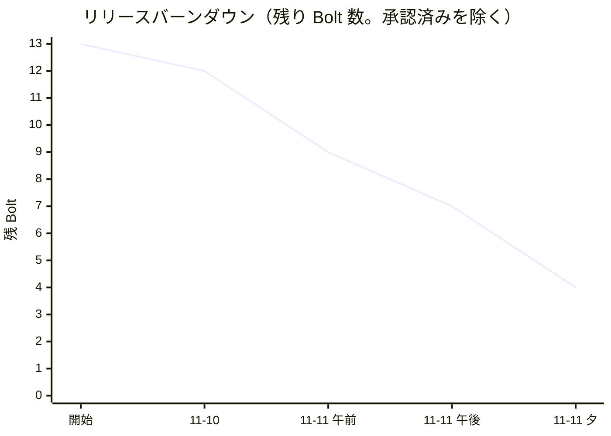
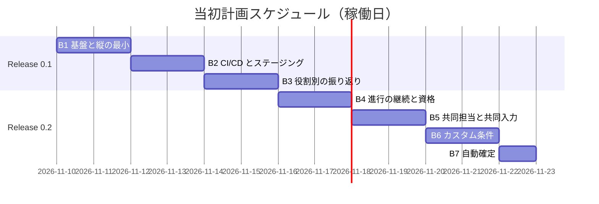
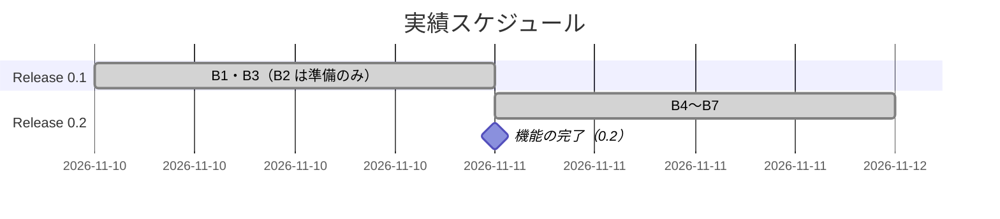
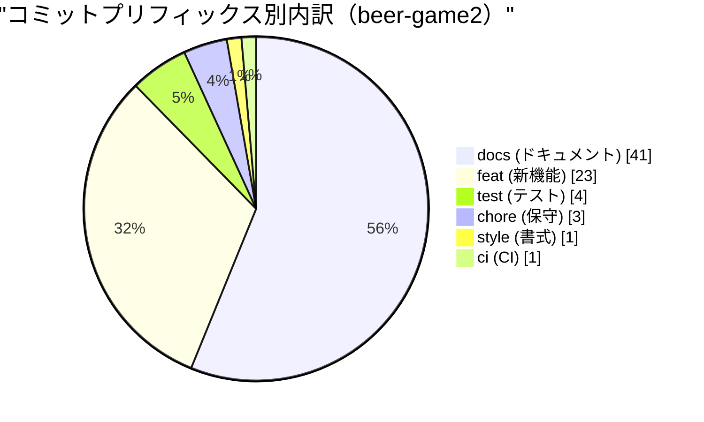
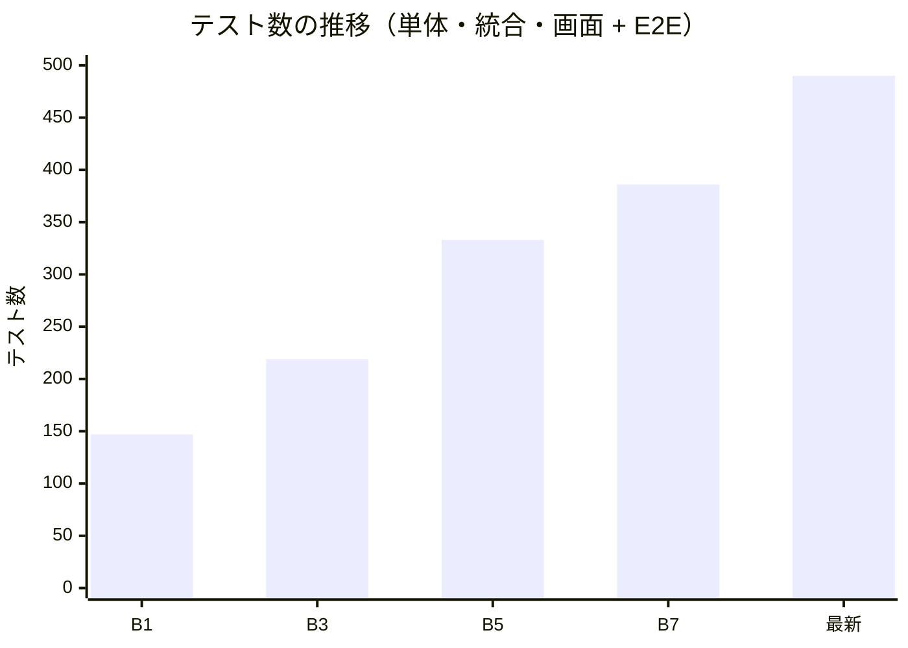

# リリース完了報告書 0.2 - ビールゲームシミュレーション（v2）

**報告書作成日**: 2026-11-11

## 概要

beer-game2（v2）の Release 0.1・0.2 の範囲（U1 ウォーキングスケルトン、U2 共同担当と進行の継続、U3 カスタム条件と自動確定、U4 の振り返りの核）の完了報告書です。対象の Bolt 7 個（B1〜B7）のうち 6 個を承認により完了し、Release 0.2 の受入条件と並行性・鍵のローテーションのテストはすべてパスしました。

**ただし、リリースとしては未完了です。** Release 0.1 のリリース条件「ステージングへ、main のマージで自動デプロイされ、ロールバックを確認済み」が未達です（B2 は準備のみ。AWS を使うかの判断待ち）。このため、**git のタグと CHANGELOG は作っていません**（2026-11-11 の人の判断「0.2 を機能の完了として報告」）。

本プロジェクトは AI-DLC を採用し、進捗をストーリーポイントではなく **Bolt の数と承認ゲート、リードタイム**で測ります（[リリース計画](./release_plan.md)の進捗管理）。テンプレートの SP とベロシティの欄は、Bolt に読み替えています。

---

## プロジェクトサマリー

| 項目 | 値 |
| :--- | :--- |
| **期間** | 2026-11-09 〜 2026-11-11（3 日。計画は 11-09、実装は 11-10・11-11） |
| **対象の Bolt（Release 0.1・0.2）** | 7 個（B1〜B7）。完了 6、準備のみ 1（B2） |
| **前倒しで進めた Bolt（Release 1.0 の範囲）** | 5 個（B8〜B12）。完了 3（B8〜B10）、定義まで 2（B11・B12） |
| **総コミット数** | 73（beer-game2 に関係するもの。マージを除く） |
| **総テスト数** | 478（単体・統合 387、画面 91）＋ E2E 12（2026-11-11 の最新） |
| **受入条件**（Release 0.2 の範囲） | Release 0.1 の 23 件、Release 0.2 の 21 件（US3.1・3.2 を含む）がパス |
| **承認ゲート** | B1・B3〜B7 は人が承認（2026-11-10・11-11）。実操作の確認の申告は無い |

---

## 計画と実績の差異分析

### Bolt 別の達成状況

| Bolt | Unit | リリース | 計画（稼働日） | 実績 | 状態 |
| :--- | :--- | :--- | ---: | :--- | :--- |
| B1 基盤と縦の最小 | U1 | 0.1 | 2 | 2026-11-10（1 セッション） | 完了（承認 2026-11-11） |
| B2 CI/CD とステージング | U1 | 0.1 | 2 | 2026-11-10（準備のみ） | **未完了**（AWS 未デプロイ） |
| B3 役割別の振り返り | U4 | 0.1 | 2 | 2026-11-10（1 セッション） | 完了（承認 2026-11-10） |
| B4 進行の継続と資格 | U2 | 0.2 | 2 | 2026-11-11（1 セッション） | 完了（承認） |
| B5 共同担当と共同入力 | U2 | 0.2 | 2 | 2026-11-11（1 セッション） | 完了（承認）。**U2 完了** |
| B6 カスタム条件 | U3 | 0.2 | 2 | 2026-11-11（1 セッション） | 完了（承認） |
| B7 自動確定 | U3 | 0.2 | 1 | 2026-11-11（1 セッション） | 完了（承認）。**U3 完了** |
| **合計** | | | **13** | **2 日** | **6 / 7** |

### リリース別の達成状況

| リリース | 内容 | 含む Bolt | 完了 | 状態 |
| :--- | :--- | :--- | :--- | :--- |
| Release 0.1 学習が成立する最小 | 1 ゲームを通し、役割別の振り返り。ステージングで動く | B1〜B3 | 2 / 3 | 機能は完了。**ステージングの条件が未達** |
| Release 0.2 進行の継続と v2 の範囲 | 停止・代理入力・復帰、資格、共同担当、カスタム条件、自動確定 | B4〜B7 | 4 / 4 | リリース条件の 3 項目をテストで満たす。0.1 の未達を引き継ぐ |

### リリースバーンダウン（残り Bolt 数）

計画は、Release 0.1 で残り 10、0.2 で残り 6、1.0 で 0（[リリース計画](./release_plan.md)）。実績は、2026-11-11 の終わりで残り 4（B2、B11・B12 の AWS の適用、B13）。

**分析結果**: 実装の速度は計画を大きく上回ったが、**残りはすべて人の判断や外部の準備を待つ Bolt**（AWS、独自ドメイン、通知先）。バーンダウンは、ここから先は AI の作業量では進まない。

---

## 計画日程 vs 実績日数の差異分析

### Bolt 別の日程比較

| Bolt | 計画日数 | 実績日数 | 短縮日数 | 短縮率 |
| :--- | ---: | ---: | ---: | ---: |
| B1〜B3（Release 0.1） | 6 日 | 1 日（11-10） | 5 日 | 83.3% |
| B4〜B7（Release 0.2） | 7 日 | 1 日（11-11） | 6 日 | 85.7% |
| **合計** | **13 日** | **2 日** | **11 日** | **84.6%** |

### 工期短縮の可視化

```mermaid
xychart-beta
    title "計画日数 vs 実績日数"
    x-axis ["Release 0.1（B1〜B3）", "Release 0.2（B4〜B7）"]
    y-axis "日数" 0 --> 8
    bar "計画" [6, 7]
    bar "実績" [1, 1]
```

### 計画 vs 実績ガントチャート

#### 当初計画スケジュール

#### 実績スケジュール

### サマリー

| 指標 | 値 |
| :--- | :--- |
| **計画総日数** | 13 日 |
| **実績総日数** | 2 日 |
| **短縮日数** | 11 日 |
| **短縮率** | **84.6%** |
| **効率倍率** | **6.5 倍** |

### 差異分析

1. **実績日数は、人の検証の時間を含まない**。B1〜B12 の各 Bolt は、目標（`/goal`）に従って AI が承認ゲートを人の検証なしに連続して通過し、承認は Unit の終わりにまとめて受けた。計画の「稼働日」は人の検証を含む見積もりなので、単純な比較は過大になる。
2. **ステージング（B2）は日数を消化していない**。AWS を使うかの判断待ちで、計画の 2 日はまだ使っていない。
3. 計画の 1 Bolt 1〜3 稼働日に対し、実績は 1 セッションで 2〜4 Bolt を終えた。リリース計画の「B1 の結果で所要を再調整する」は、実績が偏っている（人の検証が入っていない）ため、まだ行っていない。

### 工期短縮の要因分析

| 要因 | 説明 |
| :--- | :--- |
| 状態の形が規則を表していた | 遅延を待ち行列の段の数で持っていたため、遅延の可変化は初期状態の変更だけで済んだ（B6）。共同担当は「役割 → 参加者の一覧」にするだけで済んだ（B5） |
| 同じ契約のテスト | メモリ版と PostgreSQL 版のリポジトリを同じ契約でテストし、ユースケースのテストを速いメモリ版で回せた |
| 承認ゲートの省略 | 人の検証を Unit の終わりにまとめた（上の差異分析 1）。速さの一部は、検証を先送りした結果である |

---

## コミットログ分析

### コミットプリフィックス別内訳

beer-game2 に関係するコミット（`apps/beer-game2`、`docs/*/beer-game2`、beer-game2 のワークフロー）。2026-11-09〜11-11。

| プリフィックス | 件数 | 割合 | 説明 |
| :--- | ---: | ---: | :--- |
| docs | 41 | 56.2% | 計画・終了報告・承認の記録・設計の更新 |
| feat | 23 | 31.5% | 新機能 |
| test | 4 | 5.5% | テストの追加・修正 |
| chore | 3 | 4.1% | 保守 |
| style | 1 | 1.4% | 書式 |
| ci | 1 | 1.4% | CI |
| **合計** | **73** | **100%** | |

日別: 11-09 10 件、11-10 32 件、11-11 31 件。

### コミットプリフィックス別パイチャート

### 分析

1. **docs が半数を超える**。各 Bolt で、計画・終了報告・承認の記録を別のコミットにしている（AI-DLC の「成果物は契約であり、コンテキストである」）。
2. **fix が 0 件**。見つけた欠陥（AC3.2.3 の古い応答の上書き、AC1.1.6 の既定値の食い違い、受入条件のタグの誤り）は、同じ Bolt の feat の中で直した。欠陥の件数がコミットの種別からは見えない点は、改善の余地がある。
3. feat のコミットは、サーバー側と画面側に分けたもの（B4）と、まとめたもの（B5 以降）がある。B5 で、サーバー側だけのコミットの時点で E2E が壊れていたため、まとめる方針にした。

---

## 品質メトリクス

### テストカバレッジ

ゲートは、行 85 / 関数 85 / 文 85 / 分岐 75（%）。

| 時点 | 行 | 関数 | 文 | 分岐 | 判定 |
| :--- | ---: | ---: | ---: | ---: | :--- |
| B1 終了 | 98.7 | 98.0 | 96.8 | 88.5 | ✓ |
| B7 終了（Release 0.2 の範囲） | 99.1 | — | — | 90.7 | ✓ |
| 2026-11-11 最新 | 99.3 | 99.0 | 97.9 | 89.8 | ✓ |

### テスト数の推移

| 時点 | 単体・統合・画面 | E2E | 合計 |
| :--- | ---: | ---: | ---: |
| B1 終了 | 144 | 3 | 147 |
| B3 終了（Release 0.1 の範囲） | 213 | 6 | 219 |
| B5 終了（U2） | 323 | 10 | 333 |
| B7 終了（Release 0.2 の範囲） | 375 | 11 | 386 |
| 2026-11-11 最新 | 478 | 12 | 490 |

B3 終了時点の E2E の件数は、B4 の開始時の実行（9 件のうち B4 で加えた 3 件を除く）から求めた。

### 静的解析

| 指標 | 結果 |
| :--- | :--- |
| ESLint（層の依存の規則を含む） | 警告 0 |
| TypeScript の型検査 | エラー 0 |
| Prettier | 差分 0 |
| SonarQube | 未実施 |
| Flaky テスト | E2E の断続的な失敗 1 件を修正（B3 の後）。以降は、人の開発サーバーの再利用による一斉の失敗が 2 回（B6・B10）。E2E を専用のポートで動かすよう直した |

### Bolt のリードタイム

| 項目 | 値 |
| :--- | :--- |
| 1 日あたりの完了 Bolt（実装） | 11-10: 2（B1・B3）、11-11: 4（B4〜B7）＋ 前倒し 3（B8〜B10） |
| 承認ゲートの通過 | Unit の終わりにまとめて承認（U2・U3・U4・B10） |
| 手戻り（人が修正を求めた回数） | 0（ただし、人の実操作の確認の申告も無い） |

---

## リリース履歴

| リリース | 含まれる Bolt | 日付 | 状態 |
| :--- | :--- | :--- | :--- |
| Release 0.1 学習が成立する最小 | B1〜B3 | 2026-11-10（機能） | 機能は完了。ステージングが未達。タグなし |
| Release 0.2 進行の継続と v2 の範囲 | B4〜B7 | 2026-11-11（機能） | 機能は完了。0.1 の未達を引き継ぐ。タグなし |
| Release 1.0 本番 | B8〜B13 | — | B8〜B10 完了、B11・B12 は定義まで（AWS 未適用）、B13 未着手 |

---

## 主要な成果物

### 実装した主要機能

1. **ゲームの進行の縦の流れ**（Release 0.1 / B1）
     - 作成 → 参加 → 役割の割り当て → 開始 → 入力 → 確定 → 状態の表示。キット準拠の週次の計算（`simulateWeek`）、版による楽観的排他、冪等な確定、SSE とポーリングの通知
2. **役割別の振り返り**（Release 0.1 / B3）
     - 終了後だけ開示する、役割別の時系列のグラフと表。ブルウィップ効果を確認できる
3. **進行の継続と資格**（Release 0.2 / B4）
     - 停止・再開・代理入力（値を監査の記録に）、復帰コードでの復帰、資格の有効期限・失効・再発行、鍵の複数の版、参加・復帰のレート制限
4. **共同担当と共同入力**（Release 0.2 / B5）
     - 同じ役割に複数人。競合したら最新の値と保存者を示し、自分の値を保持する
5. **カスタム条件と自動確定**（Release 0.2 / B6・B7）
     - 初期在庫・遅延・費用単価・公開範囲の変更と「カスタム」の記録、確定方式の切り替え、再開時の自動確定
6. **前倒しで完了したもの**（Release 1.0 の範囲 / B8〜B10）
     - 観察者と観察（逆算できない合計だけ）、CSV・JSON の出力、保持期間と期限後の削除。あわせて、進行役のコンソールの 4 分割（役割ごとの状況）

### 技術的成果

| 成果 | 内容 |
| :--- | :--- |
| テスト駆動開発 | 490 テスト（最新）。行カバレッジ 99.3%。プロパティテスト（週次の計算、可変の遅延）、実 PostgreSQL の並行テスト（共同入力の 50 回の試行、2 プロセスの確定の競合） |
| ポートとアダプター | 層の依存を ESLint で検査。メモリ版と PostgreSQL 版を同じ契約でテスト |
| 2 つの集約 | `Game`（準備）と `Session`（進行）。共同担当と自動確定を、集約を分けずに表せた |
| Living Documentation | ガイドツアーとサイトシーイング・マップを、コードのタグから生成し、CI で一致を検査 |
| CI/CD | GitHub Actions（verify、E2E、コンテナ、Terraform の検査、shellcheck）。デプロイのワークフローは定義済みで、AWS では未実行 |

---

## 総評

beer-game2 の Release 0.1・0.2 の範囲は、Bolt 7 個のうち 6 個を承認により完了し、**機能としては完了**しました。U2 と U3 は Unit として完了し（U4 も、前倒しの B8・B9 により完了）、Release 0.2 のリリース条件（受入条件、並行性の統合テスト、鍵のローテーション）はテストで満たしています。

一方で、**ステージングでの確認が未達のため、リリースとしては未完了**です。また、承認は Unit の終わりにまとめて受けており、人による実操作の確認の申告はありません。実績日数（2 日）は、この検証の時間を含んでいません。

### ハイライト

- **Release 0.2 の範囲の受入条件がすべてパス**: 停止・代理入力・復帰・資格・共同担当・カスタム条件・自動確定
- **490 テストによる品質保証**: 単体・統合 387 ＋ 画面 91 ＋ E2E 12（最新）
- **99.3% の行カバレッジ**: ゲート 85% を上回る
- **並行性の保証を実 DB で確認**: 共同入力で失われた更新 0 件、自動と手動の確定の競合で週は一度だけ

### 次のリリースに向けて

| 項目 | 必要なこと |
| :--- | :--- |
| Release 0.1・0.2 の完了 | B2 の判断（AWS を使うか）と、ステージングへの自動デプロイ・ロールバックの確認。その後、タグ（v0.2.0）と CHANGELOG |
| Release 1.0 | 独自ドメイン、通知先と体制の合意、本番への適用、復元の訓練（AC6.2.5）、B13（仕上げ） |
| 計画の再調整 | 人の検証の時間を含めた実績で、残りの Bolt の所要を見直す |

### 完了メトリクス

| 指標 | 値 |
| :--- | :--- |
| **完了した Bolt**（Release 0.1・0.2 の範囲） | 6 / 7 |
| **完了した Unit** | U2、U3、U4（U4 は B8・B9 を前倒しで完了。U1 は B2 が未完了） |
| **総コミット数** | 73 |
| **総テスト数** | 490（最新） |
| **行カバレッジ** | 99.3% |
| **リリース（タグ）** | 0（ステージングの確認待ち） |
