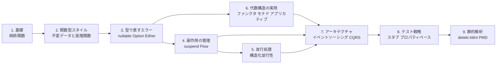
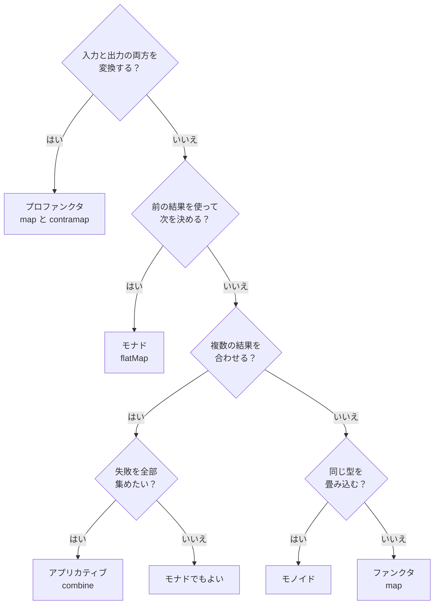
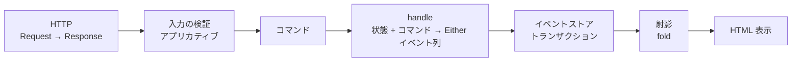

# 関数型プログラミングガイド（Kotlin 編）

## このガイドについて

関数型プログラミング（FP）は、状態の書き換えではなく値の変換でプログラムを組み立てる考え方である。変更を楽に安全にできるソフトウェアを作るための技術的な手段のひとつであり、副作用を境界に押し出し、型で失敗を表し、小さな関数を合成する。

本ガイドは、Kotlin でこの考え方を実践するための要点を整理する。次の 2 つの学習記事を元にしている。

| 出典 | 内容 | 本ガイドでの扱い |
| --- | --- | --- |
| Grokking Functional Programming Kotlin 版（全 12 章） | 純粋関数、イミュータブルなデータ、Option/Either、IO、ストリーム、並行処理、テスト | 第 1〜6 章の骨格 |
| Zettai Kotlin FP 版（全 13 章、From Objects to Functions 演習） | ToDo アプリを題材にした HTTP、ドメインモデリング、イベントソーシング、CQRS、バリデーション、関数型 JSON | 第 7〜8 章の骨格 |

- **対象**: Kotlin の経験があり、Scala を経由せずに JVM 上で実践的な FP を身につけたい開発者。
- **使うもの**: 第 1〜2 章は Kotlin 標準ライブラリのみ。第 3 章以降は [Arrow](https://arrow-kt.io/) と kotlinx.coroutines も使う。
- **コード例**: 出典記事の動作確認済みの実装から転記している。本文に載せたコードは、このガイドのために書き下ろしたものではない。詳細な解説と演習問題は出典の記事を参照する。

## 全体像



| 章 | 主題 | 一言で言うと |
| --- | --- | --- |
| 1 | 基礎 | 同じ入力には同じ出力。外に触れない |
| 2 | 関数型スタイル | 変更せず、新しい値を作る。関数を値として渡す |
| 3 | 型で表すエラー | 失敗を例外ではなく戻り値の型で表す |
| 4 | 副作用の管理 | 副作用を「実行しない記述」として値にする |
| 5 | 並行処理 | 並行処理も構造と型で安全にする |
| 6 | 代数構造の実用 | 合成のパターンに名前を付け、判断の手順で使い分ける |
| 7 | アーキテクチャ | 状態を事実（イベント）の列として扱う |
| 8 | テスト戦略 | 純粋関数の性質をテストで言い切る |
| 9 | 静的解析とルール設定 | 関数型の規約を機械で守らせる。PMD のカスタムルールも作る。ただし教材コードとの衝突に注意する |

---

## 1. 基礎: 純粋関数

### 1.1 命令型と関数型

命令型は「どうやるか」の手順を書き、関数型は「何であるか」の定義を書く。

```kotlin
// Kotlin: 命令型でワードスコアを計算
fun calculateScoreImperative(word: String): Int {
    var score = 0
    for (c in word) {
        score++
    }
    return score
}
```

```kotlin
// Kotlin: 関数型でワードスコアを計算
fun wordScore(word: String): Int = word.length
```

| 概念 | 命令型 | 関数型 |
| --- | --- | --- |
| 焦点 | 手順（How） | 結果（What） |
| 状態 | 変更する（`var`） | 変換する（`val`） |
| ループ | `for` / `while` | `map` / `filter` / `fold` |
| データ | ミュータブル（`MutableList`） | イミュータブル（`List`） |
| 関数の形 | ブロック本体 + `return` | 式本体関数 |

Kotlin は、トップレベル関数、式本体関数、`val`、式としての `if` / `when` を言語機能として備えている。式本体関数は「値を計算する式」であることが一目で分かり、`return` や途中の代入を書く余地がないため副作用が紛れ込みにくい。

### 1.2 純粋関数

純粋関数は次の 2 つを満たす。

1. 同じ入力には常に同じ出力を返す。
2. 副作用がない（外部状態を変更しない）。

```kotlin
// 純粋関数の例
fun increment(x: Int): Int = x + 1

fun add(a: Int, b: Int): Int = a + b

fun getFirstCharacter(s: String): Char = s[0]

/** 入力の 95% を返す */
fun applyDiscount(x: Double): Double = x * 95.0 / 100.0
```

式本体で書くことは純粋さの手がかりにはなるが、保証にはならない。乱数やシステム時計は **隠れた入力** であり、引数が同じでも結果が変わる。

```kotlin
import kotlin.random.Random

/** 不純: 乱数に依存するため、同じ入力でも毎回異なる値を返しうる */
fun randomPart(x: Double): Double = x * Random.nextDouble()

/** 不純: 呼び出すタイミングによって結果が変わる */
fun currentTime(): Long = System.currentTimeMillis()
```

### 1.3 状態を持つクラスの問題

状態をクラスに持たせると、状態同士の食い違いが生まれる。次のカートは `items` が外から変更でき、`bookAdded` と食い違う。

```kotlin
class ShoppingCartBad {
    /** 問題: 可変リストを外部に公開しているため、誰でも中身を変更できる */
    val items: MutableList<String> = mutableListOf()

    /** 問題: items とは別に管理されるフラグ。items と食い違う可能性がある */
    private var bookAdded = false

    fun addItem(item: String) {
        items.add(item)
        if (item == "Book") {
            bookAdded = true
        }
    }

    fun getDiscountPercentage(): Int = if (bookAdded) 5 else 0

    /** 読み取り専用の型で返しても、中身は内部の可変リストそのもの */
    fun itemsView(): List<String> = items
}
```

状態をやめて、中身を引数で受け取る純粋関数にすると、食い違いの余地が最初からなくなる。

```kotlin
/** Book が含まれていれば 5%、そうでなければ 0% の割引率を返す */
fun getDiscountPercentage(items: List<String>): Int =
    if ("Book" in items) 5 else 0
```

**純粋関数の利点**: テストが入力と出力の確認だけで済む。並行に呼んでも安全である。呼び出しを値に置き換えても意味が変わらない（参照透過性）ので、読んで理解しやすい。

---

## 2. 関数型スタイル: 不変データと高階関数

### 2.1 読み取り専用 ≠ イミュータブル

Kotlin の `List` は **読み取り専用のビュー** であり、イミュータブルを保証する型ではない。元の `MutableList` が変更されると、`List` として参照している側にも見える。

```kotlin
test("MutableList を List として参照しても、元のリストの変更は見えてしまう") {
    val mutable = mutableListOf("a", "b")
    val readOnly: List<String> = mutable

    mutable.add("c")

    readOnly shouldBe listOf("a", "b", "c")
}
```

可変なコレクションを共有せず、必要なら呼び出し時点でコピーを取る。変更は新しいリストを作ることで表す。

```kotlin
/** 呼び出し時点の内容を新しいリストとしてコピーする */
fun <T> snapshotOf(list: List<T>): List<T> = list.toList()
```

```kotlin
val appleBook = listOf("Apple", "Book")
val appleBookMango = appleBook + "Mango"

appleBook shouldBe listOf("Apple", "Book")                  // 元のリストは変わらない
appleBookMango shouldBe listOf("Apple", "Book", "Mango")    // 新しいリストが作成される
```

局所的にどうしても可変操作が必要なら、`buildList` の内側に閉じ込める。

```kotlin
/** 1 から n までの 2 乗のリストを作る（可変操作は buildList の内側に閉じ込める） */
fun squares(n: Int): List<Int> = buildList {
    for (i in 1..n) add(i * i)
}
```

`data class` の `copy` も同じ考え方で、元を変えずに一部だけ違う新しい値を作る。

```kotlin
data class ProgrammingLanguage(val name: String, val year: Int)

/** 名前だけを変えた新しいインスタンスを返す */
fun renamed(language: ProgrammingLanguage, newName: String): ProgrammingLanguage =
    language.copy(name = newName)
```

### 2.2 関数を値として渡す

関数は引数にも戻り値にもなる。変わる部分を関数として外から渡すと、同じ枠組みで振る舞いを差し替えられる。

```kotlin
/** 基本スコア: 'a' を除いた文字数 */
fun score(word: String): Int = word.replace("a", "").length

fun bonus(word: String): Int = if (word.contains("c")) 5 else 0
fun penalty(word: String): Int = if (word.contains("s")) 7 else 0

/** スコア関数を受け取ってランキングを作成 */
fun rankedWords(wordScore: (String) -> Int, words: List<String>): List<String> =
    words.sortedBy(wordScore).reversed()

val words = listOf("ada", "haskell", "scala", "java", "rust")

rankedWords(::score, words) shouldBe listOf("haskell", "rust", "scala", "java", "ada")
rankedWords({ w -> score(w) + bonus(w) - penalty(w) }, words) shouldBe
    listOf("java", "scala", "ada", "haskell", "rust")
```

関数参照（`::score`）、ラムダ、末尾ラムダ、暗黙のパラメータ `it` は、同じ意味の別の書き方である。

```kotlin
// 以下はすべて同じ意味
sortByFunction(words, { s -> s.length })
sortByFunction(words) { s -> s.length }
sortByFunction(words) { it.length }
```

拡張関数にすると、末尾ラムダでパイプラインのように読める。

```kotlin
/** 拡張関数版のランキング - 末尾ラムダでスコア関数を渡せる */
fun List<String>.rankedBy(wordScore: (String) -> Int): List<String> =
    sortedBy(wordScore).reversed()

words.rankedBy { score(it) + bonus(it) } shouldBe listOf("scala", "haskell", "rust", "java", "ada")
```

### 2.3 map / filter / fold

| 操作 | 役割 | 例 |
| --- | --- | --- |
| `map` | 各要素を変換する（要素数は同じ） | `words.map(::len)` |
| `filter` | 条件に合う要素だけ残す | `numbers.filter(::isOdd)` |
| `fold` | 初期値から畳み込んで 1 つの値にする | 合計、最大値、連結 |

```kotlin
/** 合計を計算 */
fun sum(numbers: List<Int>): Int = numbers.fold(0) { acc, i -> acc + i }

/** 最大値を取得（空リストなら Int.MIN_VALUE） */
fun largest(numbers: List<Int>): Int = numbers.fold(Int.MIN_VALUE) { max, i -> if (i > max) i else max }
```

空のリストでは、`fold` は初期値を返し、`reduce` は例外を投げる。初期値が自然に決まらない場合は、結果を nullable で返す `reduceOrNull` を使う。

```kotlin
sum(emptyList()) shouldBe 0   // fold は初期値を返す
shouldThrow<UnsupportedOperationException> {
    emptyList<Int>().reduce { acc, i -> acc + i }   // reduce は例外を投げる
}
```

```kotlin
/** 最大値を取得（空リストなら null） */
fun largestOrNull(numbers: List<Int>): Int? = numbers.reduceOrNull { max, i -> if (i > max) i else max }
```

### 2.4 関数を返す関数とカリー化

条件を関数として組み立てて返すと、同じ `filter` に別の条件を渡せる。

```kotlin
/** 指定値より大きいかを判定する関数を返す */
fun largerThan(n: Int): (Int) -> Boolean = { i -> i > n }

/** 指定値で割り切れるかを判定する関数を返す */
fun divisibleBy(n: Int): (Int) -> Boolean = { it % n == 0 }

val numbers = listOf(5, 1, 2, 4, 0)
numbers.filter(largerThan(4)) shouldBe listOf(5)
numbers.filter(divisibleBy(2)) shouldBe listOf(2, 4, 0)
```

複数の引数を 1 つずつ受け取る形（カリー化）にすると、先頭の引数だけ与えた部分適用で、新しい関数を作れる。

```kotlin
/** 2 引数関数をカリー化する */
fun <A, B, C> curry(f: (A, B) -> C): (A) -> (B) -> C = { a -> { b -> f(a, b) } }
```

### 2.5 flatMap

`map` で「リストを返す関数」を適用すると結果がネストする。`flatMap` は適用と平坦化を一度に行う。

```kotlin
data class Book(val title: String, val authors: List<String>)

/** 全著者のリストを取得 */
fun allAuthors(books: List<Book>): List<String> = books.flatMap(Book::authors)

val books = listOf(
    Book("FP in Scala", listOf("Chiusano", "Bjarnason")),
    Book("The Hobbit", listOf("Tolkien")),
)

// map だけだとリストがネストする
books.map(Book::authors) shouldBe listOf(listOf("Chiusano", "Bjarnason"), listOf("Tolkien"))

// flatMap で平坦化
allAuthors(books) shouldBe listOf("Chiusano", "Bjarnason", "Tolkien")
```

`flatMap` が返すリストの大きさは自由で、要素数を増やすことも、減らす（`filter` の代わりにする）こともできる。

```kotlin
/** 各要素を i と i + 10 の 2 つにする（要素数が増える） */
fun duplicate(numbers: List<Int>): List<Int> = numbers.flatMap { listOf(it, it + 10) }

/** 偶数のみを残す（要素数が減る - filter の代わり） */
fun filterEvens(numbers: List<Int>): List<Int> =
    numbers.flatMap { if (it % 2 == 0) listOf(it) else emptyList() }
```

`flatMap` を入れ子にすると深くなる。Kotlin には Scala の for 内包表記に当たる構文がないため、`sequence { }` ビルダーで同じ形を平らに書ける。

```kotlin
/** おすすめ文を生成（ネストした flatMap） */
fun recommendations(books: List<Book>): List<String> =
    books.flatMap { book ->
        book.authors.flatMap { author ->
            bookAdaptations(author).map { movie ->
                "You may like ${movie.title}, because you liked $author's ${book.title}"
            }
        }
    }
```

```kotlin
/** おすすめ文を生成（sequence ビルダー版） */
fun recommendationsWithSequence(books: List<Book>): List<String> =
    sequence {
        for (book in books)
            for (author in book.authors)
                for (movie in bookAdaptations(author))
                    yield("You may like ${movie.title}, because you liked $author's ${book.title}")
    }.toList()
```

---

## 3. 型で表すエラー

例外は関数のシグネチャに現れず、呼び出し側が処理を忘れても気づけない。失敗の可能性を戻り値の型に出すと、扱いをコンパイラが強制する。

### 3.1 nullable 型

値がないことだけを表すなら、Kotlin 標準の nullable 型（`A?`）で十分である。`?:`（エルビス演算子）、`?.let`、`toIntOrNull` で合成できる。

```kotlin
fun safeDivide(a: Int, b: Int): Int? = if (b == 0) null else a / b

fun addStrings(a: String, b: String): Int? {
    val x = a.trim().toIntOrNull() ?: return null
    val y = b.trim().toIntOrNull() ?: return null
    return x + y
}
```

例外を投げる実装を、小さな nullable 関数の合成に置き換える。

```kotlin
fun parseShow(rawShow: String): TvShow? {
    val name = extractName(rawShow) ?: return null
    val yearStart = extractYearStart(rawShow) ?: extractSingleYear(rawShow) ?: return null
    val yearEnd = extractYearEnd(rawShow) ?: extractSingleYear(rawShow) ?: return null
    return TvShow(name, yearStart, yearEnd)
}
```

```kotlin
// 正常ケース
parseShow("Breaking Bad (2008-2013)")  // TvShow("Breaking Bad", 2008, 2013)

// 異常ケース → null が返される（例外なし）
parseShow("The Wire 2002-2008")        // null
```

`?:` は「左が null なら右を使う」フォールバックである。

### 3.2 Either: 失敗の理由を持つ

nullable は「なぜ失敗したか」を運べない。理由を持たせるときは Arrow の `Either<E, A>` を使う。慣例で左（`Left`）が失敗、右（`Right`）が成功である。

```kotlin
fun extractName(rawShow: String): Either<String, String> {
    val bracketOpen = rawShow.indexOf('(')
    return if (bracketOpen > 0) {
        rawShow.substring(0, bracketOpen).trim().right()
    } else {
        "Can't extract name from: $rawShow".left()
    }
}

/** nullable 型の結果に失敗理由を付けて Either にする */
fun parseYear(yearStr: String, context: String): Either<String, Int> =
    yearStr.trim().toIntOrNull()?.right() ?: "Can't parse $context: '$yearStr'".left()
```

```kotlin
extractName("The Wire (2002-2008)")        // Right("The Wire")
extractName("(2022)")                      // Left("Can't extract name from: (2022)")
```

### 3.3 either { } DSL と Raise

`flatMap` の入れ子は、`either { }` と `bind()` で逐次コードのように書ける。`bind()` は `Left` なら即座にブロックを抜ける。

```kotlin
import arrow.core.raise.either

/** either { } DSL で組み立てる */
fun parseShow(rawShow: String): Either<String, TvShow> = either {
    val name = extractName(rawShow).bind()
    val yearStart = extractYearStart(rawShow).getOrElse { extractSingleYear(rawShow).bind() }
    val yearEnd = extractYearEnd(rawShow).getOrElse { extractSingleYear(rawShow).bind() }
    TvShow(name, yearStart, yearEnd)
}
```

`Raise<E>` をレシーバにすると、「この関数は `E` で失敗しうる」ことをシグネチャで示せる。`ensure` が条件を検査し、満たさなければ中断する。

```kotlin
import arrow.core.raise.Raise
import arrow.core.raise.ensure

/** Raise<String> の文脈で年齢を検証する。失敗したら raise で処理を中断する */
fun Raise<String>.checkAge(age: Int): Int {
    ensure(age >= 0) { "Age cannot be negative" }
    ensure(age <= 150) { "Age cannot be greater than 150" }
    return age
}

/** either { } で Raise の関数を Either を返す関数に変換する */
fun validateAge(age: Int): Either<String, Int> = either { checkAge(age) }
```

`Raise` の関数は `bind()` なしで直接呼び出して合成できる。

```kotlin
/** Raise の関数を直接呼び出して組み立てる（bind() も不要） */
fun validateUserRaise(username: String, email: String, age: Int): Either<String, User> = either {
    User(checkUsername(username), checkEmail(email), checkAge(age))
}
```

### 3.4 エラーを集める

`either { }` は最初のエラーで止まる。入力検証のように全部のエラーを返したいときは、`zipOrAccumulate` で `NonEmptyList` に集める。

```kotlin
import arrow.core.NonEmptyList
import arrow.core.raise.zipOrAccumulate

/** zipOrAccumulate: すべての検証を実行し、エラーを NonEmptyList に集める */
fun validateUserAccumulating(username: String, email: String, age: Int): Either<NonEmptyList<String>, User> =
    either {
        zipOrAccumulate(
            { checkUsername(username) },
            { checkEmail(email) },
            { checkAge(age) },
        ) { validUsername, validEmail, validAge ->
            User(validUsername, validEmail, validAge)
        }
    }
```

リストを処理するときの失敗の扱いは、次の 3 つの戦略から選ぶ。

```kotlin
/** Best-effort 戦略: パースできたものだけを返す */
fun parseShowsBestEffort(rawShows: List<String>): List<TvShow> =
    rawShows.mapNotNull { parseShow(it).getOrNull() }

/** All-or-nothing 戦略: 最初のエラーで停止する */
fun parseShowsAllOrNothing(rawShows: List<String>): Either<String, List<TvShow>> = either {
    rawShows.map { parseShow(it).bind() }
}
```

もう 1 つはエラー収集戦略で、すべてのエラーを `NonEmptyList` に集める。

### 3.5 sealed interface で ADT を作る

取りうる場合を限定した型（代数的データ型）を `sealed interface` で表し、`when` で網羅的に処理する。場合を追加したとき、扱いを忘れている `when` はコンパイルエラーになる。

```kotlin
sealed interface ToDoListEvent {
    val user: User
    val listName: ListName
}

data class ListCreated(
    override val user: User,
    override val listName: ListName,
) : ToDoListEvent

data class ItemAdded(
    override val user: User,
    override val listName: ListName,
    val item: ToDoItem,
) : ToDoListEvent
```

### 3.6 使い分け

| 状況 | 使うもの |
| --- | --- |
| 値がないことだけを表したい | nullable 型（`A?`）と `?:` |
| 失敗の理由を呼び出し側に伝えたい | `Either<E, A>` |
| 逐次的に書きたい／関数のシグネチャで失敗を示したい | `either { }` と `Raise<E>` |
| すべての検証エラーをまとめて返したい | `zipOrAccumulate` と `NonEmptyList` |
| 取りうる場合を限定して漏れを防ぎたい | `sealed interface` と `when` |

Arrow の `Option` は nullable の代替だが、Kotlin では nullable 型で足りる場面が多い。Arrow の API と合成したいときなど、`Option` が必要な場面に限って使う。

---

## 4. 副作用の管理

### 4.1 副作用を値として扱う

副作用のある処理を「実行しない記述」として値にすると、いつ実行するかを呼び出し側が決められる。最小の形は、引数なしの関数（サンク）である。

```kotlin
/** 呼び出すたびに異なる値が返る */
fun castTheDieImpure(): Int = Random.nextInt(1, 7)

/** サンク: 「サイコロを振る」という計算の記述を返す */
fun castTheDieThunk(): () -> Int = { castTheDieImpure() }
```

出典の記事では、このサンクを包む小さな `IO<A>` 型を実装して、`map` / `flatMap` / `orElse` / `retry` を定義している。

```kotlin
class IO<A> private constructor(private val thunk: () -> A) {

    /** IO を実行して結果を取得する（ここで初めて副作用が発生する） */
    fun unsafeRun(): A = thunk()

    /** 結果を変換する */
    fun <B> map(f: (A) -> B): IO<B> = IO { f(thunk()) }

    /** IO を返す関数を適用してフラット化する */
    fun <B> flatMap(f: (A) -> IO<B>): IO<B> = IO { f(thunk()).unsafeRun() }

    companion object {
        /** 副作用のある式を遅延実行する IO を作る */
        fun <A> delay(thunk: () -> A): IO<A> = IO(thunk)

        /** 既存の値をラップする（副作用なし） */
        fun <A> pure(value: A): IO<A> = IO { value }
    }
}
```

### 4.2 Kotlin では suspend が IO の役割を担う

Kotlin では、自前の `IO` 型を作らなくても `suspend` 関数が副作用の型付けになる。`suspend` 関数はコルーチンの中でしか呼べないので、副作用を持つ処理の呼び出し位置が限定される。`suspend` ラムダは値として保持でき、呼び出すまで実行されない。

```kotlin
/** suspend: 呼び出せる場所がコルーチンの中に限定される */
suspend fun castTheDie(): Int = castTheDieImpure()
```

```kotlin
test("suspend ラムダは値として保持でき、呼び出すまで実行されない") {
    var calls = 0
    val program: suspend () -> Int = { calls += 1; castTheDie() }
    calls shouldBe 0
    program() shouldBeInRange 1..6
    program() shouldBeInRange 1..6
    calls shouldBe 2
}
```

合成は `flatMap` ではなく、普通の逐次コードで書ける。

```kotlin
/** flatMap の代わりに、普通の逐次コードとして合成できる */
suspend fun castTheDieTwice(): Int {
    val first = castTheDie()
    val second = castTheDie()
    return first + second
}
```

ブロッキングの I/O は `withContext(Dispatchers.IO)` に閉じ込める。

```kotlin
suspend fun calendarEntries(name: String): List<MeetingTime> =
    withContext(Dispatchers.IO) { calendarEntriesApiCall(name) }

suspend fun createMeeting(names: List<String>, meeting: MeetingTime): Unit =
    withContext(Dispatchers.IO) { createMeetingApiCall(names, meeting) }
```

### 4.3 失敗とリトライ

例外は `Either.catch` で値にし、フォールバックは `getOrElse` で書く。再実行は Arrow の `Schedule` で表す。

```kotlin
/** suspend ラムダ版の orElse: 失敗したら fallback を実行する新しい「記述」を返す */
infix fun <A> (suspend () -> A).orElse(fallback: suspend () -> A): suspend () -> A = {
    Either.catch { this() }.getOrElse { fallback() }
}
```

```kotlin
/** Arrow の Schedule で最大 maxRetries 回まで再実行する */
suspend fun <A> retry(maxRetries: Int, action: suspend () -> A): A =
    Schedule.recurs<Throwable>(maxRetries.toLong()).retry(action)

/** リトライしても全て失敗したらデフォルト値を返す */
suspend fun <A> retryWithDefault(maxRetries: Int, default: A, action: suspend () -> A): A =
    Either.catch { retry(maxRetries, action) }.getOrElse { default }
```

### 4.4 副作用を境界に寄せる

純粋な計算と副作用を分け、副作用は関数として外から受け取る。次のスケジューリングでは、空き時間の計算が純粋関数で、取得と作成だけが副作用である。

```kotlin
fun meetingsOverlap(meeting1: MeetingTime, meeting2: MeetingTime): Boolean =
    meeting1.endHour > meeting2.startHour && meeting2.endHour > meeting1.startHour

fun possibleMeetings(
    existingMeetings: List<MeetingTime>,
    startHour: Int,
    endHour: Int,
    lengthHours: Int,
): List<MeetingTime> =
    (startHour..endHour - lengthHours)
        .map { start -> MeetingTime(start, start + lengthHours) }
        .filter { slot -> existingMeetings.none { meetingsOverlap(it, slot) } }
```

入出力を関数として受け取れば、コンソールでもテスト用のスタブでも差し替えられる。

```kotlin
/** 入出力を関数として受け取ることで、コンソールにもテスト用スタブにも差し替えられる */
suspend fun schedulingProgram(
    getName: suspend () -> String,
    showMeeting: suspend (MeetingTime?) -> Unit,
) {
    val name1 = getName()
    val name2 = getName()
    val possibleMeeting = schedule(listOf(name1, name2), 2)
    showMeeting(possibleMeeting)
}
```

### 4.5 ストリーム: Sequence と Flow

連続したデータを遅延評価で扱う。必要な要素だけが評価されるので、無限のストリームも定義できる。

| 型 | 評価 | 副作用（suspend） | 向く場面 |
| --- | --- | --- | --- |
| `Sequence<A>` | 遅延・同期 | 呼び出せない | メモリ上の変換、無限列の定義 |
| `Flow<A>` | 遅延・非同期（コールド） | 呼び出せる | I/O を伴う連続した値 |

```kotlin
/** 自然数の無限ストリーム */
val naturals: Sequence<Int> = generateSequence(1) { it + 1 }

naturals.filter { it % 2 == 0 }.take(3).toList() // [2, 4, 6]
```

`Flow` はコールドで、`collect` するたびに最初から実行される。

```kotlin
/** suspend 関数 castTheDie を無限に呼び出すストリーム */
fun infiniteDieCasts(): Flow<Int> = flow {
    while (true) emit(castTheDie())
}

/** 6 が出るまで振り続け、6 を含めた目を返す */
suspend fun castUntilSix(): List<Int> =
    infiniteDieCasts().transformWhile { value ->
        emit(value)
        value != 6
    }.toList()
```

```kotlin
flowOf(1, 2, 3).map { it * 2 }.toList()                          // [2, 4, 6]
flowOf(1, 2, 3).zip(flowOf("a", "b", "c")) { n, s -> "$n$s" }.toList() // [1a, 2b, 3c]
flowOf(1, 2, 3).scan(0) { acc, n -> acc + n }.toList()            // [0, 1, 3, 6]
```

窓を使ったトレンド検出は、純粋関数として切り出す。

```kotlin
/** 連続して上昇していれば true */
fun trending(rates: List<BigDecimal>): Boolean =
    rates.size > 1 && rates.zipWithNext().all { (previous, rate) -> rate > previous }
```

---

## 5. 並行処理

### 5.1 共有状態はアトミックに更新する

複数のコルーチンから共有状態を更新するときは、読み取りと書き込みを分けずに `update` で一度に行う。

```kotlin
/** Atomic に保存されたチェックイン数をアトミックに更新する */
fun storeCheckIn(storedCheckIns: Atomic<Map<City, Int>>, city: City) {
    storedCheckIns.update { current -> updateCheckIns(current, city) }
}
```

### 5.2 構造化並行性

`coroutineScope` の中で起動した `async` は、スコープが終わるまでに必ず完了するか、キャンセルされる。1 つが失敗すれば、兄弟のコルーチンもキャンセルされる。

```kotlin
/** 2 つのサイコロを並行して振り、合計を返す */
suspend fun castTheDieTwice(castTheDie: suspend () -> Int): Int = coroutineScope {
    val first = async { castTheDie() }
    val second = async { castTheDie() }
    first.await() + second.await()
}
```

```kotlin
/** 1 つずつ順番に実行して合計する */
suspend fun sumSequential(ios: List<suspend () -> Int>): Int =
    ios.sumOf { io -> io() }

/** すべてを並行に実行して合計する */
suspend fun sumConcurrent(ios: List<suspend () -> Int>): Int = coroutineScope {
    ios.map { io -> async { io() } }.awaitAll().sum()
}
```

`runTest` の仮想時間を使うと、並行にすることで処理時間が「合計」から「最も遅い処理」に縮むことを、待たずにテストで確かめられる。

```kotlin
test("sumSequential は処理時間の合計だけかかる") {
    runTest {
        val ios = listOf(delayed(100, 1), delayed(100, 2), delayed(100, 3))
        sumSequential(ios) shouldBe 6
        currentTime shouldBe 300
    }
}
test("sumConcurrent は最も遅い処理の時間だけで終わる") {
    runTest {
        val ios = listOf(delayed(100, 1), delayed(200, 2), delayed(100, 3))
        sumConcurrent(ios) shouldBe 6
        currentTime shouldBe 200
    }
}
```

### 5.3 parMap と parZip

Arrow の `parMap` はリストの各要素を並列に処理し、同時実行数も制限できる。`parZip` は種類の異なる複数の処理を並列に実行して組み合わせる。

```kotlin
/** 同時実行数を制限して並列に取得する */
suspend fun <A, B> fetchAllLimited(
    ids: List<A>,
    concurrency: Int,
    fetch: suspend (A) -> B,
): List<B> = ids.parMap(concurrency = concurrency) { id -> fetch(id) }
```

```kotlin
data class Profile(val name: String, val score: Int)

/**
 * 名前とスコアを並列に取得して Profile に組み立てる。
 * context を省略すると呼び出し元の Dispatcher を引き継ぐ。
 */
suspend fun fetchProfile(
    fetchName: suspend () -> String,
    fetchScore: suspend () -> Int,
    context: CoroutineContext = EmptyCoroutineContext,
): Profile = parZip(
    context,
    { fetchName() },
    { fetchScore() },
) { name, score -> Profile(name, score) }
```

### 5.4 競争・タイムアウト・キャンセル

| 目的 | 道具 |
| --- | --- |
| 先に終わったほうを採用する | `raceN`（結果は `Either` で返る） |
| 時間で打ち切る | `withTimeout` |
| バックグラウンドで実行し、後で止める | `Job` と `cancel` |
| 処理の性質に応じた実行場所 | `Dispatchers.Default`（CPU）、`Dispatchers.IO`（ブロッキング I/O） |

```kotlin
test("raceN は先に完了した側を Either で返す") {
    runTest {
        val result = raceN(EmptyCoroutineContext, { delay(200); "slow" }, { delay(50); 42 })
        result shouldBe Either.Right(42)
        currentTime shouldBe 50
    }
}
```

複数の共有状態をまとめて更新し、全体を一貫させたいときは、Arrow の STM を使う。

---

## 6. 代数構造の実用

モノイド・ファンクタ・モナド・アプリカティブ・プロファンクタは、これまでに使ってきた `fold`、`map`、`flatMap`、`zip` の共通のパターンに付けた名前である。数学の用語を覚えることが目的ではなく、「この型にこの操作が使える」と見抜いて、合成の道具を選べるようにするために使う。

Zettai 版では、5 つの構造がすべて現れた。Kotlin では、標準ライブラリと Arrow が与えるものと、自作したものがある。

| 構造 | 章 | Kotlin |
| --- | --- | --- |
| モノイド | 5 | 自作（標準の `fold` を使う） |
| ファンクタ | 7・8 | 標準にある（`List.map`、`Either.map`） |
| モナド | 9 | Arrow にある（`Either.flatMap`、`either { }` と `bind()`） |
| アプリカティブ | 11 | Arrow にある（`zipOrAccumulate`）。入力の検証では `zipAll` を自作 |
| プロファンクタ | 12 | 自作（`Encoder` と `Decoder`） |

### 6.1 モノイドでイベントを畳み込む

イベントの列を、標準の `fold` で状態へ畳み込む。`fold` は初期値から始め、左から順にイベントを現在の状態へ取り込む。

```kotlin
fun List<ToDoListEvent>.replayFrom(from: ToDoListState): ToDoListState =
    fold(from) { state, event -> state.apply(event) }
```

イベントを固定すると、「状態を受け取り状態を返す関数」になる。この関数を値として扱い、合成（`andThen`）と単位元（`identityTransition`）を用意する。

```kotlin
typealias StateTransition = (ToDoListState) -> ToDoListState
```

```kotlin
fun ToDoListEvent.asTransition(): StateTransition =
    { state -> state.apply(this) }
```

二つの状態変換は順番につなげられる。

```kotlin
infix fun StateTransition.andThen(next: StateTransition): StateTransition =
    { state -> next(this(state)) }
```

何もしない変換もある。

```kotlin
val identityTransition: StateTransition = { it }
```

イベント列を変換へ畳み込むとき、この単位元を初期値にする。

```kotlin
fun List<ToDoListEvent>.asTransition(): StateTransition =
    fold(identityTransition) { accumulated, event ->
        accumulated andThen event.asTransition()
    }
```

この構造には二つの法則がある。

- 結合律: `(a andThen b) andThen c` と `a andThen (b andThen c)` の結果は同じである。
- 単位元: identity を左または右につないでも結果は変わらない。

状態変換、合成、単位元がそろい、法則が成り立つ構造をモノイドと呼ぶ。法則があると、長いイベント列を分割して別々に畳み込み、後で合成しても、結果が変わらない。

### 6.2 ファンクタとモナドは標準と Arrow にある

`List.map` と `Either.map` はファンクタである。読み出しが失敗しうるようになると、クエリの結果は `Either<ZettaiError, List<ToDoListRow>>` になり、`map` が二重になる。それでも、恒等則と合成則が成り立つ。

```kotlin
    "クエリ結果の map は恒等則を満たす" {
        checkAll(results) { result ->
            result.map { it } shouldBe result
        }
    }
```

```kotlin
    "クエリ結果の map は合成則を満たす" {
        checkAll(results, rowToInt, intToText) { result, f, g ->
            result.map { rows -> rows.map(f) }.map { values -> values.map(g) } shouldBe
                result.map { rows -> rows.map { g(f(it)) } }
        }
    }
```

`map` に `Either` を返す関数を渡すと、`Either` が二重になる。読み出して、判断して、保存する操作は、それぞれ失敗しうるので、内側を開けて繋ぐ `flatMap` が要る。Arrow の `either { }` と `bind()` は、この `flatMap` の連鎖と同じ結果になり、上から順に読める形で書ける。

```kotlin
        execute = { command ->
            either {
                val state = readAggregate(command.user, command.listName).bind().replayFrom()
                val events = handle(command, state).bind()
                persist(events).bind()
                events
            }
        },
```

読み出しの失敗、コマンドの拒否、保存の失敗のどれが起きても、そこで打ち切って同じ `Left` を返す。

`flatMap` が予測可能に繋がるには、3 つの性質が必要である。`pure(a)` は値 `a` を成功として包む操作で、`f` と `g` は `Either` を返す関数である。

1. 左恒等則: `pure(a).flatMap(f)` は `f(a)` と同じ
2. 右恒等則: `m.flatMap(pure)` は `m` と同じ
3. 結合律: `m.flatMap(f).flatMap(g)` は `m.flatMap { x -> f(x).flatMap(g) }` と同じ

法則は、モノイドやファンクタと同じように、プロパティテストで確かめる。

```kotlin
    "左恒等則：pure(a).flatMap(f) は f(a) と同じ" {
        checkAll(values, steps) { a, f ->
            pure(a).flatMap(f) shouldBe f(a)
        }
    }
```

```kotlin
    "結合律：flatMap を続けても、中にまとめても同じ" {
        checkAll(results, steps, steps) { m, f, g ->
            m.flatMap(f).flatMap(g) shouldBe m.flatMap { x -> f(x).flatMap(g) }
        }
    }
```

`bind()` の連鎖が `flatMap` と同じ結果になることも、同じ方法で確かめる。

```kotlin
    // Hub の `either { ... bind() ... }` は、flatMap の連鎖を上から読める形で書いたもの。
    "Raise の bind の連鎖は flatMap と同じ結果になる" {
        checkAll(results, steps, steps) { m, f, g ->
            val withBind: Either<ZettaiError, Int> = either { g(f(m.bind()).bind()).bind() }

            withBind shouldBe m.flatMap(f).flatMap(g)
        }
    }
```

この 3 つの性質を満たす `flatMap` と `pure` を持つ構造が、モナドである。

### 6.3 アプリカティブでバリデーションを合成する

`either { }` のモナドは、最初のエラーで止まる。独立した複数の検証をすべて走らせ、エラーを全部集めるには、アプリカティブを使う。Arrow の `zipOrAccumulate` は 3.4 節のとおりである。入力の検証では、検証結果の合成に `zipAll` を使う。誤りの側は `NonEmptyList` で、失敗しているなら誤りは必ず 1 つ以上あることを型が保証する。シグネチャは次のとおりである。

```kotlin
fun <P, A, B, R> zipAll(
    first: Either<NonEmptyList<P>, A>,
    second: Either<NonEmptyList<P>, B>,
    transform: (A, B) -> R,
): Either<NonEmptyList<P>, R>
```

1 つの名前に対する 3 つの規則は、この合成で 1 つにする。

```kotlin
fun validateName(field: InputField, raw: String): Either<NonEmptyList<FieldProblem>, String> =
    zipAll(notBlank(field, raw), withinLength(field, raw), noForbiddenCharacter(field, raw)) { _, _, _ -> raw }
```

検証が済んだ入力だけがドメインのコマンドになる。境界で生の文字列を検証済みの型に変え、内側では検証を繰り返さない。

### 6.4 プロファンクタで入力と出力の両方を変換する

JSON の変換のように、書き込みと読み込みの両方向を持つ型は、入力側を `contramap`、出力側を `map` で変換する。2 つを一度に行うのが `dimap` である。

```kotlin
data class Encoder<A, B>(val run: (A) -> B) {
    fun <C, D> dimap(contramap: (C) -> A, map: (B) -> D): Encoder<C, D> =
        Encoder { map(run(contramap(it))) }
}
```

読む側の `Decoder` も、同じ形である。

```kotlin
data class Decoder<B, A>(val run: (B) -> Either<ConversionFailure, A>) {
    fun <C, D> dimap(contramap: (C) -> B, map: (A) -> D): Decoder<C, D> =
        Decoder { run(contramap(it)).map(map) }
}
```

どちらも、プロファンクタの形をしている。反変は「入力を受け取る前に、別の型から写す」こと、共変は「出力を返したあとで、別の型へ写す」ことである。求められる法則は次の 2 つである。

- `dimap id id = id`
- `dimap (f ∘ g) (h ∘ k) = dimap g h ∘ dimap f k`

法則はプロパティテストで確かめる。プロファンクタという名前は、見つけたものに名前を付けただけで、名前を付けても実装が賢くなるわけではない。法則が通ることだけが、名前の根拠である。

2 つを束ねた `Converter` には、入力と出力を同時に写す一般の `dimap` を持たせなかった。行きと帰りで、逆向きの関数が要るためである。持たせたのは、繋ぐ `andThen` である。

```kotlin
data class Converter<A, B>(val encoder: Encoder<A, B>, val decoder: Decoder<B, A>) {
    fun <C> andThen(next: Converter<B, C>): Converter<A, C> =
        Converter(
            encoder = encoder.dimap({ it }, next.encoder.run),
            decoder = Decoder { c -> next.decoder.run(c).flatMap(decoder.run) },
        )
}
```

### 6.5 どの構造を選ぶか: 判断の手順

5 つの構造を「いつ選ぶか」で整理する。

| 構造 | 持つもの | 選ぶとき | 連載の章 |
| --- | --- | --- | --- |
| モノイド | 合成と単位元 | 同じ型のものを畳み込みたい | 5 |
| ファンクタ | `map` | 箱の中身だけを変えたい | 7・8 |
| アプリカティブ | `map` と `combine` | 独立な計算を合わせ、失敗を全部集めたい | 11 |
| モナド | `map` と `flatMap` と `pure` | 前の結果を使って次を決めたい | 9・10 |
| プロファンクタ | `map` と `contramap` | 入力と出力の両方を変換したい | 12 |

実際には、次の順で考えると決まる。



上から順に「いいえ」なら下へ進む。強い構造から確かめて、要らなければ弱いものにする。

「強い」とは「できることが多い」という意味で、「偉い」という意味ではない。`map` で足りるなら `map` を使う。できることを増やすと、できなくなることがある。モナドは「前の結果を使う」能力を得た代わりに、「失敗を集める」能力を失った。必要な強さを選ぶ。

---

## 7. アーキテクチャ: 関数で組み立てる

### 7.1 薄い縦串から始める

最初にウォーキングスケルトン（HTTP からドメイン、表示までを貫く最小の経路）を作り、外側の受入テストから内側へ進める。http4k の `HttpHandler` は概念上 `(Request) -> Response` の関数なので、サーバーを起動せずにテストできる。

```kotlin
"GET /todo/{user}/{list} はリストを HTML で返す" {
    val response = app(Request(GET, "/todo/uberto/book"))

    response.status shouldBe Status.OK
    response.bodyString() shouldContain "<h2>book</h2>"
    response.bodyString() shouldContain "<li>write chapter</li>"
    response.bodyString() shouldContain "<li>publish book</li>"
}
```

### 7.2 依存は関数の型で表す

外部とのやり取りをインターフェースのクラス階層ではなく、関数の型（`typealias`）で表す。テストでは同じ型の関数に差し替えるだけでよい。

```kotlin
typealias ToDoListFetcher = suspend (User, ListName) -> ToDoList?

data class ToDoListHub(
    val getList: ToDoListFetcher,
)

fun todoListHub(fetchList: ToDoListFetcher): ToDoListHub =
    ToDoListHub(getList = fetchList)
```

```kotlin
val hub = todoListHub { actualUser, actualName ->
    if (actualUser == user && actualName == listName) expected else null
}
```

同じ受入テストを、ドメイン層と HTTP 層の両方に対して流せるようにする方法もある。操作を関数の束にして、層ごとの実装を並べる。

```kotlin
data class ZettaiActions(
    val name: String,
    val setUp: (User, ToDoList) -> Unit,
    val getToDoList: (User, ListName) -> List<ToDoItem>?,
)
```

### 7.3 状態をイベントの列として扱う（イベントソーシング）

現在の状態を直接更新せず、起きた事実（イベント）を追記し、状態はイベントの再生で導く。状態の更新は、`when` で網羅した純粋関数になる。

```kotlin
fun ToDoListState.apply(event: ToDoListEvent): ToDoListState {
    return when (event) {
        is ListCreated -> put(
            event.user,
            event.listName,
            ToDoList(event.listName, emptyList()),
        )

        is ItemAdded -> {
            val current = listFor(event.user, event.listName) ?: return this
            put(
                event.user,
                event.listName,
                current.copy(items = current.items + event.item),
            )
        }
    }
}
```

`copy`、`Map.plus`、`List.plus` は元の値を書き換えない。イベントの種類が増えれば、`when` の分岐も増える（網羅性はコンパイラが検査する）。列全体の再生は、1 件の適用を `fold` で繰り返すだけである（6.1 節）。

### 7.4 コマンドを検証し、イベントを生成する

コマンド（意図）を、現在の状態に照らして検証し、成功すればイベントを返す。失敗は `Either` で表す。

```kotlin
sealed interface ToDoListCommand {
    val user: User
    val listName: ListName
}

data class CreateToDoList(
    override val user: User,
    override val listName: ListName,
) : ToDoListCommand
```

業務ルール（状態遷移の許可）は、データとして宣言する。

```kotlin
private val allowedTransitions = mapOf(
    ToDoStatus.Todo to setOf(ToDoStatus.InProgress, ToDoStatus.Done),
    ToDoStatus.InProgress to setOf(ToDoStatus.Done, ToDoStatus.Blocked),
    ToDoStatus.Done to emptySet(),
    ToDoStatus.Blocked to setOf(ToDoStatus.InProgress),
)

fun ToDoStatus.canTransitionTo(next: ToDoStatus): Boolean =
    next in allowedTransitions.getValue(this)
```

名前の変更のように、1 つのコマンドが複数のイベントを生むこともある。

```kotlin
is RenameToDoList -> {
    val list = ensureNotNull(state.listFor(command.user, command.listName)) {
        ListNotFound(command.user, command.listName)
    }
    ensure(state.listFor(command.user, command.newName) == null) {
        ListAlreadyExists(command.user, command.newName)
    }
    listOf(
        ListRenamed(command.user, command.listName, command.newName),
        ListCreated(command.user, command.newName),
    ) + list.items.map { ItemAdded(command.user, command.newName, it) }
}
```

### 7.5 コマンドと問い合わせの分離（CQRS）

書き込み（コマンド → イベント）と読み取り（イベント → 射影）を分ける。読み取り側は、イベントの列を畳み込む純粋関数として書ける。

```kotlin
fun projectFrom(user: User, events: List<ToDoListEvent>): List<ToDoListRow> =
    events
        .filter { it.user == user }
        .fold(emptyMap<ListName, List<ToDoItem>>()) { lists, event -> lists.step(event) }
        .map { (listName, items) ->
            ToDoListRow(
                listName = listName,
                itemCount = items.size,
                doneCount = items.count { it.status == ToDoStatus.Done },
            )
        }
```

### 7.6 永続化とトランザクション境界

永続化の失敗は例外のまま漏らさず、境界で `Either` に変換する。ブロッキング I/O は `Dispatchers.IO` に閉じ込める。

```kotlin
private suspend fun <A> blocking(block: () -> A): Either<PersistenceFailure, A> =
    withContext(Dispatchers.IO) { Either.catch(block) }
        .mapLeft { PersistenceFailure("${it::class.simpleName}: ${it.message}") }
```

ストアも関数の束として定義すると、PostgreSQL 版とインメモリ版を差し替えられる。

```kotlin
fun postgresEventStore(connect: () -> Connection): EventStore =
    EventStore(
        readAggregate = { user, listName ->
            query(connect, EventTable.SELECT_BY_ENTITY, entityId(user, listName))
        },
        readUser = { user ->
            query(connect, EventTable.SELECT_BY_USER, userPrefix(user))
        },
        persist = { events -> append(connect, events) },
    )
```

複数のストリームをまたぐコマンドは、「読む → 検証する → 追記する」を 1 つのトランザクションの中で行う。読んだときのバージョンを追記時に渡して、競合を検出する。

```kotlin
execute = { command ->
    store.transaction { tx ->
        either {
            val read = command.streams.associateWith { store.readStream(tx, it).bind() }
            val state = read.values.flatMap { it.events }.replayFrom()
            val events = handle(command, state).bind()
            store.append(tx, read.mapValues { it.value.version }, events).bind()
            events
        }
    }
},
```

### 7.7 監視は合成で足す

ログや計測は、ビジネスのコードを変えずに、関数をラップして足す。

```kotlin
fun ToDoListHub.logged(log: (String) -> Unit, now: () -> Instant): ToDoListHub {
    val inner = this
    return ToDoListHub(
        getList = { user, listName ->
            observe(log, now, "query", "getList", user, listName) { inner.getList(user, listName) }
        },
        listRows = { user ->
            observe(log, now, "query", "listRows", user, null) { inner.listRows(user) }
        },
        execute = { command ->
            observe(
                log,
                now,
                "command",
                command::class.simpleName ?: "Command",
                command.user,
                command.listName,
                events = { it.size },
            ) { inner.execute(command) }
        },
    )
}
```

構造化されたログの 1 件は、データクラスで表す。

```kotlin
data class LogRecord(
    val at: Instant,
    val kind: String,
    val name: String,
    val outcome: String,
    val user: String? = null,
    val list: String? = null,
    val durationMs: Long,
    val streams: Int? = null,
    val events: Int? = null,
    val path: String? = null,
    val status: Int? = null,
)
```

### 7.8 全体の形

出典の最終章がたどり着いた設計は、次の形である。



核になる純粋関数（検証、`handle`、`apply`、射影）を中心に置き、副作用（HTTP、データベース、ログ）は外側の薄い層に寄せる。

---

## 8. テスト戦略

純粋関数は、入力を与えて出力を確かめるだけでテストできる。副作用は関数として外から渡し、テスト用に差し替える。

### 8.1 失敗を型で返す

「良いガイドが見つからなかった」ことも、失敗の理由を持った値で返す。

```kotlin
/** 検索レポート（良いガイドが見つからなかった理由を報告する） */
data class SearchReport(val badGuides: List<Guide>, val problems: List<String>)
```

### 8.2 テスト用スタブ

外部への依存をインターフェースで受け取り、テスト用の実装は関数で差し替えられるようにする。失敗のシミュレーションも関数で書ける。

```kotlin
class TestDataAccess(
    private val attractions: suspend (name: String) -> List<Attraction> = { emptyList() },
    private val artists: suspend (locationId: LocationId) -> List<Artist> = { emptyList() },
    private val movies: suspend (locationId: LocationId) -> List<Movie> = { emptyList() },
) : DataAccess {
```

```kotlin
test("良いガイドが見つからなければ、悪いガイドを含む SearchReport を返す") {
    val dataAccess = TestDataAccess.of(attractions = listOf(yellowstone))

    travelGuideV3(dataAccess, "") shouldBe
        SearchReport(badGuides = listOf(Guide(yellowstone, emptyList())), problems = emptyList()).left()
}
```

### 8.3 プロパティベーステスト

具体的な値の例ではなく、「どんな入力でも成り立つ性質」をテストする。Kotest の `checkAll` と `Arb` で入力を生成する。

```kotlin
val nonNegativeInt: Arb<Int> = Arb.int(0..Int.MAX_VALUE)

val identifier: Arb<String> = Arb.string(1..10, Codepoint.alphanumeric())

val randomArtist: Arb<Artist> = arbitrary { Artist(identifier.bind(), nonNegativeInt.bind()) }

val randomMovie: Arb<Movie> = Arb.bind(identifier, nonNegativeInt) { name, boxOffice -> Movie(name, boxOffice) }
```

```kotlin
test("スコアはアトラクションの名前と説明の文字列に依存しない") {
    checkAll(Arb.string(), Arb.string()) { name, description ->
        val guide = Guide(
            Attraction(name, description, wyoming),
            listOf(Movie("The Hateful Eight", 155_760_117), Movie("Heaven's Gate", 3_484_331)),
        )
        guideScore(guide) shouldBe 65
    }
}
```

性質のテストは、バグを見つける力も強い。次のテストは、`Int` のまま合計するとオーバーフローすることを示している。

```kotlin
test("Int のまま合計するとオーバーフローするので Long で合計する") {
    val followers = listOf(Int.MAX_VALUE, Int.MAX_VALUE)
    followers.sum() shouldBe -2
    followers.sumOf { it.toLong() } shouldBe 4_294_967_294L
}
```

参照透過性そのものも、性質として書ける。

```kotlin
test("guideScore は同じ入力に対して常に同じ出力を返す（参照透過性）") {
    forAll(randomGuide) { guide -> guideScore(guide) == guideScore(guide) }
}
```

| テストの種類 | 確かめること | 道具 |
| --- | --- | --- |
| 例によるテスト | 代表的な入力での振る舞い | Kotest の `shouldBe` |
| スタブを使ったテスト | 副作用の失敗や組み合わせでの振る舞い | `TestDataAccess` のような関数で差し替える実装 |
| プロパティベーステスト | どんな入力でも成り立つ性質 | `checkAll`、`forAll`、`Arb` |
| 仮想時間のテスト | 並行処理の所要時間 | `runTest` と `currentTime` |
| 結合テスト | 実際のデータベースとの接続 | Testcontainers の PostgreSQL |

---

## 9. 静的解析とルール設定

関数型の規約（`var` を避ける、可変コレクションを共有しない、例外を握りつぶさない）は、レビューだけに頼ると漏れる。静的解析で機械的に守らせる。ただし、ツールの選択を先に間違えないことが重要である。

### 9.1 ツールの選び方

| ツール | 対象 | 役割 | Kotlin への適用 |
| --- | --- | --- | --- |
| PMD | Java、Kotlin（PMD 7.0 から） | バグの兆候、設計、コードスタイルの検査。XPath でカスタムルールを書ける | 標準の Kotlin ルールは少数（後述）。強みは XPath によるカスタムルール |
| detekt | Kotlin | 複雑度、潜在的なバグ、スタイルの検査 | 標準ルールが豊富。中心になる静的解析 |
| ktlint | Kotlin | 整形（フォーマット） | 書式の統一。後述の副作用に注意 |
| Checkstyle / SpotBugs | Java | 書式、バグパターン | Kotlin には適用できない |

PMD は 7.0 から Kotlin に対応している（[PMD の Kotlin 対応](https://pmd.github.io/pmd/pmd_languages_kotlin.html)）。ただし、PMD 7.29.0 の時点で標準の Kotlin ルールは次の 4 つだけである（[Kotlin のルール一覧](https://pmd.github.io/pmd/pmd_rules_kotlin.html)で確認）。

| カテゴリ | ルール | 内容 |
| --- | --- | --- |
| Best Practices | `FunctionNameTooShort` | 短すぎる関数名 |
| Best Practices | `LocalVariableShadowsParameter` | 引数と同名のローカル変数 |
| Best Practices | `LooseCoupling` | 実装型（`HashMap` など）への依存 |
| Error Prone | `OverrideBothEqualsAndHashcode` | `equals` と `hashCode` の片方だけの上書き |

そのため、Kotlin では標準ルールの数と種類が多い detekt を中心にしつつ、**関数型の規約を表すカスタムルールは、XPath で書ける PMD でも実装できる**（9.6 節）。PMD が Java にも使えることは、Kotlin と Java のソースが混在するプロジェクトで、1 つのツールで両方を検査できるという利点になる。

### 9.2 PMD のルール設定（Java）

出典の Java プロジェクトで使っている `ruleset.xml` である。Kotlin 向けには、`category/java/...` の代わりに `category/kotlin/bestpractices.xml` などを参照する（9.6 節）。カテゴリ単位で有効にし、プロジェクトに合わないルールを除外し、複雑度のしきい値を明示する。

```xml
<?xml version="1.0"?>
<ruleset name="Custom Rules"
         xmlns="http://pmd.sourceforge.net/ruleset/2.0.0"
         xmlns:xsi="http://www.w3.org/2001/XMLSchema-instance"
         xsi:schemaLocation="http://pmd.sourceforge.net/ruleset/2.0.0 https://pmd.sourceforge.io/ruleset_2_0_0.xsd">

    <description>
        プロジェクト用 PMD ルールセット
    </description>

    <!-- 基本ルール -->
    <rule ref="category/java/bestpractices.xml">
        <exclude name="JUnitTestContainsTooManyAsserts"/>
    </rule>
    <rule ref="category/java/errorprone.xml"/>
    <rule ref="category/java/codestyle.xml">
        <exclude name="AtLeastOneConstructor"/>
        <exclude name="OnlyOneReturn"/>
        <exclude name="LocalVariableCouldBeFinal"/>
        <exclude name="MethodArgumentCouldBeFinal"/>
        <exclude name="ShortVariable"/>
        <exclude name="LongVariable"/>
        <exclude name="ShortMethodName"/>
        <exclude name="ShortClassName"/>
        <exclude name="CommentDefaultAccessModifier"/>
    </rule>

    <!-- コード複雑度 -->
    <rule ref="category/java/design.xml/CyclomaticComplexity">
        <properties>
            <property name="classReportLevel" value="80"/>
            <property name="methodReportLevel" value="7"/>
        </properties>
    </rule>
    <rule ref="category/java/design.xml/CognitiveComplexity">
        <properties>
            <property name="reportLevel" value="4"/>
        </properties>
    </rule>
    <rule ref="category/java/design.xml/NPathComplexity">
        <properties>
            <property name="reportLevel" value="200"/>
        </properties>
    </rule>
</ruleset>
```

Gradle では、`pmd` プラグインに設定ファイルを渡す。`ruleSets = []` は、プラグイン既定のルールセットを無効にして、上のファイルだけを使うための指定である。

```groovy
plugins {
    id 'pmd'
}

pmd {
    ruleSetFiles = files('config/pmd/ruleset.xml')
    ruleSets = []
}
```

方針は次のとおりである。

- **カテゴリごとに有効にして、合わないものだけ除外する。** 個別のルールを列挙するより、新しい版で追加されたルールも自動で効く。
- **除外には理由がある。** `OnlyOneReturn` は早期 return を禁じるので、ガード節で平らに書く関数型のスタイルと衝突する。`LocalVariableCouldBeFinal` などは、`final` を付ける代わりに `val` で表す Kotlin では意味を持たない（Java 側の規約）。
- **しきい値は数値で明示する。** 複雑度はメソッドごとに小さく保つ（出典では循環的複雑度 7、認知的複雑度 4）。小さな関数を合成するスタイルと相性がよい。

### 9.3 detekt のルール設定（Kotlin）

Kotlin では detekt を中心にする。次の設定は、関数型のスタイルを支える代表的なルールの例である。出典のリポジトリには detekt の設定ファイルがなく、ここに書く設定は **出典から転記したものではなく、実際に走らせて確認してもいない**。導入時は、使う detekt のバージョンのルール名と既定値を公式のドキュメントで確認すること。

```yaml
# detekt.yml（例）
build:
  maxIssues: 0

complexity:
  CyclomaticComplexMethod:
    active: true
    threshold: 15
  CognitiveComplexMethod:
    active: true
    threshold: 15
  LongParameterList:
    active: true
    functionThreshold: 6
    ignoreDefaultParameters: true

exceptions:
  TooGenericExceptionCaught:
    active: true
  SwallowedException:
    active: true

potential-bugs:
  UnsafeCallOnNullableType:
    active: true

style:
  MaxLineLength:
    active: true
    maxLineLength: 120
  ForbiddenMethodCall:
    active: true
    methods:
      - reason: 'コレクションの共有可変状態を避ける。必要なら buildList の内側に閉じ込める'
        value: 'kotlin.collections.mutableListOf'
```

関数型の観点で効くルールは次のとおりである。

| 規約 | ルール（例） | ねらい |
| --- | --- | --- |
| 例外を値に置き換える | `TooGenericExceptionCaught`、`SwallowedException` | 例外を握りつぶさず、`Either.catch` などで型にする |
| null の安全な扱い | `UnsafeCallOnNullableType` | `!!` を避け、`?:` や `ensureNotNull` を使う |
| 可変状態を共有しない | `ForbiddenMethodCall` | 可変コレクションの生成を検出する |
| 関数を小さく保つ | `CyclomaticComplexMethod`、`CognitiveComplexMethod`、`LongParameterList` | 小さな関数の合成を促す |
| 読みやすさ | `MaxLineLength` | 行長を揃える |

`var` を禁止する専用のルールは、detekt の標準では確認できていない。`var` の抑制などは、9.6 節のカスタムルールで補う。

### 9.4 ktlint を使うときの注意

ktlint の標準ルールを適用すると、整形の副作用が出ることがある。出典の連載（Zettai Kotlin 版）で実際に導入を試した結果は次のとおりである。

| 入った整形 | 影響 |
| --- | --- |
| 引数が 2 つ以上の関数シグネチャを強制的に複数行に分割 | コードが縦長になり、記事のコードブロックが読みにくくなる |
| `if (x) a else b` を必ずブロックに展開 | 同上 |
| 式の本体を必ず改行してインデント | 同上 |
| ファイル名をクラス名に合わせる | 同じパッケージに OO 版と FP 版を並べにくい |
| 関数名を camelCase に強制 | バッククォートで書く日本語のテスト名が書けない |

下の 2 つは `.editorconfig` でルールを外して回避できる。しかし上の 3 つは ktlint の中核の整形で、外すと導入の意味がほとんど残らない。この連載では、整形を適用した結果、記事のコード例が 40 件、実装とずれた。

### 9.5 ツールを入れる前に、守りたいことを決める

出典の連載は、静的解析を `check` に組み込まない決定をした（ADR-004）。判断の流れは、ツールの選択の参考になる。

1. **実際に起きている問題を数える。** 行長 120 超が 2 件、`import` の順序の乱れが 3 件。タブの混入は 0 件だった。
2. **汎用ツールの副作用を測る。** ktlint は整形が入りすぎて、目的に対して副作用が大きかった。
3. **必要な検査だけを小さく作る。** 行長と `import` の順序だけを検査する小さなスクリプトで足りた。行長の違反は、鍵を作る関数を切り出して直した。汎用ツールの整形より、意味のある切り出しになった。
4. **再検討の条件を事象で決める。** 「開発者が 2 名以上になる」「複雑度や未使用コード、バグの兆候など、自作の検査で拾えない問題が実際に起きる」のいずれかが起きたとき。時期が来たことは、判断の理由にならない。

| 状況 | 推奨 |
| --- | --- |
| 複数人の開発、長く保守するプロダクト | detekt を `check` に組み込み、ktlint の整形は `.editorconfig` で調整する |
| 1 人の教材・記事のコード | 必要な検査だけを自作する。汎用ツールは副作用を測ってから入れる |
| Java の資産が混在する | Java 側は PMD、Checkstyle、SpotBugs。Kotlin 側は detekt。PMD に揃えるなら、Kotlin も PMD のカスタムルールで検査する |

静的解析は、検出できる種類の問題にしか効かない。たとえば「記事に載せたコードの実装が存在しなかった」という問題は、静的解析では検出できず、コード例を実装と突き合わせる検査が必要だった。入れるツールは、実際に起きる問題に合わせて選ぶ。

### 9.6 関数型ルールのカスタム PMD ルール

標準ルールでは表せない関数型の規約は、PMD の XPath ルールで検査する。Kotlin のソースは構文木に変換されるので、木の形に対する条件を XPath で書くだけでよい。Java で実装するプラグインや Gradle のサブプロジェクトは要らず、ルールセットの XML 1 ファイルで完結する。

> **検証状況**: PMD 7.29.0 のコマンドライン版で実行して確認した（下の「ルールの確認」の期待件数と一致した）。ノード名は PMD の文法定義（`Kotlin.g4` と `KotlinLexer.g4`）と、PMD 自身の Kotlin ルール（`FunctionNameTooShort` と `LooseCoupling`）の XPath から読み取って決めた。ほかの版では、「ルールの確認」の手順で先に確かめること。

#### ルール一覧

各章の内容を、機械で検査できる形のルールにした。章ごとの対応は次のとおりである。

| 章 | ルール | 検出するもの | 根拠となる規約 |
| --- | --- | --- | --- |
| 1 基礎 | `NoVarProperty` | クラスやトップレベルの `var` プロパティ（関数内のローカルな `var` は許す） | 状態を持たせず、値を変換する（1.3 節） |
| 1 基礎 | `NoVarClassParameter` | コンストラクタの `var`（`data class(var x: Int)` など） | 値は不変にし、`copy` で新しい値を作る（2.1 節、7.3 節） |
| 2 関数型スタイル | `NoMutableCollectionInSignature` | 公開関数の引数・戻り値の `MutableList` / `MutableSet` / `MutableMap` / `MutableCollection` | 可変コレクションを共有しない（2.1 節） |
| 2 関数型スタイル | `NoMutableCollectionFactory` | `buildList` / `buildSet` / `buildMap` の外での `mutableListOf` や `ArrayList()` などの生成 | 可変操作は `buildList` の内側に閉じ込める（2.1 節） |
| 2 関数型スタイル | `NoReduce` | `reduce` / `reduceRight` | 空のコレクションで例外を投げる。`fold` か `reduceOrNull` を使う（2.3 節） |
| 3 型で表すエラー | `NoNotNullAssertion` | `!!` | null は `?:` や `ensureNotNull` で扱う（3.1 節） |
| 3 型で表すエラー | `NoThrow` | `throw` 式 | 失敗は例外ではなく `Either` で返す（第 3 章） |
| 3 型で表すエラー | `NoGenericCatch` | `Exception` / `Throwable` / `RuntimeException` の `catch` | 例外は `Either.catch` で値にする（4.3 節） |
| 4 副作用の管理 | `SideEffectInNonSuspendFunction` | `suspend` でない関数の中での、時計・乱数・UUID・標準出力の呼び出し | 隠れた入力と副作用は `suspend` で型に表す（1.2 節、4.2 節） |
| 4 副作用の管理 | `NoRunBlocking` | `runBlocking` の呼び出し | 副作用の型付け（`suspend`）を呼び出し側で打ち消さない（4.2 節） |
| 5 並行処理 | `NoGlobalScope` | `GlobalScope` の使用 | 構造化並行性の中で起動する（5.2 節） |
| 5 並行処理 | `NoRawConcurrency` | `Thread(...)`、`thread { }`、`Executors`、`synchronized`、`@Synchronized` | スレッドやロックではなく、コルーチンと `Atomic` で共有状態を更新する（5.1 節） |
| 5 並行処理、8 テスト戦略 | `NoThreadSleep` | `Thread.sleep` | スレッドを塞ぐ。`delay` と、テストでは `runTest` の仮想時間を使う（5.2 節） |
| 6 代数構造の実用 | `NoNestedFlatMap` | `flatMap` の中の `flatMap` | `either { }` と `bind()`、`sequence { }` で平らに書く（2.5 節、3.3 節） |

第 7 章（アーキテクチャ）は、イベントやコマンドを不変の値で表す規約として `NoVarProperty` と `NoVarClassParameter`、境界の一度きりの `runBlocking` として `NoRunBlocking` が対応する。第 8 章（テスト戦略）は、`Thread.sleep` と `runBlocking` を使わずに `runTest` で時間を扱う規約として `NoThreadSleep` と `NoRunBlocking` が対応する。`sealed interface` の `when` に `else` を書かない、純粋関数の性質をプロパティベーステストで書く、といった規約は、型情報やテストの内容が要るため、構文の検査では表せない。レビューとテストで守る。

#### ルールセット

```xml
<?xml version="1.0"?>
<ruleset name="FP Kotlin Rules"
         xmlns="http://pmd.sourceforge.net/ruleset/2.0.0"
         xmlns:xsi="http://www.w3.org/2001/XMLSchema-instance"
         xsi:schemaLocation="http://pmd.sourceforge.net/ruleset/2.0.0 https://pmd.sourceforge.io/ruleset_2_0_0.xsd">
    <description>関数型プログラミングガイド（Kotlin 編）に準拠したカスタムルール</description>

    <rule name="NoVarProperty" language="kotlin"
          message="var プロパティは val にし、状態の書き換えではなく新しい値を作る"
          class="net.sourceforge.pmd.lang.rule.xpath.XPathRule">
        <description>クラスやトップレベルの var プロパティを禁止する。関数内のローカルな var は許す。</description>
        <priority>3</priority>
        <properties>
            <property name="xpath"><value><![CDATA[
//PropertyDeclaration[@Mutable = true()]
    [not(ancestor::FunctionBody or ancestor::AnonymousInitializer or ancestor::SecondaryConstructor)]
            ]]></value></property>
        </properties>
    </rule>

    <rule name="NoNotNullAssertion" language="kotlin"
          message="!! を使わず、?: や ?.let で null を型として扱う"
          class="net.sourceforge.pmd.lang.rule.xpath.XPathRule">
        <description>非 null 表明（!!）を禁止する。</description>
        <priority>2</priority>
        <properties>
            <property name="xpath"><value><![CDATA[
//PostfixUnaryOperator[Excl]
            ]]></value></property>
        </properties>
    </rule>

    <rule name="NoThrow" language="kotlin"
          message="throw の代わりに Either などの戻り値の型で失敗を表す"
          class="net.sourceforge.pmd.lang.rule.xpath.XPathRule">
        <description>throw 式を禁止する。</description>
        <priority>3</priority>
        <properties>
            <property name="xpath"><value><![CDATA[
//JumpExpression[T-THROW]
            ]]></value></property>
        </properties>
    </rule>

    <rule name="NoMutableCollectionInSignature" language="kotlin"
          message="公開関数の引数と戻り値では読み取り専用のコレクション型を使う"
          class="net.sourceforge.pmd.lang.rule.xpath.XPathRule">
        <description>公開関数のシグネチャに MutableList / MutableSet / MutableMap / MutableCollection を使うことを禁止する。</description>
        <priority>3</priority>
        <properties>
            <property name="xpath"><value><![CDATA[
//FunctionDeclaration[not(ancestor::FunctionBody)]
    [not(pmd-kotlin:modifiers() = ('private', 'protected', 'internal'))]
    //SimpleUserType[not(ancestor::FunctionBody)]/SimpleIdentifier/T-Identifier
        [@Text = ('MutableList', 'MutableSet', 'MutableMap', 'MutableCollection')]
            ]]></value></property>
        </properties>
    </rule>

    <rule name="SideEffectInNonSuspendFunction" language="kotlin"
          message="時計・乱数・スリープ・標準出力などの副作用は suspend 関数の中に置くか、引数で外から受け取る"
          class="net.sourceforge.pmd.lang.rule.xpath.XPathRule">
        <description>suspend でない関数の中で、隠れた入力や副作用を持つ呼び出しをすることを禁止する。</description>
        <priority>3</priority>
        <properties>
            <property name="xpath"><value><![CDATA[
//PostfixUnaryExpression
    [ancestor::FunctionDeclaration[1]]
    [not(ancestor::FunctionDeclaration[1]/Modifiers//T-SUSPEND)]
    [
        (
            PrimaryExpression/SimpleIdentifier/T-Identifier[@Text = ('println', 'print')]
            and PostfixUnarySuffix[1]/CallSuffix
        )
        or (
            PrimaryExpression/SimpleIdentifier/T-Identifier[@Text = 'System']
            and PostfixUnarySuffix[1]/NavigationSuffix/SimpleIdentifier/T-Identifier
                [@Text = ('currentTimeMillis', 'nanoTime')]
            and PostfixUnarySuffix[2]/CallSuffix
        )
        or (
            PrimaryExpression/SimpleIdentifier/T-Identifier[@Text = 'Random']
            and PostfixUnarySuffix[1]/NavigationSuffix/SimpleIdentifier/T-Identifier
                [starts-with(@Text, 'next')]
            and PostfixUnarySuffix[2]/CallSuffix
        )
        or (
            PrimaryExpression/SimpleIdentifier/T-Identifier
                [@Text = ('Instant', 'LocalDate', 'LocalDateTime', 'LocalTime', 'ZonedDateTime', 'OffsetDateTime')]
            and PostfixUnarySuffix[1]/NavigationSuffix/SimpleIdentifier/T-Identifier[@Text = 'now']
            and PostfixUnarySuffix[2]/CallSuffix
        )
        or (
            PrimaryExpression/SimpleIdentifier/T-Identifier[@Text = 'UUID']
            and PostfixUnarySuffix[1]/NavigationSuffix/SimpleIdentifier/T-Identifier[@Text = 'randomUUID']
            and PostfixUnarySuffix[2]/CallSuffix
        )
    ]
            ]]></value></property>
        </properties>
    </rule>

    <rule name="NoRunBlocking" language="kotlin"
          message="runBlocking で suspend の型付けを打ち消さない。呼び出し側も suspend にするか、境界で一度だけ使う"
          class="net.sourceforge.pmd.lang.rule.xpath.XPathRule">
        <description>runBlocking の呼び出しを禁止する。</description>
        <priority>3</priority>
        <properties>
            <property name="xpath"><value><![CDATA[
//PostfixUnaryExpression
    [PrimaryExpression/SimpleIdentifier/T-Identifier[@Text = 'runBlocking']]
    [PostfixUnarySuffix[1]/CallSuffix]
            ]]></value></property>
        </properties>
    </rule>

    <rule name="NoVarClassParameter" language="kotlin"
          message="コンストラクタの var は val にし、変更は copy で新しい値を作る"
          class="net.sourceforge.pmd.lang.rule.xpath.XPathRule">
        <description>コンストラクタのプロパティを var で宣言することを禁止する。イベントやコマンドなどの値は不変にする。</description>
        <priority>3</priority>
        <properties>
            <property name="xpath"><value><![CDATA[
//ClassParameter[T-VAR]
            ]]></value></property>
        </properties>
    </rule>

    <rule name="NoMutableCollectionFactory" language="kotlin"
          message="可変コレクションの生成は buildList / buildSet / buildMap の内側に閉じ込める"
          class="net.sourceforge.pmd.lang.rule.xpath.XPathRule">
        <description>buildList / buildSet / buildMap の外で、可変コレクションを生成することを禁止する。</description>
        <priority>3</priority>
        <properties>
            <property name="xpath"><value><![CDATA[
//PostfixUnaryExpression
    [PrimaryExpression/SimpleIdentifier/T-Identifier
        [@Text = ('mutableListOf', 'mutableSetOf', 'mutableMapOf', 'arrayListOf', 'hashSetOf', 'hashMapOf',
                  'linkedSetOf', 'linkedMapOf', 'ArrayList', 'HashSet', 'HashMap', 'LinkedHashSet', 'LinkedHashMap')]]
    [PostfixUnarySuffix/CallSuffix]
    [not(ancestor::PostfixUnaryExpression
        [PrimaryExpression/SimpleIdentifier/T-Identifier[@Text = ('buildList', 'buildSet', 'buildMap')]])]
            ]]></value></property>
        </properties>
    </rule>

    <rule name="NoReduce" language="kotlin"
          message="reduce は空のコレクションで例外を投げる。fold か reduceOrNull を使う"
          class="net.sourceforge.pmd.lang.rule.xpath.XPathRule">
        <description>reduce / reduceRight の呼び出しを禁止する。</description>
        <priority>3</priority>
        <properties>
            <property name="xpath"><value><![CDATA[
//PostfixUnaryExpression/PostfixUnarySuffix/NavigationSuffix/SimpleIdentifier/T-Identifier
    [@Text = ('reduce', 'reduceRight')]
            ]]></value></property>
        </properties>
    </rule>

    <rule name="NoGenericCatch" language="kotlin"
          message="Exception / Throwable を広く catch せず、Either.catch で値にするか、想定する例外の型だけを catch する"
          class="net.sourceforge.pmd.lang.rule.xpath.XPathRule">
        <description>Exception / Throwable / RuntimeException を catch することを禁止する。</description>
        <priority>3</priority>
        <properties>
            <property name="xpath"><value><![CDATA[
//CatchBlock[Type//T-Identifier[@Text = ('Exception', 'Throwable', 'RuntimeException')]]
            ]]></value></property>
        </properties>
    </rule>

    <rule name="NoNestedFlatMap" language="kotlin"
          message="flatMap の入れ子は、either ブロックと bind()、または sequence ビルダーで平らに書く"
          class="net.sourceforge.pmd.lang.rule.xpath.XPathRule">
        <description>flatMap の中で flatMap を呼ぶことを禁止する。</description>
        <priority>3</priority>
        <properties>
            <property name="xpath"><value><![CDATA[
//PostfixUnaryExpression
    [PostfixUnarySuffix/NavigationSuffix/SimpleIdentifier/T-Identifier[@Text = 'flatMap']]
    [ancestor::PostfixUnaryExpression
        [PostfixUnarySuffix/NavigationSuffix/SimpleIdentifier/T-Identifier[@Text = 'flatMap']]]
            ]]></value></property>
        </properties>
    </rule>

    <rule name="NoGlobalScope" language="kotlin"
          message="GlobalScope を使わず、coroutineScope の中で起動して構造化並行性を保つ"
          class="net.sourceforge.pmd.lang.rule.xpath.XPathRule">
        <description>GlobalScope の使用を禁止する。</description>
        <priority>2</priority>
        <properties>
            <property name="xpath"><value><![CDATA[
//PrimaryExpression/SimpleIdentifier/T-Identifier[@Text = 'GlobalScope']
            ]]></value></property>
        </properties>
    </rule>

    <rule name="NoRawConcurrency" language="kotlin"
          message="スレッドやロックを直接扱わず、コルーチンと Atomic で共有状態を更新する"
          class="net.sourceforge.pmd.lang.rule.xpath.XPathRule">
        <description>Thread の生成、thread { }、Executors、synchronized、@Synchronized を禁止する。</description>
        <priority>3</priority>
        <properties>
            <property name="xpath"><value><![CDATA[
(
    //PostfixUnaryExpression
        [PrimaryExpression/SimpleIdentifier/T-Identifier[@Text = ('Thread', 'thread', 'synchronized')]]
        [PostfixUnarySuffix[1]/CallSuffix]
    | //PostfixUnaryExpression
        [PrimaryExpression/SimpleIdentifier/T-Identifier[@Text = 'Executors']]
    | //SingleAnnotation/UnescapedAnnotation/UserType/SimpleUserType/SimpleIdentifier/T-Identifier
        [@Text = 'Synchronized']
)
            ]]></value></property>
        </properties>
    </rule>

    <rule name="NoThreadSleep" language="kotlin"
          message="Thread.sleep はスレッドを塞ぐ。suspend 関数の delay を使い、テストでは runTest の仮想時間を使う"
          class="net.sourceforge.pmd.lang.rule.xpath.XPathRule">
        <description>Thread.sleep の呼び出しを禁止する。</description>
        <priority>3</priority>
        <properties>
            <property name="xpath"><value><![CDATA[
//PostfixUnaryExpression
    [PrimaryExpression/SimpleIdentifier/T-Identifier[@Text = 'Thread']]
    [PostfixUnarySuffix[1]/NavigationSuffix/SimpleIdentifier/T-Identifier[@Text = 'sleep']]
            ]]></value></property>
        </properties>
    </rule>
</ruleset>
```

#### XPath の読み方

| 式 | 意味 | 根拠 |
| --- | --- | --- |
| `PropertyDeclaration[@Mutable = true()]` | `var` で宣言されたプロパティ | PMD の Kotlin 対応のページに `@Mutable` と、真偽値は `true()` / `false()` で比べると書かれている |
| `not(ancestor::FunctionBody or ...)` | 関数の本体、`init` ブロック、副コンストラクタの中を除く（つまりローカルな `var` を許す） | PMD の `LooseCoupling` が同じ条件でローカルのプロパティを除いている |
| `PostfixUnaryOperator[Excl]` | 後置演算子のうち、`!` を子に持つもの（`!!`）。前置の `!b` は `PrefixUnaryOperator` なので対象外 | 文法定義の `postfixUnaryOperator : INCR \| DECR \| EXCL_NO_WS excl` |
| `JumpExpression[T-THROW]` | `throw` で始まるジャンプ式 | 文法定義の `jumpExpression : THROW NL* expression`。トークンのノード名は `T-` に字句の名前を付けた形（例: `T-CLASS`、`T-Identifier`） |
| `pmd-kotlin:modifiers()` | 修飾子の列。`private` / `protected` / `internal` を持たない関数を「公開」とみなす | PMD の `LooseCoupling` が `pmd-kotlin:modifiers() = 'override'` を使っている |
| `SimpleUserType/SimpleIdentifier/T-Identifier[@Text = (...)]` | 型名の識別子が `Mutable*` | 文法定義の `simpleUserType : simpleIdentifier typeArguments?` |

`Mutable*` の検査は、型名の文字列に対する検査である。次の点に注意する。

- **型の別名は検出できない。** `typealias Names = MutableList<String>` で包むと見逃す。
- **公開かどうかは関数自身の修飾子だけで判断する。** `private` なクラスの中の公開関数も報告する。
- **型情報を使っていない。** `auxClasspath` の設定は要らないが、`import ... as` で別名を付けた型は見逃す。

副作用の型付けのルール（`SideEffectInNonSuspendFunction`、`NoRunBlocking`）は、呼び出しの式の形を読む。

| 式 | 意味 | 根拠 |
| --- | --- | --- |
| `PostfixUnaryExpression` | `a.b(...)` や `f(...)` のような、先頭の要素と後ろに続く接尾辞の並び | `System.currentTimeMillis()` の構文木は、`PrimaryExpression`（`System`）、`NavigationSuffix`（`.currentTimeMillis`）、`CallSuffix`（`()`）の順に並ぶ。PMD の `ast-dump` で確認した |
| `PostfixUnarySuffix[1]/CallSuffix` | 先頭の要素の直後が呼び出し。`println(...)` や `runBlocking { }` のような修飾なしの呼び出し | 同上 |
| `PostfixUnarySuffix[1]/NavigationSuffix/...` と `PostfixUnarySuffix[2]/CallSuffix` | `名前.メンバ(...)` の形の呼び出し | 同上 |
| `ancestor::FunctionDeclaration[1]` | その呼び出しを直接囲む関数（一番内側） | XPath の標準の軸 |
| `Modifiers//T-SUSPEND` | その関数が `suspend` で修飾されている | `suspend` 関数の構文木に `T-SUSPEND` が現れる（`ast-dump` で確認） |

このルールが検出する呼び出しは、次のとおりである。型名と関数名の文字列で判断するので、一覧にないものは検出しない。

| 種類 | 検出する呼び出し |
| --- | --- |
| 標準出力 | `println(...)`、`print(...)` |
| 時計 | `System.currentTimeMillis()`、`System.nanoTime()`、`Instant.now()`、`LocalDate.now()`、`LocalDateTime.now()`、`LocalTime.now()`、`ZonedDateTime.now()`、`OffsetDateTime.now()` |
| 乱数 | `Random.next...(...)`（`Random.nextInt(1, 7)` など） |
| 識別子の生成 | `UUID.randomUUID()` |

次の点に注意する。

- **関数の外は対象外。** トップレベルのプロパティの初期化（`val top = System.currentTimeMillis()`）のように、囲む関数がない場所は見逃す。
- **`Random.Default.nextInt()` のように、途中に要素が挟まる形は見逃す。**
- **`suspend` の関数の中のラムダは許す。** 一番内側の関数が `suspend` であれば報告しない。
- **`suspend` にしても、純粋になるわけではない。** このルールが求めるのは、副作用を持つ処理を `suspend` 関数の中、または引数として外から受け取る関数（`clock: () -> Long` のような形）に置くことで、呼び出し位置を型で限定することである。
- **`fun main()` や HTTP の入口など、境界のコードは報告される。** 除外パターンで外すか、ルールセットを分ける。

#### 標準ルールと合わせて有効にする

Kotlin 用の標準ルールと、上のカスタムルールセットを並べて参照する。

```xml
<?xml version="1.0"?>
<ruleset name="Project Kotlin Rules"
         xmlns="http://pmd.sourceforge.net/ruleset/2.0.0"
         xmlns:xsi="http://www.w3.org/2001/XMLSchema-instance"
         xsi:schemaLocation="http://pmd.sourceforge.net/ruleset/2.0.0 https://pmd.sourceforge.io/ruleset_2_0_0.xsd">
    <description>プロジェクト用の Kotlin ルールセット</description>

    <rule ref="category/kotlin/bestpractices.xml"/>
    <rule ref="category/kotlin/errorprone.xml"/>
    <rule ref="config/pmd/fp-kotlin-ruleset.xml"/>
</ruleset>
```

境界のコード（HTTP の入口、第三者のライブラリとの接続）やテストでは、例外を投げる必要がある。その層だけを外すには、ルールセットのファイルを分けるか、PMD の除外パターンを使う。`@Suppress` を教材や記事のコードに写り込ませないためにも、層ごとに外すほうがよい。

#### ルールの確認

ルールは、使い始める前にテストファーストで確かめる。違反するコードと、しないコードを 1 つのファイルに並べ、期待どおりの行だけが報告されることを見る。

```kotlin
package sample

class Counter {
    var count = 0                       // NoVarProperty
    val ok = 1
}

fun sum(numbers: List<Int>): Int {
    var total = 0                       // ローカルな var は許す
    for (n in numbers) total += n
    return total
}

fun first(list: List<String>?): String = list!![0]   // NoNotNullAssertion

fun notNull(b: Boolean): Boolean = !b                // 前置の ! は対象外

fun fail(): Nothing = throw IllegalStateException("boom")   // NoThrow

fun add(items: MutableList<String>): MutableList<String> = items   // NoMutableCollectionInSignature（引数と戻り値で 2 件）

private fun addPrivate(items: MutableList<String>): Int = items.size   // private は対象外

fun readOnly(items: List<String>): List<String> = items + "x"          // 読み取り専用は対象外

fun now(): Long = System.currentTimeMillis()                  // SideEffectInNonSuspendFunction
fun log(message: String) { println(message) }                 // SideEffectInNonSuspendFunction
suspend fun castTheDie(): Int = Random.nextInt(1, 7)          // suspend 関数の中は対象外
fun pureScore(word: String): Int = word.length                // 純粋関数は対象外
fun blocking(): Int = runBlocking { 1 }                       // NoRunBlocking
data class Counter2(var x: Int)                                // NoVarClassParameter
fun words(): List<String> { val l = mutableListOf("a"); return l }   // NoMutableCollectionFactory
fun squares(n: Int): List<Int> = buildList { val tmp = mutableListOf(n); addAll(tmp) }   // buildList の中は対象外
fun biggest(n: List<Int>): Int = n.reduce { a, b -> if (a > b) a else b }   // NoReduce
fun safe(): Int = try { 1 } catch (e: Exception) { 0 }          // NoGenericCatch
fun nested(a: List<Int>): List<Int> = a.flatMap { x -> listOf(x).flatMap { y -> listOf(y) } }   // NoNestedFlatMap
fun launchAll() { GlobalScope.launch { } }                     // NoGlobalScope
fun spawn() { thread { } }                                     // NoRawConcurrency
@Synchronized fun sync() {}                                    // NoRawConcurrency
fun nap() { Thread.sleep(10) }                                 // NoThreadSleep
```

```bash
pmd check -d src -R fp-kotlin-ruleset.xml -f text --no-cache
```

期待する結果は、`NoVarProperty` が 1 件（4 行目）、`NoNotNullAssertion` が 1 件（14 行目）、`NoThrow` が 1 件（18 行目）、`NoMutableCollectionInSignature` が 2 件（20 行目、引数と戻り値）、`SideEffectInNonSuspendFunction` が 2 件（26・27 行目）、`NoRunBlocking` が 1 件（30 行目）、`NoVarClassParameter` が 1 件（31 行目）、`NoMutableCollectionFactory` が 1 件（32 行目）、`NoReduce` が 1 件（34 行目）、`NoGenericCatch` が 1 件（35 行目）、`NoNestedFlatMap` が 1 件（36 行目）、`NoGlobalScope` が 1 件（37 行目）、`NoRawConcurrency` が 2 件（38・39 行目）、`NoThreadSleep` が 1 件（40 行目）である。PMD 7.29.0 で実行したところ、この 17 件だけが報告された。`suspend` 関数の中の `Random.nextInt`、`buildList` の内側の `mutableListOf`（33 行目）、純粋関数は報告されない。

ルールの `message` に `{` と `}` を書いてはいけない。PMD が `MessageFormat` として解釈し、`can't parse argument number` の内部エラーで処理が失敗する。コード片を示したいときは、`description` に書くか、波括弧を使わない言い方にする（`either ブロック`、`sequence ビルダー`）。件数が合わないときは、PMD の `designer`（構文木を見るツール）で、実際のノード名を確かめて XPath を直す。

実行時に `No auxClasspath configured for Kotlin; type resolution will not work.` という警告が出る。これらのルールは型情報を使わない構文の検査なので、無視してよい。

追加で、次の境界のケースも確かめた。

| コード | 結果 |
| --- | --- |
| トップレベルの `var`、`object` 内の `var` | 報告される |
| `init` ブロック内の `var`、関数内の `var` | 報告されない |
| クラスの公開メソッドの `MutableList` 引数 | 報告される |
| `private` 関数の `MutableMap` 引数 | 報告されない |
| `typealias N = MutableList<String>` を引数の型に使う | 報告されない（見逃す。前述の制限） |
| 前置の `!true` | 報告されない |
| `i!!.plus(1)` | 報告される |
| 本体にブロックを持つローカル関数の `MutableSet` 引数 | 報告されない |
| 非 `suspend` のメソッドの `Instant.now()`、`System.nanoTime()`、`UUID.randomUUID()`、`print("a")` | 報告される |
| `suspend` 関数の中の `println`、ラムダ内の `Random.nextInt()` | 報告されない |
| 時計を `clock: () -> Long` で受け取り `clock()` を呼ぶ関数 | 報告されない |
| `Random.Default.nextInt()`、トップレベルプロパティの `System.currentTimeMillis()` | 報告されない（見逃す） |

なお、式本体のローカル関数（`fun h() { fun inner(a: MutableSet<Int>) = 1 }`）を含むファイルでは、PMD 7.29.0 が内部エラー（`Parameter count mismatch in !debug only!`）で処理に失敗した。これらのルールの問題ではなく、PMD 側の挙動である。同じ形のコードがあるときは、PMD の更新を試す。

#### detekt で実装する場合

同じ規約を detekt のカスタムルールとして実装することもできる。detekt のルールは Kotlin 製のプラグイン（`Rule` を継承したクラスと `RuleSetProvider`、`detektPlugins` での登録）になるため、Gradle のサブプロジェクトとテストが要る。XPath で足りる規約は PMD、型情報や複雑な判断が要る規約は detekt、と使い分ける。

#### 導入の進め方

1. まず違反の件数を数える（9.5 節の「実際に起きている問題を数える」）。
2. 件数が多いルールは、新しいコードだけに適用する。
3. ルールを増やすのは、同じ指摘をレビューで繰り返したときに限る。

---

## 10. 判断の指針

### 10.1 自前の抽象か、ライブラリか

出典の 2 つの記事は、同じ関数型の考え方を異なる手段で実現している。

| 観点 | 自前で組み立てる | Arrow と coroutines に委ねる |
| --- | --- | --- |
| 副作用 | 小さな `IO<A>` を実装する | `suspend` 関数 |
| エラー | `Either` を自前で定義する | Arrow の `Either`、`Raise`、`either { }` |
| 並行 | スレッドとロックを直接扱う | 構造化並行性、`parMap`、`raceN` |
| 利点 | 仕組みが見えて理解が深まる | 実務で使える完成度、コードが短い |
| 向く場面 | 学習・仕組みの理解 | 実際のアプリケーション |

学習では自前の `IO` が仕組みを理解する助けになる。実務では Kotlin 標準の `suspend` と Arrow を使う。

### 10.2 落とし穴

| 落とし穴 | 対処 |
| --- | --- |
| `List` を不変だと思い込む | 読み取り専用ビューにすぎないと知り、コピーするか可変参照を共有しない |
| `val` を不変の保証だと思い込む | `val` は再代入を防ぐだけ。参照先の型で不変性を確かめる |
| 式本体で書いたから純粋だと思う | 乱数、時計、I/O は隠れた入力。外から引数で渡す |
| `reduce` を空のリストに使う | 空でも使えるなら `fold`、結果がないなら `reduceOrNull` |
| `flatMap` を連鎖させてネストが深くなる | `either { }` と `bind()`、`sequence { }` で平らに書く |
| 検証で最初のエラーだけ返す | 独立した検証は `zipOrAccumulate` で蓄積する |
| `Flow` を一度だけ実行されると思う | コールドなので `collect` のたびに最初から実行される |
| `async` を `coroutineScope` の外で起動する | 構造化並行性の中で起動し、失敗とキャンセルを伝播させる |
| `Int` の合計がオーバーフローする | 合計は `Long` で行い、プロパティベーステストで境界を探る |

### 10.3 導入の順序

一度にすべてを取り入れる必要はない。効果が大きく、リスクの小さい順に進める。

1. `val`、式本体関数、`data class` と `copy`、読み取り専用コレクションを使う。
2. 副作用のある処理と純粋な計算を、別の関数に分ける。
3. 例外の代わりに nullable と `Either` を返す。
4. 副作用を境界に寄せ、`suspend` 関数や関数の引数として外から渡す。
5. 検証や並行処理に Arrow の道具を使う。
6. 状態の更新をイベントの列にする設計は、変更の履歴が価値を持つ領域に限って検討する。

---

## 11. 参考資料

- Grokking Functional Programming Kotlin 版: 純粋関数から並行処理、テスト戦略までを章立てで学ぶ記事（出典）
- Zettai Kotlin FP 版（From Objects to Functions 演習）: ToDo アプリを題材に、HTTP、ドメインモデリング、イベントソーシング、関数型エラーハンドリングまでを実装する連載（出典）
- 静的解析の節の出典: Zettai 連載の ADR-004（静的解析を `check` に組み込まない決定）と、Java 版サンプル（getting-started-tdd）の PMD `ruleset.xml`
- 上記 2 つのシリーズへのリンクは [記事](../article/index.md) にある。
- [Arrow](https://arrow-kt.io/): Kotlin 向けの関数型プログラミングライブラリ
- [kotlinx.coroutines](https://kotlinlang.org/docs/coroutines-overview.html): Kotlin のコルーチン
- [detekt](https://detekt.dev/)、[ktlint](https://pinterest.github.io/ktlint/)、[PMD](https://pmd.github.io/): 静的解析ツール
- 関連ガイド: [テスト戦略ガイド](./テスト戦略ガイド.md)、[コーディングとテストガイド](./コーディングとテストガイド.md)、[ドメインモデル設計ガイド](./ドメインモデル設計ガイド.md)
