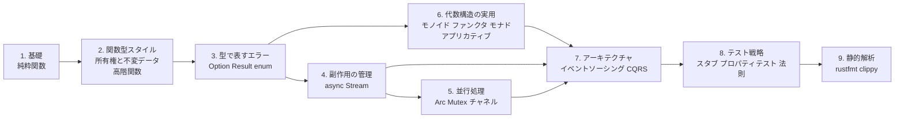
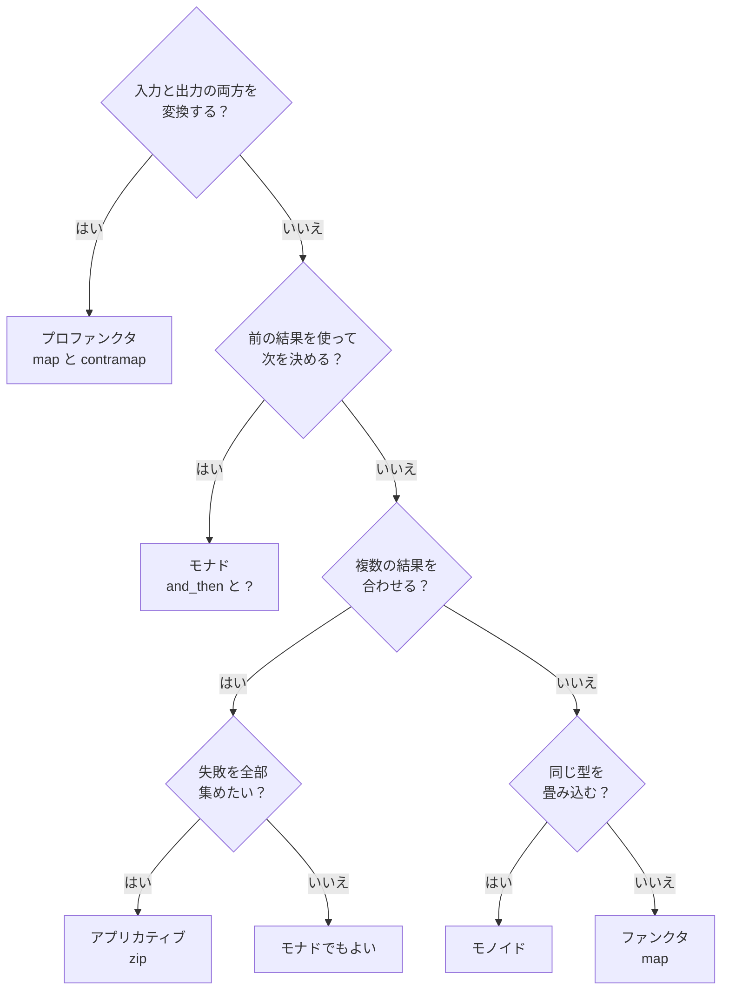

# 関数型プログラミングガイド（Rust 編）

## このガイドについて

関数型プログラミング（FP）は、状態の書き換えではなく値の変換でプログラムを組み立てる考え方である。変更を楽に安全にできるソフトウェアを作るための技術的な手段のひとつであり、副作用を境界に押し出し、型で失敗を表し、小さな関数を合成する。

本ガイドは、Rust でこの考え方を実践するための要点を整理する。構成は [関数型プログラミングガイド（Kotlin 編）](./関数型プログラミングガイド_Kotlin編.md) に合わせている。次の 2 つの学習記事を元にしている。

| 出典 | 内容 | 本ガイドでの扱い |
| --- | --- | --- |
| Grokking Functional Programming Rust 版（全 12 章） | 純粋関数、イミュータブルなデータ、Option/Result、async、ストリーム、並行処理、実践的なアプリケーション | 第 1〜5 章の骨格 |
| Zettai Rust 版（全 13 章、From Objects to Functions 演習） | ToDo アプリを題材にした HTTP、ドメインモデリング、イベントソーシング、関数型エラーハンドリング、アプリカティブ、関数型 JSON | 第 6〜8 章の骨格 |

- **対象**: 他の言語で書いた経験があり、所有権のある言語で関数型の設計をしたい開発者。所有権・借用・ライフタイムの基礎は知っているものとする。
- **使うもの**: 第 1〜3 章は Rust の標準ライブラリのみ。第 4〜5 章は [tokio](https://tokio.rs/) と [futures](https://docs.rs/futures/) を使う。Zettai 版の本体は同期のコードで、依存は `tiny_http`、`postgres`、`tera` だけである。
- **コード例**: 出典の記事から転記している。本文に載せたコードは、このガイドのために書き下ろしたものではない。ただし第 9 章の clippy の設定と確認用コードだけは例外で、このガイドのために書き、clippy 0.1.91 で実行して確認した。詳細な解説と演習問題は出典の記事を参照する。

### Kotlin 編との違い

Rust は、Kotlin 編で自前に作ったり Arrow に頼ったりした多くのものを、言語やコンパイラが与える。代わりに所有権・借用・ライフタイムという制約が入る。

| | Kotlin | Rust |
| --- | --- | --- |
| 不変性 | `val` は再代入を防ぐだけ。`List` は読み取り専用のビュー | 束縛はデフォルトで不変。変更は `mut` で明示する |
| 失敗の型 | nullable、Arrow の `Either` と `Raise` | `Option`、`Result`、`?` が言語にある |
| 代数的データ型 | `sealed interface` | `enum` |
| 副作用の型付け | `suspend` | `async fn`（本体は `.await` まで実行されない）。ただし Zettai 版は同期のコードを選んだ |
| 並行処理の安全 | 構造化並行性 | 所有権、`Send` と `Sync`（データ競合がコンパイルで止まる） |
| テストの土台 | Kotest など | `#[test]` が言語にある |
| 静的解析 | detekt、ktlint、PMD | rustfmt、clippy（コンパイラの lint を含む） |

## 全体像



| 章 | 主題 | 一言で言うと |
| --- | --- | --- |
| 1 | 基礎 | 同じ入力には同じ出力。外に触れない |
| 2 | 関数型スタイル | 変更せず、新しい値を作る。関数を値として渡す |
| 3 | 型で表すエラー | 失敗を panic ではなく戻り値の型で表す |
| 4 | 副作用の管理 | 副作用を「実行しない記述」として値にする |
| 5 | 並行処理 | 並行処理も所有権と型で安全にする |
| 6 | 代数構造の実用 | 合成のパターンに名前を付け、判断の手順で使い分ける |
| 7 | アーキテクチャ | 状態を事実（イベント）の列として扱う |
| 8 | テスト戦略 | 純粋関数の性質と、代数構造の法則をテストで言い切る |
| 9 | 静的解析とルール設定 | 関数型の規約を clippy で機械に守らせる |

---

## 1. 基礎: 純粋関数

### 1.1 命令型と関数型

命令型は「どうやるか」の手順を書き、関数型は「何であるか」の定義を書く。

```rust
// 命令型スタイル: ステップバイステップで計算
fn calculate_score_imperative(word: &str) -> usize {
    let mut score = 0;
    for _ in word.chars() {
        score += 1;
    }
    score
}
```

```rust
// 関数型スタイル: 宣言的に記述
fn word_score(word: &str) -> usize {
    word.len()
}
```

Rust は、束縛がデフォルトでイミュータブルである。変更が必要な場所は `mut` と書いて明示する。

```rust
let x = 5;        // イミュータブル
// x = 6;         // コンパイルエラー!

let mut y = 5;    // ミュータブル（明示的に指定）
y = 6;            // OK
```

Kotlin の `val` は再代入を防ぐだけで、参照先の不変性までは保証しない。Rust は、不変な束縛を通して中身を変更することもできない。内部可変性を持つ型（`Mutex` や `RefCell` など）を除けば、変更を許す場所は `mut` が付いた場所だけである。

### 1.2 純粋関数

純粋関数は次の 2 つを満たす。

1. 同じ入力には常に同じ出力を返す。
2. 副作用がない（外部状態を変更しない）。

```rust
/// 純粋関数: 同じ入力に対して常に同じ出力
fn add(a: i32, b: i32) -> i32 {
    a + b
}

/// 純粋関数: 文字 'a' を除外したワードスコア
fn word_score(word: &str) -> usize {
    word.chars().filter(|&c| c != 'a').count()
}

// テスト
assert_eq!(word_score("Scala"), 3);    // "Scl" → 3文字
assert_eq!(word_score("function"), 8); // 'a' なし → 8文字
assert_eq!(word_score(""), 0);         // 空文字 → 0文字
```

システム時計は隠れた入力であり、引数が同じでも結果が変わる。

```rust
// 不純な関数 - 呼び出すたびに異なる値を返す
fn current_timestamp() -> u64 {
    use std::time::{SystemTime, UNIX_EPOCH};
    SystemTime::now()
        .duration_since(UNIX_EPOCH)
        .unwrap()
        .as_secs()
}
```

### 1.3 所有権と純粋性

Rust では、関数のシグネチャから、引数をどう扱うかが分かる。`&str` や `&[i32]` で借りる関数は、元のデータを変更できない。新しい値は戻り値として返す。

```rust
/// 借用を使った純粋関数（元のデータを変更しない）
fn count_vowels(s: &str) -> usize {
    s.chars()
        .filter(|c| matches!(c.to_ascii_lowercase(), 'a' | 'e' | 'i' | 'o' | 'u'))
        .count()
}

/// Vec を変換する純粋関数（新しい Vec を返す）
fn double_all(numbers: &[i32]) -> Vec<i32> {
    numbers.iter().map(|x| x * 2).collect()
}

// 元のデータは変更されない
let numbers = vec![1, 2, 3];
let doubled = double_all(&numbers);
assert_eq!(doubled, vec![2, 4, 6]);
assert_eq!(numbers, vec![1, 2, 3]);  // 元のデータはそのまま
```

ショッピングカートの例では、状態を持つクラスの代わりに、カートの中身を引数で受け取る純粋関数を合成する。

```rust
/// ショッピングカートの割引率を計算（純粋関数）
fn get_discount_percentage(items: &[&str]) -> i32 {
    if items.contains(&"Book") {
        5
    } else {
        0
    }
}

/// 割引額を計算（純粋関数）
fn calculate_discount(total: i32, percentage: i32) -> i32 {
    total * percentage / 100
}

/// 最終価格を計算（純粋関数の合成）
fn calculate_final_price(total: i32, items: &[&str]) -> i32 {
    let discount_percentage = get_discount_percentage(items);
    let discount = calculate_discount(total, discount_percentage);
    total - discount
}

// テスト
assert_eq!(calculate_final_price(100, &["Apple", "Book"]), 95);
assert_eq!(calculate_final_price(100, &["Apple"]), 100);
```

### 1.4 参照透過性

純粋関数の呼び出しは、その結果の値に置き換えても、プログラムの意味が変わらない。これを参照透過性と呼ぶ。

```rust
// word_score("Scala") は常に 3 を返す
let score1 = word_score("Scala");
let score2 = word_score("Scala");
// score1 と score2 は常に同じ値（3）

// 以下の2つは同等
let total1 = word_score("Scala") + word_score("Java");
let total2 = 3 + 2;  // word_score の結果で置き換え可能
assert_eq!(total1, total2);
```

**純粋関数の利点**: テストが入力と出力の確認だけで済む。並行に呼んでも安全である。呼び出しを値に置き換えても意味が変わらないので、読んで理解しやすい。

---

## 2. 関数型スタイル: 所有権と不変データ、高階関数

### 2.1 新しい値を作る

イミュータブルなデータを「変更する」とは、変更を加えた新しい値を作ることである。元の値はそのまま残る。

```rust
let list = vec!["Apple", "Book"];
// list.push("Mango"); // コンパイルエラー！不変だから

// 新しい Vec を作成する
let mut new_list = list.clone();
new_list.push("Mango");

assert_eq!(list.len(), 2);     // 元のリストは変わらない
assert_eq!(new_list.len(), 3); // 新しいリストに追加された
```

この変更を関数にして、局所的な可変操作を関数の内側に閉じ込める。呼び出し側からは、新しい値が返るだけに見える。

```rust
pub fn appended<T: Clone>(list: &[T], element: T) -> Vec<T> {
    let mut result = list.to_vec();
    result.push(element);
    result
}

let apple_book = vec!["Apple", "Book"];
let apple_book_mango = appended(&apple_book, "Mango");

assert_eq!(apple_book.len(), 2);      // 元のリストは変わらない
assert_eq!(apple_book_mango.len(), 3);
assert_eq!(apple_book_mango, vec!["Apple", "Book", "Mango"]);
```

```rust
pub fn first_two<T: Clone>(list: &[T]) -> Vec<T> {
    list.iter().take(2).cloned().collect()
}

pub fn last_two<T: Clone>(list: &[T]) -> Vec<T> {
    let len = list.len();
    if len <= 2 {
        list.to_vec()
    } else {
        list[len - 2..].to_vec()
    }
}

assert_eq!(first_two(&["a", "b", "c"]), vec!["a", "b"]);
assert_eq!(last_two(&["a", "b", "c"]), vec!["b", "c"]);
```

Kotlin では `List` が読み取り専用のビューにすぎず、元の `MutableList` の変更が見えてしまう。Rust では、借用している間は元の値を変更できない（借用規則）ので、このすり替わりが起きない。借用を手放さず `&mut` で変更しようとすると、コンパイルが止まる。

### 2.2 関数を値として渡す

関数は引数にも戻り値にもなる。変わる部分を関数として外から渡すと、同じ枠組みで振る舞いを差し替えられる。Rust では、関数を受け取る型を `Fn` トレイトで表す。

```rust
pub fn score(word: &str) -> usize {
    word.chars().filter(|&c| c != 'a').count()
}

pub fn sort_by_score<T, F, K>(list: &[T], key_fn: F) -> Vec<T>
where
    T: Clone,
    F: Fn(&T) -> K,
    K: Ord,
{
    let mut result = list.to_vec();
    result.sort_by_key(|item| key_fn(item));
    result
}

let words = vec!["rust", "java"];
let sorted = sort_by_score(&words, |w| score(w));
assert_eq!(sorted, vec!["java", "rust"]);
// java: 2文字 (j, v), rust: 4文字 (r, u, s, t)
```

| トレイト | 意味 |
| --- | --- |
| `Fn` | 何度でも呼べる。キャプチャした値を読むだけ |
| `FnMut` | 何度でも呼べるが、キャプチャした値を変更する |
| `FnOnce` | 1 回だけ呼べる。キャプチャした値を消費する |

純粋な関数を受け取るなら、できるだけ `Fn` で受け取る。

### 2.3 map / filter / fold

| 操作 | 役割 |
| --- | --- |
| `map` | 各要素を変換する（要素数は同じ） |
| `filter` | 条件に合う要素だけ残す |
| `fold` | 初期値から畳み込んで 1 つの値にする |

```rust
let lengths: Vec<usize> = vec!["scala", "rust", "ada"]
    .iter()
    .map(|s| s.len())
    .collect();
assert_eq!(lengths, vec![5, 4, 3]);

let doubles: Vec<i32> = vec![5, 1, 2, 4, 0]
    .iter()
    .map(|&i| i * 2)
    .collect();
assert_eq!(doubles, vec![10, 2, 4, 8, 0]);
```

```rust
let odds: Vec<i32> = vec![5, 1, 2, 4, 0]
    .iter()
    .filter(|&&i| i % 2 == 1)
    .cloned()
    .collect();
assert_eq!(odds, vec![5, 1]);
```

```rust
let sum = vec![5, 1, 2, 4, 100]
    .iter()
    .fold(0, |acc, &i| acc + i);
assert_eq!(sum, 112);

let max = vec![5, 1, 2, 4, 15]
    .iter()
    .fold(i32::MIN, |max, &i| if i > max { i } else { max });
assert_eq!(max, 15);
```

Rust のイテレータは遅延評価で、`collect` や `fold` などで消費するまで何も実行されない。

### 2.4 関数を返す関数とカリー化

条件を関数として組み立てて返すと、同じ `filter` に別の条件を渡せる。戻り値の型には `impl Fn` を使う。

```rust
pub fn larger_than(n: i32) -> impl Fn(i32) -> bool {
    move |i| i > n
}

let larger_than_4 = larger_than(4);
assert!(larger_than_4(5));
assert!(!larger_than_4(4));

// filter で使う場合
let large: Vec<i32> = vec![5, 1, 2, 4, 0]
    .into_iter()
    .filter(|&x| larger_than(4)(x))
    .collect();
assert_eq!(large, vec![5]);
```

引数を 1 つずつ受け取る形（カリー化）にすると、先頭の引数だけ与えた部分適用で、新しい関数を作れる。

```rust
// カリー化された関数
pub fn curried_add(a: i32) -> impl Fn(i32) -> i32 {
    move |b| a + b
}

let add_10 = curried_add(10);
assert_eq!(add_10(5), 15);
assert_eq!(add_10(20), 30);
```

`move` は、クロージャが外の値を借りずに所有することを指定する。関数から返すクロージャには、所有して持ち出すために `move` が要る。

### 2.5 flat_map

`map` で「コレクションを返す関数」を適用すると結果がネストする。`flat_map` は適用と平坦化を一度に行う。

```rust
#[derive(Debug, Clone, PartialEq)]
pub struct Book {
    pub title: String,
    pub authors: Vec<String>,
}

let books = vec![
    Book::new("FP in Scala", vec!["Chiusano", "Bjarnason"]),
    Book::new("The Hobbit", vec!["Tolkien"]),
];

// map だけだとネストする
let author_lists: Vec<Vec<String>> = books.iter().map(|b| b.authors.clone()).collect();
// [["Chiusano", "Bjarnason"], ["Tolkien"]]

// flatten で平坦化
let authors: Vec<String> = author_lists.into_iter().flatten().collect();
// ["Chiusano", "Bjarnason", "Tolkien"]
```

```rust
// flat_map で同じことを1行で
let authors: Vec<String> = books
    .iter()
    .flat_map(|book| book.authors.clone())
    .collect();
assert_eq!(authors, vec!["Chiusano", "Bjarnason", "Tolkien"]);
```

`flat_map` を入れ子にすると、クロージャが外の値を借りるため、`move` と `clone` が増えて読みにくくなる。

```rust
// ネストした flat_map
let recommendations: Vec<String> = books
    .iter()
    .flat_map(|book| {
        let book_title = book.title.clone();
        book.authors.iter().flat_map(move |author| {
            let author_name = author.clone();
            let book_title_inner = book_title.clone();
            book_adaptations(&author_name).into_iter().map(move |movie| {
                format!(
                    "You may like {}, because you liked {}'s {}",
                    movie.title, author_name, book_title_inner
                )
            })
        })
    })
    .collect();
```

Rust には Scala の for 内包表記に当たる構文がない。2 つの組み合わせ程度なら、`flat_map` と `map` のイテレータチェーンで足りる。

```rust
// 全組み合わせを生成
pub fn all_combinations(xs: &[i32], ys: &[i32]) -> Vec<i32> {
    xs.iter()
        .flat_map(|&x| ys.iter().map(move |&y| x + y))
        .collect()
}

let result = all_combinations(&[1, 2], &[10, 20]);
assert_eq!(result, vec![11, 21, 12, 22]);
```

---

## 3. 型で表すエラー

panic は関数のシグネチャに現れず、呼び出し側が備えられない。失敗の可能性を戻り値の型に出すと、扱いをコンパイラが強制する。

### 3.1 Option

値がないことだけを表すなら、標準の `Option<T>` を使う。次の実装は、前提が崩れると `panic!` する。

```rust
// panic! が発生する可能性あり
pub fn parse_show_unsafe(raw_show: &str) -> (&str, i32, i32) {
    let bracket_open = raw_show.find('(').unwrap();  // パニックの可能性
    let bracket_close = raw_show.find(')').unwrap(); // パニックの可能性
    let dash = raw_show.find('-').unwrap();          // パニックの可能性

    let name = raw_show[..bracket_open].trim();
    let year_start: i32 = raw_show[bracket_open + 1..dash].parse().unwrap();
    let year_end: i32 = raw_show[dash + 1..bracket_close].parse().unwrap();

    (name, year_start, year_end)
}

// 正常ケース
parse_show_unsafe("Breaking Bad (2008-2013)");  // OK

// 異常ケース → panic!
parse_show_unsafe("Chernobyl (2019)");  // パニック！ '-' がない
parse_show_unsafe("The Wire 2002-2008"); // パニック！ '(' がない
```

小さな関数が `Option` を返すようにして、`?` 演算子で合成する。`?` は `None` なら即座に関数から `None` を返す。

```rust
/// 番組名を抽出
pub fn extract_name(raw_show: &str) -> Option<String> {
    let bracket_open = raw_show.find('(')?;  // ? 演算子で None を伝播
    if bracket_open > 0 {
        Some(raw_show[..bracket_open].trim().to_string())
    } else {
        None
    }
}
```

```rust
/// TV番組をパース（Option 版）
pub fn parse_show(raw_show: &str) -> Option<TvShow> {
    let name = extract_name(raw_show)?;
    let year_start = extract_year_start(raw_show)
        .or_else(|| extract_single_year(raw_show))?;
    let year_end = extract_year_end(raw_show)
        .or_else(|| extract_single_year(raw_show))?;

    Some(TvShow::new(&name, year_start, year_end))
}

// 正常ケース
parse_show("Breaking Bad (2008-2013)");  // Some(TvShow { ... })
parse_show("Chernobyl (2019)");          // Some(TvShow { ... })

// 異常ケース → None が返される（パニックなし）
parse_show("The Wire 2002-2008");         // None
```

`or` と `or_else` は「`None` なら代替を使う」フォールバックである。

```rust
let seven: Option<i32> = Some(7);
let eight: Option<i32> = Some(8);
let none: Option<i32> = None;

assert_eq!(seven.or(eight), Some(7));   // 最初が Some なのでそのまま
assert_eq!(none.or(eight), Some(8));    // 最初が None なので代替を使用
assert_eq!(seven.or(none), Some(7));
assert_eq!(none.or(none), None);
```

主要なメソッドは次のとおりである。

```rust
let year: Option<i32> = Some(996);
let no_year: Option<i32> = None;

// map
assert_eq!(year.map(|y| y * 2), Some(1992));
assert_eq!(no_year.map(|y| y * 2), None);

// and_then (Scala の flatMap 相当)
assert_eq!(year.and_then(|y| Some(y * 2)), Some(1992));
assert_eq!(no_year.and_then(|y| Some(y * 2)), None);

// filter
assert_eq!(year.filter(|&y| y < 2020), Some(996));
assert_eq!(year.filter(|&y| y > 2020), None);

// unwrap_or
assert_eq!(year.unwrap_or(0), 996);
assert_eq!(no_year.unwrap_or(0), 0);
```

### 3.2 Result: 失敗の理由を持つ

`Option` は「なぜ失敗したか」を運べない。理由を持たせるときは `Result<T, E>` を使う。`Ok` が成功、`Err` が失敗である。`Option` から変えるには `ok_or` を使う。

```rust
let year: Option<i32> = Some(996);
let no_year: Option<i32> = None;

assert_eq!(year.ok_or("no year given"), Ok(996));
assert_eq!(no_year.ok_or("no year given"), Err("no year given"));
```

```rust
pub fn extract_name(raw_show: &str) -> Result<String, String> {
    let bracket_open = raw_show
        .find('(')
        .ok_or_else(|| format!("Can't find '(' in {}", raw_show))?;
    if bracket_open > 0 {
        Ok(raw_show[..bracket_open].trim().to_string())
    } else {
        Err(format!("Can't extract name from {}", raw_show))
    }
}

extract_name("The Wire (2002-2008)");  // Ok("The Wire")
extract_name("(2022)");                // Err("Can't extract name from (2022)")
```

`?` は `Result` でも同じように使える。`Err` なら即座に関数から `Err` を返す。

```rust
pub fn parse_show(raw_show: &str) -> Result<TvShow, String> {
    let name = extract_name(raw_show)?;
    let year_start = extract_year_start(raw_show)
        .or_else(|_| extract_single_year(raw_show))?;
    let year_end = extract_year_end(raw_show)
        .or_else(|_| extract_single_year(raw_show))?;

    Ok(TvShow::new(&name, year_start, year_end))
}

parse_show("The Wire (2002-2008)");  // Ok(TvShow { ... })
parse_show("Mad Men ()");            // Err("Can't extract single year from ...")
parse_show("(2002-2008)");           // Err("Can't extract name from ...")
```

```rust
let year: Result<i32, &str> = Ok(996);
let no_year: Result<i32, &str> = Err("no year");

// map
assert_eq!(year.map(|y| y * 2), Ok(1992));
assert_eq!(no_year.map(|y| y * 2), Err("no year"));

// and_then
assert_eq!(year.and_then(|y| Ok(y * 2)), Ok(1992));
assert_eq!(no_year.and_then(|y| Ok(y * 2)), Err("no year"));

// ok (Option に変換)
assert_eq!(year.ok(), Some(996));
assert_eq!(no_year.ok(), None);
```

### 3.3 エラーの型を設計する

`String` のエラーを、業務の言葉の `enum` にする。Zettai 版は、`Option` の `None` と、状態遷移の拒否を、1 つのエラー型にまとめた。

```rust
pub enum ZettaiError {
    /// 同じ名前のリストがもうある。
    ListAlreadyExists { list_name: ListName },
    /// リストが見つからない。**第 6 章の `ListDoesNotExist` と、
    /// `Option` の `None` が、ここで 1 つになった。**
    ListNotFound { user: User, list_name: ListName },
    /// 説明が空。
    EmptyDescription,
}
```

`?` は、エラーの型が違うときに `From` トレイトで変換する。変換を `impl From` で書いておけば、層をまたぐエラーも `?` だけで伝播できる。

```rust
impl From<DomainError> for HttpError {
    fn from(e: DomainError) -> Self {
        HttpError::Domain(e)
    }
}
```

境界で、エラーを HTTP の応答に対応付ける。`match` が網羅されるので、エラーの種類を足すと、対応付けを忘れた箇所がコンパイルエラーになる。

```rust
fn failed(reason: ZettaiError) -> Reply {
    match reason {
        ZettaiError::ListNotFound { .. } => not_found(),
        ZettaiError::ListAlreadyExists { .. } => Reply {
            status: 409,
            body: "<html><body><h1>409</h1></body></html>".to_string(),
        },
        ZettaiError::EmptyDescription => bad_request(),
    }
}
```

### 3.4 リストの失敗の扱い

リストを処理するときの失敗の扱いは、次の戦略から選ぶ。`collect` は、結果の型で動作が変わる。

```rust
pub fn parse_shows_best_effort(raw_shows: &[&str]) -> Vec<TvShow> {
    raw_shows
        .iter()
        .filter_map(|raw| parse_show(raw))  // Some のみ収集
        .collect()
}

pub fn parse_shows_all_or_nothing(raw_shows: &[&str]) -> Option<Vec<TvShow>> {
    raw_shows.iter().map(|raw| parse_show(raw)).collect()
}

// 全部成功 → Some(vec![...])
parse_shows_all_or_nothing(&["Breaking Bad (2008-2013)", "Mad Men (2007-2015)"]);
// Some(vec![TvShow(...), TvShow(...)])

// 一つでも失敗 → None
parse_shows_all_or_nothing(&["Breaking Bad (2008-2013)", "Invalid"]);
// None
```

`Vec<Option<T>>` を `Option<Vec<T>>` に畳む `collect` は、最初の `None` で止まる（all-or-nothing）。`Result` でも同じで、最初の `Err` で止まる。全部のエラーを集めたいときは、6.2 節の `Validated` を使う。

### 3.5 enum で ADT を作る

取りうる場合を限定した型（代数的データ型）を `enum` で表し、`match` で網羅的に処理する。場合を追加したとき、扱いを忘れている `match` はコンパイルエラーになる。

```rust
/// 音楽ジャンル
#[derive(Debug, Clone, Copy, PartialEq, Eq)]
pub enum MusicGenre {
    HeavyMetal,
    Pop,
    HardRock,
    Jazz,
}

/// 活動期間
#[derive(Debug, Clone, PartialEq)]
pub enum YearsActive {
    /// 現在も活動中
    StillActive { since: i32 },
    /// 活動終了
    ActiveBetween { start: i32, end: i32 },
}
```

```rust
/// アーティスト
#[derive(Debug, Clone, PartialEq)]
pub struct Artist {
    pub name: String,
    pub genre: MusicGenre,
    pub origin: String,
    pub years_active: YearsActive,
}
```

```rust
/// アーティストが指定期間に活動していたか判定
pub fn was_artist_active(artist: &Artist, year_start: i32, year_end: i32) -> bool {
    match &artist.years_active {
        YearsActive::StillActive { since } => *since <= year_end,
        YearsActive::ActiveBetween { start, end } => *start <= year_end && *end >= year_start,
    }
}

/// アーティストの活動年数を計算
pub fn active_length(artist: &Artist, current_year: i32) -> i32 {
    match &artist.years_active {
        YearsActive::StillActive { since } => current_year - since,
        YearsActive::ActiveBetween { start, end } => end - start,
    }
}
```

`match` の網羅性は、コンパイラが検査する。ただし、ワイルドカード（`_`）を足すと網羅の検査が止まる。ワイルドカードを避ける規約は、第 9 章の lint で守る。

### 3.6 使い分け

| 状況 | 使うもの |
| --- | --- |
| 値がないことだけを表したい | `Option<T>` と `?`、`or_else` |
| 失敗の理由を呼び出し側に伝えたい | `Result<T, E>` と `?` |
| `Option` を `Result` に変えたい | `ok_or`、`ok_or_else` |
| エラーの型を層ごとに変換したい | `impl From<E1> for E2` と `?` |
| すべての検証エラーをまとめて返したい | 6.2 節の `Validated` |
| 取りうる場合を限定して漏れを防ぎたい | `enum` と `match`（ワイルドカードを避ける） |
| 失敗を無視したくない | `Result` は `#[must_use]`。捨てるとコンパイラが警告する |

---

## 4. 副作用の管理

### 4.1 副作用を値として扱う

副作用のある処理を「実行しない記述」として値にすると、いつ実行するかを呼び出し側が決められる。まず、副作用を持つ不純な関数を示す。

```rust
/// 不純な関数（副作用あり）- サイコロを振る
pub fn cast_the_die_impure() -> i32 {
    use std::time::{SystemTime, UNIX_EPOCH};
    let nanos = SystemTime::now()
        .duration_since(UNIX_EPOCH)
        .unwrap()
        .subsec_nanos();
    (nanos % 6) as i32 + 1
}
```

### 4.2 async は副作用の記述になる

Rust の `async fn` は、呼び出しただけでは本体が実行されない。`Future` という実行前の記述を返し、`.await` したときに初めて実行される。副作用を持つ処理の呼び出し位置が、`async` の文脈に限定される。

```rust
/// 非同期でサイコロを振る（副作用を遅延）
pub async fn cast_the_die() -> i32 {
    cast_the_die_impure()
}

/// 2回サイコロを振って合計を返す
pub async fn cast_the_die_twice() -> i32 {
    let first = cast_the_die().await;
    let second = cast_the_die().await;
    first + second
}
```

合成は、`flat_map` ではなく、普通の逐次コードで書ける。Kotlin の `suspend` に近い役割である。

ただし Zettai 版は、`async` を採らず、同期のコードで 13 章を書いた（ADR-024）。1 プロセスで 1 リクエストずつ扱う規模なら、同期で足りた。「同期のほうが良かった」のではなく、「困らなかった」という結論である。この規模で分かったのは、「同期で書ける」ことだけである。

### 4.3 純粋な計算と非同期処理を分ける

純粋な計算と副作用を分け、副作用は関数として外から受け取る。ミーティングの空き時間の計算は純粋関数で、カレンダーの取得だけが非同期である。

```rust
/// ミーティング時間を表す構造体
#[derive(Debug, Clone, PartialEq)]
pub struct MeetingTime {
    pub start_hour: i32,
    pub end_hour: i32,
}

/// 2つのミーティングが重なっているか判定（純粋関数）
pub fn meetings_overlap(m1: &MeetingTime, m2: &MeetingTime) -> bool {
    m1.start_hour < m2.end_hour && m2.start_hour < m1.end_hour
}
```

### 4.4 失敗とリトライ

失敗する非同期処理は `Result` を返す。フォールバックは `unwrap_or_else` で書き、再実行は汎用の関数にする。

```rust
/// 失敗する可能性のあるカレンダー取得
pub async fn calendar_entries_may_fail(name: &str) -> Result<Vec<MeetingTime>, String> {
    if name == "Error" {
        Err("API call failed".to_string())
    } else {
        Ok(calendar_entries(name).await)
    }
}

/// フォールバック付きのカレンダー取得
pub async fn calendar_entries_with_fallback(name: &str) -> Vec<MeetingTime> {
    calendar_entries_may_fail(name)
        .await
        .unwrap_or_else(|_| vec![])
}
```

```rust
/// 指定回数リトライする
pub async fn retry<T, E, F, Fut>(action: F, max_retries: usize) -> Result<T, E>
where
    F: Fn() -> Fut,
    Fut: Future<Output = Result<T, E>>,
{
    let mut last_error = None;
    for _ in 0..max_retries {
        match action().await {
            Ok(result) => return Ok(result),
            Err(e) => last_error = Some(e),
        }
    }
    Err(last_error.unwrap())
}
```

### 4.5 複数の非同期処理を合成する

独立した複数の非同期処理は、`join_all` で並行に実行できる。

```rust
/// 複数人の予定を並行取得
pub async fn scheduled_meetings_for_all(attendees: &[&str]) -> Vec<MeetingTime> {
    let futures: Vec<_> = attendees
        .iter()
        .map(|name| calendar_entries(name))
        .collect();

    let results = futures::future::join_all(futures).await;
    results.into_iter().flatten().collect()
}
```

条件によって異なる `Future` を返すには、型を揃える `BoxFuture` を使う。

```rust
pub type BoxFuture<'a, T> = Pin<Box<dyn Future<Output = T> + Send + 'a>>;

/// 条件に応じて異なる非同期処理を返す
pub fn conditional_async(condition: bool) -> BoxFuture<'static, &'static str> {
    if condition {
        Box::pin(async { "Success" })
    } else {
        Box::pin(async { "Failure" })
    }
}
```

### 4.6 ストリーム: Iterator と Stream

連続したデータを遅延評価で扱う。必要な要素だけが評価されるので、無限のストリームも定義できる。

| 型 | 評価 | 副作用（async） | 向く場面 |
| --- | --- | --- | --- |
| `Iterator` | 遅延・同期 | 呼び出せない | メモリ上の変換、無限列の定義 |
| `Stream`（futures） | 遅延・非同期 | 呼び出せる | I/O を伴う連続した値 |

```rust
use futures::stream::{self, Stream, StreamExt};

/// イテレータからストリームを作成
pub fn numbers_stream(start: i32, end: i32) -> impl Stream<Item = i32> {
    stream::iter(start..=end)
}
```

```rust
/// 2つのストリームを結合
pub fn concat_streams<S1, S2, T>(stream1: S1, stream2: S2) -> impl Stream<Item = T>
where
    S1: Stream<Item = T>,
    S2: Stream<Item = T>,
{
    stream1.chain(stream2)
}
```

無限のストリームは `unfold` で定義する。

```rust
/// 無限ストリームを生成
pub fn infinite_stream<T, F>(initial: T, f: F) -> impl Stream<Item = T>
where
    T: Clone,
    F: FnMut(&T) -> T,
{
    stream::unfold((initial, f), |(state, mut f)| async move {
        let next = f(&state);
        Some((state, (next, f)))
    })
}

/// フィボナッチ数列のストリーム
pub fn fibonacci_stream() -> impl Stream<Item = u64> {
    stream::unfold((0u64, 1u64), |(a, b)| async move {
        Some((a, (b, a + b)))
    })
}
```

```rust
let stream = fibonacci_stream();
let first_ten: Vec<u64> = stream.take(10).collect().await;
assert_eq!(first_ten, vec![0, 1, 1, 2, 3, 5, 8, 13, 21, 34]);
```

---

## 5. 並行処理

### 5.1 共有状態は所有権で守る

Rust は、複数のスレッドから共有する値に、`Send` と `Sync` の条件を課す。条件を満たさない型を共有しようとすると、コンパイルが止まる。共有する状態は `Arc` で所有を共有し、`Mutex` で書き込みを直列にする。

```rust
use std::sync::Arc;
use tokio::sync::Mutex;

/// アトミックカウンター
#[derive(Clone)]
pub struct AtomicCounter {
    value: Arc<Mutex<i32>>,
}

impl AtomicCounter {
    pub fn new(initial: i32) -> Self {
        Self {
            value: Arc::new(Mutex::new(initial)),
        }
    }

    pub async fn get(&self) -> i32 {
        *self.value.lock().await
    }

    pub async fn increment(&self) {
        let mut guard = self.value.lock().await;
        *guard += 1;
    }

    pub async fn update<F>(&self, f: F)
    where
        F: FnOnce(i32) -> i32,
    {
        let mut guard = self.value.lock().await;
        *guard = f(*guard);
    }
}
```

読み取りが多いなら `RwLock` で読み書きを分ける。ロックのガードは、スコープを抜けると自動で解放される。

### 5.2 並列実行とキャンセル

`tokio::spawn` で別のタスクを起動し、`JoinHandle` で結果を待つ。タスクのキャンセルは `abort` である。

```rust
pub async fn run_parallel<T, U, F, Fut>(items: Vec<T>, f: F) -> Vec<U>
where
    T: Send + 'static,
    U: Send + 'static,
    F: Fn(T) -> Fut + Send + Sync + 'static,
    Fut: std::future::Future<Output = U> + Send,
{
    let f = Arc::new(f);
    let handles: Vec<JoinHandle<U>> = items
        .into_iter()
        .map(|item| {
            let f = Arc::clone(&f);
            tokio::spawn(async move { f(item).await })
        })
        .collect();

    let mut results = Vec::with_capacity(handles.len());
    for handle in handles {
        results.push(handle.await.unwrap());
    }
    results
}
```

`join_all`（4.5 節）は、起動した `Future` を同じタスクの中で並行に進める。`tokio::spawn` は別のタスクとして並列に走らせる。

### 5.3 チャネルで状態を共有しない

共有状態をロックで守る代わりに、値をチャネルで送る方法がある。状態を 1 つのタスクだけが持てば、ロックは要らない。

| チャネル | 通信の形 |
| --- | --- |
| `mpsc` | 複数の送信者から、単一の受信者へ |
| `oneshot` | 一回限りの通信 |
| `broadcast` | 複数の受信者へ同じ値を配る |

```rust
use tokio::sync::mpsc;

pub async fn basic_mpsc_example() -> Vec<i32> {
    let (tx, mut rx) = mpsc::channel(10);

    // 送信タスク
    tokio::spawn(async move {
        for i in 1..=3 {
            tx.send(i).await.unwrap();
        }
    });

    // 受信
    let mut results = Vec::new();
    while let Some(value) = rx.recv().await {
        results.push(value);
    }

    results
}
```

```rust
use tokio::sync::oneshot;

pub async fn compute_with_oneshot(input: i32) -> i32 {
    let (tx, rx) = oneshot::channel();

    tokio::spawn(async move {
        let result = input * input;
        tx.send(result).unwrap();
    });

    rx.await.unwrap()
}
```

### 5.4 アクターで状態を閉じ込める

状態を 1 つのタスクに閉じ込め、メッセージで操作するパターンがアクターである。メッセージは `enum` で表し、応答が要るときは `oneshot::Sender` を同封する。

```rust
pub enum CounterMessage {
    Increment,
    Decrement,
    Get(oneshot::Sender<i32>),
    Stop,
}
```

```rust
pub enum BankMessage {
    Deposit(i32),
    Withdraw(i32, oneshot::Sender<Result<(), String>>),
    GetBalance(oneshot::Sender<i32>),
    Stop,
}
```

イベントを多くの購読者に配るイベントバスも、`broadcast` で作れる。

```rust
#[derive(Debug, Clone)]
pub enum Event {
    UserLoggedIn { user_id: String },
    UserLoggedOut { user_id: String },
    MessageSent { from: String, to: String, content: String },
}
```

---

## 6. 代数構造の実用

モノイド・ファンクタ・モナド・アプリカティブ・プロファンクタは、これまでに使ってきた `fold`、`map`、`and_then`、`zip` の共通のパターンに付けた名前である。数学の用語を覚えることが目的ではなく、「この型にこの操作が使える」と見抜いて、合成の道具を選べるようにするために使う。

Zettai 版では、5 つの構造がすべて現れた。言語が与えたのは 2 つだけで、残りは自作した。

| 構造 | 章 | Rust |
| --- | --- | --- |
| モノイド | 5 | 自作 |
| ファンクタ | 7・8 | 言語にある（`Result` / `Option` の `map`） |
| モナド | 9 | 言語にある（`and_then` と `?`） |
| アプリカティブ | 11 | 自作（`Validated`） |
| プロファンクタ | 12 | 自作（`Converter`） |

### 6.1 モノイドでイベントを畳み込む

状態を変える操作を「リストから新しいリストへの変換」として値にし、合成（`compose`）と単位元（`identity`）を用意する。これでイベントの列を `fold` で 1 つの変換に畳める。

```rust
#[derive(Debug, Clone, PartialEq, Eq)]
pub enum ToDoListEvent {
    ListCreated { list_name: ListName },
    ItemAdded { item: ToDoItem },
}
```

```rust
pub fn transform_for(event: ToDoListEvent) -> Transform {
    match event {
        ToDoListEvent::ListCreated { list_name } => Box::new(move |_previous| ToDoList {
            list_name: list_name.clone(),
            items: Vec::new(),
        }),
        ToDoListEvent::ItemAdded { item } => Box::new(move |list: ToDoList| ToDoList {
            list_name: list.list_name,
            items: [list.items, vec![item.clone()]].concat(),
        }),
    }
}
```

```rust
/// 何もしない変換。**合成の単位元。**
pub fn identity() -> Transform {
    Box::new(|list| list)
}

/// 2 つの変換を繋ぐ。**結果も変換なので、繰り返せる。**
pub fn compose(f: Transform, g: Transform) -> Transform {
    Box::new(move |list| g(f(list)))
}
```

```rust
pub fn fold_events(events: Vec<ToDoListEvent>) -> Transform {
    events
        .into_iter()
        .map(transform_for)
        .fold(identity(), compose)
}
```

```rust
pub fn replay(events: Vec<ToDoListEvent>) -> ToDoList {
    fold_events(events)(empty_list())
}
```

合成を型（`impl Fn`）で表すと、`fold` で畳もうとしたときに型が合わず、コンパイルが止まる（E0308）。`Box<dyn Fn>` の値にして名前（`Transform`）を付けると、モノイドの形がそのまま出る。

```rust
type Transform = Box<dyn Fn(Vec<String>) -> Vec<String>>;

fn make(prefix: &str) -> Transform {
    Box::new(move |mut s| { s.push(prefix.to_string()); s })
}
```

### 6.2 ファンクタとモナドは言語にある

`Option` と `Result` の `map` はファンクタ、`and_then` と `?` はモナドである。自作の型にも、同じ形の `map` を用意すると、射影のクエリで同じように使える。

```rust
pub fn summary_transform_for(event: ToDoListEvent) -> SummaryTransform {
    match event {
        ToDoListEvent::ListCreated { list_name } => Box::new(move |_previous| ListSummary {
            list_name: list_name.0.clone(),
            item_count: 0,
        }),
        ToDoListEvent::ItemAdded { .. } => Box::new(|summary| ListSummary {
            item_count: summary.item_count + 1,
            ..summary
        }),
    }
}
```

```rust
pub fn map(self, f: impl Fn(ListSummary) -> ListSummary) -> Summaries {
    Summaries(self.0.into_iter().map(f).collect())
}
```

モナドは、前の結果を使って次を決める。永続化では、読む、検証する、追記する、を `?` で繋ぐ。

```rust
pub fn handle_with_store(
    store: &dyn EventStore,
    user: &User,
    list_name: &ListName,
    command: crate::ToDoListCommand,
) -> Result<crate::ToDoList, ZettaiError> {
    let before = store.events_of(user, list_name)?;
    let new_events = crate::execute(user, list_name, &before, command)?;
    store.append(user, list_name, &new_events)?;
    let all = [before, new_events].concat();
    Ok(crate::replay(all))
}
```

### 6.3 アプリカティブでバリデーションを合成する

`Result` のモナドは、最初のエラーで止まる。独立した検証をすべて走らせ、エラーを全部集めるには、`Validated` を自作する。`zip` は、両方がだめなら両方の理由を返す。

```rust
pub fn zip<U>(self, other: Validated<U>) -> Validated<(T, U)> {
    match (self, other) {
        (Validated::Valid(a), Validated::Valid(b)) => Validated::Valid((a, b)),
        // **両方だめなら両方返す。** ここがこの型の存在理由
        (Validated::Invalid(a), Validated::Invalid(b)) => Validated::Invalid([a, b].concat()),
        (Validated::Invalid(a), _) => Validated::Invalid(a),
        (_, Validated::Invalid(b)) => Validated::Invalid(b),
    }
}
```

```rust
pub fn valid_new_name(name: &str) -> Validated<crate::ListName> {
    not_empty(name)
        .zip(within_limit(name))
        .zip(without_markup(name))
        .map(|_| crate::ListName::new(name))
}
```

### 6.4 プロファンクタで入力と出力の両方を変換する

JSON の変換のように、書き込みと読み込みの両方向を持つ型は、入力側を `contramap` で変換する。

```rust
pub type Write<A, B> = Box<dyn Fn(&A) -> B>;
pub type Read<A, B> = Box<dyn Fn(&B) -> Result<A, ZettaiError>>;
```

```rust
pub struct Converter<A, B> {
    write: Write<A, B>,
    read: Read<A, B>,
}
```

```rust
pub fn contramap<A2: 'static>(
    self,
    to: impl Fn(&A2) -> A + 'static,
    from: impl Fn(A) -> A2 + 'static,
) -> Converter<A2, B> {
    Converter {
        write: Box::new(move |a2| (self.write)(&to(a2))),
        read: Box::new(move |b| (self.read)(b).map(&from)),
    }
}
```

### 6.5 どの構造を選ぶか: 判断の手順

5 つの構造を「いつ選ぶか」で整理する。

| 構造 | 持つもの | 選ぶとき | 連載の章 |
| --- | --- | --- | --- |
| モノイド | 合成と単位元 | 同じ型のものを畳み込みたい | 5 |
| ファンクタ | `map` | 箱の中身だけを変えたい | 7・8 |
| アプリカティブ | `map` と `zip` | 独立な計算を合わせ、失敗を全部集めたい | 11 |
| モナド | `map` と `and_then` と `pure` | 前の結果を使って次を決めたい | 9・10 |
| プロファンクタ | `map` と `contramap` | 入力と出力の両方を変換したい | 12 |

実際には、次の順で考えると決まる。



上から順に「いいえ」なら下へ進む。強い構造から確かめて、要らなければ弱いものにする。

「強い」とは「できることが多い」という意味で、「偉い」という意味ではない。`map` で足りるなら `map` を使う。できることを増やすと、できなくなることがある。モナドは「前の結果を使う」能力を得た代わりに、「失敗を集める」能力を失った。必要な強さを選ぶ。

---

## 7. アーキテクチャ: 関数と型で組み立てる

### 7.1 薄い縦串から始める

最初に、HTTP からドメイン、表示までを貫く最小の経路を作る。Zettai 版は、HTTP のハンドラを「パスを受け取り、応答を返す」関数にした。サーバの型を返さないので、サーバを起こさずに関数として呼べる。

```rust
/// 応答。状態コードと本文だけを持つ。
///
/// `tiny_http` の型を返さないのは、**この関数を HTTP 無しでテストできる**
/// ようにするため。サーバの組み立ては `src/bin/zettai.rs` が持つ。
#[derive(Debug, PartialEq, Eq)]
pub struct Reply {
    pub status: u16,
    pub body: String,
}
```

```rust
#[test]
fn a_known_list_is_rendered() {
    let reply = handle("/todo/uberto/book");
    assert_eq!(reply.status, 200);
    assert!(reply.body.contains("<li>write chapter</li>"));
    assert!(reply.body.contains("<h1>book</h1>"));
}
```

パスの分解は、スライスのパターンマッチで書ける。

```rust
let (user, list_name) = match parts.as_slice() {
    ["todo", user, list_name] => (User::new(user), ListName::new(list_name)),
    _ => return not_found(),
};
```

### 7.2 依存は関数の型とトレイトで表す

外部とのやり取りを、関数の値（クロージャ）として受け取る。ハブは、取得と保存の関数を持つだけの型である。テストでは、渡す関数を差し替える。

```rust
pub struct ToDoListHub<F, S> {
    fetch: F,
    save: S,
}
```

```rust
#[test]
fn the_hub_uses_the_function_it_was_given() {
    // 埋め込みのデータではなく、**ここで渡したものが返る**。
    let hub = ToDoListHub::new(
        |_u, name| {
            Some(ToDoList {
                list_name: name.clone(),
                items: vec![ToDoItem::new("渡したほう")],
            })
        },
        |_u, _l| {},
    );
```

ハブのメソッドは、受け取ったリストを書き換えず、足した新しいリストを返す。

```rust
/// リストに項目を足す。**足した後のリストを返す。**
///
/// 受け取ったリストを書き換えるのではなく、**足した新しいリストを作る**。
/// もとのリストは変わらないので、第 5 章で「イベントを適用する関数」に
/// そのまま化ける。
pub fn add_item(&self, user: &User, list_name: &ListName, item: ToDoItem) -> Option<ToDoList> {
    let list = (self.fetch)(user, list_name)?;
    let updated = ToDoList {
        list_name: list.list_name,
        items: [list.items, vec![item]].concat(),
    };
    (self.save)(user, &updated);
    Some(updated)
}
```

同じシナリオを複数の経路（ドメインを直接、HTTP のハンドラを通す、データベース）に流すには、操作をトレイトにまとめて、経路ごとに実装する。

```rust
/// シナリオが使える操作。**経路ごとに実装する。**
///
/// Kotlin 版は Pesticide の `DdtActions`、なでしこ3 版は関数値を詰めた辞書。
/// Rust はトレイトがそのまま当たる。
pub trait ZettaiActions {
    /// 記録に残す経路の名前。どの経路で落ちたかを知るために要る。
    fn route(&self) -> &'static str;
    /// 利用者のリストの項目を、説明の並びで返す。無ければ `None`。
    fn items_of(&self, user: &str, list_name: &str) -> Option<Vec<String>>;
}
```

```rust
#[test]
fn every_route_tells_the_same_story() {
    for actions in all_routes() {
        uberto_sees_his_book_list(actions.as_ref());
        an_empty_list_is_still_a_list(actions.as_ref());
        an_unknown_list_is_not_found(actions.as_ref());
    }
}
```

### 7.3 コマンドと状態遷移表

コマンド（意図）を `enum` で表し、拒否の理由も `enum` にする。状態は 3 つの場合に絞り、状態とコマンドの組で `match` する遷移表を作る。

```rust
#[derive(Debug, Clone, PartialEq, Eq)]
pub enum ToDoListCommand {
    CreateList { list_name: ListName },
    AddItem { item: ToDoItem },
}
```

```rust
#[derive(Debug, Clone, PartialEq, Eq)]
pub enum Rejected {
    /// 同じ名前のリストがもうある。
    ListAlreadyExists,
    /// リストがまだ無い。
    ListDoesNotExist,
}
```

```rust
#[derive(Debug, Clone, Copy, PartialEq, Eq)]
pub enum ListState {
    Missing,
    Empty,
    HasItems,
}
```

```rust
pub fn execute_in(
    state: ListState,
    command: ToDoListCommand,
) -> Result<Vec<ToDoListEvent>, Rejected> {
    match (state, command) {
        (ListState::Missing, ToDoListCommand::CreateList { list_name }) => {
            Ok(vec![ToDoListEvent::ListCreated { list_name }])
        }
        (ListState::Missing, ToDoListCommand::AddItem { .. }) => Err(Rejected::ListDoesNotExist),
        (ListState::Empty, ToDoListCommand::CreateList { .. }) => Err(Rejected::ListAlreadyExists),
        (ListState::Empty, ToDoListCommand::AddItem { item }) => {
            Ok(vec![ToDoListEvent::ItemAdded { item }])
        }
        (ListState::HasItems, ToDoListCommand::CreateList { .. }) => {
            Err(Rejected::ListAlreadyExists)
        }
        (ListState::HasItems, ToDoListCommand::AddItem { item }) => {
            Ok(vec![ToDoListEvent::ItemAdded { item }])
        }
    }
}
```

```rust
pub fn state_of_list(list: Option<&ToDoList>) -> ListState {
    match list {
        None => ListState::Missing,
        Some(list) if list.items.is_empty() => ListState::Empty,
        Some(_) => ListState::HasItems,
    }
}
```

マスが足りなければ、コンパイラが止める（E0004）。ただし、このコンパイラの検査が守る範囲は、思っているより狭い（9.4 節）。

### 7.4 状態をイベントの列として扱う

現在の状態を直接更新せず、起きた事実（イベント）を追記し、状態はイベントの再生で導く。再生は 6.1 節のモノイドの畳み込みである。読み取り用の表（射影）も、イベントの列から作る（6.2 節）。書き込み（コマンドからイベント）と読み取り（イベントから射影）を分ける設計が CQRS である。

### 7.5 永続化とトランザクション境界

永続化の窓口も、トレイトにする。PostgreSQL 版とインメモリ版を差し替えられる。

```rust
pub trait EventStore {
    /// 起きたことを追記する。
    fn append(
        &self,
        user: &User,
        list_name: &ListName,
        events: &[ToDoListEvent],
    ) -> Result<(), ZettaiError>;

    /// 起きたことを順に読み出す。
    fn events_of(
        &self,
        user: &User,
        list_name: &ListName,
    ) -> Result<Vec<ToDoListEvent>, ZettaiError>;
}
```

複数の操作を 1 つのトランザクションにまとめるには、トランザクションを値として返すのではなく、区間として貸す。`commit` の呼び忘れが起こりえなくなる。

```rust
pub trait TransactionalStore {
    fn in_transaction(&self, work: UnitOfWork<'_>) -> Result<ToDoList, ZettaiError>;
}
```

```rust
pub fn handle_in_transaction(
    store: &dyn TransactionalStore,
    user: &User,
    list_name: &ListName,
    command: crate::ToDoListCommand,
) -> Result<ToDoList, ZettaiError> {
    store.in_transaction(&|tx| {
        let before = tx.events_of(user, list_name)?;
        let new_events = crate::execute(user, list_name, &before, command.clone())?;
        tx.append(user, list_name, &new_events)?;
        Ok(crate::replay([before, new_events].concat()))
    })
}
```

### 7.6 バリデーションと境界

境界で、生の文字列を検証済みの型に変え、内側では検証を繰り返さない。検証には 6.3 節の `Validated` を使う。

### 7.7 監視は合成で足す

ログは、業務の言葉で書いた `Record` として扱う。

```rust
pub struct Record {
    /// 何が起きたか。業務の言葉で書く。
    pub what: String,
    /// 付帯する値。**キーと値の並び。**
    pub fields: Vec<(String, String)>,
}
```

### 7.8 全体の形と、クレートによる境界


核になる純粋関数（検証、`execute_in`、`replay`、射影）を中心に置き、副作用（HTTP、データベース、ログ）は外側の薄い層に寄せる。

Zettai 版は、ドメインのクレートを、13 章通して依存 0 にした。ドメインを別のクレートに分けると、ドメインが HTTP やデータベースを呼ぶコードは、そもそもコンパイルできない。境界検査のコードを 1 行も書かずに済んだ。

---

## 8. テスト戦略

純粋関数は、入力を与えて出力を確かめるだけでテストできる。副作用は関数やトレイトとして外から渡し、テスト用に差し替える。

### 8.1 テストの土台は言語にある

`#[test]` と `assert_eq!` が言語にある。テストは、テスト対象と同じファイルの `#[cfg(test)]` モジュールに書ける。

```rust
#[cfg(test)]
mod tests {
    use super::*;

    #[test]
    fn test_word_score() {
        assert_eq!(word_score("Scala"), 3);
        assert_eq!(word_score("function"), 8);
        assert_eq!(word_score("aaa"), 0);
        assert_eq!(word_score(""), 0);
    }
}
```

### 8.2 テスト用スタブ

外部への依存をトレイトで受け取り、テスト用の実装を差し替える。失敗のシミュレーションも、スタブに持たせる。

```rust
pub struct StubDataAccess {
    attractions: Vec<Attraction>,
    artists: HashMap<LocationId, Vec<MusicArtist>>,
    movies: HashMap<LocationId, Vec<Movie>>,
    artists_error: Option<String>,
    movies_error: Option<String>,
}
```

```rust
#[tokio::test]
async fn test_travel_guide_with_error() {
    let data = Arc::new(
        StubDataAccess::new()
            .with_attractions(vec![create_test_attraction()])
            .with_artists_error("Artist service unavailable")
    );

    let guide = travel_guide(data.as_ref(), "Test").await;

    assert!(guide.is_some());
    assert!(!guide.unwrap().search_report.errors.is_empty());
}
```

### 8.3 プロパティベーステスト

具体的な値の例ではなく、「どんな入力でも成り立つ性質」をテストする。`proptest` で入力を生成する。

```rust
use proptest::prelude::*;

proptest! {
    /// ソートは要素を保持する
    #[test]
    fn sort_by_population_preserves_elements(
        populations in prop::collection::vec(0i32..10_000_000, 0..10)
    ) {
        let locations: Vec<Location> = populations
            .iter()
            .enumerate()
            .map(|(i, &pop)| Location::new(
                LocationId::new(&format!("loc{}", i)),
                &format!("City{}", i),
                pop,
            ))
            .collect();

        let sorted = sort_by_population(locations.clone());

        prop_assert_eq!(sorted.len(), locations.len());
    }
}
```

なお Zettai 版は、`proptest` を入れず、20 行ほどの乱数生成を自作した（依存を +38、ビルドを +26.77 秒増やさないため）。道具は、実際に調べて決める（10.1 節）。

### 8.4 代数構造の法則をテストする

代数構造は、実装が法則を守っているかをテストで確かめる。たとえばファンクタの法則は、「2 回 `map` するのは、合成した関数を 1 回 `map` するのと同じ」である。

```rust
#[test]
fn mapping_twice_equals_mapping_the_composition() {
    let mut rng = Rng::new(31415926);
    for _ in 0..TRIALS {
        let outcome = any_outcome(&mut rng);
        let twice = outcome.clone().map(add_marker).map(rename);
        let once = outcome.map(|list| rename(add_marker(list)));
        assert_eq!(twice, once);
    }
}
```

モナドの結合則も同じ形で書ける。

```rust
#[test]
fn associativity() {
    let mut rng = Rng::new(27182818);
    for _ in 0..TRIALS {
        let outcome = any_outcome(&mut rng);
        let left = outcome.clone().and_then(add_one).and_then(rename);
        let right = outcome.and_then(|list| add_one(list).and_then(rename));
        assert_eq!(left, right);
    }
}
```

法則のテストが本当に効いているかは、法則をわざと壊して、検出できるかで確かめる。Zettai 版は、壊したときの検出率が期待値の 3〜4σ 以内に入ることをしきい値にした。しきい値を 1.58σ に置いたなでしこ3 版では、CI が確率 5.7% で落ちた。

| 構造 | 壊し方 | 検出 | 期待値（σ） |
| --- | --- | --- | --- |
| モノイド | `item7` のときだけ足さない | 12 / 200 | 15（3.72） |
| ファンクタ（`Result`） | 項目 2 件のとき飛ばす | 50 / 200 | 50（6.12） |
| モナド | 項目 1 件のとき飛ばす | 47 / 200 | 50（6.12） |
| アプリカティブ | 片方の理由を捨てる | 56 / 200 | 50（6.12） |
| プロファンクタ | 片方だけ直す | 188 / 200 | 180（4.24） |

### 8.5 テストの種類

| テストの種類 | 確かめること | 道具 |
| --- | --- | --- |
| 例によるテスト | 代表的な入力での振る舞い | `#[test]`、`assert_eq!` |
| スタブを使ったテスト | 副作用の失敗や組み合わせでの振る舞い | トレイトを実装したスタブ |
| プロパティベーステスト | どんな入力でも成り立つ性質 | `proptest`、または自作の乱数 |
| 法則のテスト | 代数構造の実装が法則を守ること | 乱数と、壊したときの検出率 |
| 結合テスト | 実際のデータベースとの接続 | PostgreSQL（Zettai 版は実体を見せるため Testcontainers を使わなかった） |

---

## 9. 静的解析とルール設定

関数型の規約（`unwrap` を避ける、副作用を境界に寄せる、ワイルドカードで網羅を無効にしない）は、レビューだけに頼ると漏れる。Rust では、コンパイラと clippy が、多くを機械で守る。

### 9.1 ツールの選び方

| ツール | 役割 | Rust への適用 |
| --- | --- | --- |
| rustc（コンパイラ） | 型、所有権、借用、`match` の網羅、`#[must_use]` | 常に有効。lint の水準は `Cargo.toml` の `[lints.rust]` で上げられる |
| rustfmt | 整形 | 書式の統一 |
| clippy | 慣用から外れた書き方、バグの兆候、規約の検査 | 中心になる静的解析。`[lints.clippy]` と `clippy.toml` で規約を表す |
| カバレッジ | テストが見ていないコード | テストが通ったかではなく、見ていない範囲を知る |

Kotlin 編で使った detekt と ktlint は Kotlin 用のツールで、Rust のソースは対象にならない。PMD は 7.9.0 から Rust に対応しているが、対応しているのは重複コードの検出（CPD）だけで、PMD のルール（静的解析）は Rust に対して使えない（[PMD の Rust 対応](https://pmd.github.io/pmd/pmd_languages_rust.html)で確認）。そのため、Kotlin 編のような PMD の XPath ルールは使えない。Rust の規約は、clippy の設定で表す。clippy の組み込みの lint で足りない規約を表したいときは、独自の lint を書く仕組み（dylint など）があるが、本ガイドでは扱わない。

### 9.2 検査に何を入れるか

Zettai 版は、検査の段を入れるときに、それが何を守るかを数えた。

| 段 | 何を守るか | `test` と重複するか | 秒数 |
| --- | --- | --- | --- |
| `fmt` | 体裁 | しない（`test` は体裁を見ない） | 1 秒 |
| `clippy` | 慣用から外れた書き方 | しない（コンパイルは通るが指摘される書き方がある） | 3 秒 |
| `test` | 振る舞い。あわせて型・所有権も（コンパイルするため） | — | 3 秒 |
| `cov` | テストが見ていないコード | しない（`test` は「通ったか」しか見ない） | 3 秒 |

4 段とも守るものが違うので、4 段とも入れた。前の対象（なでしこ3 版）では、`lint` が `test` と完全に重複していたのに、後の工程まで気づかず、検査時間の半分を食っていた。入れる前に、何を守るかを書き出す。

### 9.3 clippy が止めたものの扱い

clippy は、正しい指摘をすることが多い。ただし、法則のテストのように、clippy の指摘が「確かめたい性質そのもの」を消してしまうことがある。恒等関数を `map` するのは、ふだんは冗長だが、ファンクタの恒等則のテストでは、まさにそれを確かめたい。

```rust
/// **clippy が `map_identity` で止める。** 「恒等関数を `map` するな」は
/// ふだんは正しいが、**ここではそれが確かめたい法則そのもの**。
/// 消すとテストが消える。
#[allow(clippy::map_identity)]
```

Zettai 版は、clippy に押された件数を 5 件数えた。これは「設計の改善」と「clippy の好み」に仕分けた。法則のテストを止めた指摘は、好みの側に仕分け、理由をコメントに書いて `allow` した。`allow` するときは、理由を残す。

### 9.4 コンパイラと clippy が守る範囲

守る範囲は、思っているより狭いところがある。Zettai 版の第 13 章は次のように整理した。

| 何を | 守ったか |
| --- | --- |
| 境界（ドメインが HTTP を呼ばない） | 守った（クレートを分ける） |
| 遷移表の枝が揃っているか | 守った（E0004） |
| 遷移表の行き先が正しいか | 守らない |
| ワイルドカードで網羅を無効にすること | 守らない（組で受けると lint も効かない） |
| 失敗を捨てること | 守った（`Result` は `#[must_use]`） |
| CQRS でコマンド側とクエリ側を混ぜること | 守った（型が違う） |
| クエリ側から状態を変えること | 守らない |

`match` の穴を 3 種類作って確かめた結果は次のとおりである。

| 穴の種類 | 例 | コンパイラ | clippy |
| --- | --- | --- | --- |
| マスが足りない | `(HasItems, AddItem)` を書き忘れる | 止まる | — |
| ワイルドカードが隠す（単体の `enum`） | `match state { _ => .. }` | 通る | 止められる |
| ワイルドカードが隠す（組・参照ごし） | `match (state, command) { _ => .. }` | 通る | 通る |
| 行き先が間違っている | 無いリストに項目を足せてしまう | 通る | 通る |

コンパイラが「ワイルドカードを足せば通る」と案内するので、足すと網羅の検査がそこで止まる。ワイルドカードを禁じる `clippy::wildcard_enum_match_arm` は、単体の `enum` を直接 `match` したときだけ発火し、遷移表のように組で受けると発火しない。コンパイラがあっても、守る範囲が違うので、守られない範囲はテストで確かめる。

### 9.5 ツールを入れる前に、守りたいことを決める

既製品や検査を足すときは、まず実際に起きている問題を数え、足したときの副作用（依存の数、ビルド時間、記事のコードへの影響）を測る。Zettai 版は、この手順を 7 回の判断で繰り返し、入れたのは 1 回だけだった（10.1 節）。

| 状況 | 推奨 |
| --- | --- |
| 複数人の開発、長く保守するプロダクト | clippy の lint を `deny` にして CI で止める。`[workspace.lints]` で全クレートに揃える |
| 1 人の教材・記事のコード | rustfmt と clippy は入れる（秒数が小さい）。独自の検査は、実際に起きた問題に絞る |
| 層ごとに許す範囲が違う | クレートを分け、クレートごとに `clippy.toml` と `[lints]` を置く |

### 9.6 関数型ルールを clippy の設定にする

各章の規約を、clippy の設定で表す。`Cargo.toml` の `[lints]` で lint の水準を上げ、`clippy.toml` で、使ってはいけない関数や型を指定する。

> **検証状況**: このガイドのために書いた設定で、**clippy 0.1.91（Rust 1.91 系）で実行して確認した**。下の確認用コードに対して、17 件が期待どおりの行で報告された。ほかの版では、「ルールの確認」の手順で先に確かめること。

#### 章とルールの対応

| 章 | 規約 | 設定 |
| --- | --- | --- |
| 1 基礎 | 状態を持たせない。共有状態は境界のクレートだけが持つ | `clippy.toml` の `disallowed-types`: `std::sync::Mutex` |
| 1 基礎 | 安全でないコードを書かない | `[lints.rust]` の `unsafe_code = "forbid"` |
| 2 関数型スタイル | 添字の代わりに `get` とイテレータを使う | `indexing_slicing` |
| 3 型で表すエラー | 失敗を panic にしない | `unwrap_used`、`expect_used`、`panic`、`todo` |
| 3 型で表すエラー | `match` でワイルドカードを避ける | `wildcard_enum_match_arm`、`match_wildcard_for_single_variants` |
| 3 型で表すエラー | 失敗を捨てない | `let_underscore_must_use`、`[lints.rust]` の `unused_must_use` |
| 4 副作用の管理 | 標準出力を使わない | `print_stdout`、`print_stderr`、`dbg_macro` |
| 4 副作用の管理 | 時計と環境は引数で受け取る | `disallowed-methods`: `SystemTime::now`、`Instant::now`、`env::var` |
| 5 並行処理 | スレッドを塞がない、直接扱わない | `disallowed-methods`: `thread::sleep`、`thread::spawn` |
| 6 代数構造の実用 | 法則を守っていること | lint では表せない。8.4 節の法則のテストで確かめる |
| 7 アーキテクチャ | ドメインが外部に依存しない | クレートを分ける（lint ではなく、依存関係で守る） |
| 8 テスト戦略 | テストでは `unwrap` などを許す | `clippy.toml` の `allow-unwrap-in-tests` など |

`disallowed_methods` と `disallowed_types` は、既定では警告になる。`deny` にして初めてビルドを止められる。

#### 設定

```toml
[package]
name = "fp_lints"
version = "0.1.0"
edition = "2021"

[lints.rust]
unsafe_code = "forbid"
unused_must_use = "deny"

[lints.clippy]
unwrap_used = "deny"
expect_used = "deny"
panic = "deny"
todo = "deny"
indexing_slicing = "deny"
wildcard_enum_match_arm = "deny"
match_wildcard_for_single_variants = "deny"
print_stdout = "deny"
print_stderr = "deny"
dbg_macro = "deny"
let_underscore_must_use = "deny"
disallowed_methods = "deny"
disallowed_types = "deny"
```

```toml
disallowed-methods = [
    { path = "std::time::SystemTime::now", reason = "時計は引数で受け取る" },
    { path = "std::time::Instant::now", reason = "時計は引数で受け取る" },
    { path = "std::thread::sleep", reason = "スレッドを塞ぐ" },
    { path = "std::thread::spawn", reason = "スレッドを直接扱わない" },
    { path = "std::panic::catch_unwind", reason = "失敗は Result で返す" },
    { path = "std::env::var", reason = "環境は引数で受け取る" },
]
disallowed-types = [
    { path = "std::sync::Mutex", reason = "共有状態は境界のクレートだけが持つ" },
]
```

#### 確認用コード

違反するコードと、しないコードを 1 つのファイルに並べ、期待どおりの行だけが報告されることを見る。

```rust
use std::sync::Mutex;

pub enum State {
    Empty,
    HasItems,
    Done,
}

pub fn first(v: &[i32]) -> i32 {
    v[0]
}

pub fn unwrap_it(o: Option<i32>) -> i32 {
    o.unwrap()
}

pub fn expect_it(o: Option<i32>) -> i32 {
    o.expect("ある")
}

pub fn boom() {
    panic!("boom");
}

pub fn later() {
    todo!()
}

pub fn say() {
    println!("x");
    dbg!(1);
}

pub fn now() -> std::time::SystemTime {
    std::time::SystemTime::now()
}

pub fn nap() {
    std::thread::sleep(std::time::Duration::from_millis(1));
}

pub fn spawn() {
    std::thread::spawn(|| {}).join().ok();
}

pub fn env() -> Result<String, std::env::VarError> {
    std::env::var("X")
}

pub static LOCK: Mutex<i32> = Mutex::new(0);

pub fn wildcard(s: State) -> i32 {
    match s {
        State::Empty => 0,
        _ => 1,
    }
}

pub fn wildcard_tuple(s: State, c: bool) -> i32 {
    match (s, c) {
        (State::Empty, true) => 0,
        _ => 1,
    }
}

pub fn discard(r: Result<i32, String>) {
    let _ = r;
}

pub fn raw(x: &i32) -> i32 {
    unsafe { *(x as *const i32) }
}

pub fn pure_ok(v: &[i32]) -> Option<i32> {
    v.first().copied()
}

pub fn exhaustive(s: State) -> i32 {
    match s {
        State::Empty => 0,
        State::HasItems => 1,
        State::Done => 2,
    }
}
```

```bash
cargo clippy
```

期待する結果は、次の 17 件である（`src/lib.rs` の行番号）。

| 行 | 報告される内容 | 対応する設定 |
| --- | --- | --- |
| 1 | `std::sync::Mutex` | `disallowed-types` |
| 10 | 添字で panic しうる | `indexing_slicing` |
| 14 | `unwrap()` | `unwrap_used` |
| 18 | `expect()` | `expect_used` |
| 22 | `panic!` | `panic` |
| 26 | `todo!` | `todo` |
| 30 | `println!` | `print_stdout` |
| 31 | `dbg!` | `dbg_macro` |
| 35 | `SystemTime::now` | `disallowed-methods` |
| 39 | `thread::sleep` | `disallowed-methods` |
| 43 | `thread::spawn` | `disallowed-methods` |
| 47 | `env::var` | `disallowed-methods` |
| 50（2 件） | `static` の型と `Mutex::new` | `disallowed-types` |
| 55 | ワイルドカードの `match`（単体の `enum`） | `wildcard_enum_match_arm` |
| 67 | `let _ = r;` で `Result` を捨てる | `let_underscore_must_use` |
| 71 | `unsafe` ブロック | `unsafe_code` |

次のコードは報告されない。組で受ける `match`（`wildcard_tuple`）、`first()` を使う `pure_ok`、網羅した `match`（`exhaustive`）である。組で受けるワイルドカードが通ることは、9.4 節の表のとおりで、lint では守れない範囲として残る。

`catch_unwind` を `disallowed-methods` に入れているが、確認用コードには含めていない（確認していない）。

#### テストでは許す

テストでは、`unwrap` や添字を使うほうが読みやすい。`clippy.toml` で、テストの中だけ許す。

```toml
allow-unwrap-in-tests = true
allow-expect-in-tests = true
allow-indexing-slicing-in-tests = true
allow-panic-in-tests = true
allow-print-in-tests = true
```

確認したところ、`#[cfg(test)]` の中の `unwrap`、添字、`println!` は報告されず、同じファイルの本体の添字は報告された。`cargo clippy --all-targets` で、テストも検査の対象に含める。

#### 層ごとに許す範囲を変える

層ごとに許す範囲が違うなら、クレートを分ける。ドメインのクレートには厳しい設定を置き、境界のクレート（HTTP、データベース）には置かない。`clippy.toml` は、クレートのディレクトリのものが使われる。

```toml
[workspace]
members = ["domain", "adapter"]
resolver = "2"

[workspace.lints.clippy]
unwrap_used = "deny"
disallowed_methods = "deny"
```

```toml
[package]
name = "domain"
version = "0.1.0"
edition = "2021"

[lints]
workspace = true
```

`domain` に `clippy.toml`（`disallowed-methods` に `SystemTime::now`）を置き、`adapter` には `[lints]` も `clippy.toml` も置かない構成で確認した。同じ `SystemTime::now()` と `unwrap()` を両方のクレートに書いたところ、`domain` の 2 件だけが報告され、`adapter` は報告されなかった。Kotlin 編のように除外パターンで層を外すのではなく、クレートの設定が層の境界になる。

#### 限界

- **意味は検査できない。** 遷移表の行き先が正しいか、法則が守られているかは、lint では表せない。テストで確かめる。
- **関数の名前で判断する。** `disallowed-methods` は、関数の完全なパスで一致させる。ラッパー関数の中に隠した呼び出しは、そのラッパーの定義で報告される。
- **ワイルドカードは組で通る。** `match (state, command) { _ => .. }` は、lint が止めない。レビューで見る。
- **`catch_unwind` は未確認。** 設定には入れたが、動作は確認していない。

#### 導入の進め方

1. まず `warn` で違反の件数を数える（9.5 節）。
2. 件数が多い lint は、新しいコードだけに適用する。
3. 例外を許すときは、`#[allow]` を乱用せず、理由をコメントに書く（9.3 節）。層ごとに許すなら、クレートを分ける。
4. lint を増やすのは、同じ指摘をレビューで繰り返したときに限る。

---

## 10. 判断の指針

### 10.1 自前で作るか、既製品を使うか

Zettai 版は、既製品を 7 回判断し、入れたのは 1 回だった。

| 章 | 既製品 | 要求を満たすか | 判断 | 決め手 |
| --- | --- | --- | --- | --- |
| 3 | `cucumber` | 満たす | 入れず | 依存 +121・ビルド +92 秒 |
| 5 | `proptest` | 満たす | 入れず | 依存 +38・26.77 秒 |
| 7 | `thiserror` | 満たす | 入れず | 中身は `impl From` 1 つ |
| 9 | `serde_json` | 満たさない | 入れず | 対にならない |
| 11 | `tera` | 満たす | 入れた | 自作する理由が消えた |
| 12 | `tracing` | 満たす | 入れず | 依存 +18。`check` の余裕が 4 秒弱 |
| 12 | `serde` derive | 満たす | 入れず | 依存 0 が壊れる |

入れなかった 6 回の理由は同じではない。数字が合わないが 4 回、要求を満たさないが 1 回、別の性質が壊れるが 1 回だった。第 11 章だけ結論が変わった。Kotlin 版が自作した理由（既製品は未適用のタグを失敗にできない）が、Rust では成り立たなかったからである。毎回調べることを手順にしていなければ、11 回目も自作していた。

これは「自作が好き」ではなく、教材の要求が特殊だからである。実務では、ライブラリを使ったほうが速く、保守される。

| | Kotlin | Rust |
| --- | --- | --- |
| 何を決めたか | 何を作るか | 与えられたものを使うか、作るか |
| ADR の件数 | 12 件 | 14 件 |

書くコードが減っても、判断は減らない。

### 10.2 落とし穴

| 落とし穴 | 対処 |
| --- | --- |
| 一時値が借用中に破棄される（E0716） | 一度変数に受けてから使う。2 行に分かれて読みやすくなる |
| `Vec<String>` と `&[&str]` を比べる（E0308） | 期待値を `&str` で並べ、比べる直前に `String` へ揃える |
| `map` や `flat_map` のクロージャが借用を閉じ込められない | `move` で所有する。必要なら `clone` する |
| 合成を `impl Fn` で表すと畳み込めない（E0308） | `Box<dyn Fn>` の値にして名前を付ける |
| ハブの戻り値に `impl Fn` を 2 つ書けない | `Box<dyn Fn>` にして名前を付ける |
| トランザクションを値として返せない（E0515・E0505） | 区間として貸す（`in_transaction`） |
| `match` にワイルドカードを足して網羅を止める | `wildcard_enum_match_arm` を使う。ただし組で受ける `match` は止まらないので、レビューで見る |
| `unwrap` で panic を持ち込む | `?` と `Result`。テストの中だけ許す |
| `Mutex` を `lock().unwrap()` する | 毒された `Mutex` では panic する。境界のクレートだけが持ち、`expect` に理由を書く |
| clippy が法則のテストを止める | `#[allow]` と理由のコメントで許す |
| 同期で書けるのに `async` を足す | `async` は後戻りの効かない判断。規模が小さいなら同期で始める |

### 10.3 型は何を守り、何を守らなかったか

9.4 節の表のとおり、境界、遷移表の枝、失敗の無視、コマンドとクエリの型の混在は守られる。遷移表の行き先、ワイルドカード、クエリ側からの状態変更は守られない。コンパイラがあっても、守る範囲が違うので、守られない範囲はテストで確かめる。

### 10.4 制約が設計を押す

Rust の所有権・借用・ライフタイムは、設計を 7 回押した。7 回とも、押された先のほうが読みやすい形だった。

| # | 押された箇所 | 押された先 |
| --- | --- | --- |
| 1 | 一時値が借用中に破棄された（E0716） | 一度変数に受ける。2 行に分かれて読みやすくなった |
| 2 | 同じクレートだと相互参照できてしまう | クレートを分けた。境界検査が要らなくなった |
| 3 | 合成を型で表すと畳み込めない（E0308） | 合成を値で持つ。モノイドの形がそのまま出た |
| 4 | クロージャに借りた値を閉じ込められない | 借りずに所有する。イベントの形に合う |
| 5 | ハブの戻り値に `impl Fn` を 2 つ書けない | `Box<dyn Fn>` にして名前を付けた。配線が 1 か所に寄った |
| 6 | トランザクションを値として返せない（E0515・E0505） | 区間として貸す。`commit` の呼び忘れが起こりえなくなった |
| 7 | 中身が空の文脈を作れない（E0478） | 文脈に動詞を持たせた。Kotlin 版の実行時検査が要らなくなった |

### 10.5 導入の順序

一度にすべてを取り入れる必要はない。効果が大きく、リスクの小さい順に進める。

1. 束縛をデフォルトのイミュータブルのまま使い、`mut` は局所的な範囲に限る。
2. 副作用のある処理と純粋な計算を、別の関数に分ける。
3. panic の代わりに `Option` と `Result` を返す。`?` で合成する。
4. 副作用を境界に寄せ、トレイトや関数の引数として外から渡す。
5. rustfmt と clippy を CI に入れ、規約を `[lints]` と `clippy.toml` にする。
6. 状態の更新をイベントの列にする設計は、変更の履歴が価値を持つ領域に限って検討する。
7. `async` と tokio は、並行や I/O の待ちが実際に必要になってから入れる。

---

## 11. 参考資料

- Grokking Functional Programming Rust 版: 純粋関数から並行処理、実践的なアプリケーションまでを章立てで学ぶ記事（出典）
- Zettai Rust 版（From Objects to Functions 演習）: ToDo アプリを題材に、HTTP、ドメインモデリング、イベントソーシング、関数型エラーハンドリングまでを実装する連載（出典）
- 上記 2 つのシリーズへのリンクは [記事](../article/index.md) にある。
- [関数型プログラミングガイド（Kotlin 編）](./関数型プログラミングガイド_Kotlin編.md): 同じ構成で Kotlin と Arrow を扱ったガイド
- [Clippy のドキュメント](https://doc.rust-lang.org/clippy/): lint の一覧と設定
- [tokio](https://tokio.rs/)、[futures](https://docs.rs/futures/): 非同期と並行処理
- 関連ガイド: [テスト戦略ガイド](./テスト戦略ガイド.md)、[コーディングとテストガイド](./コーディングとテストガイド.md)、[ドメインモデル設計ガイド](./ドメインモデル設計ガイド.md)
