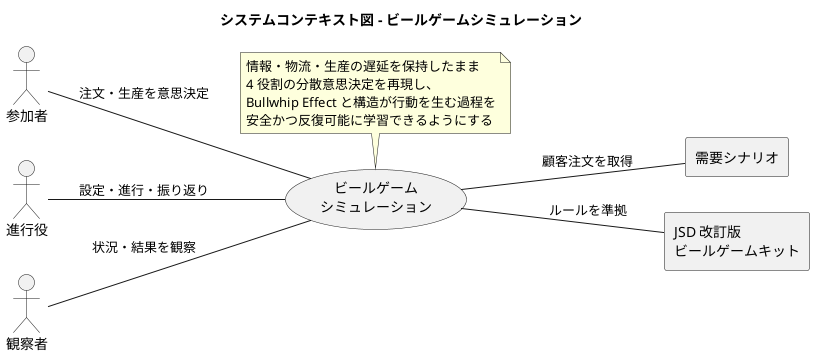
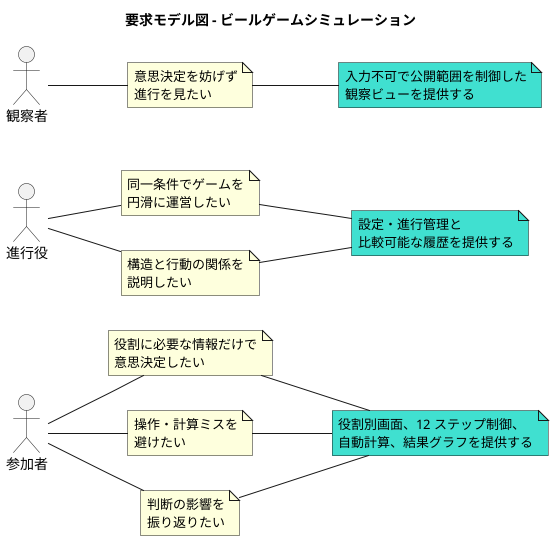
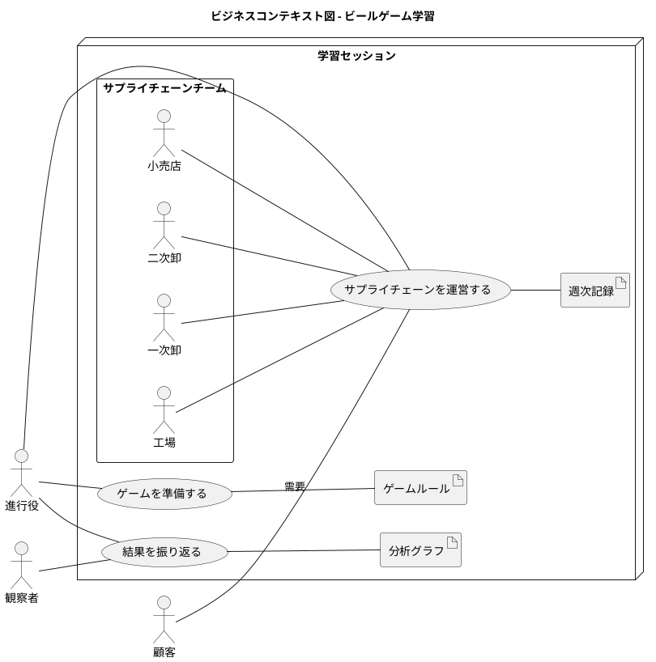
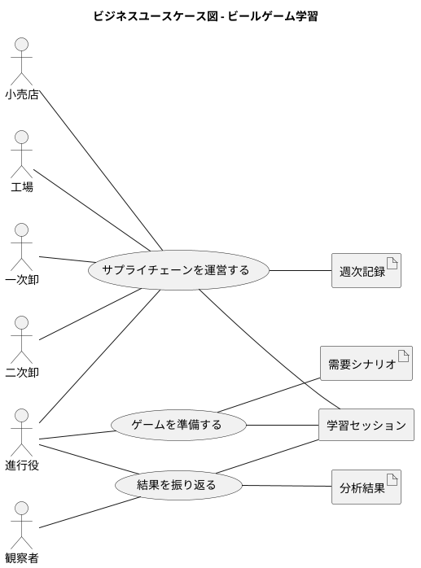
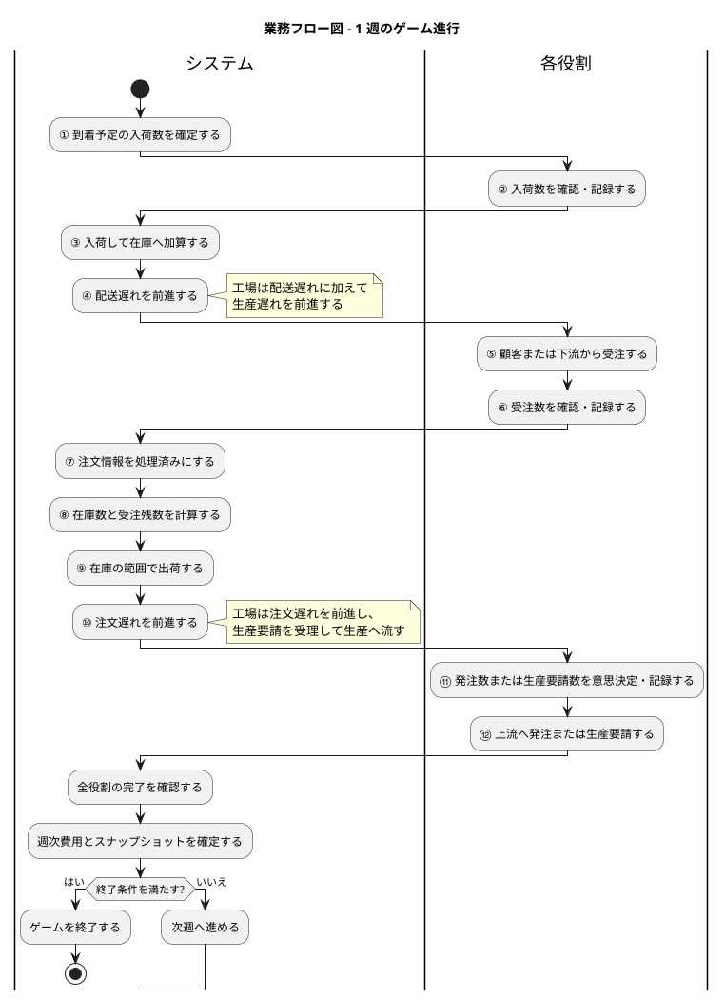
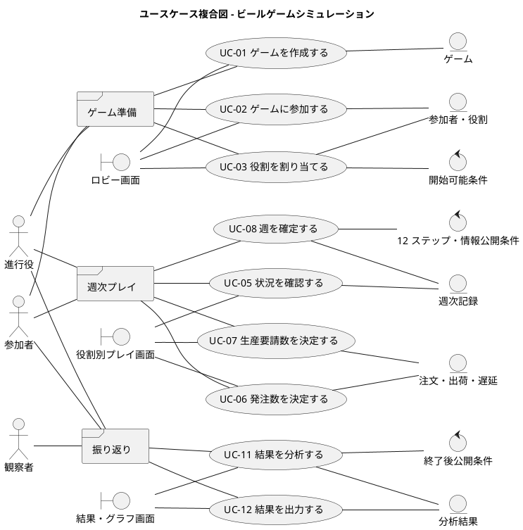
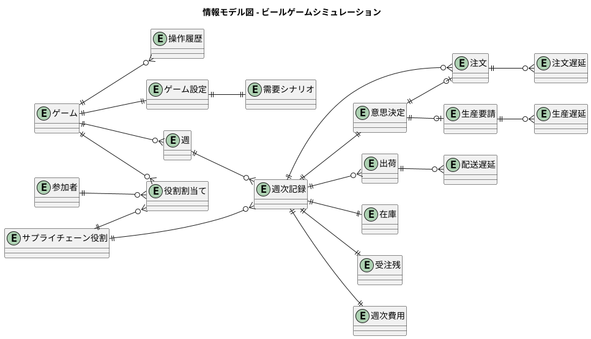
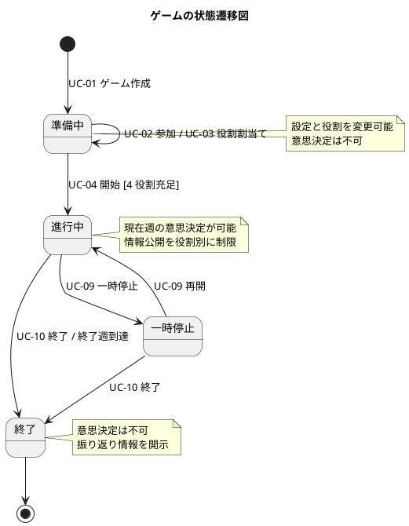
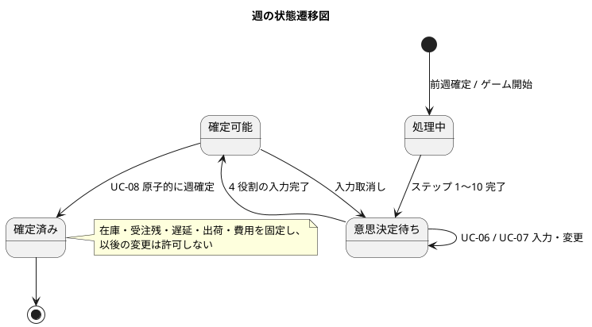

# 要件定義 - ビールゲームシミュレーション

## 文書の目的

本書は、日本システム・ダイナミクス学会（JSD）が公開する改訂版ビールゲームキットを、複数人で実行できるデジタルシミュレーションとして再現するための要件を、RDRA 2.0 の 4 層で定義します。

対象システムの第一の目的は勝敗を決めることではありません。参加者が、局所的には合理的な意思決定をしても、情報遅延・配送遅延・相互作用によって在庫と受注残の振動が増幅する過程を体験し、「システムの内的構造が行動を生む」という System Dynamics の原則を学ぶことです。

## 根拠と前提

### 参照資料

| ID | 資料 | 本書で参照した内容 |
| :--- | :--- | :--- |
| SRC-01 | [JSD ビールゲーム公開ページ](https://j-s-d.jp/web/beergame/) | 学習目的、4 役割、改訂理由、公開キット一覧 |
| SRC-02 | [ビールゲームの説明](https://www.j-s-d.jp/Beer/BeerGame/2_What_is_BG.pdf) | 盤面構造、物流・情報流、初期値、遅延、運営方法 |
| SRC-03 | [ゲームの修正ステップ](https://www.j-s-d.jp/Beer/Revised/1_ReSteps.pdf) | 各役割が週ごとに行う 12 ステップ |
| SRC-04 | [改訂版ビールゲーム盤](https://www.j-s-d.jp/Beer/Revised/2_ReGB.pdf) | 4 役割の盤面、在庫、遅延、注文カードの配置 |
| SRC-05 | [工場用記録シート](https://www.j-s-d.jp/Beer/Revised/3_Sheet1.pdf) | 工場の記録項目、50 週、費用計算 |
| SRC-06 | [一次卸用記録シート](https://www.j-s-d.jp/Beer/Revised/4_Sheet2.pdf) | 一次卸の記録項目 |
| SRC-07 | [二次卸用記録シート](https://www.j-s-d.jp/Beer/Revised/5_Sheet3.pdf) | 二次卸の記録項目 |
| SRC-08 | [小売店用記録シート](https://www.j-s-d.jp/Beer/Revised/6_Sheet4.pdf) | 小売店の記録項目 |
| SRC-09 | [注文グラフシート](https://www.j-s-d.jp/Beer/BeerGame/7_OrderGraph.pdf) | 注文量の時系列分析 |
| SRC-10 | [在庫と受注残のグラフシート](https://www.j-s-d.jp/Beer/BeerGame/8_InBaGraph.pdf) | 在庫・受注残の時系列分析 |

### スコープ

| 区分 | 内容 |
| :--- | :--- |
| 対象 | ゲーム設定、参加、週次進行、注文・生産意思決定、物流・情報遅延、在庫・受注残・費用計算、結果可視化、振り返り |
| 対象外 | 実物キットの印刷・組立、金銭決済、教材販売、汎用 Supply Chain Management、実在企業の需給計画 |
| 前提 | 1 ゲームは工場・一次卸・二次卸・小売店の 4 役割で構成し、各役割を 1 人以上が担当します |
| 前提 | 参加者間の需要・注文・在庫情報は、ゲームルールで許可された範囲に限定します |
| デジタル化方針 | 物理キットの移動操作は自動化しますが、意思決定の分散、情報制約、遅延、費用構造は保持します |

### 未確定事項と仮定

| ID | 項目 | 現時点の扱い |
| :--- | :--- | :--- |
| ASM-01 | 顧客需要系列 | 進行役が事前設定し、各週に小売店だけへ開示します。既定系列の値は実装前に教材の運営条件と照合します |
| ASM-02 | ゲーム週数 | 記録シートに合わせて最大 50 週とし、終了週は進行役が設定可能とします |
| ASM-03 | プレイヤー不在時 | 進行役が代理操作できるものとし、自動補充戦略は初期スコープ外とします |
| ASM-04 | 同一役割の複数人担当 | 共同で 1 つの意思決定値を入力します。投票・多数決は対象外です |
| ASM-05 | 途中参加・再接続 | 同じ参加者または進行役の割当てにより復帰できます |

## システム価値

### システムコンテキスト

### ステークホルダー要求

| ID | ステークホルダー | 要求 | 派生するシステム要求 |
| :--- | :--- | :--- | :--- |
| SR-01 | 参加者 | 自分の役割に必要な情報だけを見て意思決定したい | 役割別画面と情報アクセス制御を提供する |
| SR-02 | 参加者 | 盤面操作や計算の単純ミスを避けたい | 12 ステップを順序制御し、数量と費用を自動計算する |
| SR-03 | 参加者 | 自分の判断がサプライチェーン全体に与えた影響を理解したい | 終了後に役割別・チーム全体の時系列を比較表示する |
| SR-04 | 進行役 | ルール説明より学習支援に集中したい | ゲーム作成、役割割当て、週進行、停止・再開を一元管理する |
| SR-05 | 進行役 | 複数チームを同じ条件で比較したい | 同一シナリオと初期条件から独立したゲームを開始できる |
| SR-06 | 進行役 | 振り返りで Bullwhip Effect の発生過程を説明したい | 注文・在庫・受注残・費用・需要のグラフと履歴を提供する |
| SR-07 | 観察者 | 意思決定を妨げず進行を把握したい | 入力不可の観察ビューを提供し、公開範囲を進行役が制御する |
| SR-08 | 教材管理者 | 改訂版キットの学習構造を損なわずデジタル化したい | 4 役割、遅延、情報制約、費用、12 ステップをルールとして固定・検証する |

### 要求モデル

## システム外部環境

### ビジネスコンテキスト

### ビジネスユースケース

| ID | ビジネスユースケース | 主アクター | 開始条件 | 成果 |
| :--- | :--- | :--- | :--- | :--- |
| BUC-01 | ゲームを準備する | 進行役 | 学習セッションを計画した | 参加者、役割、期間、需要、初期条件が確定する |
| BUC-02 | サプライチェーンを運営する | 4 役割、進行役 | ゲームが開始可能である | 各週の物流・注文・生産・費用が確定する |
| BUC-03 | 結果を振り返る | 進行役、参加者、観察者 | ゲームが終了した | 振動・増幅・遅延と意思決定の関係を説明できる |

### ビジネスユースケース図

### 週次業務フロー

改訂版キットの 12 ステップを 1 週のトランザクション境界とします。小売店、卸、工場で存在しないステップはスキップしますが、全役割が同じステップ番号で同期します。

### 利用シーン

| ID | 利用シーン | アクター | 説明 |
| :--- | :--- | :--- | :--- |
| US-01 | 同室での研修 | 進行役、参加者 | 進行役の合図で各役割が同じ週・ステップを進めます |
| US-02 | オンライン研修 | 進行役、参加者 | 各端末から同一ゲームに参加し、役割外の情報を見ずに意思決定します |
| US-03 | 複数チーム比較 | 進行役、参加者 | 同じ需要系列と初期条件で複数ゲームを実施し、結果を比較します |
| US-04 | デブリーフィング | 全員 | 役割情報を開示し、注文・在庫・受注残・費用の時系列から構造と行動を考察します |
| US-05 | 中断からの再開 | 進行役、参加者 | 保存された確定週からゲームを再開します |

### バリエーション・条件

| 分類軸 | 値 | 条件 |
| :--- | :--- | :--- |
| 役割 | 小売店 | 顧客需要を受け、二次卸へ発注します |
| 役割 | 二次卸 | 小売店から受注し、一次卸へ発注します |
| 役割 | 一次卸 | 二次卸から受注し、工場へ発注します |
| 役割 | 工場 | 一次卸から受注し、生産要請を決定します |
| ゲーム状態 | 準備中 | 設定・参加・役割割当てを変更できます |
| ゲーム状態 | 進行中 | 週次入力と進行だけを許可します |
| ゲーム状態 | 一時停止 | 閲覧と再開を許可し、意思決定確定を停止します |
| ゲーム状態 | 終了 | 入力を禁止し、全体結果を開示します |
| 情報公開 | プレイ中 | 各役割のローカル情報と許可された注文・入荷だけを表示します |
| 情報公開 | 振り返り | チーム全体の需要、注文、在庫、受注残、出荷、費用を表示します |

## システム境界

### システムユースケース一覧

| ID | ユースケース | 主アクター | 対応要求 |
| :--- | :--- | :--- | :--- |
| UC-01 | ゲームを作成する | 進行役 | SR-04、SR-05 |
| UC-02 | ゲームに参加する | 参加者 | SR-01、SR-04 |
| UC-03 | 役割を割り当てる | 進行役 | SR-04 |
| UC-04 | ゲームを開始する | 進行役 | SR-04、SR-08 |
| UC-05 | 週次状況を確認する | 参加者 | SR-01、SR-02 |
| UC-06 | 発注数を決定する | 小売店、二次卸、一次卸 | SR-01、SR-02 |
| UC-07 | 生産要請数を決定する | 工場 | SR-01、SR-02 |
| UC-08 | 週を確定する | システム、進行役 | SR-02、SR-04、SR-08 |
| UC-09 | ゲームを一時停止・再開する | 進行役 | SR-04 |
| UC-10 | ゲームを終了する | 進行役、システム | SR-04 |
| UC-11 | 結果を分析する | 全員 | SR-03、SR-06、SR-07 |
| UC-12 | 結果を出力する | 進行役 | SR-05、SR-06 |

### ユースケース複合図

### 画面・帳票モデル

| ID | 画面・帳票 | 利用者 | 主な内容 |
| :--- | :--- | :--- | :--- |
| UI-01 | ゲーム作成画面 | 進行役 | 名称、週数、需要シナリオ、初期条件、費用単価、公開設定 |
| UI-02 | ロビー画面 | 進行役、参加者 | 参加コード、参加者一覧、役割割当て、準備状況、開始操作 |
| UI-03 | 役割別プレイ画面 | 参加者 | 現在週・ステップ、在庫、受注残、到着入荷、受注、発注・生産入力、履歴 |
| UI-04 | 進行管理画面 | 進行役 | 全役割の入力完了状況、停止・再開、代理入力、週確定、終了 |
| UI-05 | 観察画面 | 観察者 | 進行役が許可した集約情報、現在週、進行状況 |
| UI-06 | 結果・グラフ画面 | 全員 | 需要、役割別注文、在庫、受注残、出荷、週次費用、累積費用 |
| RP-01 | ゲーム結果データ | 進行役 | ゲーム設定と全週・全役割の記録を再利用可能な形式で出力 |

### イベントモデル

| ID | イベント | 発生元 | 受信先 | 結果 |
| :--- | :--- | :--- | :--- | :--- |
| EV-01 | 参加者が参加した | 参加者 | ゲーム | ロビーへ参加者を追加する |
| EV-02 | ゲームが開始された | 進行役 | ゲーム | 初期状態を固定し、第 1 週を開始する |
| EV-03 | 顧客需要が到来した | 需要シナリオ | 小売店 | 当該週の小売店受注へ加える |
| EV-04 | 発注が確定した | 下流役割 | 注文遅延 | 注文を 2 週の情報遅延へ投入する |
| EV-05 | 注文が到着した | 注文遅延 | 上流役割 | 当該週の受注へ加える |
| EV-06 | 出荷が確定した | 上流役割 | 配送遅延 | 出荷を 2 週の物流遅延へ投入する |
| EV-07 | 入荷が到着した | 配送遅延 | 下流役割 | 在庫へ加算する |
| EV-08 | 生産要請が確定した | 工場 | 生産遅延 | 生産要請を 2 段階の生産遅延へ投入する |
| EV-09 | 全役割の意思決定が完了した | 4 役割 | ゲーム | 週次計算を確定し次週へ進める |
| EV-10 | ゲームが終了した | 進行役・終了条件 | 分析 | 全情報を確定し、振り返り用に開示する |

### 機能要件

| ID | 要件 | 受入基準 |
| :--- | :--- | :--- |
| FR-01 | システムは、進行役がゲーム設定を作成できること | 週数、需要系列、初期在庫、各遅延量、費用単価、公開範囲を保存できる |
| FR-02 | システムは、参加コードで参加者をゲームへ参加させられること | 有効なコードではロビーへ参加し、無効・終了済みコードでは拒否理由を表示する |
| FR-03 | システムは、4 役割を重複なく割り当てられること | 工場・一次卸・二次卸・小売店がすべて充足するまで開始できない |
| FR-04 | システムは、役割に応じた情報だけを表示すること | プレイ中、他役割の在庫・受注残・意思決定値と将来需要を取得できない |
| FR-05 | システムは、改訂版キットの 12 ステップ順に週を進めること | 未完了の必須ステップを飛ばして週を確定できない |
| FR-06 | システムは、入荷・受注・在庫・受注残を自動計算すること | BR-05〜BR-08 の式と順序に一致し、負の在庫を保存しない |
| FR-07 | システムは、各役割の非負整数の発注数または生産要請数を受け付けること | 小数・負数・未入力を拒否し、確定前は変更できる |
| FR-08 | システムは、注文・配送・生産の遅延を週単位で保持すること | BR-02〜BR-04 の期間より早く到着しない |
| FR-09 | システムは、週確定を一度だけ原子的に行うこと | 再送・同時操作でも在庫、注文、出荷、費用が二重計上されない |
| FR-10 | システムは、各週・各役割の週次費用と累積費用を計算すること | BR-09 と一致し、チーム費用は 4 役割の合計になる |
| FR-11 | システムは、進行役がゲームを一時停止・再開・終了できること | 一時停止中と終了後は参加者の新規確定操作を拒否する |
| FR-12 | システムは、確定済み週から中断ゲームを復元できること | 復元前後で在庫、受注残、遅延、履歴、費用が一致する |
| FR-13 | システムは、終了後に需要と全役割の時系列を比較表示すること | 1 つの時間軸で需要、注文、在庫、受注残、出荷、費用を役割別に切り替えられる |
| FR-14 | システムは、ゲーム設定と全週記録を出力できること | 出力から週・役割・各数量・費用・意思決定を識別できる |
| FR-15 | システムは、進行役による代理入力を記録できること | 誰が、どの役割へ、いつ、何を入力したか履歴に残る |

### 非機能要件

| ID | 品質特性 | 要件・測定基準 |
| :--- | :--- | :--- |
| NFR-01 | 正確性 | 同じ初期状態と意思決定系列からは、常に同じ週次状態・費用を再現すること |
| NFR-02 | 整合性 | 週確定処理は All-or-Nothing とし、障害時に部分更新を残さないこと |
| NFR-03 | 応答性 | 通常負荷で、入力確定の 95 パーセンタイルを 1 秒以内、週確定後の画面反映を 2 秒以内とすること |
| NFR-04 | 同時利用 | 少なくとも 15 チーム、各チーム 4 役割と進行役の同時利用を支えること |
| NFR-05 | 可用性 | セッション中の一時的な切断後、確定済みデータを失わず再接続できること |
| NFR-06 | セキュリティ | 推測困難な参加コードを使用し、ゲーム・役割単位で操作権限を検証すること |
| NFR-07 | プライバシー | 表示名以外の個人情報を必須収集せず、保持期間を運営者が設定できること |
| NFR-08 | アクセシビリティ | 色だけに依存せず状態を示し、キーボード操作と十分なコントラストを提供すること |
| NFR-09 | 監査性 | ゲーム設定、役割変更、代理入力、週確定、停止、再開、終了の履歴を追跡できること |
| NFR-10 | 可搬性 | 最新 2 世代の主要デスクトップブラウザで利用でき、参加者側への専用ソフト導入を不要とすること |

## システム内部構造

### ビジネスルール

| ID | ルール | 根拠 |
| :--- | :--- | :--- |
| BR-01 | サプライチェーンは、上流から工場→一次卸→二次卸→小売店→顧客の順で構成する | SRC-01、SRC-02 |
| BR-02 | 工場から一次卸、一次卸から二次卸、二次卸から小売店への配送は、それぞれ 2 週を要する | SRC-02、SRC-03 |
| BR-03 | 小売店から二次卸、二次卸から一次卸、一次卸から工場への注文情報は、それぞれ 2 週を要する | SRC-02、SRC-03 |
| BR-04 | 工場の生産要請は 2 段階の生産遅延を経て工場在庫へ入る | SRC-02、SRC-03 |
| BR-05 | 当週の利用可能量は「前週末在庫 + 当週入荷」である | SRC-03、SRC-05〜SRC-08 |
| BR-06 | 当週の充足対象は「前週末受注残 + 当週受注」である | SRC-03、SRC-05〜SRC-08 |
| BR-07 | 当週出荷数は「利用可能量」と「充足対象」の小さい方とする | SRC-03、SRC-05〜SRC-08 |
| BR-08 | 当週末在庫は `max(0, 利用可能量 - 充足対象)`、当週末受注残は `max(0, 充足対象 - 利用可能量)` とする | SRC-03、SRC-05〜SRC-08 |
| BR-09 | 週次費用は `当週末在庫 × $0.50 + 当週末受注残 × $1.00`、チーム総費用は全役割・全週の合計とする | SRC-05〜SRC-08 |
| BR-10 | 参加者の意思決定対象は、当週の発注数または工場の生産要請数だけとする | SRC-02、SRC-03 |
| BR-11 | 顧客需要は外生変数であり、プレイ中は当該週の値を小売店だけに開示する | SRC-02 |
| BR-12 | 週の状態は 4 役割すべての意思決定が揃った後に一度だけ確定する | デジタル化要件 |
| BR-13 | 初期値はキット準拠プリセットとして、生産遅れ各段 4、工場在庫 12、配送遅れ各段 4、各役割在庫 12 を提供する | SRC-02 |
| BR-14 | 初期値、需要系列、週数、費用単価を変更したゲームは「カスタム」と明示し、キット準拠ゲームと区別する | 教材忠実性 |

### 情報モデル

### ゲームの状態モデル

### 週の状態モデル

### トレーサビリティ

| 価値・要求 | 業務 | システム UC | 機能・ルール |
| :--- | :--- | :--- | :--- |
| SR-01 役割情報で意思決定 | BUC-02 | UC-05〜UC-07 | FR-04、FR-07、BR-10、BR-11 |
| SR-02 ミスを防止 | BUC-02 | UC-05〜UC-08 | FR-05、FR-06、FR-08、FR-09、BR-02〜BR-09 |
| SR-03 影響を理解 | BUC-03 | UC-11 | FR-13 |
| SR-04 円滑な進行 | BUC-01、BUC-02 | UC-01〜UC-04、UC-08〜UC-10 | FR-01〜FR-03、FR-09、FR-11、FR-12、FR-15 |
| SR-05 同一条件で比較 | BUC-01、BUC-03 | UC-01、UC-12 | FR-01、FR-14、BR-13、BR-14 |
| SR-06 学習を支援 | BUC-03 | UC-11、UC-12 | FR-10、FR-13、FR-14 |
| SR-07 観察 | BUC-03 | UC-11 | FR-04、FR-13 |
| SR-08 教材へ準拠 | BUC-01、BUC-02 | UC-04、UC-08 | FR-05、FR-06、FR-08〜FR-10、BR-01〜BR-14 |

## 受入れの判断基準

次を満たしたとき、改訂版ビールゲームに基づく最小実用範囲を受け入れ可能とします。

- 4 役割の参加者が、他役割の非公開情報を参照せずに 1 ゲームを完了できます。
- 既知の初期状態と意思決定系列を与えた自動テストで、50 週すべての在庫・受注残・注文・出荷・遅延・費用が期待値と一致します。
- 同一入力の再実行で同一結果となり、週確定の重複操作でも二重計上されません。
- 中断・再接続後も確定済み状態が一致し、ゲームを継続できます。
- 終了後、注文・在庫・受注残・費用を役割別に比較し、需要変動が上流へ増幅する過程を振り返れます。
- キット準拠設定とカスタム設定を画面・出力の双方で識別できます。

## 次工程への引継ぎ

- ASM-01 の既定需要系列を、進行役向け教材または有識者レビューで確定します。
- `analyzing-usecases` で UC-01〜UC-12 の事前条件、基本フロー、代替フロー、事後条件を詳細化します。
- `analyzing-domain-model` でゲーム、週、役割、注文、出荷、遅延、在庫、受注残、費用の不変条件を定義します。
- `analyzing-test-strategy` で BR-02〜BR-09 と週確定の決定表・プロパティベーステストを設計します。
