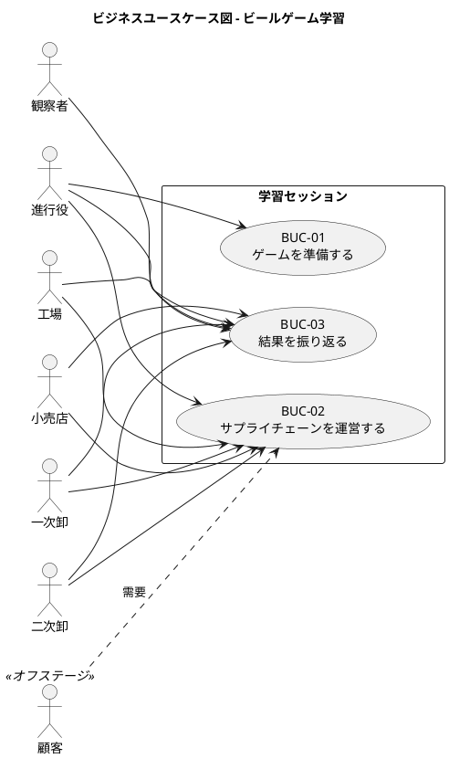

# ビジネスユースケース - ビールゲームシミュレーション（v2）

> **beer-game2（v2）の出発点**: 本書は beer-game（v1）の文書を複製したものです。v2 で改訂します。表中の「実装状況」「現状」は **v1 の状態**を表し、不足は v2 で解消する対象です。詳細は [ADR-001](../../adr/beer-game2/001-rebuild-as-beer-game2.md) を参照してください。

## 概要

本書は、[要件定義](./requirements_definition.md) の「システム外部環境」を起点に、ビールゲーム学習の**ビジネスユースケース**を定義します。システムの詳細には踏み込まず、業務の目標とアクターの関係だけを扱います。システムの振る舞いは [システムユースケース](./system_usecase.md)、開発可能な粒度は [ユーザーストーリー](./user_story.md) で定義します。

**`docs/` を正本**とします。`aidlc/` のユーザーストーリーとペルソナを取り込み、要件定義との対応を明示しています。

## スコープ

### 設計スコープ

| 項目 | 内容 |
| :--- | :--- |
| 設計スコープ | 🏢 学習セッション（組織の業務）。ブラックボックスとして扱い、システムの内部には触れない |
| 対象システム | 🖥️ ビールゲームシミュレーション |
| 目的 | 局所的に合理的な意思決定が、遅延と相互作用によって在庫と受注残の振動を増幅する過程を体験し、「システムの内的構造が行動を生む」ことを学ぶ |

### In / Out リスト

| トピック | In | Out | 備考 |
| :--- | :---: | :---: | :--- |
| ゲーム設定、参加、役割割当て | ✓ | | BUC-01 |
| 週次の意思決定、物流・情報遅延、在庫・受注残・費用の計算 | ✓ | | BUC-02 |
| 進行管理（停止・再開・代理入力・終了） | ✓ | | BUC-02 |
| 結果の可視化、振り返り、出力 | ✓ | | BUC-03 |
| 保持期間と期限後の削除 | ✓ | | BUC-01（設定）、システムが実行 |
| 実物キットの印刷・組立 | | ✓ | 要件定義のスコープ外 |
| 金銭決済、教材販売 | | ✓ | 要件定義のスコープ外 |
| 汎用 Supply Chain Management、実在企業の需給計画 | | ✓ | 要件定義のスコープ外 |
| プレイヤー不在時の自動補充 | | ✓ | ASM-03（初期スコープ外） |

## アクター

| アクター | 種別 | 説明 | ペルソナ |
| :--- | :--- | :--- | :--- |
| 進行役 | 主アクター | 学習セッションの準備、進行、振り返りを管理する | P1 進行役 |
| 工場 | 主アクター | 一次卸から受注し、生産要請を決定する | P2 生産役 |
| 一次卸 | 主アクター | 二次卸から受注し、工場へ発注する | P3 流通役 |
| 二次卸 | 主アクター | 小売店から受注し、一次卸へ発注する | P3 流通役 |
| 小売店 | 主アクター | 顧客需要を受け、二次卸へ発注する（当週需要を見られる唯一の役割） | P3 流通役 |
| 観察者 | 主アクター | 意思決定に干渉せず、進行状況と振り返りを観察する（読み取り専用） | P4 観察者 |
| 顧客 | オフステージ | 需要を発生させる。システムの利用者ではなく、需要系列として表現する | — |

要件定義では「参加者」を 4 役割の総称として使います。ペルソナの「生産役」は工場、「流通役」は一次卸・二次卸・小売店に対応します。

## アクター・目的リスト

| アクター | 目的 | レベル | 優先度 | 頻度 |
| :--- | :--- | :---: | :---: | :--- |
| 進行役 | 学習セッションを準備する（BUC-01） | 🌊 | 高 | セッションごと 1 回 |
| 進行役 | セッションを運営する（BUC-02） | 🌊 | 高 | セッションごと |
| 工場・一次卸・二次卸・小売店 | サプライチェーンを運営する（BUC-02） | 🌊 | 高 | 毎週 |
| 進行役 | 結果を振り返る（BUC-03） | 🌊 | 高 | セッションごと 1 回 |
| 参加者 | 結果を振り返る（BUC-03） | 🌊 | 高 | セッションごと 1 回 |
| 観察者 | 進行を観察し、結果を振り返る（BUC-03） | 🌊 | 中 | セッションごと |

## ビジネスユースケース一覧

| ID | ビジネスユースケース | 主アクター | レベル | 開始条件 | 成果 |
| :--- | :--- | :--- | :---: | :--- | :--- |
| BUC-01 | ゲームを準備する | 進行役 | 🌊 | 学習セッションを計画した | 参加者、役割、期間、需要、保持期間が確定し、学習を開始できる |
| BUC-02 | サプライチェーンを運営する | 4 役割、進行役 | ☁️ | ゲームが開始可能である | 各週の物流・注文・生産・費用が確定し、最終週でゲームが終わる |
| BUC-03 | 結果を振り返る | 進行役、参加者、観察者 | 🌊 | ゲームが終了した | 振動・増幅・遅延と意思決定の関係を説明できる |

BUC-02 は、毎週繰り返す複数のユーザー目的（状況の確認、意思決定、週の確定）を含むため、要約レベル（☁️）とします。

### ビジネスユースケース図

## ビジネスユースケースの記述

### BUC-01: 🏢ゲームを準備する🌊

**主アクター**: 進行役

**利害関係者と利益**:

- 進行役: 手間をかけずに、同じ条件で学習セッションを再現できる
- 参加者: アカウントを作らずに、すぐ参加できる
- 運営者: 参加者の個人情報を必要以上に持たない

**成功保証**: 参加者 4 役割（工場、一次卸、二次卸、小売店）が揃い、需要系列と期間と保持期間が確定し、ゲームを開始できる。

**主成功シナリオ**:

1. 進行役が、条件（既定のキット準拠、またはカスタム）を決めてゲームを作る
2. 進行役が、参加コードを参加者へ伝える
3. 参加者が、参加コードと表示名で参加する
4. 進行役が、参加者へ役割を割り当てる
5. 進行役が、4 役割が揃ったことを確認してゲームを開始する

**拡張**:

- 1a. 条件を変更する: キット準拠値から変えた場合は「カスタム」として区別し、比較の対象外であることを示す（BR-14）
- 3a. 参加者が途中で切断する: 同じ参加者として戻れる（ASM-05）
- 5a. 役割が不足している: 開始できず、不足している役割を示す

**関連**: SR-04、SR-05、BR-13、BR-14、FR-01〜FR-04。対応するシステムユースケース: UC-01〜UC-04。

### BUC-02: 🏢サプライチェーンを運営する☁️

**主アクター**: 工場、一次卸、二次卸、小売店、進行役

**利害関係者と利益**:

- 参加者: 自分の役割の情報だけで意思決定でき、計算ミスに悩まされない
- 進行役: 全役割の進行を同期でき、不在者や中断にも対応できる
- 教材の運営者: 教材（JSD 改訂版キット）の規則に忠実である

**成功保証**: 4 役割の意思決定から週の状態が一度だけ確定し、最終週で終了する。確定した週の記録が残る。

**主成功シナリオ（1 週）**:

1. 各参加者が、自分の役割の状況（在庫、受注残、入荷、受注）を確認する
2. 各参加者が、発注数（工場は生産要請数）を決める
3. システムが、4 役割の入力が揃ったことを示す
4. 進行役が、週を確定する
5. システムが、12 ステップに従って物流・注文・費用を計算し、次週へ進める

最終週を確定するとゲームは終了します。

**拡張**:

- 2a. 参加者が不在である: 進行役が代理で入力する（ASM-03）
- 4a. 中断が必要になる: 進行役が一時停止し、再開する
- 5a. 最終週に達した: ゲームを終了し、BUC-03 へ進む
- *a. 通信が切れた: 参加者は同じ役割へ復帰し、確定済みの記録は失われない

**関連**: SR-01、SR-02、SR-04、SR-08、BR-01〜BR-12、FR-04〜FR-12、FR-15。対応するシステムユースケース: UC-05〜UC-10、UC-14。

### BUC-03: 🏢結果を振り返る🌊

**主アクター**: 進行役、参加者、観察者

**利害関係者と利益**:

- 参加者: 自分の意思決定が全体の振動にどう影響したかを理解できる
- 進行役: 遅延と構造が行動を生む過程を、データで説明できる
- 観察者: プレイ中は学習条件を壊さない範囲で進行を観察でき、終了後は全体を見られる
- 運営者: 不要になった記録を残さない

**成功保証**: 需要、注文、在庫、受注残、出荷、費用を、役割別に同じ時間軸で比較でき、記録を再利用できる形式で出力できる。保持期間を過ぎた記録は削除される。

**主成功シナリオ**:

1. 観察者が、プレイ中に進行状況とチーム合計を観察する（役割別の非公開値は見ない）
2. ゲームが終了する
3. 全員が、需要と全役割の時系列を比較する
4. 進行役が、全週の記録を CSV と JSON で出力する
5. 保持期間を過ぎると、システムが記録を削除する

**拡張**:

- 1a. 集計対象が少なく、合計から個別の値が逆算できる: 合計を表示しない
- 3a. 終了前に分析を求められる: 終了後専用の情報は開示しない
- 4a. 出力の一部が失敗する: 部分的な結果を完全な出力として示さない

**関連**: SR-03、SR-06、SR-07、FR-04、FR-13、FR-14、NFR-07。対応するシステムユースケース: UC-11、UC-12、UC-13、UC-15。

## トレーサビリティ

| 価値・要求 | ビジネスユースケース | システムユースケース |
| :--- | :--- | :--- |
| SR-01 役割情報で意思決定 | BUC-02 | UC-05〜UC-07 |
| SR-02 ミスを防止 | BUC-02 | UC-05〜UC-08 |
| SR-03 影響を理解 | BUC-03 | UC-11 |
| SR-04 円滑な進行 | BUC-01、BUC-02 | UC-01〜UC-04、UC-08〜UC-10、UC-14 |
| SR-05 同一条件で比較 | BUC-01、BUC-03 | UC-01、UC-12 |
| SR-06 学習を支援 | BUC-03 | UC-11、UC-12 |
| SR-07 観察 | BUC-03 | UC-11、UC-13 |
| SR-08 教材へ準拠 | BUC-01、BUC-02 | UC-04、UC-08 |

## 出典

- [要件定義](./requirements_definition.md)（システム外部環境、ビジネスユースケース、トレーサビリティ）
- `aidlc/spaces/default/intents/261027-beer-game-development/inception/user-stories/personas.md`
