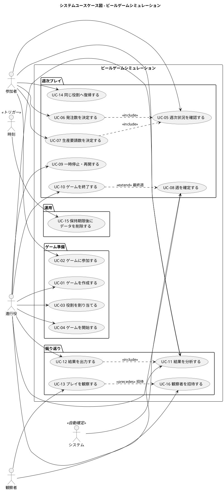

# システムユースケース - ビールゲームシミュレーション（v2）

> **beer-game2（v2）**: 本書は beer-game（v1）の文書を出発点に、v2 で改訂しました。表中に「v1 の状態」と記した項目は、v1 の実装の状況で、不足は v2 で解消する対象です。経緯は [ADR-001](../../adr/beer-game2/001-rebuild-as-beer-game2.md) を参照してください。

## 概要

本書は、[ビジネスユースケース](./business_usecase.md) をシステム境界の視点で詳細化し、「システムが何を提供するか」を完全形式で定義します。ここから [ユーザーストーリー](./user_story.md) を導出します。

**`docs/` を正本**とします。beer-game（v1）の同名の文書を出発点に、**v2 で改訂**しました。

- UC-01〜UC-15 は v1 から引き継ぎ、v2 の範囲（共同担当、カスタム条件、観察者、自動確定）と、v1 の不足の解消を反映しました。
- UC-16「観察者を招待する」を、観察者の独立した立場（FR-17）のために追加しました。
- 各ユースケースに、**v1 の状態**（実装の状況）と **v2 での扱い**を併記しています。

## スコープ

| 項目 | 内容 |
| :--- | :--- |
| 設計スコープ | 🖥️ ビールゲームシミュレーション（ブラックボックスとして扱う） |
| 外部の人 | 進行役、参加者（工場・一次卸・二次卸・小売店）、観察者 |
| 外部のシステム | なし（アカウント基盤、決済、外部配信は対象外） |

### ユースケース複合図

## ユースケース一覧

| ID | ユースケース | 主アクター | 対応要求 | v1 の状態 | v2 での扱い |
| :--- | :--- | :--- | :--- | :--- | :--- |
| UC-01 | ゲームを作成する | 進行役 | SR-04、SR-05、FR-01 | 一部（カスタム条件の保持、初期値・費用の変更が無い） | カスタム条件の変更と記録、最終週 1〜50、自動確定の設定を実装 |
| UC-02 | ゲームに参加する | 参加者 | SR-01、SR-04 | 実装済み | 引き継ぐ |
| UC-03 | 役割を割り当てる | 進行役 | SR-04、FR-16 | 一部（共同担当が無い） | 同一役割に複数人を割り当て可能にする |
| UC-04 | ゲームを開始する | 進行役 | SR-04、SR-08 | 実装済み | 引き継ぐ（各役割 1 人以上で開始） |
| UC-05 | 週次状況を確認する | 参加者 | SR-01、SR-02 | 実装済み | 共同担当の参加者が同じ状況を見る |
| UC-06 | 発注数を決定する | 小売店、二次卸、一次卸 | SR-01、SR-02、FR-16 | 実装済み（共同入力は無い） | 共同入力と競合の検出を実装 |
| UC-07 | 生産要請数を決定する | 工場 | SR-01、SR-02、FR-16 | 実装済み（同上） | 同上 |
| UC-08 | 週を確定する | 進行役、システム | SR-02、SR-04、SR-08、FR-18 | 実装済み（進行役の操作のみ） | 自動確定（FR-18）を追加。手動の確定は残す |
| UC-09 | ゲームを一時停止・再開する | 進行役 | SR-04、FR-15 | 実装済み（代理入力の値が履歴に残らない） | 代理入力の履歴に値を含める。停止中は自動確定しない |
| UC-10 | ゲームを終了する | 進行役 | SR-04 | 実装済み | 引き継ぐ |
| UC-11 | 結果を分析する | 進行役、参加者、観察者 | SR-03、SR-06、FR-13 | 一部（役割別の時系列が無い） | 役割別の時系列を実装（最優先） |
| UC-12 | 結果を出力する | 進行役 | SR-05、SR-06、FR-14 | 一部（チーム合計の CSV と JSON のみ） | 設定、役割別の値、意思決定、履歴を含める |
| UC-13 | プレイを観察する | 観察者 | SR-07、FR-17 | 一部（観察者という独立した立場が無い） | 観察用の招待で参加する観察者を実装 |
| UC-14 | 同じ役割へ復帰する | 参加者、進行役 | SR-04（ASM-05、NFR-05） | 実装済み（進行役の復帰手段が無い） | 進行役の復帰を加える |
| UC-15 | 保持期限後にデータを削除する | 時刻（システム） | NFR-07 | 一部（削除対象に漏れ） | 削除対象を網羅し、削除後に残らないことをテストで確認 |
| UC-16 | 観察者を招待する | 進行役 | SR-07、FR-17 | なし | 新規 |

## ユースケースの記述

各ユースケースは、設計スコープ 🖥️、レベル 🌊（ユーザー目的）です。

### UC-01: 🖥️ゲームを作成する🌊

**使用時のコンテキスト**: 学習セッションを始める前に、進行役が条件を決めてゲームを作る。

**主アクター**: 進行役

**利害関係者と利益**:

- 進行役: 同じ条件でセッションを再現できる
- 運営者: 保持期間が必ず設定される

**事前条件**: なし（アカウントは不要）

**最低保証**: 不正な条件のゲームは作られない。同じ操作を繰り返しても、ゲームは重複して作られない。

**成功保証**: 参加コードと進行役の資格を持つ、準備中のゲームが作られる。

**トリガー**: 進行役がゲームの作成を求める。

**主成功シナリオ**:

1. 進行役が、条件（最終週、需要系列、初期在庫、遅延、費用単価、公開範囲、保持期間、自動確定の有無）を決める
2. システムが、条件を検証する
3. システムが、準備中のゲームを一度だけ作成する
4. システムが、参加コードと進行役の資格を発行する
5. 進行役が、参加コードを確認する

**拡張**:

- 1a. 既定のキット準拠を選ぶ: システムが、キット準拠の条件（12 週、需要は毎週 4、初期在庫・遅延・費用はキットの値）を設定する
- 2a. 条件が不正である（最終週、需要系列、保持期間が範囲外）: システムが、作成せず、修正すべき項目を示す
- 2b. 準拠値から変更した条件である: システムが「カスタム」としてゲームに記録し、画面と出力で示す（BR-14）
- 3a. 同じ操作が重複して届く: システムが、同じ結果を返し、ゲームを増やさない

**技術およびデータのバリエーション**:

- 最終週: 1〜50 の整数（ASM-02）
- 初期在庫、遅延、費用単価: キット準拠の値を既定とし、0 以上の整数（上限は設計で決める）
- 公開範囲: プレイ中に観察者へ見せる合計の範囲（既定はチーム合計）
- 自動確定: 既定は無効
- 需要系列: 最終週以上の長さで、各値は 0〜1000 の整数
- 保持期間: 1〜3650 日（未指定は 90 日）

**関連情報**: FR-01、BR-13、BR-14、UI-01。
**v1 の状態**: 作成と冪等性は実装済み。「カスタム」はゲームに保存されず画面の区別だけ（BR-14）、初期在庫・遅延・費用単価・公開範囲は変更できない（FR-01）、最終週の上限が 52 で ASM-02（50 週）と異なる。
**v2 での扱い**: カスタム条件（初期在庫、遅延、費用単価、公開範囲）を作成画面と API に加え、準拠値から変えた場合は「カスタム」としてゲームに保存する。最終週は 1〜50。自動確定の有効・無効を設定できる（既定は無効）。

### UC-02: 🖥️ゲームに参加する🌊

**使用時のコンテキスト**: 参加者が、進行役から伝えられた参加コードでロビーに入る。

**主アクター**: 参加者

**利害関係者と利益**:

- 参加者: アカウントを作らずに参加できる
- 進行役: 参加者の人数と表示名を把握できる

**事前条件**: 参加コードが有効で、ゲームが準備中である。

**最低保証**: 無効なコードや受付終了のゲームには参加できない。

**成功保証**: 参加者がロビーに入り、復帰資格がブラウザに保存される。

**トリガー**: 参加者が、参加コードと表示名を入力する。

**主成功シナリオ**:

1. 参加者が、参加コードと表示名を入力する
2. システムが、コードと表示名（1〜80 文字）を検証する
3. システムが、参加者をゲームに登録する
4. システムが、復帰資格をブラウザに保存する
5. 参加者が、ロビーで参加状況を確認する

**拡張**:

- 2a. コードが無効、またはゲームが準備中でない: システムが、参加させず理由を示す
- 2b. 表示名が不正である: システムが、修正を求める
- 3a. 同じ操作が重複して届く: システムが、二重に登録しない

**関連情報**: FR-02、EV-01、UI-02。
**v1 の状態**: 実装済み。
**v2 での扱い**: 引き継ぐ。

### UC-03: 🖥️役割を割り当てる🌊

**主アクター**: 進行役

**利害関係者と利益**:

- 進行役: 4 役割を重複なく割り当てて、開始の準備を整えられる
- 参加者: 自分の役割を受け取れる

**事前条件**: ゲームが準備中で、参加者が 1 人以上いる。

**最低保証**: 1 人の参加者が複数の役割を持つことはない。

**成功保証**: 参加者に役割（工場、一次卸、二次卸、小売店のいずれか）が割り当てられる。

**トリガー**: 進行役が、参加者へ役割を割り当てる。

**主成功シナリオ**:

1. 進行役が、ロビーで参加者を選び、役割を決める（同じ役割に複数の参加者を割り当てられる）
2. システムが、役割が空いていることを確認する
3. システムが、参加者へ役割を割り当てる
4. 進行役が、全役割の状況を確認する

**拡張**:

- 2a. 参加者が既に別の役割を持っている: システムが、割り当てず理由を示す
- 2b. 画面の情報が古い（他の操作が先に行われた）: システムが、更新を求める

**関連情報**: FR-03、ASM-04（同一役割の共同担当）、UC-04。
**v1 の状態**: 1 役割 1 人は実装済み。共同担当（同一役割に複数人）は未実装で、二人目は拒否される。
**v2 での扱い**: 同一役割に複数の参加者を割り当てられる（FR-16、BR-15）。1 人の参加者が持てる役割は 1 つ。

### UC-04: 🖥️ゲームを開始する🌊

**主アクター**: 進行役

**利害関係者と利益**:

- 進行役: 4 役割が揃った状態で、確実に開始できる
- 参加者: 開始と同時に、第 1 週の意思決定を始められる

**事前条件**: ゲームが準備中である。

**最低保証**: 役割が不足したままでは開始されない。

**成功保証**: ゲームが進行中になり、第 1 週が始まる。

**トリガー**: 進行役が、開始を求める。

**主成功シナリオ**:

1. 進行役が、開始を求める
2. システムが、4 役割がすべて割り当てられていることを確認する
3. システムが、初期状態を固定し、ゲームを進行中にする
4. システムが、全参加者へ開始を知らせる

**拡張**:

- 2a. 役割が不足している: システムが、開始せず、不足している役割を示す
- 1a. 画面の情報が古い: システムが、更新を求める

**関連情報**: FR-03、EV-02、BR-13。
**v1 の状態**: 実装済み（開始操作は、役割が揃うまで画面で無効）。
**v2 での扱い**: 引き継ぐ。役割の充足は、各役割に 1 人以上の割り当てで判定する。

### UC-05: 🖥️週次状況を確認する🌊

**主アクター**: 参加者

**利害関係者と利益**:

- 参加者: 自分の役割の状況だけを見て意思決定できる
- 進行役・教材の運営者: 他の役割の情報と将来の需要が見えない

**事前条件**: ゲームが進行中で、参加者に役割がある。

**最低保証**: 自分の役割以外の在庫・受注残・意思決定値と、将来の需要は開示されない。

**成功保証**: 自分の役割の週次状況が表示される。

**トリガー**: 参加者が、プレイ画面を開く、または更新を受け取る。

**主成功シナリオ**:

1. 参加者が、プレイ画面を開く
2. システムが、権限（ゲームと役割）を確認する
3. システムが、自分の役割の在庫、受注残、入荷、受注、入力状況を表示する
4. システムが、状態が変わったら自動で最新にする

**拡張**:

- 2a. 他の役割の情報を求める: システムが、権限エラーとして値を返さない
- 3a. 小売店以外が当週・将来の需要を求める: システムが、開示しない
- 4a. 自動更新が途切れる: システムが、定期的な再取得に切り替える

**関連情報**: FR-04、FR-05、NFR-03、UI-03。
**v1 の状態**: 実装済み。
**v2 での扱い**: 引き継ぐ。共同担当の参加者は、同じ役割の状況と入力値・版を見る。他の役割の「入力済み」を参加者へ見せるかは、情報の開示範囲を決めてから判断する（UI 設計）。

### UC-06: 🖥️発注数を決定する🌊

**主アクター**: 小売店、二次卸、一次卸

**利害関係者と利益**:

- 参加者: 自分の判断で、確定前なら変更できる
- 進行役: 全役割の入力状況を把握できる

**事前条件**: ゲームが進行中で、当週が未確定である。

**最低保証**: 不正な数量は保存されない。確定した週の入力は変更されない。

**成功保証**: 当週の発注数が保存される。

**トリガー**: 参加者が、発注数を入力する。

**主成功シナリオ**:

1. 参加者が、状況を確認する（UC-05）
2. 参加者が、発注数を入力する（同じ役割の他の参加者も、同じ値と版を見る）
3. システムが、数量（0 以上の整数、上限あり）を検証する
4. システムが、発注数を保存し、入力済みであることを進行役へ示す

**拡張**:

- 3a. 数量が負数、小数、未入力、上限超過である: システムが、保存せず、入力を残したまま修正方法を示す
- 3b. 同じ役割へ別の画面から同時に入力された: システムが、競合を示し、変更を黙って失わない
- 2a. 一時停止中である: システムが、入力を受け付けない

**関連情報**: FR-07、BR-10。
**v1 の状態**: 実装済み。同一役割への共同入力は未実装。
**v2 での扱い**: 共同入力を実装する。同時に更新した場合は、競合を示し、変更を黙って失わない（BR-15）。

### UC-07: 🖥️生産要請数を決定する🌊

**主アクター**: 工場

UC-06 と同じ流れで、工場が生産要請数を入力する。入力した数は、生産遅延（2 段階）を経て工場の在庫に入る（BR-04）。

**事前条件・保証・拡張**: UC-06 に準じる。

**関連情報**: FR-07、BR-04、BR-10。
**v1 の状態**: 実装済み。
**v2 での扱い**: UC-06 と同じ。

### UC-08: 🖥️週を確定する🌊

**使用時のコンテキスト**: 4 役割の入力が揃い、進行役が当週を確定する。

**主アクター**: 進行役（自動確定が有効な場合はシステム）

**利害関係者と利益**:

- 進行役: 手作業のミスなく、正しい状態を残せる
- 参加者: 自分の入力が二重に計上されない
- 教材の運営者: 計算が教材（12 ステップ、2 週遅延）に忠実である

**事前条件**: ゲームが進行中で、4 役割の意思決定が揃っている。

**最低保証**: 確定が中断しても、部分的な更新は残らない。同じ確定要求が重複しても、結果と費用は一度だけ計上される。

**成功保証**: 入荷・受注・在庫・受注残・遅延・出荷・費用が確定し、次週へ進む（最終週なら終了する）。

**トリガー**: 進行役が、週の確定を求める。または、自動確定が有効なゲームで、4 役割の入力がそろう。

**主成功シナリオ**:

1. 進行役が、全役割の入力状況を確認する
2. 進行役が、週の確定を求める
3. システムが、週と版が現在のものであることを確認する
4. システムが、12 ステップに従って、在庫・受注残・出荷・遅延・週次費用を計算する
5. システムが、結果を一度の取引で保存し、次週へ進める
6. システムが、全参加者へ状態の更新を知らせる

**拡張**:

- 3a. 入力が揃っていない: システムが、確定せず、不足している役割を示す
- 3b. 週または版が古い（他の操作が先に行われた）: システムが、確定せず、最新の状態を示す
- 3c. 同じ確定要求が重複して届く: システムが、同じ結果を返す
- 5a. 保存中に障害が起きた: システムが、部分的な更新を残さず、再試行できる状態にする
- 5b. 当週が最終週である: システムが、ゲームを終了する（UC-10）
- 3d. 自動確定が有効で、4 役割の入力がそろった: システムが、進行役の操作を待たずに、手順 3〜6 を実行する（一時停止中は実行しない。BR-16）
- 3e. 自動確定の直前に、入力が変更された: システムが、最新の入力で確定するか、確定を見送り、入力の完了を再び待つ（設計で決める）

**関連情報**: FR-05、FR-06、FR-08、FR-09、FR-10、BR-02〜BR-09、BR-12、NFR-01〜NFR-03、EV-09。
**v1 の状態**: 実装済み。システムによる自動確定は無く、進行役の操作のみ。
**v2 での扱い**: 進行役の確定操作に加え、自動確定（FR-18、BR-16）を実装する。自動確定は、進行役が有効にしたゲームで、4 役割の入力がそろい、進行中のときだけ働く。確定の一回性と原子性は、手動と同じ。

### UC-09: 🖥️ゲームを一時停止・再開する🌊

**主アクター**: 進行役

**利害関係者と利益**:

- 進行役: 中断や不在者への対応で、学習を継続できる
- 参加者: 中断中に入力を失わない

**事前条件**: ゲームが進行中（停止）または一時停止中（再開）である。

**最低保証**: 停止中に参加者が確定操作をしても、既存の入力は失われない。

**成功保証**: 状態が切り替わり、全参加者へ知らされる。

**トリガー**: 進行役が、停止または再開を求める。

**主成功シナリオ**:

1. 進行役が、一時停止を求め、確認する
2. システムが、ゲームを一時停止にし、参加者の新規の確定を拒否する
3. 進行役が、必要なら不在の役割の代理入力を行う
4. 進行役が、再開を求める
5. システムが、最後の確定済みの週から、入力できる状態に戻す

**拡張**:

- 3a. 代理入力を行う: システムが、誰が・どの役割へ・いつ・何を入力したかを履歴に残す（FR-15）
- 1a. 画面の情報が古い: システムが、更新を求める

**関連情報**: FR-11、FR-15、NFR-09、UI-04。
**v1 の状態**: 停止・再開・代理入力は実装済み。**代理入力の履歴は、操作者と役割だけで、入力値が残らない**（専用の監査テーブルは未使用）。
**v2 での扱い**: 代理入力の履歴に、入力値を含める（FR-15）。一時停止中は、自動確定しない。

### UC-10: 🖥️ゲームを終了する🌊

**主アクター**: 進行役（最終週の確定ではシステム）

**事前条件**: ゲームが進行中、または一時停止中である。

**最低保証**: 終了後は、入力できない。

**成功保証**: ゲームが終了し、振り返り用の情報が開示される。

**トリガー**: 進行役が終了を求める、または最終週が確定される。

**主成功シナリオ**:

1. 進行役が、終了を求め、確認する（最終週では、確定によって自動で終了する）
2. システムが、ゲームを終了にする
3. システムが、全参加者へ終了を知らせる
4. 参加者と進行役が、振り返りへ進む（UC-11）

**拡張**:

- 1a. 既に終了している: システムが、何もしない

**関連情報**: FR-11、EV-10。
**v1 の状態**: 実装済み。最終週の確定で自動終了した後も、進行役が振り返りへ進めるように修正済み。
**v2 での扱い**: 引き継ぐ。

### UC-11: 🖥️結果を分析する🌊

**使用時のコンテキスト**: 終了後に、需要と全役割の時系列を比較して、変動が増幅する過程を考察する。

**主アクター**: 進行役、参加者、観察者

**利害関係者と利益**:

- 参加者・進行役: 遅延と意思決定が変動を増幅する過程を、データで説明できる
- 教材の運営者: プレイ中は終了後専用の情報が漏れない

**事前条件**: ゲームが終了している。

**最低保証**: 終了前に、終了後専用の役割別の値は開示されない。

**成功保証**: 需要、注文、在庫、受注残、出荷、費用を、役割別に同じ週の軸で比較できる。

**トリガー**: 利用者が、振り返り画面を開く。

**主成功シナリオ**:

1. 利用者が、振り返り画面を開く
2. システムが、権限と、ゲームの終了を確認する
3. システムが、週ごとの時系列を表示する
4. 利用者が、表示する指標（注文、在庫、受注残、出荷、費用）を切り替える
5. 利用者が、役割ごとの推移を比べる

**拡張**:

- 2a. ゲームが終了していない: システムが、開示しない
- 3a. データが 0 件である: システムが「データなし」と、読み込みの失敗を区別して示す

**関連情報**: FR-13、SR-03、UI-06。
**v1 の状態**: 表と推移グラフは実装済みですが、**表示できるのは全役割の合計だけ**です。イベントに役割別の値が含まれないため、役割別の注文の増幅（ブルウィップ効果の中心）を比較できません。
**v2 での扱い**: 週確定の記録に役割別の値（注文、在庫、受注残、出荷、費用）を含め、役割別の時系列を比較できるようにする（FR-13）。最優先の要件。

### UC-12: 🖥️結果を出力する🌊

**主アクター**: 進行役

**事前条件**: ゲームが終了している。

**最低保証**: 出力の一部が失敗しても、部分的な結果を完全な出力として示さない。

**成功保証**: 全週の記録を、CSV と JSON で出力できる。

**トリガー**: 進行役が、出力を求める。

**主成功シナリオ**:

1. 進行役が、出力を求める
2. システムが、権限と、ゲームの終了を確認する
3. システムが、記録から CSV と JSON を作る（スキーマ版とチェックサムを付ける）
4. 進行役が、出力を受け取る

**拡張**:

- 3a. 同じ操作が重複して届く: システムが、同じ出力を返す
- 3b. 作成に失敗した: システムが、部分的な出力を示さず、失敗を示す

**関連情報**: FR-14、RP-01。
**v1 の状態**: 出力と冪等性は実装済みですが、**内容は全役割の合計の週次推移だけ**です。要件にあるゲーム設定、役割別の値、意思決定、操作履歴は含まれません。
**v2 での扱い**: ゲーム設定、役割別の値、意思決定、操作履歴を含める（FR-14）。スキーマ版とチェックサムは維持する。

### UC-13: 🖥️プレイを観察する🌊

**使用時のコンテキスト**: 観察者が、学習条件を壊さずに、プレイ中の進行を見守る。

**主アクター**: 観察者

**利害関係者と利益**:

- 観察者: 進行状況とチーム全体の傾向を知れる
- 参加者・教材の運営者: 役割別の非公開情報と将来の需要が漏れない

**事前条件**: ゲームが進行中で、観察者が進行役の観察用の招待（UC-16）を持っている。

**最低保証**: 役割別の値と将来の需要は開示されない。観察者は、状態を変更できない。合計から個別の値が逆算できる場合は、合計も開示しない。

**成功保証**: 現在の週、入力の完了状況、チーム合計の在庫・受注残・注文が表示される。

**トリガー**: 観察者が、観察画面を開く。

**主成功シナリオ**:

1. 観察者が、観察用の招待で参加し、観察画面を開く
2. システムが、観察者の権限（読み取り専用）を確認する
3. システムが、現在の週、各役割の入力の完了状況、チーム合計を表示する
4. システムが、状態が変わったら自動で最新にする

**拡張**:

- 3a. 集計の対象が少なく、逆算できる: システムが、合計を表示せず、理由を示す
- 3b. 役割別の値や将来の需要を求める: システムが、権限エラーとして値を返さない

**関連情報**: FR-04、SR-07、UI-05。
**v1 の状態**: 観察画面と開示の抑止は実装済みですが、**観察者という独立した立場が無く**、画面を開けるのは、そのゲームの進行役か参加者に限られます。
**v2 での扱い**: 観察用の招待（UC-16）で参加する観察者を実装する（FR-17、BR-17）。読み取り専用で、役割別の非公開値と将来需要は見えない。

### UC-14: 🖥️同じ役割へ復帰する🌊

**使用時のコンテキスト**: 通信が切れた、またはブラウザを閉じた参加者が、同じ役割へ戻る。

**主アクター**: 参加者、進行役

**利害関係者と利益**:

- 参加者・進行役: 確定済みのデータと作業を失わずに続けられる
- 進行役: 中断の影響が最小で済む

**事前条件**: 参加者が、復帰資格をブラウザに保存している。

**最低保証**: 無効な資格や、削除済みのゲームには復帰できない。他人の役割へは戻れない。

**成功保証**: 同じゲームと役割の最新の状態が表示される。

**トリガー**: 参加者が、復帰を求める。

**主成功シナリオ**:

1. 参加者が、復帰を求める
2. システムが、復帰資格を確認する
3. システムが、新しい復帰資格を発行して置き換える
4. システムが、同じゲームと役割の最新の状態を表示する

**拡張**:

- 2a. 資格が無効、期限切れ、失効、または削除済みである: システムが、復帰させず、進行役への確認方法を示す
- 2b. 参加者に役割が無い: システムが、復帰させない
- 4a. 複数のタブを開いている: システムが、古い応答を適用せず、最新の状態を反映する

**関連情報**: ASM-05、FR-12、NFR-05、NFR-06。
**v1 の状態**: 実装済み（復帰資格の有効期間は 30 日、復帰のたびに更新）。**進行役が再読み込みしたときの復帰手段が無い**。
**v2 での扱い**: 参加者に加え、進行役も、資格で同じゲームのコンソールへ戻れる。資格には有効期限と、失効・再発行の手段を持たせる（NFR-06）。

### UC-15: 🖥️保持期限後にデータを削除する🌊

**主アクター**: 時刻（システム）。進行役は、保持期間の設定と、失敗時の再試行を行う。

**利害関係者と利益**:

- 運営者・参加者: 期限を過ぎた記録が残らない
- 進行役: 保持期限と削除の状況を確認できる

**事前条件**: ゲームに保持期間が設定されている（既定 90 日）。

**最低保証**: 削除が半分だけ行われた状態を、完了として扱わない。

**成功保証**: ゲームの記録、履歴、復帰資格が削除され、実行結果（ゲームを特定しない証跡）が残る。

**トリガー**: 保持期限に到達する。

**主成功シナリオ**:

1. システムが、期限に達したゲームを見つける
2. システムが、ゲームのデータを持つ各担当へ、削除を依頼する
3. 各担当が、自分のデータだけを削除し、完了を知らせる
4. システムが、全担当の完了を確認して、削除を完了とする
5. システムが、実行結果を記録する

**拡張**:

- 3a. 削除に失敗した: システムが、自動で再試行する（上限あり）
- 3b. 再試行の上限に達した: 進行役が、状況を確認し、再試行を求める
- 3c. 無効な完了の通知が届いた: システムが、隔離して扱う

**関連情報**: NFR-07、ADR-008。
**v1 の状態**: 実装済みですが、**削除対象に漏れがあります**（`outbox_events`、`idempotency_records`。[データモデル設計](../../design/beer-game/data-model.md) の差分 #3）。
**v2 での扱い**: ゲームに関するすべてのデータ（イベント、冪等記録を含む）を削除対象にし、削除後に、そのゲームの ID を含む行が残らないことをテストで確認する。バックアップに残る期間を、保持方針に明記する。

### UC-16: 🖥️観察者を招待する🌊

**使用時のコンテキスト**: 進行役が、研修を見学する人や、結果を観察する人を、役割を持たない観察者として招く。

**主アクター**: 進行役

**利害関係者と利益**:

- 進行役: 参加者と区別して、観察者を安全に招ける
- 観察者: 学習条件を壊さずに観察できる
- 参加者・教材の運営者: 観察者から、役割別の非公開情報と将来の需要が見えない

**事前条件**: ゲームが作成されている（準備中または進行中）。

**最低保証**: 観察用の招待では、役割を得ることも、状態を変更することもできない。招待を失効させれば、新しい参加はできなくなる。

**成功保証**: 観察用の招待（参加コードと別のコード）が発行され、観察者が読み取り専用で参加できる。

**トリガー**: 進行役が、観察用の招待を求める。

**主成功シナリオ**:

1. 進行役が、観察用の招待を求める
2. システムが、権限（進行役）を確認する
3. システムが、観察用の招待を発行し、進行役へ示す
4. 進行役が、招待を観察者へ伝える
5. 観察者が、招待で参加する（UC-13）

**拡張**:

- 2a. 進行役以外が求めた: システムが、発行しない
- 3a. 同じ操作が重複して届く: システムが、同じ招待を返す
- 4a. 招待が漏れた: 進行役が、招待を失効させ、新しい招待を発行する

**関連情報**: FR-17、BR-17、SR-07、UC-13。
**v1 の状態**: なし。
**v2 での扱い**: 新規。観察用の招待は、参加コードと別の値とし、有効期間と失効の手段を持たせる。

## v1 からの変更

| # | 内容 | 扱い |
| :--- | :--- | :--- |
| 1 | UC-16 を追加した（観察者の独立した立場） | [要件定義](./requirements_definition.md) の一覧に反映済み |
| 2 | UC-08 の主アクターを、「進行役」から「進行役、システム」に戻した | 自動確定（FR-18）を v2 の範囲に含めたため |
| 3 | UC-03 で、同一役割の共同担当を認める。UC-06 で共同入力と競合の検出を扱う | FR-16、BR-15 |
| 4 | UC-01 のカスタム条件、UC-09 の代理入力の値、UC-11・12 の役割別の記録、UC-14 の進行役の復帰、UC-15 の削除の網羅 | v1 の不足の解消 |

## 出典

- [要件定義](./requirements_definition.md)（システム境界、機能要件、非機能要件）
- [ビジネスユースケース](./business_usecase.md)
- `aidlc/spaces/default/intents/261027-beer-game-development/inception/user-stories/stories.md`
- v1 の実装: `apps/beer-game/src/application/game-service.ts`、`learning/learning-view.ts`、`retention/`、`ui/`
