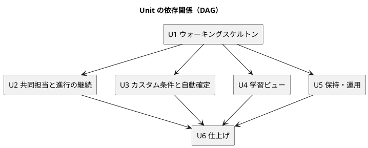

# Unit 定義 - ビールゲームシミュレーション（v2）

## 概要

本書は、beer-game2（v2）の Intent を **Unit**（疎結合・高凝集な作業単位）に分解し、境界、依存、ユーザーストーリーとの対応、評価を定義します。AI-DLC の Inception の成果物で、[リリース計画](../../development/beer-game2/release_plan.md) の入力です。

- 入力: [ユーザーストーリー（v2）](./user_story.md)（15 件）、[システムユースケース（v2）](./system_usecase.md)、[要件定義（v2）](./requirements_definition.md)、設計（[ドメイン](../../design/beer-game2/domain-model.md)、[アーキテクチャ](../../design/beer-game2/architecture-backend.md)）、[ADR](../../adr/beer-game2/index.md)
- 方針: v1 は、UI を最後の Unit（U5）に置いたため、画面が最後まで揃わず、運用の不足（ログ、デプロイ）も後回しになった。**v2 は、縦割り（画面から DB まで）で Unit を切り、観測性とデプロイを最初の Unit に含める。**

## Intent

> 学習用のビールゲームを、複数人で実行し、**役割別に、遅延と意思決定が変動を増幅する過程を振り返れる**、運用できるシステムとして作る（beer-game2）。

### 測定基準（ビジネス意図へのトレース）

| 指標 | 目標 | 対応する Unit |
| :--- | :--- | :--- |
| 1 ゲーム（4 役割、12 週）を、他の役割の非公開情報を見ずに完了できる | 受入テストで 100% | U1 |
| 振り返りで、役割別の注文の推移を比較できる（増幅を確認できる） | 受入条件 AC4.2.1 を満たす | U1（結果の保存）、U4（表示） |
| 同一役割の共同入力で、変更を失わない | 並行テストで失われた更新 0 件 | U2 |
| 研修中の停止を 1 分以内に検知できる | 合成監視とアラームの訓練で確認 | U5 |
| 本番へ自動でデプロイし、直前の版へ戻せる | ステージングでロールバックを毎回確認 | U1（基本）、U5（本番） |
| 15 チーム同時利用で、入力確定 p95 1 秒、反映 p95 2 秒 | 夜間の負荷試験の記録 | U6 |

## Unit の一覧

| Unit | 名称 | 目的 | 含むストーリー | 種別 |
| :--- | :--- | :--- | :--- | :--- |
| U1 | ウォーキングスケルトン | 作成から確定までの最小の縦割りを、実 DB と観測性と CI/CD つきで通す | US1.1（AC1.1.1〜1.1.2）、US1.2（共同担当を除く）、US2.1（AC2.1.1〜2.1.3）、US2.2（AC2.2.1、2.2.2）、US2.3（AC2.3.1〜2.3.5）、US6.1（基本）、US6.2（ステージングまで） | サービス + UI + 基盤 |
| U2 | 共同担当と進行の継続 | 共同入力、停止・代理入力・再開、復帰、資格の期限と失効 | US1.2（AC1.2.4）、US2.1（AC2.1.4）、US2.2（AC2.2.3、2.2.4）、US3.1、US3.2 | サービス + UI |
| U3 | カスタム条件と自動確定 | 設定の拡張（カスタム条件）と、週の自動確定 | US1.1（AC1.1.3〜1.1.6）、US2.4 | サービス + UI |
| U4 | 学習ビュー | 役割別の振り返り、観察者の招待と観察、出力 | US1.3、US4.1、US4.2、US4.3 | サービス + UI |
| U5 | 保持・運用 | カスケード削除、観測の完成（メトリクス、アラーム、合成監視）、本番のデプロイ、復元の訓練 | US5.1、US6.1（完成）、US6.2（本番） | サービス + インフラ |
| U6 | 仕上げ | ヘルプ、アクセシビリティの手動確認、性能・負荷の確認、受入 | 横断の受入条件 X-1〜X-5、US2.x の性能（NF-P1〜P3） | 検証 + UI |

U1 に、**観測性（構造化ログ、`/ready`）と CI/CD（ステージングまで）を含める**ことが、v1 との最大の違いです。以降の Unit は、すべて、観測できて、デプロイできる土台の上で開発します。

## 依存関係（DAG）

- U2、U3、U4、U5 は、U1 の完成後に、互いに依存せず、並列に進められる。体制が 1 人（と AI）の間は、優先順位の順に直列で進める。
- U4 の「役割別の振り返り」は、U1 で保存する役割別の週結果（AC2.3.5）に依存する。
- U5 の本番デプロイは、U1 のステージング、U5 の観測の完成に依存する。

## ストーリーと Unit の対応

| ストーリー | 優先度 | Unit | 備考 |
| :--- | :---: | :--- | :--- |
| US1.1 ゲームを作成する | Must | U1（AC1.1.1、1.1.2）、U3（AC1.1.3〜1.1.6） | キット準拠の作成を先に、カスタム条件を後に |
| US1.2 参加して役割を受け取る | Must | U1（共同担当を除く）、U2（AC1.2.4） | |
| US1.3 観察者を招待する | Should | U4 | |
| US2.1 役割別の週次状況を確認する | Must | U1、U2（AC2.1.4） | |
| US2.2 発注または生産要請を決定する | Must | U1（AC2.2.1、2.2.2）、U2（AC2.2.3、2.2.4） | |
| US2.3 1 週を原子的に確定する | Must | U1 | 役割別の週結果の保存を含む |
| US2.4 週を自動で確定する | Should | U3 | |
| US3.1 停止・代理入力・再開を管理する | Must | U2 | 代理入力の値をイベントに含める |
| US3.2 切断後に同じ役割へ復帰する | Must | U2 | 進行役の復帰、資格の期限と失効 |
| US4.1 公開範囲内でプレイを観察する | Should | U4 | |
| US4.2 終了後に Bullwhip Effect を振り返る | Must | U4 | |
| US4.3 結果を CSV / JSON で出力する | Should | U4 | |
| US5.1 保持期限後にデータを削除する | Must | U5 | |
| US6.1 障害と性能の劣化を検知する | Must | U1（基本）、U5（完成） | |
| US6.2 安全にリリースし、元に戻し、復元する | Must | U1（ステージング）、U5（本番、復元） | |

全 15 ストーリーが、1 つ以上の Unit に割り当てられています。すべての Unit は、1 つ以上のストーリーを持ちます。

## Unit ごとの定義と評価

### 評価の凡例

AI-DLC の「実装エントロピー」の 5 軸を、LOW／MED／HIGH で評価します。HIGH が多い Unit ほど、承認ゲートを密にします。

| 軸 | 問い |
| :--- | :--- |
| 意図の曖昧さ | ストーリーと受入条件は、一意に解釈できるか |
| 構造的不確実性 | 変更対象の構造や境界は、把握できているか |
| 検証の不確実性 | 完了を、テストで判定できるか |
| リスク | セキュリティ・データ・運用への影響は |
| 未解決の仮定 | 置いた仮定は、確認済みか |

### 評価の一覧

| Unit | 意図の曖昧さ | 構造的不確実性 | 検証の不確実性 | リスク | 未解決の仮定 | ゲート密度 | テスト戦略 |
| :--- | :---: | :---: | :---: | :---: | :---: | :--- | :--- |
| U1 | LOW | **HIGH** | LOW | MED | MED | **密**（ウォーキングスケルトンで AI の出力の質を確認する） | Comprehensive（計算・集約）、Standard（他） |
| U2 | MED | **HIGH**（並行性） | MED | **HIGH**（資格） | MED | 密 | Comprehensive（並行性・資格） |
| U3 | MED | MED | LOW | MED | **HIGH**（設定の上限、自動確定の猶予） | 標準 | Standard〜Comprehensive（自動確定の競合） |
| U4 | MED | LOW | LOW | **HIGH**（情報の開示） | MED（公開範囲、観察者の人数） | 標準 | Standard（開示の抑止は Comprehensive） |
| U5 | LOW | MED | MED | **HIGH**（本番、削除） | **HIGH**（体制、通知先、ドメイン） | 密 | Standard（削除の網羅は Comprehensive） |
| U6 | LOW | LOW | MED | LOW | MED | 標準 | Standard |

### U1: ウォーキングスケルトン

| 項目 | 内容 |
| :--- | :--- |
| 目的 | 作成 → 参加 → 役割の割り当て → 開始 → 入力 → 確定 → 状態の表示を、実 DB、構造化ログ、`/ready`、CI/CD（ステージング）つきで、縦に通す |
| 境界 | キット準拠のゲームの作成、参加（1 役割 1 人）、役割の割り当て、開始、意思決定の保存、手動の確定（**役割別の週結果の保存を含む**）、役割別の状態の表示。共同担当、カスタム条件、観察者、削除、本番は含まない |
| 含む設計 | `Game`・`Session` 集約、`simulateWeek`、リポジトリ（版つきの更新）、冪等性、資格の基本（ダイジェスト + 鍵の版 + 起動時の検査）、SSE（版の通知）、URL ルーティング、日本語の表示名、構造化ログ、`/health`・`/ready`、層の依存の lint、CI（検証）、ステージングへの自動デプロイ |
| 成果物 | ステージングで動く、1 ゲームを通せる縦割りのシステム |
| NFR | NF-O1〜NF-O3、NF-O10、NF-S1〜NF-S3、NF-R5〜NF-R7、NF-P12 |
| リスク | 構造の誤り（集約の粒度）、Node 26 / TypeScript 6 / PostgreSQL 18 の組み合わせの未知の不具合 |
| 推奨 Bolt | B1（基盤と縦の最小）、B2（CI/CD とステージング） |

### U2: 共同担当と進行の継続

| 項目 | 内容 |
| :--- | :--- |
| 目的 | 同一役割の共同入力と、進行の継続（停止・代理入力・再開・復帰）、資格の期限と失効 |
| 境界 | 共同担当の割り当てと共同入力（版による競合の検出）、停止・再開・代理入力（入力値をイベントに）、参加者・進行役の復帰、資格の有効期限・失効・再発行、鍵のローテーション |
| 含む設計 | `Game.assign`（複数人）、`Session.submitDecision`（共同）、`CredentialValidity`、鍵の複数の版、専用のレート制限（参加・復帰） |
| NFR | NF-R13（一部）、NF-R14、NF-S3、NF-S4、NF-S11、NF-S19、NF-P13 |
| リスク | 並行性（同時の保存）、資格の設計の誤り（セキュリティ）。有効期間の既定値が未合意 |
| 推奨 Bolt | B4（進行の継続と資格）、B5（共同担当） |

### U3: カスタム条件と自動確定

| 項目 | 内容 |
| :--- | :--- |
| 目的 | カスタム条件の設定と記録、週の自動確定 |
| 境界 | 初期在庫・遅延・費用単価・公開範囲の設定、`KitPreset`（準拠かカスタムかの判定）、可変の遅延に対応した `simulateWeek`、確定方式（MANUAL / AUTO）、自動確定 |
| 含む設計 | `GameSettings`、`KitPreset`、`Session.submitDecision` 内の自動確定、`AutoCommitChanged` |
| NFR | NF-R13、NF-P14 |
| リスク | 設定の上限が未決、自動確定の猶予が未決、手動・自動の競合 |
| 推奨 Bolt | B6（カスタム条件）、B7（自動確定） |

### U4: 学習ビュー

| 項目 | 内容 |
| :--- | :--- |
| 目的 | 役割別の振り返り（ブルウィップ効果の可視化）、観察者の招待と観察、出力 |
| 境界 | 役割別の時系列（指標・役割の切り替え、グラフと表）、観察用の招待（発行・失効・参加）、観察（公開範囲、抑止）、CSV と JSON の出力（設定・役割別・意思決定・履歴） |
| 含む設計 | `week_role_results` への問い合わせ、`DisclosurePolicy`、`ObserverInvitation`、観察者の権限、出力の成果物 |
| NFR | NF-P8、NF-P9、NF-S17、NF-S18 |
| リスク | 情報の開示（役割別の値や将来の需要の漏れ。最重要）、公開範囲の仕様が未決 |
| 推奨 Bolt | B3（役割別の振り返り）、B8（観察者）、B9（出力） |

### U5: 保持・運用

| 項目 | 内容 |
| :--- | :--- |
| 目的 | カスケード削除、観測の完成、本番のデプロイ、復元の訓練 |
| 境界 | 保持方針と期限検出、`games` のカスケード削除、削除の再試行と通知、受領記録、メトリクス・アラーム・ダッシュボード・合成監視、独自ドメイン・TLS・セキュリティヘッダー、ブルー/グリーン、復元の訓練 |
| 含む設計 | `RetentionSaga`、削除の網羅のテスト、EMF メトリクス、CloudWatch Synthetics、CloudFront のヘッダーポリシー、CodeDeploy |
| NFR | NF-S9、NF-S15、NF-S16、NF-O4、NF-O5、NF-O11、NF-R1〜NF-R4、NF-R8 |
| リスク | 本番の設定（誤ると影響が大きい）、独自ドメインの取得（組織の判断）、通知先・体制が未決 |
| 推奨 Bolt | B10（保持と削除）、B11（観測の完成）、B12（本番） |

### U6: 仕上げ

| 項目 | 内容 |
| :--- | :--- |
| 目的 | ヘルプ、アクセシビリティの手動確認、性能・負荷の確認、受入 |
| 境界 | ヘルプ画面、狭い画面の案内、スクリーンリーダーでの確認、ブラウザ行列、実 DB での負荷試験と確定から反映までの計測、受入テスト（要件定義の受入れの判断基準） |
| NFR | NF-P1〜NF-P3、NF-U2、NF-U4、NF-C1〜NF-C3 |
| 推奨 Bolt | B13 |

## 未決事項（Unit の着手前に決める）

| # | 事項 | 影響する Unit | 決める時期 |
| :--- | :--- | :--- | :--- |
| 1 | 資格の有効期間の既定値（ブラウザセッション、復帰資格、進行役の資格、観察用の招待） | U2 | B4 の前 |
| 2 | 設定の上限（初期在庫、遅延、費用単価）と、遅延のカスタム範囲 | U3 | B6 の前 |
| 3 | 自動確定の猶予の要否 | U3 | B7 の前 |
| 4 | 公開範囲の選択肢の一覧、観察者の人数の上限、観察者の表示名の要否 | U4 | B8 の前 |
| 5 | 独自ドメインの取得と、DNS の管理者 | U5 | B12 の前（遅くとも B10） |
| 6 | オンコールの体制、通知先、研修日時を運用側へ伝える手順 | U5 | B11 の前 |
| 7 | SLO・保持などの数値目標の、運営者との合意 | U5、U6 | B11 の前 |

## 出典

- [ユーザーストーリー（v2）](./user_story.md)、[システムユースケース（v2）](./system_usecase.md)、[要件定義（v2）](./requirements_definition.md)
- [ドメインモデル（v2）](../../design/beer-game2/domain-model.md)、[非機能要件（v2）](../../design/beer-game2/non-functional.md)、[ADR](../../adr/beer-game2/index.md)
- [リリース・イテレーション計画ガイド（AI-DLC 版）](../../reference/リリース・イテレーション計画ガイド_AI-DLC版.md)
- v1 の Unit: `aidlc/spaces/default/intents/261027-beer-game-development/inception/units-generation/unit-of-work.md`
